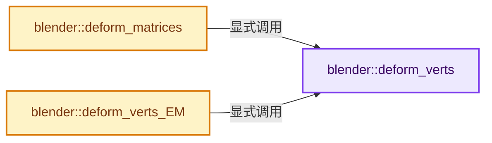
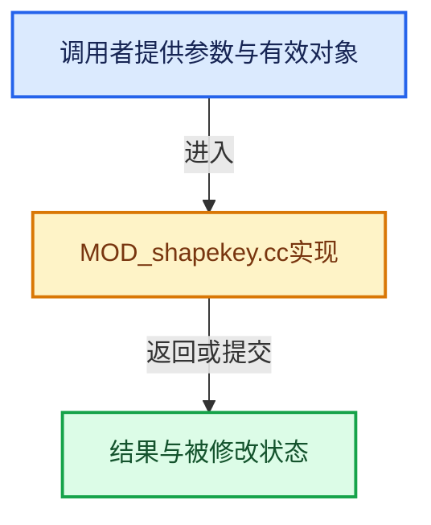

# 实现依赖专题：source/blender/modifiers/intern/MOD_shapekey.cc

[实现依赖导航](../../../README.md) · [符号索引](../../../../00-课程指南/02-源码与提交索引/符号依赖与实现索引.md)

本专题从正文实际调用进入，集中保存共享实现。函数有稳定锚点，可从调用处直接跳到对应完整函数；递归与互相调用通过回链组织。

## 本文件的实现关系






## 完整成员与函数实现

<a id="f-28f15a07a028259a"></a>

### `blender::deform_verts`

实现位置：[source/blender/modifiers/intern/MOD_shapekey.cc](../../../../../../../../source/blender/modifiers/intern/MOD_shapekey.cc) · L26—L42。

接口参数：

- `ModifierData *`
- `const ModifierEvalContext *ctx`
- `Mesh *`
- `MutableSpan<float3> positions`

**教学注释版**

<!-- annotated:f6e8428f91fe64 -->

```cpp
static void deform_verts(ModifierData * /*md*/,
                         const ModifierEvalContext *ctx,
                         Mesh * /*mesh*/,
                         MutableSpan<float3> positions)
{
  Key *key = BKE_key_from_object(ctx->object);

  if (key && key->block.first_) {
    int deformedVerts_tot;
    BKE_key_evaluate_object_ex(ctx->object,
                               &deformedVerts_tot,
                               // [讲解] positions.data：返回借用范围的地址。
                               reinterpret_cast<float *>(positions.data()),
                               // [讲解] positions.size：查询视图长度或生成对应有效索引区间。
                               sizeof(float3) * positions.size(),
                               std::nullopt,
                               nullptr);
  }
}
```

<details>
<summary>核对原始源码：source/blender/modifiers/intern/MOD_shapekey.cc · L26—L42</summary>

<!-- original:f6e8428f91fe64:source/blender/modifiers/intern/MOD_shapekey.cc:26:42 -->

```cpp
static void deform_verts(ModifierData * /*md*/,
                         const ModifierEvalContext *ctx,
                         Mesh * /*mesh*/,
                         MutableSpan<float3> positions)
{
  Key *key = BKE_key_from_object(ctx->object);

  if (key && key->block.first_) {
    int deformedVerts_tot;
    BKE_key_evaluate_object_ex(ctx->object,
                               &deformedVerts_tot,
                               reinterpret_cast<float *>(positions.data()),
                               sizeof(float3) * positions.size(),
                               std::nullopt,
                               nullptr);
  }
}
```

</details>

**继续追踪实现**

- `BKE_key_from_object` → [blender::BKE_key_from_object · L1311](../../../02-BKE几何与数据/intern/key.cc.md#f-c191304ae3a652d6)。
- `BKE_key_evaluate_object_ex` → [blender::BKE_key_evaluate_object_ex · L1009](../../../02-BKE几何与数据/intern/key.cc.md#f-2ee933fd9371726a)。
- `positions.data` → [blender::MutableSpan::data · L545](../../../../01-基础容器与现代CPP/06-MutableSpan可写视图.md#f-eb45a6e4d8211efd)；[blender::gpu::shader::parser::MutableSpan::data · L82](../../gpu/shader_tool/utils.hh.md#f-ad0a09cec9741c65)。同名重载需按实参类型选择。
- `positions.size` → [blender::MutableSpan::size · L499](../../../../01-基础容器与现代CPP/06-MutableSpan可写视图.md#f-1de6a66839c304a8)；[blender::gpu::shader::parser::MutableSpan::size · L87](../../gpu/shader_tool/utils.hh.md#f-5e684af6ee7990e9)。同名重载需按实参类型选择。

<a id="f-505b228175c965f9"></a>

### `blender::deform_matrices`

实现位置：[source/blender/modifiers/intern/MOD_shapekey.cc](../../../../../../../../source/blender/modifiers/intern/MOD_shapekey.cc) · L44—L70。

接口参数：

- `ModifierData *md`
- `const ModifierEvalContext *ctx`
- `Mesh *mesh`
- `MutableSpan<float3> positions`
- `MutableSpan<float3x3> matrices`

**教学注释版**

<!-- annotated:be50a59f023067 -->

```cpp
static void deform_matrices(ModifierData *md,
                            const ModifierEvalContext *ctx,
                            Mesh *mesh,
                            MutableSpan<float3> positions,
                            MutableSpan<float3x3> matrices)
{
  Key *key = BKE_key_from_object(ctx->object);
  KeyBlock *kb = BKE_keyblock_from_object(ctx->object);

  // [讲解] positions.size：查询视图长度或生成对应有效索引区间。
  if (kb && kb->totelem == positions.size() && kb != key->refkey) {
    float scale[3][3];
    int a;

    if (ctx->object->shapeflag & OB_SHAPE_LOCK) {
      scale_m3_fl(scale, 1);
    }
    else {
      scale_m3_fl(scale, kb->curval);
    }

    for (a = 0; a < positions.size(); a++) {
      copy_m3_m3(matrices[a].ptr(), scale);
    }
  }

  deform_verts(md, ctx, mesh, positions);
}
```

<details>
<summary>核对原始源码：source/blender/modifiers/intern/MOD_shapekey.cc · L44—L70</summary>

<!-- original:be50a59f023067:source/blender/modifiers/intern/MOD_shapekey.cc:44:70 -->

```cpp
static void deform_matrices(ModifierData *md,
                            const ModifierEvalContext *ctx,
                            Mesh *mesh,
                            MutableSpan<float3> positions,
                            MutableSpan<float3x3> matrices)
{
  Key *key = BKE_key_from_object(ctx->object);
  KeyBlock *kb = BKE_keyblock_from_object(ctx->object);

  if (kb && kb->totelem == positions.size() && kb != key->refkey) {
    float scale[3][3];
    int a;

    if (ctx->object->shapeflag & OB_SHAPE_LOCK) {
      scale_m3_fl(scale, 1);
    }
    else {
      scale_m3_fl(scale, kb->curval);
    }

    for (a = 0; a < positions.size(); a++) {
      copy_m3_m3(matrices[a].ptr(), scale);
    }
  }

  deform_verts(md, ctx, mesh, positions);
}
```

</details>

**继续追踪实现**

- `BKE_key_from_object` → [blender::BKE_key_from_object · L1311](../../../02-BKE几何与数据/intern/key.cc.md#f-c191304ae3a652d6)。
- `BKE_keyblock_from_object` → [blender::BKE_keyblock_from_object · L1407](../../../02-BKE几何与数据/intern/key.cc.md#f-0b20126f099723f9)。
- `positions.size` → [blender::MutableSpan::size · L499](../../../../01-基础容器与现代CPP/06-MutableSpan可写视图.md#f-1de6a66839c304a8)；[blender::gpu::shader::parser::MutableSpan::size · L87](../../gpu/shader_tool/utils.hh.md#f-5e684af6ee7990e9)。同名重载需按实参类型选择。
- `scale_m3_fl` → [blender::scale_m3_fl · L2090](../../../01-BLI基础库/intern/math_matrix_c.cc.md#f-765dcf3106554985)。
- `copy_m3_m3` → [blender::copy_m3_m3 · L78](../../../01-BLI基础库/intern/math_matrix_c.cc.md#f-c73aa9bdf12f5c76)。
- `matrices[a].ptr` → [调用协议](../../../../00-课程指南/01-路线与规范/模板宏与动态分派协议.md)：接收对象类型依赖auto、返回值或模板实例；不按同名猜测目标。调用位置L65。
- `deform_verts` → [blender::deform_verts · L26](MOD_shapekey.cc.md#f-28f15a07a028259a)。

<a id="f-84ba6503394dc262"></a>

### `blender::deform_verts_EM`

实现位置：[source/blender/modifiers/intern/MOD_shapekey.cc](../../../../../../../../source/blender/modifiers/intern/MOD_shapekey.cc) · L72—L83。

接口参数：

- `ModifierData *md`
- `const ModifierEvalContext *ctx`
- `const BMEditMesh *`
- `Mesh *mesh`
- `MutableSpan<float3> positions`

**教学注释版**

<!-- annotated:aa3a320b810f34 -->

```cpp
static void deform_verts_EM(ModifierData *md,
                            const ModifierEvalContext *ctx,
                            const BMEditMesh * /*em*/,
                            Mesh *mesh,
                            MutableSpan<float3> positions)
{
  Key *key = BKE_key_from_object(ctx->object);

  if (key && key->type == KEY_RELATIVE) {
    deform_verts(md, ctx, mesh, positions);
  }
}
```

<details>
<summary>核对原始源码：source/blender/modifiers/intern/MOD_shapekey.cc · L72—L83</summary>

<!-- original:aa3a320b810f34:source/blender/modifiers/intern/MOD_shapekey.cc:72:83 -->

```cpp
static void deform_verts_EM(ModifierData *md,
                            const ModifierEvalContext *ctx,
                            const BMEditMesh * /*em*/,
                            Mesh *mesh,
                            MutableSpan<float3> positions)
{
  Key *key = BKE_key_from_object(ctx->object);

  if (key && key->type == KEY_RELATIVE) {
    deform_verts(md, ctx, mesh, positions);
  }
}
```

</details>

**继续追踪实现**

- `BKE_key_from_object` → [blender::BKE_key_from_object · L1311](../../../02-BKE几何与数据/intern/key.cc.md#f-c191304ae3a652d6)。
- `deform_verts` → [blender::deform_verts · L26](MOD_shapekey.cc.md#f-28f15a07a028259a)。
