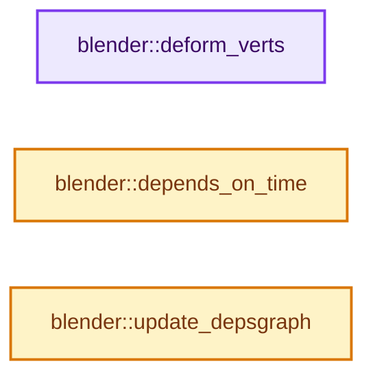
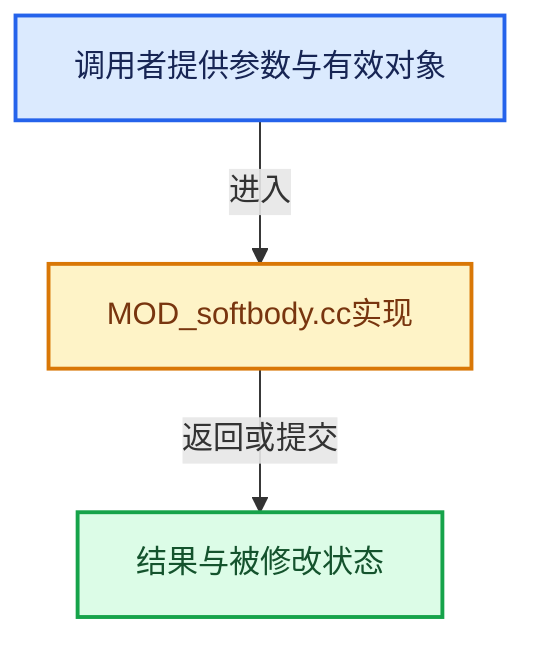

# 实现依赖专题：source/blender/modifiers/intern/MOD_softbody.cc

[实现依赖导航](../../../README.md) · [符号索引](../../../../00-课程指南/02-源码与提交索引/符号依赖与实现索引.md)

本专题从正文实际调用进入，集中保存共享实现。函数有稳定锚点，可从调用处直接跳到对应完整函数；递归与互相调用通过回链组织。

## 本文件的实现关系






## 完整成员与函数实现

<a id="f-ec3526265f5cd79f"></a>

### `blender::deform_verts`

实现位置：[source/blender/modifiers/intern/MOD_softbody.cc](../../../../../../../../source/blender/modifiers/intern/MOD_softbody.cc) · L31—L43。

接口参数：

- `ModifierData *`
- `const ModifierEvalContext *ctx`
- `Mesh *`
- `MutableSpan<float3> positions`

**教学注释版**

<!-- annotated:fe7b2e71c164a7 -->

```cpp
static void deform_verts(ModifierData * /*md*/,
                         const ModifierEvalContext *ctx,
                         Mesh * /*mesh*/,
                         MutableSpan<float3> positions)
{
  Scene *scene = DEG_get_evaluated_scene(ctx->depsgraph);
  sbObjectStep(ctx->depsgraph,
               scene,
               ctx->object,
               DEG_get_ctime(ctx->depsgraph),
               // [讲解] positions.data：返回借用范围的地址。
               reinterpret_cast<float (*)[3]>(positions.data()),
               // [讲解] positions.size：查询视图长度或生成对应有效索引区间。
               positions.size());
}
```

<details>
<summary>核对原始源码：source/blender/modifiers/intern/MOD_softbody.cc · L31—L43</summary>

<!-- original:fe7b2e71c164a7:source/blender/modifiers/intern/MOD_softbody.cc:31:43 -->

```cpp
static void deform_verts(ModifierData * /*md*/,
                         const ModifierEvalContext *ctx,
                         Mesh * /*mesh*/,
                         MutableSpan<float3> positions)
{
  Scene *scene = DEG_get_evaluated_scene(ctx->depsgraph);
  sbObjectStep(ctx->depsgraph,
               scene,
               ctx->object,
               DEG_get_ctime(ctx->depsgraph),
               reinterpret_cast<float (*)[3]>(positions.data()),
               positions.size());
}
```

</details>

**继续追踪实现**

- `DEG_get_evaluated_scene` → [blender::DEG_get_evaluated_scene · L212](../../../06-Depsgraph依赖图/intern/depsgraph_query.cc.md#f-be7729d26a71d3fd)。
- `sbObjectStep` → [blender::sbObjectStep · L3514](../../../02-BKE几何与数据/intern/softbody.cc.md#f-42319d46566a3f3b)。
- `DEG_get_ctime` → [blender::DEG_get_ctime · L105](../../../06-Depsgraph依赖图/intern/depsgraph_query.cc.md#f-156dee0918a22f2f)。
- `positions.data` → [blender::MutableSpan::data · L545](../../../../01-基础容器与现代CPP/06-MutableSpan可写视图.md#f-eb45a6e4d8211efd)；[blender::gpu::shader::parser::MutableSpan::data · L82](../../gpu/shader_tool/utils.hh.md#f-ad0a09cec9741c65)。同名重载需按实参类型选择。
- `positions.size` → [blender::MutableSpan::size · L499](../../../../01-基础容器与现代CPP/06-MutableSpan可写视图.md#f-1de6a66839c304a8)；[blender::gpu::shader::parser::MutableSpan::size · L87](../../gpu/shader_tool/utils.hh.md#f-5e684af6ee7990e9)。同名重载需按实参类型选择。

<a id="f-2e044e08636ab602"></a>

### `blender::depends_on_time`

实现位置：[source/blender/modifiers/intern/MOD_softbody.cc](../../../../../../../../source/blender/modifiers/intern/MOD_softbody.cc) · L45—L48。

接口参数：

- `Scene *`
- `ModifierData *`

**教学注释版**

<!-- annotated:81ab26596c2bca -->

```cpp
static bool depends_on_time(Scene * /*scene*/, ModifierData * /*md*/)
{
  return true;
}
```

<details>
<summary>核对原始源码：source/blender/modifiers/intern/MOD_softbody.cc · L45—L48</summary>

<!-- original:81ab26596c2bca:source/blender/modifiers/intern/MOD_softbody.cc:45:48 -->

```cpp
static bool depends_on_time(Scene * /*scene*/, ModifierData * /*md*/)
{
  return true;
}
```

</details>

**结果出口**

- `return true;`

**继续追踪实现**

本实现没有需要继续展开的显式调用；检查返回表达式、对象转换和调用者前置条件。

<a id="f-7d04637837cfabe8"></a>

### `blender::update_depsgraph`

实现位置：[source/blender/modifiers/intern/MOD_softbody.cc](../../../../../../../../source/blender/modifiers/intern/MOD_softbody.cc) · L50—L65。

接口参数：

- `ModifierData *`
- `const ModifierUpdateDepsgraphContext *ctx`

**教学注释版**

<!-- annotated:71d7942746eabb -->

```cpp
static void update_depsgraph(ModifierData * /*md*/, const ModifierUpdateDepsgraphContext *ctx)
{
  if (ctx->object->soft) {
    /* Actual code uses ccd_build_deflector_hash */
    DEG_add_collision_relations(ctx->node,
                                ctx->object,
                                ctx->object->soft->collision_group,
                                eModifierType_Collision,
                                nullptr,
                                "Softbody Collision");
    DEG_add_forcefield_relations(
        ctx->node, ctx->object, ctx->object->soft->effector_weights, true, 0, "Softbody Field");
  }
  /* We need our own transformation as well. */
  DEG_add_depends_on_transform_relation(ctx->node, "SoftBody Modifier");
}
```

<details>
<summary>核对原始源码：source/blender/modifiers/intern/MOD_softbody.cc · L50—L65</summary>

<!-- original:71d7942746eabb:source/blender/modifiers/intern/MOD_softbody.cc:50:65 -->

```cpp
static void update_depsgraph(ModifierData * /*md*/, const ModifierUpdateDepsgraphContext *ctx)
{
  if (ctx->object->soft) {
    /* Actual code uses ccd_build_deflector_hash */
    DEG_add_collision_relations(ctx->node,
                                ctx->object,
                                ctx->object->soft->collision_group,
                                eModifierType_Collision,
                                nullptr,
                                "Softbody Collision");
    DEG_add_forcefield_relations(
        ctx->node, ctx->object, ctx->object->soft->effector_weights, true, 0, "Softbody Field");
  }
  /* We need our own transformation as well. */
  DEG_add_depends_on_transform_relation(ctx->node, "SoftBody Modifier");
}
```

</details>

**继续追踪实现**

- `DEG_add_collision_relations` → [blender::DEG_add_collision_relations · L112](../../../06-Depsgraph依赖图/intern/depsgraph_physics.cc.md#f-a8a23fb36db5feb5)。
- `DEG_add_forcefield_relations` → [blender::DEG_add_forcefield_relations · L203](../../../06-Depsgraph依赖图/intern/depsgraph_physics.cc.md#f-1a87e7be20724278)。
- `DEG_add_depends_on_transform_relation` → [blender::DEG_add_depends_on_transform_relation · L240](../../../06-Depsgraph依赖图/intern/depsgraph_build.cc.md#f-47c32a354defa20d)。
