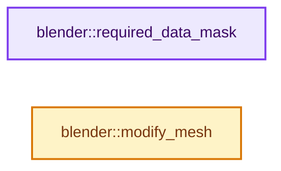
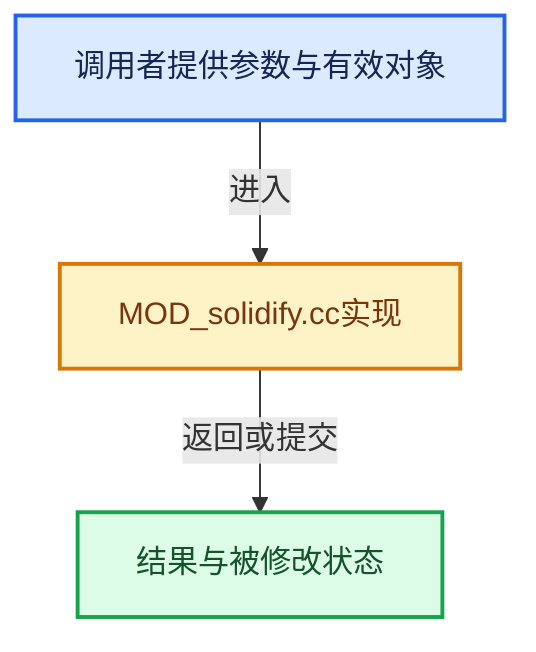

# 实现依赖专题：source/blender/modifiers/intern/MOD_solidify.cc

[实现依赖导航](../../../README.md) · [符号索引](../../../../00-课程指南/02-源码与提交索引/符号依赖与实现索引.md)

本专题从正文实际调用进入，集中保存共享实现。函数有稳定锚点，可从调用处直接跳到对应完整函数；递归与互相调用通过回链组织。

## 本文件的实现关系






## 完整成员与函数实现

<a id="f-bf8787cd02632a3e"></a>

### `blender::required_data_mask`

实现位置：[source/blender/modifiers/intern/MOD_solidify.cc](../../../../../../../../source/blender/modifiers/intern/MOD_solidify.cc) · L44—L54。

接口参数：

- `ModifierData *md`
- `CustomData_MeshMasks *r_cddata_masks`

**教学注释版**

<!-- annotated:4509f176f2c383 -->

```cpp
static void required_data_mask(ModifierData *md, CustomData_MeshMasks *r_cddata_masks)
{
  SolidifyModifierData *smd = reinterpret_cast<SolidifyModifierData *>(md);

  /* Ask for vertex-groups if we need them. */
  if (smd->defgrp_name[0] != '\0' || smd->shell_defgrp_name[0] != '\0' ||
      smd->rim_defgrp_name[0] != '\0')
  {
    r_cddata_masks->vmask |= CD_MASK_MDEFORMVERT;
  }
}
```

<details>
<summary>核对原始源码：source/blender/modifiers/intern/MOD_solidify.cc · L44—L54</summary>

<!-- original:4509f176f2c383:source/blender/modifiers/intern/MOD_solidify.cc:44:54 -->

```cpp
static void required_data_mask(ModifierData *md, CustomData_MeshMasks *r_cddata_masks)
{
  SolidifyModifierData *smd = reinterpret_cast<SolidifyModifierData *>(md);

  /* Ask for vertex-groups if we need them. */
  if (smd->defgrp_name[0] != '\0' || smd->shell_defgrp_name[0] != '\0' ||
      smd->rim_defgrp_name[0] != '\0')
  {
    r_cddata_masks->vmask |= CD_MASK_MDEFORMVERT;
  }
}
```

</details>

**沿实际写入检查状态**

- `r_cddata_masks->vmask |= CD_MASK_MDEFORMVERT;`

**继续追踪实现**

本实现没有需要继续展开的显式调用；检查返回表达式、对象转换和调用者前置条件。

<a id="f-8b40cd9373c9beba"></a>

### `blender::modify_mesh`

实现位置：[source/blender/modifiers/intern/MOD_solidify.cc](../../../../../../../../source/blender/modifiers/intern/MOD_solidify.cc) · L56—L68。

接口参数：

- `ModifierData *md`
- `const ModifierEvalContext *ctx`
- `Mesh *mesh`

**教学注释版**

<!-- annotated:8e9bf54935637f -->

```cpp
static Mesh *modify_mesh(ModifierData *md, const ModifierEvalContext *ctx, Mesh *mesh)
{
  const SolidifyModifierData *smd = reinterpret_cast<SolidifyModifierData *>(md);
  switch (smd->mode) {
    case MOD_SOLIDIFY_MODE_EXTRUDE:
      return MOD_solidify_extrude_modifyMesh(md, ctx, mesh);
    case MOD_SOLIDIFY_MODE_NONMANIFOLD:
      return MOD_solidify_nonmanifold_modifyMesh(md, ctx, mesh);
    default:
      BLI_assert_unreachable();
  }
  return mesh;
}
```

<details>
<summary>核对原始源码：source/blender/modifiers/intern/MOD_solidify.cc · L56—L68</summary>

<!-- original:8e9bf54935637f:source/blender/modifiers/intern/MOD_solidify.cc:56:68 -->

```cpp
static Mesh *modify_mesh(ModifierData *md, const ModifierEvalContext *ctx, Mesh *mesh)
{
  const SolidifyModifierData *smd = reinterpret_cast<SolidifyModifierData *>(md);
  switch (smd->mode) {
    case MOD_SOLIDIFY_MODE_EXTRUDE:
      return MOD_solidify_extrude_modifyMesh(md, ctx, mesh);
    case MOD_SOLIDIFY_MODE_NONMANIFOLD:
      return MOD_solidify_nonmanifold_modifyMesh(md, ctx, mesh);
    default:
      BLI_assert_unreachable();
  }
  return mesh;
}
```

</details>

**结果出口**

- `return MOD_solidify_extrude_modifyMesh(md, ctx, mesh);`
- `return MOD_solidify_nonmanifold_modifyMesh(md, ctx, mesh);`
- `return mesh;`

**继续追踪实现**

- `MOD_solidify_extrude_modifyMesh` → [blender::MOD_solidify_extrude_modifyMesh · L150](MOD_solidify_extrude.cc.md#f-97bf50510a051cb6)。
- `MOD_solidify_nonmanifold_modifyMesh` → [blender::MOD_solidify_nonmanifold_modifyMesh · L138](MOD_solidify_nonmanifold.cc.md#f-bcc7c85d74feac27)。
- `BLI_assert_unreachable` → [BLI_assert_unreachable · L77](../../../01-BLI基础库/BLI_assert.hh.md#m-7a2d91a67d8e)。宏定义由构建条件选择。
