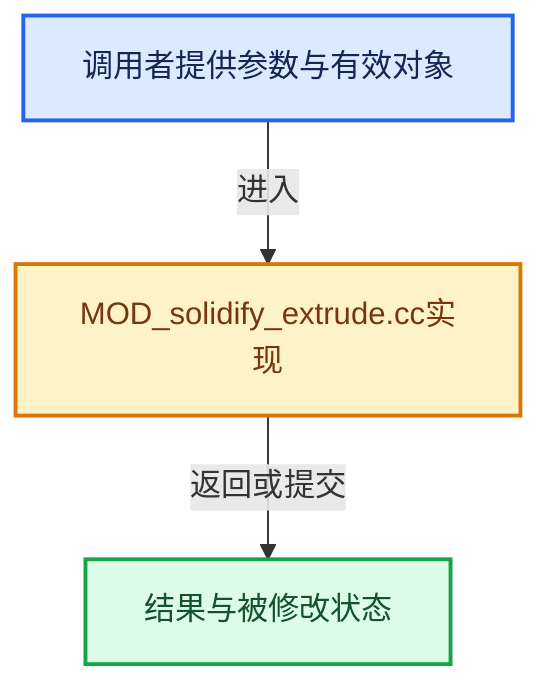

# 实现依赖专题：source/blender/modifiers/intern/MOD_solidify_extrude.cc

[实现依赖导航](../../../README.md) · [符号索引](../../../../00-课程指南/02-源码与提交索引/符号依赖与实现索引.md)

本专题从正文实际调用进入，集中保存共享实现。函数有稳定锚点，可从调用处直接跳到对应完整函数；递归与互相调用通过回链组织。

## 本文件的实现关系





## 完整成员与函数实现

<a id="f-6cff2d27540652c7"></a>

### `blender::edgeref_is_init`

实现位置：[source/blender/modifiers/intern/MOD_solidify_extrude.cc](../../../../../../../../source/blender/modifiers/intern/MOD_solidify_extrude.cc) · L50—L53。

接口参数：

- `const EdgeFaceRef *edge_ref`

**教学注释版**

<!-- annotated:c86dc22211bc2d -->

```cpp
BLI_INLINE bool edgeref_is_init(const EdgeFaceRef *edge_ref)
{
  return !((edge_ref->p1 == 0) && (edge_ref->p2 == 0));
}
```

<details>
<summary>核对原始源码：source/blender/modifiers/intern/MOD_solidify_extrude.cc · L50—L53</summary>

<!-- original:c86dc22211bc2d:source/blender/modifiers/intern/MOD_solidify_extrude.cc:50:53 -->

```cpp
BLI_INLINE bool edgeref_is_init(const EdgeFaceRef *edge_ref)
{
  return !((edge_ref->p1 == 0) && (edge_ref->p2 == 0));
}
```

</details>

**结果出口**

- `return !((edge_ref->p1 == 0) && (edge_ref->p2 == 0));`

**继续追踪实现**

本实现没有需要继续展开的显式调用；检查返回表达式、对象转换和调用者前置条件。

<a id="f-26364ff29c574345"></a>

### `blender::mesh_calc_hq_normal`

实现位置：[source/blender/modifiers/intern/MOD_solidify_extrude.cc](../../../../../../../../source/blender/modifiers/intern/MOD_solidify_extrude.cc) · L60—L141。

接口参数：

- `Mesh *mesh`
- `const Span<float3> face_normals`
- `float (*r_vert_nors)[3]`
- `USE_NONMANIFOLD_WORKAROUND
                                 BLI_bitmap *edge_tmp_tag`

**教学注释版**

<!-- annotated:6d2ff287435793 -->

```cpp
static void mesh_calc_hq_normal(Mesh *mesh,
                                const Span<float3> face_normals,
                                float (*r_vert_nors)[3],
#ifdef USE_NONMANIFOLD_WORKAROUND
                                BLI_bitmap *edge_tmp_tag
#endif
)
{
  const int verts_num = mesh->verts_num;
  const Span<int2> edges = mesh->edges();
  const OffsetIndices faces = mesh->faces();
  const Span<int> corner_edges = mesh->corner_edges();

  {
    // [讲解] edges.size：查询视图长度或生成对应有效索引区间。
    EdgeFaceRef *edge_ref_array = MEM_new_array_zeroed<EdgeFaceRef>(edges.size(), __func__);
    EdgeFaceRef *edge_ref;
    float edge_normal[3];

    /* Add an edge reference if it's not there, pointing back to the face index. */
    for (const int i : faces.index_range()) {
      // [讲解] corner_edges.slice：建立原连续范围的子视图。
      for (const int edge_i : corner_edges.slice(faces[i])) {
        /* --- add edge ref to face --- */
        edge_ref = &edge_ref_array[edge_i];
        if (!edgeref_is_init(edge_ref)) {
          edge_ref->p1 = i;
          edge_ref->p2 = -1;
        }
        else if ((edge_ref->p1 != -1) && (edge_ref->p2 == -1)) {
          edge_ref->p2 = i;
        }
        else {
          /* 3+ faces using an edge, we can't handle this usefully */
          edge_ref->p1 = edge_ref->p2 = -1;
#ifdef USE_NONMANIFOLD_WORKAROUND
          BLI_BITMAP_ENABLE(edge_tmp_tag, edge_i);
#endif
        }
        /* --- done --- */
      }
    }

    int i;
    const int2 *edge;
    // [讲解] edges.data：返回借用范围的地址。
    for (i = 0, edge = edges.data(), edge_ref = edge_ref_array; i < edges.size();
         i++, edge++, edge_ref++)
    {
      /* Get the edge vert indices, and edge value (the face indices that use it) */

      if (edgeref_is_init(edge_ref) && (edge_ref->p1 != -1)) {
        if (edge_ref->p2 != -1) {
          /* We have 2 faces using this edge, calculate the edges normal
           * using the angle between the 2 faces as a weighting */
#if 0
          add_v3_v3v3(edge_normal, face_nors[edge_ref->f1], face_nors[edge_ref->f2]);
          normalize_v3_length(
              edge_normal,
              angle_normalized_v3v3(face_nors[edge_ref->f1], face_nors[edge_ref->f2]));
#else
          mid_v3_v3v3_angle_weighted(
              edge_normal, face_normals[edge_ref->p1], face_normals[edge_ref->p2]);
#endif
        }
        else {
          /* only one face attached to that edge */
          /* an edge without another attached- the weight on this is undefined */
          copy_v3_v3(edge_normal, face_normals[edge_ref->p1]);
        }
        add_v3_v3(r_vert_nors[(*edge)[0]], edge_normal);
        add_v3_v3(r_vert_nors[(*edge)[1]], edge_normal);
      }
    }
    MEM_delete(edge_ref_array);
  }

  /* normalize vertex normals and assign */
  const Span<float3> vert_normals = mesh->vert_normals_true();
  for (int i = 0; i < verts_num; i++) {
    if (normalize_v3(r_vert_nors[i]) == 0.0f) {
      copy_v3_v3(r_vert_nors[i], vert_normals[i]);
    }
  }
}
```

<details>
<summary>核对原始源码：source/blender/modifiers/intern/MOD_solidify_extrude.cc · L60—L141</summary>

<!-- original:6d2ff287435793:source/blender/modifiers/intern/MOD_solidify_extrude.cc:60:141 -->

```cpp
static void mesh_calc_hq_normal(Mesh *mesh,
                                const Span<float3> face_normals,
                                float (*r_vert_nors)[3],
#ifdef USE_NONMANIFOLD_WORKAROUND
                                BLI_bitmap *edge_tmp_tag
#endif
)
{
  const int verts_num = mesh->verts_num;
  const Span<int2> edges = mesh->edges();
  const OffsetIndices faces = mesh->faces();
  const Span<int> corner_edges = mesh->corner_edges();

  {
    EdgeFaceRef *edge_ref_array = MEM_new_array_zeroed<EdgeFaceRef>(edges.size(), __func__);
    EdgeFaceRef *edge_ref;
    float edge_normal[3];

    /* Add an edge reference if it's not there, pointing back to the face index. */
    for (const int i : faces.index_range()) {
      for (const int edge_i : corner_edges.slice(faces[i])) {
        /* --- add edge ref to face --- */
        edge_ref = &edge_ref_array[edge_i];
        if (!edgeref_is_init(edge_ref)) {
          edge_ref->p1 = i;
          edge_ref->p2 = -1;
        }
        else if ((edge_ref->p1 != -1) && (edge_ref->p2 == -1)) {
          edge_ref->p2 = i;
        }
        else {
          /* 3+ faces using an edge, we can't handle this usefully */
          edge_ref->p1 = edge_ref->p2 = -1;
#ifdef USE_NONMANIFOLD_WORKAROUND
          BLI_BITMAP_ENABLE(edge_tmp_tag, edge_i);
#endif
        }
        /* --- done --- */
      }
    }

    int i;
    const int2 *edge;
    for (i = 0, edge = edges.data(), edge_ref = edge_ref_array; i < edges.size();
         i++, edge++, edge_ref++)
    {
      /* Get the edge vert indices, and edge value (the face indices that use it) */

      if (edgeref_is_init(edge_ref) && (edge_ref->p1 != -1)) {
        if (edge_ref->p2 != -1) {
          /* We have 2 faces using this edge, calculate the edges normal
           * using the angle between the 2 faces as a weighting */
#if 0
          add_v3_v3v3(edge_normal, face_nors[edge_ref->f1], face_nors[edge_ref->f2]);
          normalize_v3_length(
              edge_normal,
              angle_normalized_v3v3(face_nors[edge_ref->f1], face_nors[edge_ref->f2]));
#else
          mid_v3_v3v3_angle_weighted(
              edge_normal, face_normals[edge_ref->p1], face_normals[edge_ref->p2]);
#endif
        }
        else {
          /* only one face attached to that edge */
          /* an edge without another attached- the weight on this is undefined */
          copy_v3_v3(edge_normal, face_normals[edge_ref->p1]);
        }
        add_v3_v3(r_vert_nors[(*edge)[0]], edge_normal);
        add_v3_v3(r_vert_nors[(*edge)[1]], edge_normal);
      }
    }
    MEM_delete(edge_ref_array);
  }

  /* normalize vertex normals and assign */
  const Span<float3> vert_normals = mesh->vert_normals_true();
  for (int i = 0; i < verts_num; i++) {
    if (normalize_v3(r_vert_nors[i]) == 0.0f) {
      copy_v3_v3(r_vert_nors[i], vert_normals[i]);
    }
  }
}
```

</details>

**沿实际写入检查状态**

- `edge_ref = &edge_ref_array[edge_i];`
- `edge_ref->p1 = i;`
- `edge_ref->p2 = -1;`
- `edge_ref->p2 = i;`
- `edge_ref->p1 = edge_ref->p2 = -1;`

**继续追踪实现**

- `mesh->edges` → [Mesh::edges · L1205](../../../../05-几何存储与拓扑映射/03-MPoly迁移与兼容.md#f-7232f6756b674d12)。
- `mesh->faces` → [Mesh::faces · L1217](../../../../05-几何存储与拓扑映射/03-MPoly迁移与兼容.md#f-ea444760154e17b2)。
- `mesh->corner_edges` → [Mesh::corner_edges · L1252](../../../../05-几何存储与拓扑映射/03-MPoly迁移与兼容.md#f-687b790868e7f257)。
- `MEM_new_array_zeroed<EdgeFaceRef>` → [MEM_new_array_zeroed · L566](../../../07-Intern运行时与平台/guardedalloc/MEM_guardedalloc.h.md#f-3a0cf63fb5216500)；[MEM_new_array_zeroed · L119](../../../07-Intern运行时与平台/guardedalloc/intern/mallocn.cc.md#f-6825557da566fdbe)。同名重载需按实参类型选择。
- `edges.size` → [blender::Span::size · L256](../../../../01-基础容器与现代CPP/05-Span只读连续视图.md#f-5f80fa006089c998)。
- `faces.index_range` → [blender::offset_indices::OffsetIndices::index_range · L77](../../../../05-几何存储与拓扑映射/02-OffsetIndices完整接口.md#f-19b5ca1456de007d)。
- `corner_edges.slice` → [blender::Span::slice · L141](../../../../01-基础容器与现代CPP/05-Span只读连续视图.md#f-380a0e8fdcbd53cc)；[blender::Span::slice · L149](../../../../01-基础容器与现代CPP/05-Span只读连续视图.md#f-9b9c15e78dd54eec)。同名重载需按实参类型选择。
- `edgeref_is_init` → [blender::edgeref_is_init · L50](MOD_solidify_extrude.cc.md#f-6cff2d27540652c7)。
- `BLI_BITMAP_ENABLE` → [BLI_BITMAP_ENABLE · L80](../../../01-BLI基础库/BLI_bitmap.hh.md#m-6b0abc936749)。宏定义由构建条件选择。
- `edges.data` → [blender::Span::data · L219](../../../../01-基础容器与现代CPP/05-Span只读连续视图.md#f-10c5889198935800)。
- `add_v3_v3v3` → [blender::add_v3_v3v3 · L300](../../../01-BLI基础库/intern/math_vector_inline.cc.md#f-7343b459d0d3db69)。
- `normalize_v3_length` → [blender::normalize_v3_length · L928](../../../01-BLI基础库/intern/math_vector_inline.cc.md#f-1438a0c9967461de)。
- `angle_normalized_v3v3` → [blender::angle_normalized_v3v3 · L336](../../../01-BLI基础库/intern/math_vector.cc.md#f-46a4c8a9d1ed895e)。
- `mid_v3_v3v3_angle_weighted` → [blender::mid_v3_v3v3_angle_weighted · L227](../../../01-BLI基础库/intern/math_vector.cc.md#f-9b1414134f67d658)。
- `copy_v3_v3` → [blender::copy_v3_v3 · L47](../../../01-BLI基础库/intern/math_vector_inline.cc.md#f-037a0d5fa5060bd6)。
- `add_v3_v3` → [blender::add_v3_v3 · L286](../../../01-BLI基础库/intern/math_vector_inline.cc.md#f-e7930c6fdefe462c)。
- `MEM_delete` → [MEM_delete · L400](../../../07-Intern运行时与平台/guardedalloc/MEM_guardedalloc.h.md#f-9049ffdd1682887c)。
- `mesh->vert_normals_true` → [blender::Mesh::vert_normals_true · L400](../../../../06-隐式共享与缓存系统/08-法线缓存的真实依赖.md#f-9f843a18ab6ce3ef)。
- `normalize_v3` → [blender::normalize_v3 · L933](../../../01-BLI基础库/intern/math_vector_inline.cc.md#f-5f3257e657ef732c)。

<a id="f-97bf50510a051cb6"></a>

### `blender::MOD_solidify_extrude_modifyMesh`

实现位置：[source/blender/modifiers/intern/MOD_solidify_extrude.cc](../../../../../../../../source/blender/modifiers/intern/MOD_solidify_extrude.cc) · L150—L1151。

接口参数：

- `ModifierData *md`
- `const ModifierEvalContext *ctx`
- `Mesh *mesh`

**教学注释版**

<!-- annotated:b47c03cf2e90a6 -->

```cpp
Mesh *MOD_solidify_extrude_modifyMesh(ModifierData *md, const ModifierEvalContext *ctx, Mesh *mesh)
{
  Mesh *result;
  const SolidifyModifierData *smd = reinterpret_cast<SolidifyModifierData *>(md);

  const uint verts_num = uint(mesh->verts_num);
  const uint edges_num = uint(mesh->edges_num);
  const uint faces_num = uint(mesh->faces_num);
  const uint loops_num = uint(mesh->corners_num);
  uint newLoops = 0, newPolys = 0, newEdges = 0, newVerts = 0, rimVerts = 0;

  /* Only use material offsets if we have 2 or more materials. */
  const short mat_nr_max = ctx->object->totcol > 1 ? ctx->object->totcol - 1 : 0;
  const short mat_ofs = mat_nr_max ? smd->mat_ofs : 0;
  const short mat_ofs_rim = mat_nr_max ? smd->mat_ofs_rim : 0;

  /* use for edges */
  /* Over-allocate new_vert_arr, old_vert_arr. */
  uint *new_vert_arr = nullptr;
  STACK_DECLARE(new_vert_arr);

  uint *new_edge_arr = nullptr;
  STACK_DECLARE(new_edge_arr);

  uint *old_vert_arr = MEM_new_array_zeroed<uint>(verts_num, "old_vert_arr in solidify");

  uint *edge_users = nullptr;
  int *edge_order = nullptr;

  float (*vert_nors)[3] = nullptr;
  Span<float3> face_normals;

  const bool need_face_normals = (smd->flag & MOD_SOLIDIFY_NORMAL_CALC) ||
                                 (smd->flag & MOD_SOLIDIFY_EVEN) ||
                                 (smd->flag & MOD_SOLIDIFY_OFFSET_ANGLE_CLAMP) ||
                                 (smd->bevel_convex != 0);

  const float ofs_orig = -(((-smd->offset_fac + 1.0f) * 0.5f) * smd->offset);
  const float ofs_new = smd->offset + ofs_orig;
  const float offset_fac_vg = smd->offset_fac_vg;
  const float offset_fac_vg_inv = 1.0f - smd->offset_fac_vg;
  const float bevel_convex = smd->bevel_convex;
  const bool do_flip = (smd->flag & MOD_SOLIDIFY_FLIP) != 0;
  const bool do_clamp = (smd->offset_clamp != 0.0f);
  const bool do_angle_clamp = do_clamp && (smd->flag & MOD_SOLIDIFY_OFFSET_ANGLE_CLAMP) != 0;
  const bool do_bevel_convex = bevel_convex != 0.0f;
  const bool do_rim = (smd->flag & MOD_SOLIDIFY_RIM) != 0;
  const bool do_shell = !(do_rim && (smd->flag & MOD_SOLIDIFY_NOSHELL) != 0);

  /* weights */
  const MDeformVert *dvert;
  const bool defgrp_invert = (smd->flag & MOD_SOLIDIFY_VGROUP_INV) != 0;
  int defgrp_index;
  const int shell_defgrp_index = BKE_id_defgroup_name_index(&mesh->id, smd->shell_defgrp_name);
  const int rim_defgrp_index = BKE_id_defgroup_name_index(&mesh->id, smd->rim_defgrp_name);

  /* array size is doubled in case of using a shell */
  const uint stride = do_shell ? 2 : 1;

  const Span<float3> vert_normals = mesh->vert_normals_true();

  MOD_get_vgroup(ctx->object, mesh, smd->defgrp_name, &dvert, &defgrp_index);

  const Span<float3> orig_vert_positions = mesh->vert_positions();
  const Span<int2> orig_edges = mesh->edges();
  const OffsetIndices orig_faces = mesh->faces();
  const Span<int> orig_corner_verts = mesh->corner_verts();
  const Span<int> orig_corner_edges = mesh->corner_edges();
  const bke::AttributeAccessor orig_attributes = mesh->attributes();

  if (need_face_normals) {
    /* calculate only face normals */
    face_normals = mesh->face_normals_true();
  }

  STACK_INIT(new_vert_arr, verts_num * 2);
  STACK_INIT(new_edge_arr, edges_num * 2);

  if (do_rim) {
    BLI_bitmap *orig_mvert_tag = BLI_BITMAP_NEW(verts_num, __func__);
    uint eidx;
    uint i;

#define INVALID_UNUSED uint(-1)
#define INVALID_PAIR uint(-2)

    new_vert_arr = MEM_new_array_uninitialized<uint>(2 * verts_num, __func__);
    new_edge_arr = MEM_new_array_uninitialized<uint>(((edges_num * 2) + verts_num), __func__);

    edge_users = MEM_new_array_uninitialized<uint>(edges_num, __func__);
    edge_order = MEM_new_array_uninitialized<int>(edges_num, __func__);

    /* save doing 2 loops here... */
#if 0
    std::fill_n(edge_users, edges_num, INVALID_UNUSED);
#endif

    for (eidx = 0; eidx < edges_num; eidx++) {
      edge_users[eidx] = INVALID_UNUSED;
    }

    for (const int64_t i : orig_faces.index_range()) {
      const IndexRange face = orig_faces[i];
      int j;

      // [讲解] face.last：读取范围两端的有效索引或值。
      int corner_i_prev = face.last();

      // [讲解] face.size：读取连续区间或分组的边界信息。
      for (j = 0; j < face.size(); j++) {
        const int corner_i = face[j];
        const int vert_i = orig_corner_verts[corner_i];
        const int prev_vert_i = orig_corner_verts[corner_i_prev];
        /* add edge user */
        eidx = int(orig_corner_edges[corner_i_prev]);
        if (edge_users[eidx] == INVALID_UNUSED) {
          const int2 &edge = orig_edges[eidx];
          BLI_assert(ELEM(prev_vert_i, edge[0], edge[1]) && ELEM(vert_i, edge[0], edge[1]));
          edge_users[eidx] = (prev_vert_i > vert_i) == (edge[0] < edge[1]) ? uint(i) :
                                                                             (uint(i) + faces_num);
          edge_order[eidx] = j;
        }
        else {
          edge_users[eidx] = INVALID_PAIR;
        }
        corner_i_prev = corner_i;
      }
    }

    for (eidx = 0; eidx < edges_num; eidx++) {
      if (!ELEM(edge_users[eidx], INVALID_UNUSED, INVALID_PAIR)) {
        BLI_BITMAP_ENABLE(orig_mvert_tag, orig_edges[eidx][0]);
        BLI_BITMAP_ENABLE(orig_mvert_tag, orig_edges[eidx][1]);
        STACK_PUSH(new_edge_arr, eidx);
        newPolys++;
        newLoops += 4;
      }
    }

    for (i = 0; i < verts_num; i++) {
      if (BLI_BITMAP_TEST(orig_mvert_tag, i)) {
        old_vert_arr[i] = STACK_SIZE(new_vert_arr);
        STACK_PUSH(new_vert_arr, i);
        rimVerts++;
      }
      else {
        old_vert_arr[i] = INVALID_UNUSED;
      }
    }

    MEM_delete(orig_mvert_tag);
  }

  if (do_shell == false) {
    /* only add rim vertices */
    newVerts = rimVerts;
    /* each extruded face needs an opposite edge */
    newEdges = newPolys;
  }
  else {
    /* (stride == 2) in this case, so no need to add newVerts/newEdges */
    BLI_assert(newVerts == 0);
    BLI_assert(newEdges == 0);
  }

#ifdef USE_NONMANIFOLD_WORKAROUND
  BLI_bitmap *edge_tmp_tag = BLI_BITMAP_NEW(mesh->edges_num, __func__);
#endif

  if (smd->flag & MOD_SOLIDIFY_NORMAL_CALC) {
    vert_nors = MEM_new_array_zeroed<float[3]>(verts_num, __func__);
    mesh_calc_hq_normal(mesh,
                        face_normals,
                        vert_nors
#ifdef USE_NONMANIFOLD_WORKAROUND
                        ,
                        edge_tmp_tag
#endif
    );
  }

  result = BKE_mesh_new_nomain_from_template(mesh,
                                             int((verts_num * stride) + newVerts),
                                             int((edges_num * stride) + newEdges + rimVerts),
                                             int((faces_num * stride) + newPolys),
                                             int((loops_num * stride) + newLoops));

  MutableSpan<float3> vert_positions = result->vert_positions_for_write();
  MutableSpan<int2> edges = result->edges_for_write();
  MutableSpan<int> face_offsets = result->face_offsets_for_write();
  MutableSpan<int> corner_verts = result->corner_verts_for_write();
  MutableSpan<int> corner_edges = result->corner_edges_for_write();
  bke::MutableAttributeAccessor result_attributes = result->attributes_for_write();

  bke::LegacyMeshInterpolator vert_interp(*mesh, *result, bke::AttrDomain::Point);
  bke::LegacyMeshInterpolator edge_interp(*mesh, *result, bke::AttrDomain::Edge);
  bke::LegacyMeshInterpolator face_interp(*mesh, *result, bke::AttrDomain::Face);
  bke::LegacyMeshInterpolator corner_interp(*mesh, *result, bke::AttrDomain::Corner);

  if (do_shell) {
    vert_interp.copy(0, 0, int(verts_num));
    vert_interp.copy(0, int(verts_num), int(verts_num));

    edge_interp.copy(0, 0, int(edges_num));
    edge_interp.copy(0, int(edges_num), int(edges_num));

    corner_interp.copy(0, 0, int(loops_num));
    /* DO NOT copy here the 'copied' part of loop data, we want to reverse loops
     * (so that winding of copied face get reversed, so that normals get reversed
     * and point in expected direction...).
     * If we also copy data here, then this data get overwritten
     * (and allocated memory becomes a memory leak). */

    face_interp.copy(0, 0, int(faces_num));
    face_interp.copy(0, int(faces_num), int(faces_num));
    // [讲解] face_offsets.take_front：从两端裁去或选取一定数量元素形成新视图。
    face_offsets.take_front(faces_num).copy_from(mesh->face_offsets().drop_back(1));
    for (const int i : orig_faces.index_range()) {
      face_offsets[faces_num + i] = orig_faces[i].start() + mesh->corners_num;
    }
  }
  else {
    int i, j;
    vert_interp.copy(0, 0, int(verts_num));
    for (i = 0, j = int(verts_num); i < verts_num; i++) {
      if (old_vert_arr[i] != INVALID_UNUSED) {
        vert_interp.copy(i, j, 1);
        j++;
      }
    }

    edge_interp.copy(0, 0, int(edges_num));

    for (i = 0, j = int(edges_num); i < edges_num; i++) {
      if (!ELEM(edge_users[i], INVALID_UNUSED, INVALID_PAIR)) {
        int2 *ed_src, *ed_dst;
        edge_interp.copy(i, j, 1);

        ed_src = &edges[i];
        ed_dst = &edges[j];
        (*ed_dst)[0] = old_vert_arr[(*ed_src)[0]] + verts_num;
        (*ed_dst)[1] = old_vert_arr[(*ed_src)[1]] + verts_num;
        j++;
      }
    }

    /* will be created later */
    corner_interp.copy(0, 0, int(loops_num));
    face_interp.copy(0, 0, int(faces_num));
    face_offsets.take_front(faces_num).copy_from(mesh->face_offsets().drop_back(1));
  }

  const VArraySpan orig_vert_bweight = *orig_attributes.lookup<float>("bevel_weight_vert",
                                                                      bke::AttrDomain::Point);
  bke::SpanAttributeWriter<float> result_edge_bweight;
  if (orig_attributes.contains("bevel_weight_edge") ||
      (do_bevel_convex || !orig_vert_bweight.is_empty()))
  {
    result_edge_bweight = result_attributes.lookup_or_add_for_write_span<float>(
        "bevel_weight_edge", bke::AttrDomain::Edge);
  }

  /* Initializes: (`i_end`, `do_shell_align`, `vert_index`). */
#define INIT_VERT_ARRAY_OFFSETS(test) \
  if (((ofs_new >= ofs_orig) == do_flip) == test) { \
    i_end = verts_num; \
    do_shell_align = true; \
    vert_index = 0; \
  } \
  else { \
    if (do_shell) { \
      i_end = verts_num; \
      do_shell_align = true; \
    } \
    else { \
      i_end = newVerts; \
      do_shell_align = false; \
    } \
    vert_index = verts_num; \
  } \
  (void)0

  bke::SpanAttributeWriter dst_material_index =
      result_attributes.lookup_or_add_for_write_span<int>("material_index", bke::AttrDomain::Face);

  /* flip normals */

  if (do_shell) {
    for (const int64_t i : IndexRange(mesh->faces_num)) {
      const IndexRange face = orig_faces[i];
      const int loop_end = face.size() - 1;
      int e;
      int j;

      /* reverses the loop direction (corner verts as well as custom-data)
       * Corner edges also need to be corrected too, done in a separate loop below. */
      // [讲解] face.start：读取连续区间或分组的边界信息。
      const int corner_2 = face.start() + mesh->corners_num;
#if 0
      for (j = 0; j < face.size(); j++) {
        corner_interp.copy(face.start() + j, face.start() + (loop_end - j) + mesh->corners_num, 1);
      }
#else
      /* slightly more involved, keep the first vertex the same for the copy,
       * ensures the diagonals in the new face match the original. */
      j = 0;
      for (int j_prev = loop_end; j < face.size(); j_prev = j++) {
        corner_interp.copy(
            face.start() + j, face.start() + (loop_end - j_prev) + mesh->corners_num, 1);
      }
#endif

      if (mat_ofs) {
        dst_material_index.span[faces_num + i] += mat_ofs;
        CLAMP(dst_material_index.span[faces_num + i], 0, mat_nr_max);
      }

      e = corner_edges[corner_2 + 0];
      for (j = 0; j < loop_end; j++) {
        corner_edges[corner_2 + j] = corner_edges[corner_2 + j + 1];
      }
      corner_edges[corner_2 + loop_end] = e;

      for (j = 0; j < face.size(); j++) {
        corner_verts[corner_2 + j] += verts_num;
        corner_edges[corner_2 + j] += edges_num;
      }
    }

    // [讲解] edges.slice：建立原连续范围的子视图。
    for (int2 &edge : edges.slice(edges_num, edges_num)) {
      edge += verts_num;
    }
  }

  /* NOTE: copied vertex layers don't have flipped normals yet. do this after applying offset. */
  if ((smd->flag & MOD_SOLIDIFY_EVEN) == 0) {
    /* no even thickness, very simple */
    float ofs_new_vgroup;

    /* for clamping */
    float *vert_lens = nullptr;
    float *vert_angs = nullptr;
    const float offset = fabsf(smd->offset) * smd->offset_clamp;
    const float offset_sq = offset * offset;

    /* for bevel weight */
    float *edge_angs = nullptr;

    if (do_clamp) {
      vert_lens = MEM_new_array_uninitialized<float>(verts_num, "vert_lens");
      std::fill_n(vert_lens, int(verts_num), FLT_MAX);
      for (uint i = 0; i < edges_num; i++) {
        const float ed_len_sq = len_squared_v3v3(vert_positions[edges[i][0]],
                                                 vert_positions[edges[i][1]]);
        vert_lens[edges[i][0]] = min_ff(vert_lens[edges[i][0]], ed_len_sq);
        vert_lens[edges[i][1]] = min_ff(vert_lens[edges[i][1]], ed_len_sq);
      }
    }

    if (do_angle_clamp || do_bevel_convex) {
      uint eidx;
      if (do_angle_clamp) {
        vert_angs = MEM_new_array_uninitialized<float>(verts_num, "vert_angs");
        std::fill_n(vert_angs, int(verts_num), 0.5f * M_PI);
      }
      if (do_bevel_convex) {
        edge_angs = MEM_new_array_uninitialized<float>(edges_num, "edge_angs");
        if (!do_rim) {
          edge_users = MEM_new_array_uninitialized<uint>(edges_num, "solid_mod edges");
        }
      }
      uint(*edge_user_pairs)[2] = MEM_new_array_uninitialized<uint[2]>(edges_num,
                                                                       "edge_user_pairs");
      for (eidx = 0; eidx < edges_num; eidx++) {
        edge_user_pairs[eidx][0] = INVALID_UNUSED;
        edge_user_pairs[eidx][1] = INVALID_UNUSED;
      }
      for (const int64_t i : orig_faces.index_range()) {
        const IndexRange face = orig_faces[i];
        int prev_corner_i = face.last();
        for (const int corner_i : face) {
          const int vert_i = orig_corner_verts[corner_i];
          const int prev_vert_i = orig_corner_verts[prev_corner_i];
          /* add edge user */
          eidx = orig_corner_edges[prev_corner_i];
          const int2 &ed = orig_edges[eidx];
          BLI_assert(ELEM(prev_vert_i, ed[0], ed[1]) && ELEM(vert_i, ed[0], ed[1]));
          char flip = char((prev_vert_i > vert_i) == (ed[0] < ed[1]));
          if (edge_user_pairs[eidx][flip] == INVALID_UNUSED) {
            edge_user_pairs[eidx][flip] = uint(i);
          }
          else {
            edge_user_pairs[eidx][0] = INVALID_PAIR;
            edge_user_pairs[eidx][1] = INVALID_PAIR;
          }
          prev_corner_i = corner_i;
        }
      }
      float e[3];
      for (uint i = 0; i < edges_num; i++) {
        const int2 &edge = orig_edges[i];
        if (!ELEM(edge_user_pairs[i][0], INVALID_UNUSED, INVALID_PAIR) &&
            !ELEM(edge_user_pairs[i][1], INVALID_UNUSED, INVALID_PAIR))
        {
          const float *n0 = face_normals[edge_user_pairs[i][0]];
          const float *n1 = face_normals[edge_user_pairs[i][1]];
          sub_v3_v3v3(e, orig_vert_positions[edge[0]], orig_vert_positions[edge[1]]);
          normalize_v3(e);
          const float angle = angle_signed_on_axis_v3v3_v3(n0, n1, e);
          if (do_angle_clamp) {
            vert_angs[edge[0]] = max_ff(vert_angs[edge[0]], angle);
            vert_angs[edge[1]] = max_ff(vert_angs[edge[1]], angle);
          }
          if (do_bevel_convex) {
            edge_angs[i] = angle;
            if (!do_rim) {
              edge_users[i] = INVALID_PAIR;
            }
          }
        }
      }
      MEM_delete(edge_user_pairs);
    }

    if (ofs_new != 0.0f) {
      uint i_orig, i_end;
      bool do_shell_align;

      ofs_new_vgroup = ofs_new;

      uint vert_index;
      INIT_VERT_ARRAY_OFFSETS(false);

      for (i_orig = 0; i_orig < i_end; i_orig++, vert_index++) {
        const uint i = do_shell_align ? i_orig : new_vert_arr[i_orig];
        if (dvert) {
          const MDeformVert *dv = &dvert[i];
          if (defgrp_invert) {
            ofs_new_vgroup = 1.0f - BKE_defvert_find_weight(dv, defgrp_index);
          }
          else {
            ofs_new_vgroup = BKE_defvert_find_weight(dv, defgrp_index);
          }
          ofs_new_vgroup = (offset_fac_vg + (ofs_new_vgroup * offset_fac_vg_inv)) * ofs_new;
        }
        if (do_clamp && offset > FLT_EPSILON) {
          /* always reset because we may have set before */
          if (dvert == nullptr) {
            ofs_new_vgroup = ofs_new;
          }
          if (do_angle_clamp) {
            float cos_ang = cosf(((2 * M_PI) - vert_angs[i]) * 0.5f);
            if (cos_ang > 0) {
              float max_off = sqrtf(vert_lens[i]) * 0.5f / cos_ang;
              if (max_off < offset * 0.5f) {
                ofs_new_vgroup *= max_off / offset * 2;
              }
            }
          }
          else {
            if (vert_lens[i] < offset_sq) {
              float scalar = sqrtf(vert_lens[i]) / offset;
              ofs_new_vgroup *= scalar;
            }
          }
        }
        if (vert_nors) {
          madd_v3_v3fl(vert_positions[vert_index], vert_nors[i], ofs_new_vgroup);
        }
        else {
          madd_v3_v3fl(vert_positions[vert_index], vert_normals[i], ofs_new_vgroup);
        }
      }
    }

    if (ofs_orig != 0.0f) {
      uint i_orig, i_end;
      bool do_shell_align;

      ofs_new_vgroup = ofs_orig;

      /* as above but swapped */
      uint vert_index;
      INIT_VERT_ARRAY_OFFSETS(true);

      for (i_orig = 0; i_orig < i_end; i_orig++, vert_index++) {
        const uint i = do_shell_align ? i_orig : new_vert_arr[i_orig];
        if (dvert) {
          const MDeformVert *dv = &dvert[i];
          if (defgrp_invert) {
            ofs_new_vgroup = 1.0f - BKE_defvert_find_weight(dv, defgrp_index);
          }
          else {
            ofs_new_vgroup = BKE_defvert_find_weight(dv, defgrp_index);
          }
          ofs_new_vgroup = (offset_fac_vg + (ofs_new_vgroup * offset_fac_vg_inv)) * ofs_orig;
        }
        if (do_clamp && offset > FLT_EPSILON) {
          /* always reset because we may have set before */
          if (dvert == nullptr) {
            ofs_new_vgroup = ofs_orig;
          }
          if (do_angle_clamp) {
            float cos_ang = cosf(vert_angs[i_orig] * 0.5f);
            if (cos_ang > 0) {
              float max_off = sqrtf(vert_lens[i]) * 0.5f / cos_ang;
              if (max_off < offset * 0.5f) {
                ofs_new_vgroup *= max_off / offset * 2;
              }
            }
          }
          else {
            if (vert_lens[i] < offset_sq) {
              float scalar = sqrtf(vert_lens[i]) / offset;
              ofs_new_vgroup *= scalar;
            }
          }
        }
        if (vert_nors) {
          madd_v3_v3fl(vert_positions[vert_index], vert_nors[i], ofs_new_vgroup);
        }
        else {
          madd_v3_v3fl(vert_positions[vert_index], vert_normals[i], ofs_new_vgroup);
        }
      }
    }

    if (do_bevel_convex) {
      for (uint i = 0; i < edges_num; i++) {
        if (edge_users[i] == INVALID_PAIR) {
          float angle = edge_angs[i];
          result_edge_bweight.span[i] = clamp_f(
              result_edge_bweight.span[i] + (angle < M_PI ? clamp_f(bevel_convex, 0.0f, 1.0f) :
                                                            clamp_f(bevel_convex, -1.0f, 0.0f)),
              0.0f,
              1.0f);
          if (do_shell) {
            result_edge_bweight.span[i + edges_num] = clamp_f(
                result_edge_bweight.span[i + edges_num] + (angle > M_PI ?
                                                               clamp_f(bevel_convex, 0.0f, 1.0f) :
                                                               clamp_f(bevel_convex, -1.0f, 0.0f)),
                0,
                1.0f);
          }
        }
      }
      if (!do_rim) {
        MEM_delete(edge_users);
      }
      MEM_delete(edge_angs);
    }

    if (do_clamp) {
      MEM_delete(vert_lens);
      if (do_angle_clamp) {
        MEM_delete(vert_angs);
      }
    }
  }
  else {
#ifdef USE_NONMANIFOLD_WORKAROUND
    const bool check_non_manifold = (smd->flag & MOD_SOLIDIFY_NORMAL_CALC) != 0;
#endif
    float *vert_angles = MEM_new_array_zeroed<float>(2 * verts_num, "mod_solid_pair"); /* 2 in 1 */
    float *vert_accum = vert_angles + verts_num;
    uint vidx;
    uint i;

    if (vert_nors == nullptr) {
      vert_nors = MEM_new_array_uninitialized<float[3]>(verts_num, "mod_solid_vno");
      for (i = 0; i < verts_num; i++) {
        copy_v3_v3(vert_nors[i], vert_normals[i]);
      }
    }

    for (const int64_t i : IndexRange(faces_num)) {
      const IndexRange face = orig_faces[i];
      /* #bke::mesh::face_angles_calc logic is inlined here */
      float nor_prev[3];
      float nor_next[3];

      int i_curr = face.size() - 1;
      int i_next = 0;

      const int *face_verts = &corner_verts[face.start()];
      const int *face_edges = &corner_edges[face.start()];

      sub_v3_v3v3(
          nor_prev, vert_positions[face_verts[i_curr - 1]], vert_positions[face_verts[i_curr]]);
      normalize_v3(nor_prev);

      while (i_next < face.size()) {
        float angle;
        sub_v3_v3v3(
            nor_next, vert_positions[face_verts[i_curr]], vert_positions[face_verts[i_next]]);
        normalize_v3(nor_next);
        angle = angle_normalized_v3v3(nor_prev, nor_next);

        /* --- not related to angle calc --- */
        // [讲解] std::max：按比较关系选取较大值。本讲解中的增长公式同时满足最低请求和几何增长；若保存返回引用，还需注意实参寿命。
        angle = std::max(angle, FLT_EPSILON);

        vidx = face_verts[i_curr];
        vert_accum[vidx] += angle;

#ifdef USE_NONMANIFOLD_WORKAROUND
        /* skip 3+ face user edges */
        if ((check_non_manifold == false) ||
            LIKELY(!BLI_BITMAP_TEST(edge_tmp_tag, face_edges[i_curr]) &&
                   !BLI_BITMAP_TEST(edge_tmp_tag, face_edges[i_next])))
        {
          vert_angles[vidx] += shell_v3v3_normalized_to_dist(vert_nors[vidx], face_normals[i]) *
                               angle;
        }
        else {
          vert_angles[vidx] += angle;
        }
#else
        vert_angles[vidx] += shell_v3v3_normalized_to_dist(vert_nors[vidx], face_normals[i]) *
                             angle;
#endif
        /* --- end non-angle-calc section --- */

        /* step */
        copy_v3_v3(nor_prev, nor_next);
        i_curr = i_next;
        i_next++;
      }
    }

    /* vertex group support */
    if (dvert) {
      const MDeformVert *dv = dvert;
      float scalar;

      if (defgrp_invert) {
        for (i = 0; i < verts_num; i++, dv++) {
          scalar = 1.0f - BKE_defvert_find_weight(dv, defgrp_index);
          scalar = offset_fac_vg + (scalar * offset_fac_vg_inv);
          vert_angles[i] *= scalar;
        }
      }
      else {
        for (i = 0; i < verts_num; i++, dv++) {
          scalar = BKE_defvert_find_weight(dv, defgrp_index);
          scalar = offset_fac_vg + (scalar * offset_fac_vg_inv);
          vert_angles[i] *= scalar;
        }
      }
    }

    /* for angle clamp */
    float *vert_angs = nullptr;
    /* for bevel convex */
    float *edge_angs = nullptr;

    if (do_angle_clamp || do_bevel_convex) {
      uint eidx;
      if (do_angle_clamp) {
        vert_angs = MEM_new_array_uninitialized<float>(verts_num, "vert_angs even");
        std::fill_n(vert_angs, int(verts_num), 0.5f * M_PI);
      }
      if (do_bevel_convex) {
        edge_angs = MEM_new_array_uninitialized<float>(edges_num, "edge_angs even");
        if (!do_rim) {
          edge_users = MEM_new_array_uninitialized<uint>(edges_num, "solid_mod edges");
        }
      }
      uint(*edge_user_pairs)[2] = MEM_new_array_uninitialized<uint[2]>(edges_num,
                                                                       "edge_user_pairs");
      for (eidx = 0; eidx < edges_num; eidx++) {
        edge_user_pairs[eidx][0] = INVALID_UNUSED;
        edge_user_pairs[eidx][1] = INVALID_UNUSED;
      }
      for (const int i : orig_faces.index_range()) {
        const IndexRange face = orig_faces[i];
        int prev_corner_i = face.start() + face.size() - 1;
        for (int j = 0; j < face.size(); j++) {
          const int corner_i = face.start() + j;
          const int vert_i = orig_corner_verts[corner_i];
          const int prev_vert_i = orig_corner_verts[prev_corner_i];

          /* add edge user */
          eidx = orig_corner_edges[prev_corner_i];
          const int2 &edge = orig_edges[eidx];
          BLI_assert(ELEM(prev_vert_i, edge[0], edge[1]) && ELEM(vert_i, edge[0], edge[1]));
          char flip = char((prev_vert_i > vert_i) == (edge[0] < edge[1]));
          if (edge_user_pairs[eidx][flip] == INVALID_UNUSED) {
            edge_user_pairs[eidx][flip] = uint(i);
          }
          else {
            edge_user_pairs[eidx][0] = INVALID_PAIR;
            edge_user_pairs[eidx][1] = INVALID_PAIR;
          }
          prev_corner_i = corner_i;
        }
      }
      float e[3];
      for (i = 0; i < edges_num; i++) {
        const int2 &edge = orig_edges[i];
        if (!ELEM(edge_user_pairs[i][0], INVALID_UNUSED, INVALID_PAIR) &&
            !ELEM(edge_user_pairs[i][1], INVALID_UNUSED, INVALID_PAIR))
        {
          const float *n0 = face_normals[edge_user_pairs[i][0]];
          const float *n1 = face_normals[edge_user_pairs[i][1]];
          if (do_angle_clamp) {
            const float angle = M_PI - angle_normalized_v3v3(n0, n1);
            vert_angs[edge[0]] = max_ff(vert_angs[edge[0]], angle);
            vert_angs[edge[1]] = max_ff(vert_angs[edge[1]], angle);
          }
          if (do_bevel_convex) {
            sub_v3_v3v3(e, orig_vert_positions[edge[0]], orig_vert_positions[edge[1]]);
            normalize_v3(e);
            edge_angs[i] = angle_signed_on_axis_v3v3_v3(n0, n1, e);
            if (!do_rim) {
              edge_users[i] = INVALID_PAIR;
            }
          }
        }
      }
      MEM_delete(edge_user_pairs);
    }

    if (do_clamp) {
      const float clamp_fac = 1 + (do_angle_clamp ? fabsf(smd->offset_fac) : 0);
      const float offset = fabsf(smd->offset) * smd->offset_clamp * clamp_fac;
      if (offset > FLT_EPSILON) {
        float *vert_lens_sq = MEM_new_array_uninitialized<float>(verts_num, "vert_lens_sq");
        const float offset_sq = offset * offset;
        std::fill_n(vert_lens_sq, int(verts_num), FLT_MAX);
        for (i = 0; i < edges_num; i++) {
          const float ed_len = len_squared_v3v3(vert_positions[edges[i][0]],
                                                vert_positions[edges[i][1]]);
          vert_lens_sq[edges[i][0]] = min_ff(vert_lens_sq[edges[i][0]], ed_len);
          vert_lens_sq[edges[i][1]] = min_ff(vert_lens_sq[edges[i][1]], ed_len);
        }
        if (do_angle_clamp) {
          for (i = 0; i < verts_num; i++) {
            float cos_ang = cosf(vert_angs[i] * 0.5f);
            if (cos_ang > 0) {
              float max_off = sqrtf(vert_lens_sq[i]) * 0.5f / cos_ang;
              if (max_off < offset * 0.5f) {
                vert_angles[i] *= max_off / offset * 2;
              }
            }
          }
          MEM_delete(vert_angs);
        }
        else {
          for (i = 0; i < verts_num; i++) {
            if (vert_lens_sq[i] < offset_sq) {
              float scalar = sqrtf(vert_lens_sq[i]) / offset;
              vert_angles[i] *= scalar;
            }
          }
        }
        MEM_delete(vert_lens_sq);
      }
    }

    if (do_bevel_convex) {
      for (i = 0; i < edges_num; i++) {
        if (edge_users[i] == INVALID_PAIR) {
          float angle = edge_angs[i];
          result_edge_bweight.span[i] = clamp_f(
              result_edge_bweight.span[i] + (angle < M_PI ? clamp_f(bevel_convex, 0.0f, 1.0f) :
                                                            clamp_f(bevel_convex, -1.0f, 0.0f)),
              0.0f,
              1.0f);
          if (do_shell) {
            result_edge_bweight.span[i + edges_num] = clamp_f(
                result_edge_bweight.span[i + edges_num] +
                    (angle > M_PI ? clamp_f(bevel_convex, 0, 1) : clamp_f(bevel_convex, -1, 0)),
                0.0f,
                1.0f);
          }
        }
      }
      if (!do_rim) {
        MEM_delete(edge_users);
      }
      MEM_delete(edge_angs);
    }

#undef INVALID_UNUSED
#undef INVALID_PAIR

    if (ofs_new != 0.0f) {
      uint i_orig, i_end;
      bool do_shell_align;

      uint vert_index;
      INIT_VERT_ARRAY_OFFSETS(false);

      for (i_orig = 0; i_orig < i_end; i_orig++, vert_index++) {
        const uint i_other = do_shell_align ? i_orig : new_vert_arr[i_orig];
        if (vert_accum[i_other]) { /* zero if unselected */
          madd_v3_v3fl(vert_positions[vert_index],
                       vert_nors[i_other],
                       ofs_new * (vert_angles[i_other] / vert_accum[i_other]));
        }
      }
    }

    if (ofs_orig != 0.0f) {
      uint i_orig, i_end;
      bool do_shell_align;

      /* same as above but swapped, intentional use of 'ofs_new' */
      uint vert_index;
      INIT_VERT_ARRAY_OFFSETS(true);

      for (i_orig = 0; i_orig < i_end; i_orig++, vert_index++) {
        const uint i_other = do_shell_align ? i_orig : new_vert_arr[i_orig];
        if (vert_accum[i_other]) { /* zero if unselected */
          madd_v3_v3fl(vert_positions[vert_index],
                       vert_nors[i_other],
                       ofs_orig * (vert_angles[i_other] / vert_accum[i_other]));
        }
      }
    }

    MEM_delete(vert_angles);
  }

#ifdef USE_NONMANIFOLD_WORKAROUND
  MEM_SAFE_DELETE(edge_tmp_tag);
#endif

  if (vert_nors) {
    MEM_delete(vert_nors);
  }

  /* Add vertex weights for rim and shell vgroups. */
  if (shell_defgrp_index != -1 || rim_defgrp_index != -1) {
    MDeformVert *dst_dvert = result->deform_verts_for_write().data();

    /* Ultimate security check. */
    if (dst_dvert != nullptr) {

      if (rim_defgrp_index != -1) {
        for (uint i = 0; i < rimVerts; i++) {
          BKE_defvert_ensure_index(&dst_dvert[new_vert_arr[i]], rim_defgrp_index)->weight = 1.0f;
          BKE_defvert_ensure_index(&dst_dvert[(do_shell ? new_vert_arr[i] : i) + verts_num],
                                   rim_defgrp_index)
              ->weight = 1.0f;
        }
      }

      if (shell_defgrp_index != -1) {
        for (uint i = verts_num; i < result->verts_num; i++) {
          BKE_defvert_ensure_index(&dst_dvert[i], shell_defgrp_index)->weight = 1.0f;
        }
      }
    }
  }
  if (do_rim) {
    uint i;

    const float crease_rim = smd->crease_rim;
    const float crease_outer = smd->crease_outer;
    const float crease_inner = smd->crease_inner;

    int *origindex_edge;
    int *orig_ed;
    uint j;

    bke::SpanAttributeWriter<float> result_edge_crease;
    if (crease_rim || crease_outer || crease_inner) {
      result_edge_crease = result_attributes.lookup_or_add_for_write_span<float>(
          "crease_edge", bke::AttrDomain::Edge);
    }

    /* add faces & edges */
    origindex_edge = static_cast<int *>(
        CustomData_get_layer_for_write(&result->edge_data, CD_ORIGINDEX, result->edges_num));
    orig_ed = (origindex_edge) ? &origindex_edge[(edges_num * stride) + newEdges] : nullptr;
    /* Start after copied edges. */
    int new_edge_index = int(edges_num * stride + newEdges);
    for (i = 0; i < rimVerts; i++) {
      edges[new_edge_index][0] = new_vert_arr[i];
      edges[new_edge_index][1] = (do_shell ? new_vert_arr[i] : i) + verts_num;

      if (result_edge_bweight && !orig_vert_bweight.is_empty()) {
        result_edge_bweight.span[new_edge_index] = orig_vert_bweight[new_vert_arr[i]];
      }

      if (orig_ed) {
        *orig_ed = ORIGINDEX_NONE;
        orig_ed++;
      }

      if (result_edge_crease && crease_rim) {
        result_edge_crease.span[new_edge_index] = crease_rim;
      }
      new_edge_index++;
    }

    /* faces */
    int new_face_index = int(faces_num * stride);
    // [讲解] corner_verts.drop_front：从两端裁去或选取一定数量元素形成新视图。
    MutableSpan<int> new_corner_verts = corner_verts.drop_front(loops_num * stride);
    MutableSpan<int> new_corner_edges = corner_edges.drop_front(loops_num * stride);
    j = 0;
    for (i = 0; i < newPolys; i++) {
      uint eidx = new_edge_arr[i];
      uint pidx = edge_users[eidx];
      int k1, k2;
      bool flip;

      if (pidx >= faces_num) {
        pidx -= faces_num;
        flip = true;
      }
      else {
        flip = false;
      }

      const int2 &edge = edges[eidx];

      /* copy most of the face settings */
      face_interp.copy(int(pidx), int((faces_num * stride) + i), 1);

      const int old_face_size = orig_faces[pidx].size();
      face_offsets[new_face_index] = int(j + (loops_num * stride));

      /* prev loop */
      k1 = face_offsets[pidx] + (((edge_order[eidx] - 1) + old_face_size) % old_face_size);

      k2 = face_offsets[pidx] + (edge_order[eidx]);

      corner_interp.copy(k2, int((loops_num * stride) + j + 0), 1);
      corner_interp.copy(k1, int((loops_num * stride) + j + 1), 1);
      corner_interp.copy(k1, int((loops_num * stride) + j + 2), 1);
      corner_interp.copy(k2, int((loops_num * stride) + j + 3), 1);

      if (flip == false) {
        new_corner_verts[j] = edge[0];
        new_corner_edges[j++] = eidx;

        new_corner_verts[j] = edge[1];
        new_corner_edges[j++] = (edges_num * stride) + old_vert_arr[edge[1]] + newEdges;

        new_corner_verts[j] = (do_shell ? edge[1] : old_vert_arr[edge[1]]) + verts_num;
        new_corner_edges[j++] = (do_shell ? eidx : i) + edges_num;

        new_corner_verts[j] = (do_shell ? edge[0] : old_vert_arr[edge[0]]) + verts_num;
        new_corner_edges[j++] = (edges_num * stride) + old_vert_arr[edge[0]] + newEdges;
      }
      else {
        new_corner_verts[j] = edge[1];
        new_corner_edges[j++] = eidx;

        new_corner_verts[j] = edge[0];
        new_corner_edges[j++] = (edges_num * stride) + old_vert_arr[edge[0]] + newEdges;

        new_corner_verts[j] = (do_shell ? edge[0] : old_vert_arr[edge[0]]) + verts_num;
        new_corner_edges[j++] = (do_shell ? eidx : i) + edges_num;

        new_corner_verts[j] = (do_shell ? edge[1] : old_vert_arr[edge[1]]) + verts_num;
        new_corner_edges[j++] = (edges_num * stride) + old_vert_arr[edge[1]] + newEdges;
      }

      if (origindex_edge) {
        origindex_edge[new_corner_edges[j - 3]] = ORIGINDEX_NONE;
        origindex_edge[new_corner_edges[j - 1]] = ORIGINDEX_NONE;
      }

      /* use the next material index if option enabled */
      if (mat_ofs_rim) {
        dst_material_index.span[new_face_index] += mat_ofs_rim;
        CLAMP(dst_material_index.span[new_face_index], 0, mat_nr_max);
      }
      if (result_edge_crease && crease_outer) {
        /* crease += crease_outer; without wrapping */
        float *cr = &(result_edge_crease.span[eidx]);
        float tcr = *cr + crease_outer;
        *cr = tcr > 1.0f ? 1.0f : tcr;
      }

      if (result_edge_crease && crease_inner) {
        /* crease += crease_inner; without wrapping */
        float *cr = &(result_edge_crease.span[edges_num + (do_shell ? eidx : i)]);
        float tcr = *cr + crease_inner;
        *cr = tcr > 1.0f ? 1.0f : tcr;
      }

      new_face_index++;
    }

    MEM_delete(new_vert_arr);
    MEM_delete(new_edge_arr);

    MEM_delete(edge_users);
    MEM_delete(edge_order);

    result_edge_crease.finish();
  }

  if (old_vert_arr) {
    MEM_delete(old_vert_arr);
  }

  result_edge_bweight.finish();
  dst_material_index.finish();

  return result;
}
```

<details>
<summary>核对原始源码：source/blender/modifiers/intern/MOD_solidify_extrude.cc · L150—L1151</summary>

<!-- original:b47c03cf2e90a6:source/blender/modifiers/intern/MOD_solidify_extrude.cc:150:1151 -->

```cpp
Mesh *MOD_solidify_extrude_modifyMesh(ModifierData *md, const ModifierEvalContext *ctx, Mesh *mesh)
{
  Mesh *result;
  const SolidifyModifierData *smd = reinterpret_cast<SolidifyModifierData *>(md);

  const uint verts_num = uint(mesh->verts_num);
  const uint edges_num = uint(mesh->edges_num);
  const uint faces_num = uint(mesh->faces_num);
  const uint loops_num = uint(mesh->corners_num);
  uint newLoops = 0, newPolys = 0, newEdges = 0, newVerts = 0, rimVerts = 0;

  /* Only use material offsets if we have 2 or more materials. */
  const short mat_nr_max = ctx->object->totcol > 1 ? ctx->object->totcol - 1 : 0;
  const short mat_ofs = mat_nr_max ? smd->mat_ofs : 0;
  const short mat_ofs_rim = mat_nr_max ? smd->mat_ofs_rim : 0;

  /* use for edges */
  /* Over-allocate new_vert_arr, old_vert_arr. */
  uint *new_vert_arr = nullptr;
  STACK_DECLARE(new_vert_arr);

  uint *new_edge_arr = nullptr;
  STACK_DECLARE(new_edge_arr);

  uint *old_vert_arr = MEM_new_array_zeroed<uint>(verts_num, "old_vert_arr in solidify");

  uint *edge_users = nullptr;
  int *edge_order = nullptr;

  float (*vert_nors)[3] = nullptr;
  Span<float3> face_normals;

  const bool need_face_normals = (smd->flag & MOD_SOLIDIFY_NORMAL_CALC) ||
                                 (smd->flag & MOD_SOLIDIFY_EVEN) ||
                                 (smd->flag & MOD_SOLIDIFY_OFFSET_ANGLE_CLAMP) ||
                                 (smd->bevel_convex != 0);

  const float ofs_orig = -(((-smd->offset_fac + 1.0f) * 0.5f) * smd->offset);
  const float ofs_new = smd->offset + ofs_orig;
  const float offset_fac_vg = smd->offset_fac_vg;
  const float offset_fac_vg_inv = 1.0f - smd->offset_fac_vg;
  const float bevel_convex = smd->bevel_convex;
  const bool do_flip = (smd->flag & MOD_SOLIDIFY_FLIP) != 0;
  const bool do_clamp = (smd->offset_clamp != 0.0f);
  const bool do_angle_clamp = do_clamp && (smd->flag & MOD_SOLIDIFY_OFFSET_ANGLE_CLAMP) != 0;
  const bool do_bevel_convex = bevel_convex != 0.0f;
  const bool do_rim = (smd->flag & MOD_SOLIDIFY_RIM) != 0;
  const bool do_shell = !(do_rim && (smd->flag & MOD_SOLIDIFY_NOSHELL) != 0);

  /* weights */
  const MDeformVert *dvert;
  const bool defgrp_invert = (smd->flag & MOD_SOLIDIFY_VGROUP_INV) != 0;
  int defgrp_index;
  const int shell_defgrp_index = BKE_id_defgroup_name_index(&mesh->id, smd->shell_defgrp_name);
  const int rim_defgrp_index = BKE_id_defgroup_name_index(&mesh->id, smd->rim_defgrp_name);

  /* array size is doubled in case of using a shell */
  const uint stride = do_shell ? 2 : 1;

  const Span<float3> vert_normals = mesh->vert_normals_true();

  MOD_get_vgroup(ctx->object, mesh, smd->defgrp_name, &dvert, &defgrp_index);

  const Span<float3> orig_vert_positions = mesh->vert_positions();
  const Span<int2> orig_edges = mesh->edges();
  const OffsetIndices orig_faces = mesh->faces();
  const Span<int> orig_corner_verts = mesh->corner_verts();
  const Span<int> orig_corner_edges = mesh->corner_edges();
  const bke::AttributeAccessor orig_attributes = mesh->attributes();

  if (need_face_normals) {
    /* calculate only face normals */
    face_normals = mesh->face_normals_true();
  }

  STACK_INIT(new_vert_arr, verts_num * 2);
  STACK_INIT(new_edge_arr, edges_num * 2);

  if (do_rim) {
    BLI_bitmap *orig_mvert_tag = BLI_BITMAP_NEW(verts_num, __func__);
    uint eidx;
    uint i;

#define INVALID_UNUSED uint(-1)
#define INVALID_PAIR uint(-2)

    new_vert_arr = MEM_new_array_uninitialized<uint>(2 * verts_num, __func__);
    new_edge_arr = MEM_new_array_uninitialized<uint>(((edges_num * 2) + verts_num), __func__);

    edge_users = MEM_new_array_uninitialized<uint>(edges_num, __func__);
    edge_order = MEM_new_array_uninitialized<int>(edges_num, __func__);

    /* save doing 2 loops here... */
#if 0
    std::fill_n(edge_users, edges_num, INVALID_UNUSED);
#endif

    for (eidx = 0; eidx < edges_num; eidx++) {
      edge_users[eidx] = INVALID_UNUSED;
    }

    for (const int64_t i : orig_faces.index_range()) {
      const IndexRange face = orig_faces[i];
      int j;

      int corner_i_prev = face.last();

      for (j = 0; j < face.size(); j++) {
        const int corner_i = face[j];
        const int vert_i = orig_corner_verts[corner_i];
        const int prev_vert_i = orig_corner_verts[corner_i_prev];
        /* add edge user */
        eidx = int(orig_corner_edges[corner_i_prev]);
        if (edge_users[eidx] == INVALID_UNUSED) {
          const int2 &edge = orig_edges[eidx];
          BLI_assert(ELEM(prev_vert_i, edge[0], edge[1]) && ELEM(vert_i, edge[0], edge[1]));
          edge_users[eidx] = (prev_vert_i > vert_i) == (edge[0] < edge[1]) ? uint(i) :
                                                                             (uint(i) + faces_num);
          edge_order[eidx] = j;
        }
        else {
          edge_users[eidx] = INVALID_PAIR;
        }
        corner_i_prev = corner_i;
      }
    }

    for (eidx = 0; eidx < edges_num; eidx++) {
      if (!ELEM(edge_users[eidx], INVALID_UNUSED, INVALID_PAIR)) {
        BLI_BITMAP_ENABLE(orig_mvert_tag, orig_edges[eidx][0]);
        BLI_BITMAP_ENABLE(orig_mvert_tag, orig_edges[eidx][1]);
        STACK_PUSH(new_edge_arr, eidx);
        newPolys++;
        newLoops += 4;
      }
    }

    for (i = 0; i < verts_num; i++) {
      if (BLI_BITMAP_TEST(orig_mvert_tag, i)) {
        old_vert_arr[i] = STACK_SIZE(new_vert_arr);
        STACK_PUSH(new_vert_arr, i);
        rimVerts++;
      }
      else {
        old_vert_arr[i] = INVALID_UNUSED;
      }
    }

    MEM_delete(orig_mvert_tag);
  }

  if (do_shell == false) {
    /* only add rim vertices */
    newVerts = rimVerts;
    /* each extruded face needs an opposite edge */
    newEdges = newPolys;
  }
  else {
    /* (stride == 2) in this case, so no need to add newVerts/newEdges */
    BLI_assert(newVerts == 0);
    BLI_assert(newEdges == 0);
  }

#ifdef USE_NONMANIFOLD_WORKAROUND
  BLI_bitmap *edge_tmp_tag = BLI_BITMAP_NEW(mesh->edges_num, __func__);
#endif

  if (smd->flag & MOD_SOLIDIFY_NORMAL_CALC) {
    vert_nors = MEM_new_array_zeroed<float[3]>(verts_num, __func__);
    mesh_calc_hq_normal(mesh,
                        face_normals,
                        vert_nors
#ifdef USE_NONMANIFOLD_WORKAROUND
                        ,
                        edge_tmp_tag
#endif
    );
  }

  result = BKE_mesh_new_nomain_from_template(mesh,
                                             int((verts_num * stride) + newVerts),
                                             int((edges_num * stride) + newEdges + rimVerts),
                                             int((faces_num * stride) + newPolys),
                                             int((loops_num * stride) + newLoops));

  MutableSpan<float3> vert_positions = result->vert_positions_for_write();
  MutableSpan<int2> edges = result->edges_for_write();
  MutableSpan<int> face_offsets = result->face_offsets_for_write();
  MutableSpan<int> corner_verts = result->corner_verts_for_write();
  MutableSpan<int> corner_edges = result->corner_edges_for_write();
  bke::MutableAttributeAccessor result_attributes = result->attributes_for_write();

  bke::LegacyMeshInterpolator vert_interp(*mesh, *result, bke::AttrDomain::Point);
  bke::LegacyMeshInterpolator edge_interp(*mesh, *result, bke::AttrDomain::Edge);
  bke::LegacyMeshInterpolator face_interp(*mesh, *result, bke::AttrDomain::Face);
  bke::LegacyMeshInterpolator corner_interp(*mesh, *result, bke::AttrDomain::Corner);

  if (do_shell) {
    vert_interp.copy(0, 0, int(verts_num));
    vert_interp.copy(0, int(verts_num), int(verts_num));

    edge_interp.copy(0, 0, int(edges_num));
    edge_interp.copy(0, int(edges_num), int(edges_num));

    corner_interp.copy(0, 0, int(loops_num));
    /* DO NOT copy here the 'copied' part of loop data, we want to reverse loops
     * (so that winding of copied face get reversed, so that normals get reversed
     * and point in expected direction...).
     * If we also copy data here, then this data get overwritten
     * (and allocated memory becomes a memory leak). */

    face_interp.copy(0, 0, int(faces_num));
    face_interp.copy(0, int(faces_num), int(faces_num));
    face_offsets.take_front(faces_num).copy_from(mesh->face_offsets().drop_back(1));
    for (const int i : orig_faces.index_range()) {
      face_offsets[faces_num + i] = orig_faces[i].start() + mesh->corners_num;
    }
  }
  else {
    int i, j;
    vert_interp.copy(0, 0, int(verts_num));
    for (i = 0, j = int(verts_num); i < verts_num; i++) {
      if (old_vert_arr[i] != INVALID_UNUSED) {
        vert_interp.copy(i, j, 1);
        j++;
      }
    }

    edge_interp.copy(0, 0, int(edges_num));

    for (i = 0, j = int(edges_num); i < edges_num; i++) {
      if (!ELEM(edge_users[i], INVALID_UNUSED, INVALID_PAIR)) {
        int2 *ed_src, *ed_dst;
        edge_interp.copy(i, j, 1);

        ed_src = &edges[i];
        ed_dst = &edges[j];
        (*ed_dst)[0] = old_vert_arr[(*ed_src)[0]] + verts_num;
        (*ed_dst)[1] = old_vert_arr[(*ed_src)[1]] + verts_num;
        j++;
      }
    }

    /* will be created later */
    corner_interp.copy(0, 0, int(loops_num));
    face_interp.copy(0, 0, int(faces_num));
    face_offsets.take_front(faces_num).copy_from(mesh->face_offsets().drop_back(1));
  }

  const VArraySpan orig_vert_bweight = *orig_attributes.lookup<float>("bevel_weight_vert",
                                                                      bke::AttrDomain::Point);
  bke::SpanAttributeWriter<float> result_edge_bweight;
  if (orig_attributes.contains("bevel_weight_edge") ||
      (do_bevel_convex || !orig_vert_bweight.is_empty()))
  {
    result_edge_bweight = result_attributes.lookup_or_add_for_write_span<float>(
        "bevel_weight_edge", bke::AttrDomain::Edge);
  }

  /* Initializes: (`i_end`, `do_shell_align`, `vert_index`). */
#define INIT_VERT_ARRAY_OFFSETS(test) \
  if (((ofs_new >= ofs_orig) == do_flip) == test) { \
    i_end = verts_num; \
    do_shell_align = true; \
    vert_index = 0; \
  } \
  else { \
    if (do_shell) { \
      i_end = verts_num; \
      do_shell_align = true; \
    } \
    else { \
      i_end = newVerts; \
      do_shell_align = false; \
    } \
    vert_index = verts_num; \
  } \
  (void)0

  bke::SpanAttributeWriter dst_material_index =
      result_attributes.lookup_or_add_for_write_span<int>("material_index", bke::AttrDomain::Face);

  /* flip normals */

  if (do_shell) {
    for (const int64_t i : IndexRange(mesh->faces_num)) {
      const IndexRange face = orig_faces[i];
      const int loop_end = face.size() - 1;
      int e;
      int j;

      /* reverses the loop direction (corner verts as well as custom-data)
       * Corner edges also need to be corrected too, done in a separate loop below. */
      const int corner_2 = face.start() + mesh->corners_num;
#if 0
      for (j = 0; j < face.size(); j++) {
        corner_interp.copy(face.start() + j, face.start() + (loop_end - j) + mesh->corners_num, 1);
      }
#else
      /* slightly more involved, keep the first vertex the same for the copy,
       * ensures the diagonals in the new face match the original. */
      j = 0;
      for (int j_prev = loop_end; j < face.size(); j_prev = j++) {
        corner_interp.copy(
            face.start() + j, face.start() + (loop_end - j_prev) + mesh->corners_num, 1);
      }
#endif

      if (mat_ofs) {
        dst_material_index.span[faces_num + i] += mat_ofs;
        CLAMP(dst_material_index.span[faces_num + i], 0, mat_nr_max);
      }

      e = corner_edges[corner_2 + 0];
      for (j = 0; j < loop_end; j++) {
        corner_edges[corner_2 + j] = corner_edges[corner_2 + j + 1];
      }
      corner_edges[corner_2 + loop_end] = e;

      for (j = 0; j < face.size(); j++) {
        corner_verts[corner_2 + j] += verts_num;
        corner_edges[corner_2 + j] += edges_num;
      }
    }

    for (int2 &edge : edges.slice(edges_num, edges_num)) {
      edge += verts_num;
    }
  }

  /* NOTE: copied vertex layers don't have flipped normals yet. do this after applying offset. */
  if ((smd->flag & MOD_SOLIDIFY_EVEN) == 0) {
    /* no even thickness, very simple */
    float ofs_new_vgroup;

    /* for clamping */
    float *vert_lens = nullptr;
    float *vert_angs = nullptr;
    const float offset = fabsf(smd->offset) * smd->offset_clamp;
    const float offset_sq = offset * offset;

    /* for bevel weight */
    float *edge_angs = nullptr;

    if (do_clamp) {
      vert_lens = MEM_new_array_uninitialized<float>(verts_num, "vert_lens");
      std::fill_n(vert_lens, int(verts_num), FLT_MAX);
      for (uint i = 0; i < edges_num; i++) {
        const float ed_len_sq = len_squared_v3v3(vert_positions[edges[i][0]],
                                                 vert_positions[edges[i][1]]);
        vert_lens[edges[i][0]] = min_ff(vert_lens[edges[i][0]], ed_len_sq);
        vert_lens[edges[i][1]] = min_ff(vert_lens[edges[i][1]], ed_len_sq);
      }
    }

    if (do_angle_clamp || do_bevel_convex) {
      uint eidx;
      if (do_angle_clamp) {
        vert_angs = MEM_new_array_uninitialized<float>(verts_num, "vert_angs");
        std::fill_n(vert_angs, int(verts_num), 0.5f * M_PI);
      }
      if (do_bevel_convex) {
        edge_angs = MEM_new_array_uninitialized<float>(edges_num, "edge_angs");
        if (!do_rim) {
          edge_users = MEM_new_array_uninitialized<uint>(edges_num, "solid_mod edges");
        }
      }
      uint(*edge_user_pairs)[2] = MEM_new_array_uninitialized<uint[2]>(edges_num,
                                                                       "edge_user_pairs");
      for (eidx = 0; eidx < edges_num; eidx++) {
        edge_user_pairs[eidx][0] = INVALID_UNUSED;
        edge_user_pairs[eidx][1] = INVALID_UNUSED;
      }
      for (const int64_t i : orig_faces.index_range()) {
        const IndexRange face = orig_faces[i];
        int prev_corner_i = face.last();
        for (const int corner_i : face) {
          const int vert_i = orig_corner_verts[corner_i];
          const int prev_vert_i = orig_corner_verts[prev_corner_i];
          /* add edge user */
          eidx = orig_corner_edges[prev_corner_i];
          const int2 &ed = orig_edges[eidx];
          BLI_assert(ELEM(prev_vert_i, ed[0], ed[1]) && ELEM(vert_i, ed[0], ed[1]));
          char flip = char((prev_vert_i > vert_i) == (ed[0] < ed[1]));
          if (edge_user_pairs[eidx][flip] == INVALID_UNUSED) {
            edge_user_pairs[eidx][flip] = uint(i);
          }
          else {
            edge_user_pairs[eidx][0] = INVALID_PAIR;
            edge_user_pairs[eidx][1] = INVALID_PAIR;
          }
          prev_corner_i = corner_i;
        }
      }
      float e[3];
      for (uint i = 0; i < edges_num; i++) {
        const int2 &edge = orig_edges[i];
        if (!ELEM(edge_user_pairs[i][0], INVALID_UNUSED, INVALID_PAIR) &&
            !ELEM(edge_user_pairs[i][1], INVALID_UNUSED, INVALID_PAIR))
        {
          const float *n0 = face_normals[edge_user_pairs[i][0]];
          const float *n1 = face_normals[edge_user_pairs[i][1]];
          sub_v3_v3v3(e, orig_vert_positions[edge[0]], orig_vert_positions[edge[1]]);
          normalize_v3(e);
          const float angle = angle_signed_on_axis_v3v3_v3(n0, n1, e);
          if (do_angle_clamp) {
            vert_angs[edge[0]] = max_ff(vert_angs[edge[0]], angle);
            vert_angs[edge[1]] = max_ff(vert_angs[edge[1]], angle);
          }
          if (do_bevel_convex) {
            edge_angs[i] = angle;
            if (!do_rim) {
              edge_users[i] = INVALID_PAIR;
            }
          }
        }
      }
      MEM_delete(edge_user_pairs);
    }

    if (ofs_new != 0.0f) {
      uint i_orig, i_end;
      bool do_shell_align;

      ofs_new_vgroup = ofs_new;

      uint vert_index;
      INIT_VERT_ARRAY_OFFSETS(false);

      for (i_orig = 0; i_orig < i_end; i_orig++, vert_index++) {
        const uint i = do_shell_align ? i_orig : new_vert_arr[i_orig];
        if (dvert) {
          const MDeformVert *dv = &dvert[i];
          if (defgrp_invert) {
            ofs_new_vgroup = 1.0f - BKE_defvert_find_weight(dv, defgrp_index);
          }
          else {
            ofs_new_vgroup = BKE_defvert_find_weight(dv, defgrp_index);
          }
          ofs_new_vgroup = (offset_fac_vg + (ofs_new_vgroup * offset_fac_vg_inv)) * ofs_new;
        }
        if (do_clamp && offset > FLT_EPSILON) {
          /* always reset because we may have set before */
          if (dvert == nullptr) {
            ofs_new_vgroup = ofs_new;
          }
          if (do_angle_clamp) {
            float cos_ang = cosf(((2 * M_PI) - vert_angs[i]) * 0.5f);
            if (cos_ang > 0) {
              float max_off = sqrtf(vert_lens[i]) * 0.5f / cos_ang;
              if (max_off < offset * 0.5f) {
                ofs_new_vgroup *= max_off / offset * 2;
              }
            }
          }
          else {
            if (vert_lens[i] < offset_sq) {
              float scalar = sqrtf(vert_lens[i]) / offset;
              ofs_new_vgroup *= scalar;
            }
          }
        }
        if (vert_nors) {
          madd_v3_v3fl(vert_positions[vert_index], vert_nors[i], ofs_new_vgroup);
        }
        else {
          madd_v3_v3fl(vert_positions[vert_index], vert_normals[i], ofs_new_vgroup);
        }
      }
    }

    if (ofs_orig != 0.0f) {
      uint i_orig, i_end;
      bool do_shell_align;

      ofs_new_vgroup = ofs_orig;

      /* as above but swapped */
      uint vert_index;
      INIT_VERT_ARRAY_OFFSETS(true);

      for (i_orig = 0; i_orig < i_end; i_orig++, vert_index++) {
        const uint i = do_shell_align ? i_orig : new_vert_arr[i_orig];
        if (dvert) {
          const MDeformVert *dv = &dvert[i];
          if (defgrp_invert) {
            ofs_new_vgroup = 1.0f - BKE_defvert_find_weight(dv, defgrp_index);
          }
          else {
            ofs_new_vgroup = BKE_defvert_find_weight(dv, defgrp_index);
          }
          ofs_new_vgroup = (offset_fac_vg + (ofs_new_vgroup * offset_fac_vg_inv)) * ofs_orig;
        }
        if (do_clamp && offset > FLT_EPSILON) {
          /* always reset because we may have set before */
          if (dvert == nullptr) {
            ofs_new_vgroup = ofs_orig;
          }
          if (do_angle_clamp) {
            float cos_ang = cosf(vert_angs[i_orig] * 0.5f);
            if (cos_ang > 0) {
              float max_off = sqrtf(vert_lens[i]) * 0.5f / cos_ang;
              if (max_off < offset * 0.5f) {
                ofs_new_vgroup *= max_off / offset * 2;
              }
            }
          }
          else {
            if (vert_lens[i] < offset_sq) {
              float scalar = sqrtf(vert_lens[i]) / offset;
              ofs_new_vgroup *= scalar;
            }
          }
        }
        if (vert_nors) {
          madd_v3_v3fl(vert_positions[vert_index], vert_nors[i], ofs_new_vgroup);
        }
        else {
          madd_v3_v3fl(vert_positions[vert_index], vert_normals[i], ofs_new_vgroup);
        }
      }
    }

    if (do_bevel_convex) {
      for (uint i = 0; i < edges_num; i++) {
        if (edge_users[i] == INVALID_PAIR) {
          float angle = edge_angs[i];
          result_edge_bweight.span[i] = clamp_f(
              result_edge_bweight.span[i] + (angle < M_PI ? clamp_f(bevel_convex, 0.0f, 1.0f) :
                                                            clamp_f(bevel_convex, -1.0f, 0.0f)),
              0.0f,
              1.0f);
          if (do_shell) {
            result_edge_bweight.span[i + edges_num] = clamp_f(
                result_edge_bweight.span[i + edges_num] + (angle > M_PI ?
                                                               clamp_f(bevel_convex, 0.0f, 1.0f) :
                                                               clamp_f(bevel_convex, -1.0f, 0.0f)),
                0,
                1.0f);
          }
        }
      }
      if (!do_rim) {
        MEM_delete(edge_users);
      }
      MEM_delete(edge_angs);
    }

    if (do_clamp) {
      MEM_delete(vert_lens);
      if (do_angle_clamp) {
        MEM_delete(vert_angs);
      }
    }
  }
  else {
#ifdef USE_NONMANIFOLD_WORKAROUND
    const bool check_non_manifold = (smd->flag & MOD_SOLIDIFY_NORMAL_CALC) != 0;
#endif
    float *vert_angles = MEM_new_array_zeroed<float>(2 * verts_num, "mod_solid_pair"); /* 2 in 1 */
    float *vert_accum = vert_angles + verts_num;
    uint vidx;
    uint i;

    if (vert_nors == nullptr) {
      vert_nors = MEM_new_array_uninitialized<float[3]>(verts_num, "mod_solid_vno");
      for (i = 0; i < verts_num; i++) {
        copy_v3_v3(vert_nors[i], vert_normals[i]);
      }
    }

    for (const int64_t i : IndexRange(faces_num)) {
      const IndexRange face = orig_faces[i];
      /* #bke::mesh::face_angles_calc logic is inlined here */
      float nor_prev[3];
      float nor_next[3];

      int i_curr = face.size() - 1;
      int i_next = 0;

      const int *face_verts = &corner_verts[face.start()];
      const int *face_edges = &corner_edges[face.start()];

      sub_v3_v3v3(
          nor_prev, vert_positions[face_verts[i_curr - 1]], vert_positions[face_verts[i_curr]]);
      normalize_v3(nor_prev);

      while (i_next < face.size()) {
        float angle;
        sub_v3_v3v3(
            nor_next, vert_positions[face_verts[i_curr]], vert_positions[face_verts[i_next]]);
        normalize_v3(nor_next);
        angle = angle_normalized_v3v3(nor_prev, nor_next);

        /* --- not related to angle calc --- */
        angle = std::max(angle, FLT_EPSILON);

        vidx = face_verts[i_curr];
        vert_accum[vidx] += angle;

#ifdef USE_NONMANIFOLD_WORKAROUND
        /* skip 3+ face user edges */
        if ((check_non_manifold == false) ||
            LIKELY(!BLI_BITMAP_TEST(edge_tmp_tag, face_edges[i_curr]) &&
                   !BLI_BITMAP_TEST(edge_tmp_tag, face_edges[i_next])))
        {
          vert_angles[vidx] += shell_v3v3_normalized_to_dist(vert_nors[vidx], face_normals[i]) *
                               angle;
        }
        else {
          vert_angles[vidx] += angle;
        }
#else
        vert_angles[vidx] += shell_v3v3_normalized_to_dist(vert_nors[vidx], face_normals[i]) *
                             angle;
#endif
        /* --- end non-angle-calc section --- */

        /* step */
        copy_v3_v3(nor_prev, nor_next);
        i_curr = i_next;
        i_next++;
      }
    }

    /* vertex group support */
    if (dvert) {
      const MDeformVert *dv = dvert;
      float scalar;

      if (defgrp_invert) {
        for (i = 0; i < verts_num; i++, dv++) {
          scalar = 1.0f - BKE_defvert_find_weight(dv, defgrp_index);
          scalar = offset_fac_vg + (scalar * offset_fac_vg_inv);
          vert_angles[i] *= scalar;
        }
      }
      else {
        for (i = 0; i < verts_num; i++, dv++) {
          scalar = BKE_defvert_find_weight(dv, defgrp_index);
          scalar = offset_fac_vg + (scalar * offset_fac_vg_inv);
          vert_angles[i] *= scalar;
        }
      }
    }

    /* for angle clamp */
    float *vert_angs = nullptr;
    /* for bevel convex */
    float *edge_angs = nullptr;

    if (do_angle_clamp || do_bevel_convex) {
      uint eidx;
      if (do_angle_clamp) {
        vert_angs = MEM_new_array_uninitialized<float>(verts_num, "vert_angs even");
        std::fill_n(vert_angs, int(verts_num), 0.5f * M_PI);
      }
      if (do_bevel_convex) {
        edge_angs = MEM_new_array_uninitialized<float>(edges_num, "edge_angs even");
        if (!do_rim) {
          edge_users = MEM_new_array_uninitialized<uint>(edges_num, "solid_mod edges");
        }
      }
      uint(*edge_user_pairs)[2] = MEM_new_array_uninitialized<uint[2]>(edges_num,
                                                                       "edge_user_pairs");
      for (eidx = 0; eidx < edges_num; eidx++) {
        edge_user_pairs[eidx][0] = INVALID_UNUSED;
        edge_user_pairs[eidx][1] = INVALID_UNUSED;
      }
      for (const int i : orig_faces.index_range()) {
        const IndexRange face = orig_faces[i];
        int prev_corner_i = face.start() + face.size() - 1;
        for (int j = 0; j < face.size(); j++) {
          const int corner_i = face.start() + j;
          const int vert_i = orig_corner_verts[corner_i];
          const int prev_vert_i = orig_corner_verts[prev_corner_i];

          /* add edge user */
          eidx = orig_corner_edges[prev_corner_i];
          const int2 &edge = orig_edges[eidx];
          BLI_assert(ELEM(prev_vert_i, edge[0], edge[1]) && ELEM(vert_i, edge[0], edge[1]));
          char flip = char((prev_vert_i > vert_i) == (edge[0] < edge[1]));
          if (edge_user_pairs[eidx][flip] == INVALID_UNUSED) {
            edge_user_pairs[eidx][flip] = uint(i);
          }
          else {
            edge_user_pairs[eidx][0] = INVALID_PAIR;
            edge_user_pairs[eidx][1] = INVALID_PAIR;
          }
          prev_corner_i = corner_i;
        }
      }
      float e[3];
      for (i = 0; i < edges_num; i++) {
        const int2 &edge = orig_edges[i];
        if (!ELEM(edge_user_pairs[i][0], INVALID_UNUSED, INVALID_PAIR) &&
            !ELEM(edge_user_pairs[i][1], INVALID_UNUSED, INVALID_PAIR))
        {
          const float *n0 = face_normals[edge_user_pairs[i][0]];
          const float *n1 = face_normals[edge_user_pairs[i][1]];
          if (do_angle_clamp) {
            const float angle = M_PI - angle_normalized_v3v3(n0, n1);
            vert_angs[edge[0]] = max_ff(vert_angs[edge[0]], angle);
            vert_angs[edge[1]] = max_ff(vert_angs[edge[1]], angle);
          }
          if (do_bevel_convex) {
            sub_v3_v3v3(e, orig_vert_positions[edge[0]], orig_vert_positions[edge[1]]);
            normalize_v3(e);
            edge_angs[i] = angle_signed_on_axis_v3v3_v3(n0, n1, e);
            if (!do_rim) {
              edge_users[i] = INVALID_PAIR;
            }
          }
        }
      }
      MEM_delete(edge_user_pairs);
    }

    if (do_clamp) {
      const float clamp_fac = 1 + (do_angle_clamp ? fabsf(smd->offset_fac) : 0);
      const float offset = fabsf(smd->offset) * smd->offset_clamp * clamp_fac;
      if (offset > FLT_EPSILON) {
        float *vert_lens_sq = MEM_new_array_uninitialized<float>(verts_num, "vert_lens_sq");
        const float offset_sq = offset * offset;
        std::fill_n(vert_lens_sq, int(verts_num), FLT_MAX);
        for (i = 0; i < edges_num; i++) {
          const float ed_len = len_squared_v3v3(vert_positions[edges[i][0]],
                                                vert_positions[edges[i][1]]);
          vert_lens_sq[edges[i][0]] = min_ff(vert_lens_sq[edges[i][0]], ed_len);
          vert_lens_sq[edges[i][1]] = min_ff(vert_lens_sq[edges[i][1]], ed_len);
        }
        if (do_angle_clamp) {
          for (i = 0; i < verts_num; i++) {
            float cos_ang = cosf(vert_angs[i] * 0.5f);
            if (cos_ang > 0) {
              float max_off = sqrtf(vert_lens_sq[i]) * 0.5f / cos_ang;
              if (max_off < offset * 0.5f) {
                vert_angles[i] *= max_off / offset * 2;
              }
            }
          }
          MEM_delete(vert_angs);
        }
        else {
          for (i = 0; i < verts_num; i++) {
            if (vert_lens_sq[i] < offset_sq) {
              float scalar = sqrtf(vert_lens_sq[i]) / offset;
              vert_angles[i] *= scalar;
            }
          }
        }
        MEM_delete(vert_lens_sq);
      }
    }

    if (do_bevel_convex) {
      for (i = 0; i < edges_num; i++) {
        if (edge_users[i] == INVALID_PAIR) {
          float angle = edge_angs[i];
          result_edge_bweight.span[i] = clamp_f(
              result_edge_bweight.span[i] + (angle < M_PI ? clamp_f(bevel_convex, 0.0f, 1.0f) :
                                                            clamp_f(bevel_convex, -1.0f, 0.0f)),
              0.0f,
              1.0f);
          if (do_shell) {
            result_edge_bweight.span[i + edges_num] = clamp_f(
                result_edge_bweight.span[i + edges_num] +
                    (angle > M_PI ? clamp_f(bevel_convex, 0, 1) : clamp_f(bevel_convex, -1, 0)),
                0.0f,
                1.0f);
          }
        }
      }
      if (!do_rim) {
        MEM_delete(edge_users);
      }
      MEM_delete(edge_angs);
    }

#undef INVALID_UNUSED
#undef INVALID_PAIR

    if (ofs_new != 0.0f) {
      uint i_orig, i_end;
      bool do_shell_align;

      uint vert_index;
      INIT_VERT_ARRAY_OFFSETS(false);

      for (i_orig = 0; i_orig < i_end; i_orig++, vert_index++) {
        const uint i_other = do_shell_align ? i_orig : new_vert_arr[i_orig];
        if (vert_accum[i_other]) { /* zero if unselected */
          madd_v3_v3fl(vert_positions[vert_index],
                       vert_nors[i_other],
                       ofs_new * (vert_angles[i_other] / vert_accum[i_other]));
        }
      }
    }

    if (ofs_orig != 0.0f) {
      uint i_orig, i_end;
      bool do_shell_align;

      /* same as above but swapped, intentional use of 'ofs_new' */
      uint vert_index;
      INIT_VERT_ARRAY_OFFSETS(true);

      for (i_orig = 0; i_orig < i_end; i_orig++, vert_index++) {
        const uint i_other = do_shell_align ? i_orig : new_vert_arr[i_orig];
        if (vert_accum[i_other]) { /* zero if unselected */
          madd_v3_v3fl(vert_positions[vert_index],
                       vert_nors[i_other],
                       ofs_orig * (vert_angles[i_other] / vert_accum[i_other]));
        }
      }
    }

    MEM_delete(vert_angles);
  }

#ifdef USE_NONMANIFOLD_WORKAROUND
  MEM_SAFE_DELETE(edge_tmp_tag);
#endif

  if (vert_nors) {
    MEM_delete(vert_nors);
  }

  /* Add vertex weights for rim and shell vgroups. */
  if (shell_defgrp_index != -1 || rim_defgrp_index != -1) {
    MDeformVert *dst_dvert = result->deform_verts_for_write().data();

    /* Ultimate security check. */
    if (dst_dvert != nullptr) {

      if (rim_defgrp_index != -1) {
        for (uint i = 0; i < rimVerts; i++) {
          BKE_defvert_ensure_index(&dst_dvert[new_vert_arr[i]], rim_defgrp_index)->weight = 1.0f;
          BKE_defvert_ensure_index(&dst_dvert[(do_shell ? new_vert_arr[i] : i) + verts_num],
                                   rim_defgrp_index)
              ->weight = 1.0f;
        }
      }

      if (shell_defgrp_index != -1) {
        for (uint i = verts_num; i < result->verts_num; i++) {
          BKE_defvert_ensure_index(&dst_dvert[i], shell_defgrp_index)->weight = 1.0f;
        }
      }
    }
  }
  if (do_rim) {
    uint i;

    const float crease_rim = smd->crease_rim;
    const float crease_outer = smd->crease_outer;
    const float crease_inner = smd->crease_inner;

    int *origindex_edge;
    int *orig_ed;
    uint j;

    bke::SpanAttributeWriter<float> result_edge_crease;
    if (crease_rim || crease_outer || crease_inner) {
      result_edge_crease = result_attributes.lookup_or_add_for_write_span<float>(
          "crease_edge", bke::AttrDomain::Edge);
    }

    /* add faces & edges */
    origindex_edge = static_cast<int *>(
        CustomData_get_layer_for_write(&result->edge_data, CD_ORIGINDEX, result->edges_num));
    orig_ed = (origindex_edge) ? &origindex_edge[(edges_num * stride) + newEdges] : nullptr;
    /* Start after copied edges. */
    int new_edge_index = int(edges_num * stride + newEdges);
    for (i = 0; i < rimVerts; i++) {
      edges[new_edge_index][0] = new_vert_arr[i];
      edges[new_edge_index][1] = (do_shell ? new_vert_arr[i] : i) + verts_num;

      if (result_edge_bweight && !orig_vert_bweight.is_empty()) {
        result_edge_bweight.span[new_edge_index] = orig_vert_bweight[new_vert_arr[i]];
      }

      if (orig_ed) {
        *orig_ed = ORIGINDEX_NONE;
        orig_ed++;
      }

      if (result_edge_crease && crease_rim) {
        result_edge_crease.span[new_edge_index] = crease_rim;
      }
      new_edge_index++;
    }

    /* faces */
    int new_face_index = int(faces_num * stride);
    MutableSpan<int> new_corner_verts = corner_verts.drop_front(loops_num * stride);
    MutableSpan<int> new_corner_edges = corner_edges.drop_front(loops_num * stride);
    j = 0;
    for (i = 0; i < newPolys; i++) {
      uint eidx = new_edge_arr[i];
      uint pidx = edge_users[eidx];
      int k1, k2;
      bool flip;

      if (pidx >= faces_num) {
        pidx -= faces_num;
        flip = true;
      }
      else {
        flip = false;
      }

      const int2 &edge = edges[eidx];

      /* copy most of the face settings */
      face_interp.copy(int(pidx), int((faces_num * stride) + i), 1);

      const int old_face_size = orig_faces[pidx].size();
      face_offsets[new_face_index] = int(j + (loops_num * stride));

      /* prev loop */
      k1 = face_offsets[pidx] + (((edge_order[eidx] - 1) + old_face_size) % old_face_size);

      k2 = face_offsets[pidx] + (edge_order[eidx]);

      corner_interp.copy(k2, int((loops_num * stride) + j + 0), 1);
      corner_interp.copy(k1, int((loops_num * stride) + j + 1), 1);
      corner_interp.copy(k1, int((loops_num * stride) + j + 2), 1);
      corner_interp.copy(k2, int((loops_num * stride) + j + 3), 1);

      if (flip == false) {
        new_corner_verts[j] = edge[0];
        new_corner_edges[j++] = eidx;

        new_corner_verts[j] = edge[1];
        new_corner_edges[j++] = (edges_num * stride) + old_vert_arr[edge[1]] + newEdges;

        new_corner_verts[j] = (do_shell ? edge[1] : old_vert_arr[edge[1]]) + verts_num;
        new_corner_edges[j++] = (do_shell ? eidx : i) + edges_num;

        new_corner_verts[j] = (do_shell ? edge[0] : old_vert_arr[edge[0]]) + verts_num;
        new_corner_edges[j++] = (edges_num * stride) + old_vert_arr[edge[0]] + newEdges;
      }
      else {
        new_corner_verts[j] = edge[1];
        new_corner_edges[j++] = eidx;

        new_corner_verts[j] = edge[0];
        new_corner_edges[j++] = (edges_num * stride) + old_vert_arr[edge[0]] + newEdges;

        new_corner_verts[j] = (do_shell ? edge[0] : old_vert_arr[edge[0]]) + verts_num;
        new_corner_edges[j++] = (do_shell ? eidx : i) + edges_num;

        new_corner_verts[j] = (do_shell ? edge[1] : old_vert_arr[edge[1]]) + verts_num;
        new_corner_edges[j++] = (edges_num * stride) + old_vert_arr[edge[1]] + newEdges;
      }

      if (origindex_edge) {
        origindex_edge[new_corner_edges[j - 3]] = ORIGINDEX_NONE;
        origindex_edge[new_corner_edges[j - 1]] = ORIGINDEX_NONE;
      }

      /* use the next material index if option enabled */
      if (mat_ofs_rim) {
        dst_material_index.span[new_face_index] += mat_ofs_rim;
        CLAMP(dst_material_index.span[new_face_index], 0, mat_nr_max);
      }
      if (result_edge_crease && crease_outer) {
        /* crease += crease_outer; without wrapping */
        float *cr = &(result_edge_crease.span[eidx]);
        float tcr = *cr + crease_outer;
        *cr = tcr > 1.0f ? 1.0f : tcr;
      }

      if (result_edge_crease && crease_inner) {
        /* crease += crease_inner; without wrapping */
        float *cr = &(result_edge_crease.span[edges_num + (do_shell ? eidx : i)]);
        float tcr = *cr + crease_inner;
        *cr = tcr > 1.0f ? 1.0f : tcr;
      }

      new_face_index++;
    }

    MEM_delete(new_vert_arr);
    MEM_delete(new_edge_arr);

    MEM_delete(edge_users);
    MEM_delete(edge_order);

    result_edge_crease.finish();
  }

  if (old_vert_arr) {
    MEM_delete(old_vert_arr);
  }

  result_edge_bweight.finish();
  dst_material_index.finish();

  return result;
}
```

</details>

**沿实际写入检查状态**

- `face_normals = mesh->face_normals_true();`
- `new_vert_arr = MEM_new_array_uninitialized<uint>(2 * verts_num, __func__);`
- `new_edge_arr = MEM_new_array_uninitialized<uint>(((edges_num * 2) + verts_num), __func__);`
- `edge_users = MEM_new_array_uninitialized<uint>(edges_num, __func__);`
- `edge_order = MEM_new_array_uninitialized<int>(edges_num, __func__);`
- `edge_users[eidx] = INVALID_UNUSED;`
- `eidx = int(orig_corner_edges[corner_i_prev]);`
- `edge_users[eidx] = (prev_vert_i > vert_i) == (edge[0] < edge[1]) ? uint(i) :`
- `edge_order[eidx] = j;`
- `edge_users[eidx] = INVALID_PAIR;`
- `corner_i_prev = corner_i;`
- `newLoops += 4;`
- `old_vert_arr[i] = STACK_SIZE(new_vert_arr);`
- `old_vert_arr[i] = INVALID_UNUSED;`
- `newVerts = rimVerts;`
- `newEdges = newPolys;`
- `vert_nors = MEM_new_array_zeroed<float[3]>(verts_num, __func__);`
- `result = BKE_mesh_new_nomain_from_template(mesh,`
- `ed_src = &edges[i];`
- `ed_dst = &edges[j];`
- `result_edge_bweight = result_attributes.lookup_or_add_for_write_span<float>(`
- `i_end = verts_num; \`
- `do_shell_align = true; \`
- `vert_index = 0; \`
- `i_end = newVerts; \`
- `do_shell_align = false; \`
- `vert_index = verts_num; \`
- `j = 0;`
- `e = corner_edges[corner_2 + 0];`
- `edge += verts_num;`
- `vert_lens = MEM_new_array_uninitialized<float>(verts_num, "vert_lens");`
- `vert_lens[edges[i][0]] = min_ff(vert_lens[edges[i][0]], ed_len_sq);`
- `vert_lens[edges[i][1]] = min_ff(vert_lens[edges[i][1]], ed_len_sq);`
- `vert_angs = MEM_new_array_uninitialized<float>(verts_num, "vert_angs");`
- `edge_angs = MEM_new_array_uninitialized<float>(edges_num, "edge_angs");`
- `edge_users = MEM_new_array_uninitialized<uint>(edges_num, "solid_mod edges");`
- `edge_user_pairs[eidx][0] = INVALID_UNUSED;`
- `edge_user_pairs[eidx][1] = INVALID_UNUSED;`
- `eidx = orig_corner_edges[prev_corner_i];`
- `edge_user_pairs[eidx][flip] = uint(i);`
- `edge_user_pairs[eidx][0] = INVALID_PAIR;`
- `edge_user_pairs[eidx][1] = INVALID_PAIR;`
- `prev_corner_i = corner_i;`
- `vert_angs[edge[0]] = max_ff(vert_angs[edge[0]], angle);`
- `vert_angs[edge[1]] = max_ff(vert_angs[edge[1]], angle);`
- `edge_angs[i] = angle;`
- `edge_users[i] = INVALID_PAIR;`
- `ofs_new_vgroup = ofs_new;`
- `ofs_new_vgroup = 1.0f - BKE_defvert_find_weight(dv, defgrp_index);`
- `ofs_new_vgroup = BKE_defvert_find_weight(dv, defgrp_index);`
- `ofs_new_vgroup = (offset_fac_vg + (ofs_new_vgroup * offset_fac_vg_inv)) * ofs_new;`
- `ofs_new_vgroup *= max_off / offset * 2;`
- `ofs_new_vgroup *= scalar;`
- `ofs_new_vgroup = ofs_orig;`
- `ofs_new_vgroup = (offset_fac_vg + (ofs_new_vgroup * offset_fac_vg_inv)) * ofs_orig;`
- `result_edge_bweight.span[i] = clamp_f(`
- `vert_nors = MEM_new_array_uninitialized<float[3]>(verts_num, "mod_solid_vno");`
- `angle = angle_normalized_v3v3(nor_prev, nor_next);`
- `angle = std::max(angle, FLT_EPSILON);`
- `vidx = face_verts[i_curr];`
- `vert_accum[vidx] += angle;`
- `vert_angles[vidx] += shell_v3v3_normalized_to_dist(vert_nors[vidx], face_normals[i]) *`
- `vert_angles[vidx] += angle;`
- `i_curr = i_next;`
- `scalar = 1.0f - BKE_defvert_find_weight(dv, defgrp_index);`
- `scalar = offset_fac_vg + (scalar * offset_fac_vg_inv);`
- `vert_angles[i] *= scalar;`
- `scalar = BKE_defvert_find_weight(dv, defgrp_index);`
- `vert_angs = MEM_new_array_uninitialized<float>(verts_num, "vert_angs even");`
- `edge_angs = MEM_new_array_uninitialized<float>(edges_num, "edge_angs even");`
- `edge_angs[i] = angle_signed_on_axis_v3v3_v3(n0, n1, e);`
- `vert_lens_sq[edges[i][0]] = min_ff(vert_lens_sq[edges[i][0]], ed_len);`
- `vert_lens_sq[edges[i][1]] = min_ff(vert_lens_sq[edges[i][1]], ed_len);`
- `vert_angles[i] *= max_off / offset * 2;`
- `->weight = 1.0f;`
- `result_edge_crease = result_attributes.lookup_or_add_for_write_span<float>(`
- `origindex_edge = static_cast<int *>(`
- `orig_ed = (origindex_edge) ? &origindex_edge[(edges_num * stride) + newEdges] : nullptr;`
- `edges[new_edge_index][0] = new_vert_arr[i];`
- `edges[new_edge_index][1] = (do_shell ? new_vert_arr[i] : i) + verts_num;`
- `result_edge_bweight.span[new_edge_index] = orig_vert_bweight[new_vert_arr[i]];`
- `result_edge_crease.span[new_edge_index] = crease_rim;`
- `pidx -= faces_num;`
- `flip = true;`
- `flip = false;`
- `face_offsets[new_face_index] = int(j + (loops_num * stride));`
- `k1 = face_offsets[pidx] + (((edge_order[eidx] - 1) + old_face_size) % old_face_size);`
- `k2 = face_offsets[pidx] + (edge_order[eidx]);`
- `new_corner_verts[j] = edge[0];`
- `new_corner_verts[j] = edge[1];`
- `new_corner_verts[j] = (do_shell ? edge[1] : old_vert_arr[edge[1]]) + verts_num;`
- `new_corner_verts[j] = (do_shell ? edge[0] : old_vert_arr[edge[0]]) + verts_num;`
- `dst_material_index.span[new_face_index] += mat_ofs_rim;`

**结果出口**

- `return result;`

**继续追踪实现**

- `STACK_DECLARE` → [STACK_DECLARE · L16](../../../01-BLI基础库/BLI_utildefines_stack.hh.md#m-f46a6637d868)；[STACK_DECLARE · L26](../../../01-BLI基础库/BLI_utildefines_stack.hh.md#m-8fc157423707)。宏定义由构建条件选择。
- `MEM_new_array_zeroed<uint>` → [MEM_new_array_zeroed · L566](../../../07-Intern运行时与平台/guardedalloc/MEM_guardedalloc.h.md#f-3a0cf63fb5216500)；[MEM_new_array_zeroed · L119](../../../07-Intern运行时与平台/guardedalloc/intern/mallocn.cc.md#f-6825557da566fdbe)。同名重载需按实参类型选择。
- `BKE_id_defgroup_name_index` → [blender::BKE_id_defgroup_name_index · L557](../../../02-BKE几何与数据/intern/deform.cc.md#f-886667bbd10fa710)。
- `mesh->vert_normals_true` → [blender::Mesh::vert_normals_true · L400](../../../../06-隐式共享与缓存系统/08-法线缓存的真实依赖.md#f-9f843a18ab6ce3ef)。
- `MOD_get_vgroup` → [blender::MOD_get_vgroup · L158](MOD_util.cc.md#f-f461611d86b94405)。
- `mesh->vert_positions` → [Mesh::vert_positions · L1193](../../../../05-几何存储与拓扑映射/03-MPoly迁移与兼容.md#f-ae4177e5c5f2b371)。
- `mesh->edges` → [Mesh::edges · L1205](../../../../05-几何存储与拓扑映射/03-MPoly迁移与兼容.md#f-7232f6756b674d12)。
- `mesh->faces` → [Mesh::faces · L1217](../../../../05-几何存储与拓扑映射/03-MPoly迁移与兼容.md#f-ea444760154e17b2)。
- `mesh->corner_verts` → [Mesh::corner_verts · L1238](../../../../05-几何存储与拓扑映射/03-MPoly迁移与兼容.md#f-a59c61f583b64bc4)。
- `mesh->corner_edges` → [Mesh::corner_edges · L1252](../../../../05-几何存储与拓扑映射/03-MPoly迁移与兼容.md#f-687b790868e7f257)。
- `mesh->attributes` → [Mesh::attributes · L1298](../../../../05-几何存储与拓扑映射/03-MPoly迁移与兼容.md#f-607bbfe3e57cfc7f)。
- `mesh->face_normals_true` → [blender::Mesh::face_normals_true · L458](../../../../06-隐式共享与缓存系统/08-法线缓存的真实依赖.md#f-fe50f8ea920f5198)。
- `STACK_INIT` → [STACK_INIT · L17](../../../01-BLI基础库/BLI_utildefines_stack.hh.md#m-4faf42665148)；[STACK_INIT · L27](../../../01-BLI基础库/BLI_utildefines_stack.hh.md#m-dda4483df379)。宏定义由构建条件选择。
- `BLI_BITMAP_NEW` → [BLI_BITMAP_NEW · L39](../../../01-BLI基础库/BLI_bitmap.hh.md#m-77dce9cd8859)。宏定义由构建条件选择。
- `MEM_new_array_uninitialized<uint>` → [MEM_new_array_uninitialized · L608](../../../07-Intern运行时与平台/guardedalloc/MEM_guardedalloc.h.md#f-b7103eae8eb57b05)；[MEM_new_array_uninitialized · L129](../../../07-Intern运行时与平台/guardedalloc/intern/mallocn.cc.md#f-bf6ef4ddcfb6e5df)。同名重载需按实参类型选择。
- `MEM_new_array_uninitialized<int>` → [MEM_new_array_uninitialized · L608](../../../07-Intern运行时与平台/guardedalloc/MEM_guardedalloc.h.md#f-b7103eae8eb57b05)；[MEM_new_array_uninitialized · L129](../../../07-Intern运行时与平台/guardedalloc/intern/mallocn.cc.md#f-bf6ef4ddcfb6e5df)。同名重载需按实参类型选择。
- `std::fill_n` → [外部契约](https://eel.is/c++draft/)：这个边界按实际表达式及所属类型核对参数、返回值、寿命与失败行为。这里提供接口入口，不声称已解释该第三方版本的内部实现。
- `orig_faces.index_range` → [blender::offset_indices::OffsetIndices::index_range · L77](../../../../05-几何存储与拓扑映射/02-OffsetIndices完整接口.md#f-19b5ca1456de007d)。
- `face.last` → [blender::IndexRange::last · L214](../../../../01-基础容器与现代CPP/04-IndexRange连续整数区间.md#f-66896c6351a40de1)；[blender::gpu::shader::parser::IndexRange::last · L62](../../gpu/shader_tool/utils.hh.md#f-373501206569c3b3)。同名重载需按实参类型选择。
- `face.size` → [blender::IndexRange::size · L156](../../../../01-基础容器与现代CPP/04-IndexRange连续整数区间.md#f-05f66c3ebb2fdfec)。
- `BLI_assert` → [BLI_assert · L48](../../../01-BLI基础库/BLI_assert.hh.md#m-57a88495704d)；[BLI_assert · L63](../../../01-BLI基础库/BLI_assert.hh.md#m-d07050020cb5)。宏定义由构建条件选择。
- `ELEM` → [ELEM · L88](../../../07-Intern运行时与平台/ghost/intern/GHOST_utildefines.hh.md#m-d28724a15928)；[ELEM · L135](../../../01-BLI基础库/BLI_utildefines.hh.md#m-d6572de7cae0)。宏定义由构建条件选择。
- `BLI_BITMAP_ENABLE` → [BLI_BITMAP_ENABLE · L80](../../../01-BLI基础库/BLI_bitmap.hh.md#m-6b0abc936749)。宏定义由构建条件选择。
- `STACK_PUSH` → [STACK_PUSH · L43](../../../01-BLI基础库/BLI_utildefines_stack.hh.md#m-9a5f4720c097)。宏定义由构建条件选择。
- `BLI_BITMAP_TEST` → [BLI_BITMAP_TEST · L63](../../../01-BLI基础库/BLI_bitmap.hh.md#m-631c4702a77d)。宏定义由构建条件选择。
- `STACK_SIZE` → [STACK_SIZE · L35](../../../01-BLI基础库/BLI_utildefines_stack.hh.md#m-fc750f4e0a0a)。宏定义由构建条件选择。
- `MEM_delete` → [MEM_delete · L400](../../../07-Intern运行时与平台/guardedalloc/MEM_guardedalloc.h.md#f-9049ffdd1682887c)。
- `MEM_new_array_zeroed<float[3]>` → [MEM_new_array_zeroed · L566](../../../07-Intern运行时与平台/guardedalloc/MEM_guardedalloc.h.md#f-3a0cf63fb5216500)；[MEM_new_array_zeroed · L119](../../../07-Intern运行时与平台/guardedalloc/intern/mallocn.cc.md#f-6825557da566fdbe)。同名重载需按实参类型选择。
- `mesh_calc_hq_normal` → [blender::mesh_calc_hq_normal · L60](MOD_solidify_extrude.cc.md#f-26364ff29c574345)。
- `BKE_mesh_new_nomain_from_template` → [BKE_mesh_new_nomain_from_template · L1567](../../../../05-几何存储与拓扑映射/03-MPoly迁移与兼容.md#f-ec9d18994432323b)。
- `result->vert_positions_for_write` → [Mesh::vert_positions_for_write · L1199](../../../../05-几何存储与拓扑映射/03-MPoly迁移与兼容.md#f-ae8d77205112d843)。
- `result->edges_for_write` → [Mesh::edges_for_write · L1211](../../../../05-几何存储与拓扑映射/03-MPoly迁移与兼容.md#f-a4c919c44eeede7c)。
- `result->face_offsets_for_write` → [Mesh::face_offsets_for_write · L1228](../../../../05-几何存储与拓扑映射/03-MPoly迁移与兼容.md#f-483f42747ab436a2)。
- `result->corner_verts_for_write` → [Mesh::corner_verts_for_write · L1246](../../../../05-几何存储与拓扑映射/03-MPoly迁移与兼容.md#f-6dfaf316a81ba215)。
- `result->corner_edges_for_write` → [Mesh::corner_edges_for_write · L1260](../../../../05-几何存储与拓扑映射/03-MPoly迁移与兼容.md#f-51e939a4353adb83)。
- `result->attributes_for_write` → [Mesh::attributes_for_write · L1303](../../../../05-几何存储与拓扑映射/03-MPoly迁移与兼容.md#f-ca7af2f1a15f0bc4)。
- `vert_interp.copy` → [blender::bke::LegacyMeshInterpolator::copy · L348](../../../02-BKE几何与数据/intern/attribute_legacy_convert.cc.md#f-4e462b4a9febc9f7)。
- `edge_interp.copy` → [blender::bke::LegacyMeshInterpolator::copy · L348](../../../02-BKE几何与数据/intern/attribute_legacy_convert.cc.md#f-4e462b4a9febc9f7)。
- `corner_interp.copy` → [blender::bke::LegacyMeshInterpolator::copy · L348](../../../02-BKE几何与数据/intern/attribute_legacy_convert.cc.md#f-4e462b4a9febc9f7)。
- `face_interp.copy` → [blender::bke::LegacyMeshInterpolator::copy · L348](../../../02-BKE几何与数据/intern/attribute_legacy_convert.cc.md#f-4e462b4a9febc9f7)。
- `face_offsets.take_front(faces_num).copy_from` → [调用协议](../../../../00-课程指南/01-路线与规范/模板宏与动态分派协议.md)：接收对象类型依赖auto、返回值或模板实例；不按同名猜测目标。调用位置L363。
- `face_offsets.take_front` → [blender::MutableSpan::take_front · L635](../../../../01-基础容器与现代CPP/06-MutableSpan可写视图.md#f-0a0235d84ddc265d)。
- `mesh->face_offsets().drop_back` → [调用协议](../../../../00-课程指南/01-路线与规范/模板宏与动态分派协议.md)：接收对象类型依赖auto、返回值或模板实例；不按同名猜测目标。调用位置L363。
- `mesh->face_offsets` → [Mesh::face_offsets · L1221](../../../../05-几何存储与拓扑映射/03-MPoly迁移与兼容.md#f-49a5e24b1b5e8989)。
- `orig_faces[i].start` → [调用协议](../../../../00-课程指南/01-路线与规范/模板宏与动态分派协议.md)：接收对象类型依赖auto、返回值或模板实例；不按同名猜测目标。调用位置L365。
- `orig_attributes.lookup<float>` → [blender::bke::AttributeAccessor::lookup · L401](../../../02-BKE几何与数据/intern/attribute_access.cc.md#f-4673351b7bb3b651)；[blender::bke::AttributeAccessor::lookup · L585](../../../../05-几何存储与拓扑映射/08-AttributeAccessor接口.md#f-432b90c796a80893)；[blender::bke::AttributeAccessor::lookup · L602](../../../../05-几何存储与拓扑映射/08-AttributeAccessor接口.md#f-a60c1a45b85155d9)；[blender::bke::AttributeAccessor::lookup · L611](../../../../05-几何存储与拓扑映射/08-AttributeAccessor接口.md#f-16ca459803fc30a6)；[blender::bke::AttributeAccessor::lookup · L620](../../../../05-几何存储与拓扑映射/08-AttributeAccessor接口.md#f-403fd8a9d1a16c6d)。同名重载需按实参类型选择。
- `orig_attributes.contains` → [blender::bke::AttributeAccessor::contains · L525](../../../../05-几何存储与拓扑映射/08-AttributeAccessor接口.md#f-b0f1620f38a5372d)。
- `orig_vert_bweight.is_empty` → [blender::Bounds<T>::is_empty · L533](../../../../12-空间数据结构与几何算法/07-Bounds与BVH对比.md#f-55ac376b3d0a0944)；[blender::GVArrayCommon::is_empty · L767](../../../../04-虚拟数组与索引选择/05-GVArray运行时类型.md#f-c1da602ffc5555f9)；[blender::StringRefBase::is_empty · L201](../../../../01-基础容器与现代CPP/15-StringRef字符串视图.md#f-9f6c3d2da1cb1796)；[blender::KDTreeNew<T>::is_empty · L498](../../../../12-空间数据结构与几何算法/05-K近邻与范围查询.md#f-67f0ff91cf00b00b)。同名重载需按实参类型选择。
- `result_attributes.lookup_or_add_for_write_span<float>` → [blender::bke::MutableAttributeAccessor::lookup_or_add_for_write_span · L533](../../../02-BKE几何与数据/intern/attribute_access.cc.md#f-c533eff1b9a4973e)；[blender::bke::MutableAttributeAccessor::lookup_or_add_for_write_span · L861](../../../../05-几何存储与拓扑映射/08-AttributeAccessor接口.md#f-aa4c0d5a61437381)。同名重载需按实参类型选择。
- `result_attributes.lookup_or_add_for_write_span<int>` → [blender::bke::MutableAttributeAccessor::lookup_or_add_for_write_span · L533](../../../02-BKE几何与数据/intern/attribute_access.cc.md#f-c533eff1b9a4973e)；[blender::bke::MutableAttributeAccessor::lookup_or_add_for_write_span · L861](../../../../05-几何存储与拓扑映射/08-AttributeAccessor接口.md#f-aa4c0d5a61437381)。同名重载需按实参类型选择。
- `IndexRange` → [blender::IndexRange](../../../01-BLI基础库/BLI_index_range.hh.md#t-caa3466d6776)；[blender::gpu::shader::parser::IndexRange](../../gpu/shader_tool/utils.hh.md#t-82d2bd4ea71c)；[blender::IndexRange](../../makesdna/DNA_node_types.h.md#t-0448cc889d39)。
- `face.start` → [blender::IndexRange::start · L243](../../../../01-基础容器与现代CPP/04-IndexRange连续整数区间.md#f-99d2195bd9cfd1f0)。
- `CLAMP` → [CLAMP · L200](../../../01-BLI基础库/BLI_utildefines.hh.md#m-69703e497120)。宏定义由构建条件选择。
- `edges.slice` → [blender::MutableSpan::slice · L579](../../../../01-基础容器与现代CPP/06-MutableSpan可写视图.md#f-6808b4aefbf58808)；[blender::MutableSpan::slice · L587](../../../../01-基础容器与现代CPP/06-MutableSpan可写视图.md#f-c05b010821861e4f)。同名重载需按实参类型选择。
- `fabsf` → [fabsf · L21](../../../07-Intern运行时与平台/cycles/kernel/svm/radial_tiling_shared.h.md#m-02cc4c69cfb3)；[fabsf · L43](../../../07-Intern运行时与平台/cycles/kernel/svm/radial_tiling_shared.h.md#m-04effe61803b)；[fabsf · L74](../../../07-Intern运行时与平台/cycles/kernel/svm/radial_tiling_shared.h.md#m-927dd4eba7dc)；[fabsf · L25](../../../01-BLI基础库/intern/radial_tiling_shared.hh.md#m-8348d6b3d08f)；[fabsf · L47](../../../01-BLI基础库/intern/radial_tiling_shared.hh.md#m-13b7e0b6d84f)；[fabsf · L78](../../../01-BLI基础库/intern/radial_tiling_shared.hh.md#m-326c83464a0d)；[fabsf · L21](../../../07-Intern运行时与平台/cycles/kernel/osl/shaders/node_radial_tiling_shared.h.md#m-7c3ee12fc119)；[fabsf · L43](../../../07-Intern运行时与平台/cycles/kernel/osl/shaders/node_radial_tiling_shared.h.md#m-9112db0e2dd1)；[fabsf · L74](../../../07-Intern运行时与平台/cycles/kernel/osl/shaders/node_radial_tiling_shared.h.md#m-ee4e61908a6f)；[fabsf · L167](../../../07-Intern运行时与平台/cycles/kernel/device/oneapi/compat.h.md#m-b039ee6c1601)；[fabsf · L265](../../../07-Intern运行时与平台/cycles/kernel/device/metal/compat.h.md#m-6b21869e9f3f)。宏定义由构建条件选择。
- `MEM_new_array_uninitialized<float>` → [MEM_new_array_uninitialized · L608](../../../07-Intern运行时与平台/guardedalloc/MEM_guardedalloc.h.md#f-b7103eae8eb57b05)；[MEM_new_array_uninitialized · L129](../../../07-Intern运行时与平台/guardedalloc/intern/mallocn.cc.md#f-bf6ef4ddcfb6e5df)。同名重载需按实参类型选择。
- `len_squared_v3v3` → [blender::len_squared_v3v3 · L794](../../../01-BLI基础库/intern/math_vector_inline.cc.md#f-ae487ac3ef64aa87)。
- `min_ff` → [blender::min_ff · L321](../../../01-BLI基础库/intern/math_base_inline.cc.md#f-5b8d83d6f191be1a)。
- `MEM_new_array_uninitialized<uint[2]>` → [MEM_new_array_uninitialized · L608](../../../07-Intern运行时与平台/guardedalloc/MEM_guardedalloc.h.md#f-b7103eae8eb57b05)；[MEM_new_array_uninitialized · L129](../../../07-Intern运行时与平台/guardedalloc/intern/mallocn.cc.md#f-bf6ef4ddcfb6e5df)。同名重载需按实参类型选择。
- `sub_v3_v3v3` → [blender::sub_v3_v3v3 · L360](../../../01-BLI基础库/intern/math_vector_inline.cc.md#f-23781c252db8b30c)。
- `normalize_v3` → [blender::normalize_v3 · L933](../../../01-BLI基础库/intern/math_vector_inline.cc.md#f-5f3257e657ef732c)。
- `angle_signed_on_axis_v3v3_v3` → [blender::angle_signed_on_axis_v3v3_v3 · L379](../../../01-BLI基础库/intern/math_vector.cc.md#f-a044ce2e11486e16)。
- `max_ff` → [blender::max_ff · L325](../../../01-BLI基础库/intern/math_base_inline.cc.md#f-05a351a3afd7dc2a)。
- `INIT_VERT_ARRAY_OFFSETS` → [调用协议](../../../../00-课程指南/01-路线与规范/模板宏与动态分派协议.md)：函数指针、局部可调用对象或未展开的宏；必须结合调用者环境。调用位置L577。
- `BKE_defvert_find_weight` → [blender::BKE_defvert_find_weight · L779](../../../02-BKE几何与数据/intern/deform.cc.md#f-c117fcd05c4fd453)。
- `cosf` → [cosf · L20](../../../07-Intern运行时与平台/cycles/kernel/svm/radial_tiling_shared.h.md#m-cee9ebf67d86)；[cosf · L42](../../../07-Intern运行时与平台/cycles/kernel/svm/radial_tiling_shared.h.md#m-346533627567)；[cosf · L73](../../../07-Intern运行时与平台/cycles/kernel/svm/radial_tiling_shared.h.md#m-e01b94a43b72)；[cosf · L24](../../../01-BLI基础库/intern/radial_tiling_shared.hh.md#m-c317cb08dec6)；[cosf · L46](../../../01-BLI基础库/intern/radial_tiling_shared.hh.md#m-93325b515297)；[cosf · L77](../../../01-BLI基础库/intern/radial_tiling_shared.hh.md#m-d3058af0b490)；[cosf · L20](../../../07-Intern运行时与平台/cycles/kernel/osl/shaders/node_radial_tiling_shared.h.md#m-4c6aea22a560)；[cosf · L42](../../../07-Intern运行时与平台/cycles/kernel/osl/shaders/node_radial_tiling_shared.h.md#m-1fd6a5414477)；[cosf · L73](../../../07-Intern运行时与平台/cycles/kernel/osl/shaders/node_radial_tiling_shared.h.md#m-de2402f85270)；[cosf · L186](../../../07-Intern运行时与平台/cycles/kernel/device/oneapi/compat.h.md#m-7fdbd99009e0)；[cosf · L288](../../../07-Intern运行时与平台/cycles/kernel/device/metal/compat.h.md#m-68fe984e8b68)；[cosf · L93](../../../07-Intern运行时与平台/cycles/kernel/device/hip/compat.h.md#m-21bb557a23f1)；[cosf · L91](../../../07-Intern运行时与平台/cycles/kernel/device/cuda/compat.h.md#m-7721be419a49)；[cosf · L43](../../gpu/GPU_shader_shared_utils.hh.md#m-25d02fd11b3b)；[cosf · L64](../../gpu/GPU_shader_shared_utils.hh.md#m-698fc51ccda3)。宏定义由构建条件选择。
- `sqrtf` → [外部契约](https://eel.is/c++draft/)：这个边界按实际表达式及所属类型核对参数、返回值、寿命与失败行为。这里提供接口入口，不声称已解释该第三方版本的内部实现。
- `madd_v3_v3fl` → [blender::madd_v3_v3fl · L501](../../../01-BLI基础库/intern/math_vector_inline.cc.md#f-4f81667c5d595c80)。
- `clamp_f` → [blender::clamp_f · L405](../../../01-BLI基础库/intern/math_base_inline.cc.md#f-abaf19ee32d97de2)。
- `MEM_new_array_zeroed<float>` → [MEM_new_array_zeroed · L566](../../../07-Intern运行时与平台/guardedalloc/MEM_guardedalloc.h.md#f-3a0cf63fb5216500)；[MEM_new_array_zeroed · L119](../../../07-Intern运行时与平台/guardedalloc/intern/mallocn.cc.md#f-6825557da566fdbe)。同名重载需按实参类型选择。
- `MEM_new_array_uninitialized<float[3]>` → [MEM_new_array_uninitialized · L608](../../../07-Intern运行时与平台/guardedalloc/MEM_guardedalloc.h.md#f-b7103eae8eb57b05)；[MEM_new_array_uninitialized · L129](../../../07-Intern运行时与平台/guardedalloc/intern/mallocn.cc.md#f-bf6ef4ddcfb6e5df)。同名重载需按实参类型选择。
- `copy_v3_v3` → [blender::copy_v3_v3 · L47](../../../01-BLI基础库/intern/math_vector_inline.cc.md#f-037a0d5fa5060bd6)。
- `angle_normalized_v3v3` → [blender::angle_normalized_v3v3 · L336](../../../01-BLI基础库/intern/math_vector.cc.md#f-46a4c8a9d1ed895e)。
- `std::max` → [外部契约](https://eel.is/c++draft/alg.min.max)：按比较关系选取较大值。本讲解中的增长公式同时满足最低请求和几何增长；若保存返回引用，还需注意实参寿命。
- `LIKELY` → [LIKELY · L51](../../../07-Intern运行时与平台/guardedalloc/intern/mallocn_intern.hh.md#m-53ea5e2ff73b)；[LIKELY · L54](../../../07-Intern运行时与平台/guardedalloc/intern/mallocn_intern.hh.md#m-bb82bdeee493)；[LIKELY · L107](../../../07-Intern运行时与平台/cycles/util/defines.h.md#m-bd6166173f61)；[LIKELY · L110](../../../07-Intern运行时与平台/cycles/util/defines.h.md#m-2c2ad9a348a5)；[LIKELY · L543](../../../01-BLI基础库/BLI_utildefines.hh.md#m-eeacc3e1dee8)；[LIKELY · L546](../../../01-BLI基础库/BLI_utildefines.hh.md#m-26b4114d7b77)。宏定义由构建条件选择。
- `shell_v3v3_normalized_to_dist` → [blender::shell_v3v3_normalized_to_dist · L133](../../../01-BLI基础库/intern/math_geom_inline.cc.md#f-0ff1bb6c474aef57)。
- `MEM_SAFE_DELETE` → [MEM_SAFE_DELETE · L436](../../../07-Intern运行时与平台/guardedalloc/MEM_guardedalloc.h.md#m-eadb3bc5b902)。宏定义由构建条件选择。
- `result->deform_verts_for_write().data` → [调用协议](../../../../00-课程指南/01-路线与规范/模板宏与动态分派协议.md)：接收对象类型依赖auto、返回值或模板实例；不按同名猜测目标。调用位置L980。
- `result->deform_verts_for_write` → [Mesh::deform_verts_for_write · L1275](../../../../05-几何存储与拓扑映射/03-MPoly迁移与兼容.md#f-7f671db4897482dc)。
- `BKE_defvert_ensure_index` → [blender::BKE_defvert_ensure_index · L830](../../../02-BKE几何与数据/intern/deform.cc.md#f-d2d225cb4a79b4a7)。
- `CustomData_get_layer_for_write` → [blender::CustomData_get_layer_for_write · L3318](../../../02-BKE几何与数据/intern/customdata.cc.md#f-6af158905e2c1274)。
- `corner_verts.drop_front` → [blender::MutableSpan::drop_front · L613](../../../../01-基础容器与现代CPP/06-MutableSpan可写视图.md#f-3ed1464d2e0d1608)。
- `corner_edges.drop_front` → [blender::MutableSpan::drop_front · L613](../../../../01-基础容器与现代CPP/06-MutableSpan可写视图.md#f-3ed1464d2e0d1608)。
- `orig_faces[pidx].size` → [调用协议](../../../../00-课程指南/01-路线与规范/模板宏与动态分派协议.md)：接收对象类型依赖auto、返回值或模板实例；不按同名猜测目标。调用位置L1067。
- `result_edge_crease.finish` → [blender::bke::SpanAttributeWriter::finish · L279](../../../../05-几何存储与拓扑映射/08-AttributeAccessor接口.md#f-585970a3b1bd4da4)。
- `result_edge_bweight.finish` → [blender::bke::SpanAttributeWriter::finish · L279](../../../../05-几何存储与拓扑映射/08-AttributeAccessor接口.md#f-585970a3b1bd4da4)。
- `dst_material_index.finish` → [blender::bke::SpanAttributeWriter::finish · L279](../../../../05-几何存储与拓扑映射/08-AttributeAccessor接口.md#f-585970a3b1bd4da4)。
