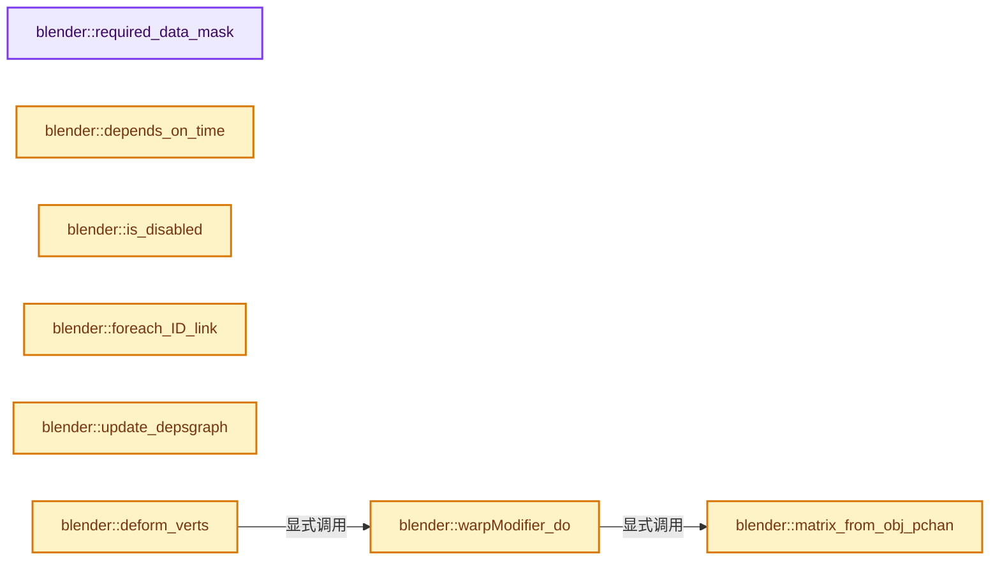
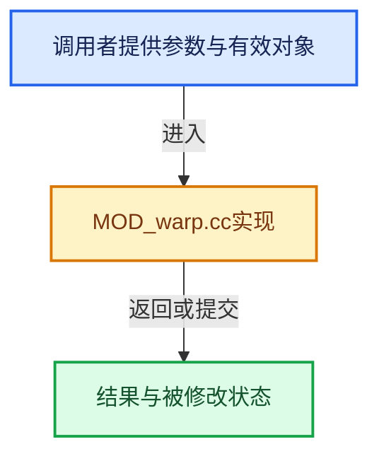

# 实现依赖专题：source/blender/modifiers/intern/MOD_warp.cc

[实现依赖导航](../../../README.md) · [符号索引](../../../../00-课程指南/02-源码与提交索引/符号依赖与实现索引.md)

本专题从正文实际调用进入，集中保存共享实现。函数有稳定锚点，可从调用处直接跳到对应完整函数；递归与互相调用通过回链组织。

## 本文件的实现关系






## 完整成员与函数实现

<a id="f-9d63b52f6c19a389"></a>

### `blender::required_data_mask`

实现位置：[source/blender/modifiers/intern/MOD_warp.cc](../../../../../../../../source/blender/modifiers/intern/MOD_warp.cc) · L65—L78。

接口参数：

- `ModifierData *md`
- `CustomData_MeshMasks *r_cddata_masks`

**教学注释版**

<!-- annotated:d512755e2225a5 -->

```cpp
static void required_data_mask(ModifierData *md, CustomData_MeshMasks *r_cddata_masks)
{
  WarpModifierData *wmd = reinterpret_cast<WarpModifierData *>(md);

  /* Ask for vertex-groups if we need them. */
  if (wmd->defgrp_name[0] != '\0') {
    r_cddata_masks->vmask |= CD_MASK_MDEFORMVERT;
  }

  /* ask for UV coordinates if we need them */
  if (wmd->texmapping == MOD_DISP_MAP_UV) {
    r_cddata_masks->fmask |= CD_MASK_MTFACE;
  }
}
```

<details>
<summary>核对原始源码：source/blender/modifiers/intern/MOD_warp.cc · L65—L78</summary>

<!-- original:d512755e2225a5:source/blender/modifiers/intern/MOD_warp.cc:65:78 -->

```cpp
static void required_data_mask(ModifierData *md, CustomData_MeshMasks *r_cddata_masks)
{
  WarpModifierData *wmd = reinterpret_cast<WarpModifierData *>(md);

  /* Ask for vertex-groups if we need them. */
  if (wmd->defgrp_name[0] != '\0') {
    r_cddata_masks->vmask |= CD_MASK_MDEFORMVERT;
  }

  /* ask for UV coordinates if we need them */
  if (wmd->texmapping == MOD_DISP_MAP_UV) {
    r_cddata_masks->fmask |= CD_MASK_MTFACE;
  }
}
```

</details>

**沿实际写入检查状态**

- `r_cddata_masks->vmask |= CD_MASK_MDEFORMVERT;`
- `r_cddata_masks->fmask |= CD_MASK_MTFACE;`

**继续追踪实现**

本实现没有需要继续展开的显式调用；检查返回表达式、对象转换和调用者前置条件。

<a id="f-02d895cc3d265f2c"></a>

### `blender::matrix_from_obj_pchan`

实现位置：[source/blender/modifiers/intern/MOD_warp.cc](../../../../../../../../source/blender/modifiers/intern/MOD_warp.cc) · L80—L94。

接口参数：

- `float mat[4][4]`
- `const float obinv[4][4]`
- `Object *ob`
- `const char *bonename`

**教学注释版**

<!-- annotated:925d02da0b5897 -->

```cpp
static void matrix_from_obj_pchan(float mat[4][4],
                                  const float obinv[4][4],
                                  Object *ob,
                                  const char *bonename)
{
  bPoseChannel *pchan = BKE_pose_channel_find_name(ob->pose, bonename);
  if (pchan) {
    float mat_bone_world[4][4];
    mul_m4_m4m4(mat_bone_world, ob->object_to_world().ptr(), pchan->pose_mat);
    mul_m4_m4m4(mat, obinv, mat_bone_world);
  }
  else {
    mul_m4_m4m4(mat, obinv, ob->object_to_world().ptr());
  }
}
```

<details>
<summary>核对原始源码：source/blender/modifiers/intern/MOD_warp.cc · L80—L94</summary>

<!-- original:925d02da0b5897:source/blender/modifiers/intern/MOD_warp.cc:80:94 -->

```cpp
static void matrix_from_obj_pchan(float mat[4][4],
                                  const float obinv[4][4],
                                  Object *ob,
                                  const char *bonename)
{
  bPoseChannel *pchan = BKE_pose_channel_find_name(ob->pose, bonename);
  if (pchan) {
    float mat_bone_world[4][4];
    mul_m4_m4m4(mat_bone_world, ob->object_to_world().ptr(), pchan->pose_mat);
    mul_m4_m4m4(mat, obinv, mat_bone_world);
  }
  else {
    mul_m4_m4m4(mat, obinv, ob->object_to_world().ptr());
  }
}
```

</details>

**继续追踪实现**

- `BKE_pose_channel_find_name` → [blender::BKE_pose_channel_find_name · L895](../../../02-BKE几何与数据/intern/action.cc.md#f-5997206551bfc9f9)。
- `mul_m4_m4m4` → [blender::mul_m4_m4m4 · L217](../../../01-BLI基础库/intern/math_matrix_c.cc.md#f-b5272136b543b73b)。
- `ob->object_to_world().ptr` → [调用协议](../../../../00-课程指南/01-路线与规范/模板宏与动态分派协议.md)：接收对象类型依赖auto、返回值或模板实例；不按同名猜测目标。调用位置L88。
- `ob->object_to_world` → [blender::Object::object_to_world · L5761](../../../02-BKE几何与数据/intern/object.cc.md#f-12fc20026327d50c)。

<a id="f-c5e0bd536d5480c7"></a>

### `blender::depends_on_time`

实现位置：[source/blender/modifiers/intern/MOD_warp.cc](../../../../../../../../source/blender/modifiers/intern/MOD_warp.cc) · L96—L105。

接口参数：

- `Scene *`
- `ModifierData *md`

**教学注释版**

<!-- annotated:203ca51c7406b8 -->

```cpp
static bool depends_on_time(Scene * /*scene*/, ModifierData *md)
{
  WarpModifierData *wmd = reinterpret_cast<WarpModifierData *>(md);

  if (wmd->texture) {
    return BKE_texture_dependsOnTime(wmd->texture);
  }

  return false;
}
```

<details>
<summary>核对原始源码：source/blender/modifiers/intern/MOD_warp.cc · L96—L105</summary>

<!-- original:203ca51c7406b8:source/blender/modifiers/intern/MOD_warp.cc:96:105 -->

```cpp
static bool depends_on_time(Scene * /*scene*/, ModifierData *md)
{
  WarpModifierData *wmd = reinterpret_cast<WarpModifierData *>(md);

  if (wmd->texture) {
    return BKE_texture_dependsOnTime(wmd->texture);
  }

  return false;
}
```

</details>

**结果出口**

- `return BKE_texture_dependsOnTime(wmd->texture);`
- `return false;`

**继续追踪实现**

- `BKE_texture_dependsOnTime` → [blender::BKE_texture_dependsOnTime · L600](../../../02-BKE几何与数据/intern/texture.cc.md#f-d94d173f823e5f13)。

<a id="f-65e936f06690c840"></a>

### `blender::is_disabled`

实现位置：[source/blender/modifiers/intern/MOD_warp.cc](../../../../../../../../source/blender/modifiers/intern/MOD_warp.cc) · L113—L118。

接口参数：

- `const Scene *`
- `ModifierData *md`
- `bool`

**教学注释版**

<!-- annotated:a2d192bf77b7c7 -->

```cpp
static bool is_disabled(const Scene * /*scene*/, ModifierData *md, bool /*use_render_params*/)
{
  WarpModifierData *wmd = reinterpret_cast<WarpModifierData *>(md);

  return !(wmd->object_from && wmd->object_to);
}
```

<details>
<summary>核对原始源码：source/blender/modifiers/intern/MOD_warp.cc · L113—L118</summary>

<!-- original:a2d192bf77b7c7:source/blender/modifiers/intern/MOD_warp.cc:113:118 -->

```cpp
static bool is_disabled(const Scene * /*scene*/, ModifierData *md, bool /*use_render_params*/)
{
  WarpModifierData *wmd = reinterpret_cast<WarpModifierData *>(md);

  return !(wmd->object_from && wmd->object_to);
}
```

</details>

**结果出口**

- `return !(wmd->object_from && wmd->object_to);`

**继续追踪实现**

本实现没有需要继续展开的显式调用；检查返回表达式、对象转换和调用者前置条件。

<a id="f-664b8d929a3b4a55"></a>

### `blender::foreach_ID_link`

实现位置：[source/blender/modifiers/intern/MOD_warp.cc](../../../../../../../../source/blender/modifiers/intern/MOD_warp.cc) · L120—L128。

接口参数：

- `ModifierData *md`
- `Object *ob`
- `IDWalkFunc walk`
- `void *user_data`

**教学注释版**

<!-- annotated:630ad851a74173 -->

```cpp
static void foreach_ID_link(ModifierData *md, Object *ob, IDWalkFunc walk, void *user_data)
{
  WarpModifierData *wmd = reinterpret_cast<WarpModifierData *>(md);

  walk(user_data, ob, reinterpret_cast<ID **>(&wmd->texture), IDWALK_CB_USER);
  walk(user_data, ob, reinterpret_cast<ID **>(&wmd->object_from), IDWALK_CB_NOP);
  walk(user_data, ob, reinterpret_cast<ID **>(&wmd->object_to), IDWALK_CB_NOP);
  walk(user_data, ob, reinterpret_cast<ID **>(&wmd->map_object), IDWALK_CB_NOP);
}
```

<details>
<summary>核对原始源码：source/blender/modifiers/intern/MOD_warp.cc · L120—L128</summary>

<!-- original:630ad851a74173:source/blender/modifiers/intern/MOD_warp.cc:120:128 -->

```cpp
static void foreach_ID_link(ModifierData *md, Object *ob, IDWalkFunc walk, void *user_data)
{
  WarpModifierData *wmd = reinterpret_cast<WarpModifierData *>(md);

  walk(user_data, ob, reinterpret_cast<ID **>(&wmd->texture), IDWALK_CB_USER);
  walk(user_data, ob, reinterpret_cast<ID **>(&wmd->object_from), IDWALK_CB_NOP);
  walk(user_data, ob, reinterpret_cast<ID **>(&wmd->object_to), IDWALK_CB_NOP);
  walk(user_data, ob, reinterpret_cast<ID **>(&wmd->map_object), IDWALK_CB_NOP);
}
```

</details>

**继续追踪实现**

- `walk` → [调用协议](../../../../00-课程指南/01-路线与规范/模板宏与动态分派协议.md)：局部可调用对象，须结合其初始化与捕获环境。调用位置L124。

<a id="f-c303707fde7dafe1"></a>

### `blender::update_depsgraph`

实现位置：[source/blender/modifiers/intern/MOD_warp.cc](../../../../../../../../source/blender/modifiers/intern/MOD_warp.cc) · L137—L166。

接口参数：

- `ModifierData *md`
- `const ModifierUpdateDepsgraphContext *ctx`

**教学注释版**

<!-- annotated:09e38510e75884 -->

```cpp
static void update_depsgraph(ModifierData *md, const ModifierUpdateDepsgraphContext *ctx)
{
  WarpModifierData *wmd = reinterpret_cast<WarpModifierData *>(md);
  bool need_transform_relation = false;

  if (wmd->object_from != nullptr && wmd->object_to != nullptr) {
    MOD_depsgraph_update_object_bone_relation(
        ctx->node, wmd->object_from, wmd->bone_from, "Warp Modifier");
    MOD_depsgraph_update_object_bone_relation(
        ctx->node, wmd->object_to, wmd->bone_to, "Warp Modifier");
    need_transform_relation = true;
  }

  if (wmd->texture != nullptr) {
    DEG_add_generic_id_relation(ctx->node, &wmd->texture->id, "Warp Modifier");

    if ((wmd->texmapping == MOD_DISP_MAP_OBJECT) && wmd->map_object != nullptr) {
      MOD_depsgraph_update_object_bone_relation(
          ctx->node, wmd->map_object, wmd->map_bone, "Warp Modifier");
      need_transform_relation = true;
    }
    else if (wmd->texmapping == MOD_DISP_MAP_GLOBAL) {
      need_transform_relation = true;
    }
  }

  if (need_transform_relation) {
    DEG_add_depends_on_transform_relation(ctx->node, "Warp Modifier");
  }
}
```

<details>
<summary>核对原始源码：source/blender/modifiers/intern/MOD_warp.cc · L137—L166</summary>

<!-- original:09e38510e75884:source/blender/modifiers/intern/MOD_warp.cc:137:166 -->

```cpp
static void update_depsgraph(ModifierData *md, const ModifierUpdateDepsgraphContext *ctx)
{
  WarpModifierData *wmd = reinterpret_cast<WarpModifierData *>(md);
  bool need_transform_relation = false;

  if (wmd->object_from != nullptr && wmd->object_to != nullptr) {
    MOD_depsgraph_update_object_bone_relation(
        ctx->node, wmd->object_from, wmd->bone_from, "Warp Modifier");
    MOD_depsgraph_update_object_bone_relation(
        ctx->node, wmd->object_to, wmd->bone_to, "Warp Modifier");
    need_transform_relation = true;
  }

  if (wmd->texture != nullptr) {
    DEG_add_generic_id_relation(ctx->node, &wmd->texture->id, "Warp Modifier");

    if ((wmd->texmapping == MOD_DISP_MAP_OBJECT) && wmd->map_object != nullptr) {
      MOD_depsgraph_update_object_bone_relation(
          ctx->node, wmd->map_object, wmd->map_bone, "Warp Modifier");
      need_transform_relation = true;
    }
    else if (wmd->texmapping == MOD_DISP_MAP_GLOBAL) {
      need_transform_relation = true;
    }
  }

  if (need_transform_relation) {
    DEG_add_depends_on_transform_relation(ctx->node, "Warp Modifier");
  }
}
```

</details>

**沿实际写入检查状态**

- `need_transform_relation = true;`

**继续追踪实现**

- `MOD_depsgraph_update_object_bone_relation` → [blender::MOD_depsgraph_update_object_bone_relation · L188](MOD_util.cc.md#f-b4d8d5d84915768b)。
- `DEG_add_generic_id_relation` → [blender::DEG_add_generic_id_relation · L232](../../../06-Depsgraph依赖图/intern/depsgraph_build.cc.md#f-43ef8aa495db0d98)。
- `DEG_add_depends_on_transform_relation` → [blender::DEG_add_depends_on_transform_relation · L240](../../../06-Depsgraph依赖图/intern/depsgraph_build.cc.md#f-47c32a354defa20d)。

<a id="f-36bf81e13cbc9c7a"></a>

### `blender::warpModifier_do`

实现位置：[source/blender/modifiers/intern/MOD_warp.cc](../../../../../../../../source/blender/modifiers/intern/MOD_warp.cc) · L168—L329。

接口参数：

- `WarpModifierData *wmd`
- `const ModifierEvalContext *ctx`
- `Mesh *mesh`
- `float (*vertexCos)[3]`
- `int verts_num`

**教学注释版**

<!-- annotated:8ba1baaec73007 -->

```cpp
static void warpModifier_do(WarpModifierData *wmd,
                            const ModifierEvalContext *ctx,
                            Mesh *mesh,
                            float (*vertexCos)[3],
                            int verts_num)
{
  Object *ob = ctx->object;
  float obinv[4][4];
  float mat_from[4][4];
  float mat_from_inv[4][4];
  float mat_to[4][4];
  float mat_unit[4][4];
  float mat_final[4][4];

  float tmat[4][4];

  const float falloff_radius_sq = square_f(wmd->falloff_radius);
  float strength = wmd->strength;
  float fac = 1.0f, weight;
  int i;
  int defgrp_index;
  const MDeformVert *dvert, *dv = nullptr;
  const bool invert_vgroup = (wmd->flag & MOD_WARP_INVERT_VGROUP) != 0;
  float (*tex_co)[3] = nullptr;

  if (!(wmd->object_from && wmd->object_to)) {
    return;
  }

  MOD_get_vgroup(ob, mesh, wmd->defgrp_name, &dvert, &defgrp_index);
  if (dvert == nullptr) {
    defgrp_index = -1;
  }

  if (wmd->curfalloff == nullptr) { /* should never happen, but bad lib linking could cause it */
    wmd->curfalloff = BKE_curvemapping_add(1, 0.0f, 0.0f, 1.0f, 1.0f);
  }

  if (wmd->curfalloff) {
    BKE_curvemapping_init(wmd->curfalloff);
  }

  invert_m4_m4(obinv, ob->object_to_world().ptr());

  /* Checks that the objects/bones are available. */
  matrix_from_obj_pchan(mat_from, obinv, wmd->object_from, wmd->bone_from);
  matrix_from_obj_pchan(mat_to, obinv, wmd->object_to, wmd->bone_to);

  invert_m4_m4(tmat, mat_from);  // swap?
  mul_m4_m4m4(mat_final, tmat, mat_to);

  invert_m4_m4(mat_from_inv, mat_from);

  unit_m4(mat_unit);

  if (strength < 0.0f) {
    float loc[3];
    strength = -strength;

    /* inverted location is not useful, just use the negative */
    copy_v3_v3(loc, mat_final[3]);
    invert_m4(mat_final);
    negate_v3_v3(mat_final[3], loc);
  }
  weight = strength;

  Tex *tex_target = wmd->texture;
  if (mesh != nullptr && tex_target != nullptr) {
    tex_co = MEM_new_array_zeroed<float[3]>(size_t(verts_num), __func__);
    MOD_get_texture_coords(
        reinterpret_cast<MappingInfoModifierData *>(wmd), ctx, ob, mesh, vertexCos, tex_co);

    MOD_init_texture(reinterpret_cast<MappingInfoModifierData *>(wmd), ctx);
  }

  for (i = 0; i < verts_num; i++) {
    float *co = vertexCos[i];

    if (wmd->falloff_type == eWarp_Falloff_None ||
        ((fac = len_squared_v3v3(co, mat_from[3])) < falloff_radius_sq &&
         (fac = (wmd->falloff_radius - sqrtf(fac)) / wmd->falloff_radius)))
    {
      /* skip if no vert group found */
      if (defgrp_index != -1) {
        dv = &dvert[i];
        weight = (invert_vgroup ? (1.0f - BKE_defvert_find_weight(dv, defgrp_index)) :
                                  BKE_defvert_find_weight(dv, defgrp_index)) *
                 strength;
        if (weight <= 0.0f) {
          continue;
        }
      }

      /* closely match PROP_SMOOTH and similar */
      switch (wmd->falloff_type) {
        case eWarp_Falloff_None:
          fac = 1.0f;
          break;
        case eWarp_Falloff_Curve:
          fac = BKE_curvemapping_evaluateF(wmd->curfalloff, 0, fac);
          break;
        case eWarp_Falloff_Sharp:
          fac = fac * fac;
          break;
        case eWarp_Falloff_Smooth:
          fac = 3.0f * fac * fac - 2.0f * fac * fac * fac;
          break;
        case eWarp_Falloff_Root:
          fac = sqrtf(fac);
          break;
        case eWarp_Falloff_Linear:
          /* pass */
          break;
        case eWarp_Falloff_Const:
          fac = 1.0f;
          break;
        case eWarp_Falloff_Sphere:
          fac = sqrtf(2 * fac - fac * fac);
          break;
        case eWarp_Falloff_InvSquare:
          fac = fac * (2.0f - fac);
          break;
      }

      fac *= weight;

      if (tex_co) {
        TexResult texres;
        BKE_texture_get_value(tex_target, tex_co[i], &texres, false);
        fac *= texres.tin;
      }

      if (fac != 0.0f) {
        /* into the 'from' objects space */
        mul_m4_v3(mat_from_inv, co);

        if (fac == 1.0f) {
          mul_m4_v3(mat_final, co);
        }
        else {
          if (wmd->flag & MOD_WARP_VOLUME_PRESERVE) {
            /* interpolate the matrix for nicer locations */
            blend_m4_m4m4(tmat, mat_unit, mat_final, fac);
            mul_m4_v3(tmat, co);
          }
          else {
            float tvec[3];
            mul_v3_m4v3(tvec, mat_final, co);
            interp_v3_v3v3(co, co, tvec, fac);
          }
        }

        /* out of the 'from' objects space */
        mul_m4_v3(mat_from, co);
      }
    }
  }

  if (tex_co) {
    MEM_delete(tex_co);
  }
}
```

<details>
<summary>核对原始源码：source/blender/modifiers/intern/MOD_warp.cc · L168—L329</summary>

<!-- original:8ba1baaec73007:source/blender/modifiers/intern/MOD_warp.cc:168:329 -->

```cpp
static void warpModifier_do(WarpModifierData *wmd,
                            const ModifierEvalContext *ctx,
                            Mesh *mesh,
                            float (*vertexCos)[3],
                            int verts_num)
{
  Object *ob = ctx->object;
  float obinv[4][4];
  float mat_from[4][4];
  float mat_from_inv[4][4];
  float mat_to[4][4];
  float mat_unit[4][4];
  float mat_final[4][4];

  float tmat[4][4];

  const float falloff_radius_sq = square_f(wmd->falloff_radius);
  float strength = wmd->strength;
  float fac = 1.0f, weight;
  int i;
  int defgrp_index;
  const MDeformVert *dvert, *dv = nullptr;
  const bool invert_vgroup = (wmd->flag & MOD_WARP_INVERT_VGROUP) != 0;
  float (*tex_co)[3] = nullptr;

  if (!(wmd->object_from && wmd->object_to)) {
    return;
  }

  MOD_get_vgroup(ob, mesh, wmd->defgrp_name, &dvert, &defgrp_index);
  if (dvert == nullptr) {
    defgrp_index = -1;
  }

  if (wmd->curfalloff == nullptr) { /* should never happen, but bad lib linking could cause it */
    wmd->curfalloff = BKE_curvemapping_add(1, 0.0f, 0.0f, 1.0f, 1.0f);
  }

  if (wmd->curfalloff) {
    BKE_curvemapping_init(wmd->curfalloff);
  }

  invert_m4_m4(obinv, ob->object_to_world().ptr());

  /* Checks that the objects/bones are available. */
  matrix_from_obj_pchan(mat_from, obinv, wmd->object_from, wmd->bone_from);
  matrix_from_obj_pchan(mat_to, obinv, wmd->object_to, wmd->bone_to);

  invert_m4_m4(tmat, mat_from);  // swap?
  mul_m4_m4m4(mat_final, tmat, mat_to);

  invert_m4_m4(mat_from_inv, mat_from);

  unit_m4(mat_unit);

  if (strength < 0.0f) {
    float loc[3];
    strength = -strength;

    /* inverted location is not useful, just use the negative */
    copy_v3_v3(loc, mat_final[3]);
    invert_m4(mat_final);
    negate_v3_v3(mat_final[3], loc);
  }
  weight = strength;

  Tex *tex_target = wmd->texture;
  if (mesh != nullptr && tex_target != nullptr) {
    tex_co = MEM_new_array_zeroed<float[3]>(size_t(verts_num), __func__);
    MOD_get_texture_coords(
        reinterpret_cast<MappingInfoModifierData *>(wmd), ctx, ob, mesh, vertexCos, tex_co);

    MOD_init_texture(reinterpret_cast<MappingInfoModifierData *>(wmd), ctx);
  }

  for (i = 0; i < verts_num; i++) {
    float *co = vertexCos[i];

    if (wmd->falloff_type == eWarp_Falloff_None ||
        ((fac = len_squared_v3v3(co, mat_from[3])) < falloff_radius_sq &&
         (fac = (wmd->falloff_radius - sqrtf(fac)) / wmd->falloff_radius)))
    {
      /* skip if no vert group found */
      if (defgrp_index != -1) {
        dv = &dvert[i];
        weight = (invert_vgroup ? (1.0f - BKE_defvert_find_weight(dv, defgrp_index)) :
                                  BKE_defvert_find_weight(dv, defgrp_index)) *
                 strength;
        if (weight <= 0.0f) {
          continue;
        }
      }

      /* closely match PROP_SMOOTH and similar */
      switch (wmd->falloff_type) {
        case eWarp_Falloff_None:
          fac = 1.0f;
          break;
        case eWarp_Falloff_Curve:
          fac = BKE_curvemapping_evaluateF(wmd->curfalloff, 0, fac);
          break;
        case eWarp_Falloff_Sharp:
          fac = fac * fac;
          break;
        case eWarp_Falloff_Smooth:
          fac = 3.0f * fac * fac - 2.0f * fac * fac * fac;
          break;
        case eWarp_Falloff_Root:
          fac = sqrtf(fac);
          break;
        case eWarp_Falloff_Linear:
          /* pass */
          break;
        case eWarp_Falloff_Const:
          fac = 1.0f;
          break;
        case eWarp_Falloff_Sphere:
          fac = sqrtf(2 * fac - fac * fac);
          break;
        case eWarp_Falloff_InvSquare:
          fac = fac * (2.0f - fac);
          break;
      }

      fac *= weight;

      if (tex_co) {
        TexResult texres;
        BKE_texture_get_value(tex_target, tex_co[i], &texres, false);
        fac *= texres.tin;
      }

      if (fac != 0.0f) {
        /* into the 'from' objects space */
        mul_m4_v3(mat_from_inv, co);

        if (fac == 1.0f) {
          mul_m4_v3(mat_final, co);
        }
        else {
          if (wmd->flag & MOD_WARP_VOLUME_PRESERVE) {
            /* interpolate the matrix for nicer locations */
            blend_m4_m4m4(tmat, mat_unit, mat_final, fac);
            mul_m4_v3(tmat, co);
          }
          else {
            float tvec[3];
            mul_v3_m4v3(tvec, mat_final, co);
            interp_v3_v3v3(co, co, tvec, fac);
          }
        }

        /* out of the 'from' objects space */
        mul_m4_v3(mat_from, co);
      }
    }
  }

  if (tex_co) {
    MEM_delete(tex_co);
  }
}
```

</details>

**沿实际写入检查状态**

- `defgrp_index = -1;`
- `wmd->curfalloff = BKE_curvemapping_add(1, 0.0f, 0.0f, 1.0f, 1.0f);`
- `strength = -strength;`
- `weight = strength;`
- `tex_co = MEM_new_array_zeroed<float[3]>(size_t(verts_num), __func__);`
- `dv = &dvert[i];`
- `weight = (invert_vgroup ? (1.0f - BKE_defvert_find_weight(dv, defgrp_index)) :`
- `fac = 1.0f;`
- `fac = BKE_curvemapping_evaluateF(wmd->curfalloff, 0, fac);`
- `fac = fac * fac;`
- `fac = 3.0f * fac * fac - 2.0f * fac * fac * fac;`
- `fac = sqrtf(fac);`
- `fac = sqrtf(2 * fac - fac * fac);`
- `fac = fac * (2.0f - fac);`
- `fac *= weight;`
- `fac *= texres.tin;`

**继续追踪实现**

- `square_f` → [blender::square_f · L302](../../../01-BLI基础库/intern/math_base_inline.cc.md#f-30f1dde493a37e0d)。
- `MOD_get_vgroup` → [blender::MOD_get_vgroup · L158](MOD_util.cc.md#f-f461611d86b94405)。
- `BKE_curvemapping_add` → [blender::BKE_curvemapping_add · L99](../../../02-BKE几何与数据/intern/colortools.cc.md#f-5eb2107731235af2)。
- `BKE_curvemapping_init` → [blender::BKE_curvemapping_init · L1441](../../../02-BKE几何与数据/intern/colortools.cc.md#f-f7d75fd7ad2a5ee6)。
- `invert_m4_m4` → [blender::invert_m4_m4 · L1150](../../../01-BLI基础库/intern/math_matrix_c.cc.md#f-c75789f10cdd5b92)。
- `ob->object_to_world().ptr` → [调用协议](../../../../00-课程指南/01-路线与规范/模板宏与动态分派协议.md)：接收对象类型依赖auto、返回值或模板实例；不按同名猜测目标。调用位置L210。
- `ob->object_to_world` → [blender::Object::object_to_world · L5761](../../../02-BKE几何与数据/intern/object.cc.md#f-12fc20026327d50c)。
- `matrix_from_obj_pchan` → [blender::matrix_from_obj_pchan · L80](MOD_warp.cc.md#f-02d895cc3d265f2c)。
- `mul_m4_m4m4` → [blender::mul_m4_m4m4 · L217](../../../01-BLI基础库/intern/math_matrix_c.cc.md#f-b5272136b543b73b)。
- `unit_m4` → [blender::unit_m4 · L55](../../../01-BLI基础库/intern/math_matrix_c.cc.md#f-e6cd812aae119176)。
- `copy_v3_v3` → [blender::copy_v3_v3 · L47](../../../01-BLI基础库/intern/math_vector_inline.cc.md#f-037a0d5fa5060bd6)。
- `invert_m4` → [blender::invert_m4 · L1069](../../../01-BLI基础库/intern/math_matrix_c.cc.md#f-db172dd1e3ce5867)。
- `negate_v3_v3` → [blender::negate_v3_v3 · L578](../../../01-BLI基础库/intern/math_vector_inline.cc.md#f-b680e10c32373391)。
- `MEM_new_array_zeroed<float[3]>` → [MEM_new_array_zeroed · L566](../../../07-Intern运行时与平台/guardedalloc/MEM_guardedalloc.h.md#f-3a0cf63fb5216500)；[MEM_new_array_zeroed · L119](../../../07-Intern运行时与平台/guardedalloc/intern/mallocn.cc.md#f-6825557da566fdbe)。同名重载需按实参类型选择。
- `MOD_get_texture_coords` → [blender::MOD_get_texture_coords · L51](MOD_util.cc.md#f-93137e45acd248b6)。
- `MOD_init_texture` → [blender::MOD_init_texture · L38](MOD_util.cc.md#f-a8c2c947afb32236)。
- `len_squared_v3v3` → [blender::len_squared_v3v3 · L794](../../../01-BLI基础库/intern/math_vector_inline.cc.md#f-ae487ac3ef64aa87)。
- `sqrtf` → [外部契约](https://eel.is/c++draft/)：这个边界按实际表达式及所属类型核对参数、返回值、寿命与失败行为。这里提供接口入口，不声称已解释该第三方版本的内部实现。
- `BKE_defvert_find_weight` → [blender::BKE_defvert_find_weight · L779](../../../02-BKE几何与数据/intern/deform.cc.md#f-c117fcd05c4fd453)。
- `BKE_curvemapping_evaluateF` → [blender::BKE_curvemapping_evaluateF · L1177](../../../02-BKE几何与数据/intern/colortools.cc.md#f-014584e04eeb1392)。
- `BKE_texture_get_value` → [blender::BKE_texture_get_value · L640](../../../02-BKE几何与数据/intern/texture.cc.md#f-39c033faea8bb059)。
- `mul_m4_v3` → [blender::mul_m4_v3 · L677](../../../01-BLI基础库/intern/math_matrix_c.cc.md#f-14a8c267710d47a3)。
- `blend_m4_m4m4` → [blender::blend_m4_m4m4 · L2199](../../../01-BLI基础库/intern/math_matrix_c.cc.md#f-48063e6b66ef92d4)。
- `mul_v3_m4v3` → [blender::mul_v3_m4v3 · L687](../../../01-BLI基础库/intern/math_matrix_c.cc.md#f-31076c71c40783a8)。
- `interp_v3_v3v3` → [blender::interp_v3_v3v3 · L41](../../../01-BLI基础库/intern/math_vector.cc.md#f-18251c70c00824d7)。
- `MEM_delete` → [MEM_delete · L400](../../../07-Intern运行时与平台/guardedalloc/MEM_guardedalloc.h.md#f-9049ffdd1682887c)。

<a id="f-98dd715a1dab904a"></a>

### `blender::deform_verts`

实现位置：[source/blender/modifiers/intern/MOD_warp.cc](../../../../../../../../source/blender/modifiers/intern/MOD_warp.cc) · L331—L339。

接口参数：

- `ModifierData *md`
- `const ModifierEvalContext *ctx`
- `Mesh *mesh`
- `MutableSpan<float3> positions`

**教学注释版**

<!-- annotated:812e4fbab90f4d -->

```cpp
static void deform_verts(ModifierData *md,
                         const ModifierEvalContext *ctx,
                         Mesh *mesh,
                         MutableSpan<float3> positions)
{
  WarpModifierData *wmd = reinterpret_cast<WarpModifierData *>(md);
  warpModifier_do(
      // [讲解] positions.data：返回借用范围的地址。
      wmd, ctx, mesh, reinterpret_cast<float (*)[3]>(positions.data()), positions.size());
}
```

<details>
<summary>核对原始源码：source/blender/modifiers/intern/MOD_warp.cc · L331—L339</summary>

<!-- original:812e4fbab90f4d:source/blender/modifiers/intern/MOD_warp.cc:331:339 -->

```cpp
static void deform_verts(ModifierData *md,
                         const ModifierEvalContext *ctx,
                         Mesh *mesh,
                         MutableSpan<float3> positions)
{
  WarpModifierData *wmd = reinterpret_cast<WarpModifierData *>(md);
  warpModifier_do(
      wmd, ctx, mesh, reinterpret_cast<float (*)[3]>(positions.data()), positions.size());
}
```

</details>

**继续追踪实现**

- `warpModifier_do` → [blender::warpModifier_do · L168](MOD_warp.cc.md#f-36bf81e13cbc9c7a)。
- `positions.data` → [blender::MutableSpan::data · L545](../../../../01-基础容器与现代CPP/06-MutableSpan可写视图.md#f-eb45a6e4d8211efd)；[blender::gpu::shader::parser::MutableSpan::data · L82](../../gpu/shader_tool/utils.hh.md#f-ad0a09cec9741c65)。同名重载需按实参类型选择。
- `positions.size` → [blender::MutableSpan::size · L499](../../../../01-基础容器与现代CPP/06-MutableSpan可写视图.md#f-1de6a66839c304a8)；[blender::gpu::shader::parser::MutableSpan::size · L87](../../gpu/shader_tool/utils.hh.md#f-5e684af6ee7990e9)。同名重载需按实参类型选择。
