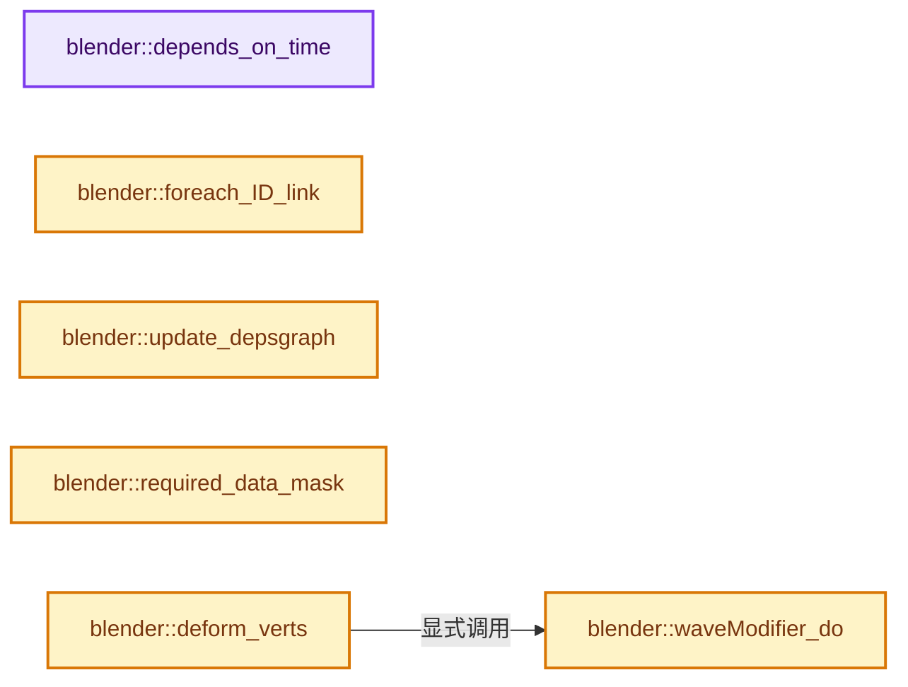
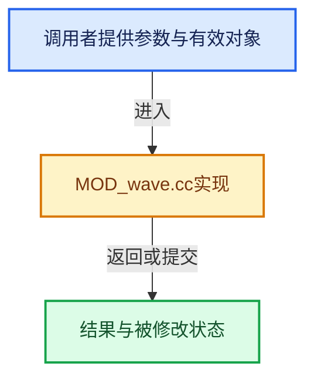

# 实现依赖专题：source/blender/modifiers/intern/MOD_wave.cc

[实现依赖导航](../../../README.md) · [符号索引](../../../../00-课程指南/02-源码与提交索引/符号依赖与实现索引.md)

本专题从正文实际调用进入，集中保存共享实现。函数有稳定锚点，可从调用处直接跳到对应完整函数；递归与互相调用通过回链组织。

## 本文件的实现关系






## 完整成员与函数实现

<a id="f-f0a406faa15df7ae"></a>

### `blender::depends_on_time`

实现位置：[source/blender/modifiers/intern/MOD_wave.cc](../../../../../../../../source/blender/modifiers/intern/MOD_wave.cc) · L51—L54。

接口参数：

- `Scene *`
- `ModifierData *`

**教学注释版**

<!-- annotated:74ae05d0982898 -->

```cpp
static bool depends_on_time(Scene * /*scene*/, ModifierData * /*md*/)
{
  return true;
}
```

<details>
<summary>核对原始源码：source/blender/modifiers/intern/MOD_wave.cc · L51—L54</summary>

<!-- original:74ae05d0982898:source/blender/modifiers/intern/MOD_wave.cc:51:54 -->

```cpp
static bool depends_on_time(Scene * /*scene*/, ModifierData * /*md*/)
{
  return true;
}
```

</details>

**结果出口**

- `return true;`

**继续追踪实现**

本实现没有需要继续展开的显式调用；检查返回表达式、对象转换和调用者前置条件。

<a id="f-d03ad3f698b40ad1"></a>

### `blender::foreach_ID_link`

实现位置：[source/blender/modifiers/intern/MOD_wave.cc](../../../../../../../../source/blender/modifiers/intern/MOD_wave.cc) · L56—L63。

接口参数：

- `ModifierData *md`
- `Object *ob`
- `IDWalkFunc walk`
- `void *user_data`

**教学注释版**

<!-- annotated:a7b311b6fbd2dc -->

```cpp
static void foreach_ID_link(ModifierData *md, Object *ob, IDWalkFunc walk, void *user_data)
{
  WaveModifierData *wmd = reinterpret_cast<WaveModifierData *>(md);

  walk(user_data, ob, reinterpret_cast<ID **>(&wmd->texture), IDWALK_CB_USER);
  walk(user_data, ob, reinterpret_cast<ID **>(&wmd->objectcenter), IDWALK_CB_NOP);
  walk(user_data, ob, reinterpret_cast<ID **>(&wmd->map_object), IDWALK_CB_NOP);
}
```

<details>
<summary>核对原始源码：source/blender/modifiers/intern/MOD_wave.cc · L56—L63</summary>

<!-- original:a7b311b6fbd2dc:source/blender/modifiers/intern/MOD_wave.cc:56:63 -->

```cpp
static void foreach_ID_link(ModifierData *md, Object *ob, IDWalkFunc walk, void *user_data)
{
  WaveModifierData *wmd = reinterpret_cast<WaveModifierData *>(md);

  walk(user_data, ob, reinterpret_cast<ID **>(&wmd->texture), IDWALK_CB_USER);
  walk(user_data, ob, reinterpret_cast<ID **>(&wmd->objectcenter), IDWALK_CB_NOP);
  walk(user_data, ob, reinterpret_cast<ID **>(&wmd->map_object), IDWALK_CB_NOP);
}
```

</details>

**继续追踪实现**

- `walk` → [调用协议](../../../../00-课程指南/01-路线与规范/模板宏与动态分派协议.md)：局部可调用对象，须结合其初始化与捕获环境。调用位置L60。

<a id="f-edf5905c80bf5d92"></a>

### `blender::update_depsgraph`

实现位置：[source/blender/modifiers/intern/MOD_wave.cc](../../../../../../../../source/blender/modifiers/intern/MOD_wave.cc) · L72—L98。

接口参数：

- `ModifierData *md`
- `const ModifierUpdateDepsgraphContext *ctx`

**教学注释版**

<!-- annotated:15bf16ed63598d -->

```cpp
static void update_depsgraph(ModifierData *md, const ModifierUpdateDepsgraphContext *ctx)
{
  WaveModifierData *wmd = reinterpret_cast<WaveModifierData *>(md);
  bool need_transform_relation = false;

  if (wmd->objectcenter != nullptr) {
    DEG_add_object_relation(ctx->node, wmd->objectcenter, DEG_OB_COMP_TRANSFORM, "Wave Modifier");
    need_transform_relation = true;
  }

  if (wmd->texture != nullptr) {
    DEG_add_generic_id_relation(ctx->node, &wmd->texture->id, "Wave Modifier");

    if ((wmd->texmapping == MOD_DISP_MAP_OBJECT) && wmd->map_object != nullptr) {
      MOD_depsgraph_update_object_bone_relation(
          ctx->node, wmd->map_object, wmd->map_bone, "Wave Modifier");
      need_transform_relation = true;
    }
    else if (wmd->texmapping == MOD_DISP_MAP_GLOBAL) {
      need_transform_relation = true;
    }
  }

  if (need_transform_relation) {
    DEG_add_depends_on_transform_relation(ctx->node, "Wave Modifier");
  }
}
```

<details>
<summary>核对原始源码：source/blender/modifiers/intern/MOD_wave.cc · L72—L98</summary>

<!-- original:15bf16ed63598d:source/blender/modifiers/intern/MOD_wave.cc:72:98 -->

```cpp
static void update_depsgraph(ModifierData *md, const ModifierUpdateDepsgraphContext *ctx)
{
  WaveModifierData *wmd = reinterpret_cast<WaveModifierData *>(md);
  bool need_transform_relation = false;

  if (wmd->objectcenter != nullptr) {
    DEG_add_object_relation(ctx->node, wmd->objectcenter, DEG_OB_COMP_TRANSFORM, "Wave Modifier");
    need_transform_relation = true;
  }

  if (wmd->texture != nullptr) {
    DEG_add_generic_id_relation(ctx->node, &wmd->texture->id, "Wave Modifier");

    if ((wmd->texmapping == MOD_DISP_MAP_OBJECT) && wmd->map_object != nullptr) {
      MOD_depsgraph_update_object_bone_relation(
          ctx->node, wmd->map_object, wmd->map_bone, "Wave Modifier");
      need_transform_relation = true;
    }
    else if (wmd->texmapping == MOD_DISP_MAP_GLOBAL) {
      need_transform_relation = true;
    }
  }

  if (need_transform_relation) {
    DEG_add_depends_on_transform_relation(ctx->node, "Wave Modifier");
  }
}
```

</details>

**沿实际写入检查状态**

- `need_transform_relation = true;`

**继续追踪实现**

- `DEG_add_object_relation` → [blender::DEG_add_object_relation · L123](../../../06-Depsgraph依赖图/intern/depsgraph_build.cc.md#f-f570cffae97e273c)。
- `DEG_add_generic_id_relation` → [blender::DEG_add_generic_id_relation · L232](../../../06-Depsgraph依赖图/intern/depsgraph_build.cc.md#f-43ef8aa495db0d98)。
- `MOD_depsgraph_update_object_bone_relation` → [blender::MOD_depsgraph_update_object_bone_relation · L188](MOD_util.cc.md#f-b4d8d5d84915768b)。
- `DEG_add_depends_on_transform_relation` → [blender::DEG_add_depends_on_transform_relation · L240](../../../06-Depsgraph依赖图/intern/depsgraph_build.cc.md#f-47c32a354defa20d)。

<a id="f-0a0502e644d24eeb"></a>

### `blender::required_data_mask`

实现位置：[source/blender/modifiers/intern/MOD_wave.cc](../../../../../../../../source/blender/modifiers/intern/MOD_wave.cc) · L100—L113。

接口参数：

- `ModifierData *md`
- `CustomData_MeshMasks *r_cddata_masks`

**教学注释版**

<!-- annotated:a1ce59842538cf -->

```cpp
static void required_data_mask(ModifierData *md, CustomData_MeshMasks *r_cddata_masks)
{
  WaveModifierData *wmd = reinterpret_cast<WaveModifierData *>(md);

  /* ask for UV coordinates if we need them */
  if (wmd->texture && wmd->texmapping == MOD_DISP_MAP_UV) {
    r_cddata_masks->fmask |= CD_MASK_MTFACE;
  }

  /* Ask for vertex-groups if we need them. */
  if (wmd->defgrp_name[0] != '\0') {
    r_cddata_masks->vmask |= CD_MASK_MDEFORMVERT;
  }
}
```

<details>
<summary>核对原始源码：source/blender/modifiers/intern/MOD_wave.cc · L100—L113</summary>

<!-- original:a1ce59842538cf:source/blender/modifiers/intern/MOD_wave.cc:100:113 -->

```cpp
static void required_data_mask(ModifierData *md, CustomData_MeshMasks *r_cddata_masks)
{
  WaveModifierData *wmd = reinterpret_cast<WaveModifierData *>(md);

  /* ask for UV coordinates if we need them */
  if (wmd->texture && wmd->texmapping == MOD_DISP_MAP_UV) {
    r_cddata_masks->fmask |= CD_MASK_MTFACE;
  }

  /* Ask for vertex-groups if we need them. */
  if (wmd->defgrp_name[0] != '\0') {
    r_cddata_masks->vmask |= CD_MASK_MDEFORMVERT;
  }
}
```

</details>

**沿实际写入检查状态**

- `r_cddata_masks->fmask |= CD_MASK_MTFACE;`
- `r_cddata_masks->vmask |= CD_MASK_MDEFORMVERT;`

**继续追踪实现**

本实现没有需要继续展开的显式调用；检查返回表达式、对象转换和调用者前置条件。

<a id="f-03c227199ad2d1c7"></a>

### `blender::waveModifier_do`

实现位置：[source/blender/modifiers/intern/MOD_wave.cc](../../../../../../../../source/blender/modifiers/intern/MOD_wave.cc) · L115—L276。

接口参数：

- `WaveModifierData *wmd`
- `const ModifierEvalContext *ctx`
- `Object *ob`
- `Mesh *mesh`
- `float (*vertexCos)[3]`
- `int verts_num`

**教学注释版**

<!-- annotated:4da0a298764b5f -->

```cpp
static void waveModifier_do(WaveModifierData *wmd,
                            const ModifierEvalContext *ctx,
                            Object *ob,
                            Mesh *mesh,
                            float (*vertexCos)[3],
                            int verts_num)
{
  const MDeformVert *dvert;
  int defgrp_index;
  float ctime = DEG_get_ctime(ctx->depsgraph);
  float minfac = float(1.0 / exp(wmd->width * wmd->narrow * wmd->width * wmd->narrow));
  float lifefac = wmd->height;
  float (*tex_co)[3] = nullptr;
  const int wmd_axis = wmd->flag & (MOD_WAVE_X | MOD_WAVE_Y);
  const float falloff = wmd->falloff;
  float falloff_fac = 1.0f; /* when falloff == 0.0f this stays at 1.0f */
  const bool invert_group = (wmd->flag & MOD_WAVE_INVERT_VGROUP) != 0;

  Span<float3> vert_normals;
  if ((wmd->flag & MOD_WAVE_NORM) && (mesh != nullptr)) {
    vert_normals = mesh->vert_normals();
  }

  if (wmd->objectcenter != nullptr) {
    float mat[4][4];
    /* get the control object's location in local coordinates */
    invert_m4_m4(ob->runtime->world_to_object.ptr(), ob->object_to_world().ptr());
    mul_m4_m4m4(mat, ob->world_to_object().ptr(), wmd->objectcenter->object_to_world().ptr());

    wmd->startx = mat[3][0];
    wmd->starty = mat[3][1];
  }

  /* get the index of the deform group */
  MOD_get_vgroup(ob, mesh, wmd->defgrp_name, &dvert, &defgrp_index);

  if (wmd->damp == 0.0f) {
    wmd->damp = 10.0f;
  }

  if (wmd->lifetime != 0.0f) {
    float x = ctime - wmd->timeoffs;

    if (x > wmd->lifetime) {
      lifefac = x - wmd->lifetime;

      if (lifefac > wmd->damp) {
        lifefac = 0.0;
      }
      else {
        lifefac = (wmd->height * (1.0f - sqrtf(lifefac / wmd->damp)));
      }
    }
  }

  Tex *tex_target = wmd->texture;
  if (mesh != nullptr && tex_target != nullptr) {
    tex_co = MEM_new_array_zeroed<float[3]>(size_t(verts_num), __func__);
    MOD_get_texture_coords(
        reinterpret_cast<MappingInfoModifierData *>(wmd), ctx, ob, mesh, vertexCos, tex_co);

    MOD_init_texture(reinterpret_cast<MappingInfoModifierData *>(wmd), ctx);
  }

  if (lifefac != 0.0f) {
    /* avoid divide by zero checks within the loop */
    float falloff_inv = falloff != 0.0f ? 1.0f / falloff : 1.0f;
    int i;

    for (i = 0; i < verts_num; i++) {
      float *co = vertexCos[i];
      float x = co[0] - wmd->startx;
      float y = co[1] - wmd->starty;
      float amplit = 0.0f;
      float def_weight = 1.0f;

      /* get weights */
      if (dvert) {
        def_weight = invert_group ? 1.0f - BKE_defvert_find_weight(&dvert[i], defgrp_index) :
                                    BKE_defvert_find_weight(&dvert[i], defgrp_index);

        /* if this vert isn't in the vgroup, don't deform it */
        if (def_weight == 0.0f) {
          continue;
        }
      }

      switch (wmd_axis) {
        case MOD_WAVE_X | MOD_WAVE_Y:
          amplit = sqrtf(x * x + y * y);
          break;
        case MOD_WAVE_X:
          amplit = x;
          break;
        case MOD_WAVE_Y:
          amplit = y;
          break;
      }

      /* this way it makes nice circles */
      amplit -= (ctime - wmd->timeoffs) * wmd->speed;

      if (wmd->flag & MOD_WAVE_CYCL) {
        amplit = fmodf(amplit - wmd->width, 2.0f * wmd->width) + wmd->width;
      }

      if (falloff != 0.0f) {
        float dist = 0.0f;

        switch (wmd_axis) {
          case MOD_WAVE_X | MOD_WAVE_Y:
            dist = sqrtf(x * x + y * y);
            break;
          case MOD_WAVE_X:
            dist = fabsf(x);
            break;
          case MOD_WAVE_Y:
            dist = fabsf(y);
            break;
        }

        falloff_fac = (1.0f - (dist * falloff_inv));
        CLAMP(falloff_fac, 0.0f, 1.0f);
      }

      /* GAUSSIAN */
      if ((falloff_fac != 0.0f) && (amplit > -wmd->width) && (amplit < wmd->width)) {
        amplit = amplit * wmd->narrow;
        amplit = (1.0f / expf(amplit * amplit) - minfac);

        /* Apply texture. */
        if (tex_co) {
          TexResult texres;
          BKE_texture_get_value(tex_target, tex_co[i], &texres, false);
          amplit *= texres.tin;
        }

        /* Apply weight & falloff. */
        amplit *= def_weight * falloff_fac;

        // [讲解] vert_normals.is_empty：查询视图长度或生成对应有效索引区间。
        if (!vert_normals.is_empty()) {
          /* move along normals */
          if (wmd->flag & MOD_WAVE_NORM_X) {
            co[0] += (lifefac * amplit) * vert_normals[i][0];
          }
          if (wmd->flag & MOD_WAVE_NORM_Y) {
            co[1] += (lifefac * amplit) * vert_normals[i][1];
          }
          if (wmd->flag & MOD_WAVE_NORM_Z) {
            co[2] += (lifefac * amplit) * vert_normals[i][2];
          }
        }
        else {
          /* move along local z axis */
          co[2] += lifefac * amplit;
        }
      }
    }
  }

  MEM_SAFE_DELETE(tex_co);
}
```

<details>
<summary>核对原始源码：source/blender/modifiers/intern/MOD_wave.cc · L115—L276</summary>

<!-- original:4da0a298764b5f:source/blender/modifiers/intern/MOD_wave.cc:115:276 -->

```cpp
static void waveModifier_do(WaveModifierData *wmd,
                            const ModifierEvalContext *ctx,
                            Object *ob,
                            Mesh *mesh,
                            float (*vertexCos)[3],
                            int verts_num)
{
  const MDeformVert *dvert;
  int defgrp_index;
  float ctime = DEG_get_ctime(ctx->depsgraph);
  float minfac = float(1.0 / exp(wmd->width * wmd->narrow * wmd->width * wmd->narrow));
  float lifefac = wmd->height;
  float (*tex_co)[3] = nullptr;
  const int wmd_axis = wmd->flag & (MOD_WAVE_X | MOD_WAVE_Y);
  const float falloff = wmd->falloff;
  float falloff_fac = 1.0f; /* when falloff == 0.0f this stays at 1.0f */
  const bool invert_group = (wmd->flag & MOD_WAVE_INVERT_VGROUP) != 0;

  Span<float3> vert_normals;
  if ((wmd->flag & MOD_WAVE_NORM) && (mesh != nullptr)) {
    vert_normals = mesh->vert_normals();
  }

  if (wmd->objectcenter != nullptr) {
    float mat[4][4];
    /* get the control object's location in local coordinates */
    invert_m4_m4(ob->runtime->world_to_object.ptr(), ob->object_to_world().ptr());
    mul_m4_m4m4(mat, ob->world_to_object().ptr(), wmd->objectcenter->object_to_world().ptr());

    wmd->startx = mat[3][0];
    wmd->starty = mat[3][1];
  }

  /* get the index of the deform group */
  MOD_get_vgroup(ob, mesh, wmd->defgrp_name, &dvert, &defgrp_index);

  if (wmd->damp == 0.0f) {
    wmd->damp = 10.0f;
  }

  if (wmd->lifetime != 0.0f) {
    float x = ctime - wmd->timeoffs;

    if (x > wmd->lifetime) {
      lifefac = x - wmd->lifetime;

      if (lifefac > wmd->damp) {
        lifefac = 0.0;
      }
      else {
        lifefac = (wmd->height * (1.0f - sqrtf(lifefac / wmd->damp)));
      }
    }
  }

  Tex *tex_target = wmd->texture;
  if (mesh != nullptr && tex_target != nullptr) {
    tex_co = MEM_new_array_zeroed<float[3]>(size_t(verts_num), __func__);
    MOD_get_texture_coords(
        reinterpret_cast<MappingInfoModifierData *>(wmd), ctx, ob, mesh, vertexCos, tex_co);

    MOD_init_texture(reinterpret_cast<MappingInfoModifierData *>(wmd), ctx);
  }

  if (lifefac != 0.0f) {
    /* avoid divide by zero checks within the loop */
    float falloff_inv = falloff != 0.0f ? 1.0f / falloff : 1.0f;
    int i;

    for (i = 0; i < verts_num; i++) {
      float *co = vertexCos[i];
      float x = co[0] - wmd->startx;
      float y = co[1] - wmd->starty;
      float amplit = 0.0f;
      float def_weight = 1.0f;

      /* get weights */
      if (dvert) {
        def_weight = invert_group ? 1.0f - BKE_defvert_find_weight(&dvert[i], defgrp_index) :
                                    BKE_defvert_find_weight(&dvert[i], defgrp_index);

        /* if this vert isn't in the vgroup, don't deform it */
        if (def_weight == 0.0f) {
          continue;
        }
      }

      switch (wmd_axis) {
        case MOD_WAVE_X | MOD_WAVE_Y:
          amplit = sqrtf(x * x + y * y);
          break;
        case MOD_WAVE_X:
          amplit = x;
          break;
        case MOD_WAVE_Y:
          amplit = y;
          break;
      }

      /* this way it makes nice circles */
      amplit -= (ctime - wmd->timeoffs) * wmd->speed;

      if (wmd->flag & MOD_WAVE_CYCL) {
        amplit = fmodf(amplit - wmd->width, 2.0f * wmd->width) + wmd->width;
      }

      if (falloff != 0.0f) {
        float dist = 0.0f;

        switch (wmd_axis) {
          case MOD_WAVE_X | MOD_WAVE_Y:
            dist = sqrtf(x * x + y * y);
            break;
          case MOD_WAVE_X:
            dist = fabsf(x);
            break;
          case MOD_WAVE_Y:
            dist = fabsf(y);
            break;
        }

        falloff_fac = (1.0f - (dist * falloff_inv));
        CLAMP(falloff_fac, 0.0f, 1.0f);
      }

      /* GAUSSIAN */
      if ((falloff_fac != 0.0f) && (amplit > -wmd->width) && (amplit < wmd->width)) {
        amplit = amplit * wmd->narrow;
        amplit = (1.0f / expf(amplit * amplit) - minfac);

        /* Apply texture. */
        if (tex_co) {
          TexResult texres;
          BKE_texture_get_value(tex_target, tex_co[i], &texres, false);
          amplit *= texres.tin;
        }

        /* Apply weight & falloff. */
        amplit *= def_weight * falloff_fac;

        if (!vert_normals.is_empty()) {
          /* move along normals */
          if (wmd->flag & MOD_WAVE_NORM_X) {
            co[0] += (lifefac * amplit) * vert_normals[i][0];
          }
          if (wmd->flag & MOD_WAVE_NORM_Y) {
            co[1] += (lifefac * amplit) * vert_normals[i][1];
          }
          if (wmd->flag & MOD_WAVE_NORM_Z) {
            co[2] += (lifefac * amplit) * vert_normals[i][2];
          }
        }
        else {
          /* move along local z axis */
          co[2] += lifefac * amplit;
        }
      }
    }
  }

  MEM_SAFE_DELETE(tex_co);
}
```

</details>

**沿实际写入检查状态**

- `vert_normals = mesh->vert_normals();`
- `wmd->startx = mat[3][0];`
- `wmd->starty = mat[3][1];`
- `wmd->damp = 10.0f;`
- `lifefac = x - wmd->lifetime;`
- `lifefac = 0.0;`
- `lifefac = (wmd->height * (1.0f - sqrtf(lifefac / wmd->damp)));`
- `tex_co = MEM_new_array_zeroed<float[3]>(size_t(verts_num), __func__);`
- `def_weight = invert_group ? 1.0f - BKE_defvert_find_weight(&dvert[i], defgrp_index) :`
- `amplit = sqrtf(x * x + y * y);`
- `amplit = x;`
- `amplit = y;`
- `amplit -= (ctime - wmd->timeoffs) * wmd->speed;`
- `amplit = fmodf(amplit - wmd->width, 2.0f * wmd->width) + wmd->width;`
- `dist = sqrtf(x * x + y * y);`
- `dist = fabsf(x);`
- `dist = fabsf(y);`
- `falloff_fac = (1.0f - (dist * falloff_inv));`
- `amplit = amplit * wmd->narrow;`
- `amplit = (1.0f / expf(amplit * amplit) - minfac);`
- `amplit *= texres.tin;`
- `amplit *= def_weight * falloff_fac;`
- `co[0] += (lifefac * amplit) * vert_normals[i][0];`
- `co[1] += (lifefac * amplit) * vert_normals[i][1];`
- `co[2] += (lifefac * amplit) * vert_normals[i][2];`
- `co[2] += lifefac * amplit;`

**继续追踪实现**

- `DEG_get_ctime` → [blender::DEG_get_ctime · L105](../../../06-Depsgraph依赖图/intern/depsgraph_query.cc.md#f-156dee0918a22f2f)。
- `exp` → [exp · L106](../../gpu/shaders/compat/gpu_shader_cxx_builtin.hh.md#m-dd7e1d600c32)。宏定义由构建条件选择。
- `mesh->vert_normals` → [blender::Mesh::vert_normals · L349](../../../../06-隐式共享与缓存系统/08-法线缓存的真实依赖.md#f-e9a9d50dc8e15fba)。
- `invert_m4_m4` → [blender::invert_m4_m4 · L1150](../../../01-BLI基础库/intern/math_matrix_c.cc.md#f-c75789f10cdd5b92)。
- `ob->runtime->world_to_object.ptr` → [调用协议](../../../../00-课程指南/01-路线与规范/模板宏与动态分派协议.md)：接收对象类型依赖auto、返回值或模板实例；不按同名猜测目标。调用位置L141。
- `ob->object_to_world().ptr` → [调用协议](../../../../00-课程指南/01-路线与规范/模板宏与动态分派协议.md)：接收对象类型依赖auto、返回值或模板实例；不按同名猜测目标。调用位置L141。
- `ob->object_to_world` → [blender::Object::object_to_world · L5761](../../../02-BKE几何与数据/intern/object.cc.md#f-12fc20026327d50c)。
- `mul_m4_m4m4` → [blender::mul_m4_m4m4 · L217](../../../01-BLI基础库/intern/math_matrix_c.cc.md#f-b5272136b543b73b)。
- `ob->world_to_object().ptr` → [调用协议](../../../../00-课程指南/01-路线与规范/模板宏与动态分派协议.md)：接收对象类型依赖auto、返回值或模板实例；不按同名猜测目标。调用位置L142。
- `ob->world_to_object` → [blender::Object::world_to_object · L5766](../../../02-BKE几何与数据/intern/object.cc.md#f-dd4d8d55d6195233)。
- `wmd->objectcenter->object_to_world().ptr` → [调用协议](../../../../00-课程指南/01-路线与规范/模板宏与动态分派协议.md)：接收对象类型依赖auto、返回值或模板实例；不按同名猜测目标。调用位置L142。
- `wmd->objectcenter->object_to_world` → [调用协议](../../../../00-课程指南/01-路线与规范/模板宏与动态分派协议.md)：接收对象类型依赖auto、返回值或模板实例；不按同名猜测目标。调用位置L142。
- `MOD_get_vgroup` → [blender::MOD_get_vgroup · L158](MOD_util.cc.md#f-f461611d86b94405)。
- `sqrtf` → [外部契约](https://eel.is/c++draft/)：这个边界按实际表达式及所属类型核对参数、返回值、寿命与失败行为。这里提供接口入口，不声称已解释该第三方版本的内部实现。
- `MEM_new_array_zeroed<float[3]>` → [MEM_new_array_zeroed · L566](../../../07-Intern运行时与平台/guardedalloc/MEM_guardedalloc.h.md#f-3a0cf63fb5216500)；[MEM_new_array_zeroed · L119](../../../07-Intern运行时与平台/guardedalloc/intern/mallocn.cc.md#f-6825557da566fdbe)。同名重载需按实参类型选择。
- `MOD_get_texture_coords` → [blender::MOD_get_texture_coords · L51](MOD_util.cc.md#f-93137e45acd248b6)。
- `MOD_init_texture` → [blender::MOD_init_texture · L38](MOD_util.cc.md#f-a8c2c947afb32236)。
- `BKE_defvert_find_weight` → [blender::BKE_defvert_find_weight · L779](../../../02-BKE几何与数据/intern/deform.cc.md#f-c117fcd05c4fd453)。
- `fmodf` → [fmodf · L182](../../../07-Intern运行时与平台/cycles/kernel/device/oneapi/compat.h.md#m-56e5993ab048)；[fmodf · L277](../../../07-Intern运行时与平台/cycles/kernel/device/metal/compat.h.md#m-d7e7e2616aed)。宏定义由构建条件选择。
- `fabsf` → [fabsf · L21](../../../07-Intern运行时与平台/cycles/kernel/svm/radial_tiling_shared.h.md#m-02cc4c69cfb3)；[fabsf · L43](../../../07-Intern运行时与平台/cycles/kernel/svm/radial_tiling_shared.h.md#m-04effe61803b)；[fabsf · L74](../../../07-Intern运行时与平台/cycles/kernel/svm/radial_tiling_shared.h.md#m-927dd4eba7dc)；[fabsf · L25](../../../01-BLI基础库/intern/radial_tiling_shared.hh.md#m-8348d6b3d08f)；[fabsf · L47](../../../01-BLI基础库/intern/radial_tiling_shared.hh.md#m-13b7e0b6d84f)；[fabsf · L78](../../../01-BLI基础库/intern/radial_tiling_shared.hh.md#m-326c83464a0d)；[fabsf · L21](../../../07-Intern运行时与平台/cycles/kernel/osl/shaders/node_radial_tiling_shared.h.md#m-7c3ee12fc119)；[fabsf · L43](../../../07-Intern运行时与平台/cycles/kernel/osl/shaders/node_radial_tiling_shared.h.md#m-9112db0e2dd1)；[fabsf · L74](../../../07-Intern运行时与平台/cycles/kernel/osl/shaders/node_radial_tiling_shared.h.md#m-ee4e61908a6f)；[fabsf · L167](../../../07-Intern运行时与平台/cycles/kernel/device/oneapi/compat.h.md#m-b039ee6c1601)；[fabsf · L265](../../../07-Intern运行时与平台/cycles/kernel/device/metal/compat.h.md#m-6b21869e9f3f)。宏定义由构建条件选择。
- `CLAMP` → [CLAMP · L200](../../../01-BLI基础库/BLI_utildefines.hh.md#m-69703e497120)。宏定义由构建条件选择。
- `expf` → [expf · L191](../../../07-Intern运行时与平台/cycles/kernel/device/oneapi/compat.h.md#m-666ba7d423f9)；[expf · L290](../../../07-Intern运行时与平台/cycles/kernel/device/metal/compat.h.md#m-fd388a772c4f)；[expf · L98](../../../07-Intern运行时与平台/cycles/kernel/device/hip/compat.h.md#m-b7645a57fd6d)；[expf · L96](../../../07-Intern运行时与平台/cycles/kernel/device/cuda/compat.h.md#m-2f79e4fe4305)；[expf · L52](../../gpu/GPU_shader_shared_utils.hh.md#m-84f40d996637)；[expf · L73](../../gpu/GPU_shader_shared_utils.hh.md#m-396d23c747d0)。宏定义由构建条件选择。
- `BKE_texture_get_value` → [blender::BKE_texture_get_value · L640](../../../02-BKE几何与数据/intern/texture.cc.md#f-39c033faea8bb059)。
- `vert_normals.is_empty` → [blender::Span::is_empty · L264](../../../../01-基础容器与现代CPP/05-Span只读连续视图.md#f-8cc1d7ba8feb50e6)。
- `MEM_SAFE_DELETE` → [MEM_SAFE_DELETE · L436](../../../07-Intern运行时与平台/guardedalloc/MEM_guardedalloc.h.md#m-eadb3bc5b902)。宏定义由构建条件选择。

<a id="f-3a377a5528fe6b4e"></a>

### `blender::deform_verts`

实现位置：[source/blender/modifiers/intern/MOD_wave.cc](../../../../../../../../source/blender/modifiers/intern/MOD_wave.cc) · L278—L290。

接口参数：

- `ModifierData *md`
- `const ModifierEvalContext *ctx`
- `Mesh *mesh`
- `MutableSpan<float3> positions`

**教学注释版**

<!-- annotated:d76c702c7a1e78 -->

```cpp
static void deform_verts(ModifierData *md,
                         const ModifierEvalContext *ctx,
                         Mesh *mesh,
                         MutableSpan<float3> positions)
{
  WaveModifierData *wmd = reinterpret_cast<WaveModifierData *>(md);
  waveModifier_do(wmd,
                  ctx,
                  ctx->object,
                  mesh,
                  // [讲解] positions.data：返回借用范围的地址。
                  reinterpret_cast<float (*)[3]>(positions.data()),
                  // [讲解] positions.size：查询视图长度或生成对应有效索引区间。
                  positions.size());
}
```

<details>
<summary>核对原始源码：source/blender/modifiers/intern/MOD_wave.cc · L278—L290</summary>

<!-- original:d76c702c7a1e78:source/blender/modifiers/intern/MOD_wave.cc:278:290 -->

```cpp
static void deform_verts(ModifierData *md,
                         const ModifierEvalContext *ctx,
                         Mesh *mesh,
                         MutableSpan<float3> positions)
{
  WaveModifierData *wmd = reinterpret_cast<WaveModifierData *>(md);
  waveModifier_do(wmd,
                  ctx,
                  ctx->object,
                  mesh,
                  reinterpret_cast<float (*)[3]>(positions.data()),
                  positions.size());
}
```

</details>

**继续追踪实现**

- `waveModifier_do` → [blender::waveModifier_do · L115](MOD_wave.cc.md#f-03c227199ad2d1c7)。
- `positions.data` → [blender::MutableSpan::data · L545](../../../../01-基础容器与现代CPP/06-MutableSpan可写视图.md#f-eb45a6e4d8211efd)；[blender::gpu::shader::parser::MutableSpan::data · L82](../../gpu/shader_tool/utils.hh.md#f-ad0a09cec9741c65)。同名重载需按实参类型选择。
- `positions.size` → [blender::MutableSpan::size · L499](../../../../01-基础容器与现代CPP/06-MutableSpan可写视图.md#f-1de6a66839c304a8)；[blender::gpu::shader::parser::MutableSpan::size · L87](../../gpu/shader_tool/utils.hh.md#f-5e684af6ee7990e9)。同名重载需按实参类型选择。
