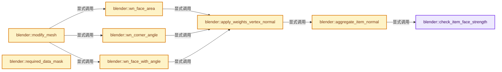
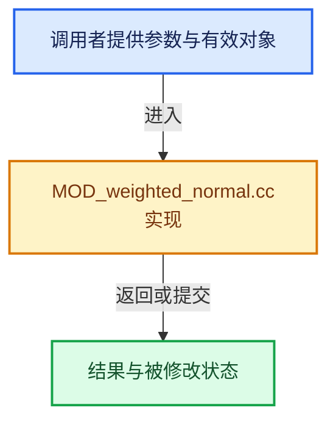

# 实现依赖专题：source/blender/modifiers/intern/MOD_weighted_normal.cc

[实现依赖导航](../../../README.md) · [符号索引](../../../../00-课程指南/02-源码与提交索引/符号依赖与实现索引.md)

本专题从正文实际调用进入，集中保存共享实现。函数有稳定锚点，可从调用处直接跳到对应完整函数；递归与互相调用通过回链组织。

## 本文件的实现关系






## 完整成员与函数实现

<a id="f-426b5a8c3b54b904"></a>

### `blender::check_item_face_strength`

实现位置：[source/blender/modifiers/intern/MOD_weighted_normal.cc](../../../../../../../../source/blender/modifiers/intern/MOD_weighted_normal.cc) · L106—L120。

接口参数：

- `WeightedNormalData *wn_data`
- `WeightedNormalDataAggregateItem *item_data`
- `const int face_index`

**教学注释版**

<!-- annotated:28c981020b244e -->

```cpp
static bool check_item_face_strength(WeightedNormalData *wn_data,
                                     WeightedNormalDataAggregateItem *item_data,
                                     const int face_index)
{
  const int mp_strength = wn_data->face_strength[face_index];

  if (mp_strength > item_data->curr_strength) {
    item_data->curr_strength = mp_strength;
    item_data->curr_val = 0.0f;
    item_data->loops_num = 0;
    zero_v3(item_data->normal);
  }

  return mp_strength == item_data->curr_strength;
}
```

<details>
<summary>核对原始源码：source/blender/modifiers/intern/MOD_weighted_normal.cc · L106—L120</summary>

<!-- original:28c981020b244e:source/blender/modifiers/intern/MOD_weighted_normal.cc:106:120 -->

```cpp
static bool check_item_face_strength(WeightedNormalData *wn_data,
                                     WeightedNormalDataAggregateItem *item_data,
                                     const int face_index)
{
  const int mp_strength = wn_data->face_strength[face_index];

  if (mp_strength > item_data->curr_strength) {
    item_data->curr_strength = mp_strength;
    item_data->curr_val = 0.0f;
    item_data->loops_num = 0;
    zero_v3(item_data->normal);
  }

  return mp_strength == item_data->curr_strength;
}
```

</details>

**沿实际写入检查状态**

- `item_data->curr_strength = mp_strength;`
- `item_data->curr_val = 0.0f;`
- `item_data->loops_num = 0;`

**结果出口**

- `return mp_strength == item_data->curr_strength;`

**继续追踪实现**

- `zero_v3` → [blender::zero_v3 · L26](../../../01-BLI基础库/intern/math_vector_inline.cc.md#f-13235b08fdecb098)。

<a id="f-c6832fefcdaaecab"></a>

### `blender::aggregate_item_normal`

实现位置：[source/blender/modifiers/intern/MOD_weighted_normal.cc](../../../../../../../../source/blender/modifiers/intern/MOD_weighted_normal.cc) · L122—L177。

接口参数：

- `WeightedNormalModifierData *wnmd`
- `WeightedNormalData *wn_data`
- `WeightedNormalDataAggregateItem *item_data`
- `const int mv_index`
- `const int face_index`
- `const float curr_val`
- `const bool use_face_influence`

**教学注释版**

<!-- annotated:2997e5f452f816 -->

```cpp
static void aggregate_item_normal(WeightedNormalModifierData *wnmd,
                                  WeightedNormalData *wn_data,
                                  WeightedNormalDataAggregateItem *item_data,
                                  const int mv_index,
                                  const int face_index,
                                  const float curr_val,
                                  const bool use_face_influence)
{
  const Span<float3> face_normals = wn_data->face_normals;

  const MDeformVert *dvert = wn_data->dvert;
  const int defgrp_index = wn_data->defgrp_index;
  const bool use_invert_vgroup = wn_data->use_invert_vgroup;

  const float weight = wn_data->weight;

  float *cached_inverse_powers_of_weight = wn_data->cached_inverse_powers_of_weight;

  const bool has_vgroup = dvert != nullptr;
  const bool vert_of_group = has_vgroup &&
                             BKE_defvert_find_index(&dvert[mv_index], defgrp_index) != nullptr;

  if (has_vgroup &&
      ((vert_of_group && use_invert_vgroup) || (!vert_of_group && !use_invert_vgroup)))
  {
    return;
  }

  if (use_face_influence && !check_item_face_strength(wn_data, item_data, face_index)) {
    return;
  }

  /* If item's curr_val is 0 init it to present value. */
  if (item_data->curr_val == 0.0f) {
    item_data->curr_val = curr_val;
  }
  if (!compare_ff(item_data->curr_val, curr_val, wnmd->thresh)) {
    /* item's curr_val and present value differ more than threshold, update. */
    item_data->loops_num++;
    item_data->curr_val = curr_val;
  }

  /* Exponentially divided weight for each normal
   * (since a few values will be used by most cases, we cache those). */
  const int loops_num = item_data->loops_num;
  if (loops_num < NUM_CACHED_INVERSE_POWERS_OF_WEIGHT &&
      cached_inverse_powers_of_weight[loops_num] == 0.0f)
  {
    cached_inverse_powers_of_weight[loops_num] = 1.0f / powf(weight, loops_num);
  }
  const float inverted_n_weight = loops_num < NUM_CACHED_INVERSE_POWERS_OF_WEIGHT ?
                                      cached_inverse_powers_of_weight[loops_num] :
                                      1.0f / powf(weight, loops_num);

  madd_v3_v3fl(item_data->normal, face_normals[face_index], curr_val * inverted_n_weight);
}
```

<details>
<summary>核对原始源码：source/blender/modifiers/intern/MOD_weighted_normal.cc · L122—L177</summary>

<!-- original:2997e5f452f816:source/blender/modifiers/intern/MOD_weighted_normal.cc:122:177 -->

```cpp
static void aggregate_item_normal(WeightedNormalModifierData *wnmd,
                                  WeightedNormalData *wn_data,
                                  WeightedNormalDataAggregateItem *item_data,
                                  const int mv_index,
                                  const int face_index,
                                  const float curr_val,
                                  const bool use_face_influence)
{
  const Span<float3> face_normals = wn_data->face_normals;

  const MDeformVert *dvert = wn_data->dvert;
  const int defgrp_index = wn_data->defgrp_index;
  const bool use_invert_vgroup = wn_data->use_invert_vgroup;

  const float weight = wn_data->weight;

  float *cached_inverse_powers_of_weight = wn_data->cached_inverse_powers_of_weight;

  const bool has_vgroup = dvert != nullptr;
  const bool vert_of_group = has_vgroup &&
                             BKE_defvert_find_index(&dvert[mv_index], defgrp_index) != nullptr;

  if (has_vgroup &&
      ((vert_of_group && use_invert_vgroup) || (!vert_of_group && !use_invert_vgroup)))
  {
    return;
  }

  if (use_face_influence && !check_item_face_strength(wn_data, item_data, face_index)) {
    return;
  }

  /* If item's curr_val is 0 init it to present value. */
  if (item_data->curr_val == 0.0f) {
    item_data->curr_val = curr_val;
  }
  if (!compare_ff(item_data->curr_val, curr_val, wnmd->thresh)) {
    /* item's curr_val and present value differ more than threshold, update. */
    item_data->loops_num++;
    item_data->curr_val = curr_val;
  }

  /* Exponentially divided weight for each normal
   * (since a few values will be used by most cases, we cache those). */
  const int loops_num = item_data->loops_num;
  if (loops_num < NUM_CACHED_INVERSE_POWERS_OF_WEIGHT &&
      cached_inverse_powers_of_weight[loops_num] == 0.0f)
  {
    cached_inverse_powers_of_weight[loops_num] = 1.0f / powf(weight, loops_num);
  }
  const float inverted_n_weight = loops_num < NUM_CACHED_INVERSE_POWERS_OF_WEIGHT ?
                                      cached_inverse_powers_of_weight[loops_num] :
                                      1.0f / powf(weight, loops_num);

  madd_v3_v3fl(item_data->normal, face_normals[face_index], curr_val * inverted_n_weight);
}
```

</details>

**沿实际写入检查状态**

- `item_data->curr_val = curr_val;`
- `cached_inverse_powers_of_weight[loops_num] = 1.0f / powf(weight, loops_num);`

**继续追踪实现**

- `BKE_defvert_find_index` → [blender::BKE_defvert_find_index · L811](../../../02-BKE几何与数据/intern/deform.cc.md#f-d8c22e4305ac3d34)。
- `check_item_face_strength` → [blender::check_item_face_strength · L106](MOD_weighted_normal.cc.md#f-426b5a8c3b54b904)。
- `compare_ff` → [blender::compare_ff · L416](../../../01-BLI基础库/intern/math_base_inline.cc.md#f-05969a4cd4cc634f)。
- `powf` → [powf · L188](../../../07-Intern运行时与平台/cycles/kernel/device/oneapi/compat.h.md#m-d8a2a165b5d3)；[powf · L264](../../../07-Intern运行时与平台/cycles/kernel/device/metal/compat.h.md#m-3de6a9230b53)；[powf · L95](../../../07-Intern运行时与平台/cycles/kernel/device/hip/compat.h.md#m-22a964b66221)；[powf · L93](../../../07-Intern运行时与平台/cycles/kernel/device/cuda/compat.h.md#m-64340c9f6eb3)。宏定义由构建条件选择。
- `madd_v3_v3fl` → [blender::madd_v3_v3fl · L501](../../../01-BLI基础库/intern/math_vector_inline.cc.md#f-4f81667c5d595c80)。

<a id="f-be648515f08b833c"></a>

### `blender::apply_weights_vertex_normal`

实现位置：[source/blender/modifiers/intern/MOD_weighted_normal.cc](../../../../../../../../source/blender/modifiers/intern/MOD_weighted_normal.cc) · L179—L371。

接口参数：

- `WeightedNormalModifierData *wnmd`
- `WeightedNormalData *wn_data`

**教学注释版**

<!-- annotated:e758d651d82c67 -->

```cpp
static void apply_weights_vertex_normal(WeightedNormalModifierData *wnmd,
                                        WeightedNormalData *wn_data)
{
  const int verts_num = wn_data->verts_num;

  const Span<float3> positions = wn_data->vert_positions;
  const OffsetIndices faces = wn_data->faces;
  const Span<int> corner_verts = wn_data->corner_verts;
  const Span<int> corner_edges = wn_data->corner_edges;

  MutableSpan<short2> clnors = wn_data->clnors;
  const Span<int> loop_to_face = wn_data->loop_to_face;

  const Span<float3> face_normals = wn_data->face_normals;
  const VArray<int> face_strength = wn_data->face_strength;

  const MDeformVert *dvert = wn_data->dvert;

  const short mode = wn_data->mode;
  ModePair *mode_pair = wn_data->mode_pair;

  bke::mesh::CornerNormalSpaceArray lnors_spacearr;

  const bool keep_sharp = (wnmd->flag & MOD_WEIGHTEDNORMAL_KEEP_SHARP) != 0;
  const bool use_face_influence = (wnmd->flag & MOD_WEIGHTEDNORMAL_FACE_INFLUENCE) != 0 &&
                                  bool(face_strength);
  const bool has_vgroup = dvert != nullptr;

  Array<float3> corner_normals;

  Array<WeightedNormalDataAggregateItem> items_data;
  if (keep_sharp) {
    /* This will give us loop normal spaces,
     * we do not actually care about computed corner_normals for now... */
    // [讲解] corner_normals.reinitialize：以新长度重建数组。
    corner_normals.reinitialize(corner_verts.size());
    bke::mesh::normals_calc_corners(positions,
                                    faces,
                                    corner_verts,
                                    corner_edges,
                                    wn_data->vert_to_face_map,
                                    wn_data->face_normals,
                                    wn_data->sharp_edges,
                                    wn_data->sharp_faces,
                                    clnors,
                                    &lnors_spacearr,
                                    corner_normals);

    WeightedNormalDataAggregateItem start_item{};
    start_item.curr_strength = FACE_STRENGTH_WEAK;
    items_data = Array<WeightedNormalDataAggregateItem>(lnors_spacearr.spaces.size(), start_item);
  }
  else {
    WeightedNormalDataAggregateItem start_item{};
    start_item.curr_strength = FACE_STRENGTH_WEAK;
    items_data = Array<WeightedNormalDataAggregateItem>(verts_num, start_item);
    // [讲解] corner_verts.size：查询视图长度或生成对应有效索引区间。
    lnors_spacearr.corner_space_indices.reinitialize(corner_verts.size());
    array_utils::fill_index_range<int>(lnors_spacearr.corner_space_indices);
  }
  wn_data->items_data = items_data;

  switch (mode) {
    case MOD_WEIGHTEDNORMAL_MODE_FACE:
      for (const int i : faces.index_range()) {
        const int face_index = mode_pair[i].index;
        const float mp_val = mode_pair[i].val;

        for (const int corner : faces[face_index]) {
          const int mv_index = corner_verts[corner];
          const int space_index = lnors_spacearr.corner_space_indices[corner];

          WeightedNormalDataAggregateItem *item_data = keep_sharp ? &items_data[space_index] :
                                                                    &items_data[mv_index];

          aggregate_item_normal(
              wnmd, wn_data, item_data, mv_index, face_index, mp_val, use_face_influence);
        }
      }
      break;
    case MOD_WEIGHTEDNORMAL_MODE_ANGLE:
    case MOD_WEIGHTEDNORMAL_MODE_FACE_ANGLE:
      for (int i = 0; i < corner_verts.size(); i++) {
        const int corner = mode_pair[i].index;
        const float ml_val = mode_pair[i].val;
        const int space_index = lnors_spacearr.corner_space_indices[corner];

        const int face_index = loop_to_face[corner];
        const int mv_index = corner_verts[corner];
        WeightedNormalDataAggregateItem *item_data = keep_sharp ? &items_data[space_index] :
                                                                  &items_data[mv_index];

        aggregate_item_normal(
            wnmd, wn_data, item_data, mv_index, face_index, ml_val, use_face_influence);
      }
      break;
    default:
      BLI_assert_unreachable();
  }

  /* Validate computed weighted normals. */
  // [讲解] items_data.index_range：查询固定有效长度及其索引范围。
  for (int item_index : items_data.index_range()) {
    if (normalize_v3(items_data[item_index].normal) < CLNORS_VALID_VEC_LEN) {
      zero_v3(items_data[item_index].normal);
    }
  }

  if (keep_sharp) {
    /* Set loop normals for normal computed for each lnor space (smooth fan).
     * Note that corner_normals is already populated with clnors
     * (before this modifier is applied, at start of this function),
     * so no need to recompute them here. */
    for (int corner = 0; corner < corner_verts.size(); corner++) {
      const int space_index = lnors_spacearr.corner_space_indices[corner];
      WeightedNormalDataAggregateItem *item_data = &items_data[space_index];
      if (!is_zero_v3(item_data->normal)) {
        copy_v3_v3(corner_normals[corner], item_data->normal);
      }
    }

    bke::mesh::normals_corner_custom_set(positions,
                                         faces,
                                         corner_verts,
                                         corner_edges,
                                         wn_data->vert_to_face_map,
                                         wn_data->vert_normals,
                                         face_normals,
                                         wn_data->sharp_faces,
                                         wn_data->sharp_edges,
                                         corner_normals,
                                         clnors);
  }
  else {
    /* TODO: Ideally, we could add an option to `BKE_mesh_normals_loop_custom_[from_verts_]set()`
     * to keep current clnors instead of resetting them to default auto-computed ones,
     * when given new custom normal is zero-vec.
     * But this is not exactly trivial change, better to keep this optimization for later...
     */
    if (!has_vgroup) {
      /* NOTE: in theory, we could avoid this extra allocation & copying...
       * But think we can live with it for now,
       * and it makes code simpler & cleaner. */
      Array<float3> vert_normals(verts_num, float3(0.0f));

      for (int corner = 0; corner < corner_verts.size(); corner++) {
        const int mv_index = corner_verts[corner];
        copy_v3_v3(vert_normals[mv_index], items_data[mv_index].normal);
      }

      bke::mesh::normals_corner_custom_set_from_verts(positions,
                                                      faces,
                                                      corner_verts,
                                                      corner_edges,
                                                      wn_data->vert_to_face_map,
                                                      wn_data->vert_normals,
                                                      face_normals,
                                                      wn_data->sharp_faces,
                                                      wn_data->sharp_edges,
                                                      vert_normals,
                                                      clnors);
    }
    else {
      corner_normals.reinitialize(corner_verts.size());
      bke::mesh::normals_calc_corners(positions,
                                      faces,
                                      corner_verts,
                                      corner_edges,
                                      wn_data->vert_to_face_map,
                                      face_normals,
                                      wn_data->sharp_edges,
                                      wn_data->sharp_faces,
                                      clnors,
                                      nullptr,
                                      corner_normals);

      for (int corner = 0; corner < corner_verts.size(); corner++) {
        const int item_index = corner_verts[corner];
        if (!is_zero_v3(items_data[item_index].normal)) {
          copy_v3_v3(corner_normals[corner], items_data[item_index].normal);
        }
      }
      bke::mesh::normals_corner_custom_set(positions,
                                           faces,
                                           corner_verts,
                                           corner_edges,
                                           wn_data->vert_to_face_map,
                                           wn_data->vert_normals,
                                           face_normals,
                                           wn_data->sharp_faces,
                                           wn_data->sharp_edges,
                                           corner_normals,
                                           clnors);
    }
  }
}
```

<details>
<summary>核对原始源码：source/blender/modifiers/intern/MOD_weighted_normal.cc · L179—L371</summary>

<!-- original:e758d651d82c67:source/blender/modifiers/intern/MOD_weighted_normal.cc:179:371 -->

```cpp
static void apply_weights_vertex_normal(WeightedNormalModifierData *wnmd,
                                        WeightedNormalData *wn_data)
{
  const int verts_num = wn_data->verts_num;

  const Span<float3> positions = wn_data->vert_positions;
  const OffsetIndices faces = wn_data->faces;
  const Span<int> corner_verts = wn_data->corner_verts;
  const Span<int> corner_edges = wn_data->corner_edges;

  MutableSpan<short2> clnors = wn_data->clnors;
  const Span<int> loop_to_face = wn_data->loop_to_face;

  const Span<float3> face_normals = wn_data->face_normals;
  const VArray<int> face_strength = wn_data->face_strength;

  const MDeformVert *dvert = wn_data->dvert;

  const short mode = wn_data->mode;
  ModePair *mode_pair = wn_data->mode_pair;

  bke::mesh::CornerNormalSpaceArray lnors_spacearr;

  const bool keep_sharp = (wnmd->flag & MOD_WEIGHTEDNORMAL_KEEP_SHARP) != 0;
  const bool use_face_influence = (wnmd->flag & MOD_WEIGHTEDNORMAL_FACE_INFLUENCE) != 0 &&
                                  bool(face_strength);
  const bool has_vgroup = dvert != nullptr;

  Array<float3> corner_normals;

  Array<WeightedNormalDataAggregateItem> items_data;
  if (keep_sharp) {
    /* This will give us loop normal spaces,
     * we do not actually care about computed corner_normals for now... */
    corner_normals.reinitialize(corner_verts.size());
    bke::mesh::normals_calc_corners(positions,
                                    faces,
                                    corner_verts,
                                    corner_edges,
                                    wn_data->vert_to_face_map,
                                    wn_data->face_normals,
                                    wn_data->sharp_edges,
                                    wn_data->sharp_faces,
                                    clnors,
                                    &lnors_spacearr,
                                    corner_normals);

    WeightedNormalDataAggregateItem start_item{};
    start_item.curr_strength = FACE_STRENGTH_WEAK;
    items_data = Array<WeightedNormalDataAggregateItem>(lnors_spacearr.spaces.size(), start_item);
  }
  else {
    WeightedNormalDataAggregateItem start_item{};
    start_item.curr_strength = FACE_STRENGTH_WEAK;
    items_data = Array<WeightedNormalDataAggregateItem>(verts_num, start_item);
    lnors_spacearr.corner_space_indices.reinitialize(corner_verts.size());
    array_utils::fill_index_range<int>(lnors_spacearr.corner_space_indices);
  }
  wn_data->items_data = items_data;

  switch (mode) {
    case MOD_WEIGHTEDNORMAL_MODE_FACE:
      for (const int i : faces.index_range()) {
        const int face_index = mode_pair[i].index;
        const float mp_val = mode_pair[i].val;

        for (const int corner : faces[face_index]) {
          const int mv_index = corner_verts[corner];
          const int space_index = lnors_spacearr.corner_space_indices[corner];

          WeightedNormalDataAggregateItem *item_data = keep_sharp ? &items_data[space_index] :
                                                                    &items_data[mv_index];

          aggregate_item_normal(
              wnmd, wn_data, item_data, mv_index, face_index, mp_val, use_face_influence);
        }
      }
      break;
    case MOD_WEIGHTEDNORMAL_MODE_ANGLE:
    case MOD_WEIGHTEDNORMAL_MODE_FACE_ANGLE:
      for (int i = 0; i < corner_verts.size(); i++) {
        const int corner = mode_pair[i].index;
        const float ml_val = mode_pair[i].val;
        const int space_index = lnors_spacearr.corner_space_indices[corner];

        const int face_index = loop_to_face[corner];
        const int mv_index = corner_verts[corner];
        WeightedNormalDataAggregateItem *item_data = keep_sharp ? &items_data[space_index] :
                                                                  &items_data[mv_index];

        aggregate_item_normal(
            wnmd, wn_data, item_data, mv_index, face_index, ml_val, use_face_influence);
      }
      break;
    default:
      BLI_assert_unreachable();
  }

  /* Validate computed weighted normals. */
  for (int item_index : items_data.index_range()) {
    if (normalize_v3(items_data[item_index].normal) < CLNORS_VALID_VEC_LEN) {
      zero_v3(items_data[item_index].normal);
    }
  }

  if (keep_sharp) {
    /* Set loop normals for normal computed for each lnor space (smooth fan).
     * Note that corner_normals is already populated with clnors
     * (before this modifier is applied, at start of this function),
     * so no need to recompute them here. */
    for (int corner = 0; corner < corner_verts.size(); corner++) {
      const int space_index = lnors_spacearr.corner_space_indices[corner];
      WeightedNormalDataAggregateItem *item_data = &items_data[space_index];
      if (!is_zero_v3(item_data->normal)) {
        copy_v3_v3(corner_normals[corner], item_data->normal);
      }
    }

    bke::mesh::normals_corner_custom_set(positions,
                                         faces,
                                         corner_verts,
                                         corner_edges,
                                         wn_data->vert_to_face_map,
                                         wn_data->vert_normals,
                                         face_normals,
                                         wn_data->sharp_faces,
                                         wn_data->sharp_edges,
                                         corner_normals,
                                         clnors);
  }
  else {
    /* TODO: Ideally, we could add an option to `BKE_mesh_normals_loop_custom_[from_verts_]set()`
     * to keep current clnors instead of resetting them to default auto-computed ones,
     * when given new custom normal is zero-vec.
     * But this is not exactly trivial change, better to keep this optimization for later...
     */
    if (!has_vgroup) {
      /* NOTE: in theory, we could avoid this extra allocation & copying...
       * But think we can live with it for now,
       * and it makes code simpler & cleaner. */
      Array<float3> vert_normals(verts_num, float3(0.0f));

      for (int corner = 0; corner < corner_verts.size(); corner++) {
        const int mv_index = corner_verts[corner];
        copy_v3_v3(vert_normals[mv_index], items_data[mv_index].normal);
      }

      bke::mesh::normals_corner_custom_set_from_verts(positions,
                                                      faces,
                                                      corner_verts,
                                                      corner_edges,
                                                      wn_data->vert_to_face_map,
                                                      wn_data->vert_normals,
                                                      face_normals,
                                                      wn_data->sharp_faces,
                                                      wn_data->sharp_edges,
                                                      vert_normals,
                                                      clnors);
    }
    else {
      corner_normals.reinitialize(corner_verts.size());
      bke::mesh::normals_calc_corners(positions,
                                      faces,
                                      corner_verts,
                                      corner_edges,
                                      wn_data->vert_to_face_map,
                                      face_normals,
                                      wn_data->sharp_edges,
                                      wn_data->sharp_faces,
                                      clnors,
                                      nullptr,
                                      corner_normals);

      for (int corner = 0; corner < corner_verts.size(); corner++) {
        const int item_index = corner_verts[corner];
        if (!is_zero_v3(items_data[item_index].normal)) {
          copy_v3_v3(corner_normals[corner], items_data[item_index].normal);
        }
      }
      bke::mesh::normals_corner_custom_set(positions,
                                           faces,
                                           corner_verts,
                                           corner_edges,
                                           wn_data->vert_to_face_map,
                                           wn_data->vert_normals,
                                           face_normals,
                                           wn_data->sharp_faces,
                                           wn_data->sharp_edges,
                                           corner_normals,
                                           clnors);
    }
  }
}
```

</details>

**沿实际写入检查状态**

- `start_item.curr_strength = FACE_STRENGTH_WEAK;`
- `items_data = Array<WeightedNormalDataAggregateItem>(lnors_spacearr.spaces.size(), start_item);`
- `items_data = Array<WeightedNormalDataAggregateItem>(verts_num, start_item);`
- `wn_data->items_data = items_data;`

**继续追踪实现**

- `corner_normals.reinitialize` → [blender::Array::reinitialize · L430](../../../../01-基础容器与现代CPP/08-Array复制移动与销毁.md#f-3414f619e246b688)。
- `corner_verts.size` → [blender::Span::size · L256](../../../../01-基础容器与现代CPP/05-Span只读连续视图.md#f-5f80fa006089c998)。
- `bke::mesh::normals_calc_corners` → [blender::bke::mesh::normals_calc_corners · L1239](../../../../06-隐式共享与缓存系统/08-法线缓存的真实依赖.md#f-be88fbe319bfb500)。
- `Array<WeightedNormalDataAggregateItem>` → [blender::Array::Array · L78](../../../../01-基础容器与现代CPP/07-Array构造与存储.md#f-001fd5eb3c658238)；[blender::Array::Array · L84](../../../../01-基础容器与现代CPP/07-Array构造与存储.md#f-674e2f10361a462b)；[blender::Array::Array · L89](../../../../01-基础容器与现代CPP/07-Array构造与存储.md#f-aa1e5908a9b67557)；[blender::Array::Array · L103](../../../../01-基础容器与现代CPP/07-Array构造与存储.md#f-b141be39084346f3)；[blender::Array::Array · L110](../../../../01-基础容器与现代CPP/07-Array构造与存储.md#f-452e276f39e81a2a)；[blender::Array::Array · L123](../../../../01-基础容器与现代CPP/07-Array构造与存储.md#f-646aa58152ec44f6)；[blender::Array::Array · L135](../../../../01-基础容器与现代CPP/07-Array构造与存储.md#f-0a9de4a549125f99)；[blender::Array::Array · L168](../../../../01-基础容器与现代CPP/07-Array构造与存储.md#f-31f001eb92069e9d)；[blender::Array::Array · L176](../../../../01-基础容器与现代CPP/07-Array构造与存储.md#f-cf8148f06fc6747a)；[blender::Array::Array · L178](../../../../01-基础容器与现代CPP/07-Array构造与存储.md#f-2ddca2fb9dd964b3)。同名重载需按实参类型选择。
- `lnors_spacearr.spaces.size` → [调用协议](../../../../00-课程指南/01-路线与规范/模板宏与动态分派协议.md)：接收对象类型依赖auto、返回值或模板实例；不按同名猜测目标。调用位置L228。
- `lnors_spacearr.corner_space_indices.reinitialize` → [调用协议](../../../../00-课程指南/01-路线与规范/模板宏与动态分派协议.md)：接收对象类型依赖auto、返回值或模板实例；不按同名猜测目标。调用位置L234。
- `array_utils::fill_index_range<int>` → [blender::array_utils::fill_index_range · L434](../../../../05-几何存储与拓扑映射/07-分组访问与反向索引.md#f-f8128b104d76df0f)；[blender::array_utils::fill_index_range · L439](../../../../05-几何存储与拓扑映射/07-分组访问与反向索引.md#f-95ca84458bfc7e7e)；[blender::array_utils::fill_index_range · L445](../../../../05-几何存储与拓扑映射/07-分组访问与反向索引.md#f-c11b114c213cd61a)。同名重载需按实参类型选择。
- `faces.index_range` → [blender::offset_indices::OffsetIndices::index_range · L77](../../../../05-几何存储与拓扑映射/02-OffsetIndices完整接口.md#f-19b5ca1456de007d)。
- `aggregate_item_normal` → [blender::aggregate_item_normal · L122](MOD_weighted_normal.cc.md#f-c6832fefcdaaecab)。
- `BLI_assert_unreachable` → [BLI_assert_unreachable · L77](../../../01-BLI基础库/BLI_assert.hh.md#m-7a2d91a67d8e)。宏定义由构建条件选择。
- `items_data.index_range` → [blender::Array::index_range · L371](../../../../01-基础容器与现代CPP/08-Array复制移动与销毁.md#f-50a09e14742887a0)。
- `normalize_v3` → [blender::normalize_v3 · L933](../../../01-BLI基础库/intern/math_vector_inline.cc.md#f-5f3257e657ef732c)。
- `zero_v3` → [blender::zero_v3 · L26](../../../01-BLI基础库/intern/math_vector_inline.cc.md#f-13235b08fdecb098)。
- `is_zero_v3` → [blender::is_zero_v3 · L963](../../../01-BLI基础库/intern/math_vector_inline.cc.md#f-80d0c8ecffdfad5b)。
- `copy_v3_v3` → [blender::copy_v3_v3 · L47](../../../01-BLI基础库/intern/math_vector_inline.cc.md#f-037a0d5fa5060bd6)。
- `bke::mesh::normals_corner_custom_set` → [blender::bke::mesh::normals_corner_custom_set · L1600](../../../../06-隐式共享与缓存系统/08-法线缓存的真实依赖.md#f-047f5ce7040508c8)。
- `float3` → [float3 · L641](../../compositor/algorithms/intern/smaa.cc.md#m-0ea8254cfdb4)。宏定义由构建条件选择。
- `bke::mesh::normals_corner_custom_set_from_verts` → [blender::bke::mesh::normals_corner_custom_set_from_verts · L1626](../../../../06-隐式共享与缓存系统/08-法线缓存的真实依赖.md#f-15dff820a56fcdf7)。

<a id="f-37c75534145b4b89"></a>

### `blender::wn_face_area`

实现位置：[source/blender/modifiers/intern/MOD_weighted_normal.cc](../../../../../../../../source/blender/modifiers/intern/MOD_weighted_normal.cc) · L373—L391。

接口参数：

- `WeightedNormalModifierData *wnmd`
- `WeightedNormalData *wn_data`

**教学注释版**

<!-- annotated:d543da22eea0e9 -->

```cpp
static void wn_face_area(WeightedNormalModifierData *wnmd, WeightedNormalData *wn_data)
{
  const Span<float3> positions = wn_data->vert_positions;
  const OffsetIndices faces = wn_data->faces;
  const Span<int> corner_verts = wn_data->corner_verts;

  // [讲解] faces.size：读取连续区间或分组的边界信息。
  ModePair *face_area = MEM_new_array_uninitialized<ModePair>(size_t(faces.size()), __func__);

  ModePair *f_area = face_area;
  for (const int i : faces.index_range()) {
    // [讲解] corner_verts.slice：建立原连续范围的子视图。
    f_area[i].val = bke::mesh::face_area_calc(positions, corner_verts.slice(faces[i]));
    f_area[i].index = i;
  }

  qsort(face_area, faces.size(), sizeof(*face_area), modepair_cmp_by_val_inverse);

  wn_data->mode_pair = face_area;
  apply_weights_vertex_normal(wnmd, wn_data);
}
```

<details>
<summary>核对原始源码：source/blender/modifiers/intern/MOD_weighted_normal.cc · L373—L391</summary>

<!-- original:d543da22eea0e9:source/blender/modifiers/intern/MOD_weighted_normal.cc:373:391 -->

```cpp
static void wn_face_area(WeightedNormalModifierData *wnmd, WeightedNormalData *wn_data)
{
  const Span<float3> positions = wn_data->vert_positions;
  const OffsetIndices faces = wn_data->faces;
  const Span<int> corner_verts = wn_data->corner_verts;

  ModePair *face_area = MEM_new_array_uninitialized<ModePair>(size_t(faces.size()), __func__);

  ModePair *f_area = face_area;
  for (const int i : faces.index_range()) {
    f_area[i].val = bke::mesh::face_area_calc(positions, corner_verts.slice(faces[i]));
    f_area[i].index = i;
  }

  qsort(face_area, faces.size(), sizeof(*face_area), modepair_cmp_by_val_inverse);

  wn_data->mode_pair = face_area;
  apply_weights_vertex_normal(wnmd, wn_data);
}
```

</details>

**沿实际写入检查状态**

- `f_area[i].val = bke::mesh::face_area_calc(positions, corner_verts.slice(faces[i]));`
- `f_area[i].index = i;`
- `wn_data->mode_pair = face_area;`

**继续追踪实现**

- `MEM_new_array_uninitialized<ModePair>` → [MEM_new_array_uninitialized · L608](../../../07-Intern运行时与平台/guardedalloc/MEM_guardedalloc.h.md#f-b7103eae8eb57b05)；[MEM_new_array_uninitialized · L129](../../../07-Intern运行时与平台/guardedalloc/intern/mallocn.cc.md#f-bf6ef4ddcfb6e5df)。同名重载需按实参类型选择。
- `faces.size` → [blender::offset_indices::OffsetIndices::size · L67](../../../../05-几何存储与拓扑映射/02-OffsetIndices完整接口.md#f-e238abc62ed42abd)。
- `faces.index_range` → [blender::offset_indices::OffsetIndices::index_range · L77](../../../../05-几何存储与拓扑映射/02-OffsetIndices完整接口.md#f-19b5ca1456de007d)。
- `bke::mesh::face_area_calc` → [blender::bke::mesh::face_area_calc · L67](../../../02-BKE几何与数据/intern/mesh_evaluate.cc.md#f-ce18cacfc44bbb37)。
- `corner_verts.slice` → [blender::Span::slice · L141](../../../../01-基础容器与现代CPP/05-Span只读连续视图.md#f-380a0e8fdcbd53cc)；[blender::Span::slice · L149](../../../../01-基础容器与现代CPP/05-Span只读连续视图.md#f-9b9c15e78dd54eec)。同名重载需按实参类型选择。
- `qsort` → [调用协议](../../../../00-课程指南/01-路线与规范/模板宏与动态分派协议.md)：函数指针、局部可调用对象或未展开的宏；必须结合调用者环境。调用位置L387。
- `apply_weights_vertex_normal` → [blender::apply_weights_vertex_normal · L179](MOD_weighted_normal.cc.md#f-be648515f08b833c)。

<a id="f-2febe7ab0c3adcc7"></a>

### `blender::wn_corner_angle`

实现位置：[source/blender/modifiers/intern/MOD_weighted_normal.cc](../../../../../../../../source/blender/modifiers/intern/MOD_weighted_normal.cc) · L393—L422。

接口参数：

- `WeightedNormalModifierData *wnmd`
- `WeightedNormalData *wn_data`

**教学注释版**

<!-- annotated:3e0c48d0775f28 -->

```cpp
static void wn_corner_angle(WeightedNormalModifierData *wnmd, WeightedNormalData *wn_data)
{
  const Span<float3> positions = wn_data->vert_positions;
  const OffsetIndices faces = wn_data->faces;
  const Span<int> corner_verts = wn_data->corner_verts;

  // [讲解] corner_verts.size：查询视图长度或生成对应有效索引区间。
  ModePair *corner_angle = MEM_new_array_uninitialized<ModePair>(size_t(corner_verts.size()),
                                                                 __func__);

  for (const int i : faces.index_range()) {
    const IndexRange face = faces[i];
    float *index_angle = MEM_new_array_uninitialized<float>(size_t(face.size()), __func__);
    // [讲解] corner_verts.slice：建立原连续范围的子视图。
    bke::mesh::face_angles_calc(positions, corner_verts.slice(face), {index_angle, face.size()});

    // [讲解] face.start：读取连续区间或分组的边界信息。
    ModePair *c_angl = &corner_angle[face.start()];
    float *angl = index_angle;
    for (int corner = face.start(); corner < face.start() + face.size();
         corner++, c_angl++, angl++)
    {
      c_angl->val = float(M_PI) - *angl;
      c_angl->index = corner;
    }
    MEM_delete(index_angle);
  }

  qsort(corner_angle, corner_verts.size(), sizeof(*corner_angle), modepair_cmp_by_val_inverse);

  wn_data->mode_pair = corner_angle;
  apply_weights_vertex_normal(wnmd, wn_data);
}
```

<details>
<summary>核对原始源码：source/blender/modifiers/intern/MOD_weighted_normal.cc · L393—L422</summary>

<!-- original:3e0c48d0775f28:source/blender/modifiers/intern/MOD_weighted_normal.cc:393:422 -->

```cpp
static void wn_corner_angle(WeightedNormalModifierData *wnmd, WeightedNormalData *wn_data)
{
  const Span<float3> positions = wn_data->vert_positions;
  const OffsetIndices faces = wn_data->faces;
  const Span<int> corner_verts = wn_data->corner_verts;

  ModePair *corner_angle = MEM_new_array_uninitialized<ModePair>(size_t(corner_verts.size()),
                                                                 __func__);

  for (const int i : faces.index_range()) {
    const IndexRange face = faces[i];
    float *index_angle = MEM_new_array_uninitialized<float>(size_t(face.size()), __func__);
    bke::mesh::face_angles_calc(positions, corner_verts.slice(face), {index_angle, face.size()});

    ModePair *c_angl = &corner_angle[face.start()];
    float *angl = index_angle;
    for (int corner = face.start(); corner < face.start() + face.size();
         corner++, c_angl++, angl++)
    {
      c_angl->val = float(M_PI) - *angl;
      c_angl->index = corner;
    }
    MEM_delete(index_angle);
  }

  qsort(corner_angle, corner_verts.size(), sizeof(*corner_angle), modepair_cmp_by_val_inverse);

  wn_data->mode_pair = corner_angle;
  apply_weights_vertex_normal(wnmd, wn_data);
}
```

</details>

**沿实际写入检查状态**

- `c_angl->val = float(M_PI) - *angl;`
- `c_angl->index = corner;`
- `wn_data->mode_pair = corner_angle;`

**继续追踪实现**

- `MEM_new_array_uninitialized<ModePair>` → [MEM_new_array_uninitialized · L608](../../../07-Intern运行时与平台/guardedalloc/MEM_guardedalloc.h.md#f-b7103eae8eb57b05)；[MEM_new_array_uninitialized · L129](../../../07-Intern运行时与平台/guardedalloc/intern/mallocn.cc.md#f-bf6ef4ddcfb6e5df)。同名重载需按实参类型选择。
- `corner_verts.size` → [blender::Span::size · L256](../../../../01-基础容器与现代CPP/05-Span只读连续视图.md#f-5f80fa006089c998)。
- `faces.index_range` → [blender::offset_indices::OffsetIndices::index_range · L77](../../../../05-几何存储与拓扑映射/02-OffsetIndices完整接口.md#f-19b5ca1456de007d)。
- `MEM_new_array_uninitialized<float>` → [MEM_new_array_uninitialized · L608](../../../07-Intern运行时与平台/guardedalloc/MEM_guardedalloc.h.md#f-b7103eae8eb57b05)；[MEM_new_array_uninitialized · L129](../../../07-Intern运行时与平台/guardedalloc/intern/mallocn.cc.md#f-bf6ef4ddcfb6e5df)。同名重载需按实参类型选择。
- `face.size` → [blender::IndexRange::size · L156](../../../../01-基础容器与现代CPP/04-IndexRange连续整数区间.md#f-05f66c3ebb2fdfec)。
- `bke::mesh::face_angles_calc` → [blender::bke::mesh::face_angles_calc · L201](../../../02-BKE几何与数据/intern/mesh_evaluate.cc.md#f-817443dc574d41f5)。
- `corner_verts.slice` → [blender::Span::slice · L141](../../../../01-基础容器与现代CPP/05-Span只读连续视图.md#f-380a0e8fdcbd53cc)；[blender::Span::slice · L149](../../../../01-基础容器与现代CPP/05-Span只读连续视图.md#f-9b9c15e78dd54eec)。同名重载需按实参类型选择。
- `face.start` → [blender::IndexRange::start · L243](../../../../01-基础容器与现代CPP/04-IndexRange连续整数区间.md#f-99d2195bd9cfd1f0)。
- `MEM_delete` → [MEM_delete · L400](../../../07-Intern运行时与平台/guardedalloc/MEM_guardedalloc.h.md#f-9049ffdd1682887c)。
- `qsort` → [调用协议](../../../../00-课程指南/01-路线与规范/模板宏与动态分派协议.md)：函数指针、局部可调用对象或未展开的宏；必须结合调用者环境。调用位置L418。
- `apply_weights_vertex_normal` → [blender::apply_weights_vertex_normal · L179](MOD_weighted_normal.cc.md#f-be648515f08b833c)。

<a id="f-25fe063ce6cfb866"></a>

### `blender::wn_face_with_angle`

实现位置：[source/blender/modifiers/intern/MOD_weighted_normal.cc](../../../../../../../../source/blender/modifiers/intern/MOD_weighted_normal.cc) · L424—L455。

接口参数：

- `WeightedNormalModifierData *wnmd`
- `WeightedNormalData *wn_data`

**教学注释版**

<!-- annotated:3528c6e597fb63 -->

```cpp
static void wn_face_with_angle(WeightedNormalModifierData *wnmd, WeightedNormalData *wn_data)
{
  const Span<float3> positions = wn_data->vert_positions;
  const OffsetIndices faces = wn_data->faces;
  const Span<int> corner_verts = wn_data->corner_verts;

  // [讲解] corner_verts.size：查询视图长度或生成对应有效索引区间。
  ModePair *combined = MEM_new_array_uninitialized<ModePair>(size_t(corner_verts.size()),
                                                             __func__);

  for (const int i : faces.index_range()) {
    const IndexRange face = faces[i];
    // [讲解] corner_verts.slice：建立原连续范围的子视图。
    const Span<int> face_verts = corner_verts.slice(face);
    const float face_area = bke::mesh::face_area_calc(positions, face_verts);
    float *index_angle = MEM_new_array_uninitialized<float>(size_t(face.size()), __func__);
    bke::mesh::face_angles_calc(positions, face_verts, {index_angle, face.size()});

    // [讲解] face.start：读取连续区间或分组的边界信息。
    ModePair *cmbnd = &combined[face.start()];
    float *angl = index_angle;
    for (int corner = face.start(); corner < face.start() + face.size(); corner++, cmbnd++, angl++)
    {
      /* In this case val is product of corner angle and face area. */
      cmbnd->val = (float(M_PI) - *angl) * face_area;
      cmbnd->index = corner;
    }
    MEM_delete(index_angle);
  }

  qsort(combined, corner_verts.size(), sizeof(*combined), modepair_cmp_by_val_inverse);

  wn_data->mode_pair = combined;
  apply_weights_vertex_normal(wnmd, wn_data);
}
```

<details>
<summary>核对原始源码：source/blender/modifiers/intern/MOD_weighted_normal.cc · L424—L455</summary>

<!-- original:3528c6e597fb63:source/blender/modifiers/intern/MOD_weighted_normal.cc:424:455 -->

```cpp
static void wn_face_with_angle(WeightedNormalModifierData *wnmd, WeightedNormalData *wn_data)
{
  const Span<float3> positions = wn_data->vert_positions;
  const OffsetIndices faces = wn_data->faces;
  const Span<int> corner_verts = wn_data->corner_verts;

  ModePair *combined = MEM_new_array_uninitialized<ModePair>(size_t(corner_verts.size()),
                                                             __func__);

  for (const int i : faces.index_range()) {
    const IndexRange face = faces[i];
    const Span<int> face_verts = corner_verts.slice(face);
    const float face_area = bke::mesh::face_area_calc(positions, face_verts);
    float *index_angle = MEM_new_array_uninitialized<float>(size_t(face.size()), __func__);
    bke::mesh::face_angles_calc(positions, face_verts, {index_angle, face.size()});

    ModePair *cmbnd = &combined[face.start()];
    float *angl = index_angle;
    for (int corner = face.start(); corner < face.start() + face.size(); corner++, cmbnd++, angl++)
    {
      /* In this case val is product of corner angle and face area. */
      cmbnd->val = (float(M_PI) - *angl) * face_area;
      cmbnd->index = corner;
    }
    MEM_delete(index_angle);
  }

  qsort(combined, corner_verts.size(), sizeof(*combined), modepair_cmp_by_val_inverse);

  wn_data->mode_pair = combined;
  apply_weights_vertex_normal(wnmd, wn_data);
}
```

</details>

**沿实际写入检查状态**

- `cmbnd->val = (float(M_PI) - *angl) * face_area;`
- `cmbnd->index = corner;`
- `wn_data->mode_pair = combined;`

**继续追踪实现**

- `MEM_new_array_uninitialized<ModePair>` → [MEM_new_array_uninitialized · L608](../../../07-Intern运行时与平台/guardedalloc/MEM_guardedalloc.h.md#f-b7103eae8eb57b05)；[MEM_new_array_uninitialized · L129](../../../07-Intern运行时与平台/guardedalloc/intern/mallocn.cc.md#f-bf6ef4ddcfb6e5df)。同名重载需按实参类型选择。
- `corner_verts.size` → [blender::Span::size · L256](../../../../01-基础容器与现代CPP/05-Span只读连续视图.md#f-5f80fa006089c998)。
- `faces.index_range` → [blender::offset_indices::OffsetIndices::index_range · L77](../../../../05-几何存储与拓扑映射/02-OffsetIndices完整接口.md#f-19b5ca1456de007d)。
- `corner_verts.slice` → [blender::Span::slice · L141](../../../../01-基础容器与现代CPP/05-Span只读连续视图.md#f-380a0e8fdcbd53cc)；[blender::Span::slice · L149](../../../../01-基础容器与现代CPP/05-Span只读连续视图.md#f-9b9c15e78dd54eec)。同名重载需按实参类型选择。
- `bke::mesh::face_area_calc` → [blender::bke::mesh::face_area_calc · L67](../../../02-BKE几何与数据/intern/mesh_evaluate.cc.md#f-ce18cacfc44bbb37)。
- `MEM_new_array_uninitialized<float>` → [MEM_new_array_uninitialized · L608](../../../07-Intern运行时与平台/guardedalloc/MEM_guardedalloc.h.md#f-b7103eae8eb57b05)；[MEM_new_array_uninitialized · L129](../../../07-Intern运行时与平台/guardedalloc/intern/mallocn.cc.md#f-bf6ef4ddcfb6e5df)。同名重载需按实参类型选择。
- `face.size` → [blender::IndexRange::size · L156](../../../../01-基础容器与现代CPP/04-IndexRange连续整数区间.md#f-05f66c3ebb2fdfec)。
- `bke::mesh::face_angles_calc` → [blender::bke::mesh::face_angles_calc · L201](../../../02-BKE几何与数据/intern/mesh_evaluate.cc.md#f-817443dc574d41f5)。
- `face.start` → [blender::IndexRange::start · L243](../../../../01-基础容器与现代CPP/04-IndexRange连续整数区间.md#f-99d2195bd9cfd1f0)。
- `MEM_delete` → [MEM_delete · L400](../../../07-Intern运行时与平台/guardedalloc/MEM_guardedalloc.h.md#f-9049ffdd1682887c)。
- `qsort` → [调用协议](../../../../00-课程指南/01-路线与规范/模板宏与动态分派协议.md)：函数指针、局部可调用对象或未展开的宏；必须结合调用者环境。调用位置L451。
- `apply_weights_vertex_normal` → [blender::apply_weights_vertex_normal · L179](MOD_weighted_normal.cc.md#f-be648515f08b833c)。

<a id="f-c1dc6635a4cdcf84"></a>

### `blender::modify_mesh`

实现位置：[source/blender/modifiers/intern/MOD_weighted_normal.cc](../../../../../../../../source/blender/modifiers/intern/MOD_weighted_normal.cc) · L457—L548。

接口参数：

- `ModifierData *md`
- `const ModifierEvalContext *ctx`
- `Mesh *mesh`

**教学注释版**

<!-- annotated:03ed1299de1633 -->

```cpp
static Mesh *modify_mesh(ModifierData *md, const ModifierEvalContext *ctx, Mesh *mesh)
{
  WeightedNormalModifierData *wnmd = reinterpret_cast<WeightedNormalModifierData *>(md);

  Mesh *result;
  result = id_cast<Mesh *>(BKE_id_copy_ex(nullptr, &mesh->id, nullptr, LIB_ID_COPY_LOCALIZE));

  const int verts_num = result->verts_num;
  const Span<float3> positions = mesh->vert_positions();
  const OffsetIndices faces = result->faces();
  const Span<int> corner_verts = mesh->corner_verts();
  const Span<int> corner_edges = mesh->corner_edges();

  /* Right now:
   * If weight = 50 then all faces are given equal weight.
   * If weight > 50 then more weight given to faces with larger values (face area / corner angle).
   * If weight < 50 then more weight given to faces with lesser values. However current calculation
   * does not converge to min/max.
   */
  float weight = float(wnmd->weight) / 50.0f;
  if (wnmd->weight == 100) {
    weight = float(SHRT_MAX);
  }
  else if (wnmd->weight == 1) {
    weight = 1 / float(SHRT_MAX);
  }
  else if ((weight - 1) * 25 > 1) {
    weight = (weight - 1) * 25;
  }

  const MDeformVert *dvert;
  int defgrp_index;
  MOD_get_vgroup(ctx->object, mesh, wnmd->defgrp_name, &dvert, &defgrp_index);

  const Span<int> loop_to_face_map = result->corner_to_face_map();

  bke::MutableAttributeAccessor attributes = result->attributes_for_write();
  bke::SpanAttributeWriter<bool> sharp_edges = attributes.lookup_or_add_for_write_span<bool>(
      "sharp_edge", bke::AttrDomain::Edge);
  bke::SpanAttributeWriter clnors = attributes.lookup_or_add_for_write_span<short2>(
      "custom_normal", bke::AttrDomain::Corner);
  if (!clnors) {
    return result;
  }

  WeightedNormalData wn_data{};
  wn_data.verts_num = verts_num;

  wn_data.vert_positions = positions;
  wn_data.vert_normals = result->vert_normals();
  wn_data.sharp_edges = sharp_edges.span;

  wn_data.corner_verts = corner_verts;
  wn_data.corner_edges = corner_edges;
  wn_data.vert_to_face_map = result->vert_to_face_map();
  wn_data.loop_to_face = loop_to_face_map;
  wn_data.clnors = clnors.span;

  wn_data.faces = faces;
  wn_data.face_normals = mesh->face_normals_true();
  wn_data.sharp_faces = *attributes.lookup<bool>("sharp_face", bke::AttrDomain::Face);
  wn_data.face_strength = *attributes.lookup<int>(MOD_WEIGHTEDNORMALS_FACEWEIGHT_CDLAYER_ID,
                                                  bke::AttrDomain::Face);

  wn_data.dvert = dvert;
  wn_data.defgrp_index = defgrp_index;
  wn_data.use_invert_vgroup = (wnmd->flag & MOD_WEIGHTEDNORMAL_INVERT_VGROUP) != 0;

  wn_data.weight = weight;
  wn_data.mode = wnmd->mode;

  switch (wnmd->mode) {
    case MOD_WEIGHTEDNORMAL_MODE_FACE:
      wn_face_area(wnmd, &wn_data);
      break;
    case MOD_WEIGHTEDNORMAL_MODE_ANGLE:
      wn_corner_angle(wnmd, &wn_data);
      break;
    case MOD_WEIGHTEDNORMAL_MODE_FACE_ANGLE:
      wn_face_with_angle(wnmd, &wn_data);
      break;
  }

  MEM_SAFE_DELETE(wn_data.mode_pair);

  result->runtime->is_original_bmesh = false;

  sharp_edges.finish();
  clnors.finish();

  return result;
}
```

<details>
<summary>核对原始源码：source/blender/modifiers/intern/MOD_weighted_normal.cc · L457—L548</summary>

<!-- original:03ed1299de1633:source/blender/modifiers/intern/MOD_weighted_normal.cc:457:548 -->

```cpp
static Mesh *modify_mesh(ModifierData *md, const ModifierEvalContext *ctx, Mesh *mesh)
{
  WeightedNormalModifierData *wnmd = reinterpret_cast<WeightedNormalModifierData *>(md);

  Mesh *result;
  result = id_cast<Mesh *>(BKE_id_copy_ex(nullptr, &mesh->id, nullptr, LIB_ID_COPY_LOCALIZE));

  const int verts_num = result->verts_num;
  const Span<float3> positions = mesh->vert_positions();
  const OffsetIndices faces = result->faces();
  const Span<int> corner_verts = mesh->corner_verts();
  const Span<int> corner_edges = mesh->corner_edges();

  /* Right now:
   * If weight = 50 then all faces are given equal weight.
   * If weight > 50 then more weight given to faces with larger values (face area / corner angle).
   * If weight < 50 then more weight given to faces with lesser values. However current calculation
   * does not converge to min/max.
   */
  float weight = float(wnmd->weight) / 50.0f;
  if (wnmd->weight == 100) {
    weight = float(SHRT_MAX);
  }
  else if (wnmd->weight == 1) {
    weight = 1 / float(SHRT_MAX);
  }
  else if ((weight - 1) * 25 > 1) {
    weight = (weight - 1) * 25;
  }

  const MDeformVert *dvert;
  int defgrp_index;
  MOD_get_vgroup(ctx->object, mesh, wnmd->defgrp_name, &dvert, &defgrp_index);

  const Span<int> loop_to_face_map = result->corner_to_face_map();

  bke::MutableAttributeAccessor attributes = result->attributes_for_write();
  bke::SpanAttributeWriter<bool> sharp_edges = attributes.lookup_or_add_for_write_span<bool>(
      "sharp_edge", bke::AttrDomain::Edge);
  bke::SpanAttributeWriter clnors = attributes.lookup_or_add_for_write_span<short2>(
      "custom_normal", bke::AttrDomain::Corner);
  if (!clnors) {
    return result;
  }

  WeightedNormalData wn_data{};
  wn_data.verts_num = verts_num;

  wn_data.vert_positions = positions;
  wn_data.vert_normals = result->vert_normals();
  wn_data.sharp_edges = sharp_edges.span;

  wn_data.corner_verts = corner_verts;
  wn_data.corner_edges = corner_edges;
  wn_data.vert_to_face_map = result->vert_to_face_map();
  wn_data.loop_to_face = loop_to_face_map;
  wn_data.clnors = clnors.span;

  wn_data.faces = faces;
  wn_data.face_normals = mesh->face_normals_true();
  wn_data.sharp_faces = *attributes.lookup<bool>("sharp_face", bke::AttrDomain::Face);
  wn_data.face_strength = *attributes.lookup<int>(MOD_WEIGHTEDNORMALS_FACEWEIGHT_CDLAYER_ID,
                                                  bke::AttrDomain::Face);

  wn_data.dvert = dvert;
  wn_data.defgrp_index = defgrp_index;
  wn_data.use_invert_vgroup = (wnmd->flag & MOD_WEIGHTEDNORMAL_INVERT_VGROUP) != 0;

  wn_data.weight = weight;
  wn_data.mode = wnmd->mode;

  switch (wnmd->mode) {
    case MOD_WEIGHTEDNORMAL_MODE_FACE:
      wn_face_area(wnmd, &wn_data);
      break;
    case MOD_WEIGHTEDNORMAL_MODE_ANGLE:
      wn_corner_angle(wnmd, &wn_data);
      break;
    case MOD_WEIGHTEDNORMAL_MODE_FACE_ANGLE:
      wn_face_with_angle(wnmd, &wn_data);
      break;
  }

  MEM_SAFE_DELETE(wn_data.mode_pair);

  result->runtime->is_original_bmesh = false;

  sharp_edges.finish();
  clnors.finish();

  return result;
}
```

</details>

**沿实际写入检查状态**

- `result = id_cast<Mesh *>(BKE_id_copy_ex(nullptr, &mesh->id, nullptr, LIB_ID_COPY_LOCALIZE));`
- `weight = float(SHRT_MAX);`
- `weight = 1 / float(SHRT_MAX);`
- `weight = (weight - 1) * 25;`
- `wn_data.verts_num = verts_num;`
- `wn_data.vert_positions = positions;`
- `wn_data.vert_normals = result->vert_normals();`
- `wn_data.sharp_edges = sharp_edges.span;`
- `wn_data.corner_verts = corner_verts;`
- `wn_data.corner_edges = corner_edges;`
- `wn_data.vert_to_face_map = result->vert_to_face_map();`
- `wn_data.loop_to_face = loop_to_face_map;`
- `wn_data.clnors = clnors.span;`
- `wn_data.faces = faces;`
- `wn_data.face_normals = mesh->face_normals_true();`
- `wn_data.sharp_faces = *attributes.lookup<bool>("sharp_face", bke::AttrDomain::Face);`
- `wn_data.face_strength = *attributes.lookup<int>(MOD_WEIGHTEDNORMALS_FACEWEIGHT_CDLAYER_ID,`
- `wn_data.dvert = dvert;`
- `wn_data.defgrp_index = defgrp_index;`
- `wn_data.use_invert_vgroup = (wnmd->flag & MOD_WEIGHTEDNORMAL_INVERT_VGROUP) != 0;`
- `wn_data.weight = weight;`
- `wn_data.mode = wnmd->mode;`
- `result->runtime->is_original_bmesh = false;`

**结果出口**

- `return result;`

**继续追踪实现**

- `id_cast<Mesh *>` → [blender::id_cast · L1417](../../makesdna/DNA_ID.h.md#f-6c8ac6412850ac5a)。
- `BKE_id_copy_ex` → [blender::BKE_id_copy_ex · L851](../../../02-BKE几何与数据/intern/lib_id.cc.md#f-24272170c95f49fb)。
- `mesh->vert_positions` → [Mesh::vert_positions · L1193](../../../../05-几何存储与拓扑映射/03-MPoly迁移与兼容.md#f-ae4177e5c5f2b371)。
- `result->faces` → [Mesh::faces · L1217](../../../../05-几何存储与拓扑映射/03-MPoly迁移与兼容.md#f-ea444760154e17b2)。
- `mesh->corner_verts` → [Mesh::corner_verts · L1238](../../../../05-几何存储与拓扑映射/03-MPoly迁移与兼容.md#f-a59c61f583b64bc4)。
- `mesh->corner_edges` → [Mesh::corner_edges · L1252](../../../../05-几何存储与拓扑映射/03-MPoly迁移与兼容.md#f-687b790868e7f257)。
- `MOD_get_vgroup` → [blender::MOD_get_vgroup · L158](MOD_util.cc.md#f-f461611d86b94405)。
- `result->corner_to_face_map` → [blender::Mesh::corner_to_face_map · L101](../../../../06-隐式共享与缓存系统/10-局部更新与失效修复.md#f-43907d9811e2baa7)。
- `result->attributes_for_write` → [Mesh::attributes_for_write · L1303](../../../../05-几何存储与拓扑映射/03-MPoly迁移与兼容.md#f-ca7af2f1a15f0bc4)。
- `attributes.lookup_or_add_for_write_span<bool>` → [blender::bke::MutableAttributeAccessor::lookup_or_add_for_write_span · L533](../../../02-BKE几何与数据/intern/attribute_access.cc.md#f-c533eff1b9a4973e)；[blender::bke::MutableAttributeAccessor::lookup_or_add_for_write_span · L861](../../../../05-几何存储与拓扑映射/08-AttributeAccessor接口.md#f-aa4c0d5a61437381)。同名重载需按实参类型选择。
- `attributes.lookup_or_add_for_write_span<short2>` → [blender::bke::MutableAttributeAccessor::lookup_or_add_for_write_span · L533](../../../02-BKE几何与数据/intern/attribute_access.cc.md#f-c533eff1b9a4973e)；[blender::bke::MutableAttributeAccessor::lookup_or_add_for_write_span · L861](../../../../05-几何存储与拓扑映射/08-AttributeAccessor接口.md#f-aa4c0d5a61437381)。同名重载需按实参类型选择。
- `result->vert_normals` → [blender::Mesh::vert_normals · L349](../../../../06-隐式共享与缓存系统/08-法线缓存的真实依赖.md#f-e9a9d50dc8e15fba)。
- `result->vert_to_face_map` → [blender::Mesh::vert_to_face_map · L119](../../../../06-隐式共享与缓存系统/10-局部更新与失效修复.md#f-343af7b6eb5a9239)。
- `mesh->face_normals_true` → [blender::Mesh::face_normals_true · L458](../../../../06-隐式共享与缓存系统/08-法线缓存的真实依赖.md#f-fe50f8ea920f5198)。
- `attributes.lookup<bool>` → [blender::GLVaoCache::lookup · L182](../../gpu/opengl/gl_batch.cc.md#f-e4f56cc3d9a969de)。
- `attributes.lookup<int>` → [blender::GLVaoCache::lookup · L182](../../gpu/opengl/gl_batch.cc.md#f-e4f56cc3d9a969de)。
- `wn_face_area` → [blender::wn_face_area · L373](MOD_weighted_normal.cc.md#f-37c75534145b4b89)。
- `wn_corner_angle` → [blender::wn_corner_angle · L393](MOD_weighted_normal.cc.md#f-2febe7ab0c3adcc7)。
- `wn_face_with_angle` → [blender::wn_face_with_angle · L424](MOD_weighted_normal.cc.md#f-25fe063ce6cfb866)。
- `MEM_SAFE_DELETE` → [MEM_SAFE_DELETE · L436](../../../07-Intern运行时与平台/guardedalloc/MEM_guardedalloc.h.md#m-eadb3bc5b902)。宏定义由构建条件选择。
- `sharp_edges.finish` → [blender::bke::SpanAttributeWriter::finish · L279](../../../../05-几何存储与拓扑映射/08-AttributeAccessor接口.md#f-585970a3b1bd4da4)。
- `clnors.finish` → [blender::bke::SpanAttributeWriter::finish · L279](../../../../05-几何存储与拓扑映射/08-AttributeAccessor接口.md#f-585970a3b1bd4da4)。

<a id="f-995c8ef916cc8f3c"></a>

### `blender::required_data_mask`

实现位置：[source/blender/modifiers/intern/MOD_weighted_normal.cc](../../../../../../../../source/blender/modifiers/intern/MOD_weighted_normal.cc) · L556—L567。

接口参数：

- `ModifierData *md`
- `CustomData_MeshMasks *r_cddata_masks`

**教学注释版**

<!-- annotated:97dad3a76c61c2 -->

```cpp
static void required_data_mask(ModifierData *md, CustomData_MeshMasks *r_cddata_masks)
{
  WeightedNormalModifierData *wnmd = reinterpret_cast<WeightedNormalModifierData *>(md);

  if (wnmd->defgrp_name[0] != '\0') {
    r_cddata_masks->vmask |= CD_MASK_MDEFORMVERT;
  }

  if (wnmd->flag & MOD_WEIGHTEDNORMAL_FACE_INFLUENCE) {
    r_cddata_masks->pmask |= CD_MASK_PROP_INT32;
  }
}
```

<details>
<summary>核对原始源码：source/blender/modifiers/intern/MOD_weighted_normal.cc · L556—L567</summary>

<!-- original:97dad3a76c61c2:source/blender/modifiers/intern/MOD_weighted_normal.cc:556:567 -->

```cpp
static void required_data_mask(ModifierData *md, CustomData_MeshMasks *r_cddata_masks)
{
  WeightedNormalModifierData *wnmd = reinterpret_cast<WeightedNormalModifierData *>(md);

  if (wnmd->defgrp_name[0] != '\0') {
    r_cddata_masks->vmask |= CD_MASK_MDEFORMVERT;
  }

  if (wnmd->flag & MOD_WEIGHTEDNORMAL_FACE_INFLUENCE) {
    r_cddata_masks->pmask |= CD_MASK_PROP_INT32;
  }
}
```

</details>

**沿实际写入检查状态**

- `r_cddata_masks->vmask |= CD_MASK_MDEFORMVERT;`
- `r_cddata_masks->pmask |= CD_MASK_PROP_INT32;`

**继续追踪实现**

本实现没有需要继续展开的显式调用；检查返回表达式、对象转换和调用者前置条件。
