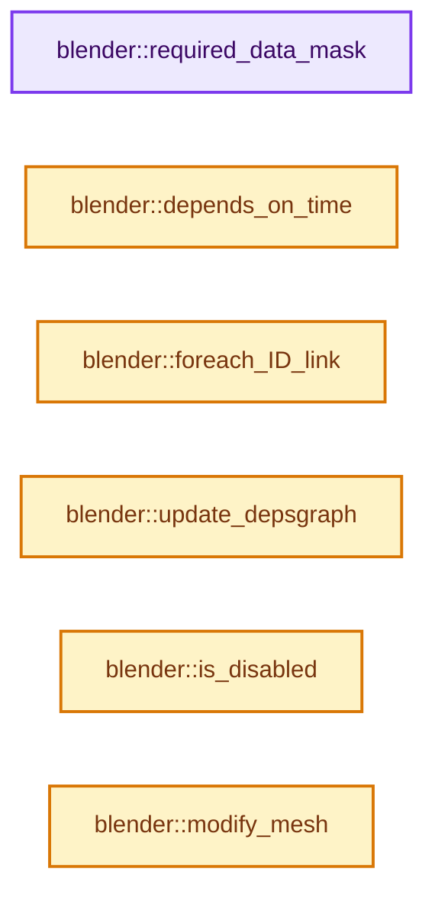

# 实现依赖专题：source/blender/modifiers/intern/MOD_weightvgedit.cc

[实现依赖导航](../../../README.md) · [符号索引](../../../../00-课程指南/02-源码与提交索引/符号依赖与实现索引.md)

本专题从正文实际调用进入，集中保存共享实现。函数有稳定锚点，可从调用处直接跳到对应完整函数；递归与互相调用通过回链组织。

## 本文件的实现关系




## 完整成员与函数实现

<a id="f-6c46c47d85ec1666"></a>

### `blender::required_data_mask`

实现位置：[source/blender/modifiers/intern/MOD_weightvgedit.cc](../../../../../../../../source/blender/modifiers/intern/MOD_weightvgedit.cc) · L84—L95。

接口参数：

- `ModifierData *md`
- `CustomData_MeshMasks *r_cddata_masks`

**教学注释版**

<!-- annotated:339cd48de7a8a5 -->

```cpp
static void required_data_mask(ModifierData *md, CustomData_MeshMasks *r_cddata_masks)
{
  WeightVGEditModifierData *wmd = reinterpret_cast<WeightVGEditModifierData *>(md);

  /* We need vertex groups! */
  r_cddata_masks->vmask |= CD_MASK_MDEFORMVERT;

  /* Ask for UV coordinates if we need them. */
  if (wmd->mask_tex_mapping == MOD_DISP_MAP_UV) {
    r_cddata_masks->fmask |= CD_MASK_MTFACE;
  }
}
```

<details>
<summary>核对原始源码：source/blender/modifiers/intern/MOD_weightvgedit.cc · L84—L95</summary>

<!-- original:339cd48de7a8a5:source/blender/modifiers/intern/MOD_weightvgedit.cc:84:95 -->

```cpp
static void required_data_mask(ModifierData *md, CustomData_MeshMasks *r_cddata_masks)
{
  WeightVGEditModifierData *wmd = reinterpret_cast<WeightVGEditModifierData *>(md);

  /* We need vertex groups! */
  r_cddata_masks->vmask |= CD_MASK_MDEFORMVERT;

  /* Ask for UV coordinates if we need them. */
  if (wmd->mask_tex_mapping == MOD_DISP_MAP_UV) {
    r_cddata_masks->fmask |= CD_MASK_MTFACE;
  }
}
```

</details>

**沿实际写入检查状态**

- `r_cddata_masks->vmask |= CD_MASK_MDEFORMVERT;`
- `r_cddata_masks->fmask |= CD_MASK_MTFACE;`

**继续追踪实现**

本实现没有需要继续展开的显式调用；检查返回表达式、对象转换和调用者前置条件。

<a id="f-901243a5209b91f9"></a>

### `blender::depends_on_time`

实现位置：[source/blender/modifiers/intern/MOD_weightvgedit.cc](../../../../../../../../source/blender/modifiers/intern/MOD_weightvgedit.cc) · L97—L105。

接口参数：

- `Scene *`
- `ModifierData *md`

**教学注释版**

<!-- annotated:6d4815fc6e366d -->

```cpp
static bool depends_on_time(Scene * /*scene*/, ModifierData *md)
{
  WeightVGEditModifierData *wmd = reinterpret_cast<WeightVGEditModifierData *>(md);

  if (wmd->mask_texture) {
    return BKE_texture_dependsOnTime(wmd->mask_texture);
  }
  return false;
}
```

<details>
<summary>核对原始源码：source/blender/modifiers/intern/MOD_weightvgedit.cc · L97—L105</summary>

<!-- original:6d4815fc6e366d:source/blender/modifiers/intern/MOD_weightvgedit.cc:97:105 -->

```cpp
static bool depends_on_time(Scene * /*scene*/, ModifierData *md)
{
  WeightVGEditModifierData *wmd = reinterpret_cast<WeightVGEditModifierData *>(md);

  if (wmd->mask_texture) {
    return BKE_texture_dependsOnTime(wmd->mask_texture);
  }
  return false;
}
```

</details>

**结果出口**

- `return BKE_texture_dependsOnTime(wmd->mask_texture);`
- `return false;`

**继续追踪实现**

- `BKE_texture_dependsOnTime` → [blender::BKE_texture_dependsOnTime · L600](../../../02-BKE几何与数据/intern/texture.cc.md#f-d94d173f823e5f13)。

<a id="f-588fea49738fdf80"></a>

### `blender::foreach_ID_link`

实现位置：[source/blender/modifiers/intern/MOD_weightvgedit.cc](../../../../../../../../source/blender/modifiers/intern/MOD_weightvgedit.cc) · L107—L113。

接口参数：

- `ModifierData *md`
- `Object *ob`
- `IDWalkFunc walk`
- `void *user_data`

**教学注释版**

<!-- annotated:36866ea430785c -->

```cpp
static void foreach_ID_link(ModifierData *md, Object *ob, IDWalkFunc walk, void *user_data)
{
  WeightVGEditModifierData *wmd = reinterpret_cast<WeightVGEditModifierData *>(md);

  walk(user_data, ob, reinterpret_cast<ID **>(&wmd->mask_texture), IDWALK_CB_USER);
  walk(user_data, ob, reinterpret_cast<ID **>(&wmd->mask_tex_map_obj), IDWALK_CB_NOP);
}
```

<details>
<summary>核对原始源码：source/blender/modifiers/intern/MOD_weightvgedit.cc · L107—L113</summary>

<!-- original:36866ea430785c:source/blender/modifiers/intern/MOD_weightvgedit.cc:107:113 -->

```cpp
static void foreach_ID_link(ModifierData *md, Object *ob, IDWalkFunc walk, void *user_data)
{
  WeightVGEditModifierData *wmd = reinterpret_cast<WeightVGEditModifierData *>(md);

  walk(user_data, ob, reinterpret_cast<ID **>(&wmd->mask_texture), IDWALK_CB_USER);
  walk(user_data, ob, reinterpret_cast<ID **>(&wmd->mask_tex_map_obj), IDWALK_CB_NOP);
}
```

</details>

**继续追踪实现**

- `walk` → [调用协议](../../../../00-课程指南/01-路线与规范/模板宏与动态分派协议.md)：局部可调用对象，须结合其初始化与捕获环境。调用位置L111。

<a id="f-9286a7f213a0d53c"></a>

### `blender::update_depsgraph`

实现位置：[source/blender/modifiers/intern/MOD_weightvgedit.cc](../../../../../../../../source/blender/modifiers/intern/MOD_weightvgedit.cc) · L122—L143。

接口参数：

- `ModifierData *md`
- `const ModifierUpdateDepsgraphContext *ctx`

**教学注释版**

<!-- annotated:efceceb1020f93 -->

```cpp
static void update_depsgraph(ModifierData *md, const ModifierUpdateDepsgraphContext *ctx)
{
  WeightVGEditModifierData *wmd = reinterpret_cast<WeightVGEditModifierData *>(md);
  bool need_transform_relation = false;

  if (wmd->mask_texture != nullptr) {
    DEG_add_generic_id_relation(ctx->node, &wmd->mask_texture->id, "WeightVGEdit Modifier");

    if (wmd->mask_tex_map_obj != nullptr && wmd->mask_tex_mapping == MOD_DISP_MAP_OBJECT) {
      MOD_depsgraph_update_object_bone_relation(
          ctx->node, wmd->mask_tex_map_obj, wmd->mask_tex_map_bone, "WeightVGEdit Modifier");
      need_transform_relation = true;
    }
    else if (wmd->mask_tex_mapping == MOD_DISP_MAP_GLOBAL) {
      need_transform_relation = true;
    }
  }

  if (need_transform_relation) {
    DEG_add_depends_on_transform_relation(ctx->node, "WeightVGEdit Modifier");
  }
}
```

<details>
<summary>核对原始源码：source/blender/modifiers/intern/MOD_weightvgedit.cc · L122—L143</summary>

<!-- original:efceceb1020f93:source/blender/modifiers/intern/MOD_weightvgedit.cc:122:143 -->

```cpp
static void update_depsgraph(ModifierData *md, const ModifierUpdateDepsgraphContext *ctx)
{
  WeightVGEditModifierData *wmd = reinterpret_cast<WeightVGEditModifierData *>(md);
  bool need_transform_relation = false;

  if (wmd->mask_texture != nullptr) {
    DEG_add_generic_id_relation(ctx->node, &wmd->mask_texture->id, "WeightVGEdit Modifier");

    if (wmd->mask_tex_map_obj != nullptr && wmd->mask_tex_mapping == MOD_DISP_MAP_OBJECT) {
      MOD_depsgraph_update_object_bone_relation(
          ctx->node, wmd->mask_tex_map_obj, wmd->mask_tex_map_bone, "WeightVGEdit Modifier");
      need_transform_relation = true;
    }
    else if (wmd->mask_tex_mapping == MOD_DISP_MAP_GLOBAL) {
      need_transform_relation = true;
    }
  }

  if (need_transform_relation) {
    DEG_add_depends_on_transform_relation(ctx->node, "WeightVGEdit Modifier");
  }
}
```

</details>

**沿实际写入检查状态**

- `need_transform_relation = true;`

**继续追踪实现**

- `DEG_add_generic_id_relation` → [blender::DEG_add_generic_id_relation · L232](../../../06-Depsgraph依赖图/intern/depsgraph_build.cc.md#f-43ef8aa495db0d98)。
- `MOD_depsgraph_update_object_bone_relation` → [blender::MOD_depsgraph_update_object_bone_relation · L188](MOD_util.cc.md#f-b4d8d5d84915768b)。
- `DEG_add_depends_on_transform_relation` → [blender::DEG_add_depends_on_transform_relation · L240](../../../06-Depsgraph依赖图/intern/depsgraph_build.cc.md#f-47c32a354defa20d)。

<a id="f-c33ae1e162371338"></a>

### `blender::is_disabled`

实现位置：[source/blender/modifiers/intern/MOD_weightvgedit.cc](../../../../../../../../source/blender/modifiers/intern/MOD_weightvgedit.cc) · L145—L150。

接口参数：

- `const Scene *`
- `ModifierData *md`
- `bool`

**教学注释版**

<!-- annotated:2af1eaf63c778e -->

```cpp
static bool is_disabled(const Scene * /*scene*/, ModifierData *md, bool /*use_render_params*/)
{
  WeightVGEditModifierData *wmd = reinterpret_cast<WeightVGEditModifierData *>(md);
  /* If no vertex group, bypass. */
  return (wmd->defgrp_name[0] == '\0');
}
```

<details>
<summary>核对原始源码：source/blender/modifiers/intern/MOD_weightvgedit.cc · L145—L150</summary>

<!-- original:2af1eaf63c778e:source/blender/modifiers/intern/MOD_weightvgedit.cc:145:150 -->

```cpp
static bool is_disabled(const Scene * /*scene*/, ModifierData *md, bool /*use_render_params*/)
{
  WeightVGEditModifierData *wmd = reinterpret_cast<WeightVGEditModifierData *>(md);
  /* If no vertex group, bypass. */
  return (wmd->defgrp_name[0] == '\0');
}
```

</details>

**结果出口**

- `return (wmd->defgrp_name[0] == '\0');`

**继续追踪实现**

本实现没有需要继续展开的显式调用；检查返回表达式、对象转换和调用者前置条件。

<a id="f-520e4757b2d9c83a"></a>

### `blender::modify_mesh`

实现位置：[source/blender/modifiers/intern/MOD_weightvgedit.cc](../../../../../../../../source/blender/modifiers/intern/MOD_weightvgedit.cc) · L152—L284。

接口参数：

- `ModifierData *md`
- `const ModifierEvalContext *ctx`
- `Mesh *mesh`

**教学注释版**

<!-- annotated:86c8567dc917f4 -->

```cpp
static Mesh *modify_mesh(ModifierData *md, const ModifierEvalContext *ctx, Mesh *mesh)
{
  BLI_assert(mesh != nullptr);

  WeightVGEditModifierData *wmd = reinterpret_cast<WeightVGEditModifierData *>(md);

  MDeformWeight **dw = nullptr;
  float *org_w; /* Array original weights. */
  float *new_w; /* Array new weights. */
  int i;
  const bool invert_vgroup_mask = (wmd->edit_flags & MOD_WVG_EDIT_INVERT_VGROUP_MASK) != 0;

  /* Flags. */
  const bool do_add = (wmd->edit_flags & MOD_WVG_EDIT_ADD2VG) != 0;
  const bool do_rem = (wmd->edit_flags & MOD_WVG_EDIT_REMFVG) != 0;
  /* Only do weight-preview in Object, Sculpt and Pose modes! */
#if 0
  const bool do_prev = (wmd->modifier.mode & eModifierMode_DoWeightPreview);
#endif

  /* Get number of verts. */
  const int verts_num = mesh->verts_num;

  /* Check if we can just return the original mesh.
   * Must have verts and therefore verts assigned to vgroups to do anything useful!
   */
  if ((verts_num == 0) || mesh->vertex_group_names.is_empty()) {
    return mesh;
  }

  /* Get vgroup idx from its name. */
  const int defgrp_index = BKE_id_defgroup_name_index(&mesh->id, wmd->defgrp_name);
  if (defgrp_index == -1) {
    return mesh;
  }

  const bool has_mdef = !mesh->deform_verts().is_empty();
  /* If no vertices were ever added to an object's vgroup, dvert might be nullptr. */
  if (!has_mdef) {
    /* If this modifier is not allowed to add vertices, just return. */
    if (!do_add) {
      return mesh;
    }
  }

  MDeformVert *dvert = mesh->deform_verts_for_write().data();

  /* Ultimate security check. */
  if (!dvert) {
    return mesh;
  }

  /* Get org weights, assuming 0.0 for vertices not in given vgroup. */
  org_w = MEM_new_array_uninitialized<float>(size_t(verts_num), __func__);
  new_w = MEM_new_array_uninitialized<float>(size_t(verts_num), __func__);
  dw = MEM_new_array_uninitialized<MDeformWeight *>(size_t(verts_num), __func__);
  for (i = 0; i < verts_num; i++) {
    dw[i] = BKE_defvert_find_index(&dvert[i], defgrp_index);
    if (dw[i]) {
      org_w[i] = new_w[i] = dw[i]->weight;
    }
    else {
      org_w[i] = new_w[i] = wmd->default_weight;
    }
  }

  /* Do mapping. */
  const bool do_invert_mapping = (wmd->edit_flags & MOD_WVG_INVERT_FALLOFF) != 0;
  const bool do_normalize = (wmd->edit_flags & MOD_WVG_EDIT_WEIGHTS_NORMALIZE) != 0;
  if (do_invert_mapping || wmd->falloff_type != MOD_WVG_MAPPING_NONE) {
    RNG *rng = nullptr;

    if (wmd->falloff_type == MOD_WVG_MAPPING_RANDOM) {
      rng = BLI_rng_new_srandom(BLI_ghashutil_strhash(ctx->object->id.name + 2));
    }

    weightvg_do_map(verts_num, new_w, wmd->falloff_type, do_invert_mapping, wmd->cmap_curve, rng);

    if (rng) {
      BLI_rng_free(rng);
    }
  }

  /* Do masking. */
  Scene *scene = DEG_get_evaluated_scene(ctx->depsgraph);
  weightvg_do_mask(ctx,
                   verts_num,
                   nullptr,
                   org_w,
                   new_w,
                   ctx->object,
                   mesh,
                   wmd->mask_constant,
                   wmd->mask_defgrp_name,
                   scene,
                   wmd->mask_texture,
                   wmd->mask_tex_use_channel,
                   wmd->mask_tex_mapping,
                   wmd->mask_tex_map_obj,
                   wmd->mask_tex_map_bone,
                   wmd->mask_tex_uvlayer_name,
                   invert_vgroup_mask);

  /* Update/add/remove from vgroup. */
  weightvg_update_vg(dvert,
                     defgrp_index,
                     dw,
                     verts_num,
                     nullptr,
                     org_w,
                     do_add,
                     wmd->add_threshold,
                     do_rem,
                     wmd->rem_threshold,
                     do_normalize);

  /* If weight preview enabled... */
#if 0 /* XXX Currently done in mod stack :/ */
  if (do_prev) {
    DM_update_weight_mcol(ob, dm, 0, org_w, 0, nullptr);
  }
#endif

  /* Freeing stuff. */
  MEM_delete(org_w);
  MEM_delete(new_w);
  MEM_delete(dw);

  mesh->runtime->is_original_bmesh = false;

  /* Return the vgroup-modified mesh. */
  return mesh;
}
```

<details>
<summary>核对原始源码：source/blender/modifiers/intern/MOD_weightvgedit.cc · L152—L284</summary>

<!-- original:86c8567dc917f4:source/blender/modifiers/intern/MOD_weightvgedit.cc:152:284 -->

```cpp
static Mesh *modify_mesh(ModifierData *md, const ModifierEvalContext *ctx, Mesh *mesh)
{
  BLI_assert(mesh != nullptr);

  WeightVGEditModifierData *wmd = reinterpret_cast<WeightVGEditModifierData *>(md);

  MDeformWeight **dw = nullptr;
  float *org_w; /* Array original weights. */
  float *new_w; /* Array new weights. */
  int i;
  const bool invert_vgroup_mask = (wmd->edit_flags & MOD_WVG_EDIT_INVERT_VGROUP_MASK) != 0;

  /* Flags. */
  const bool do_add = (wmd->edit_flags & MOD_WVG_EDIT_ADD2VG) != 0;
  const bool do_rem = (wmd->edit_flags & MOD_WVG_EDIT_REMFVG) != 0;
  /* Only do weight-preview in Object, Sculpt and Pose modes! */
#if 0
  const bool do_prev = (wmd->modifier.mode & eModifierMode_DoWeightPreview);
#endif

  /* Get number of verts. */
  const int verts_num = mesh->verts_num;

  /* Check if we can just return the original mesh.
   * Must have verts and therefore verts assigned to vgroups to do anything useful!
   */
  if ((verts_num == 0) || mesh->vertex_group_names.is_empty()) {
    return mesh;
  }

  /* Get vgroup idx from its name. */
  const int defgrp_index = BKE_id_defgroup_name_index(&mesh->id, wmd->defgrp_name);
  if (defgrp_index == -1) {
    return mesh;
  }

  const bool has_mdef = !mesh->deform_verts().is_empty();
  /* If no vertices were ever added to an object's vgroup, dvert might be nullptr. */
  if (!has_mdef) {
    /* If this modifier is not allowed to add vertices, just return. */
    if (!do_add) {
      return mesh;
    }
  }

  MDeformVert *dvert = mesh->deform_verts_for_write().data();

  /* Ultimate security check. */
  if (!dvert) {
    return mesh;
  }

  /* Get org weights, assuming 0.0 for vertices not in given vgroup. */
  org_w = MEM_new_array_uninitialized<float>(size_t(verts_num), __func__);
  new_w = MEM_new_array_uninitialized<float>(size_t(verts_num), __func__);
  dw = MEM_new_array_uninitialized<MDeformWeight *>(size_t(verts_num), __func__);
  for (i = 0; i < verts_num; i++) {
    dw[i] = BKE_defvert_find_index(&dvert[i], defgrp_index);
    if (dw[i]) {
      org_w[i] = new_w[i] = dw[i]->weight;
    }
    else {
      org_w[i] = new_w[i] = wmd->default_weight;
    }
  }

  /* Do mapping. */
  const bool do_invert_mapping = (wmd->edit_flags & MOD_WVG_INVERT_FALLOFF) != 0;
  const bool do_normalize = (wmd->edit_flags & MOD_WVG_EDIT_WEIGHTS_NORMALIZE) != 0;
  if (do_invert_mapping || wmd->falloff_type != MOD_WVG_MAPPING_NONE) {
    RNG *rng = nullptr;

    if (wmd->falloff_type == MOD_WVG_MAPPING_RANDOM) {
      rng = BLI_rng_new_srandom(BLI_ghashutil_strhash(ctx->object->id.name + 2));
    }

    weightvg_do_map(verts_num, new_w, wmd->falloff_type, do_invert_mapping, wmd->cmap_curve, rng);

    if (rng) {
      BLI_rng_free(rng);
    }
  }

  /* Do masking. */
  Scene *scene = DEG_get_evaluated_scene(ctx->depsgraph);
  weightvg_do_mask(ctx,
                   verts_num,
                   nullptr,
                   org_w,
                   new_w,
                   ctx->object,
                   mesh,
                   wmd->mask_constant,
                   wmd->mask_defgrp_name,
                   scene,
                   wmd->mask_texture,
                   wmd->mask_tex_use_channel,
                   wmd->mask_tex_mapping,
                   wmd->mask_tex_map_obj,
                   wmd->mask_tex_map_bone,
                   wmd->mask_tex_uvlayer_name,
                   invert_vgroup_mask);

  /* Update/add/remove from vgroup. */
  weightvg_update_vg(dvert,
                     defgrp_index,
                     dw,
                     verts_num,
                     nullptr,
                     org_w,
                     do_add,
                     wmd->add_threshold,
                     do_rem,
                     wmd->rem_threshold,
                     do_normalize);

  /* If weight preview enabled... */
#if 0 /* XXX Currently done in mod stack :/ */
  if (do_prev) {
    DM_update_weight_mcol(ob, dm, 0, org_w, 0, nullptr);
  }
#endif

  /* Freeing stuff. */
  MEM_delete(org_w);
  MEM_delete(new_w);
  MEM_delete(dw);

  mesh->runtime->is_original_bmesh = false;

  /* Return the vgroup-modified mesh. */
  return mesh;
}
```

</details>

**沿实际写入检查状态**

- `org_w = MEM_new_array_uninitialized<float>(size_t(verts_num), __func__);`
- `new_w = MEM_new_array_uninitialized<float>(size_t(verts_num), __func__);`
- `dw = MEM_new_array_uninitialized<MDeformWeight *>(size_t(verts_num), __func__);`
- `dw[i] = BKE_defvert_find_index(&dvert[i], defgrp_index);`
- `org_w[i] = new_w[i] = dw[i]->weight;`
- `org_w[i] = new_w[i] = wmd->default_weight;`
- `rng = BLI_rng_new_srandom(BLI_ghashutil_strhash(ctx->object->id.name + 2));`
- `mesh->runtime->is_original_bmesh = false;`

**结果出口**

- `return mesh;`

**继续追踪实现**

- `BLI_assert` → [BLI_assert · L48](../../../01-BLI基础库/BLI_assert.hh.md#m-57a88495704d)；[BLI_assert · L63](../../../01-BLI基础库/BLI_assert.hh.md#m-d07050020cb5)。宏定义由构建条件选择。
- `mesh->vertex_group_names.is_empty` → [调用协议](../../../../00-课程指南/01-路线与规范/模板宏与动态分派协议.md)：接收对象类型依赖auto、返回值或模板实例；不按同名猜测目标。调用位置L178。
- `BKE_id_defgroup_name_index` → [blender::BKE_id_defgroup_name_index · L557](../../../02-BKE几何与数据/intern/deform.cc.md#f-886667bbd10fa710)。
- `mesh->deform_verts().is_empty` → [调用协议](../../../../00-课程指南/01-路线与规范/模板宏与动态分派协议.md)：接收对象类型依赖auto、返回值或模板实例；不按同名猜测目标。调用位置L188。
- `mesh->deform_verts` → [Mesh::deform_verts · L1266](../../../../05-几何存储与拓扑映射/03-MPoly迁移与兼容.md#f-4c0433aad24aa301)。
- `mesh->deform_verts_for_write().data` → [调用协议](../../../../00-课程指南/01-路线与规范/模板宏与动态分派协议.md)：接收对象类型依赖auto、返回值或模板实例；不按同名猜测目标。调用位置L197。
- `mesh->deform_verts_for_write` → [Mesh::deform_verts_for_write · L1275](../../../../05-几何存储与拓扑映射/03-MPoly迁移与兼容.md#f-7f671db4897482dc)。
- `MEM_new_array_uninitialized<float>` → [MEM_new_array_uninitialized · L608](../../../07-Intern运行时与平台/guardedalloc/MEM_guardedalloc.h.md#f-b7103eae8eb57b05)；[MEM_new_array_uninitialized · L129](../../../07-Intern运行时与平台/guardedalloc/intern/mallocn.cc.md#f-bf6ef4ddcfb6e5df)。同名重载需按实参类型选择。
- `MEM_new_array_uninitialized<MDeformWeight *>` → [MEM_new_array_uninitialized · L608](../../../07-Intern运行时与平台/guardedalloc/MEM_guardedalloc.h.md#f-b7103eae8eb57b05)；[MEM_new_array_uninitialized · L129](../../../07-Intern运行时与平台/guardedalloc/intern/mallocn.cc.md#f-bf6ef4ddcfb6e5df)。同名重载需按实参类型选择。
- `BKE_defvert_find_index` → [blender::BKE_defvert_find_index · L811](../../../02-BKE几何与数据/intern/deform.cc.md#f-d8c22e4305ac3d34)。
- `BLI_rng_new_srandom` → [RNG::BLI_rng_new_srandom · L48](../../../01-BLI基础库/intern/rand.cc.md#f-61072c8c2d17d98d)。
- `BLI_ghashutil_strhash` → [BLI_ghashutil_strhash · L573](../../../01-BLI基础库/BLI_ghash.hh.md#m-4d269e82dba8)。宏定义由构建条件选择。
- `weightvg_do_map` → [blender::weightvg_do_map · L46](MOD_weightvg_util.cc.md#f-0c6e095a13c7c096)。
- `BLI_rng_free` → [RNG::BLI_rng_free · L55](../../../01-BLI基础库/intern/rand.cc.md#f-366aa1dd842611e9)。
- `DEG_get_evaluated_scene` → [blender::DEG_get_evaluated_scene · L212](../../../06-Depsgraph依赖图/intern/depsgraph_query.cc.md#f-be7729d26a71d3fd)。
- `weightvg_do_mask` → [blender::weightvg_do_mask · L109](MOD_weightvg_util.cc.md#f-c17381972adb0c5c)。
- `weightvg_update_vg` → [blender::weightvg_update_vg · L243](MOD_weightvg_util.cc.md#f-8ef241df5407f05a)。
- `DM_update_weight_mcol` → [调用协议](../../../../00-课程指南/01-路线与规范/模板宏与动态分派协议.md)：函数指针、局部可调用对象或未展开的宏；必须结合调用者环境。调用位置L271。
- `MEM_delete` → [MEM_delete · L400](../../../07-Intern运行时与平台/guardedalloc/MEM_guardedalloc.h.md#f-9049ffdd1682887c)。
