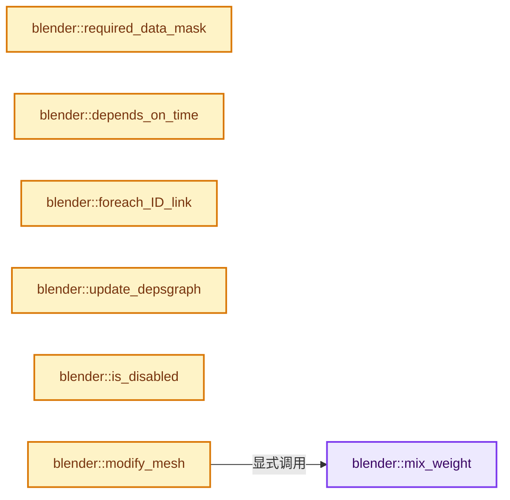

# 实现依赖专题：source/blender/modifiers/intern/MOD_weightvgmix.cc

[实现依赖导航](../../../README.md) · [符号索引](../../../../00-课程指南/02-源码与提交索引/符号依赖与实现索引.md)

本专题从正文实际调用进入，集中保存共享实现。函数有稳定锚点，可从调用处直接跳到对应完整函数；递归与互相调用通过回链组织。

## 本文件的实现关系




## 完整成员与函数实现

<a id="f-ee5beadc97f6047b"></a>

### `blender::mix_weight`

实现位置：[source/blender/modifiers/intern/MOD_weightvgmix.cc](../../../../../../../../source/blender/modifiers/intern/MOD_weightvgmix.cc) · L51—L119。

接口参数：

- `float weight`
- `float weight2`
- `char mix_mode`

**教学注释版**

<!-- annotated:d7b7ea2d0972a7 -->

```cpp
static float mix_weight(float weight, float weight2, char mix_mode)
{
#if 0
  /*
   * XXX Don't know why, but the switch version takes many CPU time,
   *     and produces lag in realtime playback...
   */
  switch (mix_mode) {
    case MOD_WVG_MIX_ADD:
      return (weight + weight2);
    case MOD_WVG_MIX_SUB:
      return (weight - weight2);
    case MOD_WVG_MIX_MUL:
      return (weight * weight2);
    case MOD_WVG_MIX_DIV:
      /* Avoid dividing by zero (or really small values). */
      if (0.0 <= weight2 < MOD_WVG_ZEROFLOOR) {
        weight2 = MOD_WVG_ZEROFLOOR;
      }
      else if (-MOD_WVG_ZEROFLOOR < weight2) {
        weight2 = -MOD_WVG_ZEROFLOOR;
      }
      return (weight / weight2);
    case MOD_WVG_MIX_DIF:
      return (weight < weight2 ? weight2 - weight : weight - weight2);
    case MOD_WVG_MIX_AVG:
      return (weight + weight2) / 2.0;
    case MOD_WVG_MIX_SET:
    default:
      return weight2;
  }
#endif
  if (mix_mode == MOD_WVG_MIX_SET) {
    return weight2;
  }
  if (mix_mode == MOD_WVG_MIX_ADD) {
    return (weight + weight2);
  }
  if (mix_mode == MOD_WVG_MIX_SUB) {
    return (weight - weight2);
  }
  if (mix_mode == MOD_WVG_MIX_MUL) {
    return (weight * weight2);
  }
  if (mix_mode == MOD_WVG_MIX_DIV) {
    /* Avoid dividing by zero (or really small values). */
    if (weight2 < 0.0f && weight2 > -MOD_WVG_ZEROFLOOR) {
      weight2 = -MOD_WVG_ZEROFLOOR;
    }
    else if (weight2 >= 0.0f && weight2 < MOD_WVG_ZEROFLOOR) {
      weight2 = MOD_WVG_ZEROFLOOR;
    }
    return (weight / weight2);
  }
  if (mix_mode == MOD_WVG_MIX_DIF) {
    return (weight < weight2 ? weight2 - weight : weight - weight2);
  }
  if (mix_mode == MOD_WVG_MIX_AVG) {
    return (weight + weight2) * 0.5f;
  }
  if (mix_mode == MOD_WVG_MIX_MIN) {
    return (weight < weight2 ? weight : weight2);
  }
  if (mix_mode == MOD_WVG_MIX_MAX) {
    return (weight > weight2 ? weight : weight2);
  }

  return weight2;
}
```

<details>
<summary>核对原始源码：source/blender/modifiers/intern/MOD_weightvgmix.cc · L51—L119</summary>

<!-- original:d7b7ea2d0972a7:source/blender/modifiers/intern/MOD_weightvgmix.cc:51:119 -->

```cpp
static float mix_weight(float weight, float weight2, char mix_mode)
{
#if 0
  /*
   * XXX Don't know why, but the switch version takes many CPU time,
   *     and produces lag in realtime playback...
   */
  switch (mix_mode) {
    case MOD_WVG_MIX_ADD:
      return (weight + weight2);
    case MOD_WVG_MIX_SUB:
      return (weight - weight2);
    case MOD_WVG_MIX_MUL:
      return (weight * weight2);
    case MOD_WVG_MIX_DIV:
      /* Avoid dividing by zero (or really small values). */
      if (0.0 <= weight2 < MOD_WVG_ZEROFLOOR) {
        weight2 = MOD_WVG_ZEROFLOOR;
      }
      else if (-MOD_WVG_ZEROFLOOR < weight2) {
        weight2 = -MOD_WVG_ZEROFLOOR;
      }
      return (weight / weight2);
    case MOD_WVG_MIX_DIF:
      return (weight < weight2 ? weight2 - weight : weight - weight2);
    case MOD_WVG_MIX_AVG:
      return (weight + weight2) / 2.0;
    case MOD_WVG_MIX_SET:
    default:
      return weight2;
  }
#endif
  if (mix_mode == MOD_WVG_MIX_SET) {
    return weight2;
  }
  if (mix_mode == MOD_WVG_MIX_ADD) {
    return (weight + weight2);
  }
  if (mix_mode == MOD_WVG_MIX_SUB) {
    return (weight - weight2);
  }
  if (mix_mode == MOD_WVG_MIX_MUL) {
    return (weight * weight2);
  }
  if (mix_mode == MOD_WVG_MIX_DIV) {
    /* Avoid dividing by zero (or really small values). */
    if (weight2 < 0.0f && weight2 > -MOD_WVG_ZEROFLOOR) {
      weight2 = -MOD_WVG_ZEROFLOOR;
    }
    else if (weight2 >= 0.0f && weight2 < MOD_WVG_ZEROFLOOR) {
      weight2 = MOD_WVG_ZEROFLOOR;
    }
    return (weight / weight2);
  }
  if (mix_mode == MOD_WVG_MIX_DIF) {
    return (weight < weight2 ? weight2 - weight : weight - weight2);
  }
  if (mix_mode == MOD_WVG_MIX_AVG) {
    return (weight + weight2) * 0.5f;
  }
  if (mix_mode == MOD_WVG_MIX_MIN) {
    return (weight < weight2 ? weight : weight2);
  }
  if (mix_mode == MOD_WVG_MIX_MAX) {
    return (weight > weight2 ? weight : weight2);
  }

  return weight2;
}
```

</details>

**沿实际写入检查状态**

- `weight2 = MOD_WVG_ZEROFLOOR;`
- `weight2 = -MOD_WVG_ZEROFLOOR;`

**结果出口**

- `return (weight + weight2);`
- `return (weight - weight2);`
- `return (weight * weight2);`
- `return (weight / weight2);`
- `return (weight < weight2 ? weight2 - weight : weight - weight2);`
- `return (weight + weight2) / 2.0;`
- `return weight2;`
- `return (weight + weight2) * 0.5f;`
- `return (weight < weight2 ? weight : weight2);`
- `return (weight > weight2 ? weight : weight2);`

**继续追踪实现**

本实现没有需要继续展开的显式调用；检查返回表达式、对象转换和调用者前置条件。

<a id="f-f3566ba52b452bc3"></a>

### `blender::required_data_mask`

实现位置：[source/blender/modifiers/intern/MOD_weightvgmix.cc](../../../../../../../../source/blender/modifiers/intern/MOD_weightvgmix.cc) · L130—L141。

接口参数：

- `ModifierData *md`
- `CustomData_MeshMasks *r_cddata_masks`

**教学注释版**

<!-- annotated:6b80c83c8fc6bc -->

```cpp
static void required_data_mask(ModifierData *md, CustomData_MeshMasks *r_cddata_masks)
{
  WeightVGMixModifierData *wmd = reinterpret_cast<WeightVGMixModifierData *>(md);

  /* We need vertex groups! */
  r_cddata_masks->vmask |= CD_MASK_MDEFORMVERT;

  /* Ask for UV coordinates if we need them. */
  if (wmd->mask_tex_mapping == MOD_DISP_MAP_UV) {
    r_cddata_masks->fmask |= CD_MASK_MTFACE;
  }
}
```

<details>
<summary>核对原始源码：source/blender/modifiers/intern/MOD_weightvgmix.cc · L130—L141</summary>

<!-- original:6b80c83c8fc6bc:source/blender/modifiers/intern/MOD_weightvgmix.cc:130:141 -->

```cpp
static void required_data_mask(ModifierData *md, CustomData_MeshMasks *r_cddata_masks)
{
  WeightVGMixModifierData *wmd = reinterpret_cast<WeightVGMixModifierData *>(md);

  /* We need vertex groups! */
  r_cddata_masks->vmask |= CD_MASK_MDEFORMVERT;

  /* Ask for UV coordinates if we need them. */
  if (wmd->mask_tex_mapping == MOD_DISP_MAP_UV) {
    r_cddata_masks->fmask |= CD_MASK_MTFACE;
  }
}
```

</details>

**沿实际写入检查状态**

- `r_cddata_masks->vmask |= CD_MASK_MDEFORMVERT;`
- `r_cddata_masks->fmask |= CD_MASK_MTFACE;`

**继续追踪实现**

本实现没有需要继续展开的显式调用；检查返回表达式、对象转换和调用者前置条件。

<a id="f-88d8fbb65e6fcc75"></a>

### `blender::depends_on_time`

实现位置：[source/blender/modifiers/intern/MOD_weightvgmix.cc](../../../../../../../../source/blender/modifiers/intern/MOD_weightvgmix.cc) · L143—L151。

接口参数：

- `Scene *`
- `ModifierData *md`

**教学注释版**

<!-- annotated:33473a729665d5 -->

```cpp
static bool depends_on_time(Scene * /*scene*/, ModifierData *md)
{
  WeightVGMixModifierData *wmd = reinterpret_cast<WeightVGMixModifierData *>(md);

  if (wmd->mask_texture) {
    return BKE_texture_dependsOnTime(wmd->mask_texture);
  }
  return false;
}
```

<details>
<summary>核对原始源码：source/blender/modifiers/intern/MOD_weightvgmix.cc · L143—L151</summary>

<!-- original:33473a729665d5:source/blender/modifiers/intern/MOD_weightvgmix.cc:143:151 -->

```cpp
static bool depends_on_time(Scene * /*scene*/, ModifierData *md)
{
  WeightVGMixModifierData *wmd = reinterpret_cast<WeightVGMixModifierData *>(md);

  if (wmd->mask_texture) {
    return BKE_texture_dependsOnTime(wmd->mask_texture);
  }
  return false;
}
```

</details>

**结果出口**

- `return BKE_texture_dependsOnTime(wmd->mask_texture);`
- `return false;`

**继续追踪实现**

- `BKE_texture_dependsOnTime` → [blender::BKE_texture_dependsOnTime · L600](../../../02-BKE几何与数据/intern/texture.cc.md#f-d94d173f823e5f13)。

<a id="f-86bd96bafcdaf1be"></a>

### `blender::foreach_ID_link`

实现位置：[source/blender/modifiers/intern/MOD_weightvgmix.cc](../../../../../../../../source/blender/modifiers/intern/MOD_weightvgmix.cc) · L153—L159。

接口参数：

- `ModifierData *md`
- `Object *ob`
- `IDWalkFunc walk`
- `void *user_data`

**教学注释版**

<!-- annotated:465aecf3f40dc9 -->

```cpp
static void foreach_ID_link(ModifierData *md, Object *ob, IDWalkFunc walk, void *user_data)
{
  WeightVGMixModifierData *wmd = reinterpret_cast<WeightVGMixModifierData *>(md);

  walk(user_data, ob, reinterpret_cast<ID **>(&wmd->mask_texture), IDWALK_CB_USER);
  walk(user_data, ob, reinterpret_cast<ID **>(&wmd->mask_tex_map_obj), IDWALK_CB_NOP);
}
```

<details>
<summary>核对原始源码：source/blender/modifiers/intern/MOD_weightvgmix.cc · L153—L159</summary>

<!-- original:465aecf3f40dc9:source/blender/modifiers/intern/MOD_weightvgmix.cc:153:159 -->

```cpp
static void foreach_ID_link(ModifierData *md, Object *ob, IDWalkFunc walk, void *user_data)
{
  WeightVGMixModifierData *wmd = reinterpret_cast<WeightVGMixModifierData *>(md);

  walk(user_data, ob, reinterpret_cast<ID **>(&wmd->mask_texture), IDWALK_CB_USER);
  walk(user_data, ob, reinterpret_cast<ID **>(&wmd->mask_tex_map_obj), IDWALK_CB_NOP);
}
```

</details>

**继续追踪实现**

- `walk` → [调用协议](../../../../00-课程指南/01-路线与规范/模板宏与动态分派协议.md)：局部可调用对象，须结合其初始化与捕获环境。调用位置L157。

<a id="f-60b54dddfefe1353"></a>

### `blender::update_depsgraph`

实现位置：[source/blender/modifiers/intern/MOD_weightvgmix.cc](../../../../../../../../source/blender/modifiers/intern/MOD_weightvgmix.cc) · L168—L189。

接口参数：

- `ModifierData *md`
- `const ModifierUpdateDepsgraphContext *ctx`

**教学注释版**

<!-- annotated:3f695169ba2238 -->

```cpp
static void update_depsgraph(ModifierData *md, const ModifierUpdateDepsgraphContext *ctx)
{
  WeightVGMixModifierData *wmd = reinterpret_cast<WeightVGMixModifierData *>(md);
  bool need_transform_relation = false;

  if (wmd->mask_texture != nullptr) {
    DEG_add_generic_id_relation(ctx->node, &wmd->mask_texture->id, "WeightVGMix Modifier");

    if (wmd->mask_tex_map_obj != nullptr && wmd->mask_tex_mapping == MOD_DISP_MAP_OBJECT) {
      MOD_depsgraph_update_object_bone_relation(
          ctx->node, wmd->mask_tex_map_obj, wmd->mask_tex_map_bone, "WeightVGMix Modifier");
      need_transform_relation = true;
    }
    else if (wmd->mask_tex_mapping == MOD_DISP_MAP_GLOBAL) {
      need_transform_relation = true;
    }
  }

  if (need_transform_relation) {
    DEG_add_depends_on_transform_relation(ctx->node, "WeightVGMix Modifier");
  }
}
```

<details>
<summary>核对原始源码：source/blender/modifiers/intern/MOD_weightvgmix.cc · L168—L189</summary>

<!-- original:3f695169ba2238:source/blender/modifiers/intern/MOD_weightvgmix.cc:168:189 -->

```cpp
static void update_depsgraph(ModifierData *md, const ModifierUpdateDepsgraphContext *ctx)
{
  WeightVGMixModifierData *wmd = reinterpret_cast<WeightVGMixModifierData *>(md);
  bool need_transform_relation = false;

  if (wmd->mask_texture != nullptr) {
    DEG_add_generic_id_relation(ctx->node, &wmd->mask_texture->id, "WeightVGMix Modifier");

    if (wmd->mask_tex_map_obj != nullptr && wmd->mask_tex_mapping == MOD_DISP_MAP_OBJECT) {
      MOD_depsgraph_update_object_bone_relation(
          ctx->node, wmd->mask_tex_map_obj, wmd->mask_tex_map_bone, "WeightVGMix Modifier");
      need_transform_relation = true;
    }
    else if (wmd->mask_tex_mapping == MOD_DISP_MAP_GLOBAL) {
      need_transform_relation = true;
    }
  }

  if (need_transform_relation) {
    DEG_add_depends_on_transform_relation(ctx->node, "WeightVGMix Modifier");
  }
}
```

</details>

**沿实际写入检查状态**

- `need_transform_relation = true;`

**继续追踪实现**

- `DEG_add_generic_id_relation` → [blender::DEG_add_generic_id_relation · L232](../../../06-Depsgraph依赖图/intern/depsgraph_build.cc.md#f-43ef8aa495db0d98)。
- `MOD_depsgraph_update_object_bone_relation` → [blender::MOD_depsgraph_update_object_bone_relation · L188](MOD_util.cc.md#f-b4d8d5d84915768b)。
- `DEG_add_depends_on_transform_relation` → [blender::DEG_add_depends_on_transform_relation · L240](../../../06-Depsgraph依赖图/intern/depsgraph_build.cc.md#f-47c32a354defa20d)。

<a id="f-912f1304d17b472c"></a>

### `blender::is_disabled`

实现位置：[source/blender/modifiers/intern/MOD_weightvgmix.cc](../../../../../../../../source/blender/modifiers/intern/MOD_weightvgmix.cc) · L191—L196。

接口参数：

- `const Scene *`
- `ModifierData *md`
- `bool`

**教学注释版**

<!-- annotated:3b075edd59af88 -->

```cpp
static bool is_disabled(const Scene * /*scene*/, ModifierData *md, bool /*use_render_params*/)
{
  WeightVGMixModifierData *wmd = reinterpret_cast<WeightVGMixModifierData *>(md);
  /* If no vertex group, bypass. */
  return (wmd->defgrp_name_a[0] == '\0');
}
```

<details>
<summary>核对原始源码：source/blender/modifiers/intern/MOD_weightvgmix.cc · L191—L196</summary>

<!-- original:3b075edd59af88:source/blender/modifiers/intern/MOD_weightvgmix.cc:191:196 -->

```cpp
static bool is_disabled(const Scene * /*scene*/, ModifierData *md, bool /*use_render_params*/)
{
  WeightVGMixModifierData *wmd = reinterpret_cast<WeightVGMixModifierData *>(md);
  /* If no vertex group, bypass. */
  return (wmd->defgrp_name_a[0] == '\0');
}
```

</details>

**结果出口**

- `return (wmd->defgrp_name_a[0] == '\0');`

**继续追踪实现**

本实现没有需要继续展开的显式调用；检查返回表达式、对象转换和调用者前置条件。

<a id="f-7b7861fae34b0118"></a>

### `blender::modify_mesh`

实现位置：[source/blender/modifiers/intern/MOD_weightvgmix.cc](../../../../../../../../source/blender/modifiers/intern/MOD_weightvgmix.cc) · L198—L439。

接口参数：

- `ModifierData *md`
- `const ModifierEvalContext *ctx`
- `Mesh *mesh`

**教学注释版**

<!-- annotated:c1ea415a08007e -->

```cpp
static Mesh *modify_mesh(ModifierData *md, const ModifierEvalContext *ctx, Mesh *mesh)
{
  BLI_assert(mesh != nullptr);

  WeightVGMixModifierData *wmd = reinterpret_cast<WeightVGMixModifierData *>(md);

  MDeformWeight **dw1, **tdw1, **dw2, **tdw2;
  float *org_w;
  float *new_w;
  int *tidx, *indices = nullptr;
  int index_num = 0;
  int i;
  const bool invert_vgroup_mask = (wmd->flag & MOD_WVG_MIX_INVERT_VGROUP_MASK) != 0;
  const bool do_normalize = (wmd->flag & MOD_WVG_MIX_WEIGHTS_NORMALIZE) != 0;

  /*
   * Note that we only invert the weight values within provided vgroups, the selection based on
   * which vertex is affected because it belongs or not to a group remains unchanged.
   * In other words, vertices not belonging to a group won't be affected, even though their
   * inverted 'virtual' weight would be 1.0f.
   */
  const bool invert_vgroup_a = (wmd->flag & MOD_WVG_MIX_INVERT_VGROUP_A) != 0;
  const bool invert_vgroup_b = (wmd->flag & MOD_WVG_MIX_INVERT_VGROUP_B) != 0;

  /* Flags. */
#if 0
  const bool do_prev = (wmd->modifier.mode & eModifierMode_DoWeightPreview) != 0;
#endif

  /* Get number of verts. */
  const int verts_num = mesh->verts_num;

  /* Check if we can just return the original mesh.
   * Must have verts and therefore verts assigned to vgroups to do anything useful!
   */
  if ((verts_num == 0) || mesh->vertex_group_names.is_empty()) {
    return mesh;
  }

  /* Get vgroup idx from its name. */
  const int defgrp_index = BKE_id_defgroup_name_index(&mesh->id, wmd->defgrp_name_a);
  if (defgrp_index == -1) {
    return mesh;
  }
  /* Get second vgroup idx from its name, if given. */
  int defgrp_index_other = -1;
  if (wmd->defgrp_name_b[0] != '\0') {
    defgrp_index_other = BKE_id_defgroup_name_index(&mesh->id, wmd->defgrp_name_b);
    if (defgrp_index_other == -1) {
      return mesh;
    }
  }

  const bool has_mdef = !mesh->deform_verts().is_empty();
  /* If no vertices were ever added to an object's vgroup, dvert might be nullptr. */
  if (!has_mdef) {
    /* If not affecting all vertices, just return. */
    if (wmd->mix_set != MOD_WVG_SET_ALL) {
      return mesh;
    }
  }

  MDeformVert *dvert = mesh->deform_verts_for_write().data();

  /* Ultimate security check. */
  if (!dvert) {
    return mesh;
  }

  /* Find out which vertices to work on. */
  tidx = MEM_new_array_uninitialized<int>(size_t(verts_num), __func__);
  tdw1 = MEM_new_array_uninitialized<MDeformWeight *>(size_t(verts_num), __func__);
  tdw2 = MEM_new_array_uninitialized<MDeformWeight *>(size_t(verts_num), __func__);
  switch (wmd->mix_set) {
    case MOD_WVG_SET_A:
      /* All vertices in first vgroup. */
      for (i = 0; i < verts_num; i++) {
        MDeformWeight *dw = BKE_defvert_find_index(&dvert[i], defgrp_index);
        if (dw) {
          tdw1[index_num] = dw;
          tdw2[index_num] = (defgrp_index_other >= 0) ?
                                BKE_defvert_find_index(&dvert[i], defgrp_index_other) :
                                nullptr;
          tidx[index_num++] = i;
        }
      }
      break;
    case MOD_WVG_SET_B:
      /* All vertices in second vgroup. */
      for (i = 0; i < verts_num; i++) {
        MDeformWeight *dw = (defgrp_index_other >= 0) ?
                                BKE_defvert_find_index(&dvert[i], defgrp_index_other) :
                                nullptr;
        if (dw) {
          tdw1[index_num] = BKE_defvert_find_index(&dvert[i], defgrp_index);
          tdw2[index_num] = dw;
          tidx[index_num++] = i;
        }
      }
      break;
    case MOD_WVG_SET_OR:
      /* All vertices in one vgroup or the other. */
      for (i = 0; i < verts_num; i++) {
        MDeformWeight *adw = BKE_defvert_find_index(&dvert[i], defgrp_index);
        MDeformWeight *bdw = (defgrp_index_other >= 0) ?
                                 BKE_defvert_find_index(&dvert[i], defgrp_index_other) :
                                 nullptr;
        if (adw || bdw) {
          tdw1[index_num] = adw;
          tdw2[index_num] = bdw;
          tidx[index_num++] = i;
        }
      }
      break;
    case MOD_WVG_SET_AND:
      /* All vertices in both vgroups. */
      for (i = 0; i < verts_num; i++) {
        MDeformWeight *adw = BKE_defvert_find_index(&dvert[i], defgrp_index);
        MDeformWeight *bdw = (defgrp_index_other >= 0) ?
                                 BKE_defvert_find_index(&dvert[i], defgrp_index_other) :
                                 nullptr;
        if (adw && bdw) {
          tdw1[index_num] = adw;
          tdw2[index_num] = bdw;
          tidx[index_num++] = i;
        }
      }
      break;
    case MOD_WVG_SET_ALL:
    default:
      /* Use all vertices. */
      for (i = 0; i < verts_num; i++) {
        tdw1[i] = BKE_defvert_find_index(&dvert[i], defgrp_index);
        tdw2[i] = (defgrp_index_other >= 0) ?
                      BKE_defvert_find_index(&dvert[i], defgrp_index_other) :
                      nullptr;
      }
      index_num = -1;
      break;
  }
  if (index_num == 0) {
    /* Use no vertices! Hence, return org data. */
    MEM_delete(tdw1);
    MEM_delete(tdw2);
    MEM_delete(tidx);
    return mesh;
  }
  if (index_num != -1) {
    indices = MEM_new_array_uninitialized<int>(size_t(index_num), __func__);
    // [讲解] memcpy：复制字节，源与目标不应重叠。类型生命周期、对齐和可复制表示须由调用者证明，不是任意对象的复制构造。
    memcpy(indices, tidx, sizeof(int) * index_num);
    dw1 = MEM_new_array_uninitialized<MDeformWeight *>(size_t(index_num), __func__);
    memcpy(dw1, tdw1, sizeof(MDeformWeight *) * index_num);
    MEM_delete(tdw1);
    dw2 = MEM_new_array_uninitialized<MDeformWeight *>(size_t(index_num), __func__);
    memcpy(dw2, tdw2, sizeof(MDeformWeight *) * index_num);
    MEM_delete(tdw2);
  }
  else {
    /* Use all vertices. */
    index_num = verts_num;
    /* Just copy MDeformWeight pointers arrays, they will be freed at the end. */
    dw1 = tdw1;
    dw2 = tdw2;
  }
  MEM_delete(tidx);

  org_w = MEM_new_array_uninitialized<float>(size_t(index_num), __func__);
  new_w = MEM_new_array_uninitialized<float>(size_t(index_num), __func__);

  /* Mix weights. */
  for (i = 0; i < index_num; i++) {
    float weight2;
    if (invert_vgroup_a) {
      org_w[i] = 1.0f - (dw1[i] ? dw1[i]->weight : wmd->default_weight_a);
    }
    else {
      org_w[i] = dw1[i] ? dw1[i]->weight : wmd->default_weight_a;
    }
    if (invert_vgroup_b) {
      weight2 = 1.0f - (dw2[i] ? dw2[i]->weight : wmd->default_weight_b);
    }
    else {
      weight2 = dw2[i] ? dw2[i]->weight : wmd->default_weight_b;
    }

    new_w[i] = mix_weight(org_w[i], weight2, wmd->mix_mode);
  }

  /* Do masking. */
  Scene *scene = DEG_get_evaluated_scene(ctx->depsgraph);
  weightvg_do_mask(ctx,
                   index_num,
                   indices,
                   org_w,
                   new_w,
                   ctx->object,
                   mesh,
                   wmd->mask_constant,
                   wmd->mask_defgrp_name,
                   scene,
                   wmd->mask_texture,
                   wmd->mask_tex_use_channel,
                   wmd->mask_tex_mapping,
                   wmd->mask_tex_map_obj,
                   wmd->mask_tex_map_bone,
                   wmd->mask_tex_uvlayer_name,
                   invert_vgroup_mask);

  /* Update (add to) vgroup.
   * XXX Depending on the MOD_WVG_SET_xxx option chosen, we might have to add vertices to vgroup.
   */
  weightvg_update_vg(dvert,
                     defgrp_index,
                     dw1,
                     index_num,
                     indices,
                     org_w,
                     true,
                     -FLT_MAX,
                     false,
                     0.0f,
                     do_normalize);

  /* If weight preview enabled... */
#if 0 /* XXX Currently done in mod stack :/ */
  if (do_prev) {
    DM_update_weight_mcol(ob, dm, 0, org_w, index_num, indices);
  }
#endif

  /* Freeing stuff. */
  MEM_delete(org_w);
  MEM_delete(new_w);
  MEM_delete(dw1);
  MEM_delete(dw2);
  MEM_SAFE_DELETE(indices);

  mesh->runtime->is_original_bmesh = false;

  /* Return the vgroup-modified mesh. */
  return mesh;
}
```

<details>
<summary>核对原始源码：source/blender/modifiers/intern/MOD_weightvgmix.cc · L198—L439</summary>

<!-- original:c1ea415a08007e:source/blender/modifiers/intern/MOD_weightvgmix.cc:198:439 -->

```cpp
static Mesh *modify_mesh(ModifierData *md, const ModifierEvalContext *ctx, Mesh *mesh)
{
  BLI_assert(mesh != nullptr);

  WeightVGMixModifierData *wmd = reinterpret_cast<WeightVGMixModifierData *>(md);

  MDeformWeight **dw1, **tdw1, **dw2, **tdw2;
  float *org_w;
  float *new_w;
  int *tidx, *indices = nullptr;
  int index_num = 0;
  int i;
  const bool invert_vgroup_mask = (wmd->flag & MOD_WVG_MIX_INVERT_VGROUP_MASK) != 0;
  const bool do_normalize = (wmd->flag & MOD_WVG_MIX_WEIGHTS_NORMALIZE) != 0;

  /*
   * Note that we only invert the weight values within provided vgroups, the selection based on
   * which vertex is affected because it belongs or not to a group remains unchanged.
   * In other words, vertices not belonging to a group won't be affected, even though their
   * inverted 'virtual' weight would be 1.0f.
   */
  const bool invert_vgroup_a = (wmd->flag & MOD_WVG_MIX_INVERT_VGROUP_A) != 0;
  const bool invert_vgroup_b = (wmd->flag & MOD_WVG_MIX_INVERT_VGROUP_B) != 0;

  /* Flags. */
#if 0
  const bool do_prev = (wmd->modifier.mode & eModifierMode_DoWeightPreview) != 0;
#endif

  /* Get number of verts. */
  const int verts_num = mesh->verts_num;

  /* Check if we can just return the original mesh.
   * Must have verts and therefore verts assigned to vgroups to do anything useful!
   */
  if ((verts_num == 0) || mesh->vertex_group_names.is_empty()) {
    return mesh;
  }

  /* Get vgroup idx from its name. */
  const int defgrp_index = BKE_id_defgroup_name_index(&mesh->id, wmd->defgrp_name_a);
  if (defgrp_index == -1) {
    return mesh;
  }
  /* Get second vgroup idx from its name, if given. */
  int defgrp_index_other = -1;
  if (wmd->defgrp_name_b[0] != '\0') {
    defgrp_index_other = BKE_id_defgroup_name_index(&mesh->id, wmd->defgrp_name_b);
    if (defgrp_index_other == -1) {
      return mesh;
    }
  }

  const bool has_mdef = !mesh->deform_verts().is_empty();
  /* If no vertices were ever added to an object's vgroup, dvert might be nullptr. */
  if (!has_mdef) {
    /* If not affecting all vertices, just return. */
    if (wmd->mix_set != MOD_WVG_SET_ALL) {
      return mesh;
    }
  }

  MDeformVert *dvert = mesh->deform_verts_for_write().data();

  /* Ultimate security check. */
  if (!dvert) {
    return mesh;
  }

  /* Find out which vertices to work on. */
  tidx = MEM_new_array_uninitialized<int>(size_t(verts_num), __func__);
  tdw1 = MEM_new_array_uninitialized<MDeformWeight *>(size_t(verts_num), __func__);
  tdw2 = MEM_new_array_uninitialized<MDeformWeight *>(size_t(verts_num), __func__);
  switch (wmd->mix_set) {
    case MOD_WVG_SET_A:
      /* All vertices in first vgroup. */
      for (i = 0; i < verts_num; i++) {
        MDeformWeight *dw = BKE_defvert_find_index(&dvert[i], defgrp_index);
        if (dw) {
          tdw1[index_num] = dw;
          tdw2[index_num] = (defgrp_index_other >= 0) ?
                                BKE_defvert_find_index(&dvert[i], defgrp_index_other) :
                                nullptr;
          tidx[index_num++] = i;
        }
      }
      break;
    case MOD_WVG_SET_B:
      /* All vertices in second vgroup. */
      for (i = 0; i < verts_num; i++) {
        MDeformWeight *dw = (defgrp_index_other >= 0) ?
                                BKE_defvert_find_index(&dvert[i], defgrp_index_other) :
                                nullptr;
        if (dw) {
          tdw1[index_num] = BKE_defvert_find_index(&dvert[i], defgrp_index);
          tdw2[index_num] = dw;
          tidx[index_num++] = i;
        }
      }
      break;
    case MOD_WVG_SET_OR:
      /* All vertices in one vgroup or the other. */
      for (i = 0; i < verts_num; i++) {
        MDeformWeight *adw = BKE_defvert_find_index(&dvert[i], defgrp_index);
        MDeformWeight *bdw = (defgrp_index_other >= 0) ?
                                 BKE_defvert_find_index(&dvert[i], defgrp_index_other) :
                                 nullptr;
        if (adw || bdw) {
          tdw1[index_num] = adw;
          tdw2[index_num] = bdw;
          tidx[index_num++] = i;
        }
      }
      break;
    case MOD_WVG_SET_AND:
      /* All vertices in both vgroups. */
      for (i = 0; i < verts_num; i++) {
        MDeformWeight *adw = BKE_defvert_find_index(&dvert[i], defgrp_index);
        MDeformWeight *bdw = (defgrp_index_other >= 0) ?
                                 BKE_defvert_find_index(&dvert[i], defgrp_index_other) :
                                 nullptr;
        if (adw && bdw) {
          tdw1[index_num] = adw;
          tdw2[index_num] = bdw;
          tidx[index_num++] = i;
        }
      }
      break;
    case MOD_WVG_SET_ALL:
    default:
      /* Use all vertices. */
      for (i = 0; i < verts_num; i++) {
        tdw1[i] = BKE_defvert_find_index(&dvert[i], defgrp_index);
        tdw2[i] = (defgrp_index_other >= 0) ?
                      BKE_defvert_find_index(&dvert[i], defgrp_index_other) :
                      nullptr;
      }
      index_num = -1;
      break;
  }
  if (index_num == 0) {
    /* Use no vertices! Hence, return org data. */
    MEM_delete(tdw1);
    MEM_delete(tdw2);
    MEM_delete(tidx);
    return mesh;
  }
  if (index_num != -1) {
    indices = MEM_new_array_uninitialized<int>(size_t(index_num), __func__);
    memcpy(indices, tidx, sizeof(int) * index_num);
    dw1 = MEM_new_array_uninitialized<MDeformWeight *>(size_t(index_num), __func__);
    memcpy(dw1, tdw1, sizeof(MDeformWeight *) * index_num);
    MEM_delete(tdw1);
    dw2 = MEM_new_array_uninitialized<MDeformWeight *>(size_t(index_num), __func__);
    memcpy(dw2, tdw2, sizeof(MDeformWeight *) * index_num);
    MEM_delete(tdw2);
  }
  else {
    /* Use all vertices. */
    index_num = verts_num;
    /* Just copy MDeformWeight pointers arrays, they will be freed at the end. */
    dw1 = tdw1;
    dw2 = tdw2;
  }
  MEM_delete(tidx);

  org_w = MEM_new_array_uninitialized<float>(size_t(index_num), __func__);
  new_w = MEM_new_array_uninitialized<float>(size_t(index_num), __func__);

  /* Mix weights. */
  for (i = 0; i < index_num; i++) {
    float weight2;
    if (invert_vgroup_a) {
      org_w[i] = 1.0f - (dw1[i] ? dw1[i]->weight : wmd->default_weight_a);
    }
    else {
      org_w[i] = dw1[i] ? dw1[i]->weight : wmd->default_weight_a;
    }
    if (invert_vgroup_b) {
      weight2 = 1.0f - (dw2[i] ? dw2[i]->weight : wmd->default_weight_b);
    }
    else {
      weight2 = dw2[i] ? dw2[i]->weight : wmd->default_weight_b;
    }

    new_w[i] = mix_weight(org_w[i], weight2, wmd->mix_mode);
  }

  /* Do masking. */
  Scene *scene = DEG_get_evaluated_scene(ctx->depsgraph);
  weightvg_do_mask(ctx,
                   index_num,
                   indices,
                   org_w,
                   new_w,
                   ctx->object,
                   mesh,
                   wmd->mask_constant,
                   wmd->mask_defgrp_name,
                   scene,
                   wmd->mask_texture,
                   wmd->mask_tex_use_channel,
                   wmd->mask_tex_mapping,
                   wmd->mask_tex_map_obj,
                   wmd->mask_tex_map_bone,
                   wmd->mask_tex_uvlayer_name,
                   invert_vgroup_mask);

  /* Update (add to) vgroup.
   * XXX Depending on the MOD_WVG_SET_xxx option chosen, we might have to add vertices to vgroup.
   */
  weightvg_update_vg(dvert,
                     defgrp_index,
                     dw1,
                     index_num,
                     indices,
                     org_w,
                     true,
                     -FLT_MAX,
                     false,
                     0.0f,
                     do_normalize);

  /* If weight preview enabled... */
#if 0 /* XXX Currently done in mod stack :/ */
  if (do_prev) {
    DM_update_weight_mcol(ob, dm, 0, org_w, index_num, indices);
  }
#endif

  /* Freeing stuff. */
  MEM_delete(org_w);
  MEM_delete(new_w);
  MEM_delete(dw1);
  MEM_delete(dw2);
  MEM_SAFE_DELETE(indices);

  mesh->runtime->is_original_bmesh = false;

  /* Return the vgroup-modified mesh. */
  return mesh;
}
```

</details>

**沿实际写入检查状态**

- `defgrp_index_other = BKE_id_defgroup_name_index(&mesh->id, wmd->defgrp_name_b);`
- `tidx = MEM_new_array_uninitialized<int>(size_t(verts_num), __func__);`
- `tdw1 = MEM_new_array_uninitialized<MDeformWeight *>(size_t(verts_num), __func__);`
- `tdw2 = MEM_new_array_uninitialized<MDeformWeight *>(size_t(verts_num), __func__);`
- `tdw1[index_num] = dw;`
- `tdw2[index_num] = (defgrp_index_other >= 0) ?`
- `tdw1[index_num] = BKE_defvert_find_index(&dvert[i], defgrp_index);`
- `tdw2[index_num] = dw;`
- `tdw1[index_num] = adw;`
- `tdw2[index_num] = bdw;`
- `tdw1[i] = BKE_defvert_find_index(&dvert[i], defgrp_index);`
- `tdw2[i] = (defgrp_index_other >= 0) ?`
- `index_num = -1;`
- `indices = MEM_new_array_uninitialized<int>(size_t(index_num), __func__);`
- `dw1 = MEM_new_array_uninitialized<MDeformWeight *>(size_t(index_num), __func__);`
- `dw2 = MEM_new_array_uninitialized<MDeformWeight *>(size_t(index_num), __func__);`
- `index_num = verts_num;`
- `dw1 = tdw1;`
- `dw2 = tdw2;`
- `org_w = MEM_new_array_uninitialized<float>(size_t(index_num), __func__);`
- `new_w = MEM_new_array_uninitialized<float>(size_t(index_num), __func__);`
- `org_w[i] = 1.0f - (dw1[i] ? dw1[i]->weight : wmd->default_weight_a);`
- `org_w[i] = dw1[i] ? dw1[i]->weight : wmd->default_weight_a;`
- `weight2 = 1.0f - (dw2[i] ? dw2[i]->weight : wmd->default_weight_b);`
- `weight2 = dw2[i] ? dw2[i]->weight : wmd->default_weight_b;`
- `new_w[i] = mix_weight(org_w[i], weight2, wmd->mix_mode);`
- `mesh->runtime->is_original_bmesh = false;`

**结果出口**

- `return mesh;`

**继续追踪实现**

- `BLI_assert` → [BLI_assert · L48](../../../01-BLI基础库/BLI_assert.hh.md#m-57a88495704d)；[BLI_assert · L63](../../../01-BLI基础库/BLI_assert.hh.md#m-d07050020cb5)。宏定义由构建条件选择。
- `mesh->vertex_group_names.is_empty` → [调用协议](../../../../00-课程指南/01-路线与规范/模板宏与动态分派协议.md)：接收对象类型依赖auto、返回值或模板实例；不按同名猜测目标。调用位置L233。
- `BKE_id_defgroup_name_index` → [blender::BKE_id_defgroup_name_index · L557](../../../02-BKE几何与数据/intern/deform.cc.md#f-886667bbd10fa710)。
- `mesh->deform_verts().is_empty` → [调用协议](../../../../00-课程指南/01-路线与规范/模板宏与动态分派协议.md)：接收对象类型依赖auto、返回值或模板实例；不按同名猜测目标。调用位置L251。
- `mesh->deform_verts` → [Mesh::deform_verts · L1266](../../../../05-几何存储与拓扑映射/03-MPoly迁移与兼容.md#f-4c0433aad24aa301)。
- `mesh->deform_verts_for_write().data` → [调用协议](../../../../00-课程指南/01-路线与规范/模板宏与动态分派协议.md)：接收对象类型依赖auto、返回值或模板实例；不按同名猜测目标。调用位置L260。
- `mesh->deform_verts_for_write` → [Mesh::deform_verts_for_write · L1275](../../../../05-几何存储与拓扑映射/03-MPoly迁移与兼容.md#f-7f671db4897482dc)。
- `MEM_new_array_uninitialized<int>` → [MEM_new_array_uninitialized · L608](../../../07-Intern运行时与平台/guardedalloc/MEM_guardedalloc.h.md#f-b7103eae8eb57b05)；[MEM_new_array_uninitialized · L129](../../../07-Intern运行时与平台/guardedalloc/intern/mallocn.cc.md#f-bf6ef4ddcfb6e5df)。同名重载需按实参类型选择。
- `MEM_new_array_uninitialized<MDeformWeight *>` → [MEM_new_array_uninitialized · L608](../../../07-Intern运行时与平台/guardedalloc/MEM_guardedalloc.h.md#f-b7103eae8eb57b05)；[MEM_new_array_uninitialized · L129](../../../07-Intern运行时与平台/guardedalloc/intern/mallocn.cc.md#f-bf6ef4ddcfb6e5df)。同名重载需按实参类型选择。
- `BKE_defvert_find_index` → [blender::BKE_defvert_find_index · L811](../../../02-BKE几何与数据/intern/deform.cc.md#f-d8c22e4305ac3d34)。
- `MEM_delete` → [MEM_delete · L400](../../../07-Intern运行时与平台/guardedalloc/MEM_guardedalloc.h.md#f-9049ffdd1682887c)。
- `memcpy` → [外部契约](https://eel.is/c++draft/cstring.syn)：复制字节，源与目标不应重叠。类型生命周期、对齐和可复制表示须由调用者证明，不是任意对象的复制构造。
- `MEM_new_array_uninitialized<float>` → [MEM_new_array_uninitialized · L608](../../../07-Intern运行时与平台/guardedalloc/MEM_guardedalloc.h.md#f-b7103eae8eb57b05)；[MEM_new_array_uninitialized · L129](../../../07-Intern运行时与平台/guardedalloc/intern/mallocn.cc.md#f-bf6ef4ddcfb6e5df)。同名重载需按实参类型选择。
- `mix_weight` → [blender::mix_weight · L51](MOD_weightvgmix.cc.md#f-ee5beadc97f6047b)。
- `DEG_get_evaluated_scene` → [blender::DEG_get_evaluated_scene · L212](../../../06-Depsgraph依赖图/intern/depsgraph_query.cc.md#f-be7729d26a71d3fd)。
- `weightvg_do_mask` → [blender::weightvg_do_mask · L109](MOD_weightvg_util.cc.md#f-c17381972adb0c5c)。
- `weightvg_update_vg` → [blender::weightvg_update_vg · L243](MOD_weightvg_util.cc.md#f-8ef241df5407f05a)。
- `DM_update_weight_mcol` → [调用协议](../../../../00-课程指南/01-路线与规范/模板宏与动态分派协议.md)：函数指针、局部可调用对象或未展开的宏；必须结合调用者环境。调用位置L424。
- `MEM_SAFE_DELETE` → [MEM_SAFE_DELETE · L436](../../../07-Intern运行时与平台/guardedalloc/MEM_guardedalloc.h.md#m-eadb3bc5b902)。宏定义由构建条件选择。
