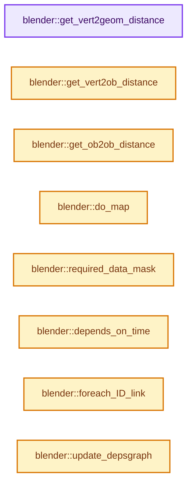
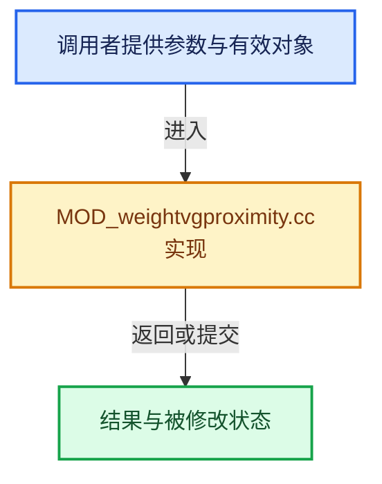

# 实现依赖专题：source/blender/modifiers/intern/MOD_weightvgproximity.cc

[实现依赖导航](../../../README.md) · [符号索引](../../../../00-课程指南/02-源码与提交索引/符号依赖与实现索引.md)

本专题从正文实际调用进入，集中保存共享实现。函数有稳定锚点，可从调用处直接跳到对应完整函数；递归与互相调用通过回链组织。

## 本文件的实现关系






## 完整成员与函数实现

<a id="f-7912a927ce9bc4df"></a>

### `blender::get_vert2geom_distance`

实现位置：[source/blender/modifiers/intern/MOD_weightvgproximity.cc](../../../../../../../../source/blender/modifiers/intern/MOD_weightvgproximity.cc) · L128—L163。

接口参数：

- `int verts_num`
- `const Span<float3> positions`
- `const int *indices`
- `float *dist_v`
- `float *dist_e`
- `float *dist_f`
- `Mesh *target`
- `const SpaceTransform *loc2trgt`

**教学注释版**

<!-- annotated:fcfebe9a5c15d7 -->

```cpp
static void get_vert2geom_distance(int verts_num,
                                   const Span<float3> positions,
                                   const int *indices,
                                   float *dist_v,
                                   float *dist_e,
                                   float *dist_f,
                                   Mesh *target,
                                   const SpaceTransform *loc2trgt)
{
  Vert2GeomData data{};

  if (dist_v) {
    /* Create a BVH-tree of the given target's verts. */
    data.verts_tree = &target->bvh_verts();
  }
  if (dist_e) {
    /* Create a BVH-tree of the given target's edges. */
    data.edges_tree = &target->bvh_edges();
  }
  if (dist_f) {
    /* Create a BVH-tree of the given target's faces. */
    data.tris_tree = &target->bvh_tris();
  }

  data.positions = positions;
  data.indices = indices;
  data.loc2trgt = loc2trgt;
  data.dist_v = dist_v;
  data.dist_e = dist_e;
  data.dist_f = dist_f;

  TaskParallelSettings settings;
  BLI_parallel_range_settings_defaults(&settings);
  settings.use_threading = (verts_num > 10000);
  BLI_task_parallel_range(0, verts_num, &data, vert2geom_task_cb_ex, &settings);
}
```

<details>
<summary>核对原始源码：source/blender/modifiers/intern/MOD_weightvgproximity.cc · L128—L163</summary>

<!-- original:fcfebe9a5c15d7:source/blender/modifiers/intern/MOD_weightvgproximity.cc:128:163 -->

```cpp
static void get_vert2geom_distance(int verts_num,
                                   const Span<float3> positions,
                                   const int *indices,
                                   float *dist_v,
                                   float *dist_e,
                                   float *dist_f,
                                   Mesh *target,
                                   const SpaceTransform *loc2trgt)
{
  Vert2GeomData data{};

  if (dist_v) {
    /* Create a BVH-tree of the given target's verts. */
    data.verts_tree = &target->bvh_verts();
  }
  if (dist_e) {
    /* Create a BVH-tree of the given target's edges. */
    data.edges_tree = &target->bvh_edges();
  }
  if (dist_f) {
    /* Create a BVH-tree of the given target's faces. */
    data.tris_tree = &target->bvh_tris();
  }

  data.positions = positions;
  data.indices = indices;
  data.loc2trgt = loc2trgt;
  data.dist_v = dist_v;
  data.dist_e = dist_e;
  data.dist_f = dist_f;

  TaskParallelSettings settings;
  BLI_parallel_range_settings_defaults(&settings);
  settings.use_threading = (verts_num > 10000);
  BLI_task_parallel_range(0, verts_num, &data, vert2geom_task_cb_ex, &settings);
}
```

</details>

**沿实际写入检查状态**

- `data.verts_tree = &target->bvh_verts();`
- `data.edges_tree = &target->bvh_edges();`
- `data.tris_tree = &target->bvh_tris();`
- `data.positions = positions;`
- `data.indices = indices;`
- `data.loc2trgt = loc2trgt;`
- `data.dist_v = dist_v;`
- `data.dist_e = dist_e;`
- `data.dist_f = dist_f;`
- `settings.use_threading = (verts_num > 10000);`

**继续追踪实现**

- `target->bvh_verts` → [blender::Mesh::bvh_verts · L674](../../../../06-隐式共享与缓存系统/09-BVH共享与运行时数据.md#f-31dc9b32b0d4da34)。
- `target->bvh_edges` → [blender::Mesh::bvh_edges · L711](../../../../06-隐式共享与缓存系统/09-BVH共享与运行时数据.md#f-65395be9217c5e97)。
- `target->bvh_tris` → [blender::Mesh::bvh_tris · L786](../../../../06-隐式共享与缓存系统/09-BVH共享与运行时数据.md#f-22c52773bbb2366e)。
- `BLI_parallel_range_settings_defaults` → [blender::BLI_parallel_range_settings_defaults · L218](../../../01-BLI基础库/BLI_task_c.hh.md#f-3858ad801a98e123)。
- `BLI_task_parallel_range` → [blender::BLI_task_parallel_range · L101](../../../../11-Depsgraph与并行任务系统/08-任务隔离死锁与实战.md#f-9d237d7e4e78d7e2)。

<a id="f-2257e7154f6351ef"></a>

### `blender::get_vert2ob_distance`

实现位置：[source/blender/modifiers/intern/MOD_weightvgproximity.cc](../../../../../../../../source/blender/modifiers/intern/MOD_weightvgproximity.cc) · L169—L186。

接口参数：

- `int verts_num`
- `const Span<float3> positions`
- `const int *indices`
- `float *dist`
- `Object *ob`
- `Object *obr`

**教学注释版**

<!-- annotated:eaed137adea87b -->

```cpp
static void get_vert2ob_distance(int verts_num,
                                 const Span<float3> positions,
                                 const int *indices,
                                 float *dist,
                                 Object *ob,
                                 Object *obr)
{
  /* Vertex and ref object coordinates. */
  float v_wco[3];
  uint i = verts_num;

  while (i-- > 0) {
    /* Get world-coordinates of the vertex (constraints and anim included). */
    mul_v3_m4v3(v_wco, ob->object_to_world().ptr(), positions[indices ? indices[i] : i]);
    /* Return distance between both coordinates. */
    dist[i] = len_v3v3(v_wco, obr->object_to_world().location());
  }
}
```

<details>
<summary>核对原始源码：source/blender/modifiers/intern/MOD_weightvgproximity.cc · L169—L186</summary>

<!-- original:eaed137adea87b:source/blender/modifiers/intern/MOD_weightvgproximity.cc:169:186 -->

```cpp
static void get_vert2ob_distance(int verts_num,
                                 const Span<float3> positions,
                                 const int *indices,
                                 float *dist,
                                 Object *ob,
                                 Object *obr)
{
  /* Vertex and ref object coordinates. */
  float v_wco[3];
  uint i = verts_num;

  while (i-- > 0) {
    /* Get world-coordinates of the vertex (constraints and anim included). */
    mul_v3_m4v3(v_wco, ob->object_to_world().ptr(), positions[indices ? indices[i] : i]);
    /* Return distance between both coordinates. */
    dist[i] = len_v3v3(v_wco, obr->object_to_world().location());
  }
}
```

</details>

**沿实际写入检查状态**

- `dist[i] = len_v3v3(v_wco, obr->object_to_world().location());`

**继续追踪实现**

- `mul_v3_m4v3` → [blender::mul_v3_m4v3 · L687](../../../01-BLI基础库/intern/math_matrix_c.cc.md#f-31076c71c40783a8)。
- `ob->object_to_world().ptr` → [调用协议](../../../../00-课程指南/01-路线与规范/模板宏与动态分派协议.md)：接收对象类型依赖auto、返回值或模板实例；不按同名猜测目标。调用位置L182。
- `ob->object_to_world` → [blender::Object::object_to_world · L5761](../../../02-BKE几何与数据/intern/object.cc.md#f-12fc20026327d50c)。
- `len_v3v3` → [blender::len_v3v3 · L826](../../../01-BLI基础库/intern/math_vector_inline.cc.md#f-c873370566848169)。
- `obr->object_to_world().location` → [调用协议](../../../../00-课程指南/01-路线与规范/模板宏与动态分派协议.md)：接收对象类型依赖auto、返回值或模板实例；不按同名猜测目标。调用位置L184。
- `obr->object_to_world` → [blender::Object::object_to_world · L5761](../../../02-BKE几何与数据/intern/object.cc.md#f-12fc20026327d50c)。

<a id="f-def08c12c5e84772"></a>

### `blender::get_ob2ob_distance`

实现位置：[source/blender/modifiers/intern/MOD_weightvgproximity.cc](../../../../../../../../source/blender/modifiers/intern/MOD_weightvgproximity.cc) · L192—L195。

接口参数：

- `const Object *ob`
- `const Object *obr`

**教学注释版**

<!-- annotated:aa538b3b4a48f6 -->

```cpp
static float get_ob2ob_distance(const Object *ob, const Object *obr)
{
  return len_v3v3(ob->object_to_world().location(), obr->object_to_world().location());
}
```

<details>
<summary>核对原始源码：source/blender/modifiers/intern/MOD_weightvgproximity.cc · L192—L195</summary>

<!-- original:aa538b3b4a48f6:source/blender/modifiers/intern/MOD_weightvgproximity.cc:192:195 -->

```cpp
static float get_ob2ob_distance(const Object *ob, const Object *obr)
{
  return len_v3v3(ob->object_to_world().location(), obr->object_to_world().location());
}
```

</details>

**结果出口**

- `return len_v3v3(ob->object_to_world().location(), obr->object_to_world().location());`

**继续追踪实现**

- `len_v3v3` → [blender::len_v3v3 · L826](../../../01-BLI基础库/intern/math_vector_inline.cc.md#f-c873370566848169)。
- `ob->object_to_world().location` → [调用协议](../../../../00-课程指南/01-路线与规范/模板宏与动态分派协议.md)：接收对象类型依赖auto、返回值或模板实例；不按同名猜测目标。调用位置L194。
- `ob->object_to_world` → [blender::Object::object_to_world · L5761](../../../02-BKE几何与数据/intern/object.cc.md#f-12fc20026327d50c)。
- `obr->object_to_world().location` → [调用协议](../../../../00-课程指南/01-路线与规范/模板宏与动态分派协议.md)：接收对象类型依赖auto、返回值或模板实例；不按同名猜测目标。调用位置L194。
- `obr->object_to_world` → [blender::Object::object_to_world · L5761](../../../02-BKE几何与数据/intern/object.cc.md#f-12fc20026327d50c)。

<a id="f-94c8b5b3cf229676"></a>

### `blender::do_map`

实现位置：[source/blender/modifiers/intern/MOD_weightvgproximity.cc](../../../../../../../../source/blender/modifiers/intern/MOD_weightvgproximity.cc) · L200—L256。

接口参数：

- `Object *ob`
- `float *weights`
- `const int nidx`
- `const float min_d`
- `const float max_d`
- `short mode`
- `const bool do_invert_mapping`
- `CurveMapping *cmap`

**教学注释版**

<!-- annotated:b652c6b86564f1 -->

```cpp
static void do_map(Object *ob,
                   float *weights,
                   const int nidx,
                   const float min_d,
                   const float max_d,
                   short mode,
                   const bool do_invert_mapping,
                   CurveMapping *cmap)
{
  const float range_inv = 1.0f / (max_d - min_d); /* invert since multiplication is faster */
  uint i = nidx;
  if (max_d == min_d) {
    while (i-- > 0) {
      weights[i] = (weights[i] >= max_d) ? 1.0f : 0.0f; /* "Step" behavior... */
    }
  }
  else if (max_d > min_d) {
    while (i-- > 0) {
      if (weights[i] >= max_d) {
        weights[i] = 1.0f; /* most likely case first */
      }
      else if (weights[i] <= min_d) {
        weights[i] = 0.0f;
      }
      else {
        weights[i] = (weights[i] - min_d) * range_inv;
      }
    }
  }
  else {
    while (i-- > 0) {
      if (weights[i] <= max_d) {
        weights[i] = 1.0f; /* most likely case first */
      }
      else if (weights[i] >= min_d) {
        weights[i] = 0.0f;
      }
      else {
        weights[i] = (weights[i] - min_d) * range_inv;
      }
    }
  }

  if (do_invert_mapping || mode != MOD_WVG_MAPPING_NONE) {
    RNG *rng = nullptr;

    if (mode == MOD_WVG_MAPPING_RANDOM) {
      rng = BLI_rng_new_srandom(BLI_ghashutil_strhash(ob->id.name + 2));
    }

    weightvg_do_map(nidx, weights, mode, do_invert_mapping, cmap, rng);

    if (rng) {
      BLI_rng_free(rng);
    }
  }
}
```

<details>
<summary>核对原始源码：source/blender/modifiers/intern/MOD_weightvgproximity.cc · L200—L256</summary>

<!-- original:b652c6b86564f1:source/blender/modifiers/intern/MOD_weightvgproximity.cc:200:256 -->

```cpp
static void do_map(Object *ob,
                   float *weights,
                   const int nidx,
                   const float min_d,
                   const float max_d,
                   short mode,
                   const bool do_invert_mapping,
                   CurveMapping *cmap)
{
  const float range_inv = 1.0f / (max_d - min_d); /* invert since multiplication is faster */
  uint i = nidx;
  if (max_d == min_d) {
    while (i-- > 0) {
      weights[i] = (weights[i] >= max_d) ? 1.0f : 0.0f; /* "Step" behavior... */
    }
  }
  else if (max_d > min_d) {
    while (i-- > 0) {
      if (weights[i] >= max_d) {
        weights[i] = 1.0f; /* most likely case first */
      }
      else if (weights[i] <= min_d) {
        weights[i] = 0.0f;
      }
      else {
        weights[i] = (weights[i] - min_d) * range_inv;
      }
    }
  }
  else {
    while (i-- > 0) {
      if (weights[i] <= max_d) {
        weights[i] = 1.0f; /* most likely case first */
      }
      else if (weights[i] >= min_d) {
        weights[i] = 0.0f;
      }
      else {
        weights[i] = (weights[i] - min_d) * range_inv;
      }
    }
  }

  if (do_invert_mapping || mode != MOD_WVG_MAPPING_NONE) {
    RNG *rng = nullptr;

    if (mode == MOD_WVG_MAPPING_RANDOM) {
      rng = BLI_rng_new_srandom(BLI_ghashutil_strhash(ob->id.name + 2));
    }

    weightvg_do_map(nidx, weights, mode, do_invert_mapping, cmap, rng);

    if (rng) {
      BLI_rng_free(rng);
    }
  }
}
```

</details>

**沿实际写入检查状态**

- `weights[i] = (weights[i] >= max_d) ? 1.0f : 0.0f; /* "Step" behavior... */`
- `weights[i] = 1.0f; /* most likely case first */`
- `weights[i] = 0.0f;`
- `weights[i] = (weights[i] - min_d) * range_inv;`
- `rng = BLI_rng_new_srandom(BLI_ghashutil_strhash(ob->id.name + 2));`

**继续追踪实现**

- `BLI_rng_new_srandom` → [RNG::BLI_rng_new_srandom · L48](../../../01-BLI基础库/intern/rand.cc.md#f-61072c8c2d17d98d)。
- `BLI_ghashutil_strhash` → [BLI_ghashutil_strhash · L573](../../../01-BLI基础库/BLI_ghash.hh.md#m-4d269e82dba8)。宏定义由构建条件选择。
- `weightvg_do_map` → [blender::weightvg_do_map · L46](MOD_weightvg_util.cc.md#f-0c6e095a13c7c096)。
- `BLI_rng_free` → [RNG::BLI_rng_free · L55](../../../01-BLI基础库/intern/rand.cc.md#f-366aa1dd842611e9)。

<a id="f-9a1139a8386a78b1"></a>

### `blender::required_data_mask`

实现位置：[source/blender/modifiers/intern/MOD_weightvgproximity.cc](../../../../../../../../source/blender/modifiers/intern/MOD_weightvgproximity.cc) · L290—L301。

接口参数：

- `ModifierData *md`
- `CustomData_MeshMasks *r_cddata_masks`

**教学注释版**

<!-- annotated:96864b52bc3225 -->

```cpp
static void required_data_mask(ModifierData *md, CustomData_MeshMasks *r_cddata_masks)
{
  WeightVGProximityModifierData *wmd = reinterpret_cast<WeightVGProximityModifierData *>(md);

  /* We need vertex groups! */
  r_cddata_masks->vmask |= CD_MASK_MDEFORMVERT;

  /* Ask for UV coordinates if we need them. */
  if (wmd->mask_tex_mapping == MOD_DISP_MAP_UV) {
    r_cddata_masks->fmask |= CD_MASK_MTFACE;
  }
}
```

<details>
<summary>核对原始源码：source/blender/modifiers/intern/MOD_weightvgproximity.cc · L290—L301</summary>

<!-- original:96864b52bc3225:source/blender/modifiers/intern/MOD_weightvgproximity.cc:290:301 -->

```cpp
static void required_data_mask(ModifierData *md, CustomData_MeshMasks *r_cddata_masks)
{
  WeightVGProximityModifierData *wmd = reinterpret_cast<WeightVGProximityModifierData *>(md);

  /* We need vertex groups! */
  r_cddata_masks->vmask |= CD_MASK_MDEFORMVERT;

  /* Ask for UV coordinates if we need them. */
  if (wmd->mask_tex_mapping == MOD_DISP_MAP_UV) {
    r_cddata_masks->fmask |= CD_MASK_MTFACE;
  }
}
```

</details>

**沿实际写入检查状态**

- `r_cddata_masks->vmask |= CD_MASK_MDEFORMVERT;`
- `r_cddata_masks->fmask |= CD_MASK_MTFACE;`

**继续追踪实现**

本实现没有需要继续展开的显式调用；检查返回表达式、对象转换和调用者前置条件。

<a id="f-b8637851155e55f0"></a>

### `blender::depends_on_time`

实现位置：[source/blender/modifiers/intern/MOD_weightvgproximity.cc](../../../../../../../../source/blender/modifiers/intern/MOD_weightvgproximity.cc) · L303—L311。

接口参数：

- `Scene *`
- `ModifierData *md`

**教学注释版**

<!-- annotated:9d611e49ed9309 -->

```cpp
static bool depends_on_time(Scene * /*scene*/, ModifierData *md)
{
  WeightVGProximityModifierData *wmd = reinterpret_cast<WeightVGProximityModifierData *>(md);

  if (wmd->mask_texture) {
    return BKE_texture_dependsOnTime(wmd->mask_texture);
  }
  return false;
}
```

<details>
<summary>核对原始源码：source/blender/modifiers/intern/MOD_weightvgproximity.cc · L303—L311</summary>

<!-- original:9d611e49ed9309:source/blender/modifiers/intern/MOD_weightvgproximity.cc:303:311 -->

```cpp
static bool depends_on_time(Scene * /*scene*/, ModifierData *md)
{
  WeightVGProximityModifierData *wmd = reinterpret_cast<WeightVGProximityModifierData *>(md);

  if (wmd->mask_texture) {
    return BKE_texture_dependsOnTime(wmd->mask_texture);
  }
  return false;
}
```

</details>

**结果出口**

- `return BKE_texture_dependsOnTime(wmd->mask_texture);`
- `return false;`

**继续追踪实现**

- `BKE_texture_dependsOnTime` → [blender::BKE_texture_dependsOnTime · L600](../../../02-BKE几何与数据/intern/texture.cc.md#f-d94d173f823e5f13)。

<a id="f-3349f71bda299934"></a>

### `blender::foreach_ID_link`

实现位置：[source/blender/modifiers/intern/MOD_weightvgproximity.cc](../../../../../../../../source/blender/modifiers/intern/MOD_weightvgproximity.cc) · L313—L320。

接口参数：

- `ModifierData *md`
- `Object *ob`
- `IDWalkFunc walk`
- `void *user_data`

**教学注释版**

<!-- annotated:0c4b910baed3d2 -->

```cpp
static void foreach_ID_link(ModifierData *md, Object *ob, IDWalkFunc walk, void *user_data)
{
  WeightVGProximityModifierData *wmd = reinterpret_cast<WeightVGProximityModifierData *>(md);

  walk(user_data, ob, reinterpret_cast<ID **>(&wmd->mask_texture), IDWALK_CB_USER);
  walk(user_data, ob, reinterpret_cast<ID **>(&wmd->proximity_ob_target), IDWALK_CB_NOP);
  walk(user_data, ob, reinterpret_cast<ID **>(&wmd->mask_tex_map_obj), IDWALK_CB_NOP);
}
```

<details>
<summary>核对原始源码：source/blender/modifiers/intern/MOD_weightvgproximity.cc · L313—L320</summary>

<!-- original:0c4b910baed3d2:source/blender/modifiers/intern/MOD_weightvgproximity.cc:313:320 -->

```cpp
static void foreach_ID_link(ModifierData *md, Object *ob, IDWalkFunc walk, void *user_data)
{
  WeightVGProximityModifierData *wmd = reinterpret_cast<WeightVGProximityModifierData *>(md);

  walk(user_data, ob, reinterpret_cast<ID **>(&wmd->mask_texture), IDWALK_CB_USER);
  walk(user_data, ob, reinterpret_cast<ID **>(&wmd->proximity_ob_target), IDWALK_CB_NOP);
  walk(user_data, ob, reinterpret_cast<ID **>(&wmd->mask_tex_map_obj), IDWALK_CB_NOP);
}
```

</details>

**继续追踪实现**

- `walk` → [调用协议](../../../../00-课程指南/01-路线与规范/模板宏与动态分派协议.md)：局部可调用对象，须结合其初始化与捕获环境。调用位置L317。

<a id="f-f0f2f2aa5c013e13"></a>

### `blender::update_depsgraph`

实现位置：[source/blender/modifiers/intern/MOD_weightvgproximity.cc](../../../../../../../../source/blender/modifiers/intern/MOD_weightvgproximity.cc) · L329—L362。

接口参数：

- `ModifierData *md`
- `const ModifierUpdateDepsgraphContext *ctx`

**教学注释版**

<!-- annotated:fed7f2dfe7d8c6 -->

```cpp
static void update_depsgraph(ModifierData *md, const ModifierUpdateDepsgraphContext *ctx)
{
  WeightVGProximityModifierData *wmd = reinterpret_cast<WeightVGProximityModifierData *>(md);
  bool need_transform_relation = false;

  if (wmd->proximity_ob_target != nullptr) {
    DEG_add_object_relation(
        ctx->node, wmd->proximity_ob_target, DEG_OB_COMP_TRANSFORM, "WeightVGProximity Modifier");
    if (wmd->proximity_ob_target->data != nullptr &&
        wmd->proximity_mode == MOD_WVG_PROXIMITY_GEOMETRY)
    {
      DEG_add_object_relation(
          ctx->node, wmd->proximity_ob_target, DEG_OB_COMP_GEOMETRY, "WeightVGProximity Modifier");
    }
    need_transform_relation = true;
  }

  if (wmd->mask_texture != nullptr) {
    DEG_add_generic_id_relation(ctx->node, &wmd->mask_texture->id, "WeightVGProximity Modifier");

    if (wmd->mask_tex_map_obj != nullptr && wmd->mask_tex_mapping == MOD_DISP_MAP_OBJECT) {
      MOD_depsgraph_update_object_bone_relation(
          ctx->node, wmd->mask_tex_map_obj, wmd->mask_tex_map_bone, "WeightVGProximity Modifier");
      need_transform_relation = true;
    }
    else if (wmd->mask_tex_mapping == MOD_DISP_MAP_GLOBAL) {
      need_transform_relation = true;
    }
  }

  if (need_transform_relation) {
    DEG_add_depends_on_transform_relation(ctx->node, "WeightVGProximity Modifier");
  }
}
```

<details>
<summary>核对原始源码：source/blender/modifiers/intern/MOD_weightvgproximity.cc · L329—L362</summary>

<!-- original:fed7f2dfe7d8c6:source/blender/modifiers/intern/MOD_weightvgproximity.cc:329:362 -->

```cpp
static void update_depsgraph(ModifierData *md, const ModifierUpdateDepsgraphContext *ctx)
{
  WeightVGProximityModifierData *wmd = reinterpret_cast<WeightVGProximityModifierData *>(md);
  bool need_transform_relation = false;

  if (wmd->proximity_ob_target != nullptr) {
    DEG_add_object_relation(
        ctx->node, wmd->proximity_ob_target, DEG_OB_COMP_TRANSFORM, "WeightVGProximity Modifier");
    if (wmd->proximity_ob_target->data != nullptr &&
        wmd->proximity_mode == MOD_WVG_PROXIMITY_GEOMETRY)
    {
      DEG_add_object_relation(
          ctx->node, wmd->proximity_ob_target, DEG_OB_COMP_GEOMETRY, "WeightVGProximity Modifier");
    }
    need_transform_relation = true;
  }

  if (wmd->mask_texture != nullptr) {
    DEG_add_generic_id_relation(ctx->node, &wmd->mask_texture->id, "WeightVGProximity Modifier");

    if (wmd->mask_tex_map_obj != nullptr && wmd->mask_tex_mapping == MOD_DISP_MAP_OBJECT) {
      MOD_depsgraph_update_object_bone_relation(
          ctx->node, wmd->mask_tex_map_obj, wmd->mask_tex_map_bone, "WeightVGProximity Modifier");
      need_transform_relation = true;
    }
    else if (wmd->mask_tex_mapping == MOD_DISP_MAP_GLOBAL) {
      need_transform_relation = true;
    }
  }

  if (need_transform_relation) {
    DEG_add_depends_on_transform_relation(ctx->node, "WeightVGProximity Modifier");
  }
}
```

</details>

**沿实际写入检查状态**

- `need_transform_relation = true;`

**继续追踪实现**

- `DEG_add_object_relation` → [blender::DEG_add_object_relation · L123](../../../06-Depsgraph依赖图/intern/depsgraph_build.cc.md#f-f570cffae97e273c)。
- `DEG_add_generic_id_relation` → [blender::DEG_add_generic_id_relation · L232](../../../06-Depsgraph依赖图/intern/depsgraph_build.cc.md#f-43ef8aa495db0d98)。
- `MOD_depsgraph_update_object_bone_relation` → [blender::MOD_depsgraph_update_object_bone_relation · L188](MOD_util.cc.md#f-b4d8d5d84915768b)。
- `DEG_add_depends_on_transform_relation` → [blender::DEG_add_depends_on_transform_relation · L240](../../../06-Depsgraph依赖图/intern/depsgraph_build.cc.md#f-47c32a354defa20d)。

<a id="f-58485959326c2392"></a>

### `blender::is_disabled`

实现位置：[source/blender/modifiers/intern/MOD_weightvgproximity.cc](../../../../../../../../source/blender/modifiers/intern/MOD_weightvgproximity.cc) · L364—L373。

接口参数：

- `const Scene *`
- `ModifierData *md`
- `bool`

**教学注释版**

<!-- annotated:e044bef691dea2 -->

```cpp
static bool is_disabled(const Scene * /*scene*/, ModifierData *md, bool /*use_render_params*/)
{
  WeightVGProximityModifierData *wmd = reinterpret_cast<WeightVGProximityModifierData *>(md);
  /* If no vertex group, bypass. */
  if (wmd->defgrp_name[0] == '\0') {
    return true;
  }
  /* If no target object, bypass. */
  return (wmd->proximity_ob_target == nullptr);
}
```

<details>
<summary>核对原始源码：source/blender/modifiers/intern/MOD_weightvgproximity.cc · L364—L373</summary>

<!-- original:e044bef691dea2:source/blender/modifiers/intern/MOD_weightvgproximity.cc:364:373 -->

```cpp
static bool is_disabled(const Scene * /*scene*/, ModifierData *md, bool /*use_render_params*/)
{
  WeightVGProximityModifierData *wmd = reinterpret_cast<WeightVGProximityModifierData *>(md);
  /* If no vertex group, bypass. */
  if (wmd->defgrp_name[0] == '\0') {
    return true;
  }
  /* If no target object, bypass. */
  return (wmd->proximity_ob_target == nullptr);
}
```

</details>

**结果出口**

- `return true;`
- `return (wmd->proximity_ob_target == nullptr);`

**继续追踪实现**

本实现没有需要继续展开的显式调用；检查返回表达式、对象转换和调用者前置条件。

<a id="f-840941c6f22e2d38"></a>

### `blender::modify_mesh`

实现位置：[source/blender/modifiers/intern/MOD_weightvgproximity.cc](../../../../../../../../source/blender/modifiers/intern/MOD_weightvgproximity.cc) · L375—L589。

接口参数：

- `ModifierData *md`
- `const ModifierEvalContext *ctx`
- `Mesh *mesh`

**教学注释版**

<!-- annotated:4e7ac9ac010649 -->

```cpp
static Mesh *modify_mesh(ModifierData *md, const ModifierEvalContext *ctx, Mesh *mesh)
{
  BLI_assert(mesh != nullptr);

  WeightVGProximityModifierData *wmd = reinterpret_cast<WeightVGProximityModifierData *>(md);
  MDeformWeight **dw, **tdw;
  Object *ob = ctx->object;
  Object *obr = nullptr; /* Our target object. */
  int defgrp_index;
  float *tw = nullptr;
  float *org_w = nullptr;
  float *new_w = nullptr;
  int *tidx, *indices = nullptr;
  int index_num = 0;
  int i;
  const bool invert_vgroup_mask = (wmd->proximity_flags & MOD_WVG_PROXIMITY_INVERT_VGROUP_MASK) !=
                                  0;
  const bool do_normalize = (wmd->proximity_flags & MOD_WVG_PROXIMITY_WEIGHTS_NORMALIZE) != 0;
  /* Flags. */
#if 0
  const bool do_prev = (wmd->modifier.mode & eModifierMode_DoWeightPreview) != 0;
#endif

#ifdef USE_TIMEIT
  TIMEIT_START(perf);
#endif

  /* Get number of verts. */
  const int verts_num = mesh->verts_num;

  /* Check if we can just return the original mesh.
   * Must have verts and therefore verts assigned to vgroups to do anything useful!
   */
  if ((verts_num == 0) || mesh->vertex_group_names.is_empty()) {
    return mesh;
  }

  /* Get our target object. */
  obr = wmd->proximity_ob_target;
  if (obr == nullptr) {
    return mesh;
  }

  /* Get vgroup idx from its name. */
  defgrp_index = BKE_id_defgroup_name_index(&mesh->id, wmd->defgrp_name);
  if (defgrp_index == -1) {
    return mesh;
  }
  const bool has_mdef = !mesh->deform_verts().is_empty();
  /* If no vertices were ever added to an object's vgroup, dvert might be nullptr. */
  /* As this modifier never add vertices to vgroup, just return. */
  if (!has_mdef) {
    return mesh;
  }

  MDeformVert *dvert = mesh->deform_verts_for_write().data();
  /* Ultimate security check. */
  if (!dvert) {
    return mesh;
  }

  /* Find out which vertices to work on (all vertices in vgroup), and get their relevant weight. */
  tidx = MEM_new_array_uninitialized<int>(size_t(verts_num), __func__);
  tw = MEM_new_array_uninitialized<float>(size_t(verts_num), __func__);
  tdw = MEM_new_array_uninitialized<MDeformWeight *>(size_t(verts_num), __func__);
  for (i = 0; i < verts_num; i++) {
    MDeformWeight *_dw = BKE_defvert_find_index(&dvert[i], defgrp_index);
    if (_dw) {
      tidx[index_num] = i;
      tw[index_num] = _dw->weight;
      tdw[index_num++] = _dw;
    }
  }
  /* If no vertices found, return org data! */
  if (index_num == 0) {
    MEM_delete(tidx);
    MEM_delete(tw);
    MEM_delete(tdw);
    return mesh;
  }
  if (index_num != verts_num) {
    indices = MEM_new_array_uninitialized<int>(size_t(index_num), __func__);
    // [讲解] memcpy：复制字节，源与目标不应重叠。类型生命周期、对齐和可复制表示须由调用者证明，不是任意对象的复制构造。
    memcpy(indices, tidx, sizeof(int) * index_num);
    org_w = MEM_new_array_uninitialized<float>(size_t(index_num), __func__);
    memcpy(org_w, tw, sizeof(float) * index_num);
    dw = MEM_new_array_uninitialized<MDeformWeight *>(size_t(index_num), __func__);
    memcpy(dw, tdw, sizeof(MDeformWeight *) * index_num);
    MEM_delete(tw);
    MEM_delete(tdw);
  }
  else {
    org_w = tw;
    dw = tdw;
  }
  new_w = MEM_new_array_uninitialized<float>(size_t(index_num), __func__);
  MEM_delete(tidx);

  const Span<float3> positions = mesh->vert_positions();

  /* Compute wanted distances. */
  if (wmd->proximity_mode == MOD_WVG_PROXIMITY_OBJECT) {
    const float dist = get_ob2ob_distance(ob, obr);
    for (i = 0; i < index_num; i++) {
      new_w[i] = dist;
    }
  }
  else if (wmd->proximity_mode == MOD_WVG_PROXIMITY_GEOMETRY) {
    const bool use_trgt_verts = (wmd->proximity_flags & MOD_WVG_PROXIMITY_GEOM_VERTS) != 0;
    const bool use_trgt_edges = (wmd->proximity_flags & MOD_WVG_PROXIMITY_GEOM_EDGES) != 0;
    const bool use_trgt_faces = (wmd->proximity_flags & MOD_WVG_PROXIMITY_GEOM_FACES) != 0;

    if (use_trgt_verts || use_trgt_edges || use_trgt_faces) {
      Mesh *target_mesh = BKE_modifier_get_evaluated_mesh_from_evaluated_object(obr);

      /* We must check that we do have a valid target_mesh! */
      if (target_mesh != nullptr) {

        /* TODO: edit-mode versions of the BVH lookup functions are available so it could be
         * avoided. */
        BKE_mesh_wrapper_ensure_mdata(target_mesh);

        SpaceTransform loc2trgt;
        float *dists_v = use_trgt_verts ?
                             MEM_new_array_uninitialized<float>(size_t(index_num), __func__) :
                             nullptr;
        float *dists_e = use_trgt_edges ?
                             MEM_new_array_uninitialized<float>(size_t(index_num), __func__) :
                             nullptr;
        float *dists_f = use_trgt_faces ?
                             MEM_new_array_uninitialized<float>(size_t(index_num), __func__) :
                             nullptr;

        BLI_SPACE_TRANSFORM_SETUP(&loc2trgt, ob, obr);
        get_vert2geom_distance(
            index_num, positions, indices, dists_v, dists_e, dists_f, target_mesh, &loc2trgt);
        for (i = 0; i < index_num; i++) {
          new_w[i] = dists_v ? dists_v[i] : FLT_MAX;
          if (dists_e) {
            new_w[i] = min_ff(dists_e[i], new_w[i]);
          }
          if (dists_f) {
            new_w[i] = min_ff(dists_f[i], new_w[i]);
          }
        }

        MEM_SAFE_DELETE(dists_v);
        MEM_SAFE_DELETE(dists_e);
        MEM_SAFE_DELETE(dists_f);
      }
      /* Else, fall back to default obj2vert behavior. */
      else {
        get_vert2ob_distance(index_num, positions, indices, new_w, ob, obr);
      }
    }
    else {
      get_vert2ob_distance(index_num, positions, indices, new_w, ob, obr);
    }
  }

  /* Map distances to weights. */
  do_map(ob,
         new_w,
         index_num,
         wmd->min_dist,
         wmd->max_dist,
         wmd->falloff_type,
         (wmd->proximity_flags & MOD_WVG_PROXIMITY_INVERT_FALLOFF) != 0,
         wmd->cmap_curve);

  /* Do masking. */
  Scene *scene = DEG_get_evaluated_scene(ctx->depsgraph);
  weightvg_do_mask(ctx,
                   index_num,
                   indices,
                   org_w,
                   new_w,
                   ob,
                   mesh,
                   wmd->mask_constant,
                   wmd->mask_defgrp_name,
                   scene,
                   wmd->mask_texture,
                   wmd->mask_tex_use_channel,
                   wmd->mask_tex_mapping,
                   wmd->mask_tex_map_obj,
                   wmd->mask_tex_map_bone,
                   wmd->mask_tex_uvlayer_name,
                   invert_vgroup_mask);

  /* Update vgroup. Note we never add nor remove vertices from vgroup here. */
  weightvg_update_vg(
      dvert, defgrp_index, dw, index_num, indices, org_w, false, 0.0f, false, 0.0f, do_normalize);

  /* If weight preview enabled... */
#if 0 /* XXX Currently done in mod stack :/ */
  if (do_prev) {
    DM_update_weight_mcol(ob, dm, 0, org_w, index_num, indices);
  }
#endif

  /* Freeing stuff. */
  MEM_delete(org_w);
  MEM_delete(new_w);
  MEM_delete(dw);
  MEM_SAFE_DELETE(indices);

#ifdef USE_TIMEIT
  TIMEIT_END(perf);
#endif

  mesh->runtime->is_original_bmesh = false;

  /* Return the vgroup-modified mesh. */
  return mesh;
}
```

<details>
<summary>核对原始源码：source/blender/modifiers/intern/MOD_weightvgproximity.cc · L375—L589</summary>

<!-- original:4e7ac9ac010649:source/blender/modifiers/intern/MOD_weightvgproximity.cc:375:589 -->

```cpp
static Mesh *modify_mesh(ModifierData *md, const ModifierEvalContext *ctx, Mesh *mesh)
{
  BLI_assert(mesh != nullptr);

  WeightVGProximityModifierData *wmd = reinterpret_cast<WeightVGProximityModifierData *>(md);
  MDeformWeight **dw, **tdw;
  Object *ob = ctx->object;
  Object *obr = nullptr; /* Our target object. */
  int defgrp_index;
  float *tw = nullptr;
  float *org_w = nullptr;
  float *new_w = nullptr;
  int *tidx, *indices = nullptr;
  int index_num = 0;
  int i;
  const bool invert_vgroup_mask = (wmd->proximity_flags & MOD_WVG_PROXIMITY_INVERT_VGROUP_MASK) !=
                                  0;
  const bool do_normalize = (wmd->proximity_flags & MOD_WVG_PROXIMITY_WEIGHTS_NORMALIZE) != 0;
  /* Flags. */
#if 0
  const bool do_prev = (wmd->modifier.mode & eModifierMode_DoWeightPreview) != 0;
#endif

#ifdef USE_TIMEIT
  TIMEIT_START(perf);
#endif

  /* Get number of verts. */
  const int verts_num = mesh->verts_num;

  /* Check if we can just return the original mesh.
   * Must have verts and therefore verts assigned to vgroups to do anything useful!
   */
  if ((verts_num == 0) || mesh->vertex_group_names.is_empty()) {
    return mesh;
  }

  /* Get our target object. */
  obr = wmd->proximity_ob_target;
  if (obr == nullptr) {
    return mesh;
  }

  /* Get vgroup idx from its name. */
  defgrp_index = BKE_id_defgroup_name_index(&mesh->id, wmd->defgrp_name);
  if (defgrp_index == -1) {
    return mesh;
  }
  const bool has_mdef = !mesh->deform_verts().is_empty();
  /* If no vertices were ever added to an object's vgroup, dvert might be nullptr. */
  /* As this modifier never add vertices to vgroup, just return. */
  if (!has_mdef) {
    return mesh;
  }

  MDeformVert *dvert = mesh->deform_verts_for_write().data();
  /* Ultimate security check. */
  if (!dvert) {
    return mesh;
  }

  /* Find out which vertices to work on (all vertices in vgroup), and get their relevant weight. */
  tidx = MEM_new_array_uninitialized<int>(size_t(verts_num), __func__);
  tw = MEM_new_array_uninitialized<float>(size_t(verts_num), __func__);
  tdw = MEM_new_array_uninitialized<MDeformWeight *>(size_t(verts_num), __func__);
  for (i = 0; i < verts_num; i++) {
    MDeformWeight *_dw = BKE_defvert_find_index(&dvert[i], defgrp_index);
    if (_dw) {
      tidx[index_num] = i;
      tw[index_num] = _dw->weight;
      tdw[index_num++] = _dw;
    }
  }
  /* If no vertices found, return org data! */
  if (index_num == 0) {
    MEM_delete(tidx);
    MEM_delete(tw);
    MEM_delete(tdw);
    return mesh;
  }
  if (index_num != verts_num) {
    indices = MEM_new_array_uninitialized<int>(size_t(index_num), __func__);
    memcpy(indices, tidx, sizeof(int) * index_num);
    org_w = MEM_new_array_uninitialized<float>(size_t(index_num), __func__);
    memcpy(org_w, tw, sizeof(float) * index_num);
    dw = MEM_new_array_uninitialized<MDeformWeight *>(size_t(index_num), __func__);
    memcpy(dw, tdw, sizeof(MDeformWeight *) * index_num);
    MEM_delete(tw);
    MEM_delete(tdw);
  }
  else {
    org_w = tw;
    dw = tdw;
  }
  new_w = MEM_new_array_uninitialized<float>(size_t(index_num), __func__);
  MEM_delete(tidx);

  const Span<float3> positions = mesh->vert_positions();

  /* Compute wanted distances. */
  if (wmd->proximity_mode == MOD_WVG_PROXIMITY_OBJECT) {
    const float dist = get_ob2ob_distance(ob, obr);
    for (i = 0; i < index_num; i++) {
      new_w[i] = dist;
    }
  }
  else if (wmd->proximity_mode == MOD_WVG_PROXIMITY_GEOMETRY) {
    const bool use_trgt_verts = (wmd->proximity_flags & MOD_WVG_PROXIMITY_GEOM_VERTS) != 0;
    const bool use_trgt_edges = (wmd->proximity_flags & MOD_WVG_PROXIMITY_GEOM_EDGES) != 0;
    const bool use_trgt_faces = (wmd->proximity_flags & MOD_WVG_PROXIMITY_GEOM_FACES) != 0;

    if (use_trgt_verts || use_trgt_edges || use_trgt_faces) {
      Mesh *target_mesh = BKE_modifier_get_evaluated_mesh_from_evaluated_object(obr);

      /* We must check that we do have a valid target_mesh! */
      if (target_mesh != nullptr) {

        /* TODO: edit-mode versions of the BVH lookup functions are available so it could be
         * avoided. */
        BKE_mesh_wrapper_ensure_mdata(target_mesh);

        SpaceTransform loc2trgt;
        float *dists_v = use_trgt_verts ?
                             MEM_new_array_uninitialized<float>(size_t(index_num), __func__) :
                             nullptr;
        float *dists_e = use_trgt_edges ?
                             MEM_new_array_uninitialized<float>(size_t(index_num), __func__) :
                             nullptr;
        float *dists_f = use_trgt_faces ?
                             MEM_new_array_uninitialized<float>(size_t(index_num), __func__) :
                             nullptr;

        BLI_SPACE_TRANSFORM_SETUP(&loc2trgt, ob, obr);
        get_vert2geom_distance(
            index_num, positions, indices, dists_v, dists_e, dists_f, target_mesh, &loc2trgt);
        for (i = 0; i < index_num; i++) {
          new_w[i] = dists_v ? dists_v[i] : FLT_MAX;
          if (dists_e) {
            new_w[i] = min_ff(dists_e[i], new_w[i]);
          }
          if (dists_f) {
            new_w[i] = min_ff(dists_f[i], new_w[i]);
          }
        }

        MEM_SAFE_DELETE(dists_v);
        MEM_SAFE_DELETE(dists_e);
        MEM_SAFE_DELETE(dists_f);
      }
      /* Else, fall back to default obj2vert behavior. */
      else {
        get_vert2ob_distance(index_num, positions, indices, new_w, ob, obr);
      }
    }
    else {
      get_vert2ob_distance(index_num, positions, indices, new_w, ob, obr);
    }
  }

  /* Map distances to weights. */
  do_map(ob,
         new_w,
         index_num,
         wmd->min_dist,
         wmd->max_dist,
         wmd->falloff_type,
         (wmd->proximity_flags & MOD_WVG_PROXIMITY_INVERT_FALLOFF) != 0,
         wmd->cmap_curve);

  /* Do masking. */
  Scene *scene = DEG_get_evaluated_scene(ctx->depsgraph);
  weightvg_do_mask(ctx,
                   index_num,
                   indices,
                   org_w,
                   new_w,
                   ob,
                   mesh,
                   wmd->mask_constant,
                   wmd->mask_defgrp_name,
                   scene,
                   wmd->mask_texture,
                   wmd->mask_tex_use_channel,
                   wmd->mask_tex_mapping,
                   wmd->mask_tex_map_obj,
                   wmd->mask_tex_map_bone,
                   wmd->mask_tex_uvlayer_name,
                   invert_vgroup_mask);

  /* Update vgroup. Note we never add nor remove vertices from vgroup here. */
  weightvg_update_vg(
      dvert, defgrp_index, dw, index_num, indices, org_w, false, 0.0f, false, 0.0f, do_normalize);

  /* If weight preview enabled... */
#if 0 /* XXX Currently done in mod stack :/ */
  if (do_prev) {
    DM_update_weight_mcol(ob, dm, 0, org_w, index_num, indices);
  }
#endif

  /* Freeing stuff. */
  MEM_delete(org_w);
  MEM_delete(new_w);
  MEM_delete(dw);
  MEM_SAFE_DELETE(indices);

#ifdef USE_TIMEIT
  TIMEIT_END(perf);
#endif

  mesh->runtime->is_original_bmesh = false;

  /* Return the vgroup-modified mesh. */
  return mesh;
}
```

</details>

**沿实际写入检查状态**

- `obr = wmd->proximity_ob_target;`
- `defgrp_index = BKE_id_defgroup_name_index(&mesh->id, wmd->defgrp_name);`
- `tidx = MEM_new_array_uninitialized<int>(size_t(verts_num), __func__);`
- `tw = MEM_new_array_uninitialized<float>(size_t(verts_num), __func__);`
- `tdw = MEM_new_array_uninitialized<MDeformWeight *>(size_t(verts_num), __func__);`
- `tidx[index_num] = i;`
- `tw[index_num] = _dw->weight;`
- `indices = MEM_new_array_uninitialized<int>(size_t(index_num), __func__);`
- `org_w = MEM_new_array_uninitialized<float>(size_t(index_num), __func__);`
- `dw = MEM_new_array_uninitialized<MDeformWeight *>(size_t(index_num), __func__);`
- `org_w = tw;`
- `dw = tdw;`
- `new_w = MEM_new_array_uninitialized<float>(size_t(index_num), __func__);`
- `new_w[i] = dist;`
- `new_w[i] = dists_v ? dists_v[i] : FLT_MAX;`
- `new_w[i] = min_ff(dists_e[i], new_w[i]);`
- `new_w[i] = min_ff(dists_f[i], new_w[i]);`
- `mesh->runtime->is_original_bmesh = false;`

**结果出口**

- `return mesh;`

**继续追踪实现**

- `BLI_assert` → [BLI_assert · L48](../../../01-BLI基础库/BLI_assert.hh.md#m-57a88495704d)；[BLI_assert · L63](../../../01-BLI基础库/BLI_assert.hh.md#m-d07050020cb5)。宏定义由构建条件选择。
- `TIMEIT_START` → [TIMEIT_START · L15](../../../01-BLI基础库/BLI_time_utildefines.hh.md#m-646b4fe09e37)。宏定义由构建条件选择。
- `mesh->vertex_group_names.is_empty` → [调用协议](../../../../00-课程指南/01-路线与规范/模板宏与动态分派协议.md)：接收对象类型依赖auto、返回值或模板实例；不按同名猜测目标。调用位置L408。
- `BKE_id_defgroup_name_index` → [blender::BKE_id_defgroup_name_index · L557](../../../02-BKE几何与数据/intern/deform.cc.md#f-886667bbd10fa710)。
- `mesh->deform_verts().is_empty` → [调用协议](../../../../00-课程指南/01-路线与规范/模板宏与动态分派协议.md)：接收对象类型依赖auto、返回值或模板实例；不按同名猜测目标。调用位置L423。
- `mesh->deform_verts` → [Mesh::deform_verts · L1266](../../../../05-几何存储与拓扑映射/03-MPoly迁移与兼容.md#f-4c0433aad24aa301)。
- `mesh->deform_verts_for_write().data` → [调用协议](../../../../00-课程指南/01-路线与规范/模板宏与动态分派协议.md)：接收对象类型依赖auto、返回值或模板实例；不按同名猜测目标。调用位置L430。
- `mesh->deform_verts_for_write` → [Mesh::deform_verts_for_write · L1275](../../../../05-几何存储与拓扑映射/03-MPoly迁移与兼容.md#f-7f671db4897482dc)。
- `MEM_new_array_uninitialized<int>` → [MEM_new_array_uninitialized · L608](../../../07-Intern运行时与平台/guardedalloc/MEM_guardedalloc.h.md#f-b7103eae8eb57b05)；[MEM_new_array_uninitialized · L129](../../../07-Intern运行时与平台/guardedalloc/intern/mallocn.cc.md#f-bf6ef4ddcfb6e5df)。同名重载需按实参类型选择。
- `MEM_new_array_uninitialized<float>` → [MEM_new_array_uninitialized · L608](../../../07-Intern运行时与平台/guardedalloc/MEM_guardedalloc.h.md#f-b7103eae8eb57b05)；[MEM_new_array_uninitialized · L129](../../../07-Intern运行时与平台/guardedalloc/intern/mallocn.cc.md#f-bf6ef4ddcfb6e5df)。同名重载需按实参类型选择。
- `MEM_new_array_uninitialized<MDeformWeight *>` → [MEM_new_array_uninitialized · L608](../../../07-Intern运行时与平台/guardedalloc/MEM_guardedalloc.h.md#f-b7103eae8eb57b05)；[MEM_new_array_uninitialized · L129](../../../07-Intern运行时与平台/guardedalloc/intern/mallocn.cc.md#f-bf6ef4ddcfb6e5df)。同名重载需按实参类型选择。
- `BKE_defvert_find_index` → [blender::BKE_defvert_find_index · L811](../../../02-BKE几何与数据/intern/deform.cc.md#f-d8c22e4305ac3d34)。
- `MEM_delete` → [MEM_delete · L400](../../../07-Intern运行时与平台/guardedalloc/MEM_guardedalloc.h.md#f-9049ffdd1682887c)。
- `memcpy` → [外部契约](https://eel.is/c++draft/cstring.syn)：复制字节，源与目标不应重叠。类型生命周期、对齐和可复制表示须由调用者证明，不是任意对象的复制构造。
- `mesh->vert_positions` → [Mesh::vert_positions · L1193](../../../../05-几何存储与拓扑映射/03-MPoly迁移与兼容.md#f-ae4177e5c5f2b371)。
- `get_ob2ob_distance` → [blender::get_ob2ob_distance · L192](MOD_weightvgproximity.cc.md#f-def08c12c5e84772)。
- `BKE_modifier_get_evaluated_mesh_from_evaluated_object` → [blender::BKE_modifier_get_evaluated_mesh_from_evaluated_object · L1041](../../../02-BKE几何与数据/intern/modifier.cc.md#f-75729c35b147b115)。
- `BKE_mesh_wrapper_ensure_mdata` → [blender::BKE_mesh_wrapper_ensure_mdata · L79](../../../02-BKE几何与数据/intern/mesh_wrapper.cc.md#f-391cdba59bba6a12)。
- `BLI_SPACE_TRANSFORM_SETUP` → [BLI_SPACE_TRANSFORM_SETUP · L571](../../../01-BLI基础库/BLI_math_matrix_c.hh.md#m-19c543923357)。宏定义由构建条件选择。
- `get_vert2geom_distance` → [blender::get_vert2geom_distance · L128](MOD_weightvgproximity.cc.md#f-7912a927ce9bc4df)。
- `min_ff` → [blender::min_ff · L321](../../../01-BLI基础库/intern/math_base_inline.cc.md#f-5b8d83d6f191be1a)。
- `MEM_SAFE_DELETE` → [MEM_SAFE_DELETE · L436](../../../07-Intern运行时与平台/guardedalloc/MEM_guardedalloc.h.md#m-eadb3bc5b902)。宏定义由构建条件选择。
- `get_vert2ob_distance` → [blender::get_vert2ob_distance · L169](MOD_weightvgproximity.cc.md#f-2257e7154f6351ef)。
- `do_map` → [blender::do_map · L200](MOD_weightvgproximity.cc.md#f-94c8b5b3cf229676)。
- `DEG_get_evaluated_scene` → [blender::DEG_get_evaluated_scene · L212](../../../06-Depsgraph依赖图/intern/depsgraph_query.cc.md#f-be7729d26a71d3fd)。
- `weightvg_do_mask` → [blender::weightvg_do_mask · L109](MOD_weightvg_util.cc.md#f-c17381972adb0c5c)。
- `weightvg_update_vg` → [blender::weightvg_update_vg · L243](MOD_weightvg_util.cc.md#f-8ef241df5407f05a)。
- `DM_update_weight_mcol` → [调用协议](../../../../00-课程指南/01-路线与规范/模板宏与动态分派协议.md)：函数指针、局部可调用对象或未展开的宏；必须结合调用者环境。调用位置L571。
- `TIMEIT_END` → [TIMEIT_END · L38](../../../01-BLI基础库/BLI_time_utildefines.hh.md#m-6e76ec35c4d4)。宏定义由构建条件选择。
