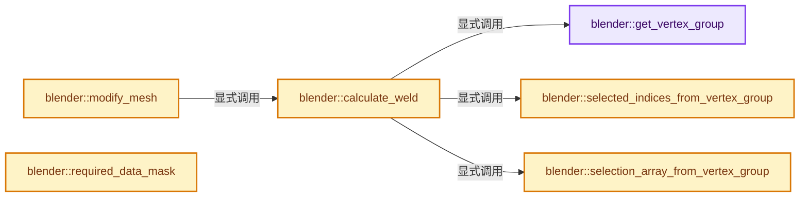
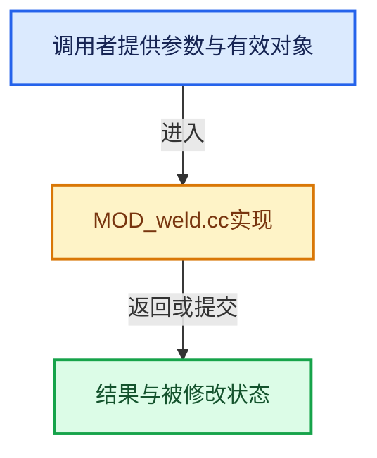

# 实现依赖专题：source/blender/modifiers/intern/MOD_weld.cc

[实现依赖导航](../../../README.md) · [符号索引](../../../../00-课程指南/02-源码与提交索引/符号依赖与实现索引.md)

本专题从正文实际调用进入，集中保存共享实现。函数有稳定锚点，可从调用处直接跳到对应完整函数；递归与互相调用通过回链组织。

## 本文件的实现关系






## 完整成员与函数实现

<a id="f-042200c5a68d465c"></a>

### `blender::get_vertex_group`

实现位置：[source/blender/modifiers/intern/MOD_weld.cc](../../../../../../../../source/blender/modifiers/intern/MOD_weld.cc) · L47—L53。

接口参数：

- `const Mesh &mesh`
- `const int defgrp_index`

**教学注释版**

<!-- annotated:92d87d0c898966 -->

```cpp
static Span<MDeformVert> get_vertex_group(const Mesh &mesh, const int defgrp_index)
{
  if (defgrp_index == -1) {
    return {};
  }
  return mesh.deform_verts();
}
```

<details>
<summary>核对原始源码：source/blender/modifiers/intern/MOD_weld.cc · L47—L53</summary>

<!-- original:92d87d0c898966:source/blender/modifiers/intern/MOD_weld.cc:47:53 -->

```cpp
static Span<MDeformVert> get_vertex_group(const Mesh &mesh, const int defgrp_index)
{
  if (defgrp_index == -1) {
    return {};
  }
  return mesh.deform_verts();
}
```

</details>

**结果出口**

- `return {};`
- `return mesh.deform_verts();`

**继续追踪实现**

- `mesh.deform_verts` → [Mesh::deform_verts · L1266](../../../../05-几何存储与拓扑映射/03-MPoly迁移与兼容.md#f-4c0433aad24aa301)。

<a id="f-deb6f267abfadd1c"></a>

### `blender::selected_indices_from_vertex_group`

实现位置：[source/blender/modifiers/intern/MOD_weld.cc](../../../../../../../../source/blender/modifiers/intern/MOD_weld.cc) · L55—L63。

接口参数：

- `Span<MDeformVert> vertex_group`
- `const int index`
- `const bool invert`
- `IndexMaskMemory &memory`

**教学注释版**

<!-- annotated:421f4ac5851842 -->

```cpp
static IndexMask selected_indices_from_vertex_group(Span<MDeformVert> vertex_group,
                                                    const int index,
                                                    const bool invert,
                                                    IndexMaskMemory &memory)
{
  // [讲解] vertex_group.index_range：查询视图长度或生成对应有效索引区间。
  return IndexMask::from_predicate(vertex_group.index_range(), memory, [&](const int i) {
    return (BKE_defvert_find_weight(&vertex_group[i], index) > 0.0f) != invert;
  });
}
```

<details>
<summary>核对原始源码：source/blender/modifiers/intern/MOD_weld.cc · L55—L63</summary>

<!-- original:421f4ac5851842:source/blender/modifiers/intern/MOD_weld.cc:55:63 -->

```cpp
static IndexMask selected_indices_from_vertex_group(Span<MDeformVert> vertex_group,
                                                    const int index,
                                                    const bool invert,
                                                    IndexMaskMemory &memory)
{
  return IndexMask::from_predicate(vertex_group.index_range(), memory, [&](const int i) {
    return (BKE_defvert_find_weight(&vertex_group[i], index) > 0.0f) != invert;
  });
}
```

</details>

**结果出口**

- `return IndexMask::from_predicate(vertex_group.index_range(), memory, [&](const int i) {`
- `return (BKE_defvert_find_weight(&vertex_group[i], index) > 0.0f) != invert;`

**继续追踪实现**

- `IndexMask::from_predicate` → [blender::index_mask::IndexMask::from_predicate · L1073](../../../../04-虚拟数组与索引选择/12-重构历史与基准练习.md#f-3864daa059098df8)。
- `vertex_group.index_range` → [blender::Span::index_range · L405](../../../../01-基础容器与现代CPP/05-Span只读连续视图.md#f-caaa9b06e13e53e0)。
- `BKE_defvert_find_weight` → [blender::BKE_defvert_find_weight · L779](../../../02-BKE几何与数据/intern/deform.cc.md#f-c117fcd05c4fd453)。

<a id="f-967c9d5038c617be"></a>

### `blender::selection_array_from_vertex_group`

实现位置：[source/blender/modifiers/intern/MOD_weld.cc](../../../../../../../../source/blender/modifiers/intern/MOD_weld.cc) · L65—L75。

接口参数：

- `Span<MDeformVert> vertex_group`
- `const int index`
- `const bool invert`

**教学注释版**

<!-- annotated:bec42e5f0b9513 -->

```cpp
static Array<bool> selection_array_from_vertex_group(Span<MDeformVert> vertex_group,
                                                     const int index,
                                                     const bool invert)
{
  // [讲解] vertex_group.size：查询视图长度或生成对应有效索引区间。
  Array<bool> selection(vertex_group.size());
  // [讲解] vertex_group.index_range：查询视图长度或生成对应有效索引区间。
  for (const int i : vertex_group.index_range()) {
    const bool found = BKE_defvert_find_weight(&vertex_group[i], index) > 0.0f;
    selection[i] = (found != invert);
  }
  return selection;
}
```

<details>
<summary>核对原始源码：source/blender/modifiers/intern/MOD_weld.cc · L65—L75</summary>

<!-- original:bec42e5f0b9513:source/blender/modifiers/intern/MOD_weld.cc:65:75 -->

```cpp
static Array<bool> selection_array_from_vertex_group(Span<MDeformVert> vertex_group,
                                                     const int index,
                                                     const bool invert)
{
  Array<bool> selection(vertex_group.size());
  for (const int i : vertex_group.index_range()) {
    const bool found = BKE_defvert_find_weight(&vertex_group[i], index) > 0.0f;
    selection[i] = (found != invert);
  }
  return selection;
}
```

</details>

**沿实际写入检查状态**

- `selection[i] = (found != invert);`

**结果出口**

- `return selection;`

**继续追踪实现**

- `vertex_group.size` → [blender::Span::size · L256](../../../../01-基础容器与现代CPP/05-Span只读连续视图.md#f-5f80fa006089c998)。
- `vertex_group.index_range` → [blender::Span::index_range · L405](../../../../01-基础容器与现代CPP/05-Span只读连续视图.md#f-caaa9b06e13e53e0)。
- `BKE_defvert_find_weight` → [blender::BKE_defvert_find_weight · L779](../../../02-BKE几何与数据/intern/deform.cc.md#f-c117fcd05c4fd453)。

<a id="f-998dd16ca154f94a"></a>

### `blender::calculate_weld`

实现位置：[source/blender/modifiers/intern/MOD_weld.cc](../../../../../../../../source/blender/modifiers/intern/MOD_weld.cc) · L77—L108。

接口参数：

- `const Mesh &mesh`
- `const WeldModifierData &wmd`

**教学注释版**

<!-- annotated:f14237e212e1ff -->

```cpp
static std::optional<Mesh *> calculate_weld(const Mesh &mesh, const WeldModifierData &wmd)
{
  const int defgrp_index = BKE_id_defgroup_name_index(&mesh.id, wmd.defgrp_name);
  Span<MDeformVert> vertex_group = get_vertex_group(mesh, defgrp_index);
  const bool invert = (wmd.flag & MOD_WELD_INVERT_VGROUP) != 0;

  if (wmd.mode == MOD_WELD_MODE_ALL) {
    // [讲解] vertex_group.is_empty：查询视图长度或生成对应有效索引区间。
    if (!vertex_group.is_empty()) {
      IndexMaskMemory memory;
      const IndexMask selected_indices = selected_indices_from_vertex_group(
          vertex_group, defgrp_index, invert, memory);
      return geometry::mesh_merge_by_distance_all(
          mesh, IndexMask(selected_indices), wmd.merge_dist);
    }
    return geometry::mesh_merge_by_distance_all(mesh, IndexMask(mesh.verts_num), wmd.merge_dist);
  }
  if (wmd.mode == MOD_WELD_MODE_CONNECTED) {
    const bool only_loose_edges = (wmd.flag & MOD_WELD_LOOSE_EDGES) != 0;
    if (!vertex_group.is_empty()) {
      Array<bool> selection = selection_array_from_vertex_group(
          vertex_group, defgrp_index, invert);
      return geometry::mesh_merge_by_distance_connected(
          mesh, selection, wmd.merge_dist, only_loose_edges);
    }
    Array<bool> selection(mesh.verts_num, true);
    return geometry::mesh_merge_by_distance_connected(
        mesh, selection, wmd.merge_dist, only_loose_edges);
  }

  BLI_assert_unreachable();
  return nullptr;
}
```

<details>
<summary>核对原始源码：source/blender/modifiers/intern/MOD_weld.cc · L77—L108</summary>

<!-- original:f14237e212e1ff:source/blender/modifiers/intern/MOD_weld.cc:77:108 -->

```cpp
static std::optional<Mesh *> calculate_weld(const Mesh &mesh, const WeldModifierData &wmd)
{
  const int defgrp_index = BKE_id_defgroup_name_index(&mesh.id, wmd.defgrp_name);
  Span<MDeformVert> vertex_group = get_vertex_group(mesh, defgrp_index);
  const bool invert = (wmd.flag & MOD_WELD_INVERT_VGROUP) != 0;

  if (wmd.mode == MOD_WELD_MODE_ALL) {
    if (!vertex_group.is_empty()) {
      IndexMaskMemory memory;
      const IndexMask selected_indices = selected_indices_from_vertex_group(
          vertex_group, defgrp_index, invert, memory);
      return geometry::mesh_merge_by_distance_all(
          mesh, IndexMask(selected_indices), wmd.merge_dist);
    }
    return geometry::mesh_merge_by_distance_all(mesh, IndexMask(mesh.verts_num), wmd.merge_dist);
  }
  if (wmd.mode == MOD_WELD_MODE_CONNECTED) {
    const bool only_loose_edges = (wmd.flag & MOD_WELD_LOOSE_EDGES) != 0;
    if (!vertex_group.is_empty()) {
      Array<bool> selection = selection_array_from_vertex_group(
          vertex_group, defgrp_index, invert);
      return geometry::mesh_merge_by_distance_connected(
          mesh, selection, wmd.merge_dist, only_loose_edges);
    }
    Array<bool> selection(mesh.verts_num, true);
    return geometry::mesh_merge_by_distance_connected(
        mesh, selection, wmd.merge_dist, only_loose_edges);
  }

  BLI_assert_unreachable();
  return nullptr;
}
```

</details>

**结果出口**

- `return geometry::mesh_merge_by_distance_all(`
- `return geometry::mesh_merge_by_distance_all(mesh, IndexMask(mesh.verts_num), wmd.merge_dist);`
- `return geometry::mesh_merge_by_distance_connected(`
- `return nullptr;`

**继续追踪实现**

- `BKE_id_defgroup_name_index` → [blender::BKE_id_defgroup_name_index · L557](../../../02-BKE几何与数据/intern/deform.cc.md#f-886667bbd10fa710)。
- `get_vertex_group` → [blender::get_vertex_group · L47](MOD_weld.cc.md#f-042200c5a68d465c)。
- `vertex_group.is_empty` → [blender::Span::is_empty · L264](../../../../01-基础容器与现代CPP/05-Span只读连续视图.md#f-8cc1d7ba8feb50e6)。
- `selected_indices_from_vertex_group` → [blender::selected_indices_from_vertex_group · L55](MOD_weld.cc.md#f-deb6f267abfadd1c)。
- `geometry::mesh_merge_by_distance_all` → [blender::geometry::mesh_merge_by_distance_all · L1285](../../../05-Geometry几何算法/intern/mesh_merge_verts.cc.md#f-5072276c0024899f)。
- `IndexMask` → [blender::index_mask::IndexMask::IndexMask · L704](../../../../04-虚拟数组与索引选择/09-分段存储与遍历.md#f-8c95440e4c5fec78)；[blender::index_mask::IndexMask::IndexMask · L709](../../../../04-虚拟数组与索引选择/09-分段存储与遍历.md#f-fdd9dc18868bc0cd)；[blender::index_mask::IndexMask::IndexMask · L722](../../../../04-虚拟数组与索引选择/09-分段存储与遍历.md#f-4b32f3ba3de66d05)。同名重载需按实参类型选择。
- `selection_array_from_vertex_group` → [blender::selection_array_from_vertex_group · L65](MOD_weld.cc.md#f-967c9d5038c617be)。
- `geometry::mesh_merge_by_distance_connected` → [blender::geometry::mesh_merge_by_distance_connected · L1315](../../../05-Geometry几何算法/intern/mesh_merge_verts.cc.md#f-83a605e6ac22f89c)。
- `BLI_assert_unreachable` → [BLI_assert_unreachable · L77](../../../01-BLI基础库/BLI_assert.hh.md#m-7a2d91a67d8e)。宏定义由构建条件选择。

<a id="f-42477853422458a5"></a>

### `blender::modify_mesh`

实现位置：[source/blender/modifiers/intern/MOD_weld.cc](../../../../../../../../source/blender/modifiers/intern/MOD_weld.cc) · L110—L119。

接口参数：

- `ModifierData *md`
- `const ModifierEvalContext *`
- `Mesh *mesh`

**教学注释版**

<!-- annotated:8b75dfd996b77b -->

```cpp
static Mesh *modify_mesh(ModifierData *md, const ModifierEvalContext * /*ctx*/, Mesh *mesh)
{
  const WeldModifierData &wmd = reinterpret_cast<WeldModifierData &>(*md);

  std::optional<Mesh *> result = calculate_weld(*mesh, wmd);
  if (!result) {
    return mesh;
  }
  return *result;
}
```

<details>
<summary>核对原始源码：source/blender/modifiers/intern/MOD_weld.cc · L110—L119</summary>

<!-- original:8b75dfd996b77b:source/blender/modifiers/intern/MOD_weld.cc:110:119 -->

```cpp
static Mesh *modify_mesh(ModifierData *md, const ModifierEvalContext * /*ctx*/, Mesh *mesh)
{
  const WeldModifierData &wmd = reinterpret_cast<WeldModifierData &>(*md);

  std::optional<Mesh *> result = calculate_weld(*mesh, wmd);
  if (!result) {
    return mesh;
  }
  return *result;
}
```

</details>

**结果出口**

- `return mesh;`
- `return *result;`

**继续追踪实现**

- `calculate_weld` → [blender::calculate_weld · L77](MOD_weld.cc.md#f-998dd16ca154f94a)。

<a id="f-d565a45eef6f667d"></a>

### `blender::required_data_mask`

实现位置：[source/blender/modifiers/intern/MOD_weld.cc](../../../../../../../../source/blender/modifiers/intern/MOD_weld.cc) · L127—L135。

接口参数：

- `ModifierData *md`
- `CustomData_MeshMasks *r_cddata_masks`

**教学注释版**

<!-- annotated:277612b02c73b5 -->

```cpp
static void required_data_mask(ModifierData *md, CustomData_MeshMasks *r_cddata_masks)
{
  WeldModifierData *wmd = reinterpret_cast<WeldModifierData *>(md);

  /* Ask for vertex-groups if we need them. */
  if (wmd->defgrp_name[0] != '\0') {
    r_cddata_masks->vmask |= CD_MASK_MDEFORMVERT;
  }
}
```

<details>
<summary>核对原始源码：source/blender/modifiers/intern/MOD_weld.cc · L127—L135</summary>

<!-- original:277612b02c73b5:source/blender/modifiers/intern/MOD_weld.cc:127:135 -->

```cpp
static void required_data_mask(ModifierData *md, CustomData_MeshMasks *r_cddata_masks)
{
  WeldModifierData *wmd = reinterpret_cast<WeldModifierData *>(md);

  /* Ask for vertex-groups if we need them. */
  if (wmd->defgrp_name[0] != '\0') {
    r_cddata_masks->vmask |= CD_MASK_MDEFORMVERT;
  }
}
```

</details>

**沿实际写入检查状态**

- `r_cddata_masks->vmask |= CD_MASK_MDEFORMVERT;`

**继续追踪实现**

本实现没有需要继续展开的显式调用；检查返回表达式、对象转换和调用者前置条件。
