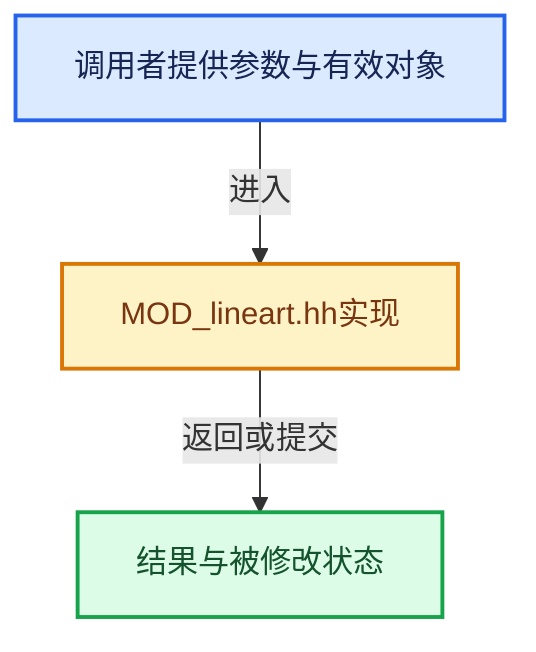

# 实现依赖专题：source/blender/modifiers/intern/lineart/MOD_lineart.hh

[实现依赖导航](../../../../README.md) · [符号索引](../../../../../00-课程指南/02-源码与提交索引/符号依赖与实现索引.md)

本专题从正文实际调用进入，集中保存共享实现。函数有稳定锚点，可从调用处直接跳到对应完整函数；递归与互相调用通过回链组织。

## 本文件的实现关系





## 相关类型布局与成员入口

<a id="t-c0d57ea0797f"></a>

### `blender::LineartEdge`

原始声明：[source/blender/modifiers/intern/lineart/MOD_lineart.hh](../../../../../../../../../source/blender/modifiers/intern/lineart/MOD_lineart.hh) · L27—L27。

成员布局：

- `LineartVert v1`
- `LineartTriangle t1`
- `ListBaseT<LineartEdgeSegment> segments`
- `int8_t min_occ`
- `uint16_t flags`
- `uint8_t intersection_mask`
- `uint64_t edge_identifier`
- `uint64_t target_reference`
- `Object object_ref`

以下保留类的数据声明与编译条件，成员函数实现通过后面的精确链接阅读。

<!-- annotated:02abdce5eca43a -->

```cpp
struct LineartEdge;
```

<details>
<summary>核对原始源码：source/blender/modifiers/intern/lineart/MOD_lineart.hh · L27—L27</summary>

<!-- original:02abdce5eca43a:source/blender/modifiers/intern/lineart/MOD_lineart.hh:27:27 -->

```cpp
struct LineartEdge;
```

</details>


<a id="t-d4a64375e7f4"></a>

### `blender::LineartEdge`

原始声明：[source/blender/modifiers/intern/lineart/MOD_lineart.hh](../../../../../../../../../source/blender/modifiers/intern/lineart/MOD_lineart.hh) · L187—L227。

成员布局：

- `LineartVert v1`
- `LineartTriangle t1`
- `ListBaseT<LineartEdgeSegment> segments`
- `int8_t min_occ`
- `uint16_t flags`
- `uint8_t intersection_mask`
- `uint64_t edge_identifier`
- `uint64_t target_reference`
- `Object object_ref`

以下保留类的数据声明与编译条件，成员函数实现通过后面的精确链接阅读。

<!-- annotated:0b60304b34f312 -->

```cpp
struct LineartEdge {
  LineartVert *v1, *v2;

  /**
   * These two variables are also used to specify original edge and segment during 3rd stage
   * reprojection, So we can easily find out the line which results come from.
   */
  LineartTriangle *t1, *t2;

  ListBaseT<LineartEdgeSegment> segments;
  int8_t min_occ;

  /** Also for line type determination on chaining. */
  uint16_t flags;
  uint8_t intersection_mask;

  /**
   * Matches the shadow result, used to determine whether a line is in the shadow or not.
   * #edge_identifier usages:
   * - Intersection lines:
   *    ((e->t1->target_reference << 32) | e->t2->target_reference);
   * - Other lines: LRT_EDGE_IDENTIFIER(obi, e);
   * - After shadow calculation: (search the shadow result and set reference to that);
   */
  uint64_t edge_identifier;

  /**
   * - Light contour: original_e->t1->target_reference | original_e->t2->target_reference.
   * - Cast shadow: triangle_projected_onto->target_reference.
   */
  uint64_t target_reference;

  /**
   * Still need this entry because culled lines will not add to object
   * #LineartElementLinkNode node (known as `eln` internally).
   *
   * TODO: If really need more savings, we can allocate this in a "extended" way too, but we need
   * another bit in flags to be able to show the difference.
   */
  Object *object_ref;
};
```

<details>
<summary>核对原始源码：source/blender/modifiers/intern/lineart/MOD_lineart.hh · L187—L227</summary>

<!-- original:0b60304b34f312:source/blender/modifiers/intern/lineart/MOD_lineart.hh:187:227 -->

```cpp
struct LineartEdge {
  LineartVert *v1, *v2;

  /**
   * These two variables are also used to specify original edge and segment during 3rd stage
   * reprojection, So we can easily find out the line which results come from.
   */
  LineartTriangle *t1, *t2;

  ListBaseT<LineartEdgeSegment> segments;
  int8_t min_occ;

  /** Also for line type determination on chaining. */
  uint16_t flags;
  uint8_t intersection_mask;

  /**
   * Matches the shadow result, used to determine whether a line is in the shadow or not.
   * #edge_identifier usages:
   * - Intersection lines:
   *    ((e->t1->target_reference << 32) | e->t2->target_reference);
   * - Other lines: LRT_EDGE_IDENTIFIER(obi, e);
   * - After shadow calculation: (search the shadow result and set reference to that);
   */
  uint64_t edge_identifier;

  /**
   * - Light contour: original_e->t1->target_reference | original_e->t2->target_reference.
   * - Cast shadow: triangle_projected_onto->target_reference.
   */
  uint64_t target_reference;

  /**
   * Still need this entry because culled lines will not add to object
   * #LineartElementLinkNode node (known as `eln` internally).
   *
   * TODO: If really need more savings, we can allocate this in a "extended" way too, but we need
   * another bit in flags to be able to show the difference.
   */
  Object *object_ref;
};
```

</details>


<a id="m-e0e12071f312"></a>

## 宏 `LRT_DOUBLE_CLOSE_ENOUGH`

<!-- annotated:3328f239cc544a -->

```cpp
#define LRT_DOUBLE_CLOSE_ENOUGH(a, b) (((a) + DBL_EDGE_LIM) >= (b) && ((a) - DBL_EDGE_LIM) <= (b))
#define LRT_DOUBLE_CLOSE_ENOUGH_TRI(a, b) \
```

<details>
<summary>核对原始源码：source/blender/modifiers/intern/lineart/MOD_lineart.hh · L629—L630</summary>

<!-- original:3328f239cc544a:source/blender/modifiers/intern/lineart/MOD_lineart.hh:629:630 -->

```cpp
#define LRT_DOUBLE_CLOSE_ENOUGH(a, b) (((a) + DBL_EDGE_LIM) >= (b) && ((a) - DBL_EDGE_LIM) <= (b))
#define LRT_DOUBLE_CLOSE_ENOUGH_TRI(a, b) \
```

</details>

宏在预处理阶段展开，参数替换、重复求值和条件编译应直接从该定义检查。与普通函数不同，宏不会自动提供参数类型检查；构建配置选择哪个定义需结合外围条件。

## 完整成员与函数实现

<a id="f-2a9fbae33d85b20e"></a>

### `blender::lineart_line_isec_2d_ignore_line2pos`

实现位置：[source/blender/modifiers/intern/lineart/MOD_lineart.hh](../../../../../../../../../source/blender/modifiers/intern/lineart/MOD_lineart.hh) · L801—L890。

接口参数：

- `const double a1[2]`
- `const double a2[2]`
- `const double b1[2]`
- `const double b2[2]`
- `double *r_a_ratio`

**教学注释版**

<!-- annotated:01f20061cc92f2 -->

```cpp
BLI_INLINE int lineart_line_isec_2d_ignore_line2pos(const double a1[2],
                                                    const double a2[2],
                                                    const double b1[2],
                                                    const double b2[2],
                                                    double *r_a_ratio)
{
  /* The define here is used to check how vector or slope method handles boundary cases. The result
   * of `lim(div->0)` and `lim(k->0)` could both produce some unwanted flickers in line art, the
   * influence of which is still not fully understood, so keep the switch there for further
   * investigations. */
#define USE_VECTOR_LINE_INTERSECTION_IGN
#ifdef USE_VECTOR_LINE_INTERSECTION_IGN

  /* from isect_line_line_v2_point() */

  double s10[2], s32[2];
  double div;

  sub_v2_v2v2_db(s10, a2, a1);
  sub_v2_v2v2_db(s32, b2, b1);

  div = cross_v2v2_db(s10, s32);
  if (div != 0.0f) {
    const double u = cross_v2v2_db(a2, a1);
    const double v = cross_v2v2_db(b2, b1);

    const double rx = ((s32[0] * u) - (s10[0] * v)) / div;
    const double ry = ((s32[1] * u) - (s10[1] * v)) / div;

    if (fabs(a2[0] - a1[0]) > fabs(a2[1] - a1[1])) {
      *r_a_ratio = ratiod(a1[0], a2[0], rx);
      if ((*r_a_ratio) >= -DBL_EDGE_LIM && (*r_a_ratio) <= 1 + DBL_EDGE_LIM) {
        return 1;
      }
      return 0;
    }

    *r_a_ratio = ratiod(a1[1], a2[1], ry);
    if ((*r_a_ratio) >= -DBL_EDGE_LIM && (*r_a_ratio) <= 1 + DBL_EDGE_LIM) {
      return 1;
    }
    return 0;
  }
  return 0;

#else
  double k1, k2;
  double x;
  double y;
  double ratio;
  double x_diff = (a2[0] - a1[0]);
  double x_diff2 = (b2[0] - b1[0]);

  if (LRT_DOUBLE_CLOSE_ENOUGH(x_diff, 0)) {
    if (LRT_DOUBLE_CLOSE_ENOUGH(x_diff2, 0)) {
      *r_a_ratio = 0;
      return 0;
    }
    double r2 = ratiod(b1[0], b2[0], a1[0]);
    x = interpd(b2[0], b1[0], r2);
    y = interpd(b2[1], b1[1], r2);
    *r_a_ratio = ratio = ratiod(a1[1], a2[1], y);
  }
  else {
    if (LRT_DOUBLE_CLOSE_ENOUGH(x_diff2, 0)) {
      ratio = ratiod(a1[0], a2[0], b1[0]);
      x = interpd(a2[0], a1[0], ratio);
      *r_a_ratio = ratio;
    }
    else {
      k1 = (a2[1] - a1[1]) / x_diff;
      k2 = (b2[1] - b1[1]) / x_diff2;

      if ((k1 == k2)) {
        return 0;
      }
      x = (a1[1] - b1[1] - k1 * a1[0] + k2 * b1[0]) / (k2 - k1);

      ratio = (x - a1[0]) / x_diff;

      *r_a_ratio = ratio;
    }
  }

  if (ratio <= 0 || ratio >= 1) {
    return 0;
  }
  return 1;
#endif
}
```

<details>
<summary>核对原始源码：source/blender/modifiers/intern/lineart/MOD_lineart.hh · L801—L890</summary>

<!-- original:01f20061cc92f2:source/blender/modifiers/intern/lineart/MOD_lineart.hh:801:890 -->

```cpp
BLI_INLINE int lineart_line_isec_2d_ignore_line2pos(const double a1[2],
                                                    const double a2[2],
                                                    const double b1[2],
                                                    const double b2[2],
                                                    double *r_a_ratio)
{
  /* The define here is used to check how vector or slope method handles boundary cases. The result
   * of `lim(div->0)` and `lim(k->0)` could both produce some unwanted flickers in line art, the
   * influence of which is still not fully understood, so keep the switch there for further
   * investigations. */
#define USE_VECTOR_LINE_INTERSECTION_IGN
#ifdef USE_VECTOR_LINE_INTERSECTION_IGN

  /* from isect_line_line_v2_point() */

  double s10[2], s32[2];
  double div;

  sub_v2_v2v2_db(s10, a2, a1);
  sub_v2_v2v2_db(s32, b2, b1);

  div = cross_v2v2_db(s10, s32);
  if (div != 0.0f) {
    const double u = cross_v2v2_db(a2, a1);
    const double v = cross_v2v2_db(b2, b1);

    const double rx = ((s32[0] * u) - (s10[0] * v)) / div;
    const double ry = ((s32[1] * u) - (s10[1] * v)) / div;

    if (fabs(a2[0] - a1[0]) > fabs(a2[1] - a1[1])) {
      *r_a_ratio = ratiod(a1[0], a2[0], rx);
      if ((*r_a_ratio) >= -DBL_EDGE_LIM && (*r_a_ratio) <= 1 + DBL_EDGE_LIM) {
        return 1;
      }
      return 0;
    }

    *r_a_ratio = ratiod(a1[1], a2[1], ry);
    if ((*r_a_ratio) >= -DBL_EDGE_LIM && (*r_a_ratio) <= 1 + DBL_EDGE_LIM) {
      return 1;
    }
    return 0;
  }
  return 0;

#else
  double k1, k2;
  double x;
  double y;
  double ratio;
  double x_diff = (a2[0] - a1[0]);
  double x_diff2 = (b2[0] - b1[0]);

  if (LRT_DOUBLE_CLOSE_ENOUGH(x_diff, 0)) {
    if (LRT_DOUBLE_CLOSE_ENOUGH(x_diff2, 0)) {
      *r_a_ratio = 0;
      return 0;
    }
    double r2 = ratiod(b1[0], b2[0], a1[0]);
    x = interpd(b2[0], b1[0], r2);
    y = interpd(b2[1], b1[1], r2);
    *r_a_ratio = ratio = ratiod(a1[1], a2[1], y);
  }
  else {
    if (LRT_DOUBLE_CLOSE_ENOUGH(x_diff2, 0)) {
      ratio = ratiod(a1[0], a2[0], b1[0]);
      x = interpd(a2[0], a1[0], ratio);
      *r_a_ratio = ratio;
    }
    else {
      k1 = (a2[1] - a1[1]) / x_diff;
      k2 = (b2[1] - b1[1]) / x_diff2;

      if ((k1 == k2)) {
        return 0;
      }
      x = (a1[1] - b1[1] - k1 * a1[0] + k2 * b1[0]) / (k2 - k1);

      ratio = (x - a1[0]) / x_diff;

      *r_a_ratio = ratio;
    }
  }

  if (ratio <= 0 || ratio >= 1) {
    return 0;
  }
  return 1;
#endif
}
```

</details>

**沿实际写入检查状态**

- `div = cross_v2v2_db(s10, s32);`
- `x = interpd(b2[0], b1[0], r2);`
- `y = interpd(b2[1], b1[1], r2);`
- `ratio = ratiod(a1[0], a2[0], b1[0]);`
- `x = interpd(a2[0], a1[0], ratio);`
- `k1 = (a2[1] - a1[1]) / x_diff;`
- `k2 = (b2[1] - b1[1]) / x_diff2;`
- `x = (a1[1] - b1[1] - k1 * a1[0] + k2 * b1[0]) / (k2 - k1);`
- `ratio = (x - a1[0]) / x_diff;`

**结果出口**

- `return 1;`
- `return 0;`

**继续追踪实现**

- `sub_v2_v2v2_db` → [blender::sub_v2_v2v2_db · L341](../../../../01-BLI基础库/intern/math_vector_inline.cc.md#f-242908cb43e89d2e)。
- `cross_v2v2_db` → [blender::cross_v2v2_db · L685](../../../../01-BLI基础库/intern/math_vector_inline.cc.md#f-40d958f32554ae33)。
- `fabs` → [外部契约](https://eel.is/c++draft/)：这个边界按实际表达式及所属类型核对参数、返回值、寿命与失败行为。这里提供接口入口，不声称已解释该第三方版本的内部实现。
- `ratiod` → [blender::ratiod · L94](../../../../01-BLI基础库/intern/math_base_inline.cc.md#f-cf7f7576c0f9e176)。
- `LRT_DOUBLE_CLOSE_ENOUGH` → [LRT_DOUBLE_CLOSE_ENOUGH · L629](MOD_lineart.hh.md#m-e0e12071f312)。宏定义由构建条件选择。
- `interpd` → [blender::interpd · L83](../../../../01-BLI基础库/intern/math_base_inline.cc.md#f-838cb2b6b77b0307)。
