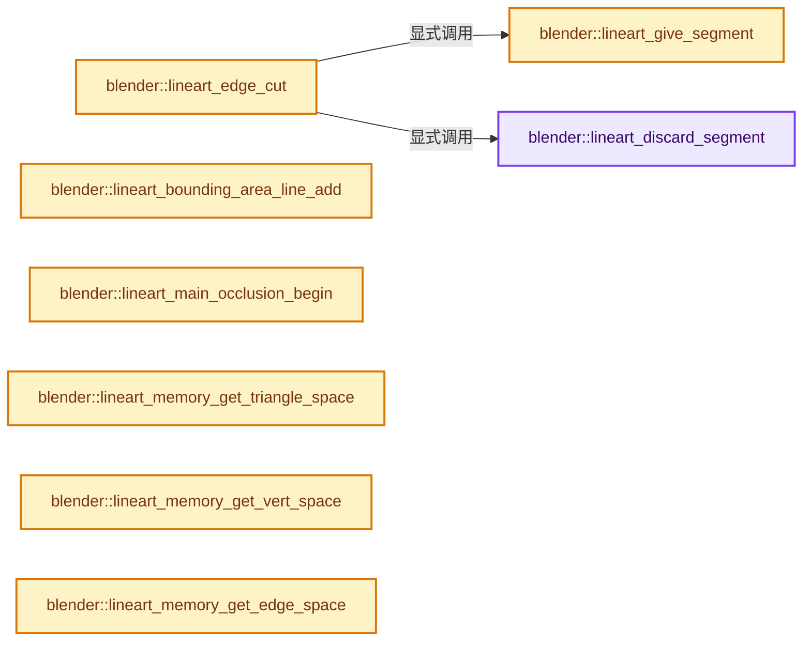
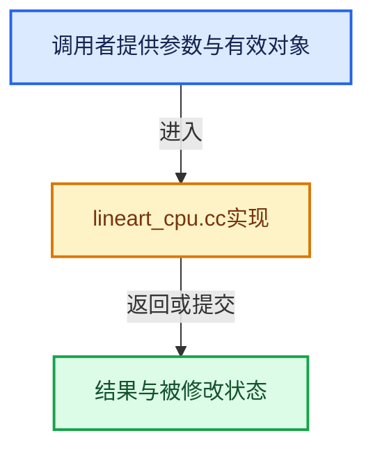

# 实现依赖专题：source/blender/modifiers/intern/lineart/lineart_cpu.cc

[实现依赖导航](../../../../README.md) · [符号索引](../../../../../00-课程指南/02-源码与提交索引/符号依赖与实现索引.md)

本专题从正文实际调用进入，集中保存共享实现。函数有稳定锚点，可从调用处直接跳到对应完整函数；递归与互相调用通过回链组织。

## 本文件的实现关系






## 完整成员与函数实现

<a id="f-edcfd3f5eb890f0f"></a>

### `blender::lineart_discard_segment`

实现位置：[source/blender/modifiers/intern/lineart/lineart_cpu.cc](../../../../../../../../../source/blender/modifiers/intern/lineart/lineart_cpu.cc) · L130—L141。

接口参数：

- `LineartData *ld`
- `LineartEdgeSegment *es`

**教学注释版**

<!-- annotated:4947953d57a283 -->

```cpp
static void lineart_discard_segment(LineartData *ld, LineartEdgeSegment *es)
{
  BLI_spin_lock(&ld->lock_cuts);

  // [讲解] memset：填充字节，不调用T构造函数，也不保证任意类型的全零表示是合法或期望值。
  memset(es, 0, sizeof(LineartEdgeSegment));

  /* Storing the node for potentially reuse the memory for new segment data.
   * Line Art data is not freed after all calculations are done. */
  BLI_addtail(&ld->wasted_cuts, es);

  BLI_spin_unlock(&ld->lock_cuts);
}
```

<details>
<summary>核对原始源码：source/blender/modifiers/intern/lineart/lineart_cpu.cc · L130—L141</summary>

<!-- original:4947953d57a283:source/blender/modifiers/intern/lineart/lineart_cpu.cc:130:141 -->

```cpp
static void lineart_discard_segment(LineartData *ld, LineartEdgeSegment *es)
{
  BLI_spin_lock(&ld->lock_cuts);

  memset(es, 0, sizeof(LineartEdgeSegment));

  /* Storing the node for potentially reuse the memory for new segment data.
   * Line Art data is not freed after all calculations are done. */
  BLI_addtail(&ld->wasted_cuts, es);

  BLI_spin_unlock(&ld->lock_cuts);
}
```

</details>

**继续追踪实现**

- `BLI_spin_lock` → [调用协议](../../../../../00-课程指南/01-路线与规范/模板宏与动态分派协议.md)：函数指针、局部可调用对象或未展开的宏；必须结合调用者环境。调用位置L132。
- `memset` → [外部契约](https://eel.is/c++draft/cstring.syn)：填充字节，不调用T构造函数，也不保证任意类型的全零表示是合法或期望值。
- `BLI_addtail` → [blender::BLI_addtail · L118](../../../../01-BLI基础库/intern/listbase.cc.md#f-4fb027713fa3115b)。
- `BLI_spin_unlock` → [BLI_spin_unlock · L433](../../../../01-BLI基础库/intern/threads.cc.md#f-ded25214a4593256)。

<a id="f-0b94e282a84376d2"></a>

### `blender::lineart_give_segment`

实现位置：[source/blender/modifiers/intern/lineart/lineart_cpu.cc](../../../../../../../../../source/blender/modifiers/intern/lineart/lineart_cpu.cc) · L143—L159。

接口参数：

- `LineartData *ld`

**教学注释版**

<!-- annotated:9cfcf4278a456b -->

```cpp
static LineartEdgeSegment *lineart_give_segment(LineartData *ld)
{
  BLI_spin_lock(&ld->lock_cuts);

  /* See if there is any already allocated memory we can reuse. */
  if (ld->wasted_cuts.first_) {
    LineartEdgeSegment *es = static_cast<LineartEdgeSegment *>(BLI_pophead(&ld->wasted_cuts));
    BLI_spin_unlock(&ld->lock_cuts);
    // [讲解] memset：填充字节，不调用T构造函数，也不保证任意类型的全零表示是合法或期望值。
    memset(es, 0, sizeof(LineartEdgeSegment));
    return es;
  }
  BLI_spin_unlock(&ld->lock_cuts);

  /* Otherwise allocate some new memory. */
  return static_cast<LineartEdgeSegment *>(
      lineart_mem_acquire_thread(ld->edge_data_pool, sizeof(LineartEdgeSegment)));
}
```

<details>
<summary>核对原始源码：source/blender/modifiers/intern/lineart/lineart_cpu.cc · L143—L159</summary>

<!-- original:9cfcf4278a456b:source/blender/modifiers/intern/lineart/lineart_cpu.cc:143:159 -->

```cpp
static LineartEdgeSegment *lineart_give_segment(LineartData *ld)
{
  BLI_spin_lock(&ld->lock_cuts);

  /* See if there is any already allocated memory we can reuse. */
  if (ld->wasted_cuts.first_) {
    LineartEdgeSegment *es = static_cast<LineartEdgeSegment *>(BLI_pophead(&ld->wasted_cuts));
    BLI_spin_unlock(&ld->lock_cuts);
    memset(es, 0, sizeof(LineartEdgeSegment));
    return es;
  }
  BLI_spin_unlock(&ld->lock_cuts);

  /* Otherwise allocate some new memory. */
  return static_cast<LineartEdgeSegment *>(
      lineart_mem_acquire_thread(ld->edge_data_pool, sizeof(LineartEdgeSegment)));
}
```

</details>

**结果出口**

- `return es;`
- `return static_cast<LineartEdgeSegment *>(`

**继续追踪实现**

- `BLI_spin_lock` → [调用协议](../../../../../00-课程指南/01-路线与规范/模板宏与动态分派协议.md)：函数指针、局部可调用对象或未展开的宏；必须结合调用者环境。调用位置L145。
- `BLI_pophead` → [blender::BLI_pophead · L259](../../../../01-BLI基础库/intern/listbase.cc.md#f-c1491382e532f81c)。
- `BLI_spin_unlock` → [BLI_spin_unlock · L433](../../../../01-BLI基础库/intern/threads.cc.md#f-ded25214a4593256)。
- `memset` → [外部契约](https://eel.is/c++draft/cstring.syn)：填充字节，不调用T构造函数，也不保证任意类型的全零表示是合法或期望值。
- `lineart_mem_acquire_thread` → [blender::lineart_mem_acquire_thread · L124](lineart_util.cc.md#f-d2e9b62a191e84f0)。

<a id="f-1e58e12cd8a8da03"></a>

### `blender::lineart_edge_cut`

实现位置：[source/blender/modifiers/intern/lineart/lineart_cpu.cc](../../../../../../../../../source/blender/modifiers/intern/lineart/lineart_cpu.cc) · L161—L353。

接口参数：

- `LineartData *ld`
- `LineartEdge *e`
- `double start`
- `double end`
- `uchar material_mask_bits`
- `uchar mat_occlusion`
- `uint32_t shadow_bits`

**教学注释版**

<!-- annotated:05eeb9f71c5759 -->

```cpp
void lineart_edge_cut(LineartData *ld,
                      LineartEdge *e,
                      double start,
                      double end,
                      uchar material_mask_bits,
                      uchar mat_occlusion,
                      uint32_t shadow_bits)
{
  LineartEdgeSegment *i_seg, *prev_seg;
  LineartEdgeSegment *cut_start_before = nullptr, *cut_end_before = nullptr;
  LineartEdgeSegment *new_seg1 = nullptr, *new_seg2 = nullptr;
  int untouched = 0;

  /* If for some reason the occlusion function may give a result that has zero length, or reversed
   * in direction, or NAN, we take care of them here. */
  if (LRT_DOUBLE_CLOSE_ENOUGH(start, end)) {
    return;
  }
  if (LRT_DOUBLE_CLOSE_ENOUGH(start, 1) || LRT_DOUBLE_CLOSE_ENOUGH(end, 0)) {
    return;
  }
  if (start != start) [[unlikely]] {
    start = 0.0;
  }
  if (end != end) [[unlikely]] {
    end = 0.0;
  }

  if (start > end) {
    double t = start;
    start = end;
    end = t;
  }

  /* Begin looking for starting position of the segment. */
  /* Not using a list iteration macro because of it more clear when using for loops to iterate
   * through the segments. */
  for (LineartEdgeSegment &seg : e->segments) {
    if (LRT_DOUBLE_CLOSE_ENOUGH(seg.ratio, start)) {
      cut_start_before = &seg;
      new_seg1 = cut_start_before;
      break;
    }
    if (seg.next == nullptr) {
      break;
    }
    i_seg = seg.next;
    if (i_seg->ratio > start + 1e-09 && start > seg.ratio) {
      cut_start_before = i_seg;
      new_seg1 = lineart_give_segment(ld);
      break;
    }
  }
  if (!cut_start_before && LRT_DOUBLE_CLOSE_ENOUGH(1, end)) {
    untouched = 1;
  }
  for (LineartEdgeSegment *seg = cut_start_before; seg; seg = seg->next) {
    /* We tried to cut ratio existing cutting point (e.g. where the line's occluded by a triangle
     * strip). */
    if (LRT_DOUBLE_CLOSE_ENOUGH(seg->ratio, end)) {
      cut_end_before = seg;
      new_seg2 = cut_end_before;
      break;
    }
    /* This check is to prevent `es->ratio == 1.0` (where we don't need to cut because we are ratio
     * the end point). */
    if (!seg->next && LRT_DOUBLE_CLOSE_ENOUGH(1, end)) {
      cut_end_before = seg;
      new_seg2 = cut_end_before;
      untouched = 1;
      break;
    }
    /* When an actual cut is needed in the line. */
    if (seg->ratio > end) {
      cut_end_before = seg;
      new_seg2 = lineart_give_segment(ld);
      break;
    }
  }

  /* When we still can't find any existing cut in the line, we allocate new ones. */
  if (new_seg1 == nullptr) {
    new_seg1 = lineart_give_segment(ld);
  }
  if (new_seg2 == nullptr) {
    if (untouched) {
      new_seg2 = new_seg1;
      cut_end_before = new_seg2;
    }
    else {
      new_seg2 = lineart_give_segment(ld);
    }
  }

  if (cut_start_before) {
    if (cut_start_before != new_seg1) {
      /* Insert cutting points for when a new cut is needed. */
      i_seg = cut_start_before->prev ? cut_start_before->prev : nullptr;
      if (i_seg) {
        new_seg1->occlusion = i_seg->occlusion;
        new_seg1->material_mask_bits = i_seg->material_mask_bits;
        new_seg1->shadow_mask_bits = i_seg->shadow_mask_bits;
      }
      BLI_insertlinkbefore(&e->segments, cut_start_before, new_seg1);
    }
    /* Otherwise we already found a existing cutting point, no need to insert a new one. */
  }
  else {
    /* We have yet to reach a existing cutting point even after we searched the whole line, so we
     * append the new cut to the end. */
    i_seg = e->segments.last();
    new_seg1->occlusion = i_seg->occlusion;
    new_seg1->material_mask_bits = i_seg->material_mask_bits;
    new_seg1->shadow_mask_bits = i_seg->shadow_mask_bits;
    BLI_addtail(&e->segments, new_seg1);
  }
  if (cut_end_before) {
    /* The same manipulation as on "cut_start_before". */
    if (cut_end_before != new_seg2) {
      i_seg = cut_end_before->prev ? cut_end_before->prev : nullptr;
      if (i_seg) {
        new_seg2->occlusion = i_seg->occlusion;
        new_seg2->material_mask_bits = i_seg->material_mask_bits;
        new_seg2->shadow_mask_bits = i_seg->shadow_mask_bits;
      }
      BLI_insertlinkbefore(&e->segments, cut_end_before, new_seg2);
    }
  }
  else {
    i_seg = e->segments.last();
    new_seg2->occlusion = i_seg->occlusion;
    new_seg2->material_mask_bits = i_seg->material_mask_bits;
    new_seg2->shadow_mask_bits = i_seg->shadow_mask_bits;
    if (!untouched) {
      BLI_addtail(&e->segments, new_seg2);
    }
  }

  /* If we touched the cut list, we assign the new cut position based on new cut position,
   * this way we accommodate precision lost due to multiple cut inserts. */
  new_seg1->ratio = start;
  if (!untouched) {
    new_seg2->ratio = end;
  }
  else {
    /* For the convenience of the loop below. */
    new_seg2 = new_seg2->next;
  }

  /* Register 1 level of occlusion for all touched segments. */
  for (LineartEdgeSegment *seg = new_seg1; seg && seg != new_seg2; seg = seg->next) {
    seg->occlusion += mat_occlusion;
    seg->material_mask_bits |= material_mask_bits;

    /* The enclosed shape flag will override regular lit/shaded
     * flags. See LineartEdgeSegment::shadow_mask_bits for details. */
    if (shadow_bits == LRT_SHADOW_MASK_ENCLOSED_SHAPE) {
      if (seg->shadow_mask_bits & LRT_SHADOW_MASK_ILLUMINATED ||
          e->flags & MOD_LINEART_EDGE_FLAG_LIGHT_CONTOUR)
      {
        seg->shadow_mask_bits |= LRT_SHADOW_MASK_INHIBITED;
      }
      else if (seg->shadow_mask_bits & LRT_SHADOW_MASK_SHADED) {
        seg->shadow_mask_bits |= LRT_SHADOW_MASK_ILLUMINATED_SHAPE;
      }
    }
    else {
      seg->shadow_mask_bits |= shadow_bits;
    }
  }

  /* Reduce adjacent cutting points of the same level, which saves memory. */
  int8_t min_occ = 127;
  prev_seg = nullptr;
  for (LineartEdgeSegment &seg : e->segments.items_mutable()) {

    if (prev_seg && prev_seg->occlusion == seg.occlusion &&
        prev_seg->material_mask_bits == seg.material_mask_bits &&
        prev_seg->shadow_mask_bits == seg.shadow_mask_bits)
    {
      BLI_remlink(&e->segments, &seg);
      /* This puts the node back to the render buffer, if more cut happens, these unused nodes get
       * picked first. */
      lineart_discard_segment(ld, &seg);
      continue;
    }

    // [讲解] std::min<int8_t>：按比较关系选取较小值；截断范围时还需先满足非负和可表示范围，min本身不会证明边界安全。
    min_occ = std::min<int8_t>(min_occ, seg.occlusion);

    prev_seg = &seg;
  }
  e->min_occ = min_occ;
}
```

<details>
<summary>核对原始源码：source/blender/modifiers/intern/lineart/lineart_cpu.cc · L161—L353</summary>

<!-- original:05eeb9f71c5759:source/blender/modifiers/intern/lineart/lineart_cpu.cc:161:353 -->

```cpp
void lineart_edge_cut(LineartData *ld,
                      LineartEdge *e,
                      double start,
                      double end,
                      uchar material_mask_bits,
                      uchar mat_occlusion,
                      uint32_t shadow_bits)
{
  LineartEdgeSegment *i_seg, *prev_seg;
  LineartEdgeSegment *cut_start_before = nullptr, *cut_end_before = nullptr;
  LineartEdgeSegment *new_seg1 = nullptr, *new_seg2 = nullptr;
  int untouched = 0;

  /* If for some reason the occlusion function may give a result that has zero length, or reversed
   * in direction, or NAN, we take care of them here. */
  if (LRT_DOUBLE_CLOSE_ENOUGH(start, end)) {
    return;
  }
  if (LRT_DOUBLE_CLOSE_ENOUGH(start, 1) || LRT_DOUBLE_CLOSE_ENOUGH(end, 0)) {
    return;
  }
  if (start != start) [[unlikely]] {
    start = 0.0;
  }
  if (end != end) [[unlikely]] {
    end = 0.0;
  }

  if (start > end) {
    double t = start;
    start = end;
    end = t;
  }

  /* Begin looking for starting position of the segment. */
  /* Not using a list iteration macro because of it more clear when using for loops to iterate
   * through the segments. */
  for (LineartEdgeSegment &seg : e->segments) {
    if (LRT_DOUBLE_CLOSE_ENOUGH(seg.ratio, start)) {
      cut_start_before = &seg;
      new_seg1 = cut_start_before;
      break;
    }
    if (seg.next == nullptr) {
      break;
    }
    i_seg = seg.next;
    if (i_seg->ratio > start + 1e-09 && start > seg.ratio) {
      cut_start_before = i_seg;
      new_seg1 = lineart_give_segment(ld);
      break;
    }
  }
  if (!cut_start_before && LRT_DOUBLE_CLOSE_ENOUGH(1, end)) {
    untouched = 1;
  }
  for (LineartEdgeSegment *seg = cut_start_before; seg; seg = seg->next) {
    /* We tried to cut ratio existing cutting point (e.g. where the line's occluded by a triangle
     * strip). */
    if (LRT_DOUBLE_CLOSE_ENOUGH(seg->ratio, end)) {
      cut_end_before = seg;
      new_seg2 = cut_end_before;
      break;
    }
    /* This check is to prevent `es->ratio == 1.0` (where we don't need to cut because we are ratio
     * the end point). */
    if (!seg->next && LRT_DOUBLE_CLOSE_ENOUGH(1, end)) {
      cut_end_before = seg;
      new_seg2 = cut_end_before;
      untouched = 1;
      break;
    }
    /* When an actual cut is needed in the line. */
    if (seg->ratio > end) {
      cut_end_before = seg;
      new_seg2 = lineart_give_segment(ld);
      break;
    }
  }

  /* When we still can't find any existing cut in the line, we allocate new ones. */
  if (new_seg1 == nullptr) {
    new_seg1 = lineart_give_segment(ld);
  }
  if (new_seg2 == nullptr) {
    if (untouched) {
      new_seg2 = new_seg1;
      cut_end_before = new_seg2;
    }
    else {
      new_seg2 = lineart_give_segment(ld);
    }
  }

  if (cut_start_before) {
    if (cut_start_before != new_seg1) {
      /* Insert cutting points for when a new cut is needed. */
      i_seg = cut_start_before->prev ? cut_start_before->prev : nullptr;
      if (i_seg) {
        new_seg1->occlusion = i_seg->occlusion;
        new_seg1->material_mask_bits = i_seg->material_mask_bits;
        new_seg1->shadow_mask_bits = i_seg->shadow_mask_bits;
      }
      BLI_insertlinkbefore(&e->segments, cut_start_before, new_seg1);
    }
    /* Otherwise we already found a existing cutting point, no need to insert a new one. */
  }
  else {
    /* We have yet to reach a existing cutting point even after we searched the whole line, so we
     * append the new cut to the end. */
    i_seg = e->segments.last();
    new_seg1->occlusion = i_seg->occlusion;
    new_seg1->material_mask_bits = i_seg->material_mask_bits;
    new_seg1->shadow_mask_bits = i_seg->shadow_mask_bits;
    BLI_addtail(&e->segments, new_seg1);
  }
  if (cut_end_before) {
    /* The same manipulation as on "cut_start_before". */
    if (cut_end_before != new_seg2) {
      i_seg = cut_end_before->prev ? cut_end_before->prev : nullptr;
      if (i_seg) {
        new_seg2->occlusion = i_seg->occlusion;
        new_seg2->material_mask_bits = i_seg->material_mask_bits;
        new_seg2->shadow_mask_bits = i_seg->shadow_mask_bits;
      }
      BLI_insertlinkbefore(&e->segments, cut_end_before, new_seg2);
    }
  }
  else {
    i_seg = e->segments.last();
    new_seg2->occlusion = i_seg->occlusion;
    new_seg2->material_mask_bits = i_seg->material_mask_bits;
    new_seg2->shadow_mask_bits = i_seg->shadow_mask_bits;
    if (!untouched) {
      BLI_addtail(&e->segments, new_seg2);
    }
  }

  /* If we touched the cut list, we assign the new cut position based on new cut position,
   * this way we accommodate precision lost due to multiple cut inserts. */
  new_seg1->ratio = start;
  if (!untouched) {
    new_seg2->ratio = end;
  }
  else {
    /* For the convenience of the loop below. */
    new_seg2 = new_seg2->next;
  }

  /* Register 1 level of occlusion for all touched segments. */
  for (LineartEdgeSegment *seg = new_seg1; seg && seg != new_seg2; seg = seg->next) {
    seg->occlusion += mat_occlusion;
    seg->material_mask_bits |= material_mask_bits;

    /* The enclosed shape flag will override regular lit/shaded
     * flags. See LineartEdgeSegment::shadow_mask_bits for details. */
    if (shadow_bits == LRT_SHADOW_MASK_ENCLOSED_SHAPE) {
      if (seg->shadow_mask_bits & LRT_SHADOW_MASK_ILLUMINATED ||
          e->flags & MOD_LINEART_EDGE_FLAG_LIGHT_CONTOUR)
      {
        seg->shadow_mask_bits |= LRT_SHADOW_MASK_INHIBITED;
      }
      else if (seg->shadow_mask_bits & LRT_SHADOW_MASK_SHADED) {
        seg->shadow_mask_bits |= LRT_SHADOW_MASK_ILLUMINATED_SHAPE;
      }
    }
    else {
      seg->shadow_mask_bits |= shadow_bits;
    }
  }

  /* Reduce adjacent cutting points of the same level, which saves memory. */
  int8_t min_occ = 127;
  prev_seg = nullptr;
  for (LineartEdgeSegment &seg : e->segments.items_mutable()) {

    if (prev_seg && prev_seg->occlusion == seg.occlusion &&
        prev_seg->material_mask_bits == seg.material_mask_bits &&
        prev_seg->shadow_mask_bits == seg.shadow_mask_bits)
    {
      BLI_remlink(&e->segments, &seg);
      /* This puts the node back to the render buffer, if more cut happens, these unused nodes get
       * picked first. */
      lineart_discard_segment(ld, &seg);
      continue;
    }

    min_occ = std::min<int8_t>(min_occ, seg.occlusion);

    prev_seg = &seg;
  }
  e->min_occ = min_occ;
}
```

</details>

**沿实际写入检查状态**

- `start = 0.0;`
- `end = 0.0;`
- `start = end;`
- `end = t;`
- `cut_start_before = &seg;`
- `new_seg1 = cut_start_before;`
- `i_seg = seg.next;`
- `cut_start_before = i_seg;`
- `new_seg1 = lineart_give_segment(ld);`
- `untouched = 1;`
- `cut_end_before = seg;`
- `new_seg2 = cut_end_before;`
- `new_seg2 = lineart_give_segment(ld);`
- `new_seg2 = new_seg1;`
- `cut_end_before = new_seg2;`
- `i_seg = cut_start_before->prev ? cut_start_before->prev : nullptr;`
- `new_seg1->occlusion = i_seg->occlusion;`
- `new_seg1->material_mask_bits = i_seg->material_mask_bits;`
- `new_seg1->shadow_mask_bits = i_seg->shadow_mask_bits;`
- `i_seg = e->segments.last();`
- `i_seg = cut_end_before->prev ? cut_end_before->prev : nullptr;`
- `new_seg2->occlusion = i_seg->occlusion;`
- `new_seg2->material_mask_bits = i_seg->material_mask_bits;`
- `new_seg2->shadow_mask_bits = i_seg->shadow_mask_bits;`
- `new_seg1->ratio = start;`
- `new_seg2->ratio = end;`
- `new_seg2 = new_seg2->next;`
- `seg->occlusion += mat_occlusion;`
- `seg->material_mask_bits |= material_mask_bits;`
- `seg->shadow_mask_bits |= LRT_SHADOW_MASK_INHIBITED;`
- `seg->shadow_mask_bits |= LRT_SHADOW_MASK_ILLUMINATED_SHAPE;`
- `seg->shadow_mask_bits |= shadow_bits;`
- `prev_seg = nullptr;`
- `min_occ = std::min<int8_t>(min_occ, seg.occlusion);`
- `prev_seg = &seg;`
- `e->min_occ = min_occ;`

**继续追踪实现**

- `LRT_DOUBLE_CLOSE_ENOUGH` → [LRT_DOUBLE_CLOSE_ENOUGH · L629](MOD_lineart.hh.md#m-e0e12071f312)。宏定义由构建条件选择。
- `lineart_give_segment` → [blender::lineart_give_segment · L143](lineart_cpu.cc.md#f-0b94e282a84376d2)。
- `BLI_insertlinkbefore` → [blender::BLI_insertlinkbefore · L378](../../../../01-BLI基础库/intern/listbase.cc.md#f-b9a49151feaf9c08)。
- `e->segments.last` → [调用协议](../../../../../00-课程指南/01-路线与规范/模板宏与动态分派协议.md)：接收对象类型依赖auto、返回值或模板实例；不按同名猜测目标。调用位置L271。
- `BLI_addtail` → [blender::BLI_addtail · L118](../../../../01-BLI基础库/intern/listbase.cc.md#f-4fb027713fa3115b)。
- `e->segments.items_mutable` → [调用协议](../../../../../00-课程指南/01-路线与规范/模板宏与动态分派协议.md)：接收对象类型依赖auto、返回值或模板实例；不按同名猜测目标。调用位置L335。
- `BLI_remlink` → [blender::BLI_remlink · L138](../../../../01-BLI基础库/intern/listbase.cc.md#f-120d80f281ca4cb7)。
- `lineart_discard_segment` → [blender::lineart_discard_segment · L130](lineart_cpu.cc.md#f-edcfd3f5eb890f0f)。
- `std::min<int8_t>` → [外部契约](https://eel.is/c++draft/alg.min.max)：按比较关系选取较小值；截断范围时还需先满足非负和可表示范围，min本身不会证明边界安全。

<a id="f-13d77f7595233936"></a>

### `blender::lineart_bounding_area_line_add`

实现位置：[source/blender/modifiers/intern/lineart/lineart_cpu.cc](../../../../../../../../../source/blender/modifiers/intern/lineart/lineart_cpu.cc) · L371—L389。

接口参数：

- `LineartBoundingArea *ba`
- `LineartEdge *e`

**教学注释版**

<!-- annotated:f3eb06882e17eb -->

```cpp
static void lineart_bounding_area_line_add(LineartBoundingArea *ba, LineartEdge *e)
{
  /* In case of too many lines concentrating in one point, do not add anymore, these lines will
   * be either shorter than a single pixel, or will still be added into the list of other less
   * dense areas. */
  if (ba->line_count >= 65535) {
    return;
  }
  if (ba->line_count >= ba->max_line_count) {
    LineartEdge **new_array = MEM_new_array_uninitialized<LineartEdge *>(ba->max_line_count * 2,
                                                                         __func__);
    // [讲解] memcpy：复制字节，源与目标不应重叠。类型生命周期、对齐和可复制表示须由调用者证明，不是任意对象的复制构造。
    memcpy(new_array, ba->linked_lines, sizeof(LineartEdge *) * ba->max_line_count);
    ba->max_line_count *= 2;
    MEM_delete(ba->linked_lines);
    ba->linked_lines = new_array;
  }
  ba->linked_lines[ba->line_count] = e;
  ba->line_count++;
}
```

<details>
<summary>核对原始源码：source/blender/modifiers/intern/lineart/lineart_cpu.cc · L371—L389</summary>

<!-- original:f3eb06882e17eb:source/blender/modifiers/intern/lineart/lineart_cpu.cc:371:389 -->

```cpp
static void lineart_bounding_area_line_add(LineartBoundingArea *ba, LineartEdge *e)
{
  /* In case of too many lines concentrating in one point, do not add anymore, these lines will
   * be either shorter than a single pixel, or will still be added into the list of other less
   * dense areas. */
  if (ba->line_count >= 65535) {
    return;
  }
  if (ba->line_count >= ba->max_line_count) {
    LineartEdge **new_array = MEM_new_array_uninitialized<LineartEdge *>(ba->max_line_count * 2,
                                                                         __func__);
    memcpy(new_array, ba->linked_lines, sizeof(LineartEdge *) * ba->max_line_count);
    ba->max_line_count *= 2;
    MEM_delete(ba->linked_lines);
    ba->linked_lines = new_array;
  }
  ba->linked_lines[ba->line_count] = e;
  ba->line_count++;
}
```

</details>

**沿实际写入检查状态**

- `ba->max_line_count *= 2;`
- `ba->linked_lines = new_array;`
- `ba->linked_lines[ba->line_count] = e;`

**继续追踪实现**

- `MEM_new_array_uninitialized<LineartEdge *>` → [MEM_new_array_uninitialized · L608](../../../../07-Intern运行时与平台/guardedalloc/MEM_guardedalloc.h.md#f-b7103eae8eb57b05)；[MEM_new_array_uninitialized · L129](../../../../07-Intern运行时与平台/guardedalloc/intern/mallocn.cc.md#f-bf6ef4ddcfb6e5df)。同名重载需按实参类型选择。
- `memcpy` → [外部契约](https://eel.is/c++draft/cstring.syn)：复制字节，源与目标不应重叠。类型生命周期、对齐和可复制表示须由调用者证明，不是任意对象的复制构造。
- `MEM_delete` → [MEM_delete · L400](../../../../07-Intern运行时与平台/guardedalloc/MEM_guardedalloc.h.md#f-9049ffdd1682887c)。

<a id="f-b66f833f418b9a6b"></a>

### `blender::lineart_main_occlusion_begin`

实现位置：[source/blender/modifiers/intern/lineart/lineart_cpu.cc](../../../../../../../../../source/blender/modifiers/intern/lineart/lineart_cpu.cc) · L475—L493。

接口参数：

- `LineartData *ld`

**教学注释版**

<!-- annotated:9e57bff34983de -->

```cpp
void lineart_main_occlusion_begin(LineartData *ld)
{
  int thread_count = ld->thread_count;
  LineartRenderTaskInfo *rti = MEM_new_array_zeroed<LineartRenderTaskInfo>(thread_count, __func__);
  int i;

  TaskPool *tp = BLI_task_pool_create(nullptr, TASK_PRIORITY_HIGH);

  for (i = 0; i < thread_count; i++) {
    rti[i].thread_id = i;
    rti[i].ld = ld;
    BLI_task_pool_push(
        tp, reinterpret_cast<TaskRunFunction>(lineart_occlusion_worker), &rti[i], false, nullptr);
  }
  BLI_task_pool_work_and_wait(tp);
  BLI_task_pool_free(tp);

  MEM_delete(rti);
}
```

<details>
<summary>核对原始源码：source/blender/modifiers/intern/lineart/lineart_cpu.cc · L475—L493</summary>

<!-- original:9e57bff34983de:source/blender/modifiers/intern/lineart/lineart_cpu.cc:475:493 -->

```cpp
void lineart_main_occlusion_begin(LineartData *ld)
{
  int thread_count = ld->thread_count;
  LineartRenderTaskInfo *rti = MEM_new_array_zeroed<LineartRenderTaskInfo>(thread_count, __func__);
  int i;

  TaskPool *tp = BLI_task_pool_create(nullptr, TASK_PRIORITY_HIGH);

  for (i = 0; i < thread_count; i++) {
    rti[i].thread_id = i;
    rti[i].ld = ld;
    BLI_task_pool_push(
        tp, reinterpret_cast<TaskRunFunction>(lineart_occlusion_worker), &rti[i], false, nullptr);
  }
  BLI_task_pool_work_and_wait(tp);
  BLI_task_pool_free(tp);

  MEM_delete(rti);
}
```

</details>

**沿实际写入检查状态**

- `rti[i].thread_id = i;`
- `rti[i].ld = ld;`

**继续追踪实现**

- `MEM_new_array_zeroed<LineartRenderTaskInfo>` → [MEM_new_array_zeroed · L566](../../../../07-Intern运行时与平台/guardedalloc/MEM_guardedalloc.h.md#f-3a0cf63fb5216500)；[MEM_new_array_zeroed · L119](../../../../07-Intern运行时与平台/guardedalloc/intern/mallocn.cc.md#f-6825557da566fdbe)。同名重载需按实参类型选择。
- `BLI_task_pool_create` → [BLI_task_pool_create · L404](../../../../../11-Depsgraph与并行任务系统/07-任务池与TBB接入.md#f-1bbb9c0703fd163c)。
- `BLI_task_pool_push` → [BLI_task_pool_push · L446](../../../../../11-Depsgraph与并行任务系统/07-任务池与TBB接入.md#f-16c248b3ea6653d2)。
- `BLI_task_pool_work_and_wait` → [BLI_task_pool_work_and_wait · L455](../../../../../11-Depsgraph与并行任务系统/07-任务池与TBB接入.md#f-cece9e6aa22a9121)。
- `BLI_task_pool_free` → [BLI_task_pool_free · L441](../../../../../11-Depsgraph与并行任务系统/07-任务池与TBB接入.md#f-b9af08e8b1362aaa)。
- `MEM_delete` → [MEM_delete · L400](../../../../07-Intern运行时与平台/guardedalloc/MEM_guardedalloc.h.md#f-9049ffdd1682887c)。

<a id="f-e576b84791c09dde"></a>

### `blender::lineart_memory_get_triangle_space`

实现位置：[source/blender/modifiers/intern/lineart/lineart_cpu.cc](../../../../../../../../../source/blender/modifiers/intern/lineart/lineart_cpu.cc) · L672—L688。

接口参数：

- `LineartData *ld`

**教学注释版**

<!-- annotated:31532b1dda84f7 -->

```cpp
static LineartElementLinkNode *lineart_memory_get_triangle_space(LineartData *ld)
{
  /* We don't need to allocate a whole bunch of triangles because the amount of clipped triangles
   * are relatively small. */
  LineartTriangle *render_triangles = static_cast<LineartTriangle *>(
      lineart_mem_acquire(&ld->render_data_pool, 64 * ld->sizeof_triangle));

  LineartElementLinkNode *eln = static_cast<LineartElementLinkNode *>(
      lineart_list_append_pointer_pool_sized(&ld->geom.triangle_buffer_pointers,
                                             &ld->render_data_pool,
                                             render_triangles,
                                             sizeof(LineartElementLinkNode)));
  eln->element_count = 64;
  eln->flags |= LRT_ELEMENT_IS_ADDITIONAL;

  return eln;
}
```

<details>
<summary>核对原始源码：source/blender/modifiers/intern/lineart/lineart_cpu.cc · L672—L688</summary>

<!-- original:31532b1dda84f7:source/blender/modifiers/intern/lineart/lineart_cpu.cc:672:688 -->

```cpp
static LineartElementLinkNode *lineart_memory_get_triangle_space(LineartData *ld)
{
  /* We don't need to allocate a whole bunch of triangles because the amount of clipped triangles
   * are relatively small. */
  LineartTriangle *render_triangles = static_cast<LineartTriangle *>(
      lineart_mem_acquire(&ld->render_data_pool, 64 * ld->sizeof_triangle));

  LineartElementLinkNode *eln = static_cast<LineartElementLinkNode *>(
      lineart_list_append_pointer_pool_sized(&ld->geom.triangle_buffer_pointers,
                                             &ld->render_data_pool,
                                             render_triangles,
                                             sizeof(LineartElementLinkNode)));
  eln->element_count = 64;
  eln->flags |= LRT_ELEMENT_IS_ADDITIONAL;

  return eln;
}
```

</details>

**沿实际写入检查状态**

- `eln->element_count = 64;`
- `eln->flags |= LRT_ELEMENT_IS_ADDITIONAL;`

**结果出口**

- `return eln;`

**继续追踪实现**

- `lineart_mem_acquire` → [blender::lineart_mem_acquire · L109](lineart_util.cc.md#f-35956bc4e0b64b36)。
- `lineart_list_append_pointer_pool_sized` → [blender::lineart_list_append_pointer_pool_sized · L39](lineart_util.cc.md#f-e59b2a6d948aeab9)。

<a id="f-f1b2a7d66a9f6737"></a>

### `blender::lineart_memory_get_vert_space`

实现位置：[source/blender/modifiers/intern/lineart/lineart_cpu.cc](../../../../../../../../../source/blender/modifiers/intern/lineart/lineart_cpu.cc) · L690—L704。

接口参数：

- `LineartData *ld`

**教学注释版**

<!-- annotated:e65160d7ceb342 -->

```cpp
static LineartElementLinkNode *lineart_memory_get_vert_space(LineartData *ld)
{
  LineartVert *render_vertices = static_cast<LineartVert *>(
      lineart_mem_acquire(&ld->render_data_pool, sizeof(LineartVert) * 64));

  LineartElementLinkNode *eln = static_cast<LineartElementLinkNode *>(
      lineart_list_append_pointer_pool_sized(&ld->geom.vertex_buffer_pointers,
                                             &ld->render_data_pool,
                                             render_vertices,
                                             sizeof(LineartElementLinkNode)));
  eln->element_count = 64;
  eln->flags |= LRT_ELEMENT_IS_ADDITIONAL;

  return eln;
}
```

<details>
<summary>核对原始源码：source/blender/modifiers/intern/lineart/lineart_cpu.cc · L690—L704</summary>

<!-- original:e65160d7ceb342:source/blender/modifiers/intern/lineart/lineart_cpu.cc:690:704 -->

```cpp
static LineartElementLinkNode *lineart_memory_get_vert_space(LineartData *ld)
{
  LineartVert *render_vertices = static_cast<LineartVert *>(
      lineart_mem_acquire(&ld->render_data_pool, sizeof(LineartVert) * 64));

  LineartElementLinkNode *eln = static_cast<LineartElementLinkNode *>(
      lineart_list_append_pointer_pool_sized(&ld->geom.vertex_buffer_pointers,
                                             &ld->render_data_pool,
                                             render_vertices,
                                             sizeof(LineartElementLinkNode)));
  eln->element_count = 64;
  eln->flags |= LRT_ELEMENT_IS_ADDITIONAL;

  return eln;
}
```

</details>

**沿实际写入检查状态**

- `eln->element_count = 64;`
- `eln->flags |= LRT_ELEMENT_IS_ADDITIONAL;`

**结果出口**

- `return eln;`

**继续追踪实现**

- `lineart_mem_acquire` → [blender::lineart_mem_acquire · L109](lineart_util.cc.md#f-35956bc4e0b64b36)。
- `lineart_list_append_pointer_pool_sized` → [blender::lineart_list_append_pointer_pool_sized · L39](lineart_util.cc.md#f-e59b2a6d948aeab9)。

<a id="f-a03837d054b005a9"></a>

### `blender::lineart_memory_get_edge_space`

实现位置：[source/blender/modifiers/intern/lineart/lineart_cpu.cc](../../../../../../../../../source/blender/modifiers/intern/lineart/lineart_cpu.cc) · L706—L721。

接口参数：

- `LineartData *ld`

**教学注释版**

<!-- annotated:4262cea261823e -->

```cpp
static LineartElementLinkNode *lineart_memory_get_edge_space(LineartData *ld)
{
  LineartEdge *render_edges = static_cast<LineartEdge *>(
      lineart_mem_acquire(ld->edge_data_pool, sizeof(LineartEdge) * 64));

  LineartElementLinkNode *eln = static_cast<LineartElementLinkNode *>(
      lineart_list_append_pointer_pool_sized(&ld->geom.line_buffer_pointers,
                                             ld->edge_data_pool,
                                             render_edges,
                                             sizeof(LineartElementLinkNode)));
  eln->element_count = 64;
  eln->crease_threshold = ld->conf.crease_threshold;
  eln->flags |= LRT_ELEMENT_IS_ADDITIONAL;

  return eln;
}
```

<details>
<summary>核对原始源码：source/blender/modifiers/intern/lineart/lineart_cpu.cc · L706—L721</summary>

<!-- original:4262cea261823e:source/blender/modifiers/intern/lineart/lineart_cpu.cc:706:721 -->

```cpp
static LineartElementLinkNode *lineart_memory_get_edge_space(LineartData *ld)
{
  LineartEdge *render_edges = static_cast<LineartEdge *>(
      lineart_mem_acquire(ld->edge_data_pool, sizeof(LineartEdge) * 64));

  LineartElementLinkNode *eln = static_cast<LineartElementLinkNode *>(
      lineart_list_append_pointer_pool_sized(&ld->geom.line_buffer_pointers,
                                             ld->edge_data_pool,
                                             render_edges,
                                             sizeof(LineartElementLinkNode)));
  eln->element_count = 64;
  eln->crease_threshold = ld->conf.crease_threshold;
  eln->flags |= LRT_ELEMENT_IS_ADDITIONAL;

  return eln;
}
```

</details>

**沿实际写入检查状态**

- `eln->element_count = 64;`
- `eln->crease_threshold = ld->conf.crease_threshold;`
- `eln->flags |= LRT_ELEMENT_IS_ADDITIONAL;`

**结果出口**

- `return eln;`

**继续追踪实现**

- `lineart_mem_acquire` → [blender::lineart_mem_acquire · L109](lineart_util.cc.md#f-35956bc4e0b64b36)。
- `lineart_list_append_pointer_pool_sized` → [blender::lineart_list_append_pointer_pool_sized · L39](lineart_util.cc.md#f-e59b2a6d948aeab9)。

<a id="f-fa132f774730e2db"></a>

### `blender::lineart_main_cull_triangles`

实现位置：[source/blender/modifiers/intern/lineart/lineart_cpu.cc](../../../../../../../../../source/blender/modifiers/intern/lineart/lineart_cpu.cc) · L1220—L1287。

接口参数：

- `LineartData *ld`
- `bool clip_far`

**教学注释版**

<!-- annotated:c23a37541e5b08 -->

```cpp
void lineart_main_cull_triangles(LineartData *ld, bool clip_far)
{
  LineartTriangle *tri;
  LineartElementLinkNode *v_eln, *t_eln, *e_eln;
  double (*m_view_projection)[4] = ld->conf.view_projection;
  int i;
  int v_count = 0, t_count = 0, e_count = 0;
  Object *ob;
  bool allow_boundaries = ld->conf.allow_boundaries;
  double cam_pos[3];
  double clip_start = ld->conf.near_clip, clip_end = ld->conf.far_clip;
  double view_dir[3], clip_advance[3];

  copy_v3_v3_db(view_dir, ld->conf.view_vector);
  copy_v3_v3_db(clip_advance, ld->conf.view_vector);
  copy_v3_v3_db(cam_pos, ld->conf.camera_pos);

  if (clip_far) {
    /* Move starting point to end plane. */
    mul_v3db_db(clip_advance, -clip_end);
    add_v3_v3_db(cam_pos, clip_advance);

    /* "reverse looking". */
    mul_v3db_db(view_dir, -1.0f);
  }
  else {
    /* Clip Near. */
    mul_v3db_db(clip_advance, -clip_start);
    add_v3_v3_db(cam_pos, clip_advance);
  }

  v_eln = lineart_memory_get_vert_space(ld);
  t_eln = lineart_memory_get_triangle_space(ld);
  e_eln = lineart_memory_get_edge_space(ld);

  /* Additional memory space for storing generated points and triangles. */
#define LRT_CULL_ENSURE_MEMORY \
  if (v_count > 60) { \
    v_eln->element_count = v_count; \
    v_eln = lineart_memory_get_vert_space(ld); \
    v_count = 0; \
  } \
  if (t_count > 60) { \
    t_eln->element_count = t_count; \
    t_eln = lineart_memory_get_triangle_space(ld); \
    t_count = 0; \
  } \
  if (e_count > 60) { \
    e_eln->element_count = e_count; \
    e_eln = lineart_memory_get_edge_space(ld); \
    e_count = 0; \
  }

#define LRT_CULL_DECIDE_INSIDE \
  /* These three represents points that are in the clipping range or not. */ \
  in0 = 0, in1 = 0, in2 = 0; \
  if (clip_far) { \
    /* Point outside far plane. */ \
    if (tri->v[0]->fbcoord[use_w] > clip_end) { \
      in0 = 1; \
    } \
    if (tri->v[1]->fbcoord[use_w] > clip_end) { \
      in1 = 1; \
    } \
    if (tri->v[2]->fbcoord[use_w] > clip_end) { \
      in2 = 1; \
    } \
  } \
```

<details>
<summary>核对原始源码：source/blender/modifiers/intern/lineart/lineart_cpu.cc · L1220—L1287</summary>

<!-- original:c23a37541e5b08:source/blender/modifiers/intern/lineart/lineart_cpu.cc:1220:1287 -->

```cpp
void lineart_main_cull_triangles(LineartData *ld, bool clip_far)
{
  LineartTriangle *tri;
  LineartElementLinkNode *v_eln, *t_eln, *e_eln;
  double (*m_view_projection)[4] = ld->conf.view_projection;
  int i;
  int v_count = 0, t_count = 0, e_count = 0;
  Object *ob;
  bool allow_boundaries = ld->conf.allow_boundaries;
  double cam_pos[3];
  double clip_start = ld->conf.near_clip, clip_end = ld->conf.far_clip;
  double view_dir[3], clip_advance[3];

  copy_v3_v3_db(view_dir, ld->conf.view_vector);
  copy_v3_v3_db(clip_advance, ld->conf.view_vector);
  copy_v3_v3_db(cam_pos, ld->conf.camera_pos);

  if (clip_far) {
    /* Move starting point to end plane. */
    mul_v3db_db(clip_advance, -clip_end);
    add_v3_v3_db(cam_pos, clip_advance);

    /* "reverse looking". */
    mul_v3db_db(view_dir, -1.0f);
  }
  else {
    /* Clip Near. */
    mul_v3db_db(clip_advance, -clip_start);
    add_v3_v3_db(cam_pos, clip_advance);
  }

  v_eln = lineart_memory_get_vert_space(ld);
  t_eln = lineart_memory_get_triangle_space(ld);
  e_eln = lineart_memory_get_edge_space(ld);

  /* Additional memory space for storing generated points and triangles. */
#define LRT_CULL_ENSURE_MEMORY \
  if (v_count > 60) { \
    v_eln->element_count = v_count; \
    v_eln = lineart_memory_get_vert_space(ld); \
    v_count = 0; \
  } \
  if (t_count > 60) { \
    t_eln->element_count = t_count; \
    t_eln = lineart_memory_get_triangle_space(ld); \
    t_count = 0; \
  } \
  if (e_count > 60) { \
    e_eln->element_count = e_count; \
    e_eln = lineart_memory_get_edge_space(ld); \
    e_count = 0; \
  }

#define LRT_CULL_DECIDE_INSIDE \
  /* These three represents points that are in the clipping range or not. */ \
  in0 = 0, in1 = 0, in2 = 0; \
  if (clip_far) { \
    /* Point outside far plane. */ \
    if (tri->v[0]->fbcoord[use_w] > clip_end) { \
      in0 = 1; \
    } \
    if (tri->v[1]->fbcoord[use_w] > clip_end) { \
      in1 = 1; \
    } \
    if (tri->v[2]->fbcoord[use_w] > clip_end) { \
      in2 = 1; \
    } \
  } \
```

</details>

**沿实际写入检查状态**

- `v_eln = lineart_memory_get_vert_space(ld);`
- `t_eln = lineart_memory_get_triangle_space(ld);`
- `e_eln = lineart_memory_get_edge_space(ld);`
- `v_eln->element_count = v_count; \`
- `v_eln = lineart_memory_get_vert_space(ld); \`
- `v_count = 0; \`
- `t_eln->element_count = t_count; \`
- `t_eln = lineart_memory_get_triangle_space(ld); \`
- `t_count = 0; \`
- `e_eln->element_count = e_count; \`
- `e_eln = lineart_memory_get_edge_space(ld); \`
- `e_count = 0; \`
- `in0 = 0, in1 = 0, in2 = 0; \`
- `in0 = 1; \`
- `in1 = 1; \`
- `in2 = 1; \`

**继续追踪实现**

- `copy_v3_v3_db` → [blender::copy_v3_v3_db · L158](../../../../01-BLI基础库/intern/math_vector_inline.cc.md#f-c589d75accd3ea79)。
- `mul_v3db_db` → [blender::mul_v3db_db · L421](../../../../01-BLI基础库/intern/math_vector_inline.cc.md#f-da6a170a2c7b9ca5)。
- `add_v3_v3_db` → [blender::add_v3_v3_db · L293](../../../../01-BLI基础库/intern/math_vector_inline.cc.md#f-20eb1a5d15341f2d)。
- `lineart_memory_get_vert_space` → [blender::lineart_memory_get_vert_space · L690](lineart_cpu.cc.md#f-f1b2a7d66a9f6737)。
- `lineart_memory_get_triangle_space` → [blender::lineart_memory_get_triangle_space · L672](lineart_cpu.cc.md#f-e576b84791c09dde)。
- `lineart_memory_get_edge_space` → [blender::lineart_memory_get_edge_space · L706](lineart_cpu.cc.md#f-a03837d054b005a9)。

<a id="f-a4c4dd216f46312b"></a>

### `lineart_main_free_adjacent_data`

实现位置：[source/blender/modifiers/intern/lineart/lineart_cpu.cc](../../../../../../../../../source/blender/modifiers/intern/lineart/lineart_cpu.cc) · L1352—L1370。

接口参数：

- `LineartData *ld`

**教学注释版**

<!-- annotated:c59fd7df1ae9f4 -->

```cpp
void lineart_main_free_adjacent_data(LineartData *ld)
{
  while (
      LinkData *link = static_cast<LinkData *>(BLI_pophead(&ld->geom.triangle_adjacent_pointers)))
  {
    // [讲解] MEM_delete_void：以原始存储释放约定调用当前后端。
    MEM_delete_void(link->data);
  }
  for (LineartElementLinkNode &eln : ld->geom.triangle_buffer_pointers) {
    LineartTriangle *tri = static_cast<LineartTriangle *>(eln.pointer);
    int i;
    for (i = 0; i < eln.element_count; i++) {
      /* See definition of tri->intersecting_verts and the usage in
       * lineart_geometry_object_load() for detailed. */
      tri->intersecting_verts = nullptr;
      tri = reinterpret_cast<LineartTriangle *>((reinterpret_cast<uchar *>(tri)) +
                                                ld->sizeof_triangle);
    }
  }
}
```

<details>
<summary>核对原始源码：source/blender/modifiers/intern/lineart/lineart_cpu.cc · L1352—L1370</summary>

<!-- original:c59fd7df1ae9f4:source/blender/modifiers/intern/lineart/lineart_cpu.cc:1352:1370 -->

```cpp
void lineart_main_free_adjacent_data(LineartData *ld)
{
  while (
      LinkData *link = static_cast<LinkData *>(BLI_pophead(&ld->geom.triangle_adjacent_pointers)))
  {
    MEM_delete_void(link->data);
  }
  for (LineartElementLinkNode &eln : ld->geom.triangle_buffer_pointers) {
    LineartTriangle *tri = static_cast<LineartTriangle *>(eln.pointer);
    int i;
    for (i = 0; i < eln.element_count; i++) {
      /* See definition of tri->intersecting_verts and the usage in
       * lineart_geometry_object_load() for detailed. */
      tri->intersecting_verts = nullptr;
      tri = reinterpret_cast<LineartTriangle *>((reinterpret_cast<uchar *>(tri)) +
                                                ld->sizeof_triangle);
    }
  }
}
```

</details>

**沿实际写入检查状态**

- `tri->intersecting_verts = nullptr;`
- `tri = reinterpret_cast<LineartTriangle *>((reinterpret_cast<uchar *>(tri)) +`

**继续追踪实现**

- `BLI_pophead` → [blender::BLI_pophead · L259](../../../../01-BLI基础库/intern/listbase.cc.md#f-c1491382e532f81c)。
- `MEM_delete_void` → [MEM_delete_void · L647](../../../../07-Intern运行时与平台/guardedalloc/MEM_guardedalloc.h.md#f-642896c7c62ff8b9)；[MEM_delete_void · L109](../../../../07-Intern运行时与平台/guardedalloc/intern/mallocn.cc.md#f-9a07b26421f2bee6)。同名重载需按实参类型选择。

<a id="f-f0eb93a37d4942a9"></a>

### `lineart_main_perspective_division`

实现位置：[source/blender/modifiers/intern/lineart/lineart_cpu.cc](../../../../../../../../../source/blender/modifiers/intern/lineart/lineart_cpu.cc) · L1372—L1392。

接口参数：

- `LineartData *ld`

**教学注释版**

<!-- annotated:a1a8e6ec989e8c -->

```cpp
void lineart_main_perspective_division(LineartData *ld)
{
  for (LineartElementLinkNode &eln : ld->geom.vertex_buffer_pointers) {
    LineartVert *vt = static_cast<LineartVert *>(eln.pointer);
    for (int i = 0; i < eln.element_count; i++) {
      if (ld->conf.cam_is_persp) {
        /* Do not divide Z, we use Z to back transform cut points in later chaining process. */
        vt[i].fbcoord[0] /= vt[i].fbcoord[3];
        vt[i].fbcoord[1] /= vt[i].fbcoord[3];
        /* Re-map z into (0-1) range, because we no longer need NDC (Normalized Device Coordinates)
         * at the moment.
         * The algorithm currently doesn't need Z for operation, we use W instead. If Z is needed
         * in the future, the line below correctly transforms it to view space coordinates. */
        // `vt[i].fbcoord[2] = -2 * vt[i].fbcoord[2] / (far - near) - (far + near) / (far - near);
      }
      /* Shifting is always needed. */
      vt[i].fbcoord[0] -= ld->conf.shift_x * 2;
      vt[i].fbcoord[1] -= ld->conf.shift_y * 2;
    }
  }
}
```

<details>
<summary>核对原始源码：source/blender/modifiers/intern/lineart/lineart_cpu.cc · L1372—L1392</summary>

<!-- original:a1a8e6ec989e8c:source/blender/modifiers/intern/lineart/lineart_cpu.cc:1372:1392 -->

```cpp
void lineart_main_perspective_division(LineartData *ld)
{
  for (LineartElementLinkNode &eln : ld->geom.vertex_buffer_pointers) {
    LineartVert *vt = static_cast<LineartVert *>(eln.pointer);
    for (int i = 0; i < eln.element_count; i++) {
      if (ld->conf.cam_is_persp) {
        /* Do not divide Z, we use Z to back transform cut points in later chaining process. */
        vt[i].fbcoord[0] /= vt[i].fbcoord[3];
        vt[i].fbcoord[1] /= vt[i].fbcoord[3];
        /* Re-map z into (0-1) range, because we no longer need NDC (Normalized Device Coordinates)
         * at the moment.
         * The algorithm currently doesn't need Z for operation, we use W instead. If Z is needed
         * in the future, the line below correctly transforms it to view space coordinates. */
        // `vt[i].fbcoord[2] = -2 * vt[i].fbcoord[2] / (far - near) - (far + near) / (far - near);
      }
      /* Shifting is always needed. */
      vt[i].fbcoord[0] -= ld->conf.shift_x * 2;
      vt[i].fbcoord[1] -= ld->conf.shift_y * 2;
    }
  }
}
```

</details>

**沿实际写入检查状态**

- `vt[i].fbcoord[0] -= ld->conf.shift_x * 2;`
- `vt[i].fbcoord[1] -= ld->conf.shift_y * 2;`

**继续追踪实现**

本实现没有需要继续展开的显式调用；检查返回表达式、对象转换和调用者前置条件。

<a id="f-f80e9ac313a4f3bf"></a>

### `lineart_main_discard_out_of_frame_edges`

实现位置：[source/blender/modifiers/intern/lineart/lineart_cpu.cc](../../../../../../../../../source/blender/modifiers/intern/lineart/lineart_cpu.cc) · L1394—L1423。

接口参数：

- `LineartData *ld`

**教学注释版**

<!-- annotated:3f96baa772890c -->

```cpp
void lineart_main_discard_out_of_frame_edges(LineartData *ld)
{
  LineartEdge *e;
  const float bounds[4][2] = {{-1.0f, -1.0f}, {-1.0f, 1.0f}, {1.0f, -1.0f}, {1.0f, 1.0f}};

#define LRT_VERT_OUT_OF_BOUND(v) \
  (v->fbcoord[0] < -1 || v->fbcoord[0] > 1 || v->fbcoord[1] < -1 || v->fbcoord[1] > 1)

  for (LineartElementLinkNode &eln : ld->geom.line_buffer_pointers) {
    e = static_cast<LineartEdge *>(eln.pointer);
    for (int i = 0; i < eln.element_count; i++) {
      if (!e[i].v1 || !e[i].v2) {
        e[i].flags = MOD_LINEART_EDGE_FLAG_CHAIN_PICKED;
        continue;
      }
      const float2 vec1(e[i].v1->fbcoord), vec2(e[i].v2->fbcoord);
      if (LRT_VERT_OUT_OF_BOUND(e[i].v1) && LRT_VERT_OUT_OF_BOUND(e[i].v2)) {
        /* A line could still cross the image border even when both of the vertices are out of
         * bound. */
        if (isect_seg_seg_v2(bounds[0], bounds[1], vec1, vec2) == ISECT_LINE_LINE_NONE &&
            isect_seg_seg_v2(bounds[0], bounds[2], vec1, vec2) == ISECT_LINE_LINE_NONE &&
            isect_seg_seg_v2(bounds[1], bounds[3], vec1, vec2) == ISECT_LINE_LINE_NONE &&
            isect_seg_seg_v2(bounds[2], bounds[3], vec1, vec2) == ISECT_LINE_LINE_NONE)
        {
          e[i].flags = MOD_LINEART_EDGE_FLAG_CHAIN_PICKED;
        }
      }
    }
  }
}
```

<details>
<summary>核对原始源码：source/blender/modifiers/intern/lineart/lineart_cpu.cc · L1394—L1423</summary>

<!-- original:3f96baa772890c:source/blender/modifiers/intern/lineart/lineart_cpu.cc:1394:1423 -->

```cpp
void lineart_main_discard_out_of_frame_edges(LineartData *ld)
{
  LineartEdge *e;
  const float bounds[4][2] = {{-1.0f, -1.0f}, {-1.0f, 1.0f}, {1.0f, -1.0f}, {1.0f, 1.0f}};

#define LRT_VERT_OUT_OF_BOUND(v) \
  (v->fbcoord[0] < -1 || v->fbcoord[0] > 1 || v->fbcoord[1] < -1 || v->fbcoord[1] > 1)

  for (LineartElementLinkNode &eln : ld->geom.line_buffer_pointers) {
    e = static_cast<LineartEdge *>(eln.pointer);
    for (int i = 0; i < eln.element_count; i++) {
      if (!e[i].v1 || !e[i].v2) {
        e[i].flags = MOD_LINEART_EDGE_FLAG_CHAIN_PICKED;
        continue;
      }
      const float2 vec1(e[i].v1->fbcoord), vec2(e[i].v2->fbcoord);
      if (LRT_VERT_OUT_OF_BOUND(e[i].v1) && LRT_VERT_OUT_OF_BOUND(e[i].v2)) {
        /* A line could still cross the image border even when both of the vertices are out of
         * bound. */
        if (isect_seg_seg_v2(bounds[0], bounds[1], vec1, vec2) == ISECT_LINE_LINE_NONE &&
            isect_seg_seg_v2(bounds[0], bounds[2], vec1, vec2) == ISECT_LINE_LINE_NONE &&
            isect_seg_seg_v2(bounds[1], bounds[3], vec1, vec2) == ISECT_LINE_LINE_NONE &&
            isect_seg_seg_v2(bounds[2], bounds[3], vec1, vec2) == ISECT_LINE_LINE_NONE)
        {
          e[i].flags = MOD_LINEART_EDGE_FLAG_CHAIN_PICKED;
        }
      }
    }
  }
}
```

</details>

**沿实际写入检查状态**

- `e = static_cast<LineartEdge *>(eln.pointer);`
- `e[i].flags = MOD_LINEART_EDGE_FLAG_CHAIN_PICKED;`

**继续追踪实现**

- `LRT_VERT_OUT_OF_BOUND` → [调用协议](../../../../../00-课程指南/01-路线与规范/模板宏与动态分派协议.md)：函数指针、局部可调用对象或未展开的宏；必须结合调用者环境。调用位置L1410。
- `isect_seg_seg_v2` → [blender::isect_seg_seg_v2 · L1232](../../../../01-BLI基础库/intern/math_geom.cc.md#f-c8e40beebc1103f3)。

<a id="f-68816eada924fc81"></a>

### `lineart_add_edge_to_array`

实现位置：[source/blender/modifiers/intern/lineart/lineart_cpu.cc](../../../../../../../../../source/blender/modifiers/intern/lineart/lineart_cpu.cc) · L1740—L1758。

接口参数：

- `LineartPendingEdges *pe`
- `LineartEdge *e`

**教学注释版**

<!-- annotated:8e21fca03329a6 -->

```cpp
void lineart_add_edge_to_array(LineartPendingEdges *pe, LineartEdge *e)
{
  if (pe->next >= pe->max || !pe->max) {
    if (!pe->max) {
      pe->max = 1000;
    }

    LineartEdge **new_array = MEM_new_array_uninitialized<LineartEdge *>(
        size_t(pe->max) * 2, "LineartPendingEdges array");
    if (pe->array) [[likely]] {
      // [讲解] memcpy：复制字节，源与目标不应重叠。类型生命周期、对齐和可复制表示须由调用者证明，不是任意对象的复制构造。
      memcpy(new_array, pe->array, sizeof(LineartEdge *) * pe->max);
      MEM_delete(pe->array);
    }
    pe->max *= 2;
    pe->array = new_array;
  }
  pe->array[pe->next] = e;
  pe->next++;
}
```

<details>
<summary>核对原始源码：source/blender/modifiers/intern/lineart/lineart_cpu.cc · L1740—L1758</summary>

<!-- original:8e21fca03329a6:source/blender/modifiers/intern/lineart/lineart_cpu.cc:1740:1758 -->

```cpp
void lineart_add_edge_to_array(LineartPendingEdges *pe, LineartEdge *e)
{
  if (pe->next >= pe->max || !pe->max) {
    if (!pe->max) {
      pe->max = 1000;
    }

    LineartEdge **new_array = MEM_new_array_uninitialized<LineartEdge *>(
        size_t(pe->max) * 2, "LineartPendingEdges array");
    if (pe->array) [[likely]] {
      memcpy(new_array, pe->array, sizeof(LineartEdge *) * pe->max);
      MEM_delete(pe->array);
    }
    pe->max *= 2;
    pe->array = new_array;
  }
  pe->array[pe->next] = e;
  pe->next++;
}
```

</details>

**沿实际写入检查状态**

- `pe->max = 1000;`
- `pe->max *= 2;`
- `pe->array = new_array;`
- `pe->array[pe->next] = e;`

**继续追踪实现**

- `MEM_new_array_uninitialized<LineartEdge *>` → [MEM_new_array_uninitialized · L608](../../../../07-Intern运行时与平台/guardedalloc/MEM_guardedalloc.h.md#f-b7103eae8eb57b05)；[MEM_new_array_uninitialized · L129](../../../../07-Intern运行时与平台/guardedalloc/intern/mallocn.cc.md#f-bf6ef4ddcfb6e5df)。同名重载需按实参类型选择。
- `memcpy` → [外部契约](https://eel.is/c++draft/cstring.syn)：复制字节，源与目标不应重叠。类型生命周期、对齐和可复制表示须由调用者证明，不是任意对象的复制构造。
- `MEM_delete` → [MEM_delete · L400](../../../../07-Intern运行时与平台/guardedalloc/MEM_guardedalloc.h.md#f-9049ffdd1682887c)。

<a id="f-cfd4fe75a4d2c730"></a>

### `lineart_finalize_object_edge_array_reserve`

实现位置：[source/blender/modifiers/intern/lineart/lineart_cpu.cc](../../../../../../../../../source/blender/modifiers/intern/lineart/lineart_cpu.cc) · L1764—L1777。

接口参数：

- `LineartPendingEdges *pe`
- `int count`

**教学注释版**

<!-- annotated:82ffc5ec880e38 -->

```cpp
void lineart_finalize_object_edge_array_reserve(LineartPendingEdges *pe, int count)
{
  /* NOTE: For simplicity, this function doesn't actually do anything
   * if you already have data in #pe. */

  if (pe->max || pe->array || count == 0) {
    return;
  }

  pe->max = count;
  LineartEdge **new_array = MEM_new_array_uninitialized<LineartEdge *>(
      size_t(pe->max), "LineartPendingEdges array final");
  pe->array = new_array;
}
```

<details>
<summary>核对原始源码：source/blender/modifiers/intern/lineart/lineart_cpu.cc · L1764—L1777</summary>

<!-- original:82ffc5ec880e38:source/blender/modifiers/intern/lineart/lineart_cpu.cc:1764:1777 -->

```cpp
void lineart_finalize_object_edge_array_reserve(LineartPendingEdges *pe, int count)
{
  /* NOTE: For simplicity, this function doesn't actually do anything
   * if you already have data in #pe. */

  if (pe->max || pe->array || count == 0) {
    return;
  }

  pe->max = count;
  LineartEdge **new_array = MEM_new_array_uninitialized<LineartEdge *>(
      size_t(pe->max), "LineartPendingEdges array final");
  pe->array = new_array;
}
```

</details>

**沿实际写入检查状态**

- `pe->max = count;`
- `pe->array = new_array;`

**继续追踪实现**

- `MEM_new_array_uninitialized<LineartEdge *>` → [MEM_new_array_uninitialized · L608](../../../../07-Intern运行时与平台/guardedalloc/MEM_guardedalloc.h.md#f-b7103eae8eb57b05)；[MEM_new_array_uninitialized · L129](../../../../07-Intern运行时与平台/guardedalloc/intern/mallocn.cc.md#f-bf6ef4ddcfb6e5df)。同名重载需按实参类型选择。

<a id="f-e91f14804ea7fb1b"></a>

### `lineart_finalize_object_edge_array`

实现位置：[source/blender/modifiers/intern/lineart/lineart_cpu.cc](../../../../../../../../../source/blender/modifiers/intern/lineart/lineart_cpu.cc) · L1779—L1791。

接口参数：

- `LineartPendingEdges *pe`
- `LineartObjectInfo *obi`

**教学注释版**

<!-- annotated:5c89a50dae90e3 -->

```cpp
static void lineart_finalize_object_edge_array(LineartPendingEdges *pe, LineartObjectInfo *obi)
{
  /* In case of line art "occlusion only" or contour not enabled, it's possible for an object to
   * not produce any feature lines. */
  if (!obi->pending_edges.array) {
    return;
  }
  // [讲解] memcpy：复制字节，源与目标不应重叠。类型生命周期、对齐和可复制表示须由调用者证明，不是任意对象的复制构造。
  memcpy(&pe->array[pe->next],
         obi->pending_edges.array,
         sizeof(LineartEdge *) * obi->pending_edges.next);
  MEM_delete(obi->pending_edges.array);
  pe->next += obi->pending_edges.next;
}
```

<details>
<summary>核对原始源码：source/blender/modifiers/intern/lineart/lineart_cpu.cc · L1779—L1791</summary>

<!-- original:5c89a50dae90e3:source/blender/modifiers/intern/lineart/lineart_cpu.cc:1779:1791 -->

```cpp
static void lineart_finalize_object_edge_array(LineartPendingEdges *pe, LineartObjectInfo *obi)
{
  /* In case of line art "occlusion only" or contour not enabled, it's possible for an object to
   * not produce any feature lines. */
  if (!obi->pending_edges.array) {
    return;
  }
  memcpy(&pe->array[pe->next],
         obi->pending_edges.array,
         sizeof(LineartEdge *) * obi->pending_edges.next);
  MEM_delete(obi->pending_edges.array);
  pe->next += obi->pending_edges.next;
}
```

</details>

**沿实际写入检查状态**

- `pe->next += obi->pending_edges.next;`

**继续追踪实现**

- `memcpy` → [外部契约](https://eel.is/c++draft/cstring.syn)：复制字节，源与目标不应重叠。类型生命周期、对齐和可复制表示须由调用者证明，不是任意对象的复制构造。
- `MEM_delete` → [MEM_delete · L400](../../../../07-Intern运行时与平台/guardedalloc/MEM_guardedalloc.h.md#f-9049ffdd1682887c)。

<a id="f-a6ff4eeeec002185"></a>

### `lineart_intersection_mask_check`

实现位置：[source/blender/modifiers/intern/lineart/lineart_cpu.cc](../../../../../../../../../source/blender/modifiers/intern/lineart/lineart_cpu.cc) · L2306—L2324。

接口参数：

- `Collection *c`
- `Object *ob`

**教学注释版**

<!-- annotated:dcd015624dac24 -->

```cpp
static uchar lineart_intersection_mask_check(Collection *c, Object *ob)
{
  for (CollectionChild &cc : c->children) {
    uchar result = lineart_intersection_mask_check(cc.collection, ob);
    if (result) {
      return result;
    }
  }

  /* We already did "depth-priority search" above, so if no child collection is overriding the
   * value, we use the parent's value. */
  if (BKE_collection_has_object_recursive_instanced(c, id_cast<Object *>(ob->id.orig_id))) {
    if (c->lineart_flags & COLLECTION_LRT_USE_INTERSECTION_MASK) {
      return c->lineart_intersection_mask;
    }
  }

  return 0;
}
```

<details>
<summary>核对原始源码：source/blender/modifiers/intern/lineart/lineart_cpu.cc · L2306—L2324</summary>

<!-- original:dcd015624dac24:source/blender/modifiers/intern/lineart/lineart_cpu.cc:2306:2324 -->

```cpp
static uchar lineart_intersection_mask_check(Collection *c, Object *ob)
{
  for (CollectionChild &cc : c->children) {
    uchar result = lineart_intersection_mask_check(cc.collection, ob);
    if (result) {
      return result;
    }
  }

  /* We already did "depth-priority search" above, so if no child collection is overriding the
   * value, we use the parent's value. */
  if (BKE_collection_has_object_recursive_instanced(c, id_cast<Object *>(ob->id.orig_id))) {
    if (c->lineart_flags & COLLECTION_LRT_USE_INTERSECTION_MASK) {
      return c->lineart_intersection_mask;
    }
  }

  return 0;
}
```

</details>

**结果出口**

- `return result;`
- `return c->lineart_intersection_mask;`
- `return 0;`

**继续追踪实现**

- `lineart_intersection_mask_check` → [lineart_intersection_mask_check · L2306](lineart_cpu.cc.md#f-a6ff4eeeec002185)。
- `BKE_collection_has_object_recursive_instanced` → [blender::BKE_collection_has_object_recursive_instanced · L1141](../../../../02-BKE几何与数据/intern/collection.cc.md#f-eceb12ee5ea6570c)。
- `id_cast<Object *>` → [blender::id_cast · L1417](../../../makesdna/DNA_ID.h.md#f-6c8ac6412850ac5a)。

<a id="f-5e11fd3b81adb786"></a>

### `lineart_intersection_priority_check`

实现位置：[source/blender/modifiers/intern/lineart/lineart_cpu.cc](../../../../../../../../../source/blender/modifiers/intern/lineart/lineart_cpu.cc) · L2326—L2347。

接口参数：

- `Collection *c`
- `Object *ob`

**教学注释版**

<!-- annotated:8420eb0d6c3de8 -->

```cpp
static uchar lineart_intersection_priority_check(Collection *c, Object *ob)
{
  if (ob->lineart.flags & OBJECT_LRT_OWN_INTERSECTION_PRIORITY) {
    return ob->lineart.intersection_priority;
  }

  for (CollectionChild &cc : c->children) {
    uchar result = lineart_intersection_priority_check(cc.collection, ob);
    if (result) {
      return result;
    }
  }

  /* We already did "depth-priority search" above, so if no child collection is overriding the
   * value, we use the parent's value. */
  if (BKE_collection_has_object_recursive_instanced(c, id_cast<Object *>(ob->id.orig_id))) {
    if (c->lineart_flags & COLLECTION_LRT_USE_INTERSECTION_PRIORITY) {
      return c->lineart_intersection_priority;
    }
  }
  return 0;
}
```

<details>
<summary>核对原始源码：source/blender/modifiers/intern/lineart/lineart_cpu.cc · L2326—L2347</summary>

<!-- original:8420eb0d6c3de8:source/blender/modifiers/intern/lineart/lineart_cpu.cc:2326:2347 -->

```cpp
static uchar lineart_intersection_priority_check(Collection *c, Object *ob)
{
  if (ob->lineart.flags & OBJECT_LRT_OWN_INTERSECTION_PRIORITY) {
    return ob->lineart.intersection_priority;
  }

  for (CollectionChild &cc : c->children) {
    uchar result = lineart_intersection_priority_check(cc.collection, ob);
    if (result) {
      return result;
    }
  }

  /* We already did "depth-priority search" above, so if no child collection is overriding the
   * value, we use the parent's value. */
  if (BKE_collection_has_object_recursive_instanced(c, id_cast<Object *>(ob->id.orig_id))) {
    if (c->lineart_flags & COLLECTION_LRT_USE_INTERSECTION_PRIORITY) {
      return c->lineart_intersection_priority;
    }
  }
  return 0;
}
```

</details>

**结果出口**

- `return ob->lineart.intersection_priority;`
- `return result;`
- `return c->lineart_intersection_priority;`
- `return 0;`

**继续追踪实现**

- `lineart_intersection_priority_check` → [lineart_intersection_priority_check · L2326](lineart_cpu.cc.md#f-5e11fd3b81adb786)。
- `BKE_collection_has_object_recursive_instanced` → [blender::BKE_collection_has_object_recursive_instanced · L1141](../../../../02-BKE几何与数据/intern/collection.cc.md#f-eceb12ee5ea6570c)。
- `id_cast<Object *>` → [blender::id_cast · L1417](../../../makesdna/DNA_ID.h.md#f-6c8ac6412850ac5a)。

<a id="f-963e1c14a9538cf0"></a>

### `lineart_usage_check`

实现位置：[source/blender/modifiers/intern/lineart/lineart_cpu.cc](../../../../../../../../../source/blender/modifiers/intern/lineart/lineart_cpu.cc) · L2353—L2402。

接口参数：

- `Collection *c`
- `Object *ob`
- `bool is_render`

**教学注释版**

<!-- annotated:c295f6f4f48b7b -->

```cpp
static int lineart_usage_check(Collection *c, Object *ob, bool is_render)
{

  if (!c) {
    return OBJECT_LRT_INHERIT;
  }

  int object_has_special_usage = (ob->lineart.usage != OBJECT_LRT_INHERIT);

  if (object_has_special_usage) {
    return ob->lineart.usage;
  }

  if (c->gobject.first_) {
    if (BKE_collection_has_object(c, id_cast<Object *>(ob->id.orig_id))) {
      if ((is_render && (c->flag & COLLECTION_HIDE_RENDER)) ||
          ((!is_render) && (c->flag & COLLECTION_HIDE_VIEWPORT)))
      {
        return OBJECT_LRT_EXCLUDE;
      }
      if (ob->lineart.usage == OBJECT_LRT_INHERIT) {
        switch (c->lineart_usage) {
          case COLLECTION_LRT_OCCLUSION_ONLY:
            return OBJECT_LRT_OCCLUSION_ONLY;
          case COLLECTION_LRT_EXCLUDE:
            return OBJECT_LRT_EXCLUDE;
          case COLLECTION_LRT_INTERSECTION_ONLY:
            return OBJECT_LRT_INTERSECTION_ONLY;
          case COLLECTION_LRT_NO_INTERSECTION:
            return OBJECT_LRT_NO_INTERSECTION;
          case COLLECTION_LRT_FORCE_INTERSECTION:
            return OBJECT_LRT_FORCE_INTERSECTION;
          case COLLECTION_LRT_INCLUDE:
            break;
        }
        return OBJECT_LRT_INHERIT;
      }
      return ob->lineart.usage;
    }
  }

  for (CollectionChild &cc : c->children) {
    int result = lineart_usage_check(cc.collection, ob, is_render);
    if (result > OBJECT_LRT_INHERIT) {
      return result;
    }
  }

  return OBJECT_LRT_INHERIT;
}
```

<details>
<summary>核对原始源码：source/blender/modifiers/intern/lineart/lineart_cpu.cc · L2353—L2402</summary>

<!-- original:c295f6f4f48b7b:source/blender/modifiers/intern/lineart/lineart_cpu.cc:2353:2402 -->

```cpp
static int lineart_usage_check(Collection *c, Object *ob, bool is_render)
{

  if (!c) {
    return OBJECT_LRT_INHERIT;
  }

  int object_has_special_usage = (ob->lineart.usage != OBJECT_LRT_INHERIT);

  if (object_has_special_usage) {
    return ob->lineart.usage;
  }

  if (c->gobject.first_) {
    if (BKE_collection_has_object(c, id_cast<Object *>(ob->id.orig_id))) {
      if ((is_render && (c->flag & COLLECTION_HIDE_RENDER)) ||
          ((!is_render) && (c->flag & COLLECTION_HIDE_VIEWPORT)))
      {
        return OBJECT_LRT_EXCLUDE;
      }
      if (ob->lineart.usage == OBJECT_LRT_INHERIT) {
        switch (c->lineart_usage) {
          case COLLECTION_LRT_OCCLUSION_ONLY:
            return OBJECT_LRT_OCCLUSION_ONLY;
          case COLLECTION_LRT_EXCLUDE:
            return OBJECT_LRT_EXCLUDE;
          case COLLECTION_LRT_INTERSECTION_ONLY:
            return OBJECT_LRT_INTERSECTION_ONLY;
          case COLLECTION_LRT_NO_INTERSECTION:
            return OBJECT_LRT_NO_INTERSECTION;
          case COLLECTION_LRT_FORCE_INTERSECTION:
            return OBJECT_LRT_FORCE_INTERSECTION;
          case COLLECTION_LRT_INCLUDE:
            break;
        }
        return OBJECT_LRT_INHERIT;
      }
      return ob->lineart.usage;
    }
  }

  for (CollectionChild &cc : c->children) {
    int result = lineart_usage_check(cc.collection, ob, is_render);
    if (result > OBJECT_LRT_INHERIT) {
      return result;
    }
  }

  return OBJECT_LRT_INHERIT;
}
```

</details>

**结果出口**

- `return OBJECT_LRT_INHERIT;`
- `return ob->lineart.usage;`
- `return OBJECT_LRT_EXCLUDE;`
- `return OBJECT_LRT_OCCLUSION_ONLY;`
- `return OBJECT_LRT_INTERSECTION_ONLY;`
- `return OBJECT_LRT_NO_INTERSECTION;`
- `return OBJECT_LRT_FORCE_INTERSECTION;`
- `return result;`

**继续追踪实现**

- `BKE_collection_has_object` → [blender::BKE_collection_has_object · L1122](../../../../02-BKE几何与数据/intern/collection.cc.md#f-22c8bdbe882d79a1)。
- `id_cast<Object *>` → [blender::id_cast · L1417](../../../makesdna/DNA_ID.h.md#f-6c8ac6412850ac5a)。
- `lineart_usage_check` → [lineart_usage_check · L2353](lineart_cpu.cc.md#f-963e1c14a9538cf0)。

<a id="f-61fb32e9942c5e2d"></a>

### `lineart_geometry_load_assign_thread`

实现位置：[source/blender/modifiers/intern/lineart/lineart_cpu.cc](../../../../../../../../../source/blender/modifiers/intern/lineart/lineart_cpu.cc) · L2404—L2421。

接口参数：

- `LineartObjectLoadTaskInfo *olti_list`
- `LineartObjectInfo *obi`
- `int thread_count`
- `int this_face_count`

**教学注释版**

<!-- annotated:ce2ed7008bd4d3 -->

```cpp
static void lineart_geometry_load_assign_thread(LineartObjectLoadTaskInfo *olti_list,
                                                LineartObjectInfo *obi,
                                                int thread_count,
                                                int this_face_count)
{
  LineartObjectLoadTaskInfo *use_olti = olti_list;
  uint64_t min_face = use_olti->total_faces;
  for (int i = 0; i < thread_count; i++) {
    if (olti_list[i].total_faces < min_face) {
      min_face = olti_list[i].total_faces;
      use_olti = &olti_list[i];
    }
  }

  use_olti->total_faces += this_face_count;
  obi->next = use_olti->pending;
  use_olti->pending = obi;
}
```

<details>
<summary>核对原始源码：source/blender/modifiers/intern/lineart/lineart_cpu.cc · L2404—L2421</summary>

<!-- original:ce2ed7008bd4d3:source/blender/modifiers/intern/lineart/lineart_cpu.cc:2404:2421 -->

```cpp
static void lineart_geometry_load_assign_thread(LineartObjectLoadTaskInfo *olti_list,
                                                LineartObjectInfo *obi,
                                                int thread_count,
                                                int this_face_count)
{
  LineartObjectLoadTaskInfo *use_olti = olti_list;
  uint64_t min_face = use_olti->total_faces;
  for (int i = 0; i < thread_count; i++) {
    if (olti_list[i].total_faces < min_face) {
      min_face = olti_list[i].total_faces;
      use_olti = &olti_list[i];
    }
  }

  use_olti->total_faces += this_face_count;
  obi->next = use_olti->pending;
  use_olti->pending = obi;
}
```

</details>

**沿实际写入检查状态**

- `min_face = olti_list[i].total_faces;`
- `use_olti = &olti_list[i];`
- `use_olti->total_faces += this_face_count;`
- `obi->next = use_olti->pending;`
- `use_olti->pending = obi;`

**继续追踪实现**

本实现没有需要继续展开的显式调用；检查返回表达式、对象转换和调用者前置条件。

<a id="f-5e649b5ea51a9363"></a>

### `lineart_geometry_check_visible`

实现位置：[source/blender/modifiers/intern/lineart/lineart_cpu.cc](../../../../../../../../../source/blender/modifiers/intern/lineart/lineart_cpu.cc) · L2423—L2464。

接口参数：

- `double model_view_proj[4][4]`
- `double shift_x`
- `double shift_y`
- `Mesh *use_mesh`

**教学注释版**

<!-- annotated:00abd04bad3da1 -->

```cpp
static bool lineart_geometry_check_visible(double model_view_proj[4][4],
                                           double shift_x,
                                           double shift_y,
                                           Mesh *use_mesh)
{
  if (!use_mesh) {
    return false;
  }
  const std::optional<Bounds<float3>> bounds = use_mesh->bounds_min_max();
  if (!bounds.has_value()) {
    return false;
  }
  const std::array<float3, 8> corners = bounds::corners(*bounds);

  double co[8][4];
  double tmp[3];
  for (int i = 0; i < 8; i++) {
    copy_v3db_v3fl(co[i], corners[i]);
    copy_v3_v3_db(tmp, co[i]);
    mul_v4_m4v3_db(co[i], model_view_proj, tmp);
    co[i][0] -= shift_x * 2 * co[i][3];
    co[i][1] -= shift_y * 2 * co[i][3];
  }

  bool cond[6] = {true, true, true, true, true, true};
  /* Because for a point to be inside clip space, it must satisfy `-Wc <= XYCc <= Wc`, here if
   * all verts falls to the same side of the clip space border, we know it's outside view. */
  for (int i = 0; i < 8; i++) {
    cond[0] &= (co[i][0] < -co[i][3]);
    cond[1] &= (co[i][0] > co[i][3]);
    cond[2] &= (co[i][1] < -co[i][3]);
    cond[3] &= (co[i][1] > co[i][3]);
    cond[4] &= (co[i][2] < -co[i][3]);
    cond[5] &= (co[i][2] > co[i][3]);
  }
  for (int i = 0; i < 6; i++) {
    if (cond[i]) {
      return false;
    }
  }
  return true;
}
```

<details>
<summary>核对原始源码：source/blender/modifiers/intern/lineart/lineart_cpu.cc · L2423—L2464</summary>

<!-- original:00abd04bad3da1:source/blender/modifiers/intern/lineart/lineart_cpu.cc:2423:2464 -->

```cpp
static bool lineart_geometry_check_visible(double model_view_proj[4][4],
                                           double shift_x,
                                           double shift_y,
                                           Mesh *use_mesh)
{
  if (!use_mesh) {
    return false;
  }
  const std::optional<Bounds<float3>> bounds = use_mesh->bounds_min_max();
  if (!bounds.has_value()) {
    return false;
  }
  const std::array<float3, 8> corners = bounds::corners(*bounds);

  double co[8][4];
  double tmp[3];
  for (int i = 0; i < 8; i++) {
    copy_v3db_v3fl(co[i], corners[i]);
    copy_v3_v3_db(tmp, co[i]);
    mul_v4_m4v3_db(co[i], model_view_proj, tmp);
    co[i][0] -= shift_x * 2 * co[i][3];
    co[i][1] -= shift_y * 2 * co[i][3];
  }

  bool cond[6] = {true, true, true, true, true, true};
  /* Because for a point to be inside clip space, it must satisfy `-Wc <= XYCc <= Wc`, here if
   * all verts falls to the same side of the clip space border, we know it's outside view. */
  for (int i = 0; i < 8; i++) {
    cond[0] &= (co[i][0] < -co[i][3]);
    cond[1] &= (co[i][0] > co[i][3]);
    cond[2] &= (co[i][1] < -co[i][3]);
    cond[3] &= (co[i][1] > co[i][3]);
    cond[4] &= (co[i][2] < -co[i][3]);
    cond[5] &= (co[i][2] > co[i][3]);
  }
  for (int i = 0; i < 6; i++) {
    if (cond[i]) {
      return false;
    }
  }
  return true;
}
```

</details>

**沿实际写入检查状态**

- `co[i][0] -= shift_x * 2 * co[i][3];`
- `co[i][1] -= shift_y * 2 * co[i][3];`
- `cond[0] &= (co[i][0] < -co[i][3]);`
- `cond[1] &= (co[i][0] > co[i][3]);`
- `cond[2] &= (co[i][1] < -co[i][3]);`
- `cond[3] &= (co[i][1] > co[i][3]);`
- `cond[4] &= (co[i][2] < -co[i][3]);`
- `cond[5] &= (co[i][2] > co[i][3]);`

**结果出口**

- `return false;`
- `return true;`

**继续追踪实现**

- `use_mesh->bounds_min_max` → [Mesh::bounds_min_max · L1942](../../../../../05-几何存储与拓扑映射/03-MPoly迁移与兼容.md#f-1a7c466d855d52a6)。
- `bounds.has_value` → [外部契约](https://eel.is/c++draft/)：这个边界按实际表达式及所属类型核对参数、返回值、寿命与失败行为。这里提供接口入口，不声称已解释该第三方版本的内部实现。
- `bounds::corners` → [调用协议](../../../../../00-课程指南/01-路线与规范/模板宏与动态分派协议.md)：局部可调用对象，须结合其初始化与捕获环境。调用位置L2435。
- `copy_v3db_v3fl` → [blender::copy_v3db_v3fl · L204](../../../../01-BLI基础库/intern/math_vector_inline.cc.md#f-5f291b6849fea907)。
- `copy_v3_v3_db` → [blender::copy_v3_v3_db · L158](../../../../01-BLI基础库/intern/math_vector_inline.cc.md#f-c589d75accd3ea79)。
- `mul_v4_m4v3_db` → [blender::mul_v4_m4v3_db · L706](../../../../01-BLI基础库/intern/math_matrix_c.cc.md#f-f87a07ca46c476dc)。

<a id="f-722b3c3e38fc593c"></a>

### `lineart_object_load_single_instance`

实现位置：[source/blender/modifiers/intern/lineart/lineart_cpu.cc](../../../../../../../../../source/blender/modifiers/intern/lineart/lineart_cpu.cc) · L2466—L2536。

接口参数：

- `LineartData *ld`
- `Depsgraph *depsgraph`
- `Scene *scene`
- `Object *ob`
- `Object *ref_ob`
- `const float use_mat[4][4]`
- `bool is_render`
- `LineartObjectLoadTaskInfo *olti`
- `int thread_count`
- `int obindex`

**教学注释版**

<!-- annotated:fe498ab3a14234 -->

```cpp
static void lineart_object_load_single_instance(LineartData *ld,
                                                Depsgraph *depsgraph,
                                                Scene *scene,
                                                Object *ob,
                                                Object *ref_ob,
                                                const float use_mat[4][4],
                                                bool is_render,
                                                LineartObjectLoadTaskInfo *olti,
                                                int thread_count,
                                                int obindex)
{
  LineartObjectInfo *obi = static_cast<LineartObjectInfo *>(
      lineart_mem_acquire(&ld->render_data_pool, sizeof(LineartObjectInfo)));
  obi->usage = lineart_usage_check(scene->master_collection, ob, is_render);
  obi->override_intersection_mask = lineart_intersection_mask_check(scene->master_collection, ob);
  obi->intersection_priority = lineart_intersection_priority_check(scene->master_collection, ob);
  Mesh *use_mesh;

  if (obi->usage == OBJECT_LRT_EXCLUDE) {
    return;
  }

  obi->obindex = obindex << LRT_OBINDEX_SHIFT;

  /* Prepare the matrix used for transforming this specific object (instance). This has to be
   * done before mesh bound-box check because the function needs that. */
  mul_m4db_m4db_m4fl(obi->model_view_proj, ld->conf.view_projection, use_mat);
  mul_m4db_m4db_m4fl(obi->model_view, ld->conf.view, use_mat);

  if (!ELEM(ob->type, OB_MESH, OB_MBALL, OB_CURVES_LEGACY, OB_SURF, OB_FONT, OB_CURVES)) {
    return;
  }
  if (ob->type == OB_MESH) {
    use_mesh = BKE_object_get_evaluated_mesh(ob);
    if ((!use_mesh) || use_mesh->runtime->edit_mesh) {
      /* If the object is being edited, then the mesh is not evaluated fully into the final
       * result, do not load them. This could be caused by incorrect evaluation order due to
       * the way line art uses depsgraph.See #102612 for explanation of this workaround. */
      return;
    }
  }
  else {
    use_mesh = BKE_mesh_new_from_object(depsgraph, ob, true, true, true);
  }

  /* In case we still can not get any mesh geometry data from the object, same as above. */
  if (!use_mesh) {
    return;
  }

  if (!lineart_geometry_check_visible(
          obi->model_view_proj, ld->conf.shift_x, ld->conf.shift_y, use_mesh))
  {
    return;
  }

  if (ob->type != OB_MESH) {
    obi->free_use_mesh = true;
  }

  /* Make normal matrix. */
  float imat[4][4];
  invert_m4_m4(imat, use_mat);
  transpose_m4(imat);
  copy_m4d_m4(obi->normal, imat);

  obi->original_me = use_mesh;
  obi->original_ob = (ref_ob->id.orig_id ? id_cast<Object *>(ref_ob->id.orig_id) : ref_ob);
  obi->original_ob_eval = DEG_get_evaluated(depsgraph, obi->original_ob);
  lineart_geometry_load_assign_thread(olti, obi, thread_count, use_mesh->faces_num);
}
```

<details>
<summary>核对原始源码：source/blender/modifiers/intern/lineart/lineart_cpu.cc · L2466—L2536</summary>

<!-- original:fe498ab3a14234:source/blender/modifiers/intern/lineart/lineart_cpu.cc:2466:2536 -->

```cpp
static void lineart_object_load_single_instance(LineartData *ld,
                                                Depsgraph *depsgraph,
                                                Scene *scene,
                                                Object *ob,
                                                Object *ref_ob,
                                                const float use_mat[4][4],
                                                bool is_render,
                                                LineartObjectLoadTaskInfo *olti,
                                                int thread_count,
                                                int obindex)
{
  LineartObjectInfo *obi = static_cast<LineartObjectInfo *>(
      lineart_mem_acquire(&ld->render_data_pool, sizeof(LineartObjectInfo)));
  obi->usage = lineart_usage_check(scene->master_collection, ob, is_render);
  obi->override_intersection_mask = lineart_intersection_mask_check(scene->master_collection, ob);
  obi->intersection_priority = lineart_intersection_priority_check(scene->master_collection, ob);
  Mesh *use_mesh;

  if (obi->usage == OBJECT_LRT_EXCLUDE) {
    return;
  }

  obi->obindex = obindex << LRT_OBINDEX_SHIFT;

  /* Prepare the matrix used for transforming this specific object (instance). This has to be
   * done before mesh bound-box check because the function needs that. */
  mul_m4db_m4db_m4fl(obi->model_view_proj, ld->conf.view_projection, use_mat);
  mul_m4db_m4db_m4fl(obi->model_view, ld->conf.view, use_mat);

  if (!ELEM(ob->type, OB_MESH, OB_MBALL, OB_CURVES_LEGACY, OB_SURF, OB_FONT, OB_CURVES)) {
    return;
  }
  if (ob->type == OB_MESH) {
    use_mesh = BKE_object_get_evaluated_mesh(ob);
    if ((!use_mesh) || use_mesh->runtime->edit_mesh) {
      /* If the object is being edited, then the mesh is not evaluated fully into the final
       * result, do not load them. This could be caused by incorrect evaluation order due to
       * the way line art uses depsgraph.See #102612 for explanation of this workaround. */
      return;
    }
  }
  else {
    use_mesh = BKE_mesh_new_from_object(depsgraph, ob, true, true, true);
  }

  /* In case we still can not get any mesh geometry data from the object, same as above. */
  if (!use_mesh) {
    return;
  }

  if (!lineart_geometry_check_visible(
          obi->model_view_proj, ld->conf.shift_x, ld->conf.shift_y, use_mesh))
  {
    return;
  }

  if (ob->type != OB_MESH) {
    obi->free_use_mesh = true;
  }

  /* Make normal matrix. */
  float imat[4][4];
  invert_m4_m4(imat, use_mat);
  transpose_m4(imat);
  copy_m4d_m4(obi->normal, imat);

  obi->original_me = use_mesh;
  obi->original_ob = (ref_ob->id.orig_id ? id_cast<Object *>(ref_ob->id.orig_id) : ref_ob);
  obi->original_ob_eval = DEG_get_evaluated(depsgraph, obi->original_ob);
  lineart_geometry_load_assign_thread(olti, obi, thread_count, use_mesh->faces_num);
}
```

</details>

**沿实际写入检查状态**

- `obi->usage = lineart_usage_check(scene->master_collection, ob, is_render);`
- `obi->override_intersection_mask = lineart_intersection_mask_check(scene->master_collection, ob);`
- `obi->intersection_priority = lineart_intersection_priority_check(scene->master_collection, ob);`
- `obi->obindex = obindex << LRT_OBINDEX_SHIFT;`
- `use_mesh = BKE_object_get_evaluated_mesh(ob);`
- `use_mesh = BKE_mesh_new_from_object(depsgraph, ob, true, true, true);`
- `obi->free_use_mesh = true;`
- `obi->original_me = use_mesh;`
- `obi->original_ob = (ref_ob->id.orig_id ? id_cast<Object *>(ref_ob->id.orig_id) : ref_ob);`
- `obi->original_ob_eval = DEG_get_evaluated(depsgraph, obi->original_ob);`

**继续追踪实现**

- `lineart_mem_acquire` → [blender::lineart_mem_acquire · L109](lineart_util.cc.md#f-35956bc4e0b64b36)。
- `lineart_usage_check` → [lineart_usage_check · L2353](lineart_cpu.cc.md#f-963e1c14a9538cf0)。
- `lineart_intersection_mask_check` → [lineart_intersection_mask_check · L2306](lineart_cpu.cc.md#f-a6ff4eeeec002185)。
- `lineart_intersection_priority_check` → [lineart_intersection_priority_check · L2326](lineart_cpu.cc.md#f-5e11fd3b81adb786)。
- `mul_m4db_m4db_m4fl` → [blender::mul_m4db_m4db_m4fl · L267](../../../../01-BLI基础库/intern/math_matrix_c.cc.md#f-f912988c0767beac)。
- `ELEM` → [ELEM · L88](../../../../07-Intern运行时与平台/ghost/intern/GHOST_utildefines.hh.md#m-d28724a15928)；[ELEM · L135](../../../../01-BLI基础库/BLI_utildefines.hh.md#m-d6572de7cae0)。宏定义由构建条件选择。
- `BKE_object_get_evaluated_mesh` → [blender::BKE_object_get_evaluated_mesh · L4436](../../../../02-BKE几何与数据/intern/object.cc.md#f-51b5453b29547868)。
- `BKE_mesh_new_from_object` → [blender::BKE_mesh_new_from_object · L909](../../../../02-BKE几何与数据/intern/mesh_convert.cc.md#f-9e0b13b74fc13c73)。
- `lineart_geometry_check_visible` → [lineart_geometry_check_visible · L2423](lineart_cpu.cc.md#f-5e649b5ea51a9363)。
- `invert_m4_m4` → [blender::invert_m4_m4 · L1150](../../../../01-BLI基础库/intern/math_matrix_c.cc.md#f-c75789f10cdd5b92)。
- `transpose_m4` → [blender::transpose_m4 · L1244](../../../../01-BLI基础库/intern/math_matrix_c.cc.md#f-21ae38279292b2d6)。
- `copy_m4d_m4` → [blender::copy_m4d_m4 · L148](../../../../01-BLI基础库/intern/math_matrix_c.cc.md#f-de2187295b935f7b)。
- `id_cast<Object *>` → [blender::id_cast · L1417](../../../makesdna/DNA_ID.h.md#f-6c8ac6412850ac5a)。
- `DEG_get_evaluated` → [blender::DEG_get_evaluated · L106](../../../../06-Depsgraph依赖图/DEG_depsgraph_query.hh.md#f-e70143fa875363bf)；[blender::DEG_get_evaluated · L112](../../../../06-Depsgraph依赖图/DEG_depsgraph_query.hh.md#f-129df72cfb5a1bad)。同名重载需按实参类型选择。
- `lineart_geometry_load_assign_thread` → [lineart_geometry_load_assign_thread · L2404](lineart_cpu.cc.md#f-61fb32e9942c5e2d)。

<a id="f-e1efc3fb8e62c194"></a>

### `lineart_main_load_geometries`

实现位置：[source/blender/modifiers/intern/lineart/lineart_cpu.cc](../../../../../../../../../source/blender/modifiers/intern/lineart/lineart_cpu.cc) · L2538—L2713。

接口参数：

- `Depsgraph *depsgraph`
- `Scene *scene`
- `Object *camera`
- `LineartData *ld`
- `bool allow_duplicates`
- `bool do_shadow_casting`
- `ListBaseT<LineartElementLinkNode> *shadow_elns`
- `Set<const Object *> *included_objects`

**教学注释版**

<!-- annotated:8c04482655f0aa -->

```cpp
void lineart_main_load_geometries(Depsgraph *depsgraph,
                                  Scene *scene,
                                  Object *camera /* Still use camera arg for convenience. */,
                                  LineartData *ld,
                                  bool allow_duplicates,
                                  bool do_shadow_casting,
                                  ListBaseT<LineartElementLinkNode> *shadow_elns,
                                  Set<const Object *> *included_objects)
{
  double proj[4][4], view[4][4], result[4][4];
  float inv[4][4];

  if (!do_shadow_casting) {
    Camera *cam = id_cast<Camera *>(camera->data);
    float sensor = BKE_camera_sensor_size(cam->sensor_fit, cam->sensor_x, cam->sensor_y);
    int fit = BKE_camera_sensor_fit(cam->sensor_fit, ld->w, ld->h);
    double asp = (double(ld->w) / double(ld->h));
    if (ELEM(cam->type, CAM_PERSP, CAM_PANO, CAM_CUSTOM)) {
      if (fit == CAMERA_SENSOR_FIT_VERT && asp > 1) {
        sensor *= asp;
      }
      if (fit == CAMERA_SENSOR_FIT_HOR && asp < 1) {
        sensor /= asp;
      }
      const double fov = focallength_to_fov(cam->lens / (1 + ld->conf.overscan), sensor);
      lineart_matrix_perspective_44d(proj, fov, asp, cam->clip_start, cam->clip_end);
    }
    else if (cam->type == CAM_ORTHO) {
      double horizontal = cam->ortho_scale / 2;
      double vertical = horizontal;
      if (fit == CAMERA_SENSOR_FIT_VERT) {
        horizontal *= asp;
      }
      else {
        vertical /= asp;
      }
      lineart_matrix_ortho_44d(
          proj, -horizontal, horizontal, -vertical, vertical, cam->clip_start, cam->clip_end);
    }
    else {
      BLI_assert(!"Unsupported camera type in lineart_main_load_geometries");
      unit_m4_db(proj);
    }

    invert_m4_m4(inv, ld->conf.cam_obmat);
    mul_m4db_m4db_m4fl(result, proj, inv);
    copy_m4_m4_db(proj, result);
    copy_m4_m4_db(ld->conf.view_projection, proj);

    unit_m4_db(view);
    copy_m4_m4_db(ld->conf.view, view);
  }

  ld->geom.triangle_buffer_pointers.clear_no_delete();
  ld->geom.vertex_buffer_pointers.clear_no_delete();

  double t_start;
  if (G.debug_value == 4000) {
    t_start = BLI_time_now_seconds();
  }

  int thread_count = ld->thread_count;
  int bound_box_discard_count = 0;
  int obindex = 0;

  /* This memory is in render buffer memory pool. So we don't need to free those after loading. */
  LineartObjectLoadTaskInfo *olti = static_cast<LineartObjectLoadTaskInfo *>(lineart_mem_acquire(
      &ld->render_data_pool, sizeof(LineartObjectLoadTaskInfo) * thread_count));

  eEvaluationMode eval_mode = DEG_get_mode(depsgraph);
  bool is_render = eval_mode == DAG_EVAL_RENDER;

  int flags = DEG_ITER_OBJECT_FLAG_LINKED_DIRECTLY | DEG_ITER_OBJECT_FLAG_LINKED_VIA_SET |
              DEG_ITER_OBJECT_FLAG_VISIBLE;

  /* Instance duplicated & particles. */
  if (allow_duplicates) {
    flags |= DEG_ITER_OBJECT_FLAG_DUPLI;
  }

  DEGObjectIterSettings deg_iter_settings = {nullptr};
  deg_iter_settings.depsgraph = depsgraph;
  deg_iter_settings.flags = flags;
  deg_iter_settings.included_objects = included_objects;

  DEG_OBJECT_ITER_BEGIN (&deg_iter_settings, ob) {

    obindex++;

    Object *eval_ob = DEG_get_evaluated(depsgraph, ob);

    if (!eval_ob) {
      continue;
    }

    /* DEG_OBJECT_ITER_BEGIN will include the instanced mesh of these curve object types, so don't
     * load them twice. */
    if (allow_duplicates && ELEM(ob->type, OB_CURVES_LEGACY, OB_FONT, OB_SURF, OB_CURVES)) {
      continue;
    }

    if (BKE_object_visibility(eval_ob, eval_mode) & OB_VISIBLE_SELF) {
      lineart_object_load_single_instance(ld,
                                          depsgraph,
                                          scene,
                                          eval_ob,
                                          eval_ob,
                                          eval_ob->object_to_world().ptr(),
                                          is_render,
                                          olti,
                                          thread_count,
                                          obindex);
    }
  }
  DEG_OBJECT_ITER_END;

  TaskPool *tp = BLI_task_pool_create(nullptr, TASK_PRIORITY_HIGH);

  if (G.debug_value == 4000) {
    printf("thread count: %d\n", thread_count);
  }
  for (int i = 0; i < thread_count; i++) {
    olti[i].ld = ld;
    olti[i].shadow_elns = shadow_elns;
    olti[i].thread_id = i;
    BLI_task_pool_push(tp,
                       reinterpret_cast<TaskRunFunction>(lineart_object_load_worker),
                       &olti[i],
                       false,
                       nullptr);
  }
  BLI_task_pool_work_and_wait(tp);
  BLI_task_pool_free(tp);

  /* The step below is to serialize vertex index in the whole scene, so
   * lineart_triangle_share_edge() can work properly from the lack of triangle adjacent info. */
  int global_i = 0;

  int edge_count = 0;
  for (int i = 0; i < thread_count; i++) {
    for (LineartObjectInfo *obi = olti[i].pending; obi; obi = obi->next) {
      if (!obi->v_eln) {
        continue;
      }
      edge_count += obi->pending_edges.next;
    }
  }
  lineart_finalize_object_edge_array_reserve(&ld->pending_edges, edge_count);

  for (int i = 0; i < thread_count; i++) {
    for (LineartObjectInfo *obi = olti[i].pending; obi; obi = obi->next) {
      if (!obi->v_eln) {
        continue;
      }
      LineartVert *v = static_cast<LineartVert *>(obi->v_eln->pointer);
      int v_count = obi->v_eln->element_count;
      obi->v_eln->global_index_offset = global_i;
      for (int vi = 0; vi < v_count; vi++) {
        v[vi].index += global_i;
      }
      /* Register a global index increment. See #lineart_triangle_share_edge() and
       * #lineart_main_load_geometries() for detailed. It's okay that global_vindex might
       * eventually overflow, in such large scene it's virtually impossible for two vertex of the
       * same numeric index to come close together. */
      obi->global_i_offset = global_i;
      global_i += v_count;
      lineart_finalize_object_edge_array(&ld->pending_edges, obi);
    }
  }

  if (G.debug_value == 4000) {
    double t_elapsed = BLI_time_now_seconds() - t_start;
    printf("Line art loading time: %lf\n", t_elapsed);
    printf("Discarded %d object from bound box check\n", bound_box_discard_count);
  }
}
```

<details>
<summary>核对原始源码：source/blender/modifiers/intern/lineart/lineart_cpu.cc · L2538—L2713</summary>

<!-- original:8c04482655f0aa:source/blender/modifiers/intern/lineart/lineart_cpu.cc:2538:2713 -->

```cpp
void lineart_main_load_geometries(Depsgraph *depsgraph,
                                  Scene *scene,
                                  Object *camera /* Still use camera arg for convenience. */,
                                  LineartData *ld,
                                  bool allow_duplicates,
                                  bool do_shadow_casting,
                                  ListBaseT<LineartElementLinkNode> *shadow_elns,
                                  Set<const Object *> *included_objects)
{
  double proj[4][4], view[4][4], result[4][4];
  float inv[4][4];

  if (!do_shadow_casting) {
    Camera *cam = id_cast<Camera *>(camera->data);
    float sensor = BKE_camera_sensor_size(cam->sensor_fit, cam->sensor_x, cam->sensor_y);
    int fit = BKE_camera_sensor_fit(cam->sensor_fit, ld->w, ld->h);
    double asp = (double(ld->w) / double(ld->h));
    if (ELEM(cam->type, CAM_PERSP, CAM_PANO, CAM_CUSTOM)) {
      if (fit == CAMERA_SENSOR_FIT_VERT && asp > 1) {
        sensor *= asp;
      }
      if (fit == CAMERA_SENSOR_FIT_HOR && asp < 1) {
        sensor /= asp;
      }
      const double fov = focallength_to_fov(cam->lens / (1 + ld->conf.overscan), sensor);
      lineart_matrix_perspective_44d(proj, fov, asp, cam->clip_start, cam->clip_end);
    }
    else if (cam->type == CAM_ORTHO) {
      double horizontal = cam->ortho_scale / 2;
      double vertical = horizontal;
      if (fit == CAMERA_SENSOR_FIT_VERT) {
        horizontal *= asp;
      }
      else {
        vertical /= asp;
      }
      lineart_matrix_ortho_44d(
          proj, -horizontal, horizontal, -vertical, vertical, cam->clip_start, cam->clip_end);
    }
    else {
      BLI_assert(!"Unsupported camera type in lineart_main_load_geometries");
      unit_m4_db(proj);
    }

    invert_m4_m4(inv, ld->conf.cam_obmat);
    mul_m4db_m4db_m4fl(result, proj, inv);
    copy_m4_m4_db(proj, result);
    copy_m4_m4_db(ld->conf.view_projection, proj);

    unit_m4_db(view);
    copy_m4_m4_db(ld->conf.view, view);
  }

  ld->geom.triangle_buffer_pointers.clear_no_delete();
  ld->geom.vertex_buffer_pointers.clear_no_delete();

  double t_start;
  if (G.debug_value == 4000) {
    t_start = BLI_time_now_seconds();
  }

  int thread_count = ld->thread_count;
  int bound_box_discard_count = 0;
  int obindex = 0;

  /* This memory is in render buffer memory pool. So we don't need to free those after loading. */
  LineartObjectLoadTaskInfo *olti = static_cast<LineartObjectLoadTaskInfo *>(lineart_mem_acquire(
      &ld->render_data_pool, sizeof(LineartObjectLoadTaskInfo) * thread_count));

  eEvaluationMode eval_mode = DEG_get_mode(depsgraph);
  bool is_render = eval_mode == DAG_EVAL_RENDER;

  int flags = DEG_ITER_OBJECT_FLAG_LINKED_DIRECTLY | DEG_ITER_OBJECT_FLAG_LINKED_VIA_SET |
              DEG_ITER_OBJECT_FLAG_VISIBLE;

  /* Instance duplicated & particles. */
  if (allow_duplicates) {
    flags |= DEG_ITER_OBJECT_FLAG_DUPLI;
  }

  DEGObjectIterSettings deg_iter_settings = {nullptr};
  deg_iter_settings.depsgraph = depsgraph;
  deg_iter_settings.flags = flags;
  deg_iter_settings.included_objects = included_objects;

  DEG_OBJECT_ITER_BEGIN (&deg_iter_settings, ob) {

    obindex++;

    Object *eval_ob = DEG_get_evaluated(depsgraph, ob);

    if (!eval_ob) {
      continue;
    }

    /* DEG_OBJECT_ITER_BEGIN will include the instanced mesh of these curve object types, so don't
     * load them twice. */
    if (allow_duplicates && ELEM(ob->type, OB_CURVES_LEGACY, OB_FONT, OB_SURF, OB_CURVES)) {
      continue;
    }

    if (BKE_object_visibility(eval_ob, eval_mode) & OB_VISIBLE_SELF) {
      lineart_object_load_single_instance(ld,
                                          depsgraph,
                                          scene,
                                          eval_ob,
                                          eval_ob,
                                          eval_ob->object_to_world().ptr(),
                                          is_render,
                                          olti,
                                          thread_count,
                                          obindex);
    }
  }
  DEG_OBJECT_ITER_END;

  TaskPool *tp = BLI_task_pool_create(nullptr, TASK_PRIORITY_HIGH);

  if (G.debug_value == 4000) {
    printf("thread count: %d\n", thread_count);
  }
  for (int i = 0; i < thread_count; i++) {
    olti[i].ld = ld;
    olti[i].shadow_elns = shadow_elns;
    olti[i].thread_id = i;
    BLI_task_pool_push(tp,
                       reinterpret_cast<TaskRunFunction>(lineart_object_load_worker),
                       &olti[i],
                       false,
                       nullptr);
  }
  BLI_task_pool_work_and_wait(tp);
  BLI_task_pool_free(tp);

  /* The step below is to serialize vertex index in the whole scene, so
   * lineart_triangle_share_edge() can work properly from the lack of triangle adjacent info. */
  int global_i = 0;

  int edge_count = 0;
  for (int i = 0; i < thread_count; i++) {
    for (LineartObjectInfo *obi = olti[i].pending; obi; obi = obi->next) {
      if (!obi->v_eln) {
        continue;
      }
      edge_count += obi->pending_edges.next;
    }
  }
  lineart_finalize_object_edge_array_reserve(&ld->pending_edges, edge_count);

  for (int i = 0; i < thread_count; i++) {
    for (LineartObjectInfo *obi = olti[i].pending; obi; obi = obi->next) {
      if (!obi->v_eln) {
        continue;
      }
      LineartVert *v = static_cast<LineartVert *>(obi->v_eln->pointer);
      int v_count = obi->v_eln->element_count;
      obi->v_eln->global_index_offset = global_i;
      for (int vi = 0; vi < v_count; vi++) {
        v[vi].index += global_i;
      }
      /* Register a global index increment. See #lineart_triangle_share_edge() and
       * #lineart_main_load_geometries() for detailed. It's okay that global_vindex might
       * eventually overflow, in such large scene it's virtually impossible for two vertex of the
       * same numeric index to come close together. */
      obi->global_i_offset = global_i;
      global_i += v_count;
      lineart_finalize_object_edge_array(&ld->pending_edges, obi);
    }
  }

  if (G.debug_value == 4000) {
    double t_elapsed = BLI_time_now_seconds() - t_start;
    printf("Line art loading time: %lf\n", t_elapsed);
    printf("Discarded %d object from bound box check\n", bound_box_discard_count);
  }
}
```

</details>

**沿实际写入检查状态**

- `sensor *= asp;`
- `horizontal *= asp;`
- `t_start = BLI_time_now_seconds();`
- `flags |= DEG_ITER_OBJECT_FLAG_DUPLI;`
- `deg_iter_settings.depsgraph = depsgraph;`
- `deg_iter_settings.flags = flags;`
- `deg_iter_settings.included_objects = included_objects;`
- `olti[i].ld = ld;`
- `olti[i].shadow_elns = shadow_elns;`
- `olti[i].thread_id = i;`
- `edge_count += obi->pending_edges.next;`
- `obi->v_eln->global_index_offset = global_i;`
- `v[vi].index += global_i;`
- `obi->global_i_offset = global_i;`
- `global_i += v_count;`

**继续追踪实现**

- `id_cast<Camera *>` → [blender::id_cast · L1417](../../../makesdna/DNA_ID.h.md#f-6c8ac6412850ac5a)。
- `BKE_camera_sensor_size` → [blender::BKE_camera_sensor_size · L329](../../../../02-BKE几何与数据/intern/camera.cc.md#f-af96630710d3f019)。
- `BKE_camera_sensor_fit` → [blender::BKE_camera_sensor_fit · L339](../../../../02-BKE几何与数据/intern/camera.cc.md#f-a3bfa9ad26d0b8ba)。
- `ELEM` → [ELEM · L88](../../../../07-Intern运行时与平台/ghost/intern/GHOST_utildefines.hh.md#m-d28724a15928)；[ELEM · L135](../../../../01-BLI基础库/BLI_utildefines.hh.md#m-d6572de7cae0)。宏定义由构建条件选择。
- `focallength_to_fov` → [blender::focallength_to_fov · L2336](../../../../01-BLI基础库/intern/math_rotation_c.cc.md#f-e8999e0a3cdf4071)。
- `lineart_matrix_perspective_44d` → [blender::lineart_matrix_perspective_44d · L163](lineart_util.cc.md#f-056a85424d20fdbd)。
- `lineart_matrix_ortho_44d` → [blender::lineart_matrix_ortho_44d · L195](lineart_util.cc.md#f-57ea246889306f24)。
- `BLI_assert` → [BLI_assert · L48](../../../../01-BLI基础库/BLI_assert.hh.md#m-57a88495704d)；[BLI_assert · L63](../../../../01-BLI基础库/BLI_assert.hh.md#m-d07050020cb5)。宏定义由构建条件选择。
- `unit_m4_db` → [blender::unit_m4_db · L64](../../../../01-BLI基础库/intern/math_matrix_c.cc.md#f-4a05767c1f44c217)。
- `invert_m4_m4` → [blender::invert_m4_m4 · L1150](../../../../01-BLI基础库/intern/math_matrix_c.cc.md#f-c75789f10cdd5b92)。
- `mul_m4db_m4db_m4fl` → [blender::mul_m4db_m4db_m4fl · L267](../../../../01-BLI基础库/intern/math_matrix_c.cc.md#f-f912988c0767beac)。
- `copy_m4_m4_db` → [blender::copy_m4_m4_db · L89](../../../../01-BLI基础库/intern/math_matrix_c.cc.md#f-fdc12f92cdd72c13)。
- `ld->geom.triangle_buffer_pointers.clear_no_delete` → [调用协议](../../../../../00-课程指南/01-路线与规范/模板宏与动态分派协议.md)：接收对象类型依赖auto、返回值或模板实例；不按同名猜测目标。调用位置L2591。
- `ld->geom.vertex_buffer_pointers.clear_no_delete` → [调用协议](../../../../../00-课程指南/01-路线与规范/模板宏与动态分派协议.md)：接收对象类型依赖auto、返回值或模板实例；不按同名猜测目标。调用位置L2592。
- `BLI_time_now_seconds` → [blender::BLI_time_now_seconds · L30](../../../../01-BLI基础库/intern/time.cc.md#f-78479f031bcc3c53)。
- `lineart_mem_acquire` → [blender::lineart_mem_acquire · L109](lineart_util.cc.md#f-35956bc4e0b64b36)。
- `DEG_get_mode` → [blender::DEG_get_mode · L99](../../../../06-Depsgraph依赖图/intern/depsgraph_query.cc.md#f-fa117f51322cd95c)。
- `DEG_OBJECT_ITER_BEGIN` → [DEG_OBJECT_ITER_BEGIN · L301](../../../../06-Depsgraph依赖图/DEG_depsgraph_query.hh.md#m-b026ee27aef3)。宏定义由构建条件选择。
- `DEG_get_evaluated` → [blender::DEG_get_evaluated · L106](../../../../06-Depsgraph依赖图/DEG_depsgraph_query.hh.md#f-e70143fa875363bf)；[blender::DEG_get_evaluated · L112](../../../../06-Depsgraph依赖图/DEG_depsgraph_query.hh.md#f-129df72cfb5a1bad)。同名重载需按实参类型选择。
- `BKE_object_visibility` → [blender::BKE_object_visibility · L2063](../../../../02-BKE几何与数据/intern/object.cc.md#f-097dd8f6158083c2)。
- `lineart_object_load_single_instance` → [lineart_object_load_single_instance · L2466](lineart_cpu.cc.md#f-722b3c3e38fc593c)。
- `eval_ob->object_to_world().ptr` → [调用协议](../../../../../00-课程指南/01-路线与规范/模板宏与动态分派协议.md)：接收对象类型依赖auto、返回值或模板实例；不按同名猜测目标。调用位置L2645。
- `eval_ob->object_to_world` → [blender::Object::object_to_world · L5761](../../../../02-BKE几何与数据/intern/object.cc.md#f-12fc20026327d50c)。
- `BLI_task_pool_create` → [BLI_task_pool_create · L404](../../../../../11-Depsgraph与并行任务系统/07-任务池与TBB接入.md#f-1bbb9c0703fd163c)。
- `printf` → [外部契约](https://eel.is/c++draft/)：这个边界按实际表达式及所属类型核对参数、返回值、寿命与失败行为。这里提供接口入口，不声称已解释该第三方版本的内部实现。
- `BLI_task_pool_push` → [BLI_task_pool_push · L446](../../../../../11-Depsgraph与并行任务系统/07-任务池与TBB接入.md#f-16c248b3ea6653d2)。
- `BLI_task_pool_work_and_wait` → [BLI_task_pool_work_and_wait · L455](../../../../../11-Depsgraph与并行任务系统/07-任务池与TBB接入.md#f-cece9e6aa22a9121)。
- `BLI_task_pool_free` → [BLI_task_pool_free · L441](../../../../../11-Depsgraph与并行任务系统/07-任务池与TBB接入.md#f-b9af08e8b1362aaa)。
- `lineart_finalize_object_edge_array_reserve` → [lineart_finalize_object_edge_array_reserve · L1764](lineart_cpu.cc.md#f-cfd4fe75a4d2c730)。
- `lineart_finalize_object_edge_array` → [lineart_finalize_object_edge_array · L1779](lineart_cpu.cc.md#f-e91f14804ea7fb1b)。

<a id="f-2c8824df16cd8da2"></a>

### `lineart_edge_from_triangle`

实现位置：[source/blender/modifiers/intern/lineart/lineart_cpu.cc](../../../../../../../../../source/blender/modifiers/intern/lineart/lineart_cpu.cc) · L2742—L2783。

接口参数：

- `const LineartTriangle *tri`
- `const LineartEdge *e`
- `bool allow_overlapping_edges`

**教学注释版**

<!-- annotated:a714bbb86d1829 -->

```cpp
bool lineart_edge_from_triangle(const LineartTriangle *tri,
                                const LineartEdge *e,
                                bool allow_overlapping_edges)
{
  const LineartEdge *use_e = e;
  if (e->flags & (MOD_LINEART_EDGE_FLAG_LIGHT_CONTOUR | MOD_LINEART_EDGE_FLAG_PROJECTED_SHADOW)) {
    if (((e->target_reference & LRT_LIGHT_CONTOUR_TARGET) == tri->target_reference) ||
        (((e->target_reference >> 32) & LRT_LIGHT_CONTOUR_TARGET) == tri->target_reference))
    {
      return true;
    }
  }
  else {
    /* Normally we just determine from identifiers of adjacent triangles. */
    if ((use_e->t1 && use_e->t1->target_reference == tri->target_reference) ||
        (use_e->t2 && use_e->t2->target_reference == tri->target_reference))
    {
      return true;
    }
  }

  /* If allows overlapping, then we compare the vertex coordinates one by one to determine if one
   * edge is from specific triangle. This is slower but can handle edge split cases very well. */
  if (allow_overlapping_edges) {
#define LRT_TRI_SAME_POINT(tri, i, pt) \
  ((LRT_DOUBLE_CLOSE_ENOUGH(tri->v[i]->gloc[0], pt->gloc[0]) && \
    LRT_DOUBLE_CLOSE_ENOUGH(tri->v[i]->gloc[1], pt->gloc[1]) && \
    LRT_DOUBLE_CLOSE_ENOUGH(tri->v[i]->gloc[2], pt->gloc[2])) || \
   (LRT_DOUBLE_CLOSE_ENOUGH(tri->v[i]->gloc[0], pt->gloc[0]) && \
    LRT_DOUBLE_CLOSE_ENOUGH(tri->v[i]->gloc[1], pt->gloc[1]) && \
    LRT_DOUBLE_CLOSE_ENOUGH(tri->v[i]->gloc[2], pt->gloc[2])))
    if ((LRT_TRI_SAME_POINT(tri, 0, e->v1) || LRT_TRI_SAME_POINT(tri, 1, e->v1) ||
         LRT_TRI_SAME_POINT(tri, 2, e->v1)) &&
        (LRT_TRI_SAME_POINT(tri, 0, e->v2) || LRT_TRI_SAME_POINT(tri, 1, e->v2) ||
         LRT_TRI_SAME_POINT(tri, 2, e->v2)))
    {
      return true;
    }
#undef LRT_TRI_SAME_POINT
  }
  return false;
}
```

<details>
<summary>核对原始源码：source/blender/modifiers/intern/lineart/lineart_cpu.cc · L2742—L2783</summary>

<!-- original:a714bbb86d1829:source/blender/modifiers/intern/lineart/lineart_cpu.cc:2742:2783 -->

```cpp
bool lineart_edge_from_triangle(const LineartTriangle *tri,
                                const LineartEdge *e,
                                bool allow_overlapping_edges)
{
  const LineartEdge *use_e = e;
  if (e->flags & (MOD_LINEART_EDGE_FLAG_LIGHT_CONTOUR | MOD_LINEART_EDGE_FLAG_PROJECTED_SHADOW)) {
    if (((e->target_reference & LRT_LIGHT_CONTOUR_TARGET) == tri->target_reference) ||
        (((e->target_reference >> 32) & LRT_LIGHT_CONTOUR_TARGET) == tri->target_reference))
    {
      return true;
    }
  }
  else {
    /* Normally we just determine from identifiers of adjacent triangles. */
    if ((use_e->t1 && use_e->t1->target_reference == tri->target_reference) ||
        (use_e->t2 && use_e->t2->target_reference == tri->target_reference))
    {
      return true;
    }
  }

  /* If allows overlapping, then we compare the vertex coordinates one by one to determine if one
   * edge is from specific triangle. This is slower but can handle edge split cases very well. */
  if (allow_overlapping_edges) {
#define LRT_TRI_SAME_POINT(tri, i, pt) \
  ((LRT_DOUBLE_CLOSE_ENOUGH(tri->v[i]->gloc[0], pt->gloc[0]) && \
    LRT_DOUBLE_CLOSE_ENOUGH(tri->v[i]->gloc[1], pt->gloc[1]) && \
    LRT_DOUBLE_CLOSE_ENOUGH(tri->v[i]->gloc[2], pt->gloc[2])) || \
   (LRT_DOUBLE_CLOSE_ENOUGH(tri->v[i]->gloc[0], pt->gloc[0]) && \
    LRT_DOUBLE_CLOSE_ENOUGH(tri->v[i]->gloc[1], pt->gloc[1]) && \
    LRT_DOUBLE_CLOSE_ENOUGH(tri->v[i]->gloc[2], pt->gloc[2])))
    if ((LRT_TRI_SAME_POINT(tri, 0, e->v1) || LRT_TRI_SAME_POINT(tri, 1, e->v1) ||
         LRT_TRI_SAME_POINT(tri, 2, e->v1)) &&
        (LRT_TRI_SAME_POINT(tri, 0, e->v2) || LRT_TRI_SAME_POINT(tri, 1, e->v2) ||
         LRT_TRI_SAME_POINT(tri, 2, e->v2)))
    {
      return true;
    }
#undef LRT_TRI_SAME_POINT
  }
  return false;
}
```

</details>

**结果出口**

- `return true;`
- `return false;`

**继续追踪实现**

- `LRT_TRI_SAME_POINT` → [调用协议](../../../../../00-课程指南/01-路线与规范/模板宏与动态分派协议.md)：函数指针、局部可调用对象或未展开的宏；必须结合调用者环境。调用位置L2773。

<a id="f-6acfec4b41b98f46"></a>

### `lineart_init_isec_thread`

实现位置：[source/blender/modifiers/intern/lineart/lineart_cpu.cc](../../../../../../../../../source/blender/modifiers/intern/lineart/lineart_cpu.cc) · L3401—L3419。

接口参数：

- `LineartIsecData *d`
- `LineartData *ld`
- `int thread_count`

**教学注释版**

<!-- annotated:36dd0c933e3dc5 -->

```cpp
static void lineart_init_isec_thread(LineartIsecData *d, LineartData *ld, int thread_count)
{
  d->threads = MEM_new_array_zeroed<LineartIsecThread>(thread_count, "LineartIsecThread arr");
  d->ld = ld;
  d->thread_count = thread_count;

  ld->isect_scheduled_up_to = static_cast<LineartElementLinkNode *>(
      ld->geom.triangle_buffer_pointers.first_);
  ld->isect_scheduled_up_to_index = 0;

  for (int i = 0; i < thread_count; i++) {
    LineartIsecThread *it = &d->threads[i];
    it->array = MEM_new_array_uninitialized<LineartIsecSingle>(100, "LineartIsecSingle arr");
    it->max = 100;
    it->current = 0;
    it->thread_id = i;
    it->ld = ld;
  }
}
```

<details>
<summary>核对原始源码：source/blender/modifiers/intern/lineart/lineart_cpu.cc · L3401—L3419</summary>

<!-- original:36dd0c933e3dc5:source/blender/modifiers/intern/lineart/lineart_cpu.cc:3401:3419 -->

```cpp
static void lineart_init_isec_thread(LineartIsecData *d, LineartData *ld, int thread_count)
{
  d->threads = MEM_new_array_zeroed<LineartIsecThread>(thread_count, "LineartIsecThread arr");
  d->ld = ld;
  d->thread_count = thread_count;

  ld->isect_scheduled_up_to = static_cast<LineartElementLinkNode *>(
      ld->geom.triangle_buffer_pointers.first_);
  ld->isect_scheduled_up_to_index = 0;

  for (int i = 0; i < thread_count; i++) {
    LineartIsecThread *it = &d->threads[i];
    it->array = MEM_new_array_uninitialized<LineartIsecSingle>(100, "LineartIsecSingle arr");
    it->max = 100;
    it->current = 0;
    it->thread_id = i;
    it->ld = ld;
  }
}
```

</details>

**沿实际写入检查状态**

- `d->threads = MEM_new_array_zeroed<LineartIsecThread>(thread_count, "LineartIsecThread arr");`
- `d->ld = ld;`
- `d->thread_count = thread_count;`
- `ld->isect_scheduled_up_to = static_cast<LineartElementLinkNode *>(`
- `ld->isect_scheduled_up_to_index = 0;`
- `it->array = MEM_new_array_uninitialized<LineartIsecSingle>(100, "LineartIsecSingle arr");`
- `it->max = 100;`
- `it->current = 0;`
- `it->thread_id = i;`
- `it->ld = ld;`

**继续追踪实现**

- `MEM_new_array_zeroed<LineartIsecThread>` → [MEM_new_array_zeroed · L566](../../../../07-Intern运行时与平台/guardedalloc/MEM_guardedalloc.h.md#f-3a0cf63fb5216500)；[MEM_new_array_zeroed · L119](../../../../07-Intern运行时与平台/guardedalloc/intern/mallocn.cc.md#f-6825557da566fdbe)。同名重载需按实参类型选择。
- `MEM_new_array_uninitialized<LineartIsecSingle>` → [MEM_new_array_uninitialized · L608](../../../../07-Intern运行时与平台/guardedalloc/MEM_guardedalloc.h.md#f-b7103eae8eb57b05)；[MEM_new_array_uninitialized · L129](../../../../07-Intern运行时与平台/guardedalloc/intern/mallocn.cc.md#f-bf6ef4ddcfb6e5df)。同名重载需按实参类型选择。

<a id="f-f5352c2915ee7268"></a>

### `lineart_destroy_isec_thread`

实现位置：[source/blender/modifiers/intern/lineart/lineart_cpu.cc](../../../../../../../../../source/blender/modifiers/intern/lineart/lineart_cpu.cc) · L3421—L3428。

接口参数：

- `LineartIsecData *d`

**教学注释版**

<!-- annotated:0cb2752bc2ff1a -->

```cpp
static void lineart_destroy_isec_thread(LineartIsecData *d)
{
  for (int i = 0; i < d->thread_count; i++) {
    LineartIsecThread *it = &d->threads[i];
    MEM_delete(it->array);
  }
  MEM_delete(d->threads);
}
```

<details>
<summary>核对原始源码：source/blender/modifiers/intern/lineart/lineart_cpu.cc · L3421—L3428</summary>

<!-- original:0cb2752bc2ff1a:source/blender/modifiers/intern/lineart/lineart_cpu.cc:3421:3428 -->

```cpp
static void lineart_destroy_isec_thread(LineartIsecData *d)
{
  for (int i = 0; i < d->thread_count; i++) {
    LineartIsecThread *it = &d->threads[i];
    MEM_delete(it->array);
  }
  MEM_delete(d->threads);
}
```

</details>

**继续追踪实现**

- `MEM_delete` → [MEM_delete · L400](../../../../07-Intern运行时与平台/guardedalloc/MEM_guardedalloc.h.md#f-9049ffdd1682887c)。

<a id="f-dc725e95584be4fb"></a>

### `lineart_main_get_view_vector`

实现位置：[source/blender/modifiers/intern/lineart/lineart_cpu.cc](../../../../../../../../../source/blender/modifiers/intern/lineart/lineart_cpu.cc) · L3489—L3517。

接口参数：

- `LineartData *ld`

**教学注释版**

<!-- annotated:a68f04d3dfa942 -->

```cpp
void lineart_main_get_view_vector(LineartData *ld)
{
  float direction[3] = {0, 0, 1};
  float trans[3];
  float inv[4][4];
  float obmat_no_scale[4][4];

  copy_m4_m4(obmat_no_scale, ld->conf.cam_obmat);
  normalize_v3(obmat_no_scale[0]);
  normalize_v3(obmat_no_scale[1]);
  normalize_v3(obmat_no_scale[2]);
  invert_m4_m4(inv, obmat_no_scale);
  transpose_m4(inv);
  mul_v3_mat3_m4v3(trans, inv, direction);
  copy_m4_m4(ld->conf.cam_obmat, obmat_no_scale);
  copy_v3db_v3fl(ld->conf.view_vector, trans);

  if (ld->conf.light_reference_available) {
    copy_m4_m4(obmat_no_scale, ld->conf.cam_obmat_secondary);
    normalize_v3(obmat_no_scale[0]);
    normalize_v3(obmat_no_scale[1]);
    normalize_v3(obmat_no_scale[2]);
    invert_m4_m4(inv, obmat_no_scale);
    transpose_m4(inv);
    mul_v3_mat3_m4v3(trans, inv, direction);
    copy_m4_m4(ld->conf.cam_obmat_secondary, obmat_no_scale);
    copy_v3db_v3fl(ld->conf.view_vector_secondary, trans);
  }
}
```

<details>
<summary>核对原始源码：source/blender/modifiers/intern/lineart/lineart_cpu.cc · L3489—L3517</summary>

<!-- original:a68f04d3dfa942:source/blender/modifiers/intern/lineart/lineart_cpu.cc:3489:3517 -->

```cpp
void lineart_main_get_view_vector(LineartData *ld)
{
  float direction[3] = {0, 0, 1};
  float trans[3];
  float inv[4][4];
  float obmat_no_scale[4][4];

  copy_m4_m4(obmat_no_scale, ld->conf.cam_obmat);
  normalize_v3(obmat_no_scale[0]);
  normalize_v3(obmat_no_scale[1]);
  normalize_v3(obmat_no_scale[2]);
  invert_m4_m4(inv, obmat_no_scale);
  transpose_m4(inv);
  mul_v3_mat3_m4v3(trans, inv, direction);
  copy_m4_m4(ld->conf.cam_obmat, obmat_no_scale);
  copy_v3db_v3fl(ld->conf.view_vector, trans);

  if (ld->conf.light_reference_available) {
    copy_m4_m4(obmat_no_scale, ld->conf.cam_obmat_secondary);
    normalize_v3(obmat_no_scale[0]);
    normalize_v3(obmat_no_scale[1]);
    normalize_v3(obmat_no_scale[2]);
    invert_m4_m4(inv, obmat_no_scale);
    transpose_m4(inv);
    mul_v3_mat3_m4v3(trans, inv, direction);
    copy_m4_m4(ld->conf.cam_obmat_secondary, obmat_no_scale);
    copy_v3db_v3fl(ld->conf.view_vector_secondary, trans);
  }
}
```

</details>

**继续追踪实现**

- `copy_m4_m4` → [blender::copy_m4_m4 · L84](../../../../01-BLI基础库/intern/math_matrix_c.cc.md#f-b4390cf8c94710f5)。
- `normalize_v3` → [blender::normalize_v3 · L933](../../../../01-BLI基础库/intern/math_vector_inline.cc.md#f-5f3257e657ef732c)。
- `invert_m4_m4` → [blender::invert_m4_m4 · L1150](../../../../01-BLI基础库/intern/math_matrix_c.cc.md#f-c75789f10cdd5b92)。
- `transpose_m4` → [blender::transpose_m4 · L1244](../../../../01-BLI基础库/intern/math_matrix_c.cc.md#f-21ae38279292b2d6)。
- `mul_v3_mat3_m4v3` → [blender::mul_v3_mat3_m4v3 · L748](../../../../01-BLI基础库/intern/math_matrix_c.cc.md#f-cffd3b331d2122f7)。
- `copy_v3db_v3fl` → [blender::copy_v3db_v3fl · L204](../../../../01-BLI基础库/intern/math_vector_inline.cc.md#f-5f291b6849fea907)。

<a id="f-a8ca6eed77e2c183"></a>

### `lineart_end_bounding_area_recursive`

实现位置：[source/blender/modifiers/intern/lineart/lineart_cpu.cc](../../../../../../../../../source/blender/modifiers/intern/lineart/lineart_cpu.cc) · L3519—L3527。

接口参数：

- `LineartBoundingArea *ba`

**教学注释版**

<!-- annotated:4f6d1a64555488 -->

```cpp
static void lineart_end_bounding_area_recursive(LineartBoundingArea *ba)
{
  BLI_spin_end(&ba->lock);
  if (ba->child) {
    for (int i = 0; i < 4; i++) {
      lineart_end_bounding_area_recursive(&ba->child[i]);
    }
  }
}
```

<details>
<summary>核对原始源码：source/blender/modifiers/intern/lineart/lineart_cpu.cc · L3519—L3527</summary>

<!-- original:4f6d1a64555488:source/blender/modifiers/intern/lineart/lineart_cpu.cc:3519:3527 -->

```cpp
static void lineart_end_bounding_area_recursive(LineartBoundingArea *ba)
{
  BLI_spin_end(&ba->lock);
  if (ba->child) {
    for (int i = 0; i < 4; i++) {
      lineart_end_bounding_area_recursive(&ba->child[i]);
    }
  }
}
```

</details>

**继续追踪实现**

- `BLI_spin_end` → [BLI_spin_end · L448](../../../../01-BLI基础库/intern/threads.cc.md#f-13c8e3908b9b32bd)。
- `lineart_end_bounding_area_recursive` → [lineart_end_bounding_area_recursive · L3519](lineart_cpu.cc.md#f-a8ca6eed77e2c183)。

<a id="f-9e8132baf6fe7826"></a>

### `lineart_destroy_render_data_keep_init`

实现位置：[source/blender/modifiers/intern/lineart/lineart_cpu.cc](../../../../../../../../../source/blender/modifiers/intern/lineart/lineart_cpu.cc) · L3529—L3552。

接口参数：

- `LineartData *ld`

**教学注释版**

<!-- annotated:521e843159e482 -->

```cpp
void lineart_destroy_render_data_keep_init(LineartData *ld)
{
  if (ld == nullptr) {
    return;
  }

  ld->chains.clear_no_delete();
  ld->wasted_cuts.clear_no_delete();

  ld->geom.vertex_buffer_pointers.clear_no_delete();
  ld->geom.line_buffer_pointers.clear_no_delete();
  ld->geom.triangle_buffer_pointers.clear_no_delete();

  if (ld->pending_edges.array) {
    MEM_delete(ld->pending_edges.array);
  }

  for (int i = 0; i < ld->qtree.initial_tile_count; i++) {
    lineart_end_bounding_area_recursive(&ld->qtree.initials[i]);
  }
  lineart_free_bounding_area_memories(ld);

  lineart_mem_destroy(&ld->render_data_pool);
}
```

<details>
<summary>核对原始源码：source/blender/modifiers/intern/lineart/lineart_cpu.cc · L3529—L3552</summary>

<!-- original:521e843159e482:source/blender/modifiers/intern/lineart/lineart_cpu.cc:3529:3552 -->

```cpp
void lineart_destroy_render_data_keep_init(LineartData *ld)
{
  if (ld == nullptr) {
    return;
  }

  ld->chains.clear_no_delete();
  ld->wasted_cuts.clear_no_delete();

  ld->geom.vertex_buffer_pointers.clear_no_delete();
  ld->geom.line_buffer_pointers.clear_no_delete();
  ld->geom.triangle_buffer_pointers.clear_no_delete();

  if (ld->pending_edges.array) {
    MEM_delete(ld->pending_edges.array);
  }

  for (int i = 0; i < ld->qtree.initial_tile_count; i++) {
    lineart_end_bounding_area_recursive(&ld->qtree.initials[i]);
  }
  lineart_free_bounding_area_memories(ld);

  lineart_mem_destroy(&ld->render_data_pool);
}
```

</details>

**继续追踪实现**

- `ld->chains.clear_no_delete` → [调用协议](../../../../../00-课程指南/01-路线与规范/模板宏与动态分派协议.md)：接收对象类型依赖auto、返回值或模板实例；不按同名猜测目标。调用位置L3535。
- `ld->wasted_cuts.clear_no_delete` → [调用协议](../../../../../00-课程指南/01-路线与规范/模板宏与动态分派协议.md)：接收对象类型依赖auto、返回值或模板实例；不按同名猜测目标。调用位置L3536。
- `ld->geom.vertex_buffer_pointers.clear_no_delete` → [调用协议](../../../../../00-课程指南/01-路线与规范/模板宏与动态分派协议.md)：接收对象类型依赖auto、返回值或模板实例；不按同名猜测目标。调用位置L3538。
- `ld->geom.line_buffer_pointers.clear_no_delete` → [调用协议](../../../../../00-课程指南/01-路线与规范/模板宏与动态分派协议.md)：接收对象类型依赖auto、返回值或模板实例；不按同名猜测目标。调用位置L3539。
- `ld->geom.triangle_buffer_pointers.clear_no_delete` → [调用协议](../../../../../00-课程指南/01-路线与规范/模板宏与动态分派协议.md)：接收对象类型依赖auto、返回值或模板实例；不按同名猜测目标。调用位置L3540。
- `MEM_delete` → [MEM_delete · L400](../../../../07-Intern运行时与平台/guardedalloc/MEM_guardedalloc.h.md#f-9049ffdd1682887c)。
- `lineart_end_bounding_area_recursive` → [lineart_end_bounding_area_recursive · L3519](lineart_cpu.cc.md#f-a8ca6eed77e2c183)。
- `lineart_free_bounding_area_memories` → [lineart_free_bounding_area_memories · L4305](lineart_cpu.cc.md#f-36e80dff5ddb9088)。
- `lineart_mem_destroy` → [blender::lineart_mem_destroy · L144](lineart_util.cc.md#f-e0c1cda4b21fa225)。

<a id="f-d4fb651b9f6b15bf"></a>

### `lineart_destroy_render_data`

实现位置：[source/blender/modifiers/intern/lineart/lineart_cpu.cc](../../../../../../../../../source/blender/modifiers/intern/lineart/lineart_cpu.cc) · L3554—L3567。

接口参数：

- `LineartData *ld`

**教学注释版**

<!-- annotated:f6717c7be055d2 -->

```cpp
static void lineart_destroy_render_data(LineartData *ld)
{
  if (ld == nullptr) {
    return;
  }

  BLI_spin_end(&ld->lock_task);
  BLI_spin_end(&ld->lock_cuts);
  BLI_spin_end(&ld->render_data_pool.lock_mem);

  lineart_destroy_render_data_keep_init(ld);

  lineart_mem_destroy(&ld->render_data_pool);
}
```

<details>
<summary>核对原始源码：source/blender/modifiers/intern/lineart/lineart_cpu.cc · L3554—L3567</summary>

<!-- original:f6717c7be055d2:source/blender/modifiers/intern/lineart/lineart_cpu.cc:3554:3567 -->

```cpp
static void lineart_destroy_render_data(LineartData *ld)
{
  if (ld == nullptr) {
    return;
  }

  BLI_spin_end(&ld->lock_task);
  BLI_spin_end(&ld->lock_cuts);
  BLI_spin_end(&ld->render_data_pool.lock_mem);

  lineart_destroy_render_data_keep_init(ld);

  lineart_mem_destroy(&ld->render_data_pool);
}
```

</details>

**继续追踪实现**

- `BLI_spin_end` → [BLI_spin_end · L448](../../../../01-BLI基础库/intern/threads.cc.md#f-13c8e3908b9b32bd)。
- `lineart_destroy_render_data_keep_init` → [lineart_destroy_render_data_keep_init · L3529](lineart_cpu.cc.md#f-9e8132baf6fe7826)。
- `lineart_mem_destroy` → [blender::lineart_mem_destroy · L144](lineart_util.cc.md#f-e0c1cda4b21fa225)。

<a id="f-8f13be4b4048c384"></a>

### `MOD_lineart_destroy_render_data_v3`

实现位置：[source/blender/modifiers/intern/lineart/lineart_cpu.cc](../../../../../../../../../source/blender/modifiers/intern/lineart/lineart_cpu.cc) · L3569—L3583。

接口参数：

- `GreasePencilLineartModifierData *lmd`

**教学注释版**

<!-- annotated:6aee8432f4efa1 -->

```cpp
void MOD_lineart_destroy_render_data_v3(GreasePencilLineartModifierData *lmd)
{
  LineartData *ld = lmd->la_data_ptr;

  lineart_destroy_render_data(ld);

  if (ld) {
    MEM_delete(ld);
    lmd->la_data_ptr = nullptr;
  }

  if (G.debug_value == 4000) {
    printf("LRT: Destroyed render data.\n");
  }
}
```

<details>
<summary>核对原始源码：source/blender/modifiers/intern/lineart/lineart_cpu.cc · L3569—L3583</summary>

<!-- original:6aee8432f4efa1:source/blender/modifiers/intern/lineart/lineart_cpu.cc:3569:3583 -->

```cpp
void MOD_lineart_destroy_render_data_v3(GreasePencilLineartModifierData *lmd)
{
  LineartData *ld = lmd->la_data_ptr;

  lineart_destroy_render_data(ld);

  if (ld) {
    MEM_delete(ld);
    lmd->la_data_ptr = nullptr;
  }

  if (G.debug_value == 4000) {
    printf("LRT: Destroyed render data.\n");
  }
}
```

</details>

**沿实际写入检查状态**

- `lmd->la_data_ptr = nullptr;`

**继续追踪实现**

- `lineart_destroy_render_data` → [lineart_destroy_render_data · L3554](lineart_cpu.cc.md#f-d4fb651b9f6b15bf)。
- `MEM_delete` → [MEM_delete · L400](../../../../07-Intern运行时与平台/guardedalloc/MEM_guardedalloc.h.md#f-9049ffdd1682887c)。
- `printf` → [外部契约](https://eel.is/c++draft/)：这个边界按实际表达式及所属类型核对参数、返回值、寿命与失败行为。这里提供接口入口，不声称已解释该第三方版本的内部实现。

<a id="f-99d241e61c5d881a"></a>

### `MOD_lineart_init_cache`

实现位置：[source/blender/modifiers/intern/lineart/lineart_cpu.cc](../../../../../../../../../source/blender/modifiers/intern/lineart/lineart_cpu.cc) · L3585—L3589。

**教学注释版**

<!-- annotated:deb1d14aed34dc -->

```cpp
LineartCache *MOD_lineart_init_cache()
{
  LineartCache *lc = MEM_new_zeroed<LineartCache>("Lineart Cache");
  return lc;
}
```

<details>
<summary>核对原始源码：source/blender/modifiers/intern/lineart/lineart_cpu.cc · L3585—L3589</summary>

<!-- original:deb1d14aed34dc:source/blender/modifiers/intern/lineart/lineart_cpu.cc:3585:3589 -->

```cpp
LineartCache *MOD_lineart_init_cache()
{
  LineartCache *lc = MEM_new_zeroed<LineartCache>("Lineart Cache");
  return lc;
}
```

</details>

**结果出口**

- `return lc;`

**继续追踪实现**

- `MEM_new_zeroed<LineartCache>` → [MEM_new_zeroed · L550](../../../../07-Intern运行时与平台/guardedalloc/MEM_guardedalloc.h.md#f-eeb1e2a7f57dd231)；[MEM_new_zeroed · L114](../../../../07-Intern运行时与平台/guardedalloc/intern/mallocn.cc.md#f-e04cf01c64c8b180)。同名重载需按实参类型选择。

<a id="f-308b8bd3625a1fa4"></a>

### `MOD_lineart_clear_cache`

实现位置：[source/blender/modifiers/intern/lineart/lineart_cpu.cc](../../../../../../../../../source/blender/modifiers/intern/lineart/lineart_cpu.cc) · L3591—L3599。

接口参数：

- `LineartCache **lc`

**教学注释版**

<!-- annotated:b79aeb4a003c09 -->

```cpp
void MOD_lineart_clear_cache(LineartCache **lc)
{
  if (!(*lc)) {
    return;
  }
  lineart_mem_destroy(&((*lc)->chain_data_pool));
  MEM_delete(*lc);
  (*lc) = nullptr;
}
```

<details>
<summary>核对原始源码：source/blender/modifiers/intern/lineart/lineart_cpu.cc · L3591—L3599</summary>

<!-- original:b79aeb4a003c09:source/blender/modifiers/intern/lineart/lineart_cpu.cc:3591:3599 -->

```cpp
void MOD_lineart_clear_cache(LineartCache **lc)
{
  if (!(*lc)) {
    return;
  }
  lineart_mem_destroy(&((*lc)->chain_data_pool));
  MEM_delete(*lc);
  (*lc) = nullptr;
}
```

</details>

**继续追踪实现**

- `lineart_mem_destroy` → [blender::lineart_mem_destroy · L144](lineart_util.cc.md#f-e0c1cda4b21fa225)。
- `MEM_delete` → [MEM_delete · L400](../../../../07-Intern运行时与平台/guardedalloc/MEM_guardedalloc.h.md#f-9049ffdd1682887c)。

<a id="f-f66c7a9430e7cb63"></a>

### `lineart_create_render_buffer_v3`

实现位置：[source/blender/modifiers/intern/lineart/lineart_cpu.cc](../../../../../../../../../source/blender/modifiers/intern/lineart/lineart_cpu.cc) · L3601—L3749。

接口参数：

- `Scene *scene`
- `GreasePencilLineartModifierData *lmd`
- `Object *camera`
- `Object *active_camera`
- `LineartCache *lc`

**教学注释版**

<!-- annotated:1cfa2ac14d92c7 -->

```cpp
static LineartData *lineart_create_render_buffer_v3(Scene *scene,
                                                    GreasePencilLineartModifierData *lmd,
                                                    Object *camera,
                                                    Object *active_camera,
                                                    LineartCache *lc)
{
  LineartData *ld = MEM_new_zeroed<LineartData>("Line Art render buffer");
  lmd->cache = lc;
  lmd->la_data_ptr = ld;
  lc->all_enabled_edge_types = lmd->edge_types_override;

  if (!scene || !camera || !lc) {
    return nullptr;
  }
  const Camera *c = id_cast<Camera *>(camera->data);
  double clipping_offset = 0;

  if (lmd->calculation_flags & MOD_LINEART_ALLOW_CLIPPING_BOUNDARIES) {
    /* This way the clipped lines are "stably visible" by prevents depth buffer artifacts. */
    clipping_offset = 0.0001;
  }

  copy_v3db_v3fl(ld->conf.camera_pos, camera->object_to_world().location());
  if (active_camera) {
    copy_v3db_v3fl(ld->conf.active_camera_pos, active_camera->object_to_world().location());
  }
  copy_m4_m4(ld->conf.cam_obmat, camera->object_to_world().ptr());
  /* Make sure none of the scaling factor makes in, line art expects no scaling on cameras and
   * lights. */
  normalize_v3(ld->conf.cam_obmat[0]);
  normalize_v3(ld->conf.cam_obmat[1]);
  normalize_v3(ld->conf.cam_obmat[2]);

  ld->conf.cam_is_persp = (c->type == CAM_PERSP);
  ld->conf.near_clip = c->clip_start + clipping_offset;
  ld->conf.far_clip = c->clip_end - clipping_offset;
  ld->w = scene->r.xsch;
  ld->h = scene->r.ysch;

  if (ld->conf.cam_is_persp) {
    ld->qtree.recursive_level = LRT_TILE_RECURSIVE_PERSPECTIVE;
  }
  else {
    ld->qtree.recursive_level = LRT_TILE_RECURSIVE_ORTHO;
  }

  double asp = double(ld->w) / double(ld->h);
  int fit = BKE_camera_sensor_fit(c->sensor_fit, ld->w, ld->h);
  ld->conf.shift_x = fit == CAMERA_SENSOR_FIT_HOR ? c->shiftx : c->shiftx / asp;
  ld->conf.shift_y = fit == CAMERA_SENSOR_FIT_VERT ? c->shifty : c->shifty * asp;

  ld->conf.overscan = lmd->overscan;

  ld->conf.shift_x /= (1 + ld->conf.overscan);
  ld->conf.shift_y /= (1 + ld->conf.overscan);

  if (lmd->light_contour_object) {
    Object *light_obj = lmd->light_contour_object;
    copy_v3db_v3fl(ld->conf.camera_pos_secondary, light_obj->object_to_world().location());
    copy_m4_m4(ld->conf.cam_obmat_secondary, light_obj->object_to_world().ptr());
    /* Make sure none of the scaling factor makes in, line art expects no scaling on cameras and
     * lights. */
    normalize_v3(ld->conf.cam_obmat_secondary[0]);
    normalize_v3(ld->conf.cam_obmat_secondary[1]);
    normalize_v3(ld->conf.cam_obmat_secondary[2]);
    ld->conf.light_reference_available = true;
    if (light_obj->type == OB_LAMP) {
      ld->conf.cam_is_persp_secondary = (id_cast<Light *>(light_obj->data))->type != LA_SUN;
    }
  }

  ld->conf.crease_threshold = cos(M_PI - lmd->crease_threshold);
  ld->conf.chaining_image_threshold = lmd->chaining_image_threshold;
  ld->conf.angle_splitting_threshold = lmd->angle_splitting_threshold;
  ld->conf.chain_smooth_tolerance = lmd->chain_smooth_tolerance;

  ld->conf.fuzzy_intersections = (lmd->calculation_flags & MOD_LINEART_INTERSECTION_AS_CONTOUR) !=
                                 0;
  ld->conf.fuzzy_everything = (lmd->calculation_flags & MOD_LINEART_EVERYTHING_AS_CONTOUR) != 0;
  ld->conf.allow_boundaries = (lmd->calculation_flags & MOD_LINEART_ALLOW_CLIPPING_BOUNDARIES) !=
                              0;
  ld->conf.use_loose_as_contour = (lmd->calculation_flags & MOD_LINEART_LOOSE_AS_CONTOUR) != 0;
  ld->conf.use_loose_edge_chain = (lmd->calculation_flags & MOD_LINEART_CHAIN_LOOSE_EDGES) != 0;
  ld->conf.use_geometry_space_chain = (lmd->calculation_flags &
                                       MOD_LINEART_CHAIN_GEOMETRY_SPACE) != 0;
  ld->conf.use_image_boundary_trimming = (lmd->calculation_flags &
                                          MOD_LINEART_USE_IMAGE_BOUNDARY_TRIMMING) != 0;

  /* See lineart_edge_from_triangle() for how this option may impact performance. */
  ld->conf.allow_overlapping_edges = (lmd->calculation_flags &
                                      MOD_LINEART_ALLOW_OVERLAPPING_EDGES) != 0;

  ld->conf.allow_duplicated_types = (lmd->calculation_flags &
                                     MOD_LINEART_ALLOW_OVERLAP_EDGE_TYPES) != 0;

  ld->conf.force_crease = (lmd->calculation_flags & MOD_LINEART_USE_CREASE_ON_SMOOTH_SURFACES) !=
                          0;
  ld->conf.sharp_as_crease = (lmd->calculation_flags & MOD_LINEART_USE_CREASE_ON_SHARP_EDGES) != 0;

  ld->conf.chain_preserve_details = (lmd->calculation_flags &
                                     MOD_LINEART_CHAIN_PRESERVE_DETAILS) != 0;

  /* This is used to limit calculation to a certain level to save time, lines who have higher
   * occlusion levels will get ignored. */
  ld->conf.max_occlusion_level = lmd->level_end_override;

  int16_t edge_types = lmd->edge_types_override;

  /* lmd->edge_types_override contains all used flags in the modifier stack. */
  ld->conf.use_contour = (edge_types & MOD_LINEART_EDGE_FLAG_CONTOUR) != 0;
  ld->conf.use_crease = (edge_types & MOD_LINEART_EDGE_FLAG_CREASE) != 0;
  ld->conf.use_material = (edge_types & MOD_LINEART_EDGE_FLAG_MATERIAL) != 0;
  ld->conf.use_edge_marks = (edge_types & MOD_LINEART_EDGE_FLAG_EDGE_MARK) != 0;
  ld->conf.use_intersections = (edge_types & MOD_LINEART_EDGE_FLAG_INTERSECTION) != 0;
  ld->conf.use_loose = (edge_types & MOD_LINEART_EDGE_FLAG_LOOSE) != 0;
  ld->conf.use_light_contour = ((edge_types & MOD_LINEART_EDGE_FLAG_LIGHT_CONTOUR) != 0 &&
                                (lmd->light_contour_object != nullptr));
  ld->conf.use_shadow = ((edge_types & MOD_LINEART_EDGE_FLAG_PROJECTED_SHADOW) != 0 &&
                         (lmd->light_contour_object != nullptr));

  ld->conf.shadow_selection = lmd->shadow_selection_override;
  ld->conf.shadow_enclose_shapes = lmd->shadow_selection_override ==
                                   LINEART_SHADOW_FILTER_ILLUMINATED_ENCLOSED_SHAPES;
  ld->conf.shadow_use_silhouette = lmd->shadow_use_silhouette_override != 0;

  ld->conf.use_back_face_culling = (lmd->calculation_flags & MOD_LINEART_USE_BACK_FACE_CULLING) !=
                                   0;

  ld->conf.filter_face_mark_invert = (lmd->calculation_flags &
                                      MOD_LINEART_FILTER_FACE_MARK_INVERT) != 0;
  ld->conf.filter_face_mark = (lmd->calculation_flags & MOD_LINEART_FILTER_FACE_MARK) != 0;
  ld->conf.filter_face_mark_boundaries = (lmd->calculation_flags &
                                          MOD_LINEART_FILTER_FACE_MARK_BOUNDARIES) != 0;
  ld->conf.filter_face_mark_keep_contour = (lmd->calculation_flags &
                                            MOD_LINEART_FILTER_FACE_MARK_KEEP_CONTOUR) != 0;

  ld->chain_data_pool = &lc->chain_data_pool;

  /* See #LineartData::edge_data_pool for explanation. */
  ld->edge_data_pool = &ld->render_data_pool;

  BLI_spin_init(&ld->lock_task);
  BLI_spin_init(&ld->lock_cuts);
  BLI_spin_init(&ld->render_data_pool.lock_mem);

  ld->thread_count = BKE_render_num_threads(&scene->r);

  return ld;
}
```

<details>
<summary>核对原始源码：source/blender/modifiers/intern/lineart/lineart_cpu.cc · L3601—L3749</summary>

<!-- original:1cfa2ac14d92c7:source/blender/modifiers/intern/lineart/lineart_cpu.cc:3601:3749 -->

```cpp
static LineartData *lineart_create_render_buffer_v3(Scene *scene,
                                                    GreasePencilLineartModifierData *lmd,
                                                    Object *camera,
                                                    Object *active_camera,
                                                    LineartCache *lc)
{
  LineartData *ld = MEM_new_zeroed<LineartData>("Line Art render buffer");
  lmd->cache = lc;
  lmd->la_data_ptr = ld;
  lc->all_enabled_edge_types = lmd->edge_types_override;

  if (!scene || !camera || !lc) {
    return nullptr;
  }
  const Camera *c = id_cast<Camera *>(camera->data);
  double clipping_offset = 0;

  if (lmd->calculation_flags & MOD_LINEART_ALLOW_CLIPPING_BOUNDARIES) {
    /* This way the clipped lines are "stably visible" by prevents depth buffer artifacts. */
    clipping_offset = 0.0001;
  }

  copy_v3db_v3fl(ld->conf.camera_pos, camera->object_to_world().location());
  if (active_camera) {
    copy_v3db_v3fl(ld->conf.active_camera_pos, active_camera->object_to_world().location());
  }
  copy_m4_m4(ld->conf.cam_obmat, camera->object_to_world().ptr());
  /* Make sure none of the scaling factor makes in, line art expects no scaling on cameras and
   * lights. */
  normalize_v3(ld->conf.cam_obmat[0]);
  normalize_v3(ld->conf.cam_obmat[1]);
  normalize_v3(ld->conf.cam_obmat[2]);

  ld->conf.cam_is_persp = (c->type == CAM_PERSP);
  ld->conf.near_clip = c->clip_start + clipping_offset;
  ld->conf.far_clip = c->clip_end - clipping_offset;
  ld->w = scene->r.xsch;
  ld->h = scene->r.ysch;

  if (ld->conf.cam_is_persp) {
    ld->qtree.recursive_level = LRT_TILE_RECURSIVE_PERSPECTIVE;
  }
  else {
    ld->qtree.recursive_level = LRT_TILE_RECURSIVE_ORTHO;
  }

  double asp = double(ld->w) / double(ld->h);
  int fit = BKE_camera_sensor_fit(c->sensor_fit, ld->w, ld->h);
  ld->conf.shift_x = fit == CAMERA_SENSOR_FIT_HOR ? c->shiftx : c->shiftx / asp;
  ld->conf.shift_y = fit == CAMERA_SENSOR_FIT_VERT ? c->shifty : c->shifty * asp;

  ld->conf.overscan = lmd->overscan;

  ld->conf.shift_x /= (1 + ld->conf.overscan);
  ld->conf.shift_y /= (1 + ld->conf.overscan);

  if (lmd->light_contour_object) {
    Object *light_obj = lmd->light_contour_object;
    copy_v3db_v3fl(ld->conf.camera_pos_secondary, light_obj->object_to_world().location());
    copy_m4_m4(ld->conf.cam_obmat_secondary, light_obj->object_to_world().ptr());
    /* Make sure none of the scaling factor makes in, line art expects no scaling on cameras and
     * lights. */
    normalize_v3(ld->conf.cam_obmat_secondary[0]);
    normalize_v3(ld->conf.cam_obmat_secondary[1]);
    normalize_v3(ld->conf.cam_obmat_secondary[2]);
    ld->conf.light_reference_available = true;
    if (light_obj->type == OB_LAMP) {
      ld->conf.cam_is_persp_secondary = (id_cast<Light *>(light_obj->data))->type != LA_SUN;
    }
  }

  ld->conf.crease_threshold = cos(M_PI - lmd->crease_threshold);
  ld->conf.chaining_image_threshold = lmd->chaining_image_threshold;
  ld->conf.angle_splitting_threshold = lmd->angle_splitting_threshold;
  ld->conf.chain_smooth_tolerance = lmd->chain_smooth_tolerance;

  ld->conf.fuzzy_intersections = (lmd->calculation_flags & MOD_LINEART_INTERSECTION_AS_CONTOUR) !=
                                 0;
  ld->conf.fuzzy_everything = (lmd->calculation_flags & MOD_LINEART_EVERYTHING_AS_CONTOUR) != 0;
  ld->conf.allow_boundaries = (lmd->calculation_flags & MOD_LINEART_ALLOW_CLIPPING_BOUNDARIES) !=
                              0;
  ld->conf.use_loose_as_contour = (lmd->calculation_flags & MOD_LINEART_LOOSE_AS_CONTOUR) != 0;
  ld->conf.use_loose_edge_chain = (lmd->calculation_flags & MOD_LINEART_CHAIN_LOOSE_EDGES) != 0;
  ld->conf.use_geometry_space_chain = (lmd->calculation_flags &
                                       MOD_LINEART_CHAIN_GEOMETRY_SPACE) != 0;
  ld->conf.use_image_boundary_trimming = (lmd->calculation_flags &
                                          MOD_LINEART_USE_IMAGE_BOUNDARY_TRIMMING) != 0;

  /* See lineart_edge_from_triangle() for how this option may impact performance. */
  ld->conf.allow_overlapping_edges = (lmd->calculation_flags &
                                      MOD_LINEART_ALLOW_OVERLAPPING_EDGES) != 0;

  ld->conf.allow_duplicated_types = (lmd->calculation_flags &
                                     MOD_LINEART_ALLOW_OVERLAP_EDGE_TYPES) != 0;

  ld->conf.force_crease = (lmd->calculation_flags & MOD_LINEART_USE_CREASE_ON_SMOOTH_SURFACES) !=
                          0;
  ld->conf.sharp_as_crease = (lmd->calculation_flags & MOD_LINEART_USE_CREASE_ON_SHARP_EDGES) != 0;

  ld->conf.chain_preserve_details = (lmd->calculation_flags &
                                     MOD_LINEART_CHAIN_PRESERVE_DETAILS) != 0;

  /* This is used to limit calculation to a certain level to save time, lines who have higher
   * occlusion levels will get ignored. */
  ld->conf.max_occlusion_level = lmd->level_end_override;

  int16_t edge_types = lmd->edge_types_override;

  /* lmd->edge_types_override contains all used flags in the modifier stack. */
  ld->conf.use_contour = (edge_types & MOD_LINEART_EDGE_FLAG_CONTOUR) != 0;
  ld->conf.use_crease = (edge_types & MOD_LINEART_EDGE_FLAG_CREASE) != 0;
  ld->conf.use_material = (edge_types & MOD_LINEART_EDGE_FLAG_MATERIAL) != 0;
  ld->conf.use_edge_marks = (edge_types & MOD_LINEART_EDGE_FLAG_EDGE_MARK) != 0;
  ld->conf.use_intersections = (edge_types & MOD_LINEART_EDGE_FLAG_INTERSECTION) != 0;
  ld->conf.use_loose = (edge_types & MOD_LINEART_EDGE_FLAG_LOOSE) != 0;
  ld->conf.use_light_contour = ((edge_types & MOD_LINEART_EDGE_FLAG_LIGHT_CONTOUR) != 0 &&
                                (lmd->light_contour_object != nullptr));
  ld->conf.use_shadow = ((edge_types & MOD_LINEART_EDGE_FLAG_PROJECTED_SHADOW) != 0 &&
                         (lmd->light_contour_object != nullptr));

  ld->conf.shadow_selection = lmd->shadow_selection_override;
  ld->conf.shadow_enclose_shapes = lmd->shadow_selection_override ==
                                   LINEART_SHADOW_FILTER_ILLUMINATED_ENCLOSED_SHAPES;
  ld->conf.shadow_use_silhouette = lmd->shadow_use_silhouette_override != 0;

  ld->conf.use_back_face_culling = (lmd->calculation_flags & MOD_LINEART_USE_BACK_FACE_CULLING) !=
                                   0;

  ld->conf.filter_face_mark_invert = (lmd->calculation_flags &
                                      MOD_LINEART_FILTER_FACE_MARK_INVERT) != 0;
  ld->conf.filter_face_mark = (lmd->calculation_flags & MOD_LINEART_FILTER_FACE_MARK) != 0;
  ld->conf.filter_face_mark_boundaries = (lmd->calculation_flags &
                                          MOD_LINEART_FILTER_FACE_MARK_BOUNDARIES) != 0;
  ld->conf.filter_face_mark_keep_contour = (lmd->calculation_flags &
                                            MOD_LINEART_FILTER_FACE_MARK_KEEP_CONTOUR) != 0;

  ld->chain_data_pool = &lc->chain_data_pool;

  /* See #LineartData::edge_data_pool for explanation. */
  ld->edge_data_pool = &ld->render_data_pool;

  BLI_spin_init(&ld->lock_task);
  BLI_spin_init(&ld->lock_cuts);
  BLI_spin_init(&ld->render_data_pool.lock_mem);

  ld->thread_count = BKE_render_num_threads(&scene->r);

  return ld;
}
```

</details>

**沿实际写入检查状态**

- `lmd->cache = lc;`
- `lmd->la_data_ptr = ld;`
- `lc->all_enabled_edge_types = lmd->edge_types_override;`
- `clipping_offset = 0.0001;`
- `ld->conf.cam_is_persp = (c->type == CAM_PERSP);`
- `ld->conf.near_clip = c->clip_start + clipping_offset;`
- `ld->conf.far_clip = c->clip_end - clipping_offset;`
- `ld->w = scene->r.xsch;`
- `ld->h = scene->r.ysch;`
- `ld->qtree.recursive_level = LRT_TILE_RECURSIVE_PERSPECTIVE;`
- `ld->qtree.recursive_level = LRT_TILE_RECURSIVE_ORTHO;`
- `ld->conf.shift_x = fit == CAMERA_SENSOR_FIT_HOR ? c->shiftx : c->shiftx / asp;`
- `ld->conf.shift_y = fit == CAMERA_SENSOR_FIT_VERT ? c->shifty : c->shifty * asp;`
- `ld->conf.overscan = lmd->overscan;`
- `ld->conf.light_reference_available = true;`
- `ld->conf.cam_is_persp_secondary = (id_cast<Light *>(light_obj->data))->type != LA_SUN;`
- `ld->conf.crease_threshold = cos(M_PI - lmd->crease_threshold);`
- `ld->conf.chaining_image_threshold = lmd->chaining_image_threshold;`
- `ld->conf.angle_splitting_threshold = lmd->angle_splitting_threshold;`
- `ld->conf.chain_smooth_tolerance = lmd->chain_smooth_tolerance;`
- `ld->conf.fuzzy_intersections = (lmd->calculation_flags & MOD_LINEART_INTERSECTION_AS_CONTOUR) !=`
- `ld->conf.fuzzy_everything = (lmd->calculation_flags & MOD_LINEART_EVERYTHING_AS_CONTOUR) != 0;`
- `ld->conf.allow_boundaries = (lmd->calculation_flags & MOD_LINEART_ALLOW_CLIPPING_BOUNDARIES) !=`
- `ld->conf.use_loose_as_contour = (lmd->calculation_flags & MOD_LINEART_LOOSE_AS_CONTOUR) != 0;`
- `ld->conf.use_loose_edge_chain = (lmd->calculation_flags & MOD_LINEART_CHAIN_LOOSE_EDGES) != 0;`
- `ld->conf.use_geometry_space_chain = (lmd->calculation_flags &`
- `ld->conf.use_image_boundary_trimming = (lmd->calculation_flags &`
- `ld->conf.allow_overlapping_edges = (lmd->calculation_flags &`
- `ld->conf.allow_duplicated_types = (lmd->calculation_flags &`
- `ld->conf.force_crease = (lmd->calculation_flags & MOD_LINEART_USE_CREASE_ON_SMOOTH_SURFACES) !=`
- `ld->conf.sharp_as_crease = (lmd->calculation_flags & MOD_LINEART_USE_CREASE_ON_SHARP_EDGES) != 0;`
- `ld->conf.chain_preserve_details = (lmd->calculation_flags &`
- `ld->conf.max_occlusion_level = lmd->level_end_override;`
- `ld->conf.use_contour = (edge_types & MOD_LINEART_EDGE_FLAG_CONTOUR) != 0;`
- `ld->conf.use_crease = (edge_types & MOD_LINEART_EDGE_FLAG_CREASE) != 0;`
- `ld->conf.use_material = (edge_types & MOD_LINEART_EDGE_FLAG_MATERIAL) != 0;`
- `ld->conf.use_edge_marks = (edge_types & MOD_LINEART_EDGE_FLAG_EDGE_MARK) != 0;`
- `ld->conf.use_intersections = (edge_types & MOD_LINEART_EDGE_FLAG_INTERSECTION) != 0;`
- `ld->conf.use_loose = (edge_types & MOD_LINEART_EDGE_FLAG_LOOSE) != 0;`
- `ld->conf.use_light_contour = ((edge_types & MOD_LINEART_EDGE_FLAG_LIGHT_CONTOUR) != 0 &&`
- `ld->conf.use_shadow = ((edge_types & MOD_LINEART_EDGE_FLAG_PROJECTED_SHADOW) != 0 &&`
- `ld->conf.shadow_selection = lmd->shadow_selection_override;`
- `ld->conf.shadow_enclose_shapes = lmd->shadow_selection_override ==`
- `ld->conf.shadow_use_silhouette = lmd->shadow_use_silhouette_override != 0;`
- `ld->conf.use_back_face_culling = (lmd->calculation_flags & MOD_LINEART_USE_BACK_FACE_CULLING) !=`
- `ld->conf.filter_face_mark_invert = (lmd->calculation_flags &`
- `ld->conf.filter_face_mark = (lmd->calculation_flags & MOD_LINEART_FILTER_FACE_MARK) != 0;`
- `ld->conf.filter_face_mark_boundaries = (lmd->calculation_flags &`
- `ld->conf.filter_face_mark_keep_contour = (lmd->calculation_flags &`
- `ld->chain_data_pool = &lc->chain_data_pool;`
- `ld->edge_data_pool = &ld->render_data_pool;`
- `ld->thread_count = BKE_render_num_threads(&scene->r);`

**结果出口**

- `return nullptr;`
- `return ld;`

**继续追踪实现**

- `MEM_new_zeroed<LineartData>` → [MEM_new_zeroed · L550](../../../../07-Intern运行时与平台/guardedalloc/MEM_guardedalloc.h.md#f-eeb1e2a7f57dd231)；[MEM_new_zeroed · L114](../../../../07-Intern运行时与平台/guardedalloc/intern/mallocn.cc.md#f-e04cf01c64c8b180)。同名重载需按实参类型选择。
- `id_cast<Camera *>` → [blender::id_cast · L1417](../../../makesdna/DNA_ID.h.md#f-6c8ac6412850ac5a)。
- `copy_v3db_v3fl` → [blender::copy_v3db_v3fl · L204](../../../../01-BLI基础库/intern/math_vector_inline.cc.md#f-5f291b6849fea907)。
- `camera->object_to_world().location` → [调用协议](../../../../../00-课程指南/01-路线与规范/模板宏与动态分派协议.md)：接收对象类型依赖auto、返回值或模板实例；不按同名猜测目标。调用位置L3623。
- `camera->object_to_world` → [blender::Object::object_to_world · L5761](../../../../02-BKE几何与数据/intern/object.cc.md#f-12fc20026327d50c)。
- `active_camera->object_to_world().location` → [调用协议](../../../../../00-课程指南/01-路线与规范/模板宏与动态分派协议.md)：接收对象类型依赖auto、返回值或模板实例；不按同名猜测目标。调用位置L3625。
- `active_camera->object_to_world` → [blender::Object::object_to_world · L5761](../../../../02-BKE几何与数据/intern/object.cc.md#f-12fc20026327d50c)。
- `copy_m4_m4` → [blender::copy_m4_m4 · L84](../../../../01-BLI基础库/intern/math_matrix_c.cc.md#f-b4390cf8c94710f5)。
- `camera->object_to_world().ptr` → [调用协议](../../../../../00-课程指南/01-路线与规范/模板宏与动态分派协议.md)：接收对象类型依赖auto、返回值或模板实例；不按同名猜测目标。调用位置L3627。
- `normalize_v3` → [blender::normalize_v3 · L933](../../../../01-BLI基础库/intern/math_vector_inline.cc.md#f-5f3257e657ef732c)。
- `BKE_camera_sensor_fit` → [blender::BKE_camera_sensor_fit · L339](../../../../02-BKE几何与数据/intern/camera.cc.md#f-a3bfa9ad26d0b8ba)。
- `light_obj->object_to_world().location` → [调用协议](../../../../../00-课程指南/01-路线与规范/模板宏与动态分派协议.md)：接收对象类型依赖auto、返回值或模板实例；不按同名猜测目标。调用位置L3659。
- `light_obj->object_to_world` → [blender::Object::object_to_world · L5761](../../../../02-BKE几何与数据/intern/object.cc.md#f-12fc20026327d50c)。
- `light_obj->object_to_world().ptr` → [调用协议](../../../../../00-课程指南/01-路线与规范/模板宏与动态分派协议.md)：接收对象类型依赖auto、返回值或模板实例；不按同名猜测目标。调用位置L3660。
- `id_cast<Light *>` → [blender::id_cast · L1417](../../../makesdna/DNA_ID.h.md#f-6c8ac6412850ac5a)。
- `cos` → [外部契约](https://eel.is/c++draft/)：这个边界按实际表达式及所属类型核对参数、返回值、寿命与失败行为。这里提供接口入口，不声称已解释该第三方版本的内部实现。
- `BLI_spin_init` → [BLI_spin_init · L394](../../../../01-BLI基础库/intern/threads.cc.md#f-f9c0cc546138420c)。
- `BKE_render_num_threads` → [blender::BKE_render_num_threads · L3151](../../../../02-BKE几何与数据/intern/scene.cc.md#f-d48728d4926748cc)。

<a id="f-4c1b809a34465220"></a>

### `lineart_triangle_size_get`

实现位置：[source/blender/modifiers/intern/lineart/lineart_cpu.cc](../../../../../../../../../source/blender/modifiers/intern/lineart/lineart_cpu.cc) · L3751—L3754。

接口参数：

- `LineartData *ld`

**教学注释版**

<!-- annotated:a90cebf10882cd -->

```cpp
static int lineart_triangle_size_get(LineartData *ld)
{
  return sizeof(LineartTriangle) + (sizeof(LineartEdge *) * (ld->thread_count));
}
```

<details>
<summary>核对原始源码：source/blender/modifiers/intern/lineart/lineart_cpu.cc · L3751—L3754</summary>

<!-- original:a90cebf10882cd:source/blender/modifiers/intern/lineart/lineart_cpu.cc:3751:3754 -->

```cpp
static int lineart_triangle_size_get(LineartData *ld)
{
  return sizeof(LineartTriangle) + (sizeof(LineartEdge *) * (ld->thread_count));
}
```

</details>

**结果出口**

- `return sizeof(LineartTriangle) + (sizeof(LineartEdge *) * (ld->thread_count));`

**继续追踪实现**

本实现没有需要继续展开的显式调用；检查返回表达式、对象转换和调用者前置条件。

<a id="f-4137c6df65ddb623"></a>

### `lineart_main_bounding_area_make_initial`

实现位置：[source/blender/modifiers/intern/lineart/lineart_cpu.cc](../../../../../../../../../source/blender/modifiers/intern/lineart/lineart_cpu.cc) · L3756—L3816。

接口参数：

- `LineartData *ld`

**教学注释版**

<!-- annotated:ab501ff7a707c0 -->

```cpp
void lineart_main_bounding_area_make_initial(LineartData *ld)
{
  /* Initial tile split is defined as 4 (subdivided as 4*4), increasing the value allows the
   * algorithm to build the acceleration structure for bigger scenes a little faster but not as
   * efficient at handling medium to small scenes. */
  int sp_w = LRT_BA_ROWS;
  int sp_h = LRT_BA_ROWS;
  int row, col;
  LineartBoundingArea *ba;

  /* Always make sure the shortest side has at least LRT_BA_ROWS tiles. */
  if (ld->w > ld->h) {
    sp_w = sp_h * ld->w / ld->h;
  }
  else {
    sp_h = sp_w * ld->h / ld->w;
  }

  /* Because NDC (Normalized Device Coordinates) range is (-1,1),
   * so the span for each initial tile is double of that in the (0,1) range. */
  double span_w = 1.0 / sp_w * 2.0;
  double span_h = 1.0 / sp_h * 2.0;

  ld->qtree.count_x = sp_w;
  ld->qtree.count_y = sp_h;
  ld->qtree.tile_width = span_w;
  ld->qtree.tile_height = span_h;

  ld->qtree.initial_tile_count = sp_w * sp_h;
  ld->qtree.initials = static_cast<LineartBoundingArea *>(lineart_mem_acquire(
      &ld->render_data_pool, sizeof(LineartBoundingArea) * ld->qtree.initial_tile_count));
  for (int i = 0; i < ld->qtree.initial_tile_count; i++) {
    BLI_spin_init(&ld->qtree.initials[i].lock);
  }

  /* Initialize tiles. */
  for (row = 0; row < sp_h; row++) {
    for (col = 0; col < sp_w; col++) {
      ba = &ld->qtree.initials[row * ld->qtree.count_x + col];

      /* Set the four direction limits. */
      ba->l = span_w * col - 1.0;
      ba->r = (col == sp_w - 1) ? 1.0 : (span_w * (col + 1) - 1.0);
      ba->u = 1.0 - span_h * row;
      ba->b = (row == sp_h - 1) ? -1.0 : (1.0 - span_h * (row + 1));

      ba->cx = (ba->l + ba->r) / 2;
      ba->cy = (ba->u + ba->b) / 2;

      /* Init linked_triangles array. */
      ba->max_triangle_count = LRT_TILE_SPLITTING_TRIANGLE_LIMIT;
      ba->max_line_count = LRT_TILE_EDGE_COUNT_INITIAL;
      ba->linked_triangles = MEM_new_array_zeroed<LineartTriangle *>(ba->max_triangle_count,
                                                                     "ba_linked_triangles");
      ba->linked_lines = MEM_new_array_zeroed<LineartEdge *>(ba->max_line_count,
                                                             "ba_linked_lines");

      BLI_spin_init(&ba->lock);
    }
  }
}
```

<details>
<summary>核对原始源码：source/blender/modifiers/intern/lineart/lineart_cpu.cc · L3756—L3816</summary>

<!-- original:ab501ff7a707c0:source/blender/modifiers/intern/lineart/lineart_cpu.cc:3756:3816 -->

```cpp
void lineart_main_bounding_area_make_initial(LineartData *ld)
{
  /* Initial tile split is defined as 4 (subdivided as 4*4), increasing the value allows the
   * algorithm to build the acceleration structure for bigger scenes a little faster but not as
   * efficient at handling medium to small scenes. */
  int sp_w = LRT_BA_ROWS;
  int sp_h = LRT_BA_ROWS;
  int row, col;
  LineartBoundingArea *ba;

  /* Always make sure the shortest side has at least LRT_BA_ROWS tiles. */
  if (ld->w > ld->h) {
    sp_w = sp_h * ld->w / ld->h;
  }
  else {
    sp_h = sp_w * ld->h / ld->w;
  }

  /* Because NDC (Normalized Device Coordinates) range is (-1,1),
   * so the span for each initial tile is double of that in the (0,1) range. */
  double span_w = 1.0 / sp_w * 2.0;
  double span_h = 1.0 / sp_h * 2.0;

  ld->qtree.count_x = sp_w;
  ld->qtree.count_y = sp_h;
  ld->qtree.tile_width = span_w;
  ld->qtree.tile_height = span_h;

  ld->qtree.initial_tile_count = sp_w * sp_h;
  ld->qtree.initials = static_cast<LineartBoundingArea *>(lineart_mem_acquire(
      &ld->render_data_pool, sizeof(LineartBoundingArea) * ld->qtree.initial_tile_count));
  for (int i = 0; i < ld->qtree.initial_tile_count; i++) {
    BLI_spin_init(&ld->qtree.initials[i].lock);
  }

  /* Initialize tiles. */
  for (row = 0; row < sp_h; row++) {
    for (col = 0; col < sp_w; col++) {
      ba = &ld->qtree.initials[row * ld->qtree.count_x + col];

      /* Set the four direction limits. */
      ba->l = span_w * col - 1.0;
      ba->r = (col == sp_w - 1) ? 1.0 : (span_w * (col + 1) - 1.0);
      ba->u = 1.0 - span_h * row;
      ba->b = (row == sp_h - 1) ? -1.0 : (1.0 - span_h * (row + 1));

      ba->cx = (ba->l + ba->r) / 2;
      ba->cy = (ba->u + ba->b) / 2;

      /* Init linked_triangles array. */
      ba->max_triangle_count = LRT_TILE_SPLITTING_TRIANGLE_LIMIT;
      ba->max_line_count = LRT_TILE_EDGE_COUNT_INITIAL;
      ba->linked_triangles = MEM_new_array_zeroed<LineartTriangle *>(ba->max_triangle_count,
                                                                     "ba_linked_triangles");
      ba->linked_lines = MEM_new_array_zeroed<LineartEdge *>(ba->max_line_count,
                                                             "ba_linked_lines");

      BLI_spin_init(&ba->lock);
    }
  }
}
```

</details>

**沿实际写入检查状态**

- `sp_w = sp_h * ld->w / ld->h;`
- `sp_h = sp_w * ld->h / ld->w;`
- `ld->qtree.count_x = sp_w;`
- `ld->qtree.count_y = sp_h;`
- `ld->qtree.tile_width = span_w;`
- `ld->qtree.tile_height = span_h;`
- `ld->qtree.initial_tile_count = sp_w * sp_h;`
- `ld->qtree.initials = static_cast<LineartBoundingArea *>(lineart_mem_acquire(`
- `ba = &ld->qtree.initials[row * ld->qtree.count_x + col];`
- `ba->l = span_w * col - 1.0;`
- `ba->r = (col == sp_w - 1) ? 1.0 : (span_w * (col + 1) - 1.0);`
- `ba->u = 1.0 - span_h * row;`
- `ba->b = (row == sp_h - 1) ? -1.0 : (1.0 - span_h * (row + 1));`
- `ba->cx = (ba->l + ba->r) / 2;`
- `ba->cy = (ba->u + ba->b) / 2;`
- `ba->max_triangle_count = LRT_TILE_SPLITTING_TRIANGLE_LIMIT;`
- `ba->max_line_count = LRT_TILE_EDGE_COUNT_INITIAL;`
- `ba->linked_triangles = MEM_new_array_zeroed<LineartTriangle *>(ba->max_triangle_count,`
- `ba->linked_lines = MEM_new_array_zeroed<LineartEdge *>(ba->max_line_count,`

**继续追踪实现**

- `lineart_mem_acquire` → [blender::lineart_mem_acquire · L109](lineart_util.cc.md#f-35956bc4e0b64b36)。
- `BLI_spin_init` → [BLI_spin_init · L394](../../../../01-BLI基础库/intern/threads.cc.md#f-f9c0cc546138420c)。
- `MEM_new_array_zeroed<LineartTriangle *>` → [MEM_new_array_zeroed · L566](../../../../07-Intern运行时与平台/guardedalloc/MEM_guardedalloc.h.md#f-3a0cf63fb5216500)；[MEM_new_array_zeroed · L119](../../../../07-Intern运行时与平台/guardedalloc/intern/mallocn.cc.md#f-6825557da566fdbe)。同名重载需按实参类型选择。
- `MEM_new_array_zeroed<LineartEdge *>` → [MEM_new_array_zeroed · L566](../../../../07-Intern运行时与平台/guardedalloc/MEM_guardedalloc.h.md#f-3a0cf63fb5216500)；[MEM_new_array_zeroed · L119](../../../../07-Intern运行时与平台/guardedalloc/intern/mallocn.cc.md#f-6825557da566fdbe)。同名重载需按实参类型选择。

<a id="f-35e1372e9bae9c70"></a>

### `lineart_bounding_areas_connect_new`

实现位置：[source/blender/modifiers/intern/lineart/lineart_cpu.cc](../../../../../../../../../source/blender/modifiers/intern/lineart/lineart_cpu.cc) · L3821—L3975。

接口参数：

- `LineartData *ld`
- `LineartBoundingArea *root`

**教学注释版**

<!-- annotated:1c869ba01cf01b -->

```cpp
static void lineart_bounding_areas_connect_new(LineartData *ld, LineartBoundingArea *root)
{
  LineartBoundingArea *ba = root->child, *tba;
  LinkData *lip2, *next_lip;
  LineartStaticMemPool *mph = &ld->render_data_pool;

  /* Inter-connection with newly created 4 child bounding areas. */
  lineart_list_append_pointer_pool(&ba[1].rp, mph, &ba[0]);
  lineart_list_append_pointer_pool(&ba[0].lp, mph, &ba[1]);
  lineart_list_append_pointer_pool(&ba[1].bp, mph, &ba[2]);
  lineart_list_append_pointer_pool(&ba[2].up, mph, &ba[1]);
  lineart_list_append_pointer_pool(&ba[2].rp, mph, &ba[3]);
  lineart_list_append_pointer_pool(&ba[3].lp, mph, &ba[2]);
  lineart_list_append_pointer_pool(&ba[3].up, mph, &ba[0]);
  lineart_list_append_pointer_pool(&ba[0].bp, mph, &ba[3]);

  /* Connect 4 child bounding areas to other areas that are
   * adjacent to their original parents. */
  for (LinkData &lip : root->lp) {

    /* For example, we are dealing with parent's left side
     * "tba" represents each adjacent neighbor of the parent. */
    tba = static_cast<LineartBoundingArea *>(lip.data);

    /* if this neighbor is adjacent to
     * the two new areas on the left side of the parent,
     * then add them to the adjacent list as well. */
    if (ba[1].u > tba->b && ba[1].b < tba->u) {
      lineart_list_append_pointer_pool(&ba[1].lp, mph, tba);
      lineart_list_append_pointer_pool(&tba->rp, mph, &ba[1]);
    }
    if (ba[2].u > tba->b && ba[2].b < tba->u) {
      lineart_list_append_pointer_pool(&ba[2].lp, mph, tba);
      lineart_list_append_pointer_pool(&tba->rp, mph, &ba[2]);
    }
  }
  for (LinkData &lip : root->rp) {
    tba = static_cast<LineartBoundingArea *>(lip.data);
    if (ba[0].u > tba->b && ba[0].b < tba->u) {
      lineart_list_append_pointer_pool(&ba[0].rp, mph, tba);
      lineart_list_append_pointer_pool(&tba->lp, mph, &ba[0]);
    }
    if (ba[3].u > tba->b && ba[3].b < tba->u) {
      lineart_list_append_pointer_pool(&ba[3].rp, mph, tba);
      lineart_list_append_pointer_pool(&tba->lp, mph, &ba[3]);
    }
  }
  for (LinkData &lip : root->up) {
    tba = static_cast<LineartBoundingArea *>(lip.data);
    if (ba[0].r > tba->l && ba[0].l < tba->r) {
      lineart_list_append_pointer_pool(&ba[0].up, mph, tba);
      lineart_list_append_pointer_pool(&tba->bp, mph, &ba[0]);
    }
    if (ba[1].r > tba->l && ba[1].l < tba->r) {
      lineart_list_append_pointer_pool(&ba[1].up, mph, tba);
      lineart_list_append_pointer_pool(&tba->bp, mph, &ba[1]);
    }
  }
  for (LinkData &lip : root->bp) {
    tba = static_cast<LineartBoundingArea *>(lip.data);
    if (ba[2].r > tba->l && ba[2].l < tba->r) {
      lineart_list_append_pointer_pool(&ba[2].bp, mph, tba);
      lineart_list_append_pointer_pool(&tba->up, mph, &ba[2]);
    }
    if (ba[3].r > tba->l && ba[3].l < tba->r) {
      lineart_list_append_pointer_pool(&ba[3].bp, mph, tba);
      lineart_list_append_pointer_pool(&tba->up, mph, &ba[3]);
    }
  }

  /* Then remove the parent bounding areas from
   * their original adjacent areas. */
  for (LinkData &lip : root->lp) {
    for (lip2 = static_cast<LinkData *>((static_cast<LineartBoundingArea *>(lip.data))->rp.first_);
         lip2;
         lip2 = next_lip)
    {
      next_lip = lip2->next;
      tba = static_cast<LineartBoundingArea *>(lip2->data);
      if (tba == root) {
        lineart_list_remove_pointer_item_no_free(
            &(static_cast<LineartBoundingArea *>(lip.data))->rp, lip2);
        if (ba[1].u > tba->b && ba[1].b < tba->u) {
          lineart_list_append_pointer_pool(&tba->rp, mph, &ba[1]);
        }
        if (ba[2].u > tba->b && ba[2].b < tba->u) {
          lineart_list_append_pointer_pool(&tba->rp, mph, &ba[2]);
        }
      }
    }
  }
  for (LinkData &lip : root->rp) {
    for (lip2 = static_cast<LinkData *>((static_cast<LineartBoundingArea *>(lip.data))->lp.first_);
         lip2;
         lip2 = next_lip)
    {
      next_lip = lip2->next;
      tba = static_cast<LineartBoundingArea *>(lip2->data);
      if (tba == root) {
        lineart_list_remove_pointer_item_no_free(
            &(static_cast<LineartBoundingArea *>(lip.data))->lp, lip2);
        if (ba[0].u > tba->b && ba[0].b < tba->u) {
          lineart_list_append_pointer_pool(&tba->lp, mph, &ba[0]);
        }
        if (ba[3].u > tba->b && ba[3].b < tba->u) {
          lineart_list_append_pointer_pool(&tba->lp, mph, &ba[3]);
        }
      }
    }
  }
  for (LinkData &lip : root->up) {
    for (lip2 = static_cast<LinkData *>((static_cast<LineartBoundingArea *>(lip.data))->bp.first_);
         lip2;
         lip2 = next_lip)
    {
      next_lip = lip2->next;
      tba = static_cast<LineartBoundingArea *>(lip2->data);
      if (tba == root) {
        lineart_list_remove_pointer_item_no_free(
            &(static_cast<LineartBoundingArea *>(lip.data))->bp, lip2);
        if (ba[0].r > tba->l && ba[0].l < tba->r) {
          lineart_list_append_pointer_pool(&tba->up, mph, &ba[0]);
        }
        if (ba[1].r > tba->l && ba[1].l < tba->r) {
          lineart_list_append_pointer_pool(&tba->up, mph, &ba[1]);
        }
      }
    }
  }
  for (LinkData &lip : root->bp) {
    for (lip2 = static_cast<LinkData *>((static_cast<LineartBoundingArea *>(lip.data))->up.first_);
         lip2;
         lip2 = next_lip)
    {
      next_lip = lip2->next;
      tba = static_cast<LineartBoundingArea *>(lip2->data);
      if (tba == root) {
        lineart_list_remove_pointer_item_no_free(
            &(static_cast<LineartBoundingArea *>(lip.data))->up, lip2);
        if (ba[2].r > tba->l && ba[2].l < tba->r) {
          lineart_list_append_pointer_pool(&tba->bp, mph, &ba[2]);
        }
        if (ba[3].r > tba->l && ba[3].l < tba->r) {
          lineart_list_append_pointer_pool(&tba->bp, mph, &ba[3]);
        }
      }
    }
  }

  /* Finally clear parent's adjacent list. */
  root->lp.clear_no_delete();
  root->rp.clear_no_delete();
  root->up.clear_no_delete();
  root->bp.clear_no_delete();
}
```

<details>
<summary>核对原始源码：source/blender/modifiers/intern/lineart/lineart_cpu.cc · L3821—L3975</summary>

<!-- original:1c869ba01cf01b:source/blender/modifiers/intern/lineart/lineart_cpu.cc:3821:3975 -->

```cpp
static void lineart_bounding_areas_connect_new(LineartData *ld, LineartBoundingArea *root)
{
  LineartBoundingArea *ba = root->child, *tba;
  LinkData *lip2, *next_lip;
  LineartStaticMemPool *mph = &ld->render_data_pool;

  /* Inter-connection with newly created 4 child bounding areas. */
  lineart_list_append_pointer_pool(&ba[1].rp, mph, &ba[0]);
  lineart_list_append_pointer_pool(&ba[0].lp, mph, &ba[1]);
  lineart_list_append_pointer_pool(&ba[1].bp, mph, &ba[2]);
  lineart_list_append_pointer_pool(&ba[2].up, mph, &ba[1]);
  lineart_list_append_pointer_pool(&ba[2].rp, mph, &ba[3]);
  lineart_list_append_pointer_pool(&ba[3].lp, mph, &ba[2]);
  lineart_list_append_pointer_pool(&ba[3].up, mph, &ba[0]);
  lineart_list_append_pointer_pool(&ba[0].bp, mph, &ba[3]);

  /* Connect 4 child bounding areas to other areas that are
   * adjacent to their original parents. */
  for (LinkData &lip : root->lp) {

    /* For example, we are dealing with parent's left side
     * "tba" represents each adjacent neighbor of the parent. */
    tba = static_cast<LineartBoundingArea *>(lip.data);

    /* if this neighbor is adjacent to
     * the two new areas on the left side of the parent,
     * then add them to the adjacent list as well. */
    if (ba[1].u > tba->b && ba[1].b < tba->u) {
      lineart_list_append_pointer_pool(&ba[1].lp, mph, tba);
      lineart_list_append_pointer_pool(&tba->rp, mph, &ba[1]);
    }
    if (ba[2].u > tba->b && ba[2].b < tba->u) {
      lineart_list_append_pointer_pool(&ba[2].lp, mph, tba);
      lineart_list_append_pointer_pool(&tba->rp, mph, &ba[2]);
    }
  }
  for (LinkData &lip : root->rp) {
    tba = static_cast<LineartBoundingArea *>(lip.data);
    if (ba[0].u > tba->b && ba[0].b < tba->u) {
      lineart_list_append_pointer_pool(&ba[0].rp, mph, tba);
      lineart_list_append_pointer_pool(&tba->lp, mph, &ba[0]);
    }
    if (ba[3].u > tba->b && ba[3].b < tba->u) {
      lineart_list_append_pointer_pool(&ba[3].rp, mph, tba);
      lineart_list_append_pointer_pool(&tba->lp, mph, &ba[3]);
    }
  }
  for (LinkData &lip : root->up) {
    tba = static_cast<LineartBoundingArea *>(lip.data);
    if (ba[0].r > tba->l && ba[0].l < tba->r) {
      lineart_list_append_pointer_pool(&ba[0].up, mph, tba);
      lineart_list_append_pointer_pool(&tba->bp, mph, &ba[0]);
    }
    if (ba[1].r > tba->l && ba[1].l < tba->r) {
      lineart_list_append_pointer_pool(&ba[1].up, mph, tba);
      lineart_list_append_pointer_pool(&tba->bp, mph, &ba[1]);
    }
  }
  for (LinkData &lip : root->bp) {
    tba = static_cast<LineartBoundingArea *>(lip.data);
    if (ba[2].r > tba->l && ba[2].l < tba->r) {
      lineart_list_append_pointer_pool(&ba[2].bp, mph, tba);
      lineart_list_append_pointer_pool(&tba->up, mph, &ba[2]);
    }
    if (ba[3].r > tba->l && ba[3].l < tba->r) {
      lineart_list_append_pointer_pool(&ba[3].bp, mph, tba);
      lineart_list_append_pointer_pool(&tba->up, mph, &ba[3]);
    }
  }

  /* Then remove the parent bounding areas from
   * their original adjacent areas. */
  for (LinkData &lip : root->lp) {
    for (lip2 = static_cast<LinkData *>((static_cast<LineartBoundingArea *>(lip.data))->rp.first_);
         lip2;
         lip2 = next_lip)
    {
      next_lip = lip2->next;
      tba = static_cast<LineartBoundingArea *>(lip2->data);
      if (tba == root) {
        lineart_list_remove_pointer_item_no_free(
            &(static_cast<LineartBoundingArea *>(lip.data))->rp, lip2);
        if (ba[1].u > tba->b && ba[1].b < tba->u) {
          lineart_list_append_pointer_pool(&tba->rp, mph, &ba[1]);
        }
        if (ba[2].u > tba->b && ba[2].b < tba->u) {
          lineart_list_append_pointer_pool(&tba->rp, mph, &ba[2]);
        }
      }
    }
  }
  for (LinkData &lip : root->rp) {
    for (lip2 = static_cast<LinkData *>((static_cast<LineartBoundingArea *>(lip.data))->lp.first_);
         lip2;
         lip2 = next_lip)
    {
      next_lip = lip2->next;
      tba = static_cast<LineartBoundingArea *>(lip2->data);
      if (tba == root) {
        lineart_list_remove_pointer_item_no_free(
            &(static_cast<LineartBoundingArea *>(lip.data))->lp, lip2);
        if (ba[0].u > tba->b && ba[0].b < tba->u) {
          lineart_list_append_pointer_pool(&tba->lp, mph, &ba[0]);
        }
        if (ba[3].u > tba->b && ba[3].b < tba->u) {
          lineart_list_append_pointer_pool(&tba->lp, mph, &ba[3]);
        }
      }
    }
  }
  for (LinkData &lip : root->up) {
    for (lip2 = static_cast<LinkData *>((static_cast<LineartBoundingArea *>(lip.data))->bp.first_);
         lip2;
         lip2 = next_lip)
    {
      next_lip = lip2->next;
      tba = static_cast<LineartBoundingArea *>(lip2->data);
      if (tba == root) {
        lineart_list_remove_pointer_item_no_free(
            &(static_cast<LineartBoundingArea *>(lip.data))->bp, lip2);
        if (ba[0].r > tba->l && ba[0].l < tba->r) {
          lineart_list_append_pointer_pool(&tba->up, mph, &ba[0]);
        }
        if (ba[1].r > tba->l && ba[1].l < tba->r) {
          lineart_list_append_pointer_pool(&tba->up, mph, &ba[1]);
        }
      }
    }
  }
  for (LinkData &lip : root->bp) {
    for (lip2 = static_cast<LinkData *>((static_cast<LineartBoundingArea *>(lip.data))->up.first_);
         lip2;
         lip2 = next_lip)
    {
      next_lip = lip2->next;
      tba = static_cast<LineartBoundingArea *>(lip2->data);
      if (tba == root) {
        lineart_list_remove_pointer_item_no_free(
            &(static_cast<LineartBoundingArea *>(lip.data))->up, lip2);
        if (ba[2].r > tba->l && ba[2].l < tba->r) {
          lineart_list_append_pointer_pool(&tba->bp, mph, &ba[2]);
        }
        if (ba[3].r > tba->l && ba[3].l < tba->r) {
          lineart_list_append_pointer_pool(&tba->bp, mph, &ba[3]);
        }
      }
    }
  }

  /* Finally clear parent's adjacent list. */
  root->lp.clear_no_delete();
  root->rp.clear_no_delete();
  root->up.clear_no_delete();
  root->bp.clear_no_delete();
}
```

</details>

**沿实际写入检查状态**

- `tba = static_cast<LineartBoundingArea *>(lip.data);`
- `lip2 = next_lip)`
- `next_lip = lip2->next;`
- `tba = static_cast<LineartBoundingArea *>(lip2->data);`

**继续追踪实现**

- `lineart_list_append_pointer_pool` → [blender::lineart_list_append_pointer_pool · L28](lineart_util.cc.md#f-41878a41ba276faf)。
- `lineart_list_remove_pointer_item_no_free` → [blender::lineart_list_remove_pointer_item_no_free · L90](lineart_util.cc.md#f-9ad764fb3c5952d7)。
- `root->lp.clear_no_delete` → [调用协议](../../../../../00-课程指南/01-路线与规范/模板宏与动态分派协议.md)：接收对象类型依赖auto、返回值或模板实例；不按同名猜测目标。调用位置L3971。
- `root->rp.clear_no_delete` → [调用协议](../../../../../00-课程指南/01-路线与规范/模板宏与动态分派协议.md)：接收对象类型依赖auto、返回值或模板实例；不按同名猜测目标。调用位置L3972。
- `root->up.clear_no_delete` → [调用协议](../../../../../00-课程指南/01-路线与规范/模板宏与动态分派协议.md)：接收对象类型依赖auto、返回值或模板实例；不按同名猜测目标。调用位置L3973。
- `root->bp.clear_no_delete` → [调用协议](../../../../../00-课程指南/01-路线与规范/模板宏与动态分派协议.md)：接收对象类型依赖auto、返回值或模板实例；不按同名猜测目标。调用位置L3974。

<a id="f-6c67d4bf6aa212e1"></a>

### `lineart_bounding_areas_connect_recursive`

实现位置：[source/blender/modifiers/intern/lineart/lineart_cpu.cc](../../../../../../../../../source/blender/modifiers/intern/lineart/lineart_cpu.cc) · L3977—L3985。

接口参数：

- `LineartData *ld`
- `LineartBoundingArea *root`

**教学注释版**

<!-- annotated:cc9c3443951679 -->

```cpp
static void lineart_bounding_areas_connect_recursive(LineartData *ld, LineartBoundingArea *root)
{
  if (root->child) {
    lineart_bounding_areas_connect_new(ld, root);
    for (int i = 0; i < 4; i++) {
      lineart_bounding_areas_connect_recursive(ld, &root->child[i]);
    }
  }
}
```

<details>
<summary>核对原始源码：source/blender/modifiers/intern/lineart/lineart_cpu.cc · L3977—L3985</summary>

<!-- original:cc9c3443951679:source/blender/modifiers/intern/lineart/lineart_cpu.cc:3977:3985 -->

```cpp
static void lineart_bounding_areas_connect_recursive(LineartData *ld, LineartBoundingArea *root)
{
  if (root->child) {
    lineart_bounding_areas_connect_new(ld, root);
    for (int i = 0; i < 4; i++) {
      lineart_bounding_areas_connect_recursive(ld, &root->child[i]);
    }
  }
}
```

</details>

**继续追踪实现**

- `lineart_bounding_areas_connect_new` → [lineart_bounding_areas_connect_new · L3821](lineart_cpu.cc.md#f-35e1372e9bae9c70)。
- `lineart_bounding_areas_connect_recursive` → [lineart_bounding_areas_connect_recursive · L3977](lineart_cpu.cc.md#f-6c67d4bf6aa212e1)。

<a id="f-bbb66582666000c3"></a>

### `lineart_main_bounding_areas_connect_post`

实现位置：[source/blender/modifiers/intern/lineart/lineart_cpu.cc](../../../../../../../../../source/blender/modifiers/intern/lineart/lineart_cpu.cc) · L3987—L4017。

接口参数：

- `LineartData *ld`

**教学注释版**

<!-- annotated:60b44089625310 -->

```cpp
void lineart_main_bounding_areas_connect_post(LineartData *ld)
{
  int total_tile_initial = ld->qtree.count_x * ld->qtree.count_y;
  int tiles_per_row = ld->qtree.count_x;

  for (int row = 0; row < ld->qtree.count_y; row++) {
    for (int col = 0; col < ld->qtree.count_x; col++) {
      LineartBoundingArea *ba = &ld->qtree.initials[row * tiles_per_row + col];
      /* Link adjacent ones. */
      if (row) {
        lineart_list_append_pointer_pool(
            &ba->up, &ld->render_data_pool, &ld->qtree.initials[(row - 1) * tiles_per_row + col]);
      }
      if (col) {
        lineart_list_append_pointer_pool(
            &ba->lp, &ld->render_data_pool, &ld->qtree.initials[row * tiles_per_row + col - 1]);
      }
      if (row != ld->qtree.count_y - 1) {
        lineart_list_append_pointer_pool(
            &ba->bp, &ld->render_data_pool, &ld->qtree.initials[(row + 1) * tiles_per_row + col]);
      }
      if (col != ld->qtree.count_x - 1) {
        lineart_list_append_pointer_pool(
            &ba->rp, &ld->render_data_pool, &ld->qtree.initials[row * tiles_per_row + col + 1]);
      }
    }
  }
  for (int i = 0; i < total_tile_initial; i++) {
    lineart_bounding_areas_connect_recursive(ld, &ld->qtree.initials[i]);
  }
}
```

<details>
<summary>核对原始源码：source/blender/modifiers/intern/lineart/lineart_cpu.cc · L3987—L4017</summary>

<!-- original:60b44089625310:source/blender/modifiers/intern/lineart/lineart_cpu.cc:3987:4017 -->

```cpp
void lineart_main_bounding_areas_connect_post(LineartData *ld)
{
  int total_tile_initial = ld->qtree.count_x * ld->qtree.count_y;
  int tiles_per_row = ld->qtree.count_x;

  for (int row = 0; row < ld->qtree.count_y; row++) {
    for (int col = 0; col < ld->qtree.count_x; col++) {
      LineartBoundingArea *ba = &ld->qtree.initials[row * tiles_per_row + col];
      /* Link adjacent ones. */
      if (row) {
        lineart_list_append_pointer_pool(
            &ba->up, &ld->render_data_pool, &ld->qtree.initials[(row - 1) * tiles_per_row + col]);
      }
      if (col) {
        lineart_list_append_pointer_pool(
            &ba->lp, &ld->render_data_pool, &ld->qtree.initials[row * tiles_per_row + col - 1]);
      }
      if (row != ld->qtree.count_y - 1) {
        lineart_list_append_pointer_pool(
            &ba->bp, &ld->render_data_pool, &ld->qtree.initials[(row + 1) * tiles_per_row + col]);
      }
      if (col != ld->qtree.count_x - 1) {
        lineart_list_append_pointer_pool(
            &ba->rp, &ld->render_data_pool, &ld->qtree.initials[row * tiles_per_row + col + 1]);
      }
    }
  }
  for (int i = 0; i < total_tile_initial; i++) {
    lineart_bounding_areas_connect_recursive(ld, &ld->qtree.initials[i]);
  }
}
```

</details>

**继续追踪实现**

- `lineart_list_append_pointer_pool` → [blender::lineart_list_append_pointer_pool · L28](lineart_util.cc.md#f-41878a41ba276faf)。
- `lineart_bounding_areas_connect_recursive` → [lineart_bounding_areas_connect_recursive · L3977](lineart_cpu.cc.md#f-6c67d4bf6aa212e1)。

<a id="f-5629e35d974cfc45"></a>

### `lineart_bounding_area_edge_intersect`

实现位置：[source/blender/modifiers/intern/lineart/lineart_cpu.cc](../../../../../../../../../source/blender/modifiers/intern/lineart/lineart_cpu.cc) · L4102—L4144。

接口参数：

- `LineartData *`
- `const double l[2]`
- `const double r[2]`
- `LineartBoundingArea *ba`

**教学注释版**

<!-- annotated:ab43b8dda5c363 -->

```cpp
static bool lineart_bounding_area_edge_intersect(LineartData * /*fb*/,
                                                 const double l[2],
                                                 const double r[2],
                                                 LineartBoundingArea *ba)
{
  double dx, dy;
  double converted[4];
  double c1, c;

  // [讲解] std::max：按比较关系选取较大值。本讲解中的增长公式同时满足最低请求和几何增长；若保存返回引用，还需注意实参寿命。
  if (((converted[0] = ba->l) > std::max(l[0], r[0])) ||
      // [讲解] std::min：按比较关系选取较小值；截断范围时还需先满足非负和可表示范围，min本身不会证明边界安全。
      ((converted[1] = ba->r) < std::min(l[0], r[0])) ||
      ((converted[2] = ba->b) > std::max(l[1], r[1])) ||
      ((converted[3] = ba->u) < std::min(l[1], r[1])))
  {
    return false;
  }

  dx = l[0] - r[0];
  dy = l[1] - r[1];

  c1 = dx * (converted[2] - l[1]) - dy * (converted[0] - l[0]);
  c = c1;

  c1 = dx * (converted[2] - l[1]) - dy * (converted[1] - l[0]);
  if (c1 * c <= 0) {
    return true;
  }
  c = c1;

  c1 = dx * (converted[3] - l[1]) - dy * (converted[0] - l[0]);
  if (c1 * c <= 0) {
    return true;
  }
  c = c1;

  c1 = dx * (converted[3] - l[1]) - dy * (converted[1] - l[0]);
  if (c1 * c <= 0) {
    return true;
  }
  c = c1;

  return false;
}
```

<details>
<summary>核对原始源码：source/blender/modifiers/intern/lineart/lineart_cpu.cc · L4102—L4144</summary>

<!-- original:ab43b8dda5c363:source/blender/modifiers/intern/lineart/lineart_cpu.cc:4102:4144 -->

```cpp
static bool lineart_bounding_area_edge_intersect(LineartData * /*fb*/,
                                                 const double l[2],
                                                 const double r[2],
                                                 LineartBoundingArea *ba)
{
  double dx, dy;
  double converted[4];
  double c1, c;

  if (((converted[0] = ba->l) > std::max(l[0], r[0])) ||
      ((converted[1] = ba->r) < std::min(l[0], r[0])) ||
      ((converted[2] = ba->b) > std::max(l[1], r[1])) ||
      ((converted[3] = ba->u) < std::min(l[1], r[1])))
  {
    return false;
  }

  dx = l[0] - r[0];
  dy = l[1] - r[1];

  c1 = dx * (converted[2] - l[1]) - dy * (converted[0] - l[0]);
  c = c1;

  c1 = dx * (converted[2] - l[1]) - dy * (converted[1] - l[0]);
  if (c1 * c <= 0) {
    return true;
  }
  c = c1;

  c1 = dx * (converted[3] - l[1]) - dy * (converted[0] - l[0]);
  if (c1 * c <= 0) {
    return true;
  }
  c = c1;

  c1 = dx * (converted[3] - l[1]) - dy * (converted[1] - l[0]);
  if (c1 * c <= 0) {
    return true;
  }
  c = c1;

  return false;
}
```

</details>

**沿实际写入检查状态**

- `dx = l[0] - r[0];`
- `dy = l[1] - r[1];`
- `c1 = dx * (converted[2] - l[1]) - dy * (converted[0] - l[0]);`
- `c = c1;`
- `c1 = dx * (converted[2] - l[1]) - dy * (converted[1] - l[0]);`
- `c1 = dx * (converted[3] - l[1]) - dy * (converted[0] - l[0]);`
- `c1 = dx * (converted[3] - l[1]) - dy * (converted[1] - l[0]);`

**结果出口**

- `return false;`
- `return true;`

**继续追踪实现**

- `std::max` → [外部契约](https://eel.is/c++draft/alg.min.max)：按比较关系选取较大值。本讲解中的增长公式同时满足最低请求和几何增长；若保存返回引用，还需注意实参寿命。
- `std::min` → [外部契约](https://eel.is/c++draft/alg.min.max)：按比较关系选取较小值；截断范围时还需先满足非负和可表示范围，min本身不会证明边界安全。

<a id="f-e683224ad0aa46be"></a>

### `lineart_free_bounding_area_memory`

实现位置：[source/blender/modifiers/intern/lineart/lineart_cpu.cc](../../../../../../../../../source/blender/modifiers/intern/lineart/lineart_cpu.cc) · L4290—L4304。

接口参数：

- `LineartBoundingArea *ba`
- `bool recursive`

**教学注释版**

<!-- annotated:3c984592fec4c5 -->

```cpp
static void lineart_free_bounding_area_memory(LineartBoundingArea *ba, bool recursive)
{
  BLI_spin_end(&ba->lock);
  if (ba->linked_lines) {
    MEM_delete(ba->linked_lines);
  }
  if (ba->linked_triangles) {
    MEM_delete(ba->linked_triangles);
  }
  if (recursive && ba->child) {
    for (int i = 0; i < 4; i++) {
      lineart_free_bounding_area_memory(&ba->child[i], recursive);
    }
  }
}
```

<details>
<summary>核对原始源码：source/blender/modifiers/intern/lineart/lineart_cpu.cc · L4290—L4304</summary>

<!-- original:3c984592fec4c5:source/blender/modifiers/intern/lineart/lineart_cpu.cc:4290:4304 -->

```cpp
static void lineart_free_bounding_area_memory(LineartBoundingArea *ba, bool recursive)
{
  BLI_spin_end(&ba->lock);
  if (ba->linked_lines) {
    MEM_delete(ba->linked_lines);
  }
  if (ba->linked_triangles) {
    MEM_delete(ba->linked_triangles);
  }
  if (recursive && ba->child) {
    for (int i = 0; i < 4; i++) {
      lineart_free_bounding_area_memory(&ba->child[i], recursive);
    }
  }
}
```

</details>

**继续追踪实现**

- `BLI_spin_end` → [BLI_spin_end · L448](../../../../01-BLI基础库/intern/threads.cc.md#f-13c8e3908b9b32bd)。
- `MEM_delete` → [MEM_delete · L400](../../../../07-Intern运行时与平台/guardedalloc/MEM_guardedalloc.h.md#f-9049ffdd1682887c)。
- `lineart_free_bounding_area_memory` → [lineart_free_bounding_area_memory · L4290](lineart_cpu.cc.md#f-e683224ad0aa46be)。

<a id="f-36e80dff5ddb9088"></a>

### `lineart_free_bounding_area_memories`

实现位置：[source/blender/modifiers/intern/lineart/lineart_cpu.cc](../../../../../../../../../source/blender/modifiers/intern/lineart/lineart_cpu.cc) · L4305—L4312。

接口参数：

- `LineartData *ld`

**教学注释版**

<!-- annotated:56ea79da9db358 -->

```cpp
static void lineart_free_bounding_area_memories(LineartData *ld)
{
  for (int i = 0; i < ld->qtree.count_y; i++) {
    for (int j = 0; j < ld->qtree.count_x; j++) {
      lineart_free_bounding_area_memory(&ld->qtree.initials[i * ld->qtree.count_x + j], true);
    }
  }
}
```

<details>
<summary>核对原始源码：source/blender/modifiers/intern/lineart/lineart_cpu.cc · L4305—L4312</summary>

<!-- original:56ea79da9db358:source/blender/modifiers/intern/lineart/lineart_cpu.cc:4305:4312 -->

```cpp
static void lineart_free_bounding_area_memories(LineartData *ld)
{
  for (int i = 0; i < ld->qtree.count_y; i++) {
    for (int j = 0; j < ld->qtree.count_x; j++) {
      lineart_free_bounding_area_memory(&ld->qtree.initials[i * ld->qtree.count_x + j], true);
    }
  }
}
```

</details>

**继续追踪实现**

- `lineart_free_bounding_area_memory` → [lineart_free_bounding_area_memory · L4290](lineart_cpu.cc.md#f-e683224ad0aa46be)。

<a id="f-91310ebcff9b9ae5"></a>

### `lineart_bounding_area_link_edge`

实现位置：[source/blender/modifiers/intern/lineart/lineart_cpu.cc](../../../../../../../../../source/blender/modifiers/intern/lineart/lineart_cpu.cc) · L4314—L4343。

接口参数：

- `LineartData *ld`
- `LineartBoundingArea *root_ba`
- `LineartEdge *e`

**教学注释版**

<!-- annotated:ce2549aecafcab -->

```cpp
static void lineart_bounding_area_link_edge(LineartData *ld,
                                            LineartBoundingArea *root_ba,
                                            LineartEdge *e)
{
  if (root_ba->child == nullptr) {
    lineart_bounding_area_line_add(root_ba, e);
  }
  else {
    if (lineart_bounding_area_edge_intersect(
            ld, e->v1->fbcoord, e->v2->fbcoord, &root_ba->child[0]))
    {
      lineart_bounding_area_link_edge(ld, &root_ba->child[0], e);
    }
    if (lineart_bounding_area_edge_intersect(
            ld, e->v1->fbcoord, e->v2->fbcoord, &root_ba->child[1]))
    {
      lineart_bounding_area_link_edge(ld, &root_ba->child[1], e);
    }
    if (lineart_bounding_area_edge_intersect(
            ld, e->v1->fbcoord, e->v2->fbcoord, &root_ba->child[2]))
    {
      lineart_bounding_area_link_edge(ld, &root_ba->child[2], e);
    }
    if (lineart_bounding_area_edge_intersect(
            ld, e->v1->fbcoord, e->v2->fbcoord, &root_ba->child[3]))
    {
      lineart_bounding_area_link_edge(ld, &root_ba->child[3], e);
    }
  }
}
```

<details>
<summary>核对原始源码：source/blender/modifiers/intern/lineart/lineart_cpu.cc · L4314—L4343</summary>

<!-- original:ce2549aecafcab:source/blender/modifiers/intern/lineart/lineart_cpu.cc:4314:4343 -->

```cpp
static void lineart_bounding_area_link_edge(LineartData *ld,
                                            LineartBoundingArea *root_ba,
                                            LineartEdge *e)
{
  if (root_ba->child == nullptr) {
    lineart_bounding_area_line_add(root_ba, e);
  }
  else {
    if (lineart_bounding_area_edge_intersect(
            ld, e->v1->fbcoord, e->v2->fbcoord, &root_ba->child[0]))
    {
      lineart_bounding_area_link_edge(ld, &root_ba->child[0], e);
    }
    if (lineart_bounding_area_edge_intersect(
            ld, e->v1->fbcoord, e->v2->fbcoord, &root_ba->child[1]))
    {
      lineart_bounding_area_link_edge(ld, &root_ba->child[1], e);
    }
    if (lineart_bounding_area_edge_intersect(
            ld, e->v1->fbcoord, e->v2->fbcoord, &root_ba->child[2]))
    {
      lineart_bounding_area_link_edge(ld, &root_ba->child[2], e);
    }
    if (lineart_bounding_area_edge_intersect(
            ld, e->v1->fbcoord, e->v2->fbcoord, &root_ba->child[3]))
    {
      lineart_bounding_area_link_edge(ld, &root_ba->child[3], e);
    }
  }
}
```

</details>

**继续追踪实现**

- `lineart_bounding_area_line_add` → [blender::lineart_bounding_area_line_add · L371](lineart_cpu.cc.md#f-13d77f7595233936)。
- `lineart_bounding_area_edge_intersect` → [lineart_bounding_area_edge_intersect · L4102](lineart_cpu.cc.md#f-5629e35d974cfc45)。
- `lineart_bounding_area_link_edge` → [lineart_bounding_area_link_edge · L4314](lineart_cpu.cc.md#f-91310ebcff9b9ae5)。

<a id="f-41e8f2285b609213"></a>

### `lineart_clear_linked_edges_recursive`

实现位置：[source/blender/modifiers/intern/lineart/lineart_cpu.cc](../../../../../../../../../source/blender/modifiers/intern/lineart/lineart_cpu.cc) · L4345—L4359。

接口参数：

- `LineartData *ld`
- `LineartBoundingArea *root_ba`

**教学注释版**

<!-- annotated:fe8e17c175f0bb -->

```cpp
static void lineart_clear_linked_edges_recursive(LineartData *ld, LineartBoundingArea *root_ba)
{
  if (root_ba->child) {
    for (int i = 0; i < 4; i++) {
      lineart_clear_linked_edges_recursive(ld, &root_ba->child[i]);
    }
  }
  if (root_ba->linked_lines) {
    MEM_delete(root_ba->linked_lines);
  }
  root_ba->line_count = 0;
  root_ba->max_line_count = 128;
  root_ba->linked_lines = MEM_new_array_zeroed<LineartEdge *>(root_ba->max_line_count,
                                                              "cleared lineart edges");
}
```

<details>
<summary>核对原始源码：source/blender/modifiers/intern/lineart/lineart_cpu.cc · L4345—L4359</summary>

<!-- original:fe8e17c175f0bb:source/blender/modifiers/intern/lineart/lineart_cpu.cc:4345:4359 -->

```cpp
static void lineart_clear_linked_edges_recursive(LineartData *ld, LineartBoundingArea *root_ba)
{
  if (root_ba->child) {
    for (int i = 0; i < 4; i++) {
      lineart_clear_linked_edges_recursive(ld, &root_ba->child[i]);
    }
  }
  if (root_ba->linked_lines) {
    MEM_delete(root_ba->linked_lines);
  }
  root_ba->line_count = 0;
  root_ba->max_line_count = 128;
  root_ba->linked_lines = MEM_new_array_zeroed<LineartEdge *>(root_ba->max_line_count,
                                                              "cleared lineart edges");
}
```

</details>

**沿实际写入检查状态**

- `root_ba->line_count = 0;`
- `root_ba->max_line_count = 128;`
- `root_ba->linked_lines = MEM_new_array_zeroed<LineartEdge *>(root_ba->max_line_count,`

**继续追踪实现**

- `lineart_clear_linked_edges_recursive` → [lineart_clear_linked_edges_recursive · L4345](lineart_cpu.cc.md#f-41e8f2285b609213)。
- `MEM_delete` → [MEM_delete · L400](../../../../07-Intern运行时与平台/guardedalloc/MEM_guardedalloc.h.md#f-9049ffdd1682887c)。
- `MEM_new_array_zeroed<LineartEdge *>` → [MEM_new_array_zeroed · L566](../../../../07-Intern运行时与平台/guardedalloc/MEM_guardedalloc.h.md#f-3a0cf63fb5216500)；[MEM_new_array_zeroed · L119](../../../../07-Intern运行时与平台/guardedalloc/intern/mallocn.cc.md#f-6825557da566fdbe)。同名重载需按实参类型选择。

<a id="f-8cfec69cd92a837b"></a>

### `lineart_main_clear_linked_edges`

实现位置：[source/blender/modifiers/intern/lineart/lineart_cpu.cc](../../../../../../../../../source/blender/modifiers/intern/lineart/lineart_cpu.cc) · L4360—L4368。

接口参数：

- `LineartData *ld`

**教学注释版**

<!-- annotated:ace4e2f6dc3ece -->

```cpp
void lineart_main_clear_linked_edges(LineartData *ld)
{
  LineartBoundingArea *ba = ld->qtree.initials;
  for (int i = 0; i < ld->qtree.count_y; i++) {
    for (int j = 0; j < ld->qtree.count_x; j++) {
      lineart_clear_linked_edges_recursive(ld, &ba[i * ld->qtree.count_x + j]);
    }
  }
}
```

<details>
<summary>核对原始源码：source/blender/modifiers/intern/lineart/lineart_cpu.cc · L4360—L4368</summary>

<!-- original:ace4e2f6dc3ece:source/blender/modifiers/intern/lineart/lineart_cpu.cc:4360:4368 -->

```cpp
void lineart_main_clear_linked_edges(LineartData *ld)
{
  LineartBoundingArea *ba = ld->qtree.initials;
  for (int i = 0; i < ld->qtree.count_y; i++) {
    for (int j = 0; j < ld->qtree.count_x; j++) {
      lineart_clear_linked_edges_recursive(ld, &ba[i * ld->qtree.count_x + j]);
    }
  }
}
```

</details>

**继续追踪实现**

- `lineart_clear_linked_edges_recursive` → [lineart_clear_linked_edges_recursive · L4345](lineart_cpu.cc.md#f-41e8f2285b609213)。

<a id="f-0cd790250635b904"></a>

### `lineart_main_link_lines`

实现位置：[source/blender/modifiers/intern/lineart/lineart_cpu.cc](../../../../../../../../../source/blender/modifiers/intern/lineart/lineart_cpu.cc) · L4370—L4383。

接口参数：

- `LineartData *ld`

**教学注释版**

<!-- annotated:1f9176ef2b171f -->

```cpp
void lineart_main_link_lines(LineartData *ld)
{
  LRT_ITER_ALL_LINES_BEGIN
  {
    int r1, r2, c1, c2, row, col;
    if (lineart_get_edge_bounding_areas(ld, e, &r1, &r2, &c1, &c2)) {
      for (row = r1; row != r2 + 1; row++) {
        for (col = c1; col != c2 + 1; col++) {
          lineart_bounding_area_link_edge(
              ld, &ld->qtree.initials[row * ld->qtree.count_x + col], e);
        }
      }
    }
  }
```

<details>
<summary>核对原始源码：source/blender/modifiers/intern/lineart/lineart_cpu.cc · L4370—L4383</summary>

<!-- original:1f9176ef2b171f:source/blender/modifiers/intern/lineart/lineart_cpu.cc:4370:4383 -->

```cpp
void lineart_main_link_lines(LineartData *ld)
{
  LRT_ITER_ALL_LINES_BEGIN
  {
    int r1, r2, c1, c2, row, col;
    if (lineart_get_edge_bounding_areas(ld, e, &r1, &r2, &c1, &c2)) {
      for (row = r1; row != r2 + 1; row++) {
        for (col = c1; col != c2 + 1; col++) {
          lineart_bounding_area_link_edge(
              ld, &ld->qtree.initials[row * ld->qtree.count_x + col], e);
        }
      }
    }
  }
```

</details>

**继续追踪实现**

- `lineart_get_edge_bounding_areas` → [lineart_get_edge_bounding_areas · L4479](lineart_cpu.cc.md#f-7ff6a7f5c961b2d5)。
- `lineart_bounding_area_link_edge` → [lineart_bounding_area_link_edge · L4314](lineart_cpu.cc.md#f-91310ebcff9b9ae5)。

<a id="f-f320652cbda6aed7"></a>

### `lineart_main_remove_unused_lines_recursive`

实现位置：[source/blender/modifiers/intern/lineart/lineart_cpu.cc](../../../../../../../../../source/blender/modifiers/intern/lineart/lineart_cpu.cc) · L4384—L4431。

接口参数：

- `LineartBoundingArea *ba`
- `uint8_t max_occlusion`

**教学注释版**

<!-- annotated:420d8ad9e61679 -->

```cpp
  LRT_ITER_ALL_LINES_END
}

static void lineart_main_remove_unused_lines_recursive(LineartBoundingArea *ba,
                                                       uint8_t max_occlusion)
{
  if (ba->child) {
    for (int i = 0; i < 4; i++) {
      lineart_main_remove_unused_lines_recursive(&ba->child[i], max_occlusion);
    }
    return;
  }

  if (!ba->line_count) {
    return;
  }

  int usable_count = 0;
  for (int i = 0; i < ba->line_count; i++) {
    LineartEdge *e = ba->linked_lines[i];
    if (e->min_occ > max_occlusion) {
      continue;
    }
    usable_count++;
  }

  if (!usable_count) {
    ba->line_count = 0;
    return;
  }

  LineartEdge **new_array = MEM_new_array_zeroed<LineartEdge *>(usable_count,
                                                                "cleaned lineart edge array");

  int new_i = 0;
  for (int i = 0; i < ba->line_count; i++) {
    LineartEdge *e = ba->linked_lines[i];
    if (e->min_occ > max_occlusion) {
      continue;
    }
    new_array[new_i] = e;
    new_i++;
  }

  MEM_delete(ba->linked_lines);
  ba->linked_lines = new_array;
  ba->max_line_count = ba->line_count = usable_count;
}
```

<details>
<summary>核对原始源码：source/blender/modifiers/intern/lineart/lineart_cpu.cc · L4384—L4431</summary>

<!-- original:420d8ad9e61679:source/blender/modifiers/intern/lineart/lineart_cpu.cc:4384:4431 -->

```cpp
  LRT_ITER_ALL_LINES_END
}

static void lineart_main_remove_unused_lines_recursive(LineartBoundingArea *ba,
                                                       uint8_t max_occlusion)
{
  if (ba->child) {
    for (int i = 0; i < 4; i++) {
      lineart_main_remove_unused_lines_recursive(&ba->child[i], max_occlusion);
    }
    return;
  }

  if (!ba->line_count) {
    return;
  }

  int usable_count = 0;
  for (int i = 0; i < ba->line_count; i++) {
    LineartEdge *e = ba->linked_lines[i];
    if (e->min_occ > max_occlusion) {
      continue;
    }
    usable_count++;
  }

  if (!usable_count) {
    ba->line_count = 0;
    return;
  }

  LineartEdge **new_array = MEM_new_array_zeroed<LineartEdge *>(usable_count,
                                                                "cleaned lineart edge array");

  int new_i = 0;
  for (int i = 0; i < ba->line_count; i++) {
    LineartEdge *e = ba->linked_lines[i];
    if (e->min_occ > max_occlusion) {
      continue;
    }
    new_array[new_i] = e;
    new_i++;
  }

  MEM_delete(ba->linked_lines);
  ba->linked_lines = new_array;
  ba->max_line_count = ba->line_count = usable_count;
}
```

</details>

**沿实际写入检查状态**

- `ba->line_count = 0;`
- `new_array[new_i] = e;`
- `ba->linked_lines = new_array;`
- `ba->max_line_count = ba->line_count = usable_count;`

**继续追踪实现**

- `lineart_main_remove_unused_lines_recursive` → [lineart_main_remove_unused_lines_recursive · L4384](lineart_cpu.cc.md#f-f320652cbda6aed7)。
- `MEM_new_array_zeroed<LineartEdge *>` → [MEM_new_array_zeroed · L566](../../../../07-Intern运行时与平台/guardedalloc/MEM_guardedalloc.h.md#f-3a0cf63fb5216500)；[MEM_new_array_zeroed · L119](../../../../07-Intern运行时与平台/guardedalloc/intern/mallocn.cc.md#f-6825557da566fdbe)。同名重载需按实参类型选择。
- `MEM_delete` → [MEM_delete · L400](../../../../07-Intern运行时与平台/guardedalloc/MEM_guardedalloc.h.md#f-9049ffdd1682887c)。

<a id="f-faa11e3f3910accc"></a>

### `lineart_main_remove_unused_lines_from_tiles`

实现位置：[source/blender/modifiers/intern/lineart/lineart_cpu.cc](../../../../../../../../../source/blender/modifiers/intern/lineart/lineart_cpu.cc) · L4433—L4441。

接口参数：

- `LineartData *ld`

**教学注释版**

<!-- annotated:58bf070865a84f -->

```cpp
static void lineart_main_remove_unused_lines_from_tiles(LineartData *ld)
{
  for (int row = 0; row < ld->qtree.count_y; row++) {
    for (int col = 0; col < ld->qtree.count_x; col++) {
      lineart_main_remove_unused_lines_recursive(
          &ld->qtree.initials[row * ld->qtree.count_x + col], ld->conf.max_occlusion_level);
    }
  }
}
```

<details>
<summary>核对原始源码：source/blender/modifiers/intern/lineart/lineart_cpu.cc · L4433—L4441</summary>

<!-- original:58bf070865a84f:source/blender/modifiers/intern/lineart/lineart_cpu.cc:4433:4441 -->

```cpp
static void lineart_main_remove_unused_lines_from_tiles(LineartData *ld)
{
  for (int row = 0; row < ld->qtree.count_y; row++) {
    for (int col = 0; col < ld->qtree.count_x; col++) {
      lineart_main_remove_unused_lines_recursive(
          &ld->qtree.initials[row * ld->qtree.count_x + col], ld->conf.max_occlusion_level);
    }
  }
}
```

</details>

**继续追踪实现**

- `lineart_main_remove_unused_lines_recursive` → [lineart_main_remove_unused_lines_recursive · L4384](lineart_cpu.cc.md#f-f320652cbda6aed7)。

<a id="f-7ff6a7f5c961b2d5"></a>

### `lineart_get_edge_bounding_areas`

实现位置：[source/blender/modifiers/intern/lineart/lineart_cpu.cc](../../../../../../../../../source/blender/modifiers/intern/lineart/lineart_cpu.cc) · L4479—L4522。

接口参数：

- `LineartData *ld`
- `LineartEdge *e`
- `int *rowbegin`
- `int *rowend`
- `int *colbegin`
- `int *colend`

**教学注释版**

<!-- annotated:67d398353a10d8 -->

```cpp
static bool lineart_get_edge_bounding_areas(
    LineartData *ld, LineartEdge *e, int *rowbegin, int *rowend, int *colbegin, int *colend)
{
  double sp_w = ld->qtree.tile_width, sp_h = ld->qtree.tile_height;
  double b[4];

  if (!e->v1 || !e->v2) {
    return false;
  }

  if (e->v1->fbcoord[0] != e->v1->fbcoord[0] || e->v2->fbcoord[0] != e->v2->fbcoord[0]) {
    return false;
  }

  // [讲解] std::min：按比较关系选取较小值；截断范围时还需先满足非负和可表示范围，min本身不会证明边界安全。
  b[0] = std::min(e->v1->fbcoord[0], e->v2->fbcoord[0]);
  // [讲解] std::max：按比较关系选取较大值。本讲解中的增长公式同时满足最低请求和几何增长；若保存返回引用，还需注意实参寿命。
  b[1] = std::max(e->v1->fbcoord[0], e->v2->fbcoord[0]);
  b[2] = std::min(e->v1->fbcoord[1], e->v2->fbcoord[1]);
  b[3] = std::max(e->v1->fbcoord[1], e->v2->fbcoord[1]);

  if (b[0] > 1 || b[1] < -1 || b[2] > 1 || b[3] < -1) {
    return false;
  }

  (*colbegin) = int((b[0] + 1.0) / sp_w);
  (*colend) = int((b[1] + 1.0) / sp_w);
  (*rowend) = ld->qtree.count_y - int((b[2] + 1.0) / sp_h) - 1;
  (*rowbegin) = ld->qtree.count_y - int((b[3] + 1.0) / sp_h) - 1;

  /* It's possible that the line stretches too much out to the side, resulting negative value. */
  if ((*rowend) < (*rowbegin)) {
    (*rowend) = ld->qtree.count_y - 1;
  }

  if ((*colend) < (*colbegin)) {
    (*colend) = ld->qtree.count_x - 1;
  }

  CLAMP((*colbegin), 0, ld->qtree.count_x - 1);
  CLAMP((*rowbegin), 0, ld->qtree.count_y - 1);
  CLAMP((*colend), 0, ld->qtree.count_x - 1);
  CLAMP((*rowend), 0, ld->qtree.count_y - 1);

  return true;
}
```

<details>
<summary>核对原始源码：source/blender/modifiers/intern/lineart/lineart_cpu.cc · L4479—L4522</summary>

<!-- original:67d398353a10d8:source/blender/modifiers/intern/lineart/lineart_cpu.cc:4479:4522 -->

```cpp
static bool lineart_get_edge_bounding_areas(
    LineartData *ld, LineartEdge *e, int *rowbegin, int *rowend, int *colbegin, int *colend)
{
  double sp_w = ld->qtree.tile_width, sp_h = ld->qtree.tile_height;
  double b[4];

  if (!e->v1 || !e->v2) {
    return false;
  }

  if (e->v1->fbcoord[0] != e->v1->fbcoord[0] || e->v2->fbcoord[0] != e->v2->fbcoord[0]) {
    return false;
  }

  b[0] = std::min(e->v1->fbcoord[0], e->v2->fbcoord[0]);
  b[1] = std::max(e->v1->fbcoord[0], e->v2->fbcoord[0]);
  b[2] = std::min(e->v1->fbcoord[1], e->v2->fbcoord[1]);
  b[3] = std::max(e->v1->fbcoord[1], e->v2->fbcoord[1]);

  if (b[0] > 1 || b[1] < -1 || b[2] > 1 || b[3] < -1) {
    return false;
  }

  (*colbegin) = int((b[0] + 1.0) / sp_w);
  (*colend) = int((b[1] + 1.0) / sp_w);
  (*rowend) = ld->qtree.count_y - int((b[2] + 1.0) / sp_h) - 1;
  (*rowbegin) = ld->qtree.count_y - int((b[3] + 1.0) / sp_h) - 1;

  /* It's possible that the line stretches too much out to the side, resulting negative value. */
  if ((*rowend) < (*rowbegin)) {
    (*rowend) = ld->qtree.count_y - 1;
  }

  if ((*colend) < (*colbegin)) {
    (*colend) = ld->qtree.count_x - 1;
  }

  CLAMP((*colbegin), 0, ld->qtree.count_x - 1);
  CLAMP((*rowbegin), 0, ld->qtree.count_y - 1);
  CLAMP((*colend), 0, ld->qtree.count_x - 1);
  CLAMP((*rowend), 0, ld->qtree.count_y - 1);

  return true;
}
```

</details>

**沿实际写入检查状态**

- `b[0] = std::min(e->v1->fbcoord[0], e->v2->fbcoord[0]);`
- `b[1] = std::max(e->v1->fbcoord[0], e->v2->fbcoord[0]);`
- `b[2] = std::min(e->v1->fbcoord[1], e->v2->fbcoord[1]);`
- `b[3] = std::max(e->v1->fbcoord[1], e->v2->fbcoord[1]);`

**结果出口**

- `return false;`
- `return true;`

**继续追踪实现**

- `std::min` → [外部契约](https://eel.is/c++draft/alg.min.max)：按比较关系选取较小值；截断范围时还需先满足非负和可表示范围，min本身不会证明边界安全。
- `std::max` → [外部契约](https://eel.is/c++draft/alg.min.max)：按比较关系选取较大值。本讲解中的增长公式同时满足最低请求和几何增长；若保存返回引用，还需注意实参寿命。
- `CLAMP` → [CLAMP · L200](../../../../01-BLI基础库/BLI_utildefines.hh.md#m-69703e497120)。宏定义由构建条件选择。

<a id="f-7734eb2ad78ff798"></a>

### `MOD_lineart_get_parent_bounding_area`

实现位置：[source/blender/modifiers/intern/lineart/lineart_cpu.cc](../../../../../../../../../source/blender/modifiers/intern/lineart/lineart_cpu.cc) · L4524—L4546。

接口参数：

- `LineartData *ld`
- `double x`
- `double y`

**教学注释版**

<!-- annotated:fae489605930f7 -->

```cpp
LineartBoundingArea *MOD_lineart_get_parent_bounding_area(LineartData *ld, double x, double y)
{
  double sp_w = ld->qtree.tile_width, sp_h = ld->qtree.tile_height;
  int col, row;

  if (x > 1 || x < -1 || y > 1 || y < -1) {
    return nullptr;
  }

  col = int((x + 1.0) / sp_w);
  row = ld->qtree.count_y - int((y + 1.0) / sp_h) - 1;

  if (col >= ld->qtree.count_x) {
    col = ld->qtree.count_x - 1;
  }
  if (row >= ld->qtree.count_y) {
    row = ld->qtree.count_y - 1;
  }
  // [讲解] std::max：按比较关系选取较大值。本讲解中的增长公式同时满足最低请求和几何增长；若保存返回引用，还需注意实参寿命。
  col = std::max(col, 0);
  row = std::max(row, 0);

  return &ld->qtree.initials[row * ld->qtree.count_x + col];
}
```

<details>
<summary>核对原始源码：source/blender/modifiers/intern/lineart/lineart_cpu.cc · L4524—L4546</summary>

<!-- original:fae489605930f7:source/blender/modifiers/intern/lineart/lineart_cpu.cc:4524:4546 -->

```cpp
LineartBoundingArea *MOD_lineart_get_parent_bounding_area(LineartData *ld, double x, double y)
{
  double sp_w = ld->qtree.tile_width, sp_h = ld->qtree.tile_height;
  int col, row;

  if (x > 1 || x < -1 || y > 1 || y < -1) {
    return nullptr;
  }

  col = int((x + 1.0) / sp_w);
  row = ld->qtree.count_y - int((y + 1.0) / sp_h) - 1;

  if (col >= ld->qtree.count_x) {
    col = ld->qtree.count_x - 1;
  }
  if (row >= ld->qtree.count_y) {
    row = ld->qtree.count_y - 1;
  }
  col = std::max(col, 0);
  row = std::max(row, 0);

  return &ld->qtree.initials[row * ld->qtree.count_x + col];
}
```

</details>

**沿实际写入检查状态**

- `col = int((x + 1.0) / sp_w);`
- `row = ld->qtree.count_y - int((y + 1.0) / sp_h) - 1;`
- `col = ld->qtree.count_x - 1;`
- `row = ld->qtree.count_y - 1;`
- `col = std::max(col, 0);`
- `row = std::max(row, 0);`

**结果出口**

- `return nullptr;`
- `return &ld->qtree.initials[row * ld->qtree.count_x + col];`

**继续追踪实现**

- `std::max` → [外部契约](https://eel.is/c++draft/alg.min.max)：按比较关系选取较大值。本讲解中的增长公式同时满足最低请求和几何增长；若保存返回引用，还需注意实参寿命。

<a id="f-cdcf60fecd9ae9ed"></a>

### `lineart_get_bounding_area`

实现位置：[source/blender/modifiers/intern/lineart/lineart_cpu.cc](../../../../../../../../../source/blender/modifiers/intern/lineart/lineart_cpu.cc) · L4548—L4583。

接口参数：

- `LineartData *ld`
- `double x`
- `double y`

**教学注释版**

<!-- annotated:f7519c285366ea -->

```cpp
static LineartBoundingArea *lineart_get_bounding_area(LineartData *ld, double x, double y)
{
  LineartBoundingArea *iba;
  double sp_w = ld->qtree.tile_width, sp_h = ld->qtree.tile_height;
  int c = int((x + 1.0) / sp_w);
  int r = ld->qtree.count_y - int((y + 1.0) / sp_h) - 1;
  // [讲解] std::max：按比较关系选取较大值。本讲解中的增长公式同时满足最低请求和几何增长；若保存返回引用，还需注意实参寿命。
  r = std::max(r, 0);
  c = std::max(c, 0);
  if (r >= ld->qtree.count_y) {
    r = ld->qtree.count_y - 1;
  }
  if (c >= ld->qtree.count_x) {
    c = ld->qtree.count_x - 1;
  }

  iba = &ld->qtree.initials[r * ld->qtree.count_x + c];
  while (iba->child) {
    if (x > iba->cx) {
      if (y > iba->cy) {
        iba = &iba->child[0];
      }
      else {
        iba = &iba->child[3];
      }
    }
    else {
      if (y > iba->cy) {
        iba = &iba->child[1];
      }
      else {
        iba = &iba->child[2];
      }
    }
  }
  return iba;
}
```

<details>
<summary>核对原始源码：source/blender/modifiers/intern/lineart/lineart_cpu.cc · L4548—L4583</summary>

<!-- original:f7519c285366ea:source/blender/modifiers/intern/lineart/lineart_cpu.cc:4548:4583 -->

```cpp
static LineartBoundingArea *lineart_get_bounding_area(LineartData *ld, double x, double y)
{
  LineartBoundingArea *iba;
  double sp_w = ld->qtree.tile_width, sp_h = ld->qtree.tile_height;
  int c = int((x + 1.0) / sp_w);
  int r = ld->qtree.count_y - int((y + 1.0) / sp_h) - 1;
  r = std::max(r, 0);
  c = std::max(c, 0);
  if (r >= ld->qtree.count_y) {
    r = ld->qtree.count_y - 1;
  }
  if (c >= ld->qtree.count_x) {
    c = ld->qtree.count_x - 1;
  }

  iba = &ld->qtree.initials[r * ld->qtree.count_x + c];
  while (iba->child) {
    if (x > iba->cx) {
      if (y > iba->cy) {
        iba = &iba->child[0];
      }
      else {
        iba = &iba->child[3];
      }
    }
    else {
      if (y > iba->cy) {
        iba = &iba->child[1];
      }
      else {
        iba = &iba->child[2];
      }
    }
  }
  return iba;
}
```

</details>

**沿实际写入检查状态**

- `r = std::max(r, 0);`
- `c = std::max(c, 0);`
- `r = ld->qtree.count_y - 1;`
- `c = ld->qtree.count_x - 1;`
- `iba = &ld->qtree.initials[r * ld->qtree.count_x + c];`
- `iba = &iba->child[0];`
- `iba = &iba->child[3];`
- `iba = &iba->child[1];`
- `iba = &iba->child[2];`

**结果出口**

- `return iba;`

**继续追踪实现**

- `std::max` → [外部契约](https://eel.is/c++draft/alg.min.max)：按比较关系选取较大值。本讲解中的增长公式同时满足最低请求和几何增长；若保存返回引用，还需注意实参寿命。

<a id="f-7282ee7b097e1a42"></a>

### `MOD_lineart_get_bounding_area`

实现位置：[source/blender/modifiers/intern/lineart/lineart_cpu.cc](../../../../../../../../../source/blender/modifiers/intern/lineart/lineart_cpu.cc) · L4585—L4592。

接口参数：

- `LineartData *ld`
- `double x`
- `double y`

**教学注释版**

<!-- annotated:a7bd9ca934fd91 -->

```cpp
LineartBoundingArea *MOD_lineart_get_bounding_area(LineartData *ld, double x, double y)
{
  LineartBoundingArea *ba;
  if ((ba = MOD_lineart_get_parent_bounding_area(ld, x, y)) != nullptr) {
    return lineart_get_bounding_area(ld, x, y);
  }
  return nullptr;
}
```

<details>
<summary>核对原始源码：source/blender/modifiers/intern/lineart/lineart_cpu.cc · L4585—L4592</summary>

<!-- original:a7bd9ca934fd91:source/blender/modifiers/intern/lineart/lineart_cpu.cc:4585:4592 -->

```cpp
LineartBoundingArea *MOD_lineart_get_bounding_area(LineartData *ld, double x, double y)
{
  LineartBoundingArea *ba;
  if ((ba = MOD_lineart_get_parent_bounding_area(ld, x, y)) != nullptr) {
    return lineart_get_bounding_area(ld, x, y);
  }
  return nullptr;
}
```

</details>

**结果出口**

- `return lineart_get_bounding_area(ld, x, y);`
- `return nullptr;`

**继续追踪实现**

- `MOD_lineart_get_parent_bounding_area` → [MOD_lineart_get_parent_bounding_area · L4524](lineart_cpu.cc.md#f-7734eb2ad78ff798)。
- `lineart_get_bounding_area` → [lineart_get_bounding_area · L4548](lineart_cpu.cc.md#f-cdcf60fecd9ae9ed)。

<a id="f-8e590669a8a3a2b4"></a>

### `lineart_create_edges_from_isec_data`

实现位置：[source/blender/modifiers/intern/lineart/lineart_cpu.cc](../../../../../../../../../source/blender/modifiers/intern/lineart/lineart_cpu.cc) · L4636—L4739。

接口参数：

- `LineartIsecData *d`

**教学注释版**

<!-- annotated:0121b1e37a0849 -->

```cpp
static void lineart_create_edges_from_isec_data(LineartIsecData *d)
{
  LineartData *ld = d->ld;
  double ZMax = ld->conf.far_clip;
  double ZMin = ld->conf.near_clip;
  int total_lines = 0;

  for (int i = 0; i < d->thread_count; i++) {
    LineartIsecThread *th = &d->threads[i];
    if (G.debug_value == 4000) {
      printf("Thread %d isec generated %d lines.\n", i, th->current);
    }
    if (!th->current) {
      continue;
    }
    total_lines += th->current;
  }

  if (!total_lines) {
    return;
  }

  /* We don't care about removing duplicated vert in this method, chaining can handle that,
   * and it saves us from using locks and look up tables. */
  LineartVert *v = static_cast<LineartVert *>(
      lineart_mem_acquire(ld->edge_data_pool, sizeof(LineartVert) * total_lines * 2));
  LineartEdge *e = static_cast<LineartEdge *>(
      lineart_mem_acquire(ld->edge_data_pool, sizeof(LineartEdge) * total_lines));
  LineartEdgeSegment *es = static_cast<LineartEdgeSegment *>(
      lineart_mem_acquire(ld->edge_data_pool, sizeof(LineartEdgeSegment) * total_lines));

  LineartElementLinkNode *eln = static_cast<LineartElementLinkNode *>(
      lineart_mem_acquire(ld->edge_data_pool, sizeof(LineartElementLinkNode)));
  eln->element_count = total_lines;
  eln->pointer = e;
  eln->flags |= LRT_ELEMENT_INTERSECTION_DATA;
  BLI_addhead(&ld->geom.line_buffer_pointers, eln);

  for (int i = 0; i < d->thread_count; i++) {
    LineartIsecThread *th = &d->threads[i];
    if (!th->current) {
      continue;
    }

    for (int j = 0; j < th->current; j++) {
      LineartIsecSingle *is = &th->array[j];
      LineartVert *v1 = v;
      LineartVert *v2 = v + 1;
      copy_v3_v3_db(v1->gloc, is->v1);
      copy_v3_v3_db(v2->gloc, is->v2);
      /* The intersection line has been generated only in geometry space, so we need to transform
       * them as well. */
      mul_v4_m4v3_db(v1->fbcoord, ld->conf.view_projection, v1->gloc);
      mul_v4_m4v3_db(v2->fbcoord, ld->conf.view_projection, v2->gloc);
      mul_v3db_db(v1->fbcoord, (1 / v1->fbcoord[3]));
      mul_v3db_db(v2->fbcoord, (1 / v2->fbcoord[3]));

      v1->fbcoord[0] -= ld->conf.shift_x * 2;
      v1->fbcoord[1] -= ld->conf.shift_y * 2;
      v2->fbcoord[0] -= ld->conf.shift_x * 2;
      v2->fbcoord[1] -= ld->conf.shift_y * 2;

      /* This z transformation is not the same as the rest of the part, because the data don't go
       * through normal perspective division calls in the pipeline, but this way the 3D result and
       * occlusion on the generated line is correct, and we don't really use 2D for viewport stroke
       * generation anyway. */
      v1->fbcoord[2] = ZMin * ZMax / (ZMax - fabs(v1->fbcoord[2]) * (ZMax - ZMin));
      v2->fbcoord[2] = ZMin * ZMax / (ZMax - fabs(v2->fbcoord[2]) * (ZMax - ZMin));
      e->v1 = v1;
      e->v2 = v2;
      e->t1 = is->tri1;
      e->t2 = is->tri2;
      /* This is so we can also match intersection edges from shadow to later viewing stage. */
      e->edge_identifier = (uint64_t(e->t1->target_reference) << 32) | e->t2->target_reference;
      e->flags = MOD_LINEART_EDGE_FLAG_INTERSECTION;
      e->intersection_mask = (is->tri1->intersection_mask | is->tri2->intersection_mask);
      BLI_addtail(&e->segments, es);

      int obi1 = (e->t1->target_reference & LRT_OBINDEX_HIGHER);
      int obi2 = (e->t2->target_reference & LRT_OBINDEX_HIGHER);
      LineartElementLinkNode *eln1 = lineart_find_matching_eln(&ld->geom.line_buffer_pointers,
                                                               obi1);
      LineartElementLinkNode *eln2 = obi1 == obi2 ? eln1 :
                                                    lineart_find_matching_eln(
                                                        &ld->geom.line_buffer_pointers, obi2);
      Object *ob1 = eln1 ? static_cast<Object *>(eln1->object_ref) : nullptr;
      Object *ob2 = eln2 ? static_cast<Object *>(eln2->object_ref) : nullptr;
      if (e->t1->intersection_priority >= e->t2->intersection_priority) {
        /* `object_ref` should be ambiguous if intersection lines comes from different objects with
         * the same priority. */
        e->object_ref = ob1;
      }
      else if (e->t1->intersection_priority < e->t2->intersection_priority) {
        e->object_ref = ob2;
      }

      lineart_add_edge_to_array(&ld->pending_edges, e);

      v += 2;
      e++;
      es++;
    }
  }
}
```

<details>
<summary>核对原始源码：source/blender/modifiers/intern/lineart/lineart_cpu.cc · L4636—L4739</summary>

<!-- original:0121b1e37a0849:source/blender/modifiers/intern/lineart/lineart_cpu.cc:4636:4739 -->

```cpp
static void lineart_create_edges_from_isec_data(LineartIsecData *d)
{
  LineartData *ld = d->ld;
  double ZMax = ld->conf.far_clip;
  double ZMin = ld->conf.near_clip;
  int total_lines = 0;

  for (int i = 0; i < d->thread_count; i++) {
    LineartIsecThread *th = &d->threads[i];
    if (G.debug_value == 4000) {
      printf("Thread %d isec generated %d lines.\n", i, th->current);
    }
    if (!th->current) {
      continue;
    }
    total_lines += th->current;
  }

  if (!total_lines) {
    return;
  }

  /* We don't care about removing duplicated vert in this method, chaining can handle that,
   * and it saves us from using locks and look up tables. */
  LineartVert *v = static_cast<LineartVert *>(
      lineart_mem_acquire(ld->edge_data_pool, sizeof(LineartVert) * total_lines * 2));
  LineartEdge *e = static_cast<LineartEdge *>(
      lineart_mem_acquire(ld->edge_data_pool, sizeof(LineartEdge) * total_lines));
  LineartEdgeSegment *es = static_cast<LineartEdgeSegment *>(
      lineart_mem_acquire(ld->edge_data_pool, sizeof(LineartEdgeSegment) * total_lines));

  LineartElementLinkNode *eln = static_cast<LineartElementLinkNode *>(
      lineart_mem_acquire(ld->edge_data_pool, sizeof(LineartElementLinkNode)));
  eln->element_count = total_lines;
  eln->pointer = e;
  eln->flags |= LRT_ELEMENT_INTERSECTION_DATA;
  BLI_addhead(&ld->geom.line_buffer_pointers, eln);

  for (int i = 0; i < d->thread_count; i++) {
    LineartIsecThread *th = &d->threads[i];
    if (!th->current) {
      continue;
    }

    for (int j = 0; j < th->current; j++) {
      LineartIsecSingle *is = &th->array[j];
      LineartVert *v1 = v;
      LineartVert *v2 = v + 1;
      copy_v3_v3_db(v1->gloc, is->v1);
      copy_v3_v3_db(v2->gloc, is->v2);
      /* The intersection line has been generated only in geometry space, so we need to transform
       * them as well. */
      mul_v4_m4v3_db(v1->fbcoord, ld->conf.view_projection, v1->gloc);
      mul_v4_m4v3_db(v2->fbcoord, ld->conf.view_projection, v2->gloc);
      mul_v3db_db(v1->fbcoord, (1 / v1->fbcoord[3]));
      mul_v3db_db(v2->fbcoord, (1 / v2->fbcoord[3]));

      v1->fbcoord[0] -= ld->conf.shift_x * 2;
      v1->fbcoord[1] -= ld->conf.shift_y * 2;
      v2->fbcoord[0] -= ld->conf.shift_x * 2;
      v2->fbcoord[1] -= ld->conf.shift_y * 2;

      /* This z transformation is not the same as the rest of the part, because the data don't go
       * through normal perspective division calls in the pipeline, but this way the 3D result and
       * occlusion on the generated line is correct, and we don't really use 2D for viewport stroke
       * generation anyway. */
      v1->fbcoord[2] = ZMin * ZMax / (ZMax - fabs(v1->fbcoord[2]) * (ZMax - ZMin));
      v2->fbcoord[2] = ZMin * ZMax / (ZMax - fabs(v2->fbcoord[2]) * (ZMax - ZMin));
      e->v1 = v1;
      e->v2 = v2;
      e->t1 = is->tri1;
      e->t2 = is->tri2;
      /* This is so we can also match intersection edges from shadow to later viewing stage. */
      e->edge_identifier = (uint64_t(e->t1->target_reference) << 32) | e->t2->target_reference;
      e->flags = MOD_LINEART_EDGE_FLAG_INTERSECTION;
      e->intersection_mask = (is->tri1->intersection_mask | is->tri2->intersection_mask);
      BLI_addtail(&e->segments, es);

      int obi1 = (e->t1->target_reference & LRT_OBINDEX_HIGHER);
      int obi2 = (e->t2->target_reference & LRT_OBINDEX_HIGHER);
      LineartElementLinkNode *eln1 = lineart_find_matching_eln(&ld->geom.line_buffer_pointers,
                                                               obi1);
      LineartElementLinkNode *eln2 = obi1 == obi2 ? eln1 :
                                                    lineart_find_matching_eln(
                                                        &ld->geom.line_buffer_pointers, obi2);
      Object *ob1 = eln1 ? static_cast<Object *>(eln1->object_ref) : nullptr;
      Object *ob2 = eln2 ? static_cast<Object *>(eln2->object_ref) : nullptr;
      if (e->t1->intersection_priority >= e->t2->intersection_priority) {
        /* `object_ref` should be ambiguous if intersection lines comes from different objects with
         * the same priority. */
        e->object_ref = ob1;
      }
      else if (e->t1->intersection_priority < e->t2->intersection_priority) {
        e->object_ref = ob2;
      }

      lineart_add_edge_to_array(&ld->pending_edges, e);

      v += 2;
      e++;
      es++;
    }
  }
}
```

</details>

**沿实际写入检查状态**

- `total_lines += th->current;`
- `eln->element_count = total_lines;`
- `eln->pointer = e;`
- `eln->flags |= LRT_ELEMENT_INTERSECTION_DATA;`
- `v1->fbcoord[0] -= ld->conf.shift_x * 2;`
- `v1->fbcoord[1] -= ld->conf.shift_y * 2;`
- `v2->fbcoord[0] -= ld->conf.shift_x * 2;`
- `v2->fbcoord[1] -= ld->conf.shift_y * 2;`
- `v1->fbcoord[2] = ZMin * ZMax / (ZMax - fabs(v1->fbcoord[2]) * (ZMax - ZMin));`
- `v2->fbcoord[2] = ZMin * ZMax / (ZMax - fabs(v2->fbcoord[2]) * (ZMax - ZMin));`
- `e->v1 = v1;`
- `e->v2 = v2;`
- `e->t1 = is->tri1;`
- `e->t2 = is->tri2;`
- `e->edge_identifier = (uint64_t(e->t1->target_reference) << 32) | e->t2->target_reference;`
- `e->flags = MOD_LINEART_EDGE_FLAG_INTERSECTION;`
- `e->intersection_mask = (is->tri1->intersection_mask | is->tri2->intersection_mask);`
- `e->object_ref = ob1;`
- `e->object_ref = ob2;`
- `v += 2;`

**继续追踪实现**

- `printf` → [外部契约](https://eel.is/c++draft/)：这个边界按实际表达式及所属类型核对参数、返回值、寿命与失败行为。这里提供接口入口，不声称已解释该第三方版本的内部实现。
- `lineart_mem_acquire` → [blender::lineart_mem_acquire · L109](lineart_util.cc.md#f-35956bc4e0b64b36)。
- `BLI_addhead` → [blender::BLI_addhead · L98](../../../../01-BLI基础库/intern/listbase.cc.md#f-fed3ad483fcdfeb9)。
- `copy_v3_v3_db` → [blender::copy_v3_v3_db · L158](../../../../01-BLI基础库/intern/math_vector_inline.cc.md#f-c589d75accd3ea79)。
- `mul_v4_m4v3_db` → [blender::mul_v4_m4v3_db · L706](../../../../01-BLI基础库/intern/math_matrix_c.cc.md#f-f87a07ca46c476dc)。
- `mul_v3db_db` → [blender::mul_v3db_db · L421](../../../../01-BLI基础库/intern/math_vector_inline.cc.md#f-da6a170a2c7b9ca5)。
- `fabs` → [外部契约](https://eel.is/c++draft/)：这个边界按实际表达式及所属类型核对参数、返回值、寿命与失败行为。这里提供接口入口，不声称已解释该第三方版本的内部实现。
- `BLI_addtail` → [blender::BLI_addtail · L118](../../../../01-BLI基础库/intern/listbase.cc.md#f-4fb027713fa3115b)。
- `lineart_find_matching_eln` → [blender::lineart_find_matching_eln · L33](lineart_shadow.cc.md#f-8f15e3e7b15fa50a)。
- `lineart_add_edge_to_array` → [lineart_add_edge_to_array · L1740](lineart_cpu.cc.md#f-68816eada924fc81)。

<a id="f-2d0224cba1d98d94"></a>

### `lineart_main_add_triangles`

实现位置：[source/blender/modifiers/intern/lineart/lineart_cpu.cc](../../../../../../../../../source/blender/modifiers/intern/lineart/lineart_cpu.cc) · L4741—L4774。

接口参数：

- `LineartData *ld`

**教学注释版**

<!-- annotated:fc3ec3bedb9143 -->

```cpp
void lineart_main_add_triangles(LineartData *ld)
{
  double t_start;
  if (G.debug_value == 4000) {
    t_start = BLI_time_now_seconds();
  }

  /* Initialize per-thread data for thread task scheduling information and storing intersection
   * results. */
  LineartIsecData d = {nullptr};
  lineart_init_isec_thread(&d, ld, ld->thread_count);

  TaskPool *tp = BLI_task_pool_create(nullptr, TASK_PRIORITY_HIGH);
  for (int i = 0; i < ld->thread_count; i++) {
    BLI_task_pool_push(tp,
                       reinterpret_cast<TaskRunFunction>(lineart_add_triangles_worker),
                       &d.threads[i],
                       false,
                       nullptr);
  }
  BLI_task_pool_work_and_wait(tp);
  BLI_task_pool_free(tp);

  if (ld->conf.use_intersections) {
    lineart_create_edges_from_isec_data(&d);
  }

  lineart_destroy_isec_thread(&d);

  if (G.debug_value == 4000) {
    double t_elapsed = BLI_time_now_seconds() - t_start;
    printf("Line art intersection time: %f\n", t_elapsed);
  }
}
```

<details>
<summary>核对原始源码：source/blender/modifiers/intern/lineart/lineart_cpu.cc · L4741—L4774</summary>

<!-- original:fc3ec3bedb9143:source/blender/modifiers/intern/lineart/lineart_cpu.cc:4741:4774 -->

```cpp
void lineart_main_add_triangles(LineartData *ld)
{
  double t_start;
  if (G.debug_value == 4000) {
    t_start = BLI_time_now_seconds();
  }

  /* Initialize per-thread data for thread task scheduling information and storing intersection
   * results. */
  LineartIsecData d = {nullptr};
  lineart_init_isec_thread(&d, ld, ld->thread_count);

  TaskPool *tp = BLI_task_pool_create(nullptr, TASK_PRIORITY_HIGH);
  for (int i = 0; i < ld->thread_count; i++) {
    BLI_task_pool_push(tp,
                       reinterpret_cast<TaskRunFunction>(lineart_add_triangles_worker),
                       &d.threads[i],
                       false,
                       nullptr);
  }
  BLI_task_pool_work_and_wait(tp);
  BLI_task_pool_free(tp);

  if (ld->conf.use_intersections) {
    lineart_create_edges_from_isec_data(&d);
  }

  lineart_destroy_isec_thread(&d);

  if (G.debug_value == 4000) {
    double t_elapsed = BLI_time_now_seconds() - t_start;
    printf("Line art intersection time: %f\n", t_elapsed);
  }
}
```

</details>

**沿实际写入检查状态**

- `t_start = BLI_time_now_seconds();`

**继续追踪实现**

- `BLI_time_now_seconds` → [blender::BLI_time_now_seconds · L30](../../../../01-BLI基础库/intern/time.cc.md#f-78479f031bcc3c53)。
- `lineart_init_isec_thread` → [lineart_init_isec_thread · L3401](lineart_cpu.cc.md#f-6acfec4b41b98f46)。
- `BLI_task_pool_create` → [BLI_task_pool_create · L404](../../../../../11-Depsgraph与并行任务系统/07-任务池与TBB接入.md#f-1bbb9c0703fd163c)。
- `BLI_task_pool_push` → [BLI_task_pool_push · L446](../../../../../11-Depsgraph与并行任务系统/07-任务池与TBB接入.md#f-16c248b3ea6653d2)。
- `BLI_task_pool_work_and_wait` → [BLI_task_pool_work_and_wait · L455](../../../../../11-Depsgraph与并行任务系统/07-任务池与TBB接入.md#f-cece9e6aa22a9121)。
- `BLI_task_pool_free` → [BLI_task_pool_free · L441](../../../../../11-Depsgraph与并行任务系统/07-任务池与TBB接入.md#f-b9af08e8b1362aaa)。
- `lineart_create_edges_from_isec_data` → [lineart_create_edges_from_isec_data · L4636](lineart_cpu.cc.md#f-8e590669a8a3a2b4)。
- `lineart_destroy_isec_thread` → [lineart_destroy_isec_thread · L3421](lineart_cpu.cc.md#f-f5352c2915ee7268)。
- `printf` → [外部契约](https://eel.is/c++draft/)：这个边界按实际表达式及所属类型核对参数、返回值、寿命与失败行为。这里提供接口入口，不声称已解释该第三方版本的内部实现。

<a id="f-74f7567c683a432b"></a>

### `MOD_lineart_compute_feature_lines_v3`

实现位置：[source/blender/modifiers/intern/lineart/lineart_cpu.cc](../../../../../../../../../source/blender/modifiers/intern/lineart/lineart_cpu.cc) · L5026—L5231。

接口参数：

- `Depsgraph *depsgraph`
- `GreasePencilLineartModifierData &lmd`
- `LineartCache **cached_result`
- `bool enable_stroke_depth_offset`

**教学注释版**

<!-- annotated:4666e19a7ad7a9 -->

```cpp
bool MOD_lineart_compute_feature_lines_v3(Depsgraph *depsgraph,
                                          GreasePencilLineartModifierData &lmd,
                                          LineartCache **cached_result,
                                          bool enable_stroke_depth_offset)
{
  LineartData *ld;
  Scene *scene = DEG_get_evaluated_scene(depsgraph);
  int intersections_only = 0; /* Not used right now, but preserve for future. */
  Object *lineart_camera = nullptr;

  double t_start;
  if (G.debug_value == 4000) {
    t_start = BLI_time_now_seconds();
  }

  bool use_render_camera_override = false;
  if (lmd.calculation_flags & MOD_LINEART_USE_CUSTOM_CAMERA) {
    if (!lmd.source_camera ||
        (lineart_camera = DEG_get_evaluated(depsgraph, lmd.source_camera))->type != OB_CAMERA)
    {
      return false;
    }
  }
  else {
    Render *render = RE_GetSceneRender(scene);
    if (render && render->camera_override) {
      lineart_camera = DEG_get_evaluated(depsgraph, render->camera_override);
      use_render_camera_override = true;
    }
    if (!lineart_camera) {
      BKE_scene_camera_switch_update(scene);
      if (!scene->camera) {
        return false;
      }
      lineart_camera = scene->camera;
    }
  }

  if (lineart_camera->type != OB_CAMERA) {
    return false;
  }

  LineartCache *lc = *cached_result;
  if (!lc) {
    lc = MOD_lineart_init_cache();
    *cached_result = lc;
  }

  ld = lineart_create_render_buffer_v3(scene,
                                       &lmd,
                                       lineart_camera,
                                       use_render_camera_override ? lineart_camera : scene->camera,
                                       lc);

  /* Triangle thread testing data size varies depending on the thread count.
   * See definition of LineartTriangleThread for details. */
  ld->sizeof_triangle = lineart_triangle_size_get(ld);

  LineartData *shadow_rb = nullptr;
  LineartElementLinkNode *shadow_veln, *shadow_eeln;
  ListBaseT<LineartElementLinkNode> *shadow_elns = ld->conf.shadow_selection ? &lc->shadow_elns :
                                                                               nullptr;
  bool shadow_generated = lineart_main_try_generate_shadow_v3(depsgraph,
                                                              scene,
                                                              ld,
                                                              &lmd,
                                                              &lc->shadow_data_pool,
                                                              &shadow_veln,
                                                              &shadow_eeln,
                                                              shadow_elns,
                                                              &shadow_rb);

  /* Get view vector before loading geometries, because we detect feature lines there. */
  lineart_main_get_view_vector(ld);

  LineartModifierRuntime *runtime = reinterpret_cast<LineartModifierRuntime *>(lmd.runtime);
  Set<const Object *> *included_objects = runtime ? &runtime->object_dependencies : nullptr;

  lineart_main_load_geometries(depsgraph,
                               scene,
                               lineart_camera,
                               ld,
                               lmd.calculation_flags & MOD_LINEART_ALLOW_DUPLI_OBJECTS,
                               false,
                               shadow_elns,
                               included_objects);

  if (shadow_generated) {
    lineart_main_transform_and_add_shadow(ld, shadow_veln, shadow_eeln);
  }

  if (!ld->geom.vertex_buffer_pointers.first_) {
    /* No geometry loaded, return early. */
    return true;
  }

  /* Initialize the bounding box acceleration structure, it's a lot like BVH in 3D. */
  lineart_main_bounding_area_make_initial(ld);

  /* We need to get cut into triangles that are crossing near/far plans, only this way can we get
   * correct coordinates of those clipped lines. Done in two steps,
   * setting clip_far==false for near plane. */
  lineart_main_cull_triangles(ld, false);
  /* `clip_far == true` for far plane. */
  lineart_main_cull_triangles(ld, true);

  /* At this point triangle adjacent info pointers is no longer needed, free them. */
  lineart_main_free_adjacent_data(ld);

  /* Do the perspective division after clipping is done. */
  lineart_main_perspective_division(ld);

  lineart_main_discard_out_of_frame_edges(ld);

  /* Triangle intersections are done here during sequential adding of them. Only after this,
   * triangles and lines are all linked with acceleration structure, and the 2D occlusion stage
   * can do its job. */
  lineart_main_add_triangles(ld);

  /* Add shadow cuts to intersection lines as well. */
  lineart_register_intersection_shadow_cuts(ld, shadow_elns);

  /* Re-link bounding areas because they have been subdivided by worker threads and we need
   * adjacent info. */
  lineart_main_bounding_areas_connect_post(ld);

  /* Link lines to acceleration structure, this can only be done after perspective division, if
   * we do it after triangles being added, the acceleration structure has already been
   * subdivided, this way we do less list manipulations. */
  lineart_main_link_lines(ld);

  /* "intersection_only" is preserved for being called in a standalone fashion.
   * If so the data will already be available at the stage. Otherwise we do the occlusion and
   * chaining etc. */

  if (!intersections_only) {

    /* Occlusion is work-and-wait. This call will not return before work is completed. */
    lineart_main_occlusion_begin(ld);

    lineart_main_make_enclosed_shapes(ld, shadow_rb);

    lineart_main_remove_unused_lines_from_tiles(ld);

    /* Chaining is all single threaded. See `lineart_chain.cc`.
     * In this particular call, only lines that are geometrically connected (share the _exact_
     * same end point) will be chained together. */
    MOD_lineart_chain_feature_lines(ld);

    /* We are unable to take care of occlusion if we only connect end points, so here we do a
     * spit, where the splitting point could be any cut in e->segments. */
    MOD_lineart_chain_split_for_fixed_occlusion(ld);

    /* Then we connect chains based on the _proximity_ of their end points in image space, here's
     * the place threshold value gets involved. */
    MOD_lineart_chain_connect(ld);

    if (ld->conf.chain_smooth_tolerance > FLT_EPSILON) {
      /* Keeping UI range of 0-1 for ease of read while scaling down the actual value for best
       * effective range in image-space (Coordinate only goes from -1 to 1). This value is
       * somewhat arbitrary, but works best for the moment. */
      MOD_lineart_smooth_chains(ld, ld->conf.chain_smooth_tolerance / 50);
    }

    if (ld->conf.use_image_boundary_trimming) {
      MOD_lineart_chain_clip_at_border(ld);
    }

    if (ld->conf.angle_splitting_threshold > FLT_EPSILON) {
      MOD_lineart_chain_split_angle(ld, ld->conf.angle_splitting_threshold);
    }

    if (enable_stroke_depth_offset && lmd.stroke_depth_offset > FLT_EPSILON) {
      MOD_lineart_chain_offset_towards_camera(
          ld, lmd.stroke_depth_offset, lmd.flags & LINEART_GPENCIL_OFFSET_TOWARDS_CUSTOM_CAMERA);
    }

    if (ld->conf.shadow_use_silhouette) {
      MOD_lineart_chain_find_silhouette_backdrop_objects(ld);
    }

    /* Finally transfer the result list into cache. */
    // [讲解] memcpy：复制字节，源与目标不应重叠。类型生命周期、对齐和可复制表示须由调用者证明，不是任意对象的复制构造。
    memcpy(&lc->chains, &ld->chains, sizeof(ListBase));

    /* At last, we need to clear flags so we don't confuse GPencil generation calls. */
    MOD_lineart_chain_clear_picked_flag(lc);

    MOD_lineart_finalize_chains(ld);
  }

  lineart_mem_destroy(&lc->shadow_data_pool);

  if (ld->conf.shadow_enclose_shapes && shadow_rb) {
    lineart_destroy_render_data_keep_init(shadow_rb);
    MEM_delete(shadow_rb);
  }

  if (G.debug_value == 4000) {
    lineart_count_and_print_render_buffer_memory(ld);

    double t_elapsed = BLI_time_now_seconds() - t_start;
    printf("Line art total time: %lf\n", t_elapsed);
  }

  return true;
}
```

<details>
<summary>核对原始源码：source/blender/modifiers/intern/lineart/lineart_cpu.cc · L5026—L5231</summary>

<!-- original:4666e19a7ad7a9:source/blender/modifiers/intern/lineart/lineart_cpu.cc:5026:5231 -->

```cpp
bool MOD_lineart_compute_feature_lines_v3(Depsgraph *depsgraph,
                                          GreasePencilLineartModifierData &lmd,
                                          LineartCache **cached_result,
                                          bool enable_stroke_depth_offset)
{
  LineartData *ld;
  Scene *scene = DEG_get_evaluated_scene(depsgraph);
  int intersections_only = 0; /* Not used right now, but preserve for future. */
  Object *lineart_camera = nullptr;

  double t_start;
  if (G.debug_value == 4000) {
    t_start = BLI_time_now_seconds();
  }

  bool use_render_camera_override = false;
  if (lmd.calculation_flags & MOD_LINEART_USE_CUSTOM_CAMERA) {
    if (!lmd.source_camera ||
        (lineart_camera = DEG_get_evaluated(depsgraph, lmd.source_camera))->type != OB_CAMERA)
    {
      return false;
    }
  }
  else {
    Render *render = RE_GetSceneRender(scene);
    if (render && render->camera_override) {
      lineart_camera = DEG_get_evaluated(depsgraph, render->camera_override);
      use_render_camera_override = true;
    }
    if (!lineart_camera) {
      BKE_scene_camera_switch_update(scene);
      if (!scene->camera) {
        return false;
      }
      lineart_camera = scene->camera;
    }
  }

  if (lineart_camera->type != OB_CAMERA) {
    return false;
  }

  LineartCache *lc = *cached_result;
  if (!lc) {
    lc = MOD_lineart_init_cache();
    *cached_result = lc;
  }

  ld = lineart_create_render_buffer_v3(scene,
                                       &lmd,
                                       lineart_camera,
                                       use_render_camera_override ? lineart_camera : scene->camera,
                                       lc);

  /* Triangle thread testing data size varies depending on the thread count.
   * See definition of LineartTriangleThread for details. */
  ld->sizeof_triangle = lineart_triangle_size_get(ld);

  LineartData *shadow_rb = nullptr;
  LineartElementLinkNode *shadow_veln, *shadow_eeln;
  ListBaseT<LineartElementLinkNode> *shadow_elns = ld->conf.shadow_selection ? &lc->shadow_elns :
                                                                               nullptr;
  bool shadow_generated = lineart_main_try_generate_shadow_v3(depsgraph,
                                                              scene,
                                                              ld,
                                                              &lmd,
                                                              &lc->shadow_data_pool,
                                                              &shadow_veln,
                                                              &shadow_eeln,
                                                              shadow_elns,
                                                              &shadow_rb);

  /* Get view vector before loading geometries, because we detect feature lines there. */
  lineart_main_get_view_vector(ld);

  LineartModifierRuntime *runtime = reinterpret_cast<LineartModifierRuntime *>(lmd.runtime);
  Set<const Object *> *included_objects = runtime ? &runtime->object_dependencies : nullptr;

  lineart_main_load_geometries(depsgraph,
                               scene,
                               lineart_camera,
                               ld,
                               lmd.calculation_flags & MOD_LINEART_ALLOW_DUPLI_OBJECTS,
                               false,
                               shadow_elns,
                               included_objects);

  if (shadow_generated) {
    lineart_main_transform_and_add_shadow(ld, shadow_veln, shadow_eeln);
  }

  if (!ld->geom.vertex_buffer_pointers.first_) {
    /* No geometry loaded, return early. */
    return true;
  }

  /* Initialize the bounding box acceleration structure, it's a lot like BVH in 3D. */
  lineart_main_bounding_area_make_initial(ld);

  /* We need to get cut into triangles that are crossing near/far plans, only this way can we get
   * correct coordinates of those clipped lines. Done in two steps,
   * setting clip_far==false for near plane. */
  lineart_main_cull_triangles(ld, false);
  /* `clip_far == true` for far plane. */
  lineart_main_cull_triangles(ld, true);

  /* At this point triangle adjacent info pointers is no longer needed, free them. */
  lineart_main_free_adjacent_data(ld);

  /* Do the perspective division after clipping is done. */
  lineart_main_perspective_division(ld);

  lineart_main_discard_out_of_frame_edges(ld);

  /* Triangle intersections are done here during sequential adding of them. Only after this,
   * triangles and lines are all linked with acceleration structure, and the 2D occlusion stage
   * can do its job. */
  lineart_main_add_triangles(ld);

  /* Add shadow cuts to intersection lines as well. */
  lineart_register_intersection_shadow_cuts(ld, shadow_elns);

  /* Re-link bounding areas because they have been subdivided by worker threads and we need
   * adjacent info. */
  lineart_main_bounding_areas_connect_post(ld);

  /* Link lines to acceleration structure, this can only be done after perspective division, if
   * we do it after triangles being added, the acceleration structure has already been
   * subdivided, this way we do less list manipulations. */
  lineart_main_link_lines(ld);

  /* "intersection_only" is preserved for being called in a standalone fashion.
   * If so the data will already be available at the stage. Otherwise we do the occlusion and
   * chaining etc. */

  if (!intersections_only) {

    /* Occlusion is work-and-wait. This call will not return before work is completed. */
    lineart_main_occlusion_begin(ld);

    lineart_main_make_enclosed_shapes(ld, shadow_rb);

    lineart_main_remove_unused_lines_from_tiles(ld);

    /* Chaining is all single threaded. See `lineart_chain.cc`.
     * In this particular call, only lines that are geometrically connected (share the _exact_
     * same end point) will be chained together. */
    MOD_lineart_chain_feature_lines(ld);

    /* We are unable to take care of occlusion if we only connect end points, so here we do a
     * spit, where the splitting point could be any cut in e->segments. */
    MOD_lineart_chain_split_for_fixed_occlusion(ld);

    /* Then we connect chains based on the _proximity_ of their end points in image space, here's
     * the place threshold value gets involved. */
    MOD_lineart_chain_connect(ld);

    if (ld->conf.chain_smooth_tolerance > FLT_EPSILON) {
      /* Keeping UI range of 0-1 for ease of read while scaling down the actual value for best
       * effective range in image-space (Coordinate only goes from -1 to 1). This value is
       * somewhat arbitrary, but works best for the moment. */
      MOD_lineart_smooth_chains(ld, ld->conf.chain_smooth_tolerance / 50);
    }

    if (ld->conf.use_image_boundary_trimming) {
      MOD_lineart_chain_clip_at_border(ld);
    }

    if (ld->conf.angle_splitting_threshold > FLT_EPSILON) {
      MOD_lineart_chain_split_angle(ld, ld->conf.angle_splitting_threshold);
    }

    if (enable_stroke_depth_offset && lmd.stroke_depth_offset > FLT_EPSILON) {
      MOD_lineart_chain_offset_towards_camera(
          ld, lmd.stroke_depth_offset, lmd.flags & LINEART_GPENCIL_OFFSET_TOWARDS_CUSTOM_CAMERA);
    }

    if (ld->conf.shadow_use_silhouette) {
      MOD_lineart_chain_find_silhouette_backdrop_objects(ld);
    }

    /* Finally transfer the result list into cache. */
    memcpy(&lc->chains, &ld->chains, sizeof(ListBase));

    /* At last, we need to clear flags so we don't confuse GPencil generation calls. */
    MOD_lineart_chain_clear_picked_flag(lc);

    MOD_lineart_finalize_chains(ld);
  }

  lineart_mem_destroy(&lc->shadow_data_pool);

  if (ld->conf.shadow_enclose_shapes && shadow_rb) {
    lineart_destroy_render_data_keep_init(shadow_rb);
    MEM_delete(shadow_rb);
  }

  if (G.debug_value == 4000) {
    lineart_count_and_print_render_buffer_memory(ld);

    double t_elapsed = BLI_time_now_seconds() - t_start;
    printf("Line art total time: %lf\n", t_elapsed);
  }

  return true;
}
```

</details>

**沿实际写入检查状态**

- `t_start = BLI_time_now_seconds();`
- `lineart_camera = DEG_get_evaluated(depsgraph, render->camera_override);`
- `use_render_camera_override = true;`
- `lineart_camera = scene->camera;`
- `lc = MOD_lineart_init_cache();`
- `ld = lineart_create_render_buffer_v3(scene,`
- `ld->sizeof_triangle = lineart_triangle_size_get(ld);`

**结果出口**

- `return false;`
- `return true;`

**继续追踪实现**

- `DEG_get_evaluated_scene` → [blender::DEG_get_evaluated_scene · L212](../../../../06-Depsgraph依赖图/intern/depsgraph_query.cc.md#f-be7729d26a71d3fd)。
- `BLI_time_now_seconds` → [blender::BLI_time_now_seconds · L30](../../../../01-BLI基础库/intern/time.cc.md#f-78479f031bcc3c53)。
- `DEG_get_evaluated` → [blender::DEG_get_evaluated · L106](../../../../06-Depsgraph依赖图/DEG_depsgraph_query.hh.md#f-e70143fa875363bf)；[blender::DEG_get_evaluated · L112](../../../../06-Depsgraph依赖图/DEG_depsgraph_query.hh.md#f-129df72cfb5a1bad)。同名重载需按实参类型选择。
- `RE_GetSceneRender` → [blender::RE_GetSceneRender · L526](../../../render/intern/pipeline.cc.md#f-340965d59b8103ee)。
- `BKE_scene_camera_switch_update` → [blender::BKE_scene_camera_switch_update · L2490](../../../../02-BKE几何与数据/intern/scene.cc.md#f-09fb19d0fe6111bf)。
- `MOD_lineart_init_cache` → [MOD_lineart_init_cache · L3585](lineart_cpu.cc.md#f-99d241e61c5d881a)。
- `lineart_create_render_buffer_v3` → [lineart_create_render_buffer_v3 · L3601](lineart_cpu.cc.md#f-f66c7a9430e7cb63)。
- `lineart_triangle_size_get` → [lineart_triangle_size_get · L3751](lineart_cpu.cc.md#f-4c1b809a34465220)。
- `lineart_main_try_generate_shadow_v3` → [lineart_main_try_generate_shadow_v3 · L1155](lineart_shadow.cc.md#f-e58ae07bc9a8f0da)。
- `lineart_main_get_view_vector` → [lineart_main_get_view_vector · L3489](lineart_cpu.cc.md#f-dc725e95584be4fb)。
- `lineart_main_load_geometries` → [lineart_main_load_geometries · L2538](lineart_cpu.cc.md#f-e1efc3fb8e62c194)。
- `lineart_main_transform_and_add_shadow` → [lineart_main_transform_and_add_shadow · L1394](lineart_shadow.cc.md#f-1584559c5604b3d4)。
- `lineart_main_bounding_area_make_initial` → [lineart_main_bounding_area_make_initial · L3756](lineart_cpu.cc.md#f-4137c6df65ddb623)。
- `lineart_main_cull_triangles` → [blender::lineart_main_cull_triangles · L1220](lineart_cpu.cc.md#f-fa132f774730e2db)。
- `lineart_main_free_adjacent_data` → [lineart_main_free_adjacent_data · L1352](lineart_cpu.cc.md#f-a4c4dd216f46312b)。
- `lineart_main_perspective_division` → [lineart_main_perspective_division · L1372](lineart_cpu.cc.md#f-f0eb93a37d4942a9)。
- `lineart_main_discard_out_of_frame_edges` → [lineart_main_discard_out_of_frame_edges · L1394](lineart_cpu.cc.md#f-f80e9ac313a4f3bf)。
- `lineart_main_add_triangles` → [lineart_main_add_triangles · L4741](lineart_cpu.cc.md#f-2d0224cba1d98d94)。
- `lineart_register_intersection_shadow_cuts` → [blender::lineart_register_intersection_shadow_cuts · L121](lineart_shadow.cc.md#f-bd8fda4e07ad0cf4)。
- `lineart_main_bounding_areas_connect_post` → [lineart_main_bounding_areas_connect_post · L3987](lineart_cpu.cc.md#f-bbb66582666000c3)。
- `lineart_main_link_lines` → [lineart_main_link_lines · L4370](lineart_cpu.cc.md#f-0cd790250635b904)。
- `lineart_main_occlusion_begin` → [blender::lineart_main_occlusion_begin · L475](lineart_cpu.cc.md#f-b66f833f418b9a6b)。
- `lineart_main_make_enclosed_shapes` → [lineart_main_make_enclosed_shapes · L1424](lineart_shadow.cc.md#f-d718c4cd214de88f)。
- `lineart_main_remove_unused_lines_from_tiles` → [lineart_main_remove_unused_lines_from_tiles · L4433](lineart_cpu.cc.md#f-faa11e3f3910accc)。
- `MOD_lineart_chain_feature_lines` → [blender::MOD_lineart_chain_feature_lines · L175](lineart_chain.cc.md#f-d8f69399db26bc64)。
- `MOD_lineart_chain_split_for_fixed_occlusion` → [MOD_lineart_chain_split_for_fixed_occlusion · L668](lineart_chain.cc.md#f-4b62dc5bbeb4bb06)。
- `MOD_lineart_chain_connect` → [MOD_lineart_chain_connect · L927](lineart_chain.cc.md#f-57682f414da816da)。
- `MOD_lineart_smooth_chains` → [MOD_lineart_smooth_chains · L1114](lineart_chain.cc.md#f-9b9d3c9d66241b95)。
- `MOD_lineart_chain_clip_at_border` → [MOD_lineart_chain_clip_at_border · L1230](lineart_chain.cc.md#f-c9a4d7f493a4abba)。
- `MOD_lineart_chain_split_angle` → [MOD_lineart_chain_split_angle · L1295](lineart_chain.cc.md#f-478cee41404027d1)。
- `MOD_lineart_chain_offset_towards_camera` → [MOD_lineart_chain_offset_towards_camera · L1352](lineart_chain.cc.md#f-625a09c2cb6442de)。
- `MOD_lineart_chain_find_silhouette_backdrop_objects` → [MOD_lineart_chain_find_silhouette_backdrop_objects · L1391](lineart_chain.cc.md#f-f41bc28248c6f929)。
- `memcpy` → [外部契约](https://eel.is/c++draft/cstring.syn)：复制字节，源与目标不应重叠。类型生命周期、对齐和可复制表示须由调用者证明，不是任意对象的复制构造。
- `MOD_lineart_chain_clear_picked_flag` → [MOD_lineart_chain_clear_picked_flag · L1070](lineart_chain.cc.md#f-a40eabb7cd2bf871)。
- `MOD_lineart_finalize_chains` → [MOD_lineart_finalize_chains · L1091](lineart_chain.cc.md#f-1b7b479be583685f)。
- `lineart_mem_destroy` → [blender::lineart_mem_destroy · L144](lineart_util.cc.md#f-e0c1cda4b21fa225)。
- `lineart_destroy_render_data_keep_init` → [lineart_destroy_render_data_keep_init · L3529](lineart_cpu.cc.md#f-9e8132baf6fe7826)。
- `MEM_delete` → [MEM_delete · L400](../../../../07-Intern运行时与平台/guardedalloc/MEM_guardedalloc.h.md#f-9049ffdd1682887c)。
- `lineart_count_and_print_render_buffer_memory` → [blender::lineart_count_and_print_render_buffer_memory · L214](lineart_util.cc.md#f-57bb321073c7a35a)。
- `printf` → [外部契约](https://eel.is/c++draft/)：这个边界按实际表达式及所属类型核对参数、返回值、寿命与失败行为。这里提供接口入口，不声称已解释该第三方版本的内部实现。

<a id="f-5324fc664cf753ef"></a>

### `MOD_lineart_gpencil_generate_v3`

实现位置：[source/blender/modifiers/intern/lineart/lineart_cpu.cc](../../../../../../../../../source/blender/modifiers/intern/lineart/lineart_cpu.cc) · L5238—L5591。

接口参数：

- `const LineartCache *cache`
- `const float4x4 &inverse_mat`
- `Depsgraph *depsgraph`
- `bke::greasepencil::Drawing &drawing`
- `const int8_t source_type`
- `Object *source_object`
- `Collection *source_collection`
- `const int level_start`
- `const int level_end`
- `const int mat_nr`
- `const int16_t edge_types`
- `const uchar mask_switches`
- `const uchar material_mask_bits`
- `const uchar intersection_mask`
- `const float thickness`
- `const float opacity`
- `const bool fill_strokes`
- `const uchar shadow_selection`
- `const uchar silhouette_mode`
- `const char *source_vgname`
- `const char *vgname`
- `const int modifier_flags`
- `const int modifier_calculation_flags`

**教学注释版**

<!-- annotated:130b0ac0e8aac3 -->

```cpp
void MOD_lineart_gpencil_generate_v3(const LineartCache *cache,
                                     const float4x4 &inverse_mat,
                                     Depsgraph *depsgraph,
                                     bke::greasepencil::Drawing &drawing,
                                     const int8_t source_type,
                                     Object *source_object,
                                     Collection *source_collection,
                                     const int level_start,
                                     const int level_end,
                                     const int mat_nr,
                                     const int16_t edge_types,
                                     const uchar mask_switches,
                                     const uchar material_mask_bits,
                                     const uchar intersection_mask,
                                     const float thickness,
                                     const float opacity,
                                     const bool fill_strokes,
                                     const uchar shadow_selection,
                                     const uchar silhouette_mode,
                                     const char *source_vgname,
                                     const char *vgname,
                                     const int modifier_flags,
                                     const int modifier_calculation_flags)
{
  if (G.debug_value == 4000) {
    printf("Line Art v3: Generating...\n");
  }

  if (cache == nullptr) {
    if (G.debug_value == 4000) {
      printf("nullptr Lineart cache!\n");
    }
    return;
  }

  Object *orig_ob = nullptr;
  Collection *orig_col = nullptr;

  if (source_type == LINEART_SOURCE_OBJECT) {
    if (!source_object) {
      return;
    }
    orig_ob = source_object->id.orig_id ? id_cast<Object *>(source_object->id.orig_id) :
                                          source_object;
    orig_col = nullptr;
  }
  else if (source_type == LINEART_SOURCE_COLLECTION) {
    if (!source_collection) {
      return;
    }
    orig_col = source_collection->id.orig_id ?
                   id_cast<Collection *>(source_collection->id.orig_id) :
                   source_collection;
    orig_ob = nullptr;
  }
  /* Otherwise the whole scene is selected. */

  int enabled_types = cache->all_enabled_edge_types;

  bool invert_input = modifier_calculation_flags & MOD_LINEART_INVERT_SOURCE_VGROUP;

  bool inverse_silhouette = modifier_flags & LINEART_GPENCIL_INVERT_SILHOUETTE_FILTER;

  Vector<LineartChainWriteInfo> writer;
  // [讲解] writer.reserve：确保可容纳至少min_capacity个元素；当前size和已有元素值不因容量请求本身而增加。
  writer.reserve(128);
  int total_point_count = 0;
  int stroke_count = 0;
  for (LineartEdgeChain &ec : cache->chains) {

    if (ec.picked) {
      continue;
    }
    if (!(ec.type & (edge_types & enabled_types))) {
      continue;
    }
    if (ec.level > level_end || ec.level < level_start) {
      continue;
    }
    if (orig_ob && orig_ob != ec.object_ref) {
      continue;
    }
    if (orig_col && ec.object_ref) {
      if (BKE_collection_has_object_recursive_instanced(orig_col, ec.object_ref)) {
        if (modifier_flags & LINEART_GPENCIL_INVERT_COLLECTION) {
          continue;
        }
      }
      else {
        if (!(modifier_flags & LINEART_GPENCIL_INVERT_COLLECTION)) {
          continue;
        }
      }
    }
    if (mask_switches & MOD_LINEART_MATERIAL_MASK_ENABLE) {
      if (mask_switches & MOD_LINEART_MATERIAL_MASK_MATCH) {
        if (ec.material_mask_bits != material_mask_bits) {
          continue;
        }
      }
      else {
        if (!(ec.material_mask_bits & material_mask_bits)) {
          continue;
        }
      }
    }
    if (ec.type & MOD_LINEART_EDGE_FLAG_INTERSECTION) {
      if (mask_switches & MOD_LINEART_INTERSECTION_MATCH) {
        if (ec.intersection_mask != intersection_mask) {
          continue;
        }
      }
      else {
        if ((intersection_mask) && !(ec.intersection_mask & intersection_mask)) {
          continue;
        }
      }
    }
    if (shadow_selection) {
      if (ec.shadow_mask_bits != LRT_SHADOW_MASK_UNDEFINED) {
        /* TODO(@Yiming): Give a behavior option for how to display undefined shadow info. */
        if (shadow_selection == LINEART_SHADOW_FILTER_ILLUMINATED &&
            !(ec.shadow_mask_bits & LRT_SHADOW_MASK_ILLUMINATED))
        {
          continue;
        }
        if (shadow_selection == LINEART_SHADOW_FILTER_SHADED &&
            !(ec.shadow_mask_bits & LRT_SHADOW_MASK_SHADED))
        {
          continue;
        }
        if (shadow_selection == LINEART_SHADOW_FILTER_ILLUMINATED_ENCLOSED_SHAPES) {
          uint32_t test_bits = ec.shadow_mask_bits & LRT_SHADOW_TEST_SHAPE_BITS;
          if ((test_bits != LRT_SHADOW_MASK_ILLUMINATED) &&
              (test_bits != (LRT_SHADOW_MASK_SHADED | LRT_SHADOW_MASK_ILLUMINATED_SHAPE)))
          {
            continue;
          }
        }
      }
    }
    if (silhouette_mode && (ec.type & (MOD_LINEART_EDGE_FLAG_CONTOUR))) {
      bool is_silhouette = false;
      if (orig_col) {
        if (!ec.silhouette_backdrop) {
          is_silhouette = true;
        }
        else if (!BKE_collection_has_object_recursive_instanced(orig_col, ec.silhouette_backdrop))
        {
          is_silhouette = true;
        }
      }
      else {
        if ((!orig_ob) && (!ec.silhouette_backdrop)) {
          is_silhouette = true;
        }
      }

      if ((silhouette_mode == LINEART_SILHOUETTE_FILTER_INDIVIDUAL || orig_ob) &&
          ec.silhouette_backdrop != ec.object_ref)
      {
        is_silhouette = true;
      }

      if (inverse_silhouette) {
        is_silhouette = !is_silhouette;
      }
      if (!is_silhouette) {
        continue;
      }
    }

    /* Preserved: If we ever do asynchronous generation, this picked flag should be set here. */
    // ec->picked = 1;

    const int count = MOD_lineart_chain_count(&ec);
    if (count < 2) {
      continue;
    }

    total_point_count += count;
    // [讲解] writer.append：在尾部建立新元素，必要时先扩大存储。
    writer.append({&ec, count});

    stroke_count++;
  }

  if (!total_point_count || !stroke_count) {
    return;
  }

  bke::CurvesGeometry new_curves(total_point_count, stroke_count);
  new_curves.fill_curve_types(CURVE_TYPE_POLY);

  BKE_defgroup_copy_list(&new_curves.vertex_group_names,
                         &drawing.strokes_for_write().vertex_group_names);

  MutableAttributeAccessor attributes = new_curves.attributes_for_write();
  MutableSpan<float3> point_positions = new_curves.positions_for_write();

  SpanAttributeWriter<float> point_radii = attributes.lookup_or_add_for_write_only_span<float>(
      "radius", AttrDomain::Point);

  SpanAttributeWriter<float> point_opacities = attributes.lookup_or_add_for_write_span<float>(
      "opacity", AttrDomain::Point);

  SpanAttributeWriter<int> stroke_materials = attributes.lookup_or_add_for_write_span<int>(
      "material_index", AttrDomain::Curve);

  MutableSpan<int> offsets = new_curves.offsets_for_write();

  const bool weight_transfer_match_output = modifier_calculation_flags &
                                            MOD_LINEART_MATCH_OUTPUT_VGROUP;

  auto find_target_defgroup = [&](StringRef group_name) {
    if (group_name.is_empty()) {
      return -1;
    }

    int group_index = 0;
    for (const bDeformGroup &group : new_curves.vertex_group_names) {
      if (group_name == StringRef(group.name)) {
        return group_index;
      }
      group_index++;
    }
    /* Do not create vertex group if the group of the same name doesn't exist in the target. */
    return -1;
  };

  const bool skip_weight_transfer = drawing.strokes().vertex_group_names.is_empty();

  int up_to_point = 0;
  for (int chain_i : writer.index_range()) {
    LineartChainWriteInfo &cwi = writer[chain_i];

    Vector<int> src_to_dst_defgroup;

    Span<MDeformVert> src_dvert;
    Mesh *src_mesh = nullptr;
    MutableSpan<MDeformVert> dv = new_curves.deform_verts_for_write();
    int target_defgroup = find_target_defgroup(vgname);
    if (source_vgname) {
      Object *eval_ob = DEG_get_evaluated(depsgraph, cwi.chain->object_ref);
      if (eval_ob && eval_ob->type == OB_MESH) {
        src_mesh = BKE_object_get_evaluated_mesh(eval_ob);
        src_dvert = src_mesh->deform_verts();
      }
    }

    // [讲解] src_dvert.is_empty：查询视图长度或生成对应有效索引区间。
    if ((!skip_weight_transfer) && (!src_dvert.is_empty())) {
      const ListBaseT<bDeformGroup> *deflist = &src_mesh->vertex_group_names;

      for (const auto [group_index, defgroup] : (deflist)->enumerate()) {
        if (StringRef(defgroup.name).startswith(source_vgname)) {
          const int target_group_index = weight_transfer_match_output ?
                                             find_target_defgroup(defgroup.name) :
                                             target_defgroup;
          src_to_dst_defgroup.append(target_group_index);
        }
        else {
          src_to_dst_defgroup.append(-1);
        }
      }
    }

    auto transfer_to_matching_groups = [&](const int64_t source_index, const int target_index) {
      for (const int from_group : src_to_dst_defgroup.index_range()) {
        if (from_group < 0 || src_to_dst_defgroup[from_group] < 0 ||
            // [讲解] src_dvert.size：查询视图长度或生成对应有效索引区间。
            UNLIKELY(source_index >= src_dvert.size()))
        {
          continue;
        }
        const MDeformWeight *mdw_from = BKE_defvert_find_index(&src_dvert[source_index],
                                                               from_group);
        MDeformWeight *mdw_to = BKE_defvert_ensure_index(&dv[target_index],
                                                         src_to_dst_defgroup[from_group]);
        const float source_weight = mdw_from ? mdw_from->weight : 0.0f;
        mdw_to->weight = invert_input ? (1 - source_weight) : source_weight;
      }
    };

    auto transfer_to_singular_group = [&](const int64_t source_index, const int target_index) {
      if (target_defgroup < 0) {
        return;
      }
      float highest_weight = 0.0f;
      for (const int from_group : src_to_dst_defgroup.index_range()) {
        if (from_group < 0 || UNLIKELY(source_index >= src_dvert.size())) {
          continue;
        }
        const MDeformWeight *mdw_from = BKE_defvert_find_index(&src_dvert[source_index],
                                                               from_group);
        const float source_weight = mdw_from ? mdw_from->weight : 0.0f;
        // [讲解] std::max：按比较关系选取较大值。本讲解中的增长公式同时满足最低请求和几何增长；若保存返回引用，还需注意实参寿命。
        highest_weight = std::max(highest_weight, source_weight);
      }
      MDeformWeight *mdw_to = BKE_defvert_ensure_index(&dv[target_index], target_defgroup);
      mdw_to->weight = invert_input ? (1 - highest_weight) : highest_weight;
    };

    for (const auto [i, eci] : cwi.chain->chain.enumerate()) {
      int point_i = i + up_to_point;
      point_positions[point_i] = math::transform_point(inverse_mat, float3(eci.gpos));
      point_radii.span[point_i] = thickness / 2.0f;
      if (point_opacities) {
        point_opacities.span[point_i] = opacity;
      }

      const int64_t vindex = eci.index - cwi.chain->index_offset;

      if (!src_to_dst_defgroup.is_empty()) {
        if (weight_transfer_match_output) {
          transfer_to_matching_groups(vindex, point_i);
        }
        else {
          transfer_to_singular_group(vindex, point_i);
        }
      }
    }

    offsets[chain_i] = up_to_point;
    stroke_materials.span[chain_i] = max_ii(mat_nr, 0);
    up_to_point += cwi.point_count;
  }

  offsets[writer.index_range().last() + 1] = up_to_point;

  SpanAttributeWriter<bool> stroke_cyclic = attributes.lookup_or_add_for_write_span<bool>(
      "cyclic", AttrDomain::Curve);
  stroke_cyclic.span.fill(false);
  stroke_cyclic.finish();

  point_radii.finish();
  point_opacities.finish();
  stroke_materials.finish();

  if (fill_strokes) {
    SpanAttributeWriter<int> fill_ids = attributes.lookup_or_add_for_write_span<int>(
        "fill_id", AttrDomain::Curve);
    bke::greasepencil::gather_next_available_fill_ids({}, fill_ids.span);
    fill_ids.finish();
  }

  Curves *original_curves = bke::curves_new_nomain(drawing.strokes());
  // [讲解] std::move：把表达式转换成可供移动重载选择的值类别；不保证真的移动，不结束源对象寿命，对const值可能选择复制。
  Curves *created_curves = bke::curves_new_nomain(std::move(new_curves));
  std::array<bke::GeometrySet, 2> geometry_sets{bke::GeometrySet::from_curves(original_curves),
                                                bke::GeometrySet::from_curves(created_curves)};
  bke::GeometrySet joined = geometry::join_geometries(geometry_sets, {});

  drawing.strokes_for_write() = std::move(joined.get_curves_for_write()->geometry.wrap());
  drawing.tag_topology_changed();

  if (G.debug_value == 4000) {
    printf("LRT: Generated %d strokes.\n", stroke_count);
  }
}
```

<details>
<summary>核对原始源码：source/blender/modifiers/intern/lineart/lineart_cpu.cc · L5238—L5591</summary>

<!-- original:130b0ac0e8aac3:source/blender/modifiers/intern/lineart/lineart_cpu.cc:5238:5591 -->

```cpp
void MOD_lineart_gpencil_generate_v3(const LineartCache *cache,
                                     const float4x4 &inverse_mat,
                                     Depsgraph *depsgraph,
                                     bke::greasepencil::Drawing &drawing,
                                     const int8_t source_type,
                                     Object *source_object,
                                     Collection *source_collection,
                                     const int level_start,
                                     const int level_end,
                                     const int mat_nr,
                                     const int16_t edge_types,
                                     const uchar mask_switches,
                                     const uchar material_mask_bits,
                                     const uchar intersection_mask,
                                     const float thickness,
                                     const float opacity,
                                     const bool fill_strokes,
                                     const uchar shadow_selection,
                                     const uchar silhouette_mode,
                                     const char *source_vgname,
                                     const char *vgname,
                                     const int modifier_flags,
                                     const int modifier_calculation_flags)
{
  if (G.debug_value == 4000) {
    printf("Line Art v3: Generating...\n");
  }

  if (cache == nullptr) {
    if (G.debug_value == 4000) {
      printf("nullptr Lineart cache!\n");
    }
    return;
  }

  Object *orig_ob = nullptr;
  Collection *orig_col = nullptr;

  if (source_type == LINEART_SOURCE_OBJECT) {
    if (!source_object) {
      return;
    }
    orig_ob = source_object->id.orig_id ? id_cast<Object *>(source_object->id.orig_id) :
                                          source_object;
    orig_col = nullptr;
  }
  else if (source_type == LINEART_SOURCE_COLLECTION) {
    if (!source_collection) {
      return;
    }
    orig_col = source_collection->id.orig_id ?
                   id_cast<Collection *>(source_collection->id.orig_id) :
                   source_collection;
    orig_ob = nullptr;
  }
  /* Otherwise the whole scene is selected. */

  int enabled_types = cache->all_enabled_edge_types;

  bool invert_input = modifier_calculation_flags & MOD_LINEART_INVERT_SOURCE_VGROUP;

  bool inverse_silhouette = modifier_flags & LINEART_GPENCIL_INVERT_SILHOUETTE_FILTER;

  Vector<LineartChainWriteInfo> writer;
  writer.reserve(128);
  int total_point_count = 0;
  int stroke_count = 0;
  for (LineartEdgeChain &ec : cache->chains) {

    if (ec.picked) {
      continue;
    }
    if (!(ec.type & (edge_types & enabled_types))) {
      continue;
    }
    if (ec.level > level_end || ec.level < level_start) {
      continue;
    }
    if (orig_ob && orig_ob != ec.object_ref) {
      continue;
    }
    if (orig_col && ec.object_ref) {
      if (BKE_collection_has_object_recursive_instanced(orig_col, ec.object_ref)) {
        if (modifier_flags & LINEART_GPENCIL_INVERT_COLLECTION) {
          continue;
        }
      }
      else {
        if (!(modifier_flags & LINEART_GPENCIL_INVERT_COLLECTION)) {
          continue;
        }
      }
    }
    if (mask_switches & MOD_LINEART_MATERIAL_MASK_ENABLE) {
      if (mask_switches & MOD_LINEART_MATERIAL_MASK_MATCH) {
        if (ec.material_mask_bits != material_mask_bits) {
          continue;
        }
      }
      else {
        if (!(ec.material_mask_bits & material_mask_bits)) {
          continue;
        }
      }
    }
    if (ec.type & MOD_LINEART_EDGE_FLAG_INTERSECTION) {
      if (mask_switches & MOD_LINEART_INTERSECTION_MATCH) {
        if (ec.intersection_mask != intersection_mask) {
          continue;
        }
      }
      else {
        if ((intersection_mask) && !(ec.intersection_mask & intersection_mask)) {
          continue;
        }
      }
    }
    if (shadow_selection) {
      if (ec.shadow_mask_bits != LRT_SHADOW_MASK_UNDEFINED) {
        /* TODO(@Yiming): Give a behavior option for how to display undefined shadow info. */
        if (shadow_selection == LINEART_SHADOW_FILTER_ILLUMINATED &&
            !(ec.shadow_mask_bits & LRT_SHADOW_MASK_ILLUMINATED))
        {
          continue;
        }
        if (shadow_selection == LINEART_SHADOW_FILTER_SHADED &&
            !(ec.shadow_mask_bits & LRT_SHADOW_MASK_SHADED))
        {
          continue;
        }
        if (shadow_selection == LINEART_SHADOW_FILTER_ILLUMINATED_ENCLOSED_SHAPES) {
          uint32_t test_bits = ec.shadow_mask_bits & LRT_SHADOW_TEST_SHAPE_BITS;
          if ((test_bits != LRT_SHADOW_MASK_ILLUMINATED) &&
              (test_bits != (LRT_SHADOW_MASK_SHADED | LRT_SHADOW_MASK_ILLUMINATED_SHAPE)))
          {
            continue;
          }
        }
      }
    }
    if (silhouette_mode && (ec.type & (MOD_LINEART_EDGE_FLAG_CONTOUR))) {
      bool is_silhouette = false;
      if (orig_col) {
        if (!ec.silhouette_backdrop) {
          is_silhouette = true;
        }
        else if (!BKE_collection_has_object_recursive_instanced(orig_col, ec.silhouette_backdrop))
        {
          is_silhouette = true;
        }
      }
      else {
        if ((!orig_ob) && (!ec.silhouette_backdrop)) {
          is_silhouette = true;
        }
      }

      if ((silhouette_mode == LINEART_SILHOUETTE_FILTER_INDIVIDUAL || orig_ob) &&
          ec.silhouette_backdrop != ec.object_ref)
      {
        is_silhouette = true;
      }

      if (inverse_silhouette) {
        is_silhouette = !is_silhouette;
      }
      if (!is_silhouette) {
        continue;
      }
    }

    /* Preserved: If we ever do asynchronous generation, this picked flag should be set here. */
    // ec->picked = 1;

    const int count = MOD_lineart_chain_count(&ec);
    if (count < 2) {
      continue;
    }

    total_point_count += count;
    writer.append({&ec, count});

    stroke_count++;
  }

  if (!total_point_count || !stroke_count) {
    return;
  }

  bke::CurvesGeometry new_curves(total_point_count, stroke_count);
  new_curves.fill_curve_types(CURVE_TYPE_POLY);

  BKE_defgroup_copy_list(&new_curves.vertex_group_names,
                         &drawing.strokes_for_write().vertex_group_names);

  MutableAttributeAccessor attributes = new_curves.attributes_for_write();
  MutableSpan<float3> point_positions = new_curves.positions_for_write();

  SpanAttributeWriter<float> point_radii = attributes.lookup_or_add_for_write_only_span<float>(
      "radius", AttrDomain::Point);

  SpanAttributeWriter<float> point_opacities = attributes.lookup_or_add_for_write_span<float>(
      "opacity", AttrDomain::Point);

  SpanAttributeWriter<int> stroke_materials = attributes.lookup_or_add_for_write_span<int>(
      "material_index", AttrDomain::Curve);

  MutableSpan<int> offsets = new_curves.offsets_for_write();

  const bool weight_transfer_match_output = modifier_calculation_flags &
                                            MOD_LINEART_MATCH_OUTPUT_VGROUP;

  auto find_target_defgroup = [&](StringRef group_name) {
    if (group_name.is_empty()) {
      return -1;
    }

    int group_index = 0;
    for (const bDeformGroup &group : new_curves.vertex_group_names) {
      if (group_name == StringRef(group.name)) {
        return group_index;
      }
      group_index++;
    }
    /* Do not create vertex group if the group of the same name doesn't exist in the target. */
    return -1;
  };

  const bool skip_weight_transfer = drawing.strokes().vertex_group_names.is_empty();

  int up_to_point = 0;
  for (int chain_i : writer.index_range()) {
    LineartChainWriteInfo &cwi = writer[chain_i];

    Vector<int> src_to_dst_defgroup;

    Span<MDeformVert> src_dvert;
    Mesh *src_mesh = nullptr;
    MutableSpan<MDeformVert> dv = new_curves.deform_verts_for_write();
    int target_defgroup = find_target_defgroup(vgname);
    if (source_vgname) {
      Object *eval_ob = DEG_get_evaluated(depsgraph, cwi.chain->object_ref);
      if (eval_ob && eval_ob->type == OB_MESH) {
        src_mesh = BKE_object_get_evaluated_mesh(eval_ob);
        src_dvert = src_mesh->deform_verts();
      }
    }

    if ((!skip_weight_transfer) && (!src_dvert.is_empty())) {
      const ListBaseT<bDeformGroup> *deflist = &src_mesh->vertex_group_names;

      for (const auto [group_index, defgroup] : (deflist)->enumerate()) {
        if (StringRef(defgroup.name).startswith(source_vgname)) {
          const int target_group_index = weight_transfer_match_output ?
                                             find_target_defgroup(defgroup.name) :
                                             target_defgroup;
          src_to_dst_defgroup.append(target_group_index);
        }
        else {
          src_to_dst_defgroup.append(-1);
        }
      }
    }

    auto transfer_to_matching_groups = [&](const int64_t source_index, const int target_index) {
      for (const int from_group : src_to_dst_defgroup.index_range()) {
        if (from_group < 0 || src_to_dst_defgroup[from_group] < 0 ||
            UNLIKELY(source_index >= src_dvert.size()))
        {
          continue;
        }
        const MDeformWeight *mdw_from = BKE_defvert_find_index(&src_dvert[source_index],
                                                               from_group);
        MDeformWeight *mdw_to = BKE_defvert_ensure_index(&dv[target_index],
                                                         src_to_dst_defgroup[from_group]);
        const float source_weight = mdw_from ? mdw_from->weight : 0.0f;
        mdw_to->weight = invert_input ? (1 - source_weight) : source_weight;
      }
    };

    auto transfer_to_singular_group = [&](const int64_t source_index, const int target_index) {
      if (target_defgroup < 0) {
        return;
      }
      float highest_weight = 0.0f;
      for (const int from_group : src_to_dst_defgroup.index_range()) {
        if (from_group < 0 || UNLIKELY(source_index >= src_dvert.size())) {
          continue;
        }
        const MDeformWeight *mdw_from = BKE_defvert_find_index(&src_dvert[source_index],
                                                               from_group);
        const float source_weight = mdw_from ? mdw_from->weight : 0.0f;
        highest_weight = std::max(highest_weight, source_weight);
      }
      MDeformWeight *mdw_to = BKE_defvert_ensure_index(&dv[target_index], target_defgroup);
      mdw_to->weight = invert_input ? (1 - highest_weight) : highest_weight;
    };

    for (const auto [i, eci] : cwi.chain->chain.enumerate()) {
      int point_i = i + up_to_point;
      point_positions[point_i] = math::transform_point(inverse_mat, float3(eci.gpos));
      point_radii.span[point_i] = thickness / 2.0f;
      if (point_opacities) {
        point_opacities.span[point_i] = opacity;
      }

      const int64_t vindex = eci.index - cwi.chain->index_offset;

      if (!src_to_dst_defgroup.is_empty()) {
        if (weight_transfer_match_output) {
          transfer_to_matching_groups(vindex, point_i);
        }
        else {
          transfer_to_singular_group(vindex, point_i);
        }
      }
    }

    offsets[chain_i] = up_to_point;
    stroke_materials.span[chain_i] = max_ii(mat_nr, 0);
    up_to_point += cwi.point_count;
  }

  offsets[writer.index_range().last() + 1] = up_to_point;

  SpanAttributeWriter<bool> stroke_cyclic = attributes.lookup_or_add_for_write_span<bool>(
      "cyclic", AttrDomain::Curve);
  stroke_cyclic.span.fill(false);
  stroke_cyclic.finish();

  point_radii.finish();
  point_opacities.finish();
  stroke_materials.finish();

  if (fill_strokes) {
    SpanAttributeWriter<int> fill_ids = attributes.lookup_or_add_for_write_span<int>(
        "fill_id", AttrDomain::Curve);
    bke::greasepencil::gather_next_available_fill_ids({}, fill_ids.span);
    fill_ids.finish();
  }

  Curves *original_curves = bke::curves_new_nomain(drawing.strokes());
  Curves *created_curves = bke::curves_new_nomain(std::move(new_curves));
  std::array<bke::GeometrySet, 2> geometry_sets{bke::GeometrySet::from_curves(original_curves),
                                                bke::GeometrySet::from_curves(created_curves)};
  bke::GeometrySet joined = geometry::join_geometries(geometry_sets, {});

  drawing.strokes_for_write() = std::move(joined.get_curves_for_write()->geometry.wrap());
  drawing.tag_topology_changed();

  if (G.debug_value == 4000) {
    printf("LRT: Generated %d strokes.\n", stroke_count);
  }
}
```

</details>

**沿实际写入检查状态**

- `orig_ob = source_object->id.orig_id ? id_cast<Object *>(source_object->id.orig_id) :`
- `orig_col = nullptr;`
- `orig_col = source_collection->id.orig_id ?`
- `orig_ob = nullptr;`
- `is_silhouette = true;`
- `is_silhouette = !is_silhouette;`
- `total_point_count += count;`
- `src_mesh = BKE_object_get_evaluated_mesh(eval_ob);`
- `src_dvert = src_mesh->deform_verts();`
- `mdw_to->weight = invert_input ? (1 - source_weight) : source_weight;`
- `highest_weight = std::max(highest_weight, source_weight);`
- `mdw_to->weight = invert_input ? (1 - highest_weight) : highest_weight;`
- `point_positions[point_i] = math::transform_point(inverse_mat, float3(eci.gpos));`
- `point_radii.span[point_i] = thickness / 2.0f;`
- `point_opacities.span[point_i] = opacity;`
- `offsets[chain_i] = up_to_point;`
- `stroke_materials.span[chain_i] = max_ii(mat_nr, 0);`
- `up_to_point += cwi.point_count;`

**结果出口**

- `return -1;`
- `return group_index;`

**继续追踪实现**

- `printf` → [外部契约](https://eel.is/c++draft/)：这个边界按实际表达式及所属类型核对参数、返回值、寿命与失败行为。这里提供接口入口，不声称已解释该第三方版本的内部实现。
- `id_cast<Object *>` → [blender::id_cast · L1417](../../../makesdna/DNA_ID.h.md#f-6c8ac6412850ac5a)。
- `id_cast<Collection *>` → [blender::id_cast · L1417](../../../makesdna/DNA_ID.h.md#f-6c8ac6412850ac5a)。
- `writer.reserve` → [blender::Vector::reserve · L405](../../../../../01-基础容器与现代CPP/10-Vector扩容与增长.md#f-4cf9c0f00e01102e)。
- `BKE_collection_has_object_recursive_instanced` → [blender::BKE_collection_has_object_recursive_instanced · L1141](../../../../02-BKE几何与数据/intern/collection.cc.md#f-eceb12ee5ea6570c)。
- `MOD_lineart_chain_count` → [MOD_lineart_chain_count · L1065](lineart_chain.cc.md#f-7c968940a20be32a)。
- `writer.append` → [blender::Vector::append · L498](../../../../../01-基础容器与现代CPP/11-Vector插入删除与重排.md#f-5bde268a69e443ec)；[blender::Vector::append · L502](../../../../../01-基础容器与现代CPP/11-Vector插入删除与重排.md#f-591e0b15e6308532)。同名重载需按实参类型选择。
- `new_curves.fill_curve_types` → [blender::bke::CurvesGeometry::fill_curve_types · L244](../../../../02-BKE几何与数据/intern/curves_geometry.cc.md#f-30f4cd01705c67bb)；[blender::bke::CurvesGeometry::fill_curve_types · L267](../../../../02-BKE几何与数据/intern/curves_geometry.cc.md#f-1683aedab3fa0c10)。同名重载需按实参类型选择。
- `BKE_defgroup_copy_list` → [blender::BKE_defgroup_copy_list · L75](../../../../02-BKE几何与数据/intern/deform.cc.md#f-abb39694bedcca18)。
- `drawing.strokes_for_write` → [blender::bke::greasepencil::Drawing::strokes_for_write · L1012](../../../../02-BKE几何与数据/intern/grease_pencil.cc.md#f-0649333785d0aa95)。
- `new_curves.attributes_for_write` → [blender::bke::CurvesGeometry::attributes_for_write · L1913](../../../../02-BKE几何与数据/intern/curves_geometry.cc.md#f-4930091b34fa9663)。
- `new_curves.positions_for_write` → [blender::bke::CurvesGeometry::positions_for_write · L328](../../../../02-BKE几何与数据/intern/curves_geometry.cc.md#f-30e013e651e830c3)。
- `attributes.lookup_or_add_for_write_only_span<float>` → [blender::bke::MutableAttributeAccessor::lookup_or_add_for_write_only_span · L546](../../../../02-BKE几何与数据/intern/attribute_access.cc.md#f-97af899f7983a038)；[blender::bke::MutableAttributeAccessor::lookup_or_add_for_write_only_span · L891](../../../../../05-几何存储与拓扑映射/08-AttributeAccessor接口.md#f-ee8d09f75408ac4f)。同名重载需按实参类型选择。
- `attributes.lookup_or_add_for_write_span<float>` → [blender::bke::MutableAttributeAccessor::lookup_or_add_for_write_span · L533](../../../../02-BKE几何与数据/intern/attribute_access.cc.md#f-c533eff1b9a4973e)；[blender::bke::MutableAttributeAccessor::lookup_or_add_for_write_span · L861](../../../../../05-几何存储与拓扑映射/08-AttributeAccessor接口.md#f-aa4c0d5a61437381)。同名重载需按实参类型选择。
- `attributes.lookup_or_add_for_write_span<int>` → [blender::bke::MutableAttributeAccessor::lookup_or_add_for_write_span · L533](../../../../02-BKE几何与数据/intern/attribute_access.cc.md#f-c533eff1b9a4973e)；[blender::bke::MutableAttributeAccessor::lookup_or_add_for_write_span · L861](../../../../../05-几何存储与拓扑映射/08-AttributeAccessor接口.md#f-aa4c0d5a61437381)。同名重载需按实参类型选择。
- `new_curves.offsets_for_write` → [blender::bke::CurvesGeometry::offsets_for_write · L352](../../../../02-BKE几何与数据/intern/curves_geometry.cc.md#f-9ea1e4f36b216dd0)。
- `group_name.is_empty` → [GraphicsInteropBuffer::is_empty · L30](../../../../07-Intern运行时与平台/cycles/session/display_driver.cpp.md#f-b5ec16e52880859c)。
- `StringRef` → [blender::StringRef::StringRef · L555](../../../../../01-基础容器与现代CPP/15-StringRef字符串视图.md#f-f6aca324a36faa7e)；[blender::StringRef::StringRef · L560](../../../../../01-基础容器与现代CPP/15-StringRef字符串视图.md#f-ab9714781ca51bac)；[blender::StringRef::StringRef · L565](../../../../../01-基础容器与现代CPP/15-StringRef字符串视图.md#f-95f0b483bbdd7739)；[blender::StringRef::StringRef · L570](../../../../../01-基础容器与现代CPP/15-StringRef字符串视图.md#f-808d05699cb33334)；[blender::StringRef::StringRef · L631](../../../../../01-基础容器与现代CPP/15-StringRef字符串视图.md#f-37788e5f3fa3b736)；[blender::StringRef::StringRef · L641](../../../../../01-基础容器与现代CPP/15-StringRef字符串视图.md#f-11abd0510fb6b926)；[blender::StringRef::StringRef · L646](../../../../../01-基础容器与现代CPP/15-StringRef字符串视图.md#f-8437dbd8a582eefd)；[blender::StringRef::StringRef · L651](../../../../../01-基础容器与现代CPP/15-StringRef字符串视图.md#f-70bcb338de0db978)。同名重载需按实参类型选择。
- `drawing.strokes().vertex_group_names.is_empty` → [调用协议](../../../../../00-课程指南/01-路线与规范/模板宏与动态分派协议.md)：接收对象类型依赖auto、返回值或模板实例；不按同名猜测目标。调用位置L5466。
- `drawing.strokes` → [blender::bke::greasepencil::Drawing::strokes · L1007](../../../../02-BKE几何与数据/intern/grease_pencil.cc.md#f-59e6522a8e8ac409)。
- `writer.index_range` → [blender::Vector::index_range · L1026](../../../../../01-基础容器与现代CPP/12-Vector异常安全与边界.md#f-ac29cf36ef185ab9)。
- `new_curves.deform_verts_for_write` → [blender::bke::CurvesGeometry::deform_verts_for_write · L621](../../../../02-BKE几何与数据/intern/curves_geometry.cc.md#f-188eb89702a0a9e8)。
- `find_target_defgroup` → [调用协议](../../../../../00-课程指南/01-路线与规范/模板宏与动态分派协议.md)：局部可调用对象，须结合其初始化与捕获环境。调用位置L5477。
- `DEG_get_evaluated` → [blender::DEG_get_evaluated · L106](../../../../06-Depsgraph依赖图/DEG_depsgraph_query.hh.md#f-e70143fa875363bf)；[blender::DEG_get_evaluated · L112](../../../../06-Depsgraph依赖图/DEG_depsgraph_query.hh.md#f-129df72cfb5a1bad)。同名重载需按实参类型选择。
- `BKE_object_get_evaluated_mesh` → [blender::BKE_object_get_evaluated_mesh · L4436](../../../../02-BKE几何与数据/intern/object.cc.md#f-51b5453b29547868)。
- `src_mesh->deform_verts` → [Mesh::deform_verts · L1266](../../../../../05-几何存储与拓扑映射/03-MPoly迁移与兼容.md#f-4c0433aad24aa301)。
- `src_dvert.is_empty` → [blender::Span::is_empty · L264](../../../../../01-基础容器与现代CPP/05-Span只读连续视图.md#f-8cc1d7ba8feb50e6)。
- `(deflist)->enumerate` → [blender::ListBaseT::enumerate · L152](../../../makesdna/DNA_listBase.h.md#f-73544c49caea6d30)；[blender::ListBaseT::enumerate · L157](../../../makesdna/DNA_listBase.h.md#f-b4ef4f7169c0afd0)。同名重载需按实参类型选择。
- `StringRef(defgroup.name).startswith` → [调用协议](../../../../../00-课程指南/01-路线与规范/模板宏与动态分派协议.md)：接收对象类型依赖auto、返回值或模板实例；不按同名猜测目标。调用位置L5490。
- `src_to_dst_defgroup.append` → [blender::Vector::append · L498](../../../../../01-基础容器与现代CPP/11-Vector插入删除与重排.md#f-5bde268a69e443ec)；[blender::Vector::append · L502](../../../../../01-基础容器与现代CPP/11-Vector插入删除与重排.md#f-591e0b15e6308532)。同名重载需按实参类型选择。
- `src_to_dst_defgroup.index_range` → [blender::Vector::index_range · L1026](../../../../../01-基础容器与现代CPP/12-Vector异常安全与边界.md#f-ac29cf36ef185ab9)。
- `UNLIKELY` → [UNLIKELY · L52](../../../../07-Intern运行时与平台/guardedalloc/intern/mallocn_intern.hh.md#m-b66d81651173)；[UNLIKELY · L55](../../../../07-Intern运行时与平台/guardedalloc/intern/mallocn_intern.hh.md#m-43069123e9fe)；[UNLIKELY · L108](../../../../07-Intern运行时与平台/cycles/util/defines.h.md#m-c50729f638e8)；[UNLIKELY · L111](../../../../07-Intern运行时与平台/cycles/util/defines.h.md#m-08e633831622)；[UNLIKELY · L25](../../../../01-BLI基础库/intern/math_base_inline.cc.md#m-beab6e34c61e)；[UNLIKELY · L27](../../../../01-BLI基础库/intern/math_base_inline.cc.md#m-9b279ffdd95b)；[UNLIKELY · L544](../../../../01-BLI基础库/BLI_utildefines.hh.md#m-74644b8209a0)；[UNLIKELY · L547](../../../../01-BLI基础库/BLI_utildefines.hh.md#m-3a47ebab6298)。宏定义由构建条件选择。
- `src_dvert.size` → [blender::Span::size · L256](../../../../../01-基础容器与现代CPP/05-Span只读连续视图.md#f-5f80fa006089c998)。
- `BKE_defvert_find_index` → [blender::BKE_defvert_find_index · L811](../../../../02-BKE几何与数据/intern/deform.cc.md#f-d8c22e4305ac3d34)。
- `BKE_defvert_ensure_index` → [blender::BKE_defvert_ensure_index · L830](../../../../02-BKE几何与数据/intern/deform.cc.md#f-d2d225cb4a79b4a7)。
- `std::max` → [外部契约](https://eel.is/c++draft/alg.min.max)：按比较关系选取较大值。本讲解中的增长公式同时满足最低请求和几何增长；若保存返回引用，还需注意实参寿命。
- `cwi.chain->chain.enumerate` → [调用协议](../../../../../00-课程指南/01-路线与规范/模板宏与动态分派协议.md)：接收对象类型依赖auto、返回值或模板实例；不按同名猜测目标。调用位置L5536。
- `math::transform_point` → [blender::math::transform_point · L318](../../../../01-BLI基础库/BLI_math_quaternion.hh.md#f-e52a2e8c12e32657)；[blender::math::transform_point · L491](../../../../01-BLI基础库/BLI_math_quaternion.hh.md#f-6c9f8362c60efe6c)；[blender::math::transform_point · L445](../../../../01-BLI基础库/BLI_math_basis_types.hh.md#f-a151fd44ae743502)。同名重载需按实参类型选择。
- `float3` → [float3 · L41](../../../../07-Intern运行时与平台/cycles/util/types_float3.h.md#f-7da2e52c0fb766ec)；[float3 · L42](../../../../07-Intern运行时与平台/cycles/util/types_float3.h.md#f-4c476b25be347939)；[float3 · L43](../../../../07-Intern运行时与平台/cycles/util/types_float3.h.md#f-776e8df31bde8162)。同名重载需按实参类型选择。
- `src_to_dst_defgroup.is_empty` → [blender::Vector::is_empty · L792](../../../../../01-基础容器与现代CPP/11-Vector插入删除与重排.md#f-937bbd9cb80bdcc8)。
- `transfer_to_matching_groups` → [调用协议](../../../../../00-课程指南/01-路线与规范/模板宏与动态分派协议.md)：局部可调用对象，须结合其初始化与捕获环境。调用位置L5548。
- `transfer_to_singular_group` → [调用协议](../../../../../00-课程指南/01-路线与规范/模板宏与动态分派协议.md)：局部可调用对象，须结合其初始化与捕获环境。调用位置L5551。
- `max_ii` → [blender::max_ii · L368](../../../../01-BLI基础库/intern/math_base_inline.cc.md#f-c45aa7b373adb94c)。
- `writer.index_range().last` → [调用协议](../../../../../00-课程指南/01-路线与规范/模板宏与动态分派协议.md)：接收对象类型依赖auto、返回值或模板实例；不按同名猜测目标。调用位置L5561。
- `attributes.lookup_or_add_for_write_span<bool>` → [blender::bke::MutableAttributeAccessor::lookup_or_add_for_write_span · L533](../../../../02-BKE几何与数据/intern/attribute_access.cc.md#f-c533eff1b9a4973e)；[blender::bke::MutableAttributeAccessor::lookup_or_add_for_write_span · L861](../../../../../05-几何存储与拓扑映射/08-AttributeAccessor接口.md#f-aa4c0d5a61437381)。同名重载需按实参类型选择。
- `stroke_cyclic.span.fill` → [调用协议](../../../../../00-课程指南/01-路线与规范/模板宏与动态分派协议.md)：接收对象类型依赖auto、返回值或模板实例；不按同名猜测目标。调用位置L5565。
- `stroke_cyclic.finish` → [blender::bke::SpanAttributeWriter::finish · L279](../../../../../05-几何存储与拓扑映射/08-AttributeAccessor接口.md#f-585970a3b1bd4da4)。
- `point_radii.finish` → [blender::bke::SpanAttributeWriter::finish · L279](../../../../../05-几何存储与拓扑映射/08-AttributeAccessor接口.md#f-585970a3b1bd4da4)。
- `point_opacities.finish` → [blender::bke::SpanAttributeWriter::finish · L279](../../../../../05-几何存储与拓扑映射/08-AttributeAccessor接口.md#f-585970a3b1bd4da4)。
- `stroke_materials.finish` → [blender::bke::SpanAttributeWriter::finish · L279](../../../../../05-几何存储与拓扑映射/08-AttributeAccessor接口.md#f-585970a3b1bd4da4)。
- `bke::greasepencil::gather_next_available_fill_ids` → [blender::bke::greasepencil::gather_next_available_fill_ids · L192](../../../../02-BKE几何与数据/intern/grease_pencil_fills.cc.md#f-9c3c27c04326171d)；[blender::bke::greasepencil::gather_next_available_fill_ids · L197](../../../../02-BKE几何与数据/intern/grease_pencil_fills.cc.md#f-beb67b2986e69e03)。同名重载需按实参类型选择。
- `fill_ids.finish` → [blender::bke::SpanAttributeWriter::finish · L279](../../../../../05-几何存储与拓扑映射/08-AttributeAccessor接口.md#f-585970a3b1bd4da4)。
- `bke::curves_new_nomain` → [blender::bke::curves_new_nomain · L293](../../../../02-BKE几何与数据/intern/curves.cc.md#f-702debf916bbedac)；[blender::bke::curves_new_nomain · L312](../../../../02-BKE几何与数据/intern/curves.cc.md#f-ba10c7025cf69460)。同名重载需按实参类型选择。
- `std::move` → [外部契约](https://eel.is/c++draft/utility.forward)：把表达式转换成可供移动重载选择的值类别；不保证真的移动，不结束源对象寿命，对const值可能选择复制。
- `bke::GeometrySet::from_curves` → [blender::bke::GeometrySet::from_curves · L448](../../../../../06-隐式共享与缓存系统/05-GeometrySet读写与复制.md#f-4a638adc47cc3b9f)。
- `geometry::join_geometries` → [blender::geometry::join_geometries · L249](../../../../05-Geometry几何算法/intern/join_geometries.cc.md#f-438d80bb03a93ea4)。
- `joined.get_curves_for_write()->geometry.wrap` → [调用协议](../../../../../00-课程指南/01-路线与规范/模板宏与动态分派协议.md)：接收对象类型依赖auto、返回值或模板实例；不按同名猜测目标。调用位置L5585。
- `joined.get_curves_for_write` → [blender::bke::GeometrySet::get_curves_for_write · L580](../../../../../06-隐式共享与缓存系统/05-GeometrySet读写与复制.md#f-95199063db32b8f7)。
- `drawing.tag_topology_changed` → [blender::bke::greasepencil::Drawing::tag_topology_changed · L1304](../../../../02-BKE几何与数据/intern/grease_pencil.cc.md#f-6eefbf46d05d944b)；[blender::bke::greasepencil::Drawing::tag_topology_changed · L1311](../../../../02-BKE几何与数据/intern/grease_pencil.cc.md#f-dbd37d071b845a58)。同名重载需按实参类型选择。
