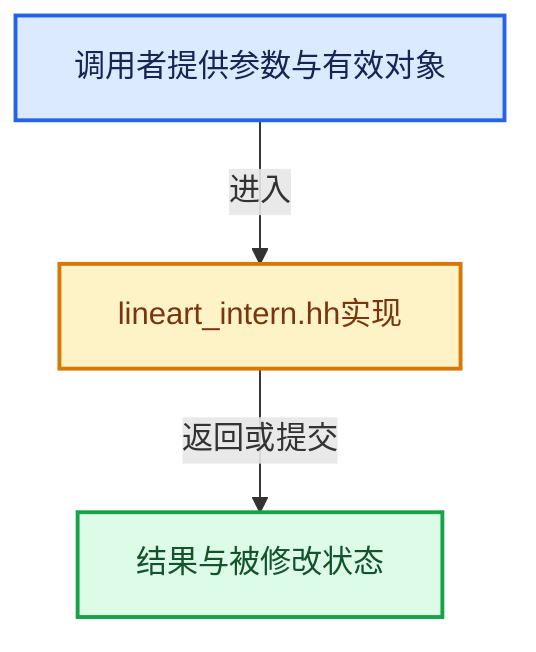

# 实现依赖专题：source/blender/modifiers/intern/lineart/lineart_intern.hh

[实现依赖导航](../../../../README.md) · [符号索引](../../../../../00-课程指南/02-源码与提交索引/符号依赖与实现索引.md)

本专题从正文实际调用进入，集中保存共享实现。函数有稳定锚点，可从调用处直接跳到对应完整函数；递归与互相调用通过回链组织。

## 本文件的实现关系





## 相关类型布局与成员入口

<a id="t-6ea8866022e2"></a>

### `blender::LineartEdge`

原始声明：[source/blender/modifiers/intern/lineart/lineart_intern.hh](../../../../../../../../../source/blender/modifiers/intern/lineart/lineart_intern.hh) · L24—L24。

以下保留类的数据声明与编译条件，成员函数实现通过后面的精确链接阅读。

<!-- annotated:ed1162958aec6b -->

```cpp
struct LineartEdge;
```

<details>
<summary>核对原始源码：source/blender/modifiers/intern/lineart/lineart_intern.hh · L24—L24</summary>

<!-- original:ed1162958aec6b:source/blender/modifiers/intern/lineart/lineart_intern.hh:24:24 -->

```cpp
struct LineartEdge;
```

</details>


<a id="t-7bce474b10f4"></a>

### `blender::LineartEdge`

原始声明：[source/blender/modifiers/intern/lineart/lineart_intern.hh](../../../../../../../../../source/blender/modifiers/intern/lineart/lineart_intern.hh) · L206—L206。

以下保留类的数据声明与编译条件，成员函数实现通过后面的精确链接阅读。

<!-- annotated:e788766a1ea7fb -->

```cpp
                                  struct LineartEdge *e,
```

<details>
<summary>核对原始源码：source/blender/modifiers/intern/lineart/lineart_intern.hh · L206—L206</summary>

<!-- original:e788766a1ea7fb:source/blender/modifiers/intern/lineart/lineart_intern.hh:206:206 -->

```cpp
                                  struct LineartEdge *e,
```

</details>


<a id="t-4d4c37004dab"></a>

### `blender::LineartEdge`

原始声明：[source/blender/modifiers/intern/lineart/lineart_intern.hh](../../../../../../../../../source/blender/modifiers/intern/lineart/lineart_intern.hh) · L207—L207。

以下保留类的数据声明与编译条件，成员函数实现通过后面的精确链接阅读。

<!-- annotated:e107b706130801 -->

```cpp
                                  struct LineartEdge *shadow_edge);
```

<details>
<summary>核对原始源码：source/blender/modifiers/intern/lineart/lineart_intern.hh · L207—L207</summary>

<!-- original:e107b706130801:source/blender/modifiers/intern/lineart/lineart_intern.hh:207:207 -->

```cpp
                                  struct LineartEdge *shadow_edge);
```

</details>


<a id="t-923769d8b3c1"></a>

### `blender::LineartEdge`

原始声明：[source/blender/modifiers/intern/lineart/lineart_intern.hh](../../../../../../../../../source/blender/modifiers/intern/lineart/lineart_intern.hh) · L212—L212。

以下保留类的数据声明与编译条件，成员函数实现通过后面的精确链接阅读。

<!-- annotated:c8664f7f667d70 -->

```cpp
                                const struct LineartEdge *e,
```

<details>
<summary>核对原始源码：source/blender/modifiers/intern/lineart/lineart_intern.hh · L212—L212</summary>

<!-- original:c8664f7f667d70:source/blender/modifiers/intern/lineart/lineart_intern.hh:212:212 -->

```cpp
                                const struct LineartEdge *e,
```

</details>


<a id="t-866ee58b5c67"></a>

### `blender::LineartEdge`

原始声明：[source/blender/modifiers/intern/lineart/lineart_intern.hh](../../../../../../../../../source/blender/modifiers/intern/lineart/lineart_intern.hh) · L239—L239。

以下保留类的数据声明与编译条件，成员函数实现通过后面的精确链接阅读。

<!-- annotated:6972bbebb68c2b -->

```cpp
                      struct LineartEdge *e,
```

<details>
<summary>核对原始源码：source/blender/modifiers/intern/lineart/lineart_intern.hh · L239—L239</summary>

<!-- original:6972bbebb68c2b:source/blender/modifiers/intern/lineart/lineart_intern.hh:239:239 -->

```cpp
                      struct LineartEdge *e,
```

</details>


<a id="t-ec7513974710"></a>

### `blender::LineartEdge`

原始声明：[source/blender/modifiers/intern/lineart/lineart_intern.hh](../../../../../../../../../source/blender/modifiers/intern/lineart/lineart_intern.hh) · L245—L245。

以下保留类的数据声明与编译条件，成员函数实现通过后面的精确链接阅读。

<!-- annotated:024f66b38f9c56 -->

```cpp
void lineart_add_edge_to_array(struct LineartPendingEdges *pe, struct LineartEdge *e);
```

<details>
<summary>核对原始源码：source/blender/modifiers/intern/lineart/lineart_intern.hh · L245—L245</summary>

<!-- original:024f66b38f9c56:source/blender/modifiers/intern/lineart/lineart_intern.hh:245:245 -->

```cpp
void lineart_add_edge_to_array(struct LineartPendingEdges *pe, struct LineartEdge *e);
```

</details>


<a id="m-3a0313dda7dd"></a>

## 宏 `LRT_EDGE_BA_MARCHING_BEGIN`

<!-- annotated:c2e23179af1214 -->

```cpp
#define LRT_EDGE_BA_MARCHING_BEGIN(fb1, fb2) \
  double x = fb1[0], y = fb1[1]; \
  LineartBoundingArea *ba = lineart_edge_first_bounding_area(ld, fb1, fb2); \
  LineartBoundingArea *nba = ba; \
  double k = (fb2[1] - fb1[1]) / (fb2[0] - fb1[0] + 1e-30); \
  int positive_x = (fb2[0] - fb1[0]) > 0 ? 1 : (fb2[0] == fb1[0] ? 0 : -1); \
  int positive_y = (fb2[1] - fb1[1]) > 0 ? 1 : (fb2[1] == fb1[1] ? 0 : -1); \
  while (nba)

```

<details>
<summary>核对原始源码：source/blender/modifiers/intern/lineart/lineart_intern.hh · L94—L102</summary>

<!-- original:c2e23179af1214:source/blender/modifiers/intern/lineart/lineart_intern.hh:94:102 -->

```cpp
#define LRT_EDGE_BA_MARCHING_BEGIN(fb1, fb2) \
  double x = fb1[0], y = fb1[1]; \
  LineartBoundingArea *ba = lineart_edge_first_bounding_area(ld, fb1, fb2); \
  LineartBoundingArea *nba = ba; \
  double k = (fb2[1] - fb1[1]) / (fb2[0] - fb1[0] + 1e-30); \
  int positive_x = (fb2[0] - fb1[0]) > 0 ? 1 : (fb2[0] == fb1[0] ? 0 : -1); \
  int positive_y = (fb2[1] - fb1[1]) > 0 ? 1 : (fb2[1] == fb1[1] ? 0 : -1); \
  while (nba)

```

</details>

宏在预处理阶段展开，参数替换、重复求值和条件编译应直接从该定义检查。与普通函数不同，宏不会自动提供参数类型检查；构建配置选择哪个定义需结合外围条件。

<a id="m-a1600941480b"></a>

## 宏 `LRT_EDGE_BA_MARCHING_NEXT`

<!-- annotated:7b016877ff445f -->

```cpp
#define LRT_EDGE_BA_MARCHING_NEXT(fb1, fb2) \
  /* Marching along `e->v1` to `e->v2`, searching each possible bounding areas it may touch. */ \
  nba = lineart_bounding_area_next(nba, fb1, fb2, x, y, k, positive_x, positive_y, &x, &y);

```

<details>
<summary>核对原始源码：source/blender/modifiers/intern/lineart/lineart_intern.hh · L103—L106</summary>

<!-- original:7b016877ff445f:source/blender/modifiers/intern/lineart/lineart_intern.hh:103:106 -->

```cpp
#define LRT_EDGE_BA_MARCHING_NEXT(fb1, fb2) \
  /* Marching along `e->v1` to `e->v2`, searching each possible bounding areas it may touch. */ \
  nba = lineart_bounding_area_next(nba, fb1, fb2, x, y, k, positive_x, positive_y, &x, &y);

```

</details>

宏在预处理阶段展开，参数替换、重复求值和条件编译应直接从该定义检查。与普通函数不同，宏不会自动提供参数类型检查；构建配置选择哪个定义需结合外围条件。

## 完整成员与函数实现
