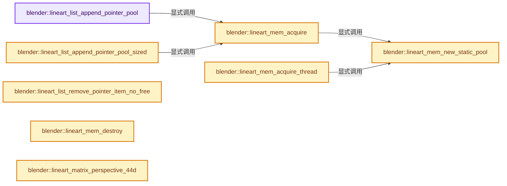
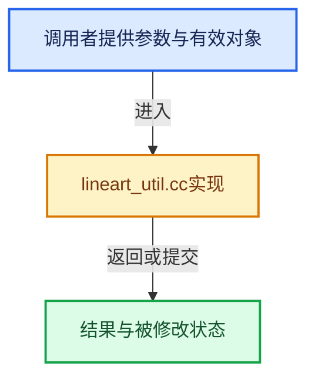

# 实现依赖专题：source/blender/modifiers/intern/lineart/lineart_util.cc

[实现依赖导航](../../../../README.md) · [符号索引](../../../../../00-课程指南/02-源码与提交索引/符号依赖与实现索引.md)

本专题从正文实际调用进入，集中保存共享实现。函数有稳定锚点，可从调用处直接跳到对应完整函数；递归与互相调用通过回链组织。

## 本文件的实现关系






## 完整成员与函数实现

<a id="f-41878a41ba276faf"></a>

### `blender::lineart_list_append_pointer_pool`

实现位置：[source/blender/modifiers/intern/lineart/lineart_util.cc](../../../../../../../../../source/blender/modifiers/intern/lineart/lineart_util.cc) · L28—L38。

接口参数：

- `ListBase *h`
- `LineartStaticMemPool *smp`
- `void *data`

**教学注释版**

<!-- annotated:c43635d18c55c1 -->

```cpp
void *lineart_list_append_pointer_pool(ListBase *h, LineartStaticMemPool *smp, void *data)
{
  LinkData *lip;
  if (h == nullptr) {
    return nullptr;
  }
  lip = static_cast<LinkData *>(lineart_mem_acquire(smp, sizeof(LinkData)));
  lip->data = data;
  BLI_addtail(h, lip);
  return lip;
}
```

<details>
<summary>核对原始源码：source/blender/modifiers/intern/lineart/lineart_util.cc · L28—L38</summary>

<!-- original:c43635d18c55c1:source/blender/modifiers/intern/lineart/lineart_util.cc:28:38 -->

```cpp
void *lineart_list_append_pointer_pool(ListBase *h, LineartStaticMemPool *smp, void *data)
{
  LinkData *lip;
  if (h == nullptr) {
    return nullptr;
  }
  lip = static_cast<LinkData *>(lineart_mem_acquire(smp, sizeof(LinkData)));
  lip->data = data;
  BLI_addtail(h, lip);
  return lip;
}
```

</details>

**沿实际写入检查状态**

- `lip = static_cast<LinkData *>(lineart_mem_acquire(smp, sizeof(LinkData)));`
- `lip->data = data;`

**结果出口**

- `return nullptr;`
- `return lip;`

**继续追踪实现**

- `lineart_mem_acquire` → [blender::lineart_mem_acquire · L109](lineart_util.cc.md#f-35956bc4e0b64b36)。
- `BLI_addtail` → [blender::BLI_addtail · L118](../../../../01-BLI基础库/intern/listbase.cc.md#f-4fb027713fa3115b)。

<a id="f-e59b2a6d948aeab9"></a>

### `blender::lineart_list_append_pointer_pool_sized`

实现位置：[source/blender/modifiers/intern/lineart/lineart_util.cc](../../../../../../../../../source/blender/modifiers/intern/lineart/lineart_util.cc) · L39—L52。

接口参数：

- `ListBase *h`
- `LineartStaticMemPool *smp`
- `void *data`
- `int size`

**教学注释版**

<!-- annotated:5a45bf66caa25a -->

```cpp
void *lineart_list_append_pointer_pool_sized(ListBase *h,
                                             LineartStaticMemPool *smp,
                                             void *data,
                                             int size)
{
  LinkData *lip;
  if (h == nullptr) {
    return nullptr;
  }
  lip = static_cast<LinkData *>(lineart_mem_acquire(smp, size));
  lip->data = data;
  BLI_addtail(h, lip);
  return lip;
}
```

<details>
<summary>核对原始源码：source/blender/modifiers/intern/lineart/lineart_util.cc · L39—L52</summary>

<!-- original:5a45bf66caa25a:source/blender/modifiers/intern/lineart/lineart_util.cc:39:52 -->

```cpp
void *lineart_list_append_pointer_pool_sized(ListBase *h,
                                             LineartStaticMemPool *smp,
                                             void *data,
                                             int size)
{
  LinkData *lip;
  if (h == nullptr) {
    return nullptr;
  }
  lip = static_cast<LinkData *>(lineart_mem_acquire(smp, size));
  lip->data = data;
  BLI_addtail(h, lip);
  return lip;
}
```

</details>

**沿实际写入检查状态**

- `lip = static_cast<LinkData *>(lineart_mem_acquire(smp, size));`
- `lip->data = data;`

**结果出口**

- `return nullptr;`
- `return lip;`

**继续追踪实现**

- `lineart_mem_acquire` → [blender::lineart_mem_acquire · L109](lineart_util.cc.md#f-35956bc4e0b64b36)。
- `BLI_addtail` → [blender::BLI_addtail · L118](../../../../01-BLI基础库/intern/listbase.cc.md#f-4fb027713fa3115b)。

<a id="f-9ad764fb3c5952d7"></a>

### `blender::lineart_list_remove_pointer_item_no_free`

实现位置：[source/blender/modifiers/intern/lineart/lineart_util.cc](../../../../../../../../../source/blender/modifiers/intern/lineart/lineart_util.cc) · L90—L93。

接口参数：

- `ListBase *h`
- `LinkData *lip`

**教学注释版**

<!-- annotated:29e6538252cf32 -->

```cpp
void lineart_list_remove_pointer_item_no_free(ListBase *h, LinkData *lip)
{
  BLI_remlink(h, static_cast<void *>(lip));
}
```

<details>
<summary>核对原始源码：source/blender/modifiers/intern/lineart/lineart_util.cc · L90—L93</summary>

<!-- original:29e6538252cf32:source/blender/modifiers/intern/lineart/lineart_util.cc:90:93 -->

```cpp
void lineart_list_remove_pointer_item_no_free(ListBase *h, LinkData *lip)
{
  BLI_remlink(h, static_cast<void *>(lip));
}
```

</details>

**继续追踪实现**

- `BLI_remlink` → [blender::BLI_remlink · L138](../../../../01-BLI基础库/intern/listbase.cc.md#f-120d80f281ca4cb7)。

<a id="f-9bceb2ca28789e4b"></a>

### `blender::lineart_mem_new_static_pool`

实现位置：[source/blender/modifiers/intern/lineart/lineart_util.cc](../../../../../../../../../source/blender/modifiers/intern/lineart/lineart_util.cc) · L95—L108。

接口参数：

- `LineartStaticMemPool *smp`
- `size_t size`

**教学注释版**

<!-- annotated:0a593d3a914e92 -->

```cpp
LineartStaticMemPoolNode *lineart_mem_new_static_pool(LineartStaticMemPool *smp, size_t size)
{
  size_t set_size = size;
  if (set_size < LRT_MEMORY_POOL_1MB) {
    set_size = LRT_MEMORY_POOL_1MB; /* Prevent too many small allocations. */
  }
  size_t total_size = set_size + sizeof(LineartStaticMemPoolNode);
  LineartStaticMemPoolNode *smpn = static_cast<LineartStaticMemPoolNode *>(
      MEM_new_zeroed(total_size, "mempool"));
  smpn->size = total_size;
  smpn->used_byte = sizeof(LineartStaticMemPoolNode);
  BLI_addhead(&smp->pools, smpn);
  return smpn;
}
```

<details>
<summary>核对原始源码：source/blender/modifiers/intern/lineart/lineart_util.cc · L95—L108</summary>

<!-- original:0a593d3a914e92:source/blender/modifiers/intern/lineart/lineart_util.cc:95:108 -->

```cpp
LineartStaticMemPoolNode *lineart_mem_new_static_pool(LineartStaticMemPool *smp, size_t size)
{
  size_t set_size = size;
  if (set_size < LRT_MEMORY_POOL_1MB) {
    set_size = LRT_MEMORY_POOL_1MB; /* Prevent too many small allocations. */
  }
  size_t total_size = set_size + sizeof(LineartStaticMemPoolNode);
  LineartStaticMemPoolNode *smpn = static_cast<LineartStaticMemPoolNode *>(
      MEM_new_zeroed(total_size, "mempool"));
  smpn->size = total_size;
  smpn->used_byte = sizeof(LineartStaticMemPoolNode);
  BLI_addhead(&smp->pools, smpn);
  return smpn;
}
```

</details>

**沿实际写入检查状态**

- `set_size = LRT_MEMORY_POOL_1MB; /* Prevent too many small allocations. */`
- `smpn->size = total_size;`
- `smpn->used_byte = sizeof(LineartStaticMemPoolNode);`

**结果出口**

- `return smpn;`

**继续追踪实现**

- `MEM_new_zeroed` → [MEM_new_zeroed · L550](../../../../07-Intern运行时与平台/guardedalloc/MEM_guardedalloc.h.md#f-eeb1e2a7f57dd231)；[MEM_new_zeroed · L114](../../../../07-Intern运行时与平台/guardedalloc/intern/mallocn.cc.md#f-e04cf01c64c8b180)。同名重载需按实参类型选择。
- `BLI_addhead` → [blender::BLI_addhead · L98](../../../../01-BLI基础库/intern/listbase.cc.md#f-fed3ad483fcdfeb9)。

<a id="f-35956bc4e0b64b36"></a>

### `blender::lineart_mem_acquire`

实现位置：[source/blender/modifiers/intern/lineart/lineart_util.cc](../../../../../../../../../source/blender/modifiers/intern/lineart/lineart_util.cc) · L109—L123。

接口参数：

- `LineartStaticMemPool *smp`
- `size_t size`

**教学注释版**

<!-- annotated:3e1bf592728ea9 -->

```cpp
void *lineart_mem_acquire(LineartStaticMemPool *smp, size_t size)
{
  LineartStaticMemPoolNode *smpn = smp->pools.first();
  void *ret;

  if (!smpn || (smpn->used_byte + size) > smpn->size) {
    smpn = lineart_mem_new_static_pool(smp, size);
  }

  ret = (reinterpret_cast<uchar *>(smpn)) + smpn->used_byte;

  smpn->used_byte += size;

  return ret;
}
```

<details>
<summary>核对原始源码：source/blender/modifiers/intern/lineart/lineart_util.cc · L109—L123</summary>

<!-- original:3e1bf592728ea9:source/blender/modifiers/intern/lineart/lineart_util.cc:109:123 -->

```cpp
void *lineart_mem_acquire(LineartStaticMemPool *smp, size_t size)
{
  LineartStaticMemPoolNode *smpn = smp->pools.first();
  void *ret;

  if (!smpn || (smpn->used_byte + size) > smpn->size) {
    smpn = lineart_mem_new_static_pool(smp, size);
  }

  ret = (reinterpret_cast<uchar *>(smpn)) + smpn->used_byte;

  smpn->used_byte += size;

  return ret;
}
```

</details>

**沿实际写入检查状态**

- `smpn = lineart_mem_new_static_pool(smp, size);`
- `ret = (reinterpret_cast<uchar *>(smpn)) + smpn->used_byte;`
- `smpn->used_byte += size;`

**结果出口**

- `return ret;`

**继续追踪实现**

- `smp->pools.first` → [调用协议](../../../../../00-课程指南/01-路线与规范/模板宏与动态分派协议.md)：接收对象类型依赖auto、返回值或模板实例；不按同名猜测目标。调用位置L111。
- `lineart_mem_new_static_pool` → [blender::lineart_mem_new_static_pool · L95](lineart_util.cc.md#f-9bceb2ca28789e4b)。

<a id="f-d2e9b62a191e84f0"></a>

### `blender::lineart_mem_acquire_thread`

实现位置：[source/blender/modifiers/intern/lineart/lineart_util.cc](../../../../../../../../../source/blender/modifiers/intern/lineart/lineart_util.cc) · L124—L143。

接口参数：

- `LineartStaticMemPool *smp`
- `size_t size`

**教学注释版**

<!-- annotated:34f49768dfd480 -->

```cpp
void *lineart_mem_acquire_thread(LineartStaticMemPool *smp, size_t size)
{
  void *ret;

  BLI_spin_lock(&smp->lock_mem);

  LineartStaticMemPoolNode *smpn = smp->pools.first();

  if (!smpn || (smpn->used_byte + size) > smpn->size) {
    smpn = lineart_mem_new_static_pool(smp, size);
  }

  ret = (reinterpret_cast<uchar *>(smpn)) + smpn->used_byte;

  smpn->used_byte += size;

  BLI_spin_unlock(&smp->lock_mem);

  return ret;
}
```

<details>
<summary>核对原始源码：source/blender/modifiers/intern/lineart/lineart_util.cc · L124—L143</summary>

<!-- original:34f49768dfd480:source/blender/modifiers/intern/lineart/lineart_util.cc:124:143 -->

```cpp
void *lineart_mem_acquire_thread(LineartStaticMemPool *smp, size_t size)
{
  void *ret;

  BLI_spin_lock(&smp->lock_mem);

  LineartStaticMemPoolNode *smpn = smp->pools.first();

  if (!smpn || (smpn->used_byte + size) > smpn->size) {
    smpn = lineart_mem_new_static_pool(smp, size);
  }

  ret = (reinterpret_cast<uchar *>(smpn)) + smpn->used_byte;

  smpn->used_byte += size;

  BLI_spin_unlock(&smp->lock_mem);

  return ret;
}
```

</details>

**沿实际写入检查状态**

- `smpn = lineart_mem_new_static_pool(smp, size);`
- `ret = (reinterpret_cast<uchar *>(smpn)) + smpn->used_byte;`
- `smpn->used_byte += size;`

**结果出口**

- `return ret;`

**继续追踪实现**

- `BLI_spin_lock` → [调用协议](../../../../../00-课程指南/01-路线与规范/模板宏与动态分派协议.md)：函数指针、局部可调用对象或未展开的宏；必须结合调用者环境。调用位置L128。
- `smp->pools.first` → [调用协议](../../../../../00-课程指南/01-路线与规范/模板宏与动态分派协议.md)：接收对象类型依赖auto、返回值或模板实例；不按同名猜测目标。调用位置L130。
- `lineart_mem_new_static_pool` → [blender::lineart_mem_new_static_pool · L95](lineart_util.cc.md#f-9bceb2ca28789e4b)。
- `BLI_spin_unlock` → [BLI_spin_unlock · L433](../../../../01-BLI基础库/intern/threads.cc.md#f-ded25214a4593256)。

<a id="f-e0c1cda4b21fa225"></a>

### `blender::lineart_mem_destroy`

实现位置：[source/blender/modifiers/intern/lineart/lineart_util.cc](../../../../../../../../../source/blender/modifiers/intern/lineart/lineart_util.cc) · L144—L151。

接口参数：

- `LineartStaticMemPool *smp`

**教学注释版**

<!-- annotated:4023ec814e6e88 -->

```cpp
void lineart_mem_destroy(LineartStaticMemPool *smp)
{
  while (LineartStaticMemPoolNode *smpn = static_cast<LineartStaticMemPoolNode *>(
             BLI_pophead(&smp->pools)))
  {
    MEM_delete(smpn);
  }
}
```

<details>
<summary>核对原始源码：source/blender/modifiers/intern/lineart/lineart_util.cc · L144—L151</summary>

<!-- original:4023ec814e6e88:source/blender/modifiers/intern/lineart/lineart_util.cc:144:151 -->

```cpp
void lineart_mem_destroy(LineartStaticMemPool *smp)
{
  while (LineartStaticMemPoolNode *smpn = static_cast<LineartStaticMemPoolNode *>(
             BLI_pophead(&smp->pools)))
  {
    MEM_delete(smpn);
  }
}
```

</details>

**继续追踪实现**

- `BLI_pophead` → [blender::BLI_pophead · L259](../../../../01-BLI基础库/intern/listbase.cc.md#f-c1491382e532f81c)。
- `MEM_delete` → [MEM_delete · L400](../../../../07-Intern运行时与平台/guardedalloc/MEM_guardedalloc.h.md#f-9049ffdd1682887c)。

<a id="f-056a85424d20fdbd"></a>

### `blender::lineart_matrix_perspective_44d`

实现位置：[source/blender/modifiers/intern/lineart/lineart_util.cc](../../../../../../../../../source/blender/modifiers/intern/lineart/lineart_util.cc) · L163—L194。

接口参数：

- `double (*mProjection)[4]`
- `double fFov_rad`
- `double fAspect`
- `double zMin`
- `double zMax`

**教学注释版**

<!-- annotated:1177fe9d4b2a40 -->

```cpp
void lineart_matrix_perspective_44d(
    double (*mProjection)[4], double fFov_rad, double fAspect, double zMin, double zMax)
{
  double yMax;
  double yMin;
  double xMin;
  double xMax;

  if (fAspect < 1) {
    yMax = zMin * tan(fFov_rad * 0.5f);
    yMin = -yMax;
    xMin = yMin * fAspect;
    xMax = -xMin;
  }
  else {
    xMax = zMin * tan(fFov_rad * 0.5f);
    xMin = -xMax;
    yMin = xMin / fAspect;
    yMax = -yMin;
  }

  unit_m4_db(mProjection);

  mProjection[0][0] = (2.0f * zMin) / (xMax - xMin);
  mProjection[1][1] = (2.0f * zMin) / (yMax - yMin);
  mProjection[2][0] = (xMax + xMin) / (xMax - xMin);
  mProjection[2][1] = (yMax + yMin) / (yMax - yMin);
  mProjection[2][2] = -((zMax + zMin) / (zMax - zMin));
  mProjection[2][3] = -1.0f;
  mProjection[3][2] = -((2.0f * (zMax * zMin)) / (zMax - zMin));
  mProjection[3][3] = 0.0f;
}
```

<details>
<summary>核对原始源码：source/blender/modifiers/intern/lineart/lineart_util.cc · L163—L194</summary>

<!-- original:1177fe9d4b2a40:source/blender/modifiers/intern/lineart/lineart_util.cc:163:194 -->

```cpp
void lineart_matrix_perspective_44d(
    double (*mProjection)[4], double fFov_rad, double fAspect, double zMin, double zMax)
{
  double yMax;
  double yMin;
  double xMin;
  double xMax;

  if (fAspect < 1) {
    yMax = zMin * tan(fFov_rad * 0.5f);
    yMin = -yMax;
    xMin = yMin * fAspect;
    xMax = -xMin;
  }
  else {
    xMax = zMin * tan(fFov_rad * 0.5f);
    xMin = -xMax;
    yMin = xMin / fAspect;
    yMax = -yMin;
  }

  unit_m4_db(mProjection);

  mProjection[0][0] = (2.0f * zMin) / (xMax - xMin);
  mProjection[1][1] = (2.0f * zMin) / (yMax - yMin);
  mProjection[2][0] = (xMax + xMin) / (xMax - xMin);
  mProjection[2][1] = (yMax + yMin) / (yMax - yMin);
  mProjection[2][2] = -((zMax + zMin) / (zMax - zMin));
  mProjection[2][3] = -1.0f;
  mProjection[3][2] = -((2.0f * (zMax * zMin)) / (zMax - zMin));
  mProjection[3][3] = 0.0f;
}
```

</details>

**沿实际写入检查状态**

- `yMax = zMin * tan(fFov_rad * 0.5f);`
- `yMin = -yMax;`
- `xMin = yMin * fAspect;`
- `xMax = -xMin;`
- `xMax = zMin * tan(fFov_rad * 0.5f);`
- `xMin = -xMax;`
- `yMin = xMin / fAspect;`
- `yMax = -yMin;`
- `mProjection[0][0] = (2.0f * zMin) / (xMax - xMin);`
- `mProjection[1][1] = (2.0f * zMin) / (yMax - yMin);`
- `mProjection[2][0] = (xMax + xMin) / (xMax - xMin);`
- `mProjection[2][1] = (yMax + yMin) / (yMax - yMin);`
- `mProjection[2][2] = -((zMax + zMin) / (zMax - zMin));`
- `mProjection[2][3] = -1.0f;`
- `mProjection[3][2] = -((2.0f * (zMax * zMin)) / (zMax - zMin));`
- `mProjection[3][3] = 0.0f;`

**继续追踪实现**

- `tan` → [tan · L131](../../../gpu/shaders/compat/gpu_shader_cxx_builtin.hh.md#m-4ad80f3fe350)。宏定义由构建条件选择。
- `unit_m4_db` → [blender::unit_m4_db · L64](../../../../01-BLI基础库/intern/math_matrix_c.cc.md#f-4a05767c1f44c217)。

<a id="f-57ea246889306f24"></a>

### `blender::lineart_matrix_ortho_44d`

实现位置：[source/blender/modifiers/intern/lineart/lineart_util.cc](../../../../../../../../../source/blender/modifiers/intern/lineart/lineart_util.cc) · L195—L212。

接口参数：

- `double (*mProjection)[4]`
- `double xMin`
- `double xMax`
- `double yMin`
- `double yMax`
- `double zMin`
- `double zMax`

**教学注释版**

<!-- annotated:b4f8e23ca949d5 -->

```cpp
void lineart_matrix_ortho_44d(double (*mProjection)[4],
                              double xMin,
                              double xMax,
                              double yMin,
                              double yMax,
                              double zMin,
                              double zMax)
{
  unit_m4_db(mProjection);

  mProjection[0][0] = 2.0f / (xMax - xMin);
  mProjection[1][1] = 2.0f / (yMax - yMin);
  mProjection[2][2] = -2.0f / (zMax - zMin);
  mProjection[3][0] = -((xMax + xMin) / (xMax - xMin));
  mProjection[3][1] = -((yMax + yMin) / (yMax - yMin));
  mProjection[3][2] = -((zMax + zMin) / (zMax - zMin));
  mProjection[3][3] = 1.0f;
}
```

<details>
<summary>核对原始源码：source/blender/modifiers/intern/lineart/lineart_util.cc · L195—L212</summary>

<!-- original:b4f8e23ca949d5:source/blender/modifiers/intern/lineart/lineart_util.cc:195:212 -->

```cpp
void lineart_matrix_ortho_44d(double (*mProjection)[4],
                              double xMin,
                              double xMax,
                              double yMin,
                              double yMax,
                              double zMin,
                              double zMax)
{
  unit_m4_db(mProjection);

  mProjection[0][0] = 2.0f / (xMax - xMin);
  mProjection[1][1] = 2.0f / (yMax - yMin);
  mProjection[2][2] = -2.0f / (zMax - zMin);
  mProjection[3][0] = -((xMax + xMin) / (xMax - xMin));
  mProjection[3][1] = -((yMax + yMin) / (yMax - yMin));
  mProjection[3][2] = -((zMax + zMin) / (zMax - zMin));
  mProjection[3][3] = 1.0f;
}
```

</details>

**沿实际写入检查状态**

- `mProjection[0][0] = 2.0f / (xMax - xMin);`
- `mProjection[1][1] = 2.0f / (yMax - yMin);`
- `mProjection[2][2] = -2.0f / (zMax - zMin);`
- `mProjection[3][0] = -((xMax + xMin) / (xMax - xMin));`
- `mProjection[3][1] = -((yMax + yMin) / (yMax - yMin));`
- `mProjection[3][2] = -((zMax + zMin) / (zMax - zMin));`
- `mProjection[3][3] = 1.0f;`

**继续追踪实现**

- `unit_m4_db` → [blender::unit_m4_db · L64](../../../../01-BLI基础库/intern/math_matrix_c.cc.md#f-4a05767c1f44c217)。

<a id="f-57bb321073c7a35a"></a>

### `blender::lineart_count_and_print_render_buffer_memory`

实现位置：[source/blender/modifiers/intern/lineart/lineart_util.cc](../../../../../../../../../source/blender/modifiers/intern/lineart/lineart_util.cc) · L214—L244。

接口参数：

- `LineartData *ld`

**教学注释版**

<!-- annotated:d5bb1942876346 -->

```cpp
void lineart_count_and_print_render_buffer_memory(LineartData *ld)
{
  size_t total = 0;
  size_t count_this = ld->render_data_pool.pools.count();
  size_t sum_this = LRT_MEMORY_POOL_1MB * count_this;

  printf("LANPR Memory allocated %zu Standalone nodes, total %zu Bytes.\n", count_this, sum_this);
  total += sum_this;
  sum_this = 0;
  count_this = 0;

  for (LineartElementLinkNode &reln : ld->geom.line_buffer_pointers) {
    count_this++;
    sum_this += reln.element_count * sizeof(LineartEdge);
  }
  printf("             allocated %zu edge blocks, total %zu Bytes.\n", count_this, sum_this);
  total += sum_this;
  sum_this = 0;
  count_this = 0;

  for (LineartElementLinkNode &reln : ld->geom.triangle_buffer_pointers) {
    count_this++;
    sum_this += reln.element_count * ld->sizeof_triangle;
  }
  printf("             allocated %zu triangle blocks, total %zu Bytes.\n", count_this, sum_this);
  total += sum_this;
  sum_this = 0;
  count_this = 0;

  (void)total; /* Ignored. */
}
```

<details>
<summary>核对原始源码：source/blender/modifiers/intern/lineart/lineart_util.cc · L214—L244</summary>

<!-- original:d5bb1942876346:source/blender/modifiers/intern/lineart/lineart_util.cc:214:244 -->

```cpp
void lineart_count_and_print_render_buffer_memory(LineartData *ld)
{
  size_t total = 0;
  size_t count_this = ld->render_data_pool.pools.count();
  size_t sum_this = LRT_MEMORY_POOL_1MB * count_this;

  printf("LANPR Memory allocated %zu Standalone nodes, total %zu Bytes.\n", count_this, sum_this);
  total += sum_this;
  sum_this = 0;
  count_this = 0;

  for (LineartElementLinkNode &reln : ld->geom.line_buffer_pointers) {
    count_this++;
    sum_this += reln.element_count * sizeof(LineartEdge);
  }
  printf("             allocated %zu edge blocks, total %zu Bytes.\n", count_this, sum_this);
  total += sum_this;
  sum_this = 0;
  count_this = 0;

  for (LineartElementLinkNode &reln : ld->geom.triangle_buffer_pointers) {
    count_this++;
    sum_this += reln.element_count * ld->sizeof_triangle;
  }
  printf("             allocated %zu triangle blocks, total %zu Bytes.\n", count_this, sum_this);
  total += sum_this;
  sum_this = 0;
  count_this = 0;

  (void)total; /* Ignored. */
}
```

</details>

**沿实际写入检查状态**

- `total += sum_this;`
- `sum_this = 0;`
- `count_this = 0;`
- `sum_this += reln.element_count * sizeof(LineartEdge);`
- `sum_this += reln.element_count * ld->sizeof_triangle;`

**继续追踪实现**

- `ld->render_data_pool.pools.count` → [调用协议](../../../../../00-课程指南/01-路线与规范/模板宏与动态分派协议.md)：接收对象类型依赖auto、返回值或模板实例；不按同名猜测目标。调用位置L217。
- `printf` → [外部契约](https://eel.is/c++draft/)：这个边界按实际表达式及所属类型核对参数、返回值、寿命与失败行为。这里提供接口入口，不声称已解释该第三方版本的内部实现。
