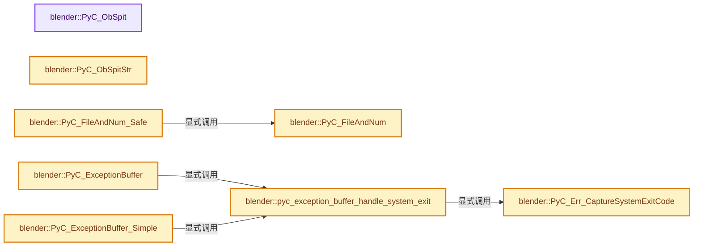
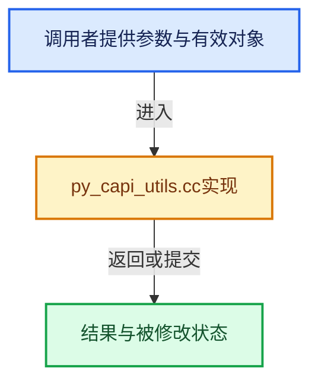

# 实现依赖专题：source/blender/python/generic/py_capi_utils.cc

[实现依赖导航](../../../README.md) · [符号索引](../../../../00-课程指南/02-源码与提交索引/符号依赖与实现索引.md)

本专题从正文实际调用进入，集中保存共享实现。函数有稳定锚点，可从调用处直接跳到对应完整函数；递归与互相调用通过回链组织。

## 本文件的实现关系






## 完整成员与函数实现

<a id="f-6a567835f288f974"></a>

### `blender::PyC_ObSpit`

实现位置：[source/blender/python/generic/py_capi_utils.cc](../../../../../../../../source/blender/python/generic/py_capi_utils.cc) · L700—L716。

接口参数：

- `const char *name`
- `PyObject *var`

**教学注释版**

<!-- annotated:fe17db4dd2f73d -->

```cpp
void PyC_ObSpit(const char *name, PyObject *var)
{
  const char *null_str = "<null>";
  fprintf(stderr, "<%s> : ", name);
  if (var == nullptr) {
    fprintf(stderr, "%s\n", null_str);
  }
  else {
    PyObject_Print(var, stderr, 0);
    const PyTypeObject *type = Py_TYPE(var);
    fprintf(stderr,
            " ref:%d, ptr:%p, type: %s\n",
            int(var->ob_refcnt),
            static_cast<void *>(var),
            type ? type->tp_name : null_str);
  }
}
```

<details>
<summary>核对原始源码：source/blender/python/generic/py_capi_utils.cc · L700—L716</summary>

<!-- original:fe17db4dd2f73d:source/blender/python/generic/py_capi_utils.cc:700:716 -->

```cpp
void PyC_ObSpit(const char *name, PyObject *var)
{
  const char *null_str = "<null>";
  fprintf(stderr, "<%s> : ", name);
  if (var == nullptr) {
    fprintf(stderr, "%s\n", null_str);
  }
  else {
    PyObject_Print(var, stderr, 0);
    const PyTypeObject *type = Py_TYPE(var);
    fprintf(stderr,
            " ref:%d, ptr:%p, type: %s\n",
            int(var->ob_refcnt),
            static_cast<void *>(var),
            type ? type->tp_name : null_str);
  }
}
```

</details>

**继续追踪实现**

- `fprintf` → [外部契约](https://eel.is/c++draft/)：这个边界按实际表达式及所属类型核对参数、返回值、寿命与失败行为。这里提供接口入口，不声称已解释该第三方版本的内部实现。
- `PyObject_Print` → [调用协议](../../../../00-课程指南/01-路线与规范/模板宏与动态分派协议.md)：配置相关检测或外部运行时接口。调用位置L708。
- `Py_TYPE` → [调用协议](../../../../00-课程指南/01-路线与规范/模板宏与动态分派协议.md)：配置相关检测或外部运行时接口。调用位置L709。

<a id="f-ef32e8ca587527fe"></a>

### `blender::PyC_ObSpitStr`

实现位置：[source/blender/python/generic/py_capi_utils.cc](../../../../../../../../source/blender/python/generic/py_capi_utils.cc) · L718—L744。

接口参数：

- `char *result`
- `size_t result_maxncpy`
- `PyObject *var`

**教学注释版**

<!-- annotated:acb699ffe4709a -->

```cpp
void PyC_ObSpitStr(char *result, size_t result_maxncpy, PyObject *var)
{
  /* No name, creator of string can manage that. */
  const char *null_str = "<null>";
  if (var == nullptr) {
    BLI_strncpy_utf8(result, null_str, result_maxncpy);
  }
  else {
    const PyTypeObject *type = Py_TYPE(var);
    PyObject *var_str = PyObject_Repr(var);
    if (var_str == nullptr) {
      /* We could print error here,
       * but this may be used for generating errors - so don't for now. */
      PyErr_Clear();
    }
    BLI_snprintf_utf8(result,
                      result_maxncpy,
                      " ref=%d, ptr=%p, type=%s, value=%.200s",
                      int(var->ob_refcnt),
                      static_cast<void *>(var),
                      type ? type->tp_name : null_str,
                      var_str ? PyUnicode_AsUTF8(var_str) : "<error>");
    if (var_str != nullptr) {
      Py_DECREF(var_str);
    }
  }
}
```

<details>
<summary>核对原始源码：source/blender/python/generic/py_capi_utils.cc · L718—L744</summary>

<!-- original:acb699ffe4709a:source/blender/python/generic/py_capi_utils.cc:718:744 -->

```cpp
void PyC_ObSpitStr(char *result, size_t result_maxncpy, PyObject *var)
{
  /* No name, creator of string can manage that. */
  const char *null_str = "<null>";
  if (var == nullptr) {
    BLI_strncpy_utf8(result, null_str, result_maxncpy);
  }
  else {
    const PyTypeObject *type = Py_TYPE(var);
    PyObject *var_str = PyObject_Repr(var);
    if (var_str == nullptr) {
      /* We could print error here,
       * but this may be used for generating errors - so don't for now. */
      PyErr_Clear();
    }
    BLI_snprintf_utf8(result,
                      result_maxncpy,
                      " ref=%d, ptr=%p, type=%s, value=%.200s",
                      int(var->ob_refcnt),
                      static_cast<void *>(var),
                      type ? type->tp_name : null_str,
                      var_str ? PyUnicode_AsUTF8(var_str) : "<error>");
    if (var_str != nullptr) {
      Py_DECREF(var_str);
    }
  }
}
```

</details>

**继续追踪实现**

- `BLI_strncpy_utf8` → [blender::BLI_strncpy_utf8 · L404](../../../01-BLI基础库/intern/string_utf8.cc.md#f-ff7c5f28742085a0)。
- `Py_TYPE` → [调用协议](../../../../00-课程指南/01-路线与规范/模板宏与动态分派协议.md)：配置相关检测或外部运行时接口。调用位置L726。
- `PyObject_Repr` → [调用协议](../../../../00-课程指南/01-路线与规范/模板宏与动态分派协议.md)：配置相关检测或外部运行时接口。调用位置L727。
- `PyErr_Clear` → [调用协议](../../../../00-课程指南/01-路线与规范/模板宏与动态分派协议.md)：配置相关检测或外部运行时接口。调用位置L731。
- `BLI_snprintf_utf8` → [blender::BLI_snprintf_utf8 · L597](../../../01-BLI基础库/intern/string_utf8.cc.md#f-47c5b052ec665ff6)。
- `PyUnicode_AsUTF8` → [调用协议](../../../../00-课程指南/01-路线与规范/模板宏与动态分派协议.md)：配置相关检测或外部运行时接口。调用位置L739。
- `Py_DECREF` → [调用协议](../../../../00-课程指南/01-路线与规范/模板宏与动态分派协议.md)：配置相关检测或外部运行时接口。调用位置L741。

<a id="f-ced9f04c60a72da5"></a>

### `blender::PyC_FileAndNum`

实现位置：[source/blender/python/generic/py_capi_utils.cc](../../../../../../../../source/blender/python/generic/py_capi_utils.cc) · L784—L838。

接口参数：

- `const char **r_filename`
- `int *r_lineno`

**教学注释版**

<!-- annotated:7725ec02d44263 -->

```cpp
void PyC_FileAndNum(const char **r_filename, int *r_lineno)
{
  PyFrameObject *frame;
  PyCodeObject *code;

  if (r_filename) {
    *r_filename = nullptr;
  }
  if (r_lineno) {
    *r_lineno = -1;
  }

  if (!(frame = PyEval_GetFrame())) {
    return;
  }
  if (!(code = PyFrame_GetCode(frame))) {
    return;
  }

  /* when executing a script */
  if (r_filename) {
    *r_filename = PyUnicode_AsUTF8(code->co_filename);
  }

  /* when executing a module */
  if (r_filename && *r_filename == nullptr) {
    /* try an alternative method to get the r_filename - module based
     * references below are all borrowed (double checked) */
    PyObject *mod_name = PyDict_GetItemString(PyEval_GetGlobals(), "__name__");
    if (mod_name) {
      PyObject *mod = PyDict_GetItem(PyImport_GetModuleDict(), mod_name);
      if (mod) {
        PyObject *mod_file = PyModule_GetFilenameObject(mod);
        if (mod_file) {
          *r_filename = PyUnicode_AsUTF8(mod_name);
          Py_DECREF(mod_file);
        }
        else {
          PyErr_Clear();
        }
      }

      /* unlikely, fallback */
      if (*r_filename == nullptr) {
        *r_filename = PyUnicode_AsUTF8(mod_name);
      }
    }
  }

  if (r_lineno) {
    *r_lineno = PyFrame_GetLineNumber(frame);
  }

  Py_DECREF(code);
}
```

<details>
<summary>核对原始源码：source/blender/python/generic/py_capi_utils.cc · L784—L838</summary>

<!-- original:7725ec02d44263:source/blender/python/generic/py_capi_utils.cc:784:838 -->

```cpp
void PyC_FileAndNum(const char **r_filename, int *r_lineno)
{
  PyFrameObject *frame;
  PyCodeObject *code;

  if (r_filename) {
    *r_filename = nullptr;
  }
  if (r_lineno) {
    *r_lineno = -1;
  }

  if (!(frame = PyEval_GetFrame())) {
    return;
  }
  if (!(code = PyFrame_GetCode(frame))) {
    return;
  }

  /* when executing a script */
  if (r_filename) {
    *r_filename = PyUnicode_AsUTF8(code->co_filename);
  }

  /* when executing a module */
  if (r_filename && *r_filename == nullptr) {
    /* try an alternative method to get the r_filename - module based
     * references below are all borrowed (double checked) */
    PyObject *mod_name = PyDict_GetItemString(PyEval_GetGlobals(), "__name__");
    if (mod_name) {
      PyObject *mod = PyDict_GetItem(PyImport_GetModuleDict(), mod_name);
      if (mod) {
        PyObject *mod_file = PyModule_GetFilenameObject(mod);
        if (mod_file) {
          *r_filename = PyUnicode_AsUTF8(mod_name);
          Py_DECREF(mod_file);
        }
        else {
          PyErr_Clear();
        }
      }

      /* unlikely, fallback */
      if (*r_filename == nullptr) {
        *r_filename = PyUnicode_AsUTF8(mod_name);
      }
    }
  }

  if (r_lineno) {
    *r_lineno = PyFrame_GetLineNumber(frame);
  }

  Py_DECREF(code);
}
```

</details>

**继续追踪实现**

- `PyEval_GetFrame` → [调用协议](../../../../00-课程指南/01-路线与规范/模板宏与动态分派协议.md)：配置相关检测或外部运行时接口。调用位置L796。
- `PyFrame_GetCode` → [调用协议](../../../../00-课程指南/01-路线与规范/模板宏与动态分派协议.md)：配置相关检测或外部运行时接口。调用位置L799。
- `PyUnicode_AsUTF8` → [调用协议](../../../../00-课程指南/01-路线与规范/模板宏与动态分派协议.md)：配置相关检测或外部运行时接口。调用位置L805。
- `PyDict_GetItemString` → [调用协议](../../../../00-课程指南/01-路线与规范/模板宏与动态分派协议.md)：配置相关检测或外部运行时接口。调用位置L812。
- `PyEval_GetGlobals` → [调用协议](../../../../00-课程指南/01-路线与规范/模板宏与动态分派协议.md)：配置相关检测或外部运行时接口。调用位置L812。
- `PyDict_GetItem` → [调用协议](../../../../00-课程指南/01-路线与规范/模板宏与动态分派协议.md)：配置相关检测或外部运行时接口。调用位置L814。
- `PyImport_GetModuleDict` → [调用协议](../../../../00-课程指南/01-路线与规范/模板宏与动态分派协议.md)：配置相关检测或外部运行时接口。调用位置L814。
- `PyModule_GetFilenameObject` → [调用协议](../../../../00-课程指南/01-路线与规范/模板宏与动态分派协议.md)：配置相关检测或外部运行时接口。调用位置L816。
- `Py_DECREF` → [调用协议](../../../../00-课程指南/01-路线与规范/模板宏与动态分派协议.md)：配置相关检测或外部运行时接口。调用位置L819。
- `PyErr_Clear` → [调用协议](../../../../00-课程指南/01-路线与规范/模板宏与动态分派协议.md)：配置相关检测或外部运行时接口。调用位置L822。
- `PyFrame_GetLineNumber` → [调用协议](../../../../00-课程指南/01-路线与规范/模板宏与动态分派协议.md)：配置相关检测或外部运行时接口。调用位置L834。

<a id="f-9c55ba82ad0d8b34"></a>

### `blender::PyC_FileAndNum_Safe`

实现位置：[source/blender/python/generic/py_capi_utils.cc](../../../../../../../../source/blender/python/generic/py_capi_utils.cc) · L840—L847。

接口参数：

- `const char **r_filename`
- `int *r_lineno`

**教学注释版**

<!-- annotated:50df585f1a0dcb -->

```cpp
void PyC_FileAndNum_Safe(const char **r_filename, int *r_lineno)
{
  if (!PyC_IsInterpreterActive()) {
    return;
  }

  PyC_FileAndNum(r_filename, r_lineno);
}
```

<details>
<summary>核对原始源码：source/blender/python/generic/py_capi_utils.cc · L840—L847</summary>

<!-- original:50df585f1a0dcb:source/blender/python/generic/py_capi_utils.cc:840:847 -->

```cpp
void PyC_FileAndNum_Safe(const char **r_filename, int *r_lineno)
{
  if (!PyC_IsInterpreterActive()) {
    return;
  }

  PyC_FileAndNum(r_filename, r_lineno);
}
```

</details>

**继续追踪实现**

- `PyC_IsInterpreterActive` → [blender::PyC_IsInterpreterActive · L1310](py_capi_utils.cc.md#f-dbefabca8ff29331)。
- `PyC_FileAndNum` → [blender::PyC_FileAndNum · L784](py_capi_utils.cc.md#f-ced9f04c60a72da5)。

<a id="f-14f3392b7d3683af"></a>

### `blender::PyC_Err_CaptureSystemExitCode`

实现位置：[source/blender/python/generic/py_capi_utils.cc](../../../../../../../../source/blender/python/generic/py_capi_utils.cc) · L957—L972。

**教学注释版**

<!-- annotated:5661662e142b89 -->

```cpp
bool PyC_Err_CaptureSystemExitCode()
{
  if (!PyErr_ExceptionMatches(PyExc_SystemExit)) {
    return false;
  }

  /* Get exit code and put back exception. */
  PyObject *exc_obj = PyErr_GetRaisedException();
  PyObject *code_obj = ((PySystemExitObject *)exc_obj)->code;
  g_system_exit_code = 0;
  if (code_obj && code_obj != Py_None) {
    g_system_exit_code = PyLong_Check(code_obj) ? int(PyLong_AsLong(code_obj)) : 1;
  }
  PyErr_SetRaisedException(exc_obj);
  return true;
}
```

<details>
<summary>核对原始源码：source/blender/python/generic/py_capi_utils.cc · L957—L972</summary>

<!-- original:5661662e142b89:source/blender/python/generic/py_capi_utils.cc:957:972 -->

```cpp
bool PyC_Err_CaptureSystemExitCode()
{
  if (!PyErr_ExceptionMatches(PyExc_SystemExit)) {
    return false;
  }

  /* Get exit code and put back exception. */
  PyObject *exc_obj = PyErr_GetRaisedException();
  PyObject *code_obj = ((PySystemExitObject *)exc_obj)->code;
  g_system_exit_code = 0;
  if (code_obj && code_obj != Py_None) {
    g_system_exit_code = PyLong_Check(code_obj) ? int(PyLong_AsLong(code_obj)) : 1;
  }
  PyErr_SetRaisedException(exc_obj);
  return true;
}
```

</details>

**沿实际写入检查状态**

- `g_system_exit_code = 0;`
- `g_system_exit_code = PyLong_Check(code_obj) ? int(PyLong_AsLong(code_obj)) : 1;`

**结果出口**

- `return false;`
- `return true;`

**继续追踪实现**

- `PyErr_ExceptionMatches` → [调用协议](../../../../00-课程指南/01-路线与规范/模板宏与动态分派协议.md)：配置相关检测或外部运行时接口。调用位置L959。
- `PyErr_GetRaisedException` → [调用协议](../../../../00-课程指南/01-路线与规范/模板宏与动态分派协议.md)：配置相关检测或外部运行时接口。调用位置L964。
- `PyLong_Check` → [调用协议](../../../../00-课程指南/01-路线与规范/模板宏与动态分派协议.md)：配置相关检测或外部运行时接口。调用位置L968。
- `PyLong_AsLong` → [调用协议](../../../../00-课程指南/01-路线与规范/模板宏与动态分派协议.md)：配置相关检测或外部运行时接口。调用位置L968。
- `PyErr_SetRaisedException` → [调用协议](../../../../00-课程指南/01-路线与规范/模板宏与动态分派协议.md)：配置相关检测或外部运行时接口。调用位置L970。

<a id="f-117e44cc4d6b1941"></a>

### `blender::pyc_exception_buffer_handle_system_exit`

实现位置：[source/blender/python/generic/py_capi_utils.cc](../../../../../../../../source/blender/python/generic/py_capi_utils.cc) · L990—L1016。

**教学注释版**

<!-- annotated:7e544adbb9ee8a -->

```cpp
static void pyc_exception_buffer_handle_system_exit()
{
  if (!PyC_Err_CaptureSystemExitCode()) {
    return;
  }
  /* Inspecting, follow Python's logic in #_Py_HandleSystemExit & treat as a regular exception. */
#  if 0 /* FIXME: */
  if (_Py_GetConfig()->inspect) {
    return;
  }
#  endif

  /* NOTE(@ideasman42): A `SystemExit` exception will exit immediately (unless inspecting).
   * So print the error and exit now. Without this #PyErr_Display shows the error stack-trace
   * as a regular exception (as if something went wrong) and fail to exit.
   * see: #99966 for additional context.
   *
   * Arguably accessing a `SystemExit` exception as a buffer should be supported without exiting.
   * (by temporarily enabling inspection for example) however - it's not obvious exactly when this
   * should be enabled and complicates the Python API by introducing different kinds of execution.
   * Since the rule of thumb is for Blender's embedded Python to match stand-alone Python,
   * favor exiting when a `SystemExit` is raised.
   * Especially since this exception more likely to be used for background/batch-processing
   * utilities where exiting immediately makes sense, the possibility of this being called
   * indirectly from python-drivers or modal-operators is less of a concern. */
  PyErr_Print();
}
```

<details>
<summary>核对原始源码：source/blender/python/generic/py_capi_utils.cc · L990—L1016</summary>

<!-- original:7e544adbb9ee8a:source/blender/python/generic/py_capi_utils.cc:990:1016 -->

```cpp
static void pyc_exception_buffer_handle_system_exit()
{
  if (!PyC_Err_CaptureSystemExitCode()) {
    return;
  }
  /* Inspecting, follow Python's logic in #_Py_HandleSystemExit & treat as a regular exception. */
#  if 0 /* FIXME: */
  if (_Py_GetConfig()->inspect) {
    return;
  }
#  endif

  /* NOTE(@ideasman42): A `SystemExit` exception will exit immediately (unless inspecting).
   * So print the error and exit now. Without this #PyErr_Display shows the error stack-trace
   * as a regular exception (as if something went wrong) and fail to exit.
   * see: #99966 for additional context.
   *
   * Arguably accessing a `SystemExit` exception as a buffer should be supported without exiting.
   * (by temporarily enabling inspection for example) however - it's not obvious exactly when this
   * should be enabled and complicates the Python API by introducing different kinds of execution.
   * Since the rule of thumb is for Blender's embedded Python to match stand-alone Python,
   * favor exiting when a `SystemExit` is raised.
   * Especially since this exception more likely to be used for background/batch-processing
   * utilities where exiting immediately makes sense, the possibility of this being called
   * indirectly from python-drivers or modal-operators is less of a concern. */
  PyErr_Print();
}
```

</details>

**继续追踪实现**

- `PyC_Err_CaptureSystemExitCode` → [blender::PyC_Err_CaptureSystemExitCode · L957](py_capi_utils.cc.md#f-14f3392b7d3683af)。
- `_Py_GetConfig` → [调用协议](../../../../00-课程指南/01-路线与规范/模板宏与动态分派协议.md)：函数指针、局部可调用对象或未展开的宏；必须结合调用者环境。调用位置L997。
- `PyErr_Print` → [调用协议](../../../../00-课程指南/01-路线与规范/模板宏与动态分派协议.md)：配置相关检测或外部运行时接口。调用位置L1015。

<a id="f-1dd24fc34c6b4978"></a>

### `blender::PyC_ExceptionBuffer`

实现位置：[source/blender/python/generic/py_capi_utils.cc](../../../../../../../../source/blender/python/generic/py_capi_utils.cc) · L1018—L1076。

**教学注释版**

<!-- annotated:cbdbc5f24cc53b -->

```cpp
PyObject *PyC_ExceptionBuffer()
{
  BLI_assert(PyErr_Occurred());

  pyc_exception_buffer_handle_system_exit();

  /* The resulting exception as a string (return value). */
  PyObject *result = nullptr;

  PyObject *error_type, *error_value, *error_traceback;
  PyErr_Fetch(&error_type, &error_value, &error_traceback);

  /* Normalizing is needed because it's possible the error value is a string which
   * #PyErr_Display will fail to print. */
  PyErr_NormalizeException(&error_type, &error_value, &error_traceback);

  /* `io.StringIO()`. */
  PyObject *string_io = nullptr;
  PyObject *string_io_mod = nullptr;
  PyObject *string_io_getvalue = nullptr;
  if ((string_io_mod = PyImport_ImportModule("io")) &&
      (string_io = PyObject_CallMethod(string_io_mod, "StringIO", nullptr)) &&
      (string_io_getvalue = PyObject_GetAttrString(string_io, "getvalue")))
  {
    PyObject *stderr_backup = PySys_GetObject("stderr"); /* Borrowed. */
    /* Since these were borrowed we don't want them freed when replaced. */
    Py_INCREF(stderr_backup);
    PySys_SetObject("stderr", string_io); /* Freed when overwriting. */

    PyErr_Display(error_type, error_value, error_traceback);

    result = PyObject_CallObject(string_io_getvalue, nullptr);
    PySys_SetObject("stderr", stderr_backup);
    Py_DECREF(stderr_backup); /* Now `sys` owns the reference again. */
  }
  else {
    PySys_WriteStderr("Internal error creating: io.StringIO()!\n");
    if (PyErr_Occurred()) [[unlikely]] {
      PyErr_Print(); /* Show the error accessing `io.StringIO`. */
    }
    PyErr_Display(error_type, error_value, error_traceback);
  }

  Py_XDECREF(string_io_mod);
  Py_XDECREF(string_io_getvalue);
  Py_XDECREF(string_io); /* Free the original reference. */

  if (result == nullptr) {
    result = PyObject_Str(error_value);
    /* Python does this too. */
    if (result == nullptr) [[unlikely]] {
      result = PyUnicode_FromFormat("<unprintable %s object>", Py_TYPE(error_value)->tp_name);
    }
  }

  PyErr_Restore(error_type, error_value, error_traceback);

  return result;
}
```

<details>
<summary>核对原始源码：source/blender/python/generic/py_capi_utils.cc · L1018—L1076</summary>

<!-- original:cbdbc5f24cc53b:source/blender/python/generic/py_capi_utils.cc:1018:1076 -->

```cpp
PyObject *PyC_ExceptionBuffer()
{
  BLI_assert(PyErr_Occurred());

  pyc_exception_buffer_handle_system_exit();

  /* The resulting exception as a string (return value). */
  PyObject *result = nullptr;

  PyObject *error_type, *error_value, *error_traceback;
  PyErr_Fetch(&error_type, &error_value, &error_traceback);

  /* Normalizing is needed because it's possible the error value is a string which
   * #PyErr_Display will fail to print. */
  PyErr_NormalizeException(&error_type, &error_value, &error_traceback);

  /* `io.StringIO()`. */
  PyObject *string_io = nullptr;
  PyObject *string_io_mod = nullptr;
  PyObject *string_io_getvalue = nullptr;
  if ((string_io_mod = PyImport_ImportModule("io")) &&
      (string_io = PyObject_CallMethod(string_io_mod, "StringIO", nullptr)) &&
      (string_io_getvalue = PyObject_GetAttrString(string_io, "getvalue")))
  {
    PyObject *stderr_backup = PySys_GetObject("stderr"); /* Borrowed. */
    /* Since these were borrowed we don't want them freed when replaced. */
    Py_INCREF(stderr_backup);
    PySys_SetObject("stderr", string_io); /* Freed when overwriting. */

    PyErr_Display(error_type, error_value, error_traceback);

    result = PyObject_CallObject(string_io_getvalue, nullptr);
    PySys_SetObject("stderr", stderr_backup);
    Py_DECREF(stderr_backup); /* Now `sys` owns the reference again. */
  }
  else {
    PySys_WriteStderr("Internal error creating: io.StringIO()!\n");
    if (PyErr_Occurred()) [[unlikely]] {
      PyErr_Print(); /* Show the error accessing `io.StringIO`. */
    }
    PyErr_Display(error_type, error_value, error_traceback);
  }

  Py_XDECREF(string_io_mod);
  Py_XDECREF(string_io_getvalue);
  Py_XDECREF(string_io); /* Free the original reference. */

  if (result == nullptr) {
    result = PyObject_Str(error_value);
    /* Python does this too. */
    if (result == nullptr) [[unlikely]] {
      result = PyUnicode_FromFormat("<unprintable %s object>", Py_TYPE(error_value)->tp_name);
    }
  }

  PyErr_Restore(error_type, error_value, error_traceback);

  return result;
}
```

</details>

**沿实际写入检查状态**

- `result = PyObject_CallObject(string_io_getvalue, nullptr);`
- `result = PyObject_Str(error_value);`
- `result = PyUnicode_FromFormat("<unprintable %s object>", Py_TYPE(error_value)->tp_name);`

**结果出口**

- `return result;`

**继续追踪实现**

- `BLI_assert` → [BLI_assert · L48](../../../01-BLI基础库/BLI_assert.hh.md#m-57a88495704d)；[BLI_assert · L63](../../../01-BLI基础库/BLI_assert.hh.md#m-d07050020cb5)。宏定义由构建条件选择。
- `PyErr_Occurred` → [调用协议](../../../../00-课程指南/01-路线与规范/模板宏与动态分派协议.md)：配置相关检测或外部运行时接口。调用位置L1020。
- `pyc_exception_buffer_handle_system_exit` → [blender::pyc_exception_buffer_handle_system_exit · L990](py_capi_utils.cc.md#f-117e44cc4d6b1941)。
- `PyErr_Fetch` → [调用协议](../../../../00-课程指南/01-路线与规范/模板宏与动态分派协议.md)：配置相关检测或外部运行时接口。调用位置L1028。
- `PyErr_NormalizeException` → [调用协议](../../../../00-课程指南/01-路线与规范/模板宏与动态分派协议.md)：配置相关检测或外部运行时接口。调用位置L1032。
- `PyImport_ImportModule` → [调用协议](../../../../00-课程指南/01-路线与规范/模板宏与动态分派协议.md)：配置相关检测或外部运行时接口。调用位置L1038。
- `PyObject_CallMethod` → [调用协议](../../../../00-课程指南/01-路线与规范/模板宏与动态分派协议.md)：配置相关检测或外部运行时接口。调用位置L1039。
- `PyObject_GetAttrString` → [调用协议](../../../../00-课程指南/01-路线与规范/模板宏与动态分派协议.md)：配置相关检测或外部运行时接口。调用位置L1040。
- `PySys_GetObject` → [调用协议](../../../../00-课程指南/01-路线与规范/模板宏与动态分派协议.md)：配置相关检测或外部运行时接口。调用位置L1042。
- `Py_INCREF` → [调用协议](../../../../00-课程指南/01-路线与规范/模板宏与动态分派协议.md)：配置相关检测或外部运行时接口。调用位置L1044。
- `PySys_SetObject` → [调用协议](../../../../00-课程指南/01-路线与规范/模板宏与动态分派协议.md)：配置相关检测或外部运行时接口。调用位置L1045。
- `PyErr_Display` → [调用协议](../../../../00-课程指南/01-路线与规范/模板宏与动态分派协议.md)：配置相关检测或外部运行时接口。调用位置L1047。
- `PyObject_CallObject` → [调用协议](../../../../00-课程指南/01-路线与规范/模板宏与动态分派协议.md)：配置相关检测或外部运行时接口。调用位置L1049。
- `Py_DECREF` → [调用协议](../../../../00-课程指南/01-路线与规范/模板宏与动态分派协议.md)：配置相关检测或外部运行时接口。调用位置L1051。
- `PySys_WriteStderr` → [调用协议](../../../../00-课程指南/01-路线与规范/模板宏与动态分派协议.md)：配置相关检测或外部运行时接口。调用位置L1054。
- `PyErr_Print` → [调用协议](../../../../00-课程指南/01-路线与规范/模板宏与动态分派协议.md)：配置相关检测或外部运行时接口。调用位置L1056。
- `Py_XDECREF` → [调用协议](../../../../00-课程指南/01-路线与规范/模板宏与动态分派协议.md)：配置相关检测或外部运行时接口。调用位置L1061。
- `PyObject_Str` → [调用协议](../../../../00-课程指南/01-路线与规范/模板宏与动态分派协议.md)：配置相关检测或外部运行时接口。调用位置L1066。
- `PyUnicode_FromFormat` → [调用协议](../../../../00-课程指南/01-路线与规范/模板宏与动态分派协议.md)：配置相关检测或外部运行时接口。调用位置L1069。
- `Py_TYPE` → [调用协议](../../../../00-课程指南/01-路线与规范/模板宏与动态分派协议.md)：配置相关检测或外部运行时接口。调用位置L1069。
- `PyErr_Restore` → [调用协议](../../../../00-课程指南/01-路线与规范/模板宏与动态分派协议.md)：配置相关检测或外部运行时接口。调用位置L1073。

<a id="f-a109dcf19cd59f37"></a>

### `blender::PyC_ExceptionBuffer_Simple`

实现位置：[source/blender/python/generic/py_capi_utils.cc](../../../../../../../../source/blender/python/generic/py_capi_utils.cc) · L1078—L1111。

**教学注释版**

<!-- annotated:d5b33bb1055371 -->

```cpp
PyObject *PyC_ExceptionBuffer_Simple()
{
  BLI_assert(PyErr_Occurred());

  pyc_exception_buffer_handle_system_exit();

  /* The resulting exception as a string (return value). */
  PyObject *result = nullptr;

  PyObject *error_type, *error_value, *error_traceback;

  PyErr_Fetch(&error_type, &error_value, &error_traceback);

  if (PyErr_GivenExceptionMatches(error_type, PyExc_SyntaxError)) {
    /* Special exception for syntax errors,
     * in these cases the full error is verbose and not very useful,
     * just use the initial text so we know what the error is. */
    if (PyTuple_CheckExact(error_value) && PyTuple_GET_SIZE(error_value) >= 1) {
      result = PyObject_Str(PyTuple_GET_ITEM(error_value, 0));
    }
  }

  if (result == nullptr) {
    result = PyObject_Str(error_value);
    /* Python does this too. */
    if (result == nullptr) [[unlikely]] {
      result = PyUnicode_FromFormat("<unprintable %s object>", Py_TYPE(error_value)->tp_name);
    }
  }

  PyErr_Restore(error_type, error_value, error_traceback);

  return result;
}
```

<details>
<summary>核对原始源码：source/blender/python/generic/py_capi_utils.cc · L1078—L1111</summary>

<!-- original:d5b33bb1055371:source/blender/python/generic/py_capi_utils.cc:1078:1111 -->

```cpp
PyObject *PyC_ExceptionBuffer_Simple()
{
  BLI_assert(PyErr_Occurred());

  pyc_exception_buffer_handle_system_exit();

  /* The resulting exception as a string (return value). */
  PyObject *result = nullptr;

  PyObject *error_type, *error_value, *error_traceback;

  PyErr_Fetch(&error_type, &error_value, &error_traceback);

  if (PyErr_GivenExceptionMatches(error_type, PyExc_SyntaxError)) {
    /* Special exception for syntax errors,
     * in these cases the full error is verbose and not very useful,
     * just use the initial text so we know what the error is. */
    if (PyTuple_CheckExact(error_value) && PyTuple_GET_SIZE(error_value) >= 1) {
      result = PyObject_Str(PyTuple_GET_ITEM(error_value, 0));
    }
  }

  if (result == nullptr) {
    result = PyObject_Str(error_value);
    /* Python does this too. */
    if (result == nullptr) [[unlikely]] {
      result = PyUnicode_FromFormat("<unprintable %s object>", Py_TYPE(error_value)->tp_name);
    }
  }

  PyErr_Restore(error_type, error_value, error_traceback);

  return result;
}
```

</details>

**沿实际写入检查状态**

- `result = PyObject_Str(PyTuple_GET_ITEM(error_value, 0));`
- `result = PyObject_Str(error_value);`
- `result = PyUnicode_FromFormat("<unprintable %s object>", Py_TYPE(error_value)->tp_name);`

**结果出口**

- `return result;`

**继续追踪实现**

- `BLI_assert` → [BLI_assert · L48](../../../01-BLI基础库/BLI_assert.hh.md#m-57a88495704d)；[BLI_assert · L63](../../../01-BLI基础库/BLI_assert.hh.md#m-d07050020cb5)。宏定义由构建条件选择。
- `PyErr_Occurred` → [调用协议](../../../../00-课程指南/01-路线与规范/模板宏与动态分派协议.md)：配置相关检测或外部运行时接口。调用位置L1080。
- `pyc_exception_buffer_handle_system_exit` → [blender::pyc_exception_buffer_handle_system_exit · L990](py_capi_utils.cc.md#f-117e44cc4d6b1941)。
- `PyErr_Fetch` → [调用协议](../../../../00-课程指南/01-路线与规范/模板宏与动态分派协议.md)：配置相关检测或外部运行时接口。调用位置L1089。
- `PyErr_GivenExceptionMatches` → [调用协议](../../../../00-课程指南/01-路线与规范/模板宏与动态分派协议.md)：配置相关检测或外部运行时接口。调用位置L1091。
- `PyTuple_CheckExact` → [调用协议](../../../../00-课程指南/01-路线与规范/模板宏与动态分派协议.md)：配置相关检测或外部运行时接口。调用位置L1095。
- `PyTuple_GET_SIZE` → [调用协议](../../../../00-课程指南/01-路线与规范/模板宏与动态分派协议.md)：配置相关检测或外部运行时接口。调用位置L1095。
- `PyObject_Str` → [调用协议](../../../../00-课程指南/01-路线与规范/模板宏与动态分派协议.md)：配置相关检测或外部运行时接口。调用位置L1096。
- `PyTuple_GET_ITEM` → [调用协议](../../../../00-课程指南/01-路线与规范/模板宏与动态分派协议.md)：配置相关检测或外部运行时接口。调用位置L1096。
- `PyUnicode_FromFormat` → [调用协议](../../../../00-课程指南/01-路线与规范/模板宏与动态分派协议.md)：配置相关检测或外部运行时接口。调用位置L1104。
- `Py_TYPE` → [调用协议](../../../../00-课程指南/01-路线与规范/模板宏与动态分派协议.md)：配置相关检测或外部运行时接口。调用位置L1104。
- `PyErr_Restore` → [调用协议](../../../../00-课程指南/01-路线与规范/模板宏与动态分派协议.md)：配置相关检测或外部运行时接口。调用位置L1108。

<a id="f-f6456f432eb1b887"></a>

### `blender::PyC_UnicodeFromBytesAndSize`

实现位置：[source/blender/python/generic/py_capi_utils.cc](../../../../../../../../source/blender/python/generic/py_capi_utils.cc) · L1173—L1186。

接口参数：

- `const char *str`
- `Py_ssize_t size`

**教学注释版**

<!-- annotated:b6346747eea938 -->

```cpp
PyObject *PyC_UnicodeFromBytesAndSize(const char *str, Py_ssize_t size)
{
  PyObject *result = PyUnicode_FromStringAndSize(str, size);
  if (result) {
    /* 99% of the time this is enough but we better support non unicode
     * chars since blender doesn't limit this */
    return result;
  }

  PyErr_Clear();
  /* this means paths will always be accessible once converted, on all OS's */
  result = PyUnicode_DecodeFSDefaultAndSize(str, size);
  return result;
}
```

<details>
<summary>核对原始源码：source/blender/python/generic/py_capi_utils.cc · L1173—L1186</summary>

<!-- original:b6346747eea938:source/blender/python/generic/py_capi_utils.cc:1173:1186 -->

```cpp
PyObject *PyC_UnicodeFromBytesAndSize(const char *str, Py_ssize_t size)
{
  PyObject *result = PyUnicode_FromStringAndSize(str, size);
  if (result) {
    /* 99% of the time this is enough but we better support non unicode
     * chars since blender doesn't limit this */
    return result;
  }

  PyErr_Clear();
  /* this means paths will always be accessible once converted, on all OS's */
  result = PyUnicode_DecodeFSDefaultAndSize(str, size);
  return result;
}
```

</details>

**沿实际写入检查状态**

- `result = PyUnicode_DecodeFSDefaultAndSize(str, size);`

**结果出口**

- `return result;`

**继续追踪实现**

- `PyUnicode_FromStringAndSize` → [调用协议](../../../../00-课程指南/01-路线与规范/模板宏与动态分派协议.md)：配置相关检测或外部运行时接口。调用位置L1175。
- `PyErr_Clear` → [调用协议](../../../../00-课程指南/01-路线与规范/模板宏与动态分派协议.md)：配置相关检测或外部运行时接口。调用位置L1182。
- `PyUnicode_DecodeFSDefaultAndSize` → [调用协议](../../../../00-课程指南/01-路线与规范/模板宏与动态分派协议.md)：配置相关检测或外部运行时接口。调用位置L1184。

<a id="f-97d770e8569b6c64"></a>

### `blender::PyC_UnicodeFromBytes`

实现位置：[source/blender/python/generic/py_capi_utils.cc](../../../../../../../../source/blender/python/generic/py_capi_utils.cc) · L1188—L1191。

接口参数：

- `const char *str`

**教学注释版**

<!-- annotated:3eec956ff07e94 -->

```cpp
PyObject *PyC_UnicodeFromBytes(const char *str)
{
  return PyC_UnicodeFromBytesAndSize(str, strlen(str));
}
```

<details>
<summary>核对原始源码：source/blender/python/generic/py_capi_utils.cc · L1188—L1191</summary>

<!-- original:3eec956ff07e94:source/blender/python/generic/py_capi_utils.cc:1188:1191 -->

```cpp
PyObject *PyC_UnicodeFromBytes(const char *str)
{
  return PyC_UnicodeFromBytesAndSize(str, strlen(str));
}
```

</details>

**结果出口**

- `return PyC_UnicodeFromBytesAndSize(str, strlen(str));`

**继续追踪实现**

- `PyC_UnicodeFromBytesAndSize` → [blender::PyC_UnicodeFromBytesAndSize · L1173](py_capi_utils.cc.md#f-f6456f432eb1b887)。
- `strlen` → [外部契约](https://eel.is/c++draft/)：这个边界按实际表达式及所属类型核对参数、返回值、寿命与失败行为。这里提供接口入口，不声称已解释该第三方版本的内部实现。

<a id="f-a10b3a4353f09159"></a>

### `blender::PyC_DefaultNameSpace`

实现位置：[source/blender/python/generic/py_capi_utils.cc](../../../../../../../../source/blender/python/generic/py_capi_utils.cc) · L1234—L1250。

接口参数：

- `const char *filename`

**教学注释版**

<!-- annotated:cc30fd3fb2ca35 -->

```cpp
PyObject *PyC_DefaultNameSpace(const char *filename)
{
  PyObject *modules = PyImport_GetModuleDict();
  PyObject *builtins = PyEval_GetBuiltins();
  PyObject *mod_main = PyModule_New("__main__");
  PyDict_SetItemString(modules, "__main__", mod_main);
  Py_DECREF(mod_main); /* `sys.modules` owns now. */
  PyModule_AddStringConstant(mod_main, "__name__", "__main__");

  /* This won't map to a real file when executing text-blocks and buttons.
   * In this case an identifier is typically used that is surrounded by angle-brackets.
   * It's mainly helpful for the UI and messages to show *something*. */
  PyModule_AddObject(mod_main, "__file__", PyC_UnicodeFromBytes(filename));
  PyModule_AddObjectRef(mod_main, "__builtins__", builtins);

  return PyModule_GetDict(mod_main);
}
```

<details>
<summary>核对原始源码：source/blender/python/generic/py_capi_utils.cc · L1234—L1250</summary>

<!-- original:cc30fd3fb2ca35:source/blender/python/generic/py_capi_utils.cc:1234:1250 -->

```cpp
PyObject *PyC_DefaultNameSpace(const char *filename)
{
  PyObject *modules = PyImport_GetModuleDict();
  PyObject *builtins = PyEval_GetBuiltins();
  PyObject *mod_main = PyModule_New("__main__");
  PyDict_SetItemString(modules, "__main__", mod_main);
  Py_DECREF(mod_main); /* `sys.modules` owns now. */
  PyModule_AddStringConstant(mod_main, "__name__", "__main__");

  /* This won't map to a real file when executing text-blocks and buttons.
   * In this case an identifier is typically used that is surrounded by angle-brackets.
   * It's mainly helpful for the UI and messages to show *something*. */
  PyModule_AddObject(mod_main, "__file__", PyC_UnicodeFromBytes(filename));
  PyModule_AddObjectRef(mod_main, "__builtins__", builtins);

  return PyModule_GetDict(mod_main);
}
```

</details>

**结果出口**

- `return PyModule_GetDict(mod_main);`

**继续追踪实现**

- `PyImport_GetModuleDict` → [调用协议](../../../../00-课程指南/01-路线与规范/模板宏与动态分派协议.md)：配置相关检测或外部运行时接口。调用位置L1236。
- `PyEval_GetBuiltins` → [调用协议](../../../../00-课程指南/01-路线与规范/模板宏与动态分派协议.md)：配置相关检测或外部运行时接口。调用位置L1237。
- `PyModule_New` → [调用协议](../../../../00-课程指南/01-路线与规范/模板宏与动态分派协议.md)：配置相关检测或外部运行时接口。调用位置L1238。
- `PyDict_SetItemString` → [调用协议](../../../../00-课程指南/01-路线与规范/模板宏与动态分派协议.md)：配置相关检测或外部运行时接口。调用位置L1239。
- `Py_DECREF` → [调用协议](../../../../00-课程指南/01-路线与规范/模板宏与动态分派协议.md)：配置相关检测或外部运行时接口。调用位置L1240。
- `PyModule_AddStringConstant` → [调用协议](../../../../00-课程指南/01-路线与规范/模板宏与动态分派协议.md)：配置相关检测或外部运行时接口。调用位置L1241。
- `PyModule_AddObject` → [调用协议](../../../../00-课程指南/01-路线与规范/模板宏与动态分派协议.md)：配置相关检测或外部运行时接口。调用位置L1246。
- `PyC_UnicodeFromBytes` → [blender::PyC_UnicodeFromBytes · L1188](py_capi_utils.cc.md#f-97d770e8569b6c64)。
- `PyModule_AddObjectRef` → [调用协议](../../../../00-课程指南/01-路线与规范/模板宏与动态分派协议.md)：配置相关检测或外部运行时接口。调用位置L1247。
- `PyModule_GetDict` → [调用协议](../../../../00-课程指南/01-路线与规范/模板宏与动态分派协议.md)：配置相关检测或外部运行时接口。调用位置L1249。

<a id="f-d25d2ad1f9d3fc93"></a>

### `blender::PyC_NameSpace_ImportArray`

实现位置：[source/blender/python/generic/py_capi_utils.cc](../../../../../../../../source/blender/python/generic/py_capi_utils.cc) · L1252—L1270。

接口参数：

- `PyObject *py_dict`
- `const char *imports[]`

**教学注释版**

<!-- annotated:9b48badb5b831b -->

```cpp
bool PyC_NameSpace_ImportArray(PyObject *py_dict, const char *imports[])
{
  for (int i = 0; imports[i]; i++) {
    PyObject *name = PyUnicode_FromString(imports[i]);
    PyObject *mod = PyImport_ImportModuleLevelObject(name, nullptr, nullptr, nullptr, 0);
    bool ok = false;
    if (mod) {
      PyDict_SetItem(py_dict, name, mod);
      ok = true;
      Py_DECREF(mod);
    }
    Py_DECREF(name);

    if (!ok) {
      return false;
    }
  }
  return true;
}
```

<details>
<summary>核对原始源码：source/blender/python/generic/py_capi_utils.cc · L1252—L1270</summary>

<!-- original:9b48badb5b831b:source/blender/python/generic/py_capi_utils.cc:1252:1270 -->

```cpp
bool PyC_NameSpace_ImportArray(PyObject *py_dict, const char *imports[])
{
  for (int i = 0; imports[i]; i++) {
    PyObject *name = PyUnicode_FromString(imports[i]);
    PyObject *mod = PyImport_ImportModuleLevelObject(name, nullptr, nullptr, nullptr, 0);
    bool ok = false;
    if (mod) {
      PyDict_SetItem(py_dict, name, mod);
      ok = true;
      Py_DECREF(mod);
    }
    Py_DECREF(name);

    if (!ok) {
      return false;
    }
  }
  return true;
}
```

</details>

**沿实际写入检查状态**

- `ok = true;`

**结果出口**

- `return false;`
- `return true;`

**继续追踪实现**

- `PyUnicode_FromString` → [调用协议](../../../../00-课程指南/01-路线与规范/模板宏与动态分派协议.md)：配置相关检测或外部运行时接口。调用位置L1255。
- `PyImport_ImportModuleLevelObject` → [调用协议](../../../../00-课程指南/01-路线与规范/模板宏与动态分派协议.md)：配置相关检测或外部运行时接口。调用位置L1256。
- `PyDict_SetItem` → [调用协议](../../../../00-课程指南/01-路线与规范/模板宏与动态分派协议.md)：配置相关检测或外部运行时接口。调用位置L1259。
- `Py_DECREF` → [调用协议](../../../../00-课程指南/01-路线与规范/模板宏与动态分派协议.md)：配置相关检测或外部运行时接口。调用位置L1261。

<a id="f-0181121d348b2e03"></a>

### `blender::PyC_MainModule_Backup`

实现位置：[source/blender/python/generic/py_capi_utils.cc](../../../../../../../../source/blender/python/generic/py_capi_utils.cc) · L1272—L1282。

**教学注释版**

<!-- annotated:08488ed239b216 -->

```cpp
PyObject *PyC_MainModule_Backup()
{
  PyObject *modules = PyImport_GetModuleDict();
  PyObject *main_mod = PyDict_GetItemString(modules, "__main__");
  if (main_mod) {
    /* Ensure the backed up module is kept until it's ownership */
    /* is transferred back to `sys.modules`. */
    Py_INCREF(main_mod);
  }
  return main_mod;
}
```

<details>
<summary>核对原始源码：source/blender/python/generic/py_capi_utils.cc · L1272—L1282</summary>

<!-- original:08488ed239b216:source/blender/python/generic/py_capi_utils.cc:1272:1282 -->

```cpp
PyObject *PyC_MainModule_Backup()
{
  PyObject *modules = PyImport_GetModuleDict();
  PyObject *main_mod = PyDict_GetItemString(modules, "__main__");
  if (main_mod) {
    /* Ensure the backed up module is kept until it's ownership */
    /* is transferred back to `sys.modules`. */
    Py_INCREF(main_mod);
  }
  return main_mod;
}
```

</details>

**结果出口**

- `return main_mod;`

**继续追踪实现**

- `PyImport_GetModuleDict` → [调用协议](../../../../00-课程指南/01-路线与规范/模板宏与动态分派协议.md)：配置相关检测或外部运行时接口。调用位置L1274。
- `PyDict_GetItemString` → [调用协议](../../../../00-课程指南/01-路线与规范/模板宏与动态分派协议.md)：配置相关检测或外部运行时接口。调用位置L1275。
- `Py_INCREF` → [调用协议](../../../../00-课程指南/01-路线与规范/模板宏与动态分派协议.md)：配置相关检测或外部运行时接口。调用位置L1279。

<a id="f-7c9f40f9cf2d90b3"></a>

### `blender::PyC_MainModule_Restore`

实现位置：[source/blender/python/generic/py_capi_utils.cc](../../../../../../../../source/blender/python/generic/py_capi_utils.cc) · L1284—L1294。

接口参数：

- `PyObject *main_mod`

**教学注释版**

<!-- annotated:1daa93730c56c5 -->

```cpp
void PyC_MainModule_Restore(PyObject *main_mod)
{
  PyObject *modules = PyImport_GetModuleDict();
  if (main_mod) {
    PyDict_SetItemString(modules, "__main__", main_mod);
    Py_DECREF(main_mod);
  }
  else {
    PyDict_DelItemString(modules, "__main__");
  }
}
```

<details>
<summary>核对原始源码：source/blender/python/generic/py_capi_utils.cc · L1284—L1294</summary>

<!-- original:1daa93730c56c5:source/blender/python/generic/py_capi_utils.cc:1284:1294 -->

```cpp
void PyC_MainModule_Restore(PyObject *main_mod)
{
  PyObject *modules = PyImport_GetModuleDict();
  if (main_mod) {
    PyDict_SetItemString(modules, "__main__", main_mod);
    Py_DECREF(main_mod);
  }
  else {
    PyDict_DelItemString(modules, "__main__");
  }
}
```

</details>

**继续追踪实现**

- `PyImport_GetModuleDict` → [调用协议](../../../../00-课程指南/01-路线与规范/模板宏与动态分派协议.md)：配置相关检测或外部运行时接口。调用位置L1286。
- `PyDict_SetItemString` → [调用协议](../../../../00-课程指南/01-路线与规范/模板宏与动态分派协议.md)：配置相关检测或外部运行时接口。调用位置L1288。
- `Py_DECREF` → [调用协议](../../../../00-课程指南/01-路线与规范/模板宏与动态分派协议.md)：配置相关检测或外部运行时接口。调用位置L1289。
- `PyDict_DelItemString` → [调用协议](../../../../00-课程指南/01-路线与规范/模板宏与动态分派协议.md)：配置相关检测或外部运行时接口。调用位置L1292。

<a id="f-dbefabca8ff29331"></a>

### `blender::PyC_IsInterpreterActive`

实现位置：[source/blender/python/generic/py_capi_utils.cc](../../../../../../../../source/blender/python/generic/py_capi_utils.cc) · L1310—L1314。

**教学注释版**

<!-- annotated:c0750093933a02 -->

```cpp
bool PyC_IsInterpreterActive()
{
  /* instead of PyThreadState_Get, which calls Py_FatalError */
  return (PyThreadState_GetDict() != nullptr);
}
```

<details>
<summary>核对原始源码：source/blender/python/generic/py_capi_utils.cc · L1310—L1314</summary>

<!-- original:c0750093933a02:source/blender/python/generic/py_capi_utils.cc:1310:1314 -->

```cpp
bool PyC_IsInterpreterActive()
{
  /* instead of PyThreadState_Get, which calls Py_FatalError */
  return (PyThreadState_GetDict() != nullptr);
}
```

</details>

**结果出口**

- `return (PyThreadState_GetDict() != nullptr);`

**继续追踪实现**

- `PyThreadState_GetDict` → [调用协议](../../../../00-课程指南/01-路线与规范/模板宏与动态分派协议.md)：配置相关检测或外部运行时接口。调用位置L1313。

<a id="f-40dd1016facb222c"></a>

### `blender::pyc_run_string_as_py_object`

实现位置：[source/blender/python/generic/py_capi_utils.cc](../../../../../../../../source/blender/python/generic/py_capi_utils.cc) · L1625—L1659。

接口参数：

- `const char *imports[]`
- `const char *imports_star[]`
- `const char *expr`
- `const char *filename`

**教学注释版**

<!-- annotated:d6cc04dacd184d -->

```cpp
static PyObject *pyc_run_string_as_py_object(const char *imports[],
                                             const char *imports_star[],
                                             const char *expr,
                                             const char *filename)
{
  PyObject *main_mod = PyC_MainModule_Backup();

  PyObject *py_dict = PyC_DefaultNameSpace(filename);

  if (imports_star) {
    for (int i = 0; imports_star[i]; i++) {
      PyObject *mod = PyImport_ImportModule(imports_star[i]);
      if (mod) {
        /* Don't overwrite existing values (override=0). */
        PyDict_Merge(py_dict, PyModule_GetDict(mod), 0);
        Py_DECREF(mod);
      }
      else { /* Highly unlikely but possibly. */
        PyErr_Print();
      }
    }
  }

  PyObject *retval;
  if (imports && !PyC_NameSpace_ImportArray(py_dict, imports)) {
    retval = nullptr; /* Failure. */
  }
  else {
    retval = PyRun_String(expr, Py_eval_input, py_dict, py_dict);
  }

  PyC_MainModule_Restore(main_mod);

  return retval;
}
```

<details>
<summary>核对原始源码：source/blender/python/generic/py_capi_utils.cc · L1625—L1659</summary>

<!-- original:d6cc04dacd184d:source/blender/python/generic/py_capi_utils.cc:1625:1659 -->

```cpp
static PyObject *pyc_run_string_as_py_object(const char *imports[],
                                             const char *imports_star[],
                                             const char *expr,
                                             const char *filename)
{
  PyObject *main_mod = PyC_MainModule_Backup();

  PyObject *py_dict = PyC_DefaultNameSpace(filename);

  if (imports_star) {
    for (int i = 0; imports_star[i]; i++) {
      PyObject *mod = PyImport_ImportModule(imports_star[i]);
      if (mod) {
        /* Don't overwrite existing values (override=0). */
        PyDict_Merge(py_dict, PyModule_GetDict(mod), 0);
        Py_DECREF(mod);
      }
      else { /* Highly unlikely but possibly. */
        PyErr_Print();
      }
    }
  }

  PyObject *retval;
  if (imports && !PyC_NameSpace_ImportArray(py_dict, imports)) {
    retval = nullptr; /* Failure. */
  }
  else {
    retval = PyRun_String(expr, Py_eval_input, py_dict, py_dict);
  }

  PyC_MainModule_Restore(main_mod);

  return retval;
}
```

</details>

**沿实际写入检查状态**

- `retval = nullptr; /* Failure. */`
- `retval = PyRun_String(expr, Py_eval_input, py_dict, py_dict);`

**结果出口**

- `return retval;`

**继续追踪实现**

- `PyC_MainModule_Backup` → [blender::PyC_MainModule_Backup · L1272](py_capi_utils.cc.md#f-0181121d348b2e03)。
- `PyC_DefaultNameSpace` → [blender::PyC_DefaultNameSpace · L1234](py_capi_utils.cc.md#f-a10b3a4353f09159)。
- `PyImport_ImportModule` → [调用协议](../../../../00-课程指南/01-路线与规范/模板宏与动态分派协议.md)：配置相关检测或外部运行时接口。调用位置L1636。
- `PyDict_Merge` → [调用协议](../../../../00-课程指南/01-路线与规范/模板宏与动态分派协议.md)：配置相关检测或外部运行时接口。调用位置L1639。
- `PyModule_GetDict` → [调用协议](../../../../00-课程指南/01-路线与规范/模板宏与动态分派协议.md)：配置相关检测或外部运行时接口。调用位置L1639。
- `Py_DECREF` → [调用协议](../../../../00-课程指南/01-路线与规范/模板宏与动态分派协议.md)：配置相关检测或外部运行时接口。调用位置L1640。
- `PyErr_Print` → [调用协议](../../../../00-课程指南/01-路线与规范/模板宏与动态分派协议.md)：配置相关检测或外部运行时接口。调用位置L1643。
- `PyC_NameSpace_ImportArray` → [blender::PyC_NameSpace_ImportArray · L1252](py_capi_utils.cc.md#f-d25d2ad1f9d3fc93)。
- `PyRun_String` → [调用协议](../../../../00-课程指南/01-路线与规范/模板宏与动态分派协议.md)：配置相关检测或外部运行时接口。调用位置L1653。
- `PyC_MainModule_Restore` → [blender::PyC_MainModule_Restore · L1284](py_capi_utils.cc.md#f-7c9f40f9cf2d90b3)。

<a id="f-73a625344415fd99"></a>

### `blender::PyC_RunString_AsNumber`

实现位置：[source/blender/python/generic/py_capi_utils.cc](../../../../../../../../source/blender/python/generic/py_capi_utils.cc) · L1661—L1705。

接口参数：

- `const char *imports[]`
- `const char *expr`
- `const char *filename`
- `double *r_value`

**教学注释版**

<!-- annotated:84c91ee58d96e9 -->

```cpp
bool PyC_RunString_AsNumber(const char *imports[],
                            const char *expr,
                            const char *filename,
                            double *r_value)
{
  int ok = -1;
  const char *imports_star[] = {"math", nullptr};
  if (PyObject *retval = pyc_run_string_as_py_object(imports, imports_star, expr, filename)) {
    double val;

    if (PyTuple_Check(retval)) {
      /* Users my have typed in `10km, 2m`, accumulate all values. */
      val = 0.0;
      for (int i = 0; i < PyTuple_GET_SIZE(retval); i++) {
        const double val_item = PyFloat_AsDouble(PyTuple_GET_ITEM(retval, i));
        if (val_item == -1 && PyErr_Occurred()) {
          val = -1;
          break;
        }
        val += val_item;
      }
    }
    else {
      val = PyFloat_AsDouble(retval);
    }
    Py_DECREF(retval);

    if (val == -1 && PyErr_Occurred()) {
      ok = false;
    }
    else if (!isfinite(val)) {
      *r_value = 0.0;
      ok = true;
    }
    else {
      *r_value = val;
      ok = true;
    }
  }
  else {
    ok = false;
  }
  BLI_assert(ok != -1);
  return bool(ok);
}
```

<details>
<summary>核对原始源码：source/blender/python/generic/py_capi_utils.cc · L1661—L1705</summary>

<!-- original:84c91ee58d96e9:source/blender/python/generic/py_capi_utils.cc:1661:1705 -->

```cpp
bool PyC_RunString_AsNumber(const char *imports[],
                            const char *expr,
                            const char *filename,
                            double *r_value)
{
  int ok = -1;
  const char *imports_star[] = {"math", nullptr};
  if (PyObject *retval = pyc_run_string_as_py_object(imports, imports_star, expr, filename)) {
    double val;

    if (PyTuple_Check(retval)) {
      /* Users my have typed in `10km, 2m`, accumulate all values. */
      val = 0.0;
      for (int i = 0; i < PyTuple_GET_SIZE(retval); i++) {
        const double val_item = PyFloat_AsDouble(PyTuple_GET_ITEM(retval, i));
        if (val_item == -1 && PyErr_Occurred()) {
          val = -1;
          break;
        }
        val += val_item;
      }
    }
    else {
      val = PyFloat_AsDouble(retval);
    }
    Py_DECREF(retval);

    if (val == -1 && PyErr_Occurred()) {
      ok = false;
    }
    else if (!isfinite(val)) {
      *r_value = 0.0;
      ok = true;
    }
    else {
      *r_value = val;
      ok = true;
    }
  }
  else {
    ok = false;
  }
  BLI_assert(ok != -1);
  return bool(ok);
}
```

</details>

**沿实际写入检查状态**

- `val = 0.0;`
- `val = -1;`
- `val += val_item;`
- `val = PyFloat_AsDouble(retval);`
- `ok = false;`
- `ok = true;`

**结果出口**

- `return bool(ok);`

**继续追踪实现**

- `pyc_run_string_as_py_object` → [blender::pyc_run_string_as_py_object · L1625](py_capi_utils.cc.md#f-40dd1016facb222c)。
- `PyTuple_Check` → [调用协议](../../../../00-课程指南/01-路线与规范/模板宏与动态分派协议.md)：配置相关检测或外部运行时接口。调用位置L1671。
- `PyTuple_GET_SIZE` → [调用协议](../../../../00-课程指南/01-路线与规范/模板宏与动态分派协议.md)：配置相关检测或外部运行时接口。调用位置L1674。
- `PyFloat_AsDouble` → [调用协议](../../../../00-课程指南/01-路线与规范/模板宏与动态分派协议.md)：配置相关检测或外部运行时接口。调用位置L1675。
- `PyTuple_GET_ITEM` → [调用协议](../../../../00-课程指南/01-路线与规范/模板宏与动态分派协议.md)：配置相关检测或外部运行时接口。调用位置L1675。
- `PyErr_Occurred` → [调用协议](../../../../00-课程指南/01-路线与规范/模板宏与动态分派协议.md)：配置相关检测或外部运行时接口。调用位置L1676。
- `Py_DECREF` → [调用协议](../../../../00-课程指南/01-路线与规范/模板宏与动态分派协议.md)：配置相关检测或外部运行时接口。调用位置L1686。
- `isfinite` → [isfinite · L125](../../../07-Intern运行时与平台/cycles/util/math_base.h.md#m-ec002db2e0ff)。宏定义由构建条件选择。
- `BLI_assert` → [BLI_assert · L48](../../../01-BLI基础库/BLI_assert.hh.md#m-57a88495704d)；[BLI_assert · L63](../../../01-BLI基础库/BLI_assert.hh.md#m-d07050020cb5)。宏定义由构建条件选择。

<a id="f-c5dfc36350235dea"></a>

### `blender::PyC_RunString_AsStringAndSize`

实现位置：[source/blender/python/generic/py_capi_utils.cc](../../../../../../../../source/blender/python/generic/py_capi_utils.cc) · L1732—L1759。

接口参数：

- `const char *imports[]`
- `const char *expr`
- `const char *filename`
- `char **r_value`
- `size_t *r_value_size`

**教学注释版**

<!-- annotated:9f180d980ba8d6 -->

```cpp
bool PyC_RunString_AsStringAndSize(const char *imports[],
                                   const char *expr,
                                   const char *filename,
                                   char **r_value,
                                   size_t *r_value_size)
{
  int ok = -1;
  if (PyObject *retval = pyc_run_string_as_py_object(imports, nullptr, expr, filename)) {
    Py_ssize_t val_len;
    const char *val = PyUnicode_AsUTF8AndSize(retval, &val_len);
    if (val == nullptr && PyErr_Occurred()) {
      ok = false;
    }
    else {
      char *val_alloc = MEM_new_array_uninitialized<char>(size_t(val_len) + 1, __func__);
      // [讲解] memcpy：复制字节，源与目标不应重叠。类型生命周期、对齐和可复制表示须由调用者证明，不是任意对象的复制构造。
      memcpy(val_alloc, val, (size_t(val_len) + 1) * sizeof(*val_alloc));
      *r_value = val_alloc;
      *r_value_size = val_len;
      ok = true;
    }
    Py_DECREF(retval);
  }
  else {
    ok = false;
  }
  BLI_assert(ok != -1);
  return ok;
}
```

<details>
<summary>核对原始源码：source/blender/python/generic/py_capi_utils.cc · L1732—L1759</summary>

<!-- original:9f180d980ba8d6:source/blender/python/generic/py_capi_utils.cc:1732:1759 -->

```cpp
bool PyC_RunString_AsStringAndSize(const char *imports[],
                                   const char *expr,
                                   const char *filename,
                                   char **r_value,
                                   size_t *r_value_size)
{
  int ok = -1;
  if (PyObject *retval = pyc_run_string_as_py_object(imports, nullptr, expr, filename)) {
    Py_ssize_t val_len;
    const char *val = PyUnicode_AsUTF8AndSize(retval, &val_len);
    if (val == nullptr && PyErr_Occurred()) {
      ok = false;
    }
    else {
      char *val_alloc = MEM_new_array_uninitialized<char>(size_t(val_len) + 1, __func__);
      memcpy(val_alloc, val, (size_t(val_len) + 1) * sizeof(*val_alloc));
      *r_value = val_alloc;
      *r_value_size = val_len;
      ok = true;
    }
    Py_DECREF(retval);
  }
  else {
    ok = false;
  }
  BLI_assert(ok != -1);
  return ok;
}
```

</details>

**沿实际写入检查状态**

- `ok = false;`
- `ok = true;`

**结果出口**

- `return ok;`

**继续追踪实现**

- `pyc_run_string_as_py_object` → [blender::pyc_run_string_as_py_object · L1625](py_capi_utils.cc.md#f-40dd1016facb222c)。
- `PyUnicode_AsUTF8AndSize` → [调用协议](../../../../00-课程指南/01-路线与规范/模板宏与动态分派协议.md)：配置相关检测或外部运行时接口。调用位置L1741。
- `PyErr_Occurred` → [调用协议](../../../../00-课程指南/01-路线与规范/模板宏与动态分派协议.md)：配置相关检测或外部运行时接口。调用位置L1742。
- `MEM_new_array_uninitialized<char>` → [MEM_new_array_uninitialized · L608](../../../07-Intern运行时与平台/guardedalloc/MEM_guardedalloc.h.md#f-b7103eae8eb57b05)；[MEM_new_array_uninitialized · L129](../../../07-Intern运行时与平台/guardedalloc/intern/mallocn.cc.md#f-bf6ef4ddcfb6e5df)。同名重载需按实参类型选择。
- `memcpy` → [外部契约](https://eel.is/c++draft/cstring.syn)：复制字节，源与目标不应重叠。类型生命周期、对齐和可复制表示须由调用者证明，不是任意对象的复制构造。
- `Py_DECREF` → [调用协议](../../../../00-课程指南/01-路线与规范/模板宏与动态分派协议.md)：配置相关检测或外部运行时接口。调用位置L1752。
- `BLI_assert` → [BLI_assert · L48](../../../01-BLI基础库/BLI_assert.hh.md#m-57a88495704d)；[BLI_assert · L63](../../../01-BLI基础库/BLI_assert.hh.md#m-d07050020cb5)。宏定义由构建条件选择。
