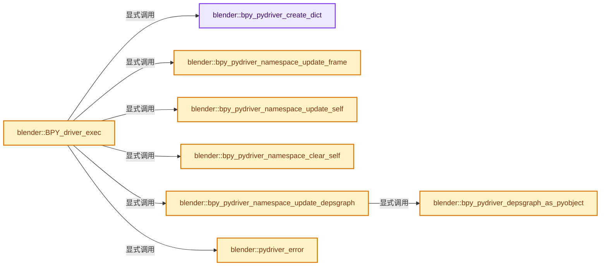
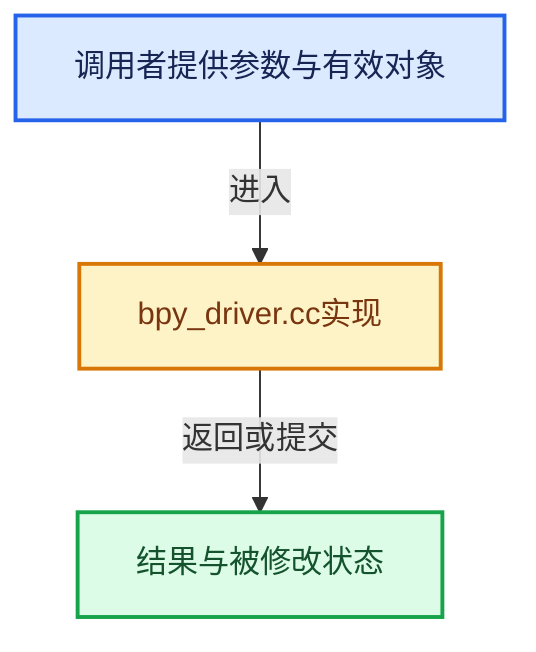

# 实现依赖专题：source/blender/python/intern/bpy_driver.cc

[实现依赖导航](../../../README.md) · [符号索引](../../../../00-课程指南/02-源码与提交索引/符号依赖与实现索引.md)

本专题从正文实际调用进入，集中保存共享实现。函数有稳定锚点，可从调用处直接跳到对应完整函数；递归与互相调用通过回链组织。

## 本文件的实现关系






## 完整成员与函数实现

<a id="f-c247c98b8b8e412a"></a>

### `blender::bpy_pydriver_create_dict`

实现位置：[source/blender/python/intern/bpy_driver.cc](../../../../../../../../source/blender/python/intern/bpy_driver.cc) · L48—L151。

**教学注释版**

<!-- annotated:97b4d8f9ae2cbf -->

```cpp
int bpy_pydriver_create_dict()
{
  PyObject *d, *mod;

  /* Validate name-space for driver evaluation. */
  if (bpy_pydriver_Dict) {
    return -1;
  }

  d = PyDict_New();
  if (d == nullptr) {
    return -1;
  }

  bpy_pydriver_Dict = d;

  /* Import some modules: `builtins`, `bpy`, `math`, `mathutils.noise`. */
  PyDict_SetItemString(d, "__builtins__", PyEval_GetBuiltins());

  mod = PyImport_ImportModule("math");
  if (mod) {
    PyDict_Merge(d, PyModule_GetDict(mod), 0); /* 0 - don't overwrite existing values */
    Py_DECREF(mod);
  }
#ifdef USE_BYTECODE_SECURE
  PyObject *mod_math = mod;
#endif

  /* Add `bpy` to global name-space. */
  mod = PyImport_ImportModuleLevel("bpy", nullptr, nullptr, nullptr, 0);
  if (mod) {
    PyDict_SetItemString(bpy_pydriver_Dict, "bpy", mod);
    Py_DECREF(mod);
  }

  /* Add noise to global name-space. */
  mod = PyImport_ImportModuleLevel("mathutils", nullptr, nullptr, nullptr, 0);
  if (mod) {
    PyObject *modsub = PyDict_GetItemString(PyModule_GetDict(mod), "noise");
    PyDict_SetItemString(bpy_pydriver_Dict, "noise", modsub);
    Py_DECREF(mod);
  }

  /* Add math utility functions. */
  mod = PyImport_ImportModuleLevel("bl_math", nullptr, nullptr, nullptr, 0);
  if (mod) {
    static const char *names[] = {"clamp", "lerp", "smoothstep", nullptr};

    for (const char **pname = names; *pname; ++pname) {
      PyObject *func = PyDict_GetItemString(PyModule_GetDict(mod), *pname);
      PyDict_SetItemString(bpy_pydriver_Dict, *pname, func);
    }

    Py_DECREF(mod);
  }

#ifdef USE_BYTECODE_SECURE
  /* Setup the secure_ids. */
  {
    bpy_pydriver_Dict__secure_ids = PyDict_New();
    const char *secure_ids[] = {
        /* builtins (basic) */
        "all",
        "any",
        "len",
        /* builtins (numeric) */
        "max",
        "min",
        "pow",
        "round",
        "sum",
        /* types */
        "bool",
        "float",
        "int",
        /* bl_math */
        "clamp",
        "lerp",
        "smoothstep",

        nullptr,
    };

    for (int i = 0; secure_ids[i]; i++) {
      PyDict_SetItemString(bpy_pydriver_Dict__secure_ids, secure_ids[i], Py_None);
    }

    /* Add all of `math` functions. */
    if (mod_math != nullptr) {
      PyObject *mod_math_dict = PyModule_GetDict(mod_math);
      PyObject *arg_key, *arg_value;
      Py_ssize_t arg_pos = 0;
      while (PyDict_Next(mod_math_dict, &arg_pos, &arg_key, &arg_value)) {
        const char *arg_str = PyUnicode_AsUTF8(arg_key);
        if (arg_str[0] && arg_str[1] != '_') {
          PyDict_SetItem(bpy_pydriver_Dict__secure_ids, arg_key, Py_None);
        }
      }
    }
  }
#endif /* USE_BYTECODE_SECURE */

  return 0;
}
```

<details>
<summary>核对原始源码：source/blender/python/intern/bpy_driver.cc · L48—L151</summary>

<!-- original:97b4d8f9ae2cbf:source/blender/python/intern/bpy_driver.cc:48:151 -->

```cpp
int bpy_pydriver_create_dict()
{
  PyObject *d, *mod;

  /* Validate name-space for driver evaluation. */
  if (bpy_pydriver_Dict) {
    return -1;
  }

  d = PyDict_New();
  if (d == nullptr) {
    return -1;
  }

  bpy_pydriver_Dict = d;

  /* Import some modules: `builtins`, `bpy`, `math`, `mathutils.noise`. */
  PyDict_SetItemString(d, "__builtins__", PyEval_GetBuiltins());

  mod = PyImport_ImportModule("math");
  if (mod) {
    PyDict_Merge(d, PyModule_GetDict(mod), 0); /* 0 - don't overwrite existing values */
    Py_DECREF(mod);
  }
#ifdef USE_BYTECODE_SECURE
  PyObject *mod_math = mod;
#endif

  /* Add `bpy` to global name-space. */
  mod = PyImport_ImportModuleLevel("bpy", nullptr, nullptr, nullptr, 0);
  if (mod) {
    PyDict_SetItemString(bpy_pydriver_Dict, "bpy", mod);
    Py_DECREF(mod);
  }

  /* Add noise to global name-space. */
  mod = PyImport_ImportModuleLevel("mathutils", nullptr, nullptr, nullptr, 0);
  if (mod) {
    PyObject *modsub = PyDict_GetItemString(PyModule_GetDict(mod), "noise");
    PyDict_SetItemString(bpy_pydriver_Dict, "noise", modsub);
    Py_DECREF(mod);
  }

  /* Add math utility functions. */
  mod = PyImport_ImportModuleLevel("bl_math", nullptr, nullptr, nullptr, 0);
  if (mod) {
    static const char *names[] = {"clamp", "lerp", "smoothstep", nullptr};

    for (const char **pname = names; *pname; ++pname) {
      PyObject *func = PyDict_GetItemString(PyModule_GetDict(mod), *pname);
      PyDict_SetItemString(bpy_pydriver_Dict, *pname, func);
    }

    Py_DECREF(mod);
  }

#ifdef USE_BYTECODE_SECURE
  /* Setup the secure_ids. */
  {
    bpy_pydriver_Dict__secure_ids = PyDict_New();
    const char *secure_ids[] = {
        /* builtins (basic) */
        "all",
        "any",
        "len",
        /* builtins (numeric) */
        "max",
        "min",
        "pow",
        "round",
        "sum",
        /* types */
        "bool",
        "float",
        "int",
        /* bl_math */
        "clamp",
        "lerp",
        "smoothstep",

        nullptr,
    };

    for (int i = 0; secure_ids[i]; i++) {
      PyDict_SetItemString(bpy_pydriver_Dict__secure_ids, secure_ids[i], Py_None);
    }

    /* Add all of `math` functions. */
    if (mod_math != nullptr) {
      PyObject *mod_math_dict = PyModule_GetDict(mod_math);
      PyObject *arg_key, *arg_value;
      Py_ssize_t arg_pos = 0;
      while (PyDict_Next(mod_math_dict, &arg_pos, &arg_key, &arg_value)) {
        const char *arg_str = PyUnicode_AsUTF8(arg_key);
        if (arg_str[0] && arg_str[1] != '_') {
          PyDict_SetItem(bpy_pydriver_Dict__secure_ids, arg_key, Py_None);
        }
      }
    }
  }
#endif /* USE_BYTECODE_SECURE */

  return 0;
}
```

</details>

**沿实际写入检查状态**

- `d = PyDict_New();`
- `bpy_pydriver_Dict = d;`
- `mod = PyImport_ImportModule("math");`
- `mod = PyImport_ImportModuleLevel("bpy", nullptr, nullptr, nullptr, 0);`
- `mod = PyImport_ImportModuleLevel("mathutils", nullptr, nullptr, nullptr, 0);`
- `mod = PyImport_ImportModuleLevel("bl_math", nullptr, nullptr, nullptr, 0);`
- `bpy_pydriver_Dict__secure_ids = PyDict_New();`

**结果出口**

- `return -1;`
- `return 0;`

**继续追踪实现**

- `PyDict_New` → [调用协议](../../../../00-课程指南/01-路线与规范/模板宏与动态分派协议.md)：配置相关检测或外部运行时接口。调用位置L57。
- `PyDict_SetItemString` → [调用协议](../../../../00-课程指南/01-路线与规范/模板宏与动态分派协议.md)：配置相关检测或外部运行时接口。调用位置L65。
- `PyEval_GetBuiltins` → [调用协议](../../../../00-课程指南/01-路线与规范/模板宏与动态分派协议.md)：配置相关检测或外部运行时接口。调用位置L65。
- `PyImport_ImportModule` → [调用协议](../../../../00-课程指南/01-路线与规范/模板宏与动态分派协议.md)：配置相关检测或外部运行时接口。调用位置L67。
- `PyDict_Merge` → [调用协议](../../../../00-课程指南/01-路线与规范/模板宏与动态分派协议.md)：配置相关检测或外部运行时接口。调用位置L69。
- `PyModule_GetDict` → [调用协议](../../../../00-课程指南/01-路线与规范/模板宏与动态分派协议.md)：配置相关检测或外部运行时接口。调用位置L69。
- `Py_DECREF` → [调用协议](../../../../00-课程指南/01-路线与规范/模板宏与动态分派协议.md)：配置相关检测或外部运行时接口。调用位置L70。
- `PyImport_ImportModuleLevel` → [调用协议](../../../../00-课程指南/01-路线与规范/模板宏与动态分派协议.md)：配置相关检测或外部运行时接口。调用位置L77。
- `PyDict_GetItemString` → [调用协议](../../../../00-课程指南/01-路线与规范/模板宏与动态分派协议.md)：配置相关检测或外部运行时接口。调用位置L86。
- `PyDict_Next` → [调用协议](../../../../00-课程指南/01-路线与规范/模板宏与动态分派协议.md)：配置相关检测或外部运行时接口。调用位置L140。
- `PyUnicode_AsUTF8` → [调用协议](../../../../00-课程指南/01-路线与规范/模板宏与动态分派协议.md)：配置相关检测或外部运行时接口。调用位置L141。
- `PyDict_SetItem` → [调用协议](../../../../00-课程指南/01-路线与规范/模板宏与动态分派协议.md)：配置相关检测或外部运行时接口。调用位置L143。

<a id="f-2cf1d75ada9094f3"></a>

### `blender::bpy_pydriver_namespace_update_frame`

实现位置：[source/blender/python/intern/bpy_driver.cc](../../../../../../../../source/blender/python/intern/bpy_driver.cc) · L166—L175。

接口参数：

- `const float evaltime`

**教学注释版**

<!-- annotated:2593166b8a491b -->

```cpp
static void bpy_pydriver_namespace_update_frame(const float evaltime)
{
  if (g_pydriver_state_prev.evaltime != evaltime) {
    PyObject *item = PyFloat_FromDouble(evaltime);
    PyDict_SetItem(bpy_pydriver_Dict, bpy_intern_str_frame, item);
    Py_DECREF(item);

    g_pydriver_state_prev.evaltime = evaltime;
  }
}
```

<details>
<summary>核对原始源码：source/blender/python/intern/bpy_driver.cc · L166—L175</summary>

<!-- original:2593166b8a491b:source/blender/python/intern/bpy_driver.cc:166:175 -->

```cpp
static void bpy_pydriver_namespace_update_frame(const float evaltime)
{
  if (g_pydriver_state_prev.evaltime != evaltime) {
    PyObject *item = PyFloat_FromDouble(evaltime);
    PyDict_SetItem(bpy_pydriver_Dict, bpy_intern_str_frame, item);
    Py_DECREF(item);

    g_pydriver_state_prev.evaltime = evaltime;
  }
}
```

</details>

**沿实际写入检查状态**

- `g_pydriver_state_prev.evaltime = evaltime;`

**继续追踪实现**

- `PyFloat_FromDouble` → [调用协议](../../../../00-课程指南/01-路线与规范/模板宏与动态分派协议.md)：配置相关检测或外部运行时接口。调用位置L169。
- `PyDict_SetItem` → [调用协议](../../../../00-课程指南/01-路线与规范/模板宏与动态分派协议.md)：配置相关检测或外部运行时接口。调用位置L170。
- `Py_DECREF` → [调用协议](../../../../00-课程指南/01-路线与规范/模板宏与动态分派协议.md)：配置相关检测或外部运行时接口。调用位置L171。

<a id="f-21c5548847d77743"></a>

### `blender::bpy_pydriver_namespace_update_self`

实现位置：[source/blender/python/intern/bpy_driver.cc](../../../../../../../../source/blender/python/intern/bpy_driver.cc) · L177—L188。

接口参数：

- `PathResolvedRNA *anim_rna`

**教学注释版**

<!-- annotated:db9f3a47e1d98a -->

```cpp
static void bpy_pydriver_namespace_update_self(PathResolvedRNA *anim_rna)
{
  if ((g_pydriver_state_prev.self == nullptr) ||
      (pyrna_driver_is_equal_anim_rna(anim_rna, g_pydriver_state_prev.self) == false))
  {
    PyObject *item = pyrna_driver_self_from_anim_rna(anim_rna);
    PyDict_SetItem(bpy_pydriver_Dict, bpy_intern_str_self, item);
    Py_DECREF(item);

    g_pydriver_state_prev.self = item;
  }
}
```

<details>
<summary>核对原始源码：source/blender/python/intern/bpy_driver.cc · L177—L188</summary>

<!-- original:db9f3a47e1d98a:source/blender/python/intern/bpy_driver.cc:177:188 -->

```cpp
static void bpy_pydriver_namespace_update_self(PathResolvedRNA *anim_rna)
{
  if ((g_pydriver_state_prev.self == nullptr) ||
      (pyrna_driver_is_equal_anim_rna(anim_rna, g_pydriver_state_prev.self) == false))
  {
    PyObject *item = pyrna_driver_self_from_anim_rna(anim_rna);
    PyDict_SetItem(bpy_pydriver_Dict, bpy_intern_str_self, item);
    Py_DECREF(item);

    g_pydriver_state_prev.self = item;
  }
}
```

</details>

**沿实际写入检查状态**

- `g_pydriver_state_prev.self = item;`

**继续追踪实现**

- `pyrna_driver_is_equal_anim_rna` → [blender::pyrna_driver_is_equal_anim_rna · L74](bpy_rna_driver.cc.md#f-6708dfc428e6326e)。
- `pyrna_driver_self_from_anim_rna` → [blender::pyrna_driver_self_from_anim_rna · L69](bpy_rna_driver.cc.md#f-13366c4a4aa396d3)。
- `PyDict_SetItem` → [调用协议](../../../../00-课程指南/01-路线与规范/模板宏与动态分派协议.md)：配置相关检测或外部运行时接口。调用位置L183。
- `Py_DECREF` → [调用协议](../../../../00-课程指南/01-路线与规范/模板宏与动态分派协议.md)：配置相关检测或外部运行时接口。调用位置L184。

<a id="f-6c0725771e814124"></a>

### `blender::bpy_pydriver_namespace_clear_self`

实现位置：[source/blender/python/intern/bpy_driver.cc](../../../../../../../../source/blender/python/intern/bpy_driver.cc) · L190—L197。

**教学注释版**

<!-- annotated:c742df37420aa1 -->

```cpp
static void bpy_pydriver_namespace_clear_self()
{
  if (g_pydriver_state_prev.self) {
    PyDict_DelItem(bpy_pydriver_Dict, bpy_intern_str_self);

    g_pydriver_state_prev.self = nullptr;
  }
}
```

<details>
<summary>核对原始源码：source/blender/python/intern/bpy_driver.cc · L190—L197</summary>

<!-- original:c742df37420aa1:source/blender/python/intern/bpy_driver.cc:190:197 -->

```cpp
static void bpy_pydriver_namespace_clear_self()
{
  if (g_pydriver_state_prev.self) {
    PyDict_DelItem(bpy_pydriver_Dict, bpy_intern_str_self);

    g_pydriver_state_prev.self = nullptr;
  }
}
```

</details>

**沿实际写入检查状态**

- `g_pydriver_state_prev.self = nullptr;`

**继续追踪实现**

- `PyDict_DelItem` → [调用协议](../../../../00-课程指南/01-路线与规范/模板宏与动态分派协议.md)：配置相关检测或外部运行时接口。调用位置L193。

<a id="f-69b30e62270a571f"></a>

### `blender::bpy_pydriver_depsgraph_as_pyobject`

实现位置：[source/blender/python/intern/bpy_driver.cc](../../../../../../../../source/blender/python/intern/bpy_driver.cc) · L199—L203。

接口参数：

- `Depsgraph *depsgraph`

**教学注释版**

<!-- annotated:05c5148b3985fd -->

```cpp
static PyObject *bpy_pydriver_depsgraph_as_pyobject(Depsgraph *depsgraph)
{
  PointerRNA depsgraph_ptr = RNA_pointer_create_discrete(nullptr, RNA_Depsgraph, depsgraph);
  return pyrna_struct_CreatePyObject(&depsgraph_ptr);
}
```

<details>
<summary>核对原始源码：source/blender/python/intern/bpy_driver.cc · L199—L203</summary>

<!-- original:05c5148b3985fd:source/blender/python/intern/bpy_driver.cc:199:203 -->

```cpp
static PyObject *bpy_pydriver_depsgraph_as_pyobject(Depsgraph *depsgraph)
{
  PointerRNA depsgraph_ptr = RNA_pointer_create_discrete(nullptr, RNA_Depsgraph, depsgraph);
  return pyrna_struct_CreatePyObject(&depsgraph_ptr);
}
```

</details>

**结果出口**

- `return pyrna_struct_CreatePyObject(&depsgraph_ptr);`

**继续追踪实现**

- `RNA_pointer_create_discrete` → [blender::RNA_pointer_create_discrete · L181](../../makesrna/intern/rna_access.cc.md#f-592a276e869c6d94)。
- `pyrna_struct_CreatePyObject` → [blender::pyrna_struct_CreatePyObject · L8871](bpy_rna.cc.md#f-8d72c1b6149f0dee)。

<a id="f-3209abf0390e4e02"></a>

### `blender::bpy_pydriver_namespace_update_depsgraph`

实现位置：[source/blender/python/intern/bpy_driver.cc](../../../../../../../../source/blender/python/intern/bpy_driver.cc) · L209—L229。

接口参数：

- `Depsgraph *depsgraph`

**教学注释版**

<!-- annotated:bec00ca76c6419 -->

```cpp
static void bpy_pydriver_namespace_update_depsgraph(Depsgraph *depsgraph)
{
  /* This should never happen, but it's probably better to have None in Python
   * than a nullptr-wrapping Depsgraph Python struct. */
  BLI_assert(depsgraph != nullptr);
  if (depsgraph == nullptr) [[unlikely]] {
    PyDict_SetItem(bpy_pydriver_Dict, bpy_intern_str_depsgraph, Py_None);
    g_pydriver_state_prev.depsgraph = nullptr;
    return;
  }

  if ((g_pydriver_state_prev.depsgraph == nullptr) ||
      (depsgraph != g_pydriver_state_prev.depsgraph->ptr->data))
  {
    PyObject *item = bpy_pydriver_depsgraph_as_pyobject(depsgraph);
    PyDict_SetItem(bpy_pydriver_Dict, bpy_intern_str_depsgraph, item);
    Py_DECREF(item);

    g_pydriver_state_prev.depsgraph = reinterpret_cast<BPy_StructRNA *>(item);
  }
}
```

<details>
<summary>核对原始源码：source/blender/python/intern/bpy_driver.cc · L209—L229</summary>

<!-- original:bec00ca76c6419:source/blender/python/intern/bpy_driver.cc:209:229 -->

```cpp
static void bpy_pydriver_namespace_update_depsgraph(Depsgraph *depsgraph)
{
  /* This should never happen, but it's probably better to have None in Python
   * than a nullptr-wrapping Depsgraph Python struct. */
  BLI_assert(depsgraph != nullptr);
  if (depsgraph == nullptr) [[unlikely]] {
    PyDict_SetItem(bpy_pydriver_Dict, bpy_intern_str_depsgraph, Py_None);
    g_pydriver_state_prev.depsgraph = nullptr;
    return;
  }

  if ((g_pydriver_state_prev.depsgraph == nullptr) ||
      (depsgraph != g_pydriver_state_prev.depsgraph->ptr->data))
  {
    PyObject *item = bpy_pydriver_depsgraph_as_pyobject(depsgraph);
    PyDict_SetItem(bpy_pydriver_Dict, bpy_intern_str_depsgraph, item);
    Py_DECREF(item);

    g_pydriver_state_prev.depsgraph = reinterpret_cast<BPy_StructRNA *>(item);
  }
}
```

</details>

**沿实际写入检查状态**

- `g_pydriver_state_prev.depsgraph = nullptr;`
- `g_pydriver_state_prev.depsgraph = reinterpret_cast<BPy_StructRNA *>(item);`

**继续追踪实现**

- `BLI_assert` → [BLI_assert · L48](../../../01-BLI基础库/BLI_assert.hh.md#m-57a88495704d)；[BLI_assert · L63](../../../01-BLI基础库/BLI_assert.hh.md#m-d07050020cb5)。宏定义由构建条件选择。
- `PyDict_SetItem` → [调用协议](../../../../00-课程指南/01-路线与规范/模板宏与动态分派协议.md)：配置相关检测或外部运行时接口。调用位置L215。
- `bpy_pydriver_depsgraph_as_pyobject` → [blender::bpy_pydriver_depsgraph_as_pyobject · L199](bpy_driver.cc.md#f-69b30e62270a571f)。
- `Py_DECREF` → [调用协议](../../../../00-课程指南/01-路线与规范/模板宏与动态分派协议.md)：配置相关检测或外部运行时接口。调用位置L225。

<a id="f-5012af2393c6dd49"></a>

### `blender::pydriver_error`

实现位置：[source/blender/python/intern/bpy_driver.cc](../../../../../../../../source/blender/python/intern/bpy_driver.cc) · L275—L294。

接口参数：

- `ChannelDriver *driver`
- `const PathResolvedRNA *anim_rna`

**教学注释版**

<!-- annotated:af596b4533d090 -->

```cpp
static void pydriver_error(ChannelDriver *driver, const PathResolvedRNA *anim_rna)
{
  driver->flag |= DRIVER_FLAG_INVALID; /* Python expression failed. */

  const char *null_str = "<null>";
  const ID *id = anim_rna->ptr.owner_id;
  fprintf(stderr,
          "\n"
          "Error in PyDriver: expression failed: %s\n"
          "For target: (type=%s, name=\"%s\", property=%s, property_index=%d)\n"
          "\n",
          driver->expression,
          id ? BKE_idtype_idcode_to_name(GS(id->name)) : null_str,
          id ? id->name + 2 : null_str,
          anim_rna->prop ? RNA_property_identifier(anim_rna->prop) : null_str,
          anim_rna->prop_index);

  // BPy_errors_to_report(nullptr); /* TODO: reports. */
  PyErr_Print();
}
```

<details>
<summary>核对原始源码：source/blender/python/intern/bpy_driver.cc · L275—L294</summary>

<!-- original:af596b4533d090:source/blender/python/intern/bpy_driver.cc:275:294 -->

```cpp
static void pydriver_error(ChannelDriver *driver, const PathResolvedRNA *anim_rna)
{
  driver->flag |= DRIVER_FLAG_INVALID; /* Python expression failed. */

  const char *null_str = "<null>";
  const ID *id = anim_rna->ptr.owner_id;
  fprintf(stderr,
          "\n"
          "Error in PyDriver: expression failed: %s\n"
          "For target: (type=%s, name=\"%s\", property=%s, property_index=%d)\n"
          "\n",
          driver->expression,
          id ? BKE_idtype_idcode_to_name(GS(id->name)) : null_str,
          id ? id->name + 2 : null_str,
          anim_rna->prop ? RNA_property_identifier(anim_rna->prop) : null_str,
          anim_rna->prop_index);

  // BPy_errors_to_report(nullptr); /* TODO: reports. */
  PyErr_Print();
}
```

</details>

**沿实际写入检查状态**

- `driver->flag |= DRIVER_FLAG_INVALID; /* Python expression failed. */`

**继续追踪实现**

- `fprintf` → [外部契约](https://eel.is/c++draft/)：这个边界按实际表达式及所属类型核对参数、返回值、寿命与失败行为。这里提供接口入口，不声称已解释该第三方版本的内部实现。
- `BKE_idtype_idcode_to_name` → [blender::BKE_idtype_idcode_to_name · L261](../../../02-BKE几何与数据/intern/idtype.cc.md#f-282fc9db6d5f0eb2)。
- `GS` → [blender::GS · L410](../../makesdna/DNA_ID.h.md#f-c3ff509f79f21b05)。
- `RNA_property_identifier` → [blender::RNA_property_identifier · L1275](../../makesrna/intern/rna_access.cc.md#f-67de6dc6c76092df)。
- `PyErr_Print` → [调用协议](../../../../00-课程指南/01-路线与规范/模板宏与动态分派协议.md)：配置相关检测或外部运行时接口。调用位置L293。

<a id="f-5e894a4ded86c749"></a>

### `blender::BPY_driver_exec`

实现位置：[source/blender/python/intern/bpy_driver.cc](../../../../../../../../source/blender/python/intern/bpy_driver.cc) · L321—L577。

接口参数：

- `PathResolvedRNA *anim_rna`
- `ChannelDriver *driver`
- `ChannelDriver *driver_orig`
- `const AnimationEvalContext *anim_eval_context`

**教学注释版**

<!-- annotated:a871801f285d47 -->

```cpp
float BPY_driver_exec(PathResolvedRNA *anim_rna,
                      ChannelDriver *driver,
                      ChannelDriver *driver_orig,
                      const AnimationEvalContext *anim_eval_context)
{
  /* (old) NOTE: PyGILState_Ensure() isn't always called because python can call
   * the bake operator which intern starts a thread which calls scene update
   * which does a driver update. to avoid a deadlock check #PyC_IsInterpreterActive()
   * if #PyGILState_Ensure() is needed, see #27683.
   *
   * (new) NOTE: checking if python is running is not thread-safe #28114
   * now release the GIL on python operator execution instead, using
   * #PyEval_SaveThread() / #PyEval_RestoreThread() so we don't lock up blender.
   *
   * For copy-on-evaluation we always cache expressions and write errors in the
   * original driver, otherwise these would get freed while editing.
   * Due to the GIL this is thread-safe. */

  PyObject *driver_vars = nullptr;
  PyObject *retval = nullptr;

  /* Speed up by pre-hashing string & avoids re-converting unicode strings for every execution. */
  PyObject *expr_vars;

  PyObject *expr_code;
  PyGILState_STATE gilstate;
  bool use_gil;

  DriverVar *dvar;
  double result = 0.0; /* Default return. */
  const char *expr;
  bool targets_ok = true;
  int i;

  /* Get the python expression to be evaluated. */
  expr = driver_orig->expression;
  if (expr[0] == '\0') {
    return 0.0f;
  }

#ifndef USE_BYTECODE_SECURE
  if (!(G.f & G_FLAG_SCRIPT_AUTOEXEC)) {
    if (!(G.f & G_FLAG_SCRIPT_AUTOEXEC_FAIL_QUIET)) {
      G.f |= G_FLAG_SCRIPT_AUTOEXEC_FAIL;
      SNPRINTF_UTF8(G.autoexec_fail, "Driver '%s'", expr);

      printf("skipping driver '%s', automatic scripts are disabled\n", expr);
    }
    driver_orig->flag |= DRIVER_FLAG_PYTHON_BLOCKED;
    return 0.0f;
  }
#else
  bool is_recompile = false;
#endif

  use_gil = true; /* !PyC_IsInterpreterActive(); */

  if (use_gil) {
    gilstate = PyGILState_Ensure();
  }

  /* Needed since drivers are updated directly after undo where `main` is re-allocated #28807. */
  BPY_update_rna_module();

  /* Initialize global dictionary for Python driver evaluation settings. */
  if (!bpy_pydriver_Dict) {
    if (bpy_pydriver_create_dict() != 0) {
      fprintf(stderr, "%s: couldn't create Python dictionary\n", __func__);
      if (use_gil) {
        PyGILState_Release(gilstate);
      }
      return 0.0f;
    }
  }

  /* Update global name-space. */
  bpy_pydriver_namespace_update_frame(anim_eval_context->eval_time);

  if (driver_orig->flag & DRIVER_FLAG_USE_SELF) {
    bpy_pydriver_namespace_update_self(anim_rna);
  }
  else {
    bpy_pydriver_namespace_clear_self();
  }

  bpy_pydriver_namespace_update_depsgraph(anim_eval_context->depsgraph);

  if (driver_orig->expr_comp == nullptr) {
    driver_orig->flag |= DRIVER_FLAG_RECOMPILE;
  }

  /* Compile the expression first if it hasn't been compiled or needs to be rebuilt. */
  if (driver_orig->flag & DRIVER_FLAG_RECOMPILE) {
    Py_XDECREF(driver_orig->expr_comp);
    driver_orig->expr_comp = PyTuple_New(2);

    expr_code = Py_CompileString(expr, "<bpy driver>", Py_eval_input);
    PyTuple_SET_ITEM(((PyObject *)driver_orig->expr_comp), 0, expr_code);

    driver_orig->flag &= ~DRIVER_FLAG_RECOMPILE;

    /* Maybe this can be removed but for now best keep until were sure. */
    driver_orig->flag |= DRIVER_FLAG_RENAMEVAR;
    driver_orig->flag &= ~DRIVER_FLAG_PYTHON_BLOCKED;

#ifdef USE_BYTECODE_SECURE
    is_recompile = true;
#endif
  }
  else {
    expr_code = PyTuple_GET_ITEM(((PyObject *)driver_orig->expr_comp), 0);
  }

  if (driver_orig->flag & DRIVER_FLAG_RENAMEVAR) {
    /* May not be set. */
    PyObject *expr_vars_prev = PyTuple_GET_ITEM(((PyObject *)driver_orig->expr_comp), 1);

    expr_vars = PyTuple_New(driver_orig->variables.count());
    PyTuple_SET_ITEM(((PyObject *)driver_orig->expr_comp), 1, expr_vars);
    Py_XDECREF(expr_vars_prev);

    for (dvar = driver_orig->variables.first(), i = 0; dvar; dvar = dvar->next) {
      PyTuple_SET_ITEM(expr_vars, i++, PyUnicode_FromString(dvar->name));
    }

    driver_orig->flag &= ~DRIVER_FLAG_RENAMEVAR;
  }
  else {
    expr_vars = PyTuple_GET_ITEM(((PyObject *)driver_orig->expr_comp), 1);
  }

  /* Add target values to a dict that will be used as `__locals__` dict. */
  driver_vars = _PyDict_NewPresized(PyTuple_GET_SIZE(expr_vars));
  for (dvar = driver->variables.first(), i = 0; dvar; dvar = dvar->next) {
    PyObject *driver_arg = nullptr;

/* Support for any RNA data. */
#ifdef USE_RNA_AS_PYOBJECT
    if (dvar->type == DVAR_TYPE_SINGLE_PROP) {
      driver_arg = pyrna_driver_get_variable_value(
          anim_eval_context, driver, dvar, &dvar->targets[0]);

      if (driver_arg == nullptr) {
        driver_arg = PyFloat_FromDouble(0.0);
        dvar->curval = 0.0f;
      }
      else {
        /* No need to worry about overflow here, values from RNA are within limits. */
        if (PyFloat_CheckExact(driver_arg)) {
          dvar->curval = float(PyFloat_AsDouble(driver_arg));
        }
        else if (PyLong_CheckExact(driver_arg)) {
          dvar->curval = float(PyLong_AsLong(driver_arg));
        }
        else if (PyBool_Check(driver_arg)) {
          dvar->curval = float(driver_arg == Py_True);
        }
        else {
          dvar->curval = 0.0f;
        }
      }
    }
    else
#endif
    {
      /* Try to get variable value. */
      const float tval = driver_get_variable_value(anim_eval_context, driver, dvar);
      driver_arg = PyFloat_FromDouble(double(tval));
    }

    /* Try to add to dictionary. */
    /* `if (PyDict_SetItemString(driver_vars, dvar->name, driver_arg)) {` */
    if (PyDict_SetItem(driver_vars, PyTuple_GET_ITEM(expr_vars, i++), driver_arg) != -1) {
      /* Pass. */
    }
    else {
      /* This target failed - bad name. */
      if (targets_ok) {
        /* First one, print some extra info for easier identification. */
        fprintf(stderr, "\n%s: Error while evaluating PyDriver:\n", __func__);
        targets_ok = false;
      }

      fprintf(stderr, "\t%s: couldn't add variable '%s' to namespace\n", __func__, dvar->name);
      // BPy_errors_to_report(nullptr); /* TODO: reports. */
      PyErr_Print();
    }
    Py_DECREF(driver_arg);
  }

#ifdef USE_BYTECODE_SECURE
  if (is_recompile && expr_code) {
    if (!(G.f & G_FLAG_SCRIPT_AUTOEXEC)) {
      PyObject *py_namespaces[] = {
          bpy_pydriver_Dict, bpy_pydriver_Dict__secure_ids, driver_vars, nullptr};
      if (!BPY_driver_secure_bytecode_test_ex(
              expr_code,
              py_namespaces,
              /* Always be verbose since this can give hints to why evaluation fails. */
              true,
              __func__))
      {
        if (!(G.f & G_FLAG_SCRIPT_AUTOEXEC_FAIL_QUIET)) {
          G.f |= G_FLAG_SCRIPT_AUTOEXEC_FAIL;
          SNPRINTF_UTF8(G.autoexec_fail, "Driver '%s'", expr);
        }

        Py_DECREF(expr_code);
        expr_code = nullptr;
        PyTuple_SET_ITEM(((PyObject *)driver_orig->expr_comp), 0, nullptr);
        driver_orig->flag |= DRIVER_FLAG_PYTHON_BLOCKED;
      }
    }
  }
#endif /* USE_BYTECODE_SECURE */

#if 0 /* slow, with this can avoid all Py_CompileString above. */
  /* execute expression to get a value */
  retval = PyRun_String(expr, Py_eval_input, bpy_pydriver_Dict, driver_vars);
#else
  /* Evaluate the compiled expression. */
  if (expr_code) {
    retval = PyEval_EvalCode(
        static_cast<PyObject *>(static_cast<void *>(expr_code)), bpy_pydriver_Dict, driver_vars);
  }
#endif

  /* Decref the driver variables first. */
  Py_DECREF(driver_vars);

  /* Process the result. */
  if (retval == nullptr) {
    pydriver_error(driver, anim_rna);
  }
  else {
    if ((result = PyFloat_AsDouble(retval)) == -1.0 && PyErr_Occurred()) [[unlikely]] {
      pydriver_error(driver, anim_rna);
      result = 0.0;
    }
    else {
      /* All fine, make sure the "invalid expression" flag is cleared. */
      driver->flag &= ~DRIVER_FLAG_INVALID;
    }
    Py_DECREF(retval);
  }

  if (use_gil) {
    PyGILState_Release(gilstate);
  }

  if (!isfinite(result)) [[unlikely]] {
    fprintf(stderr, "\t%s: driver '%s' evaluates to '%f'\n", __func__, driver->expression, result);
    return 0.0f;
  }

  return float(result);
}
```

<details>
<summary>核对原始源码：source/blender/python/intern/bpy_driver.cc · L321—L577</summary>

<!-- original:a871801f285d47:source/blender/python/intern/bpy_driver.cc:321:577 -->

```cpp
float BPY_driver_exec(PathResolvedRNA *anim_rna,
                      ChannelDriver *driver,
                      ChannelDriver *driver_orig,
                      const AnimationEvalContext *anim_eval_context)
{
  /* (old) NOTE: PyGILState_Ensure() isn't always called because python can call
   * the bake operator which intern starts a thread which calls scene update
   * which does a driver update. to avoid a deadlock check #PyC_IsInterpreterActive()
   * if #PyGILState_Ensure() is needed, see #27683.
   *
   * (new) NOTE: checking if python is running is not thread-safe #28114
   * now release the GIL on python operator execution instead, using
   * #PyEval_SaveThread() / #PyEval_RestoreThread() so we don't lock up blender.
   *
   * For copy-on-evaluation we always cache expressions and write errors in the
   * original driver, otherwise these would get freed while editing.
   * Due to the GIL this is thread-safe. */

  PyObject *driver_vars = nullptr;
  PyObject *retval = nullptr;

  /* Speed up by pre-hashing string & avoids re-converting unicode strings for every execution. */
  PyObject *expr_vars;

  PyObject *expr_code;
  PyGILState_STATE gilstate;
  bool use_gil;

  DriverVar *dvar;
  double result = 0.0; /* Default return. */
  const char *expr;
  bool targets_ok = true;
  int i;

  /* Get the python expression to be evaluated. */
  expr = driver_orig->expression;
  if (expr[0] == '\0') {
    return 0.0f;
  }

#ifndef USE_BYTECODE_SECURE
  if (!(G.f & G_FLAG_SCRIPT_AUTOEXEC)) {
    if (!(G.f & G_FLAG_SCRIPT_AUTOEXEC_FAIL_QUIET)) {
      G.f |= G_FLAG_SCRIPT_AUTOEXEC_FAIL;
      SNPRINTF_UTF8(G.autoexec_fail, "Driver '%s'", expr);

      printf("skipping driver '%s', automatic scripts are disabled\n", expr);
    }
    driver_orig->flag |= DRIVER_FLAG_PYTHON_BLOCKED;
    return 0.0f;
  }
#else
  bool is_recompile = false;
#endif

  use_gil = true; /* !PyC_IsInterpreterActive(); */

  if (use_gil) {
    gilstate = PyGILState_Ensure();
  }

  /* Needed since drivers are updated directly after undo where `main` is re-allocated #28807. */
  BPY_update_rna_module();

  /* Initialize global dictionary for Python driver evaluation settings. */
  if (!bpy_pydriver_Dict) {
    if (bpy_pydriver_create_dict() != 0) {
      fprintf(stderr, "%s: couldn't create Python dictionary\n", __func__);
      if (use_gil) {
        PyGILState_Release(gilstate);
      }
      return 0.0f;
    }
  }

  /* Update global name-space. */
  bpy_pydriver_namespace_update_frame(anim_eval_context->eval_time);

  if (driver_orig->flag & DRIVER_FLAG_USE_SELF) {
    bpy_pydriver_namespace_update_self(anim_rna);
  }
  else {
    bpy_pydriver_namespace_clear_self();
  }

  bpy_pydriver_namespace_update_depsgraph(anim_eval_context->depsgraph);

  if (driver_orig->expr_comp == nullptr) {
    driver_orig->flag |= DRIVER_FLAG_RECOMPILE;
  }

  /* Compile the expression first if it hasn't been compiled or needs to be rebuilt. */
  if (driver_orig->flag & DRIVER_FLAG_RECOMPILE) {
    Py_XDECREF(driver_orig->expr_comp);
    driver_orig->expr_comp = PyTuple_New(2);

    expr_code = Py_CompileString(expr, "<bpy driver>", Py_eval_input);
    PyTuple_SET_ITEM(((PyObject *)driver_orig->expr_comp), 0, expr_code);

    driver_orig->flag &= ~DRIVER_FLAG_RECOMPILE;

    /* Maybe this can be removed but for now best keep until were sure. */
    driver_orig->flag |= DRIVER_FLAG_RENAMEVAR;
    driver_orig->flag &= ~DRIVER_FLAG_PYTHON_BLOCKED;

#ifdef USE_BYTECODE_SECURE
    is_recompile = true;
#endif
  }
  else {
    expr_code = PyTuple_GET_ITEM(((PyObject *)driver_orig->expr_comp), 0);
  }

  if (driver_orig->flag & DRIVER_FLAG_RENAMEVAR) {
    /* May not be set. */
    PyObject *expr_vars_prev = PyTuple_GET_ITEM(((PyObject *)driver_orig->expr_comp), 1);

    expr_vars = PyTuple_New(driver_orig->variables.count());
    PyTuple_SET_ITEM(((PyObject *)driver_orig->expr_comp), 1, expr_vars);
    Py_XDECREF(expr_vars_prev);

    for (dvar = driver_orig->variables.first(), i = 0; dvar; dvar = dvar->next) {
      PyTuple_SET_ITEM(expr_vars, i++, PyUnicode_FromString(dvar->name));
    }

    driver_orig->flag &= ~DRIVER_FLAG_RENAMEVAR;
  }
  else {
    expr_vars = PyTuple_GET_ITEM(((PyObject *)driver_orig->expr_comp), 1);
  }

  /* Add target values to a dict that will be used as `__locals__` dict. */
  driver_vars = _PyDict_NewPresized(PyTuple_GET_SIZE(expr_vars));
  for (dvar = driver->variables.first(), i = 0; dvar; dvar = dvar->next) {
    PyObject *driver_arg = nullptr;

/* Support for any RNA data. */
#ifdef USE_RNA_AS_PYOBJECT
    if (dvar->type == DVAR_TYPE_SINGLE_PROP) {
      driver_arg = pyrna_driver_get_variable_value(
          anim_eval_context, driver, dvar, &dvar->targets[0]);

      if (driver_arg == nullptr) {
        driver_arg = PyFloat_FromDouble(0.0);
        dvar->curval = 0.0f;
      }
      else {
        /* No need to worry about overflow here, values from RNA are within limits. */
        if (PyFloat_CheckExact(driver_arg)) {
          dvar->curval = float(PyFloat_AsDouble(driver_arg));
        }
        else if (PyLong_CheckExact(driver_arg)) {
          dvar->curval = float(PyLong_AsLong(driver_arg));
        }
        else if (PyBool_Check(driver_arg)) {
          dvar->curval = float(driver_arg == Py_True);
        }
        else {
          dvar->curval = 0.0f;
        }
      }
    }
    else
#endif
    {
      /* Try to get variable value. */
      const float tval = driver_get_variable_value(anim_eval_context, driver, dvar);
      driver_arg = PyFloat_FromDouble(double(tval));
    }

    /* Try to add to dictionary. */
    /* `if (PyDict_SetItemString(driver_vars, dvar->name, driver_arg)) {` */
    if (PyDict_SetItem(driver_vars, PyTuple_GET_ITEM(expr_vars, i++), driver_arg) != -1) {
      /* Pass. */
    }
    else {
      /* This target failed - bad name. */
      if (targets_ok) {
        /* First one, print some extra info for easier identification. */
        fprintf(stderr, "\n%s: Error while evaluating PyDriver:\n", __func__);
        targets_ok = false;
      }

      fprintf(stderr, "\t%s: couldn't add variable '%s' to namespace\n", __func__, dvar->name);
      // BPy_errors_to_report(nullptr); /* TODO: reports. */
      PyErr_Print();
    }
    Py_DECREF(driver_arg);
  }

#ifdef USE_BYTECODE_SECURE
  if (is_recompile && expr_code) {
    if (!(G.f & G_FLAG_SCRIPT_AUTOEXEC)) {
      PyObject *py_namespaces[] = {
          bpy_pydriver_Dict, bpy_pydriver_Dict__secure_ids, driver_vars, nullptr};
      if (!BPY_driver_secure_bytecode_test_ex(
              expr_code,
              py_namespaces,
              /* Always be verbose since this can give hints to why evaluation fails. */
              true,
              __func__))
      {
        if (!(G.f & G_FLAG_SCRIPT_AUTOEXEC_FAIL_QUIET)) {
          G.f |= G_FLAG_SCRIPT_AUTOEXEC_FAIL;
          SNPRINTF_UTF8(G.autoexec_fail, "Driver '%s'", expr);
        }

        Py_DECREF(expr_code);
        expr_code = nullptr;
        PyTuple_SET_ITEM(((PyObject *)driver_orig->expr_comp), 0, nullptr);
        driver_orig->flag |= DRIVER_FLAG_PYTHON_BLOCKED;
      }
    }
  }
#endif /* USE_BYTECODE_SECURE */

#if 0 /* slow, with this can avoid all Py_CompileString above. */
  /* execute expression to get a value */
  retval = PyRun_String(expr, Py_eval_input, bpy_pydriver_Dict, driver_vars);
#else
  /* Evaluate the compiled expression. */
  if (expr_code) {
    retval = PyEval_EvalCode(
        static_cast<PyObject *>(static_cast<void *>(expr_code)), bpy_pydriver_Dict, driver_vars);
  }
#endif

  /* Decref the driver variables first. */
  Py_DECREF(driver_vars);

  /* Process the result. */
  if (retval == nullptr) {
    pydriver_error(driver, anim_rna);
  }
  else {
    if ((result = PyFloat_AsDouble(retval)) == -1.0 && PyErr_Occurred()) [[unlikely]] {
      pydriver_error(driver, anim_rna);
      result = 0.0;
    }
    else {
      /* All fine, make sure the "invalid expression" flag is cleared. */
      driver->flag &= ~DRIVER_FLAG_INVALID;
    }
    Py_DECREF(retval);
  }

  if (use_gil) {
    PyGILState_Release(gilstate);
  }

  if (!isfinite(result)) [[unlikely]] {
    fprintf(stderr, "\t%s: driver '%s' evaluates to '%f'\n", __func__, driver->expression, result);
    return 0.0f;
  }

  return float(result);
}
```

</details>

**沿实际写入检查状态**

- `expr = driver_orig->expression;`
- `G.f |= G_FLAG_SCRIPT_AUTOEXEC_FAIL;`
- `driver_orig->flag |= DRIVER_FLAG_PYTHON_BLOCKED;`
- `use_gil = true; /* !PyC_IsInterpreterActive(); */`
- `gilstate = PyGILState_Ensure();`
- `driver_orig->flag |= DRIVER_FLAG_RECOMPILE;`
- `driver_orig->expr_comp = PyTuple_New(2);`
- `expr_code = Py_CompileString(expr, "<bpy driver>", Py_eval_input);`
- `driver_orig->flag &= ~DRIVER_FLAG_RECOMPILE;`
- `driver_orig->flag |= DRIVER_FLAG_RENAMEVAR;`
- `driver_orig->flag &= ~DRIVER_FLAG_PYTHON_BLOCKED;`
- `is_recompile = true;`
- `expr_code = PyTuple_GET_ITEM(((PyObject *)driver_orig->expr_comp), 0);`
- `expr_vars = PyTuple_New(driver_orig->variables.count());`
- `driver_orig->flag &= ~DRIVER_FLAG_RENAMEVAR;`
- `expr_vars = PyTuple_GET_ITEM(((PyObject *)driver_orig->expr_comp), 1);`
- `driver_vars = _PyDict_NewPresized(PyTuple_GET_SIZE(expr_vars));`
- `driver_arg = pyrna_driver_get_variable_value(`
- `driver_arg = PyFloat_FromDouble(0.0);`
- `dvar->curval = 0.0f;`
- `dvar->curval = float(PyFloat_AsDouble(driver_arg));`
- `dvar->curval = float(PyLong_AsLong(driver_arg));`
- `dvar->curval = float(driver_arg == Py_True);`
- `driver_arg = PyFloat_FromDouble(double(tval));`
- `targets_ok = false;`
- `expr_code = nullptr;`
- `retval = PyRun_String(expr, Py_eval_input, bpy_pydriver_Dict, driver_vars);`
- `retval = PyEval_EvalCode(`
- `result = 0.0;`
- `driver->flag &= ~DRIVER_FLAG_INVALID;`

**结果出口**

- `return 0.0f;`
- `return float(result);`

**继续追踪实现**

- `SNPRINTF_UTF8` → [SNPRINTF_UTF8 · L340](../../../01-BLI基础库/BLI_string_utf8.hh.md#m-5e57d7a30c64)。宏定义由构建条件选择。
- `printf` → [外部契约](https://eel.is/c++draft/)：这个边界按实际表达式及所属类型核对参数、返回值、寿命与失败行为。这里提供接口入口，不声称已解释该第三方版本的内部实现。
- `PyGILState_Ensure` → [调用协议](../../../../00-课程指南/01-路线与规范/模板宏与动态分派协议.md)：配置相关检测或外部运行时接口。调用位置L379。
- `BPY_update_rna_module` → [blender::BPY_update_rna_module · L9090](bpy_rna.cc.md#f-d977d2b3acf69f93)。
- `bpy_pydriver_create_dict` → [blender::bpy_pydriver_create_dict · L48](bpy_driver.cc.md#f-c247c98b8b8e412a)。
- `fprintf` → [外部契约](https://eel.is/c++draft/)：这个边界按实际表达式及所属类型核对参数、返回值、寿命与失败行为。这里提供接口入口，不声称已解释该第三方版本的内部实现。
- `PyGILState_Release` → [调用协议](../../../../00-课程指南/01-路线与规范/模板宏与动态分派协议.md)：配置相关检测或外部运行时接口。调用位置L390。
- `bpy_pydriver_namespace_update_frame` → [blender::bpy_pydriver_namespace_update_frame · L166](bpy_driver.cc.md#f-2cf1d75ada9094f3)。
- `bpy_pydriver_namespace_update_self` → [blender::bpy_pydriver_namespace_update_self · L177](bpy_driver.cc.md#f-21c5548847d77743)。
- `bpy_pydriver_namespace_clear_self` → [blender::bpy_pydriver_namespace_clear_self · L190](bpy_driver.cc.md#f-6c0725771e814124)。
- `bpy_pydriver_namespace_update_depsgraph` → [blender::bpy_pydriver_namespace_update_depsgraph · L209](bpy_driver.cc.md#f-3209abf0390e4e02)。
- `Py_XDECREF` → [调用协议](../../../../00-课程指南/01-路线与规范/模板宏与动态分派协议.md)：配置相关检测或外部运行时接口。调用位置L414。
- `PyTuple_New` → [调用协议](../../../../00-课程指南/01-路线与规范/模板宏与动态分派协议.md)：配置相关检测或外部运行时接口。调用位置L415。
- `Py_CompileString` → [调用协议](../../../../00-课程指南/01-路线与规范/模板宏与动态分派协议.md)：配置相关检测或外部运行时接口。调用位置L417。
- `PyTuple_SET_ITEM` → [调用协议](../../../../00-课程指南/01-路线与规范/模板宏与动态分派协议.md)：配置相关检测或外部运行时接口。调用位置L418。
- `PyTuple_GET_ITEM` → [调用协议](../../../../00-课程指南/01-路线与规范/模板宏与动态分派协议.md)：配置相关检测或外部运行时接口。调用位置L431。
- `driver_orig->variables.count` → [调用协议](../../../../00-课程指南/01-路线与规范/模板宏与动态分派协议.md)：接收对象类型依赖auto、返回值或模板实例；不按同名猜测目标。调用位置L438。
- `driver_orig->variables.first` → [调用协议](../../../../00-课程指南/01-路线与规范/模板宏与动态分派协议.md)：接收对象类型依赖auto、返回值或模板实例；不按同名猜测目标。调用位置L442。
- `PyUnicode_FromString` → [调用协议](../../../../00-课程指南/01-路线与规范/模板宏与动态分派协议.md)：配置相关检测或外部运行时接口。调用位置L443。
- `_PyDict_NewPresized` → [调用协议](../../../../00-课程指南/01-路线与规范/模板宏与动态分派协议.md)：函数指针、局部可调用对象或未展开的宏；必须结合调用者环境。调用位置L453。
- `PyTuple_GET_SIZE` → [调用协议](../../../../00-课程指南/01-路线与规范/模板宏与动态分派协议.md)：配置相关检测或外部运行时接口。调用位置L453。
- `driver->variables.first` → [调用协议](../../../../00-课程指南/01-路线与规范/模板宏与动态分派协议.md)：接收对象类型依赖auto、返回值或模板实例；不按同名猜测目标。调用位置L454。
- `pyrna_driver_get_variable_value` → [blender::pyrna_driver_get_variable_value · L25](bpy_rna_driver.cc.md#f-b4b88a3ebf0875f7)。
- `PyFloat_FromDouble` → [调用协议](../../../../00-课程指南/01-路线与规范/模板宏与动态分派协议.md)：配置相关检测或外部运行时接口。调用位置L464。
- `PyFloat_CheckExact` → [调用协议](../../../../00-课程指南/01-路线与规范/模板宏与动态分派协议.md)：配置相关检测或外部运行时接口。调用位置L469。
- `PyFloat_AsDouble` → [调用协议](../../../../00-课程指南/01-路线与规范/模板宏与动态分派协议.md)：配置相关检测或外部运行时接口。调用位置L470。
- `PyLong_CheckExact` → [调用协议](../../../../00-课程指南/01-路线与规范/模板宏与动态分派协议.md)：配置相关检测或外部运行时接口。调用位置L472。
- `PyLong_AsLong` → [调用协议](../../../../00-课程指南/01-路线与规范/模板宏与动态分派协议.md)：配置相关检测或外部运行时接口。调用位置L473。
- `PyBool_Check` → [调用协议](../../../../00-课程指南/01-路线与规范/模板宏与动态分派协议.md)：配置相关检测或外部运行时接口。调用位置L475。
- `driver_get_variable_value` → [blender::driver_get_variable_value · L1288](../../../02-BKE几何与数据/intern/fcurve_driver.cc.md#f-3fbf47fd23666df0)。
- `PyDict_SetItem` → [调用协议](../../../../00-课程指南/01-路线与规范/模板宏与动态分派协议.md)：配置相关检测或外部运行时接口。调用位置L493。
- `PyErr_Print` → [调用协议](../../../../00-课程指南/01-路线与规范/模板宏与动态分派协议.md)：配置相关检测或外部运行时接口。调用位置L506。
- `Py_DECREF` → [调用协议](../../../../00-课程指南/01-路线与规范/模板宏与动态分派协议.md)：配置相关检测或外部运行时接口。调用位置L508。
- `BPY_driver_secure_bytecode_test_ex` → [blender::BPY_driver_secure_bytecode_test_ex · L171](bpy_driver_bytecode.cc.md#f-e8bc82ec58cdef72)。
- `PyRun_String` → [调用协议](../../../../00-课程指南/01-路线与规范/模板宏与动态分派协议.md)：配置相关检测或外部运行时接口。调用位置L539。
- `PyEval_EvalCode` → [调用协议](../../../../00-课程指南/01-路线与规范/模板宏与动态分派协议.md)：配置相关检测或外部运行时接口。调用位置L543。
- `pydriver_error` → [blender::pydriver_error · L275](bpy_driver.cc.md#f-5012af2393c6dd49)。
- `PyErr_Occurred` → [调用协议](../../../../00-课程指南/01-路线与规范/模板宏与动态分派协议.md)：配置相关检测或外部运行时接口。调用位置L556。
- `isfinite` → [isfinite · L125](../../../07-Intern运行时与平台/cycles/util/math_base.h.md#m-ec002db2e0ff)。宏定义由构建条件选择。
