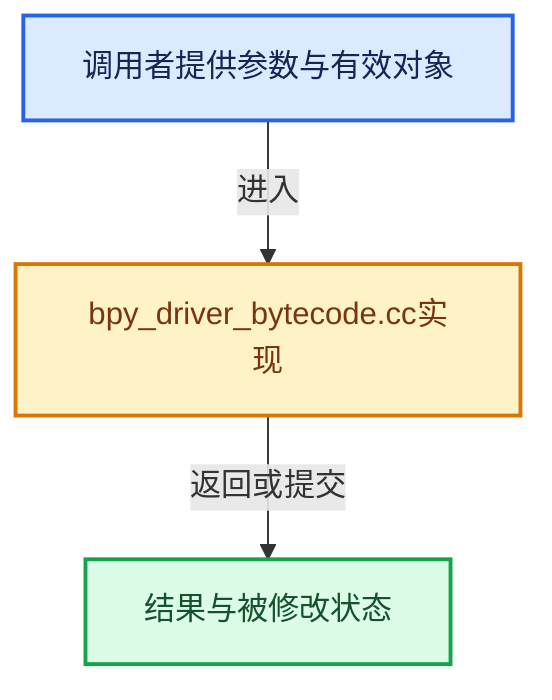

# 实现依赖专题：source/blender/python/intern/bpy_driver_bytecode.cc

[实现依赖导航](../../../README.md) · [符号索引](../../../../00-课程指南/02-源码与提交索引/符号依赖与实现索引.md)

本专题从正文实际调用进入，集中保存共享实现。函数有稳定锚点，可从调用处直接跳到对应完整函数；递归与互相调用通过回链组织。

## 本文件的实现关系





## 完整成员与函数实现

<a id="f-09ddcb17595dfe00"></a>

### `blender::is_opcode_secure`

实现位置：[source/blender/python/intern/bpy_driver_bytecode.cc](../../../../../../../../source/blender/python/intern/bpy_driver_bytecode.cc) · L31—L169。

接口参数：

- `const int opcode`

**教学注释版**

<!-- annotated:bd02267cd732ee -->

```cpp
static bool is_opcode_secure(const int opcode)
{
  /*
   * Intentionally Excluded Opcodes
   * ==============================
   *
   * Likely Safe but Unnecessary
   * ---------------------------
   *
   * These opcodes appear safe but are not needed for driver expressions.
   *
   * In the interest of reducing the attack surface, exclude them unless
   * practical use cases are found.
   *
   * - `CALL_INTRINSIC_2`: Used for exception handling (`except*`) and type hints.
   *   Not needed for driver expressions.
   *
   * - `MAKE_FUNCTION`, `LOAD_BUILD_CLASS`: Function/class creation not needed.
   *
   * Known to be Dangerous
   * ---------------------
   *
   * These opcodes are excluded for security reasons:
   *
   * - `DICT_MERGE`, `DICT_UPDATE`: Could potentially be used to manipulate
   *   the namespace via `globals()`, allowing malicious code execution.
   *
   * - `IMPORT_NAME`, `IMPORT_FROM`: Module imports are not allowed.
   *
   * - `STORE_NAME`, `STORE_GLOBAL`, `STORE_ATTR`: Storing to names/globals/attributes
   *   could modify the namespace or objects in unsafe ways.
   *
   * - `LOAD_ATTR`: Attribute access is not allowed as it could access
   *   private/internal attributes.
   */

#  define OK_OP(op) \
    case op: \
      return true;

  switch (opcode) {
    OK_OP(CACHE)
    OK_OP(COPY) /* Ok for short-circuit boolean evaluation (`and`, `or`). */
    OK_OP(POP_TOP)
    OK_OP(PUSH_NULL)
    OK_OP(NOP)
#  if PY_VERSION_HEX >= 0x030e0000
    OK_OP(NOT_TAKEN)
#  endif
    OK_OP(TO_BOOL) /* Ok for boolean conversion in `and`/`or` expressions. */
    OK_OP(UNARY_NEGATIVE)
    OK_OP(UNARY_NOT)
    OK_OP(UNARY_INVERT)
#  if PY_VERSION_HEX < 0x030e0000
    OK_OP(BINARY_SUBSCR) /* Replaced with existing `BINARY_OP`. */
#  endif
    OK_OP(GET_LEN)
    OK_OP(RETURN_VALUE)
    OK_OP(SWAP)
    OK_OP(BUILD_TUPLE)
    OK_OP(BUILD_LIST)
    OK_OP(BUILD_SET)
    OK_OP(BUILD_MAP)
    OK_OP(COMPARE_OP)
    OK_OP(JUMP_FORWARD)
    OK_OP(LOAD_GLOBAL)
    OK_OP(IS_OP)
    OK_OP(CONTAINS_OP)
    OK_OP(BINARY_OP)
    OK_OP(LOAD_FAST)
    OK_OP(LOAD_FAST_AND_CLEAR) /* Ok, optimized variant of `LOAD_FAST`. */
    OK_OP(LOAD_FAST_LOAD_FAST) /* Ok, optimized double `LOAD_FAST`. */
#  if PY_VERSION_HEX >= 0x030e0000
    OK_OP(LOAD_FAST_BORROW)                  /* Ok, optimized variant of `LOAD_FAST`. */
    OK_OP(LOAD_FAST_BORROW_LOAD_FAST_BORROW) /* Ok, optimized double `LOAD_FAST`. */
#  endif
    OK_OP(STORE_FAST)
    OK_OP(STORE_FAST_LOAD_FAST)  /* Ok, optimized `STORE_FAST` + `LOAD_FAST`. */
    OK_OP(STORE_FAST_STORE_FAST) /* Ok, optimized double `STORE_FAST`. */
    OK_OP(DELETE_FAST)
    OK_OP(BUILD_SLICE)
    OK_OP(LOAD_DEREF)
    OK_OP(STORE_DEREF)
    OK_OP(RESUME)
    OK_OP(LIST_EXTEND)
    OK_OP(SET_UPDATE)
/* NOTE(@ideasman42): Don't enable dict manipulation, unless we can prove there is not way it
 * can be used to manipulate the name-space (potentially allowing malicious code). */
#  if 0
    OK_OP(DICT_MERGE)
    OK_OP(DICT_UPDATE)
#  endif

#  if PY_VERSION_HEX < 0x030e0000
    OK_OP(RETURN_CONST)
#  endif
    /* Ok, conditional jumps only affect control flow within the expression. */
    OK_OP(POP_JUMP_IF_FALSE)    /* Used for `and` expressions and `if` conditionals. */
    OK_OP(POP_JUMP_IF_TRUE)     /* Used for `or` expressions. */
    OK_OP(POP_JUMP_IF_NONE)     /* Used for `is not None` conditionals. */
    OK_OP(POP_JUMP_IF_NOT_NONE) /* Used for `is None` conditionals. */
    OK_OP(CALL_INTRINSIC_1)
    /* Special cases. */
    OK_OP(LOAD_CONST) /* Ok because constants are accepted. */
    OK_OP(LOAD_NAME)  /* Ok, because `PyCodeObject.names` is checked. */
#  if PY_VERSION_HEX >= 0x030e0000
    OK_OP(LOAD_SMALL_INT)
#  endif
    OK_OP(CALL)    /* Ok, because we check its "name" before calling. */
    OK_OP(CALL_KW) /* Ok, because it's used for calling functions with keyword arguments. */

    OK_OP(CALL_FUNCTION_EX);

    /* OK because the names are checked. */
    OK_OP(CALL_ALLOC_AND_ENTER_INIT)
    OK_OP(CALL_BOUND_METHOD_EXACT_ARGS)
    OK_OP(CALL_BOUND_METHOD_GENERAL)
    OK_OP(CALL_BUILTIN_CLASS)
    OK_OP(CALL_BUILTIN_FAST)
    OK_OP(CALL_BUILTIN_FAST_WITH_KEYWORDS)
    OK_OP(CALL_BUILTIN_O)
    OK_OP(CALL_ISINSTANCE)
    OK_OP(CALL_LEN)
    OK_OP(CALL_LIST_APPEND)
    OK_OP(CALL_METHOD_DESCRIPTOR_FAST)
    OK_OP(CALL_METHOD_DESCRIPTOR_FAST_WITH_KEYWORDS)
    OK_OP(CALL_METHOD_DESCRIPTOR_NOARGS)
    OK_OP(CALL_METHOD_DESCRIPTOR_O)
    OK_OP(CALL_NON_PY_GENERAL)
    OK_OP(CALL_PY_EXACT_ARGS)
    OK_OP(CALL_PY_GENERAL)
    OK_OP(CALL_STR_1)
    OK_OP(CALL_TUPLE_1)
    OK_OP(CALL_TYPE_1)
  }

#  undef OK_OP
  return false;
}
```

<details>
<summary>核对原始源码：source/blender/python/intern/bpy_driver_bytecode.cc · L31—L169</summary>

<!-- original:bd02267cd732ee:source/blender/python/intern/bpy_driver_bytecode.cc:31:169 -->

```cpp
static bool is_opcode_secure(const int opcode)
{
  /*
   * Intentionally Excluded Opcodes
   * ==============================
   *
   * Likely Safe but Unnecessary
   * ---------------------------
   *
   * These opcodes appear safe but are not needed for driver expressions.
   *
   * In the interest of reducing the attack surface, exclude them unless
   * practical use cases are found.
   *
   * - `CALL_INTRINSIC_2`: Used for exception handling (`except*`) and type hints.
   *   Not needed for driver expressions.
   *
   * - `MAKE_FUNCTION`, `LOAD_BUILD_CLASS`: Function/class creation not needed.
   *
   * Known to be Dangerous
   * ---------------------
   *
   * These opcodes are excluded for security reasons:
   *
   * - `DICT_MERGE`, `DICT_UPDATE`: Could potentially be used to manipulate
   *   the namespace via `globals()`, allowing malicious code execution.
   *
   * - `IMPORT_NAME`, `IMPORT_FROM`: Module imports are not allowed.
   *
   * - `STORE_NAME`, `STORE_GLOBAL`, `STORE_ATTR`: Storing to names/globals/attributes
   *   could modify the namespace or objects in unsafe ways.
   *
   * - `LOAD_ATTR`: Attribute access is not allowed as it could access
   *   private/internal attributes.
   */

#  define OK_OP(op) \
    case op: \
      return true;

  switch (opcode) {
    OK_OP(CACHE)
    OK_OP(COPY) /* Ok for short-circuit boolean evaluation (`and`, `or`). */
    OK_OP(POP_TOP)
    OK_OP(PUSH_NULL)
    OK_OP(NOP)
#  if PY_VERSION_HEX >= 0x030e0000
    OK_OP(NOT_TAKEN)
#  endif
    OK_OP(TO_BOOL) /* Ok for boolean conversion in `and`/`or` expressions. */
    OK_OP(UNARY_NEGATIVE)
    OK_OP(UNARY_NOT)
    OK_OP(UNARY_INVERT)
#  if PY_VERSION_HEX < 0x030e0000
    OK_OP(BINARY_SUBSCR) /* Replaced with existing `BINARY_OP`. */
#  endif
    OK_OP(GET_LEN)
    OK_OP(RETURN_VALUE)
    OK_OP(SWAP)
    OK_OP(BUILD_TUPLE)
    OK_OP(BUILD_LIST)
    OK_OP(BUILD_SET)
    OK_OP(BUILD_MAP)
    OK_OP(COMPARE_OP)
    OK_OP(JUMP_FORWARD)
    OK_OP(LOAD_GLOBAL)
    OK_OP(IS_OP)
    OK_OP(CONTAINS_OP)
    OK_OP(BINARY_OP)
    OK_OP(LOAD_FAST)
    OK_OP(LOAD_FAST_AND_CLEAR) /* Ok, optimized variant of `LOAD_FAST`. */
    OK_OP(LOAD_FAST_LOAD_FAST) /* Ok, optimized double `LOAD_FAST`. */
#  if PY_VERSION_HEX >= 0x030e0000
    OK_OP(LOAD_FAST_BORROW)                  /* Ok, optimized variant of `LOAD_FAST`. */
    OK_OP(LOAD_FAST_BORROW_LOAD_FAST_BORROW) /* Ok, optimized double `LOAD_FAST`. */
#  endif
    OK_OP(STORE_FAST)
    OK_OP(STORE_FAST_LOAD_FAST)  /* Ok, optimized `STORE_FAST` + `LOAD_FAST`. */
    OK_OP(STORE_FAST_STORE_FAST) /* Ok, optimized double `STORE_FAST`. */
    OK_OP(DELETE_FAST)
    OK_OP(BUILD_SLICE)
    OK_OP(LOAD_DEREF)
    OK_OP(STORE_DEREF)
    OK_OP(RESUME)
    OK_OP(LIST_EXTEND)
    OK_OP(SET_UPDATE)
/* NOTE(@ideasman42): Don't enable dict manipulation, unless we can prove there is not way it
 * can be used to manipulate the name-space (potentially allowing malicious code). */
#  if 0
    OK_OP(DICT_MERGE)
    OK_OP(DICT_UPDATE)
#  endif

#  if PY_VERSION_HEX < 0x030e0000
    OK_OP(RETURN_CONST)
#  endif
    /* Ok, conditional jumps only affect control flow within the expression. */
    OK_OP(POP_JUMP_IF_FALSE)    /* Used for `and` expressions and `if` conditionals. */
    OK_OP(POP_JUMP_IF_TRUE)     /* Used for `or` expressions. */
    OK_OP(POP_JUMP_IF_NONE)     /* Used for `is not None` conditionals. */
    OK_OP(POP_JUMP_IF_NOT_NONE) /* Used for `is None` conditionals. */
    OK_OP(CALL_INTRINSIC_1)
    /* Special cases. */
    OK_OP(LOAD_CONST) /* Ok because constants are accepted. */
    OK_OP(LOAD_NAME)  /* Ok, because `PyCodeObject.names` is checked. */
#  if PY_VERSION_HEX >= 0x030e0000
    OK_OP(LOAD_SMALL_INT)
#  endif
    OK_OP(CALL)    /* Ok, because we check its "name" before calling. */
    OK_OP(CALL_KW) /* Ok, because it's used for calling functions with keyword arguments. */

    OK_OP(CALL_FUNCTION_EX);

    /* OK because the names are checked. */
    OK_OP(CALL_ALLOC_AND_ENTER_INIT)
    OK_OP(CALL_BOUND_METHOD_EXACT_ARGS)
    OK_OP(CALL_BOUND_METHOD_GENERAL)
    OK_OP(CALL_BUILTIN_CLASS)
    OK_OP(CALL_BUILTIN_FAST)
    OK_OP(CALL_BUILTIN_FAST_WITH_KEYWORDS)
    OK_OP(CALL_BUILTIN_O)
    OK_OP(CALL_ISINSTANCE)
    OK_OP(CALL_LEN)
    OK_OP(CALL_LIST_APPEND)
    OK_OP(CALL_METHOD_DESCRIPTOR_FAST)
    OK_OP(CALL_METHOD_DESCRIPTOR_FAST_WITH_KEYWORDS)
    OK_OP(CALL_METHOD_DESCRIPTOR_NOARGS)
    OK_OP(CALL_METHOD_DESCRIPTOR_O)
    OK_OP(CALL_NON_PY_GENERAL)
    OK_OP(CALL_PY_EXACT_ARGS)
    OK_OP(CALL_PY_GENERAL)
    OK_OP(CALL_STR_1)
    OK_OP(CALL_TUPLE_1)
    OK_OP(CALL_TYPE_1)
  }

#  undef OK_OP
  return false;
}
```

</details>

**结果出口**

- `return true;`
- `return false;`

**继续追踪实现**

- `OK_OP` → [调用协议](../../../../00-课程指南/01-路线与规范/模板宏与动态分派协议.md)：函数指针、局部可调用对象或未展开的宏；必须结合调用者环境。调用位置L72。

<a id="f-e8bc82ec58cdef72"></a>

### `blender::BPY_driver_secure_bytecode_test_ex`

实现位置：[source/blender/python/intern/bpy_driver_bytecode.cc](../../../../../../../../source/blender/python/intern/bpy_driver_bytecode.cc) · L171—L244。

接口参数：

- `PyObject *expr_code`
- `PyObject *py_namespace_array[]`
- `const bool verbose`
- `const char *error_prefix`

**教学注释版**

<!-- annotated:2db2d2c0773af6 -->

```cpp
bool BPY_driver_secure_bytecode_test_ex(PyObject *expr_code,
                                        PyObject *py_namespace_array[],
                                        const bool verbose,
                                        const char *error_prefix)
{
  PyCodeObject *py_code = reinterpret_cast<PyCodeObject *>(expr_code);

  /* Check names. */
  {
    for (int i = 0; i < PyTuple_GET_SIZE(py_code->co_names); i++) {
      PyObject *name = PyTuple_GET_ITEM(py_code->co_names, i);
      const char *name_str = PyUnicode_AsUTF8(name);
      bool contains_name = false;
      for (int j = 0; py_namespace_array[j]; j++) {
        if (PyDict_Contains(py_namespace_array[j], name)) {
          contains_name = true;
          break;
        }
      }

      if ((contains_name == false) || (name_str[0] == '_')) {
        if (verbose) {
          fprintf(stderr,
                  "\t%s: restricted access disallows name '%s', "
                  "enable auto-execution to support\n",
                  error_prefix,
                  name_str);
        }
        return false;
      }
    }
  }

  /* Check opcodes. */
  {
    const _Py_CODEUNIT *codestr;
    Py_ssize_t code_len;

    PyObject *co_code;

    co_code = PyCode_GetCode(py_code);
    if (!co_code) {
      PyErr_Print();
      return false;
    }

    PyBytes_AsStringAndSize(co_code, (char **)&codestr, &code_len);
    code_len /= sizeof(*codestr);
    bool ok = true;

    /* Loop over op-code's, the op-code arguments are ignored. */
    for (Py_ssize_t i = 0; i < code_len; i++) {
      const int opcode = _Py_OPCODE(codestr[i]);
      if (!is_opcode_secure(opcode)) {
        if (verbose) {
          fprintf(stderr,
                  "\t%s: restricted access disallows opcode '%d', "
                  "enable auto-execution to support\n",
                  error_prefix,
                  opcode);
        }
        ok = false;
        break;
      }
    }

    Py_DECREF(co_code);
    if (!ok) {
      return false;
    }
  }

  return true;
}
```

<details>
<summary>核对原始源码：source/blender/python/intern/bpy_driver_bytecode.cc · L171—L244</summary>

<!-- original:2db2d2c0773af6:source/blender/python/intern/bpy_driver_bytecode.cc:171:244 -->

```cpp
bool BPY_driver_secure_bytecode_test_ex(PyObject *expr_code,
                                        PyObject *py_namespace_array[],
                                        const bool verbose,
                                        const char *error_prefix)
{
  PyCodeObject *py_code = reinterpret_cast<PyCodeObject *>(expr_code);

  /* Check names. */
  {
    for (int i = 0; i < PyTuple_GET_SIZE(py_code->co_names); i++) {
      PyObject *name = PyTuple_GET_ITEM(py_code->co_names, i);
      const char *name_str = PyUnicode_AsUTF8(name);
      bool contains_name = false;
      for (int j = 0; py_namespace_array[j]; j++) {
        if (PyDict_Contains(py_namespace_array[j], name)) {
          contains_name = true;
          break;
        }
      }

      if ((contains_name == false) || (name_str[0] == '_')) {
        if (verbose) {
          fprintf(stderr,
                  "\t%s: restricted access disallows name '%s', "
                  "enable auto-execution to support\n",
                  error_prefix,
                  name_str);
        }
        return false;
      }
    }
  }

  /* Check opcodes. */
  {
    const _Py_CODEUNIT *codestr;
    Py_ssize_t code_len;

    PyObject *co_code;

    co_code = PyCode_GetCode(py_code);
    if (!co_code) {
      PyErr_Print();
      return false;
    }

    PyBytes_AsStringAndSize(co_code, (char **)&codestr, &code_len);
    code_len /= sizeof(*codestr);
    bool ok = true;

    /* Loop over op-code's, the op-code arguments are ignored. */
    for (Py_ssize_t i = 0; i < code_len; i++) {
      const int opcode = _Py_OPCODE(codestr[i]);
      if (!is_opcode_secure(opcode)) {
        if (verbose) {
          fprintf(stderr,
                  "\t%s: restricted access disallows opcode '%d', "
                  "enable auto-execution to support\n",
                  error_prefix,
                  opcode);
        }
        ok = false;
        break;
      }
    }

    Py_DECREF(co_code);
    if (!ok) {
      return false;
    }
  }

  return true;
}
```

</details>

**沿实际写入检查状态**

- `contains_name = true;`
- `co_code = PyCode_GetCode(py_code);`
- `ok = false;`

**结果出口**

- `return false;`
- `return true;`

**继续追踪实现**

- `PyTuple_GET_SIZE` → [调用协议](../../../../00-课程指南/01-路线与规范/模板宏与动态分派协议.md)：配置相关检测或外部运行时接口。调用位置L180。
- `PyTuple_GET_ITEM` → [调用协议](../../../../00-课程指南/01-路线与规范/模板宏与动态分派协议.md)：配置相关检测或外部运行时接口。调用位置L181。
- `PyUnicode_AsUTF8` → [调用协议](../../../../00-课程指南/01-路线与规范/模板宏与动态分派协议.md)：配置相关检测或外部运行时接口。调用位置L182。
- `PyDict_Contains` → [调用协议](../../../../00-课程指南/01-路线与规范/模板宏与动态分派协议.md)：配置相关检测或外部运行时接口。调用位置L185。
- `fprintf` → [外部契约](https://eel.is/c++draft/)：这个边界按实际表达式及所属类型核对参数、返回值、寿命与失败行为。这里提供接口入口，不声称已解释该第三方版本的内部实现。
- `PyCode_GetCode` → [调用协议](../../../../00-课程指南/01-路线与规范/模板宏与动态分派协议.md)：配置相关检测或外部运行时接口。调用位置L211。
- `PyErr_Print` → [调用协议](../../../../00-课程指南/01-路线与规范/模板宏与动态分派协议.md)：配置相关检测或外部运行时接口。调用位置L213。
- `PyBytes_AsStringAndSize` → [调用协议](../../../../00-课程指南/01-路线与规范/模板宏与动态分派协议.md)：配置相关检测或外部运行时接口。调用位置L217。
- `_Py_OPCODE` → [调用协议](../../../../00-课程指南/01-路线与规范/模板宏与动态分派协议.md)：函数指针、局部可调用对象或未展开的宏；必须结合调用者环境。调用位置L223。
- `is_opcode_secure` → [blender::is_opcode_secure · L31](bpy_driver_bytecode.cc.md#f-09ddcb17595dfe00)。
- `Py_DECREF` → [调用协议](../../../../00-课程指南/01-路线与规范/模板宏与动态分派协议.md)：配置相关检测或外部运行时接口。调用位置L237。
