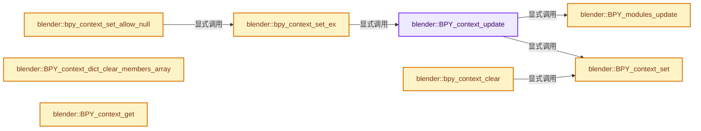
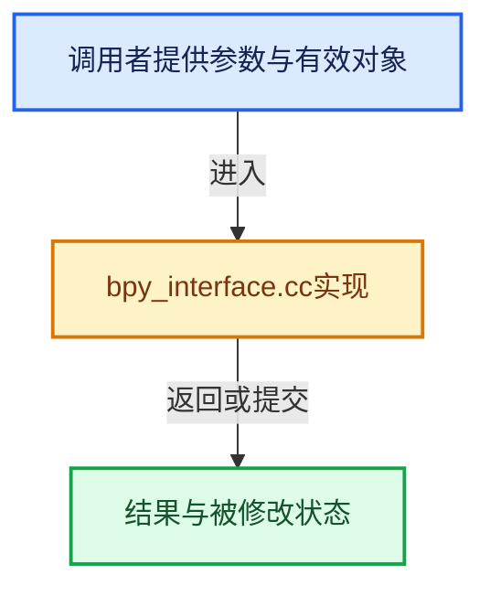

# 实现依赖专题：source/blender/python/intern/bpy_interface.cc

[实现依赖导航](../../../README.md) · [符号索引](../../../../00-课程指南/02-源码与提交索引/符号依赖与实现索引.md)

本专题从正文实际调用进入，集中保存共享实现。函数有稳定锚点，可从调用处直接跳到对应完整函数；递归与互相调用通过回链组织。

## 本文件的实现关系






## 完整成员与函数实现

<a id="f-d8e935cb55009740"></a>

### `blender::BPY_context_update`

实现位置：[source/blender/python/intern/bpy_interface.cc](../../../../../../../../source/blender/python/intern/bpy_interface.cc) · L106—L119。

接口参数：

- `bContext *C`

**教学注释版**

<!-- annotated:65c2be2eac0140 -->

```cpp
void BPY_context_update(bContext *C)
{
  /* Don't do this from a non-main (e.g. render) thread, it can cause a race
   * condition on `C->data.recursion`. Ideal solution would be to disable
   * context entirely from non-main threads, but that's more complicated. */
  if (!BLI_thread_is_main()) {
    return;
  }

  BPY_context_set(C);

  /* Can give really bad results if this isn't here. */
  BPY_modules_update();
}
```

<details>
<summary>核对原始源码：source/blender/python/intern/bpy_interface.cc · L106—L119</summary>

<!-- original:65c2be2eac0140:source/blender/python/intern/bpy_interface.cc:106:119 -->

```cpp
void BPY_context_update(bContext *C)
{
  /* Don't do this from a non-main (e.g. render) thread, it can cause a race
   * condition on `C->data.recursion`. Ideal solution would be to disable
   * context entirely from non-main threads, but that's more complicated. */
  if (!BLI_thread_is_main()) {
    return;
  }

  BPY_context_set(C);

  /* Can give really bad results if this isn't here. */
  BPY_modules_update();
}
```

</details>

**继续追踪实现**

- `BLI_thread_is_main` → [BLI_thread_is_main · L184](../../../01-BLI基础库/intern/threads.cc.md#f-da304af4327defdc)。
- `BPY_context_set` → [blender::BPY_context_set · L297](bpy_interface.cc.md#f-b6d9e3b8bfa37bbb)。
- `BPY_modules_update` → [blender::BPY_modules_update · L278](bpy_interface.cc.md#f-fd0c442cf52043e4)。

<a id="f-e1f0da81e83647a5"></a>

### `blender::bpy_context_set_ex`

实现位置：[source/blender/python/intern/bpy_interface.cc](../../../../../../../../source/blender/python/intern/bpy_interface.cc) · L127—L163。

接口参数：

- `bContext *C`
- `PyGILState_STATE *gilstate`
- `const bool allow_null_context`

**教学注释版**

<!-- annotated:25af5cf9719496 -->

```cpp
static bool bpy_context_set_ex(bContext *C,
                               PyGILState_STATE *gilstate,
                               const bool allow_null_context)
{
  bool context_set = false;
  py_call_level++;

  if (gilstate) {
    *gilstate = PyGILState_Ensure();
  }

  if (py_call_level == 1) {
    if (!allow_null_context) {
      BLI_assert_msg(C != nullptr, "bpy: Trying to set invalid nullptr context");
    }

    BPY_context_update(C);
    context_set = true;

    if (C != nullptr) {
      pyrna_context_init(C);
    }

#ifdef TIME_PY_RUN
    if (bpy_timer_count == 0) {
      /* Record time from the beginning. */
      bpy_timer = BLI_time_now_seconds();
      bpy_timer_run = bpy_timer_run_tot = 0.0;
    }
    bpy_timer_run = BLI_time_now_seconds();

    bpy_timer_count++;
#endif
  }

  return context_set;
}
```

<details>
<summary>核对原始源码：source/blender/python/intern/bpy_interface.cc · L127—L163</summary>

<!-- original:25af5cf9719496:source/blender/python/intern/bpy_interface.cc:127:163 -->

```cpp
static bool bpy_context_set_ex(bContext *C,
                               PyGILState_STATE *gilstate,
                               const bool allow_null_context)
{
  bool context_set = false;
  py_call_level++;

  if (gilstate) {
    *gilstate = PyGILState_Ensure();
  }

  if (py_call_level == 1) {
    if (!allow_null_context) {
      BLI_assert_msg(C != nullptr, "bpy: Trying to set invalid nullptr context");
    }

    BPY_context_update(C);
    context_set = true;

    if (C != nullptr) {
      pyrna_context_init(C);
    }

#ifdef TIME_PY_RUN
    if (bpy_timer_count == 0) {
      /* Record time from the beginning. */
      bpy_timer = BLI_time_now_seconds();
      bpy_timer_run = bpy_timer_run_tot = 0.0;
    }
    bpy_timer_run = BLI_time_now_seconds();

    bpy_timer_count++;
#endif
  }

  return context_set;
}
```

</details>

**沿实际写入检查状态**

- `context_set = true;`
- `bpy_timer = BLI_time_now_seconds();`
- `bpy_timer_run = bpy_timer_run_tot = 0.0;`
- `bpy_timer_run = BLI_time_now_seconds();`

**结果出口**

- `return context_set;`

**继续追踪实现**

- `PyGILState_Ensure` → [调用协议](../../../../00-课程指南/01-路线与规范/模板宏与动态分派协议.md)：配置相关检测或外部运行时接口。调用位置L135。
- `BLI_assert_msg` → [BLI_assert_msg · L55](../../../01-BLI基础库/BLI_assert.hh.md#m-695eed20dceb)；[BLI_assert_msg · L64](../../../01-BLI基础库/BLI_assert.hh.md#m-7de5563de4db)。宏定义由构建条件选择。
- `BPY_context_update` → [blender::BPY_context_update · L106](bpy_interface.cc.md#f-d8e935cb55009740)。
- `pyrna_context_init` → [blender::pyrna_context_init · L529](bpy_rna.cc.md#f-063fa42a075a0255)；[blender::pyrna_context_init · L551](bpy_rna.cc.md#f-9d90d4a52d581778)。同名重载需按实参类型选择。
- `BLI_time_now_seconds` → [blender::BLI_time_now_seconds · L30](../../../01-BLI基础库/intern/time.cc.md#f-78479f031bcc3c53)。

<a id="f-6fde7eecee5f8784"></a>

### `blender::bpy_context_set_allow_null`

实现位置：[source/blender/python/intern/bpy_interface.cc](../../../../../../../../source/blender/python/intern/bpy_interface.cc) · L170—L173。

接口参数：

- `bContext *C`
- `PyGILState_STATE *gilstate`

**教学注释版**

<!-- annotated:a124e4dcc3262d -->

```cpp
bool bpy_context_set_allow_null(bContext *C, PyGILState_STATE *gilstate)
{
  return bpy_context_set_ex(C, gilstate, true);
}
```

<details>
<summary>核对原始源码：source/blender/python/intern/bpy_interface.cc · L170—L173</summary>

<!-- original:a124e4dcc3262d:source/blender/python/intern/bpy_interface.cc:170:173 -->

```cpp
bool bpy_context_set_allow_null(bContext *C, PyGILState_STATE *gilstate)
{
  return bpy_context_set_ex(C, gilstate, true);
}
```

</details>

**结果出口**

- `return bpy_context_set_ex(C, gilstate, true);`

**继续追踪实现**

- `bpy_context_set_ex` → [blender::bpy_context_set_ex · L127](bpy_interface.cc.md#f-e1f0da81e83647a5)。

<a id="f-77cc53ad69e3e6c5"></a>

### `blender::bpy_context_clear`

实现位置：[source/blender/python/intern/bpy_interface.cc](../../../../../../../../source/blender/python/intern/bpy_interface.cc) · L175—L203。

接口参数：

- `bContext *C`
- `const PyGILState_STATE *gilstate`

**教学注释版**

<!-- annotated:ae4df580ef2544 -->

```cpp
void bpy_context_clear(bContext *C, const PyGILState_STATE *gilstate)
{
  py_call_level--;

  if (gilstate) {
    PyGILState_Release(*gilstate);
  }

  if (py_call_level < 0) {
    fprintf(stderr, "ERROR: Python context internal state bug. this should not happen!\n");
  }
  else if (py_call_level == 0) {
    /* NOTE: Unfortunately calling classes currently won't store the context.
     * Can't set nullptr because of this - but this is very unreliable still. */
#if 0
    BPY_context_set(nullptr);
#endif

    /* See previous comment regarding null check in #bpy_context_set. */
    if (C != nullptr) {
      pyrna_context_clear(C);
    }

#ifdef TIME_PY_RUN
    bpy_timer_run_tot += BLI_time_now_seconds() - bpy_timer_run;
    bpy_timer_count++;
#endif
  }
}
```

<details>
<summary>核对原始源码：source/blender/python/intern/bpy_interface.cc · L175—L203</summary>

<!-- original:ae4df580ef2544:source/blender/python/intern/bpy_interface.cc:175:203 -->

```cpp
void bpy_context_clear(bContext *C, const PyGILState_STATE *gilstate)
{
  py_call_level--;

  if (gilstate) {
    PyGILState_Release(*gilstate);
  }

  if (py_call_level < 0) {
    fprintf(stderr, "ERROR: Python context internal state bug. this should not happen!\n");
  }
  else if (py_call_level == 0) {
    /* NOTE: Unfortunately calling classes currently won't store the context.
     * Can't set nullptr because of this - but this is very unreliable still. */
#if 0
    BPY_context_set(nullptr);
#endif

    /* See previous comment regarding null check in #bpy_context_set. */
    if (C != nullptr) {
      pyrna_context_clear(C);
    }

#ifdef TIME_PY_RUN
    bpy_timer_run_tot += BLI_time_now_seconds() - bpy_timer_run;
    bpy_timer_count++;
#endif
  }
}
```

</details>

**沿实际写入检查状态**

- `bpy_timer_run_tot += BLI_time_now_seconds() - bpy_timer_run;`

**继续追踪实现**

- `PyGILState_Release` → [调用协议](../../../../00-课程指南/01-路线与规范/模板宏与动态分派协议.md)：配置相关检测或外部运行时接口。调用位置L180。
- `fprintf` → [外部契约](https://eel.is/c++draft/)：这个边界按实际表达式及所属类型核对参数、返回值、寿命与失败行为。这里提供接口入口，不声称已解释该第三方版本的内部实现。
- `BPY_context_set` → [blender::BPY_context_set · L297](bpy_interface.cc.md#f-b6d9e3b8bfa37bbb)。
- `pyrna_context_clear` → [blender::pyrna_context_clear · L534](bpy_rna.cc.md#f-97f414aa60d1cd91)；[blender::pyrna_context_clear · L552](bpy_rna.cc.md#f-41871c1015571463)。同名重载需按实参类型选择。
- `BLI_time_now_seconds` → [blender::BLI_time_now_seconds · L30](../../../01-BLI基础库/intern/time.cc.md#f-78479f031bcc3c53)。

<a id="f-50f7c388f4aa0752"></a>

### `blender::BPY_context_dict_clear_members_array`

实现位置：[source/blender/python/intern/bpy_interface.cc](../../../../../../../../source/blender/python/intern/bpy_interface.cc) · L213—L257。

接口参数：

- `void **dict_p`
- `void *dict_orig`
- `const char *context_members[]`
- `uint context_members_len`

**教学注释版**

<!-- annotated:bf4318a31525f1 -->

```cpp
void BPY_context_dict_clear_members_array(void **dict_p,
                                          void *dict_orig,
                                          const char *context_members[],
                                          uint context_members_len)
{
  PyGILState_STATE gilstate;
  const bool use_gil = !PyC_IsInterpreterActive();
  if (use_gil) {
    gilstate = PyGILState_Ensure();
  }

  /* Copy on write. */
  if (*dict_p == dict_orig) {
    *dict_p = PyDict_Copy(static_cast<PyObject *>(dict_orig));
  }

  PyObject *dict = static_cast<PyObject *>(*dict_p);
  BLI_assert(PyDict_Check(dict));

  /* Use #PyDict_Pop instead of #PyDict_DelItemString to avoid setting the exception,
   * while supported it's good to avoid for low level functions like this that run often. */
  for (uint i = 0; i < context_members_len; i++) {
    PyObject *key = PyUnicode_FromString(context_members[i]);
    PyObject *item;

    switch (PyDict_Pop(dict, key, &item)) {
      case 1: {
        Py_DECREF(item);
        break;
      }
      case -1: {
        /* Not expected, but allow for an error. */
        BLI_assert(false);
        PyErr_Clear();
        break;
      }
    }

    Py_DECREF(key);
  }

  if (use_gil) {
    PyGILState_Release(gilstate);
  }
}
```

<details>
<summary>核对原始源码：source/blender/python/intern/bpy_interface.cc · L213—L257</summary>

<!-- original:bf4318a31525f1:source/blender/python/intern/bpy_interface.cc:213:257 -->

```cpp
void BPY_context_dict_clear_members_array(void **dict_p,
                                          void *dict_orig,
                                          const char *context_members[],
                                          uint context_members_len)
{
  PyGILState_STATE gilstate;
  const bool use_gil = !PyC_IsInterpreterActive();
  if (use_gil) {
    gilstate = PyGILState_Ensure();
  }

  /* Copy on write. */
  if (*dict_p == dict_orig) {
    *dict_p = PyDict_Copy(static_cast<PyObject *>(dict_orig));
  }

  PyObject *dict = static_cast<PyObject *>(*dict_p);
  BLI_assert(PyDict_Check(dict));

  /* Use #PyDict_Pop instead of #PyDict_DelItemString to avoid setting the exception,
   * while supported it's good to avoid for low level functions like this that run often. */
  for (uint i = 0; i < context_members_len; i++) {
    PyObject *key = PyUnicode_FromString(context_members[i]);
    PyObject *item;

    switch (PyDict_Pop(dict, key, &item)) {
      case 1: {
        Py_DECREF(item);
        break;
      }
      case -1: {
        /* Not expected, but allow for an error. */
        BLI_assert(false);
        PyErr_Clear();
        break;
      }
    }

    Py_DECREF(key);
  }

  if (use_gil) {
    PyGILState_Release(gilstate);
  }
}
```

</details>

**沿实际写入检查状态**

- `gilstate = PyGILState_Ensure();`

**继续追踪实现**

- `PyC_IsInterpreterActive` → [blender::PyC_IsInterpreterActive · L1310](../generic/py_capi_utils.cc.md#f-dbefabca8ff29331)。
- `PyGILState_Ensure` → [调用协议](../../../../00-课程指南/01-路线与规范/模板宏与动态分派协议.md)：配置相关检测或外部运行时接口。调用位置L221。
- `PyDict_Copy` → [调用协议](../../../../00-课程指南/01-路线与规范/模板宏与动态分派协议.md)：配置相关检测或外部运行时接口。调用位置L226。
- `BLI_assert` → [BLI_assert · L48](../../../01-BLI基础库/BLI_assert.hh.md#m-57a88495704d)；[BLI_assert · L63](../../../01-BLI基础库/BLI_assert.hh.md#m-d07050020cb5)。宏定义由构建条件选择。
- `PyDict_Check` → [调用协议](../../../../00-课程指南/01-路线与规范/模板宏与动态分派协议.md)：配置相关检测或外部运行时接口。调用位置L230。
- `PyUnicode_FromString` → [调用协议](../../../../00-课程指南/01-路线与规范/模板宏与动态分派协议.md)：配置相关检测或外部运行时接口。调用位置L235。
- `PyDict_Pop` → [调用协议](../../../../00-课程指南/01-路线与规范/模板宏与动态分派协议.md)：配置相关检测或外部运行时接口。调用位置L238。
- `Py_DECREF` → [调用协议](../../../../00-课程指南/01-路线与规范/模板宏与动态分派协议.md)：配置相关检测或外部运行时接口。调用位置L240。
- `PyErr_Clear` → [调用协议](../../../../00-课程指南/01-路线与规范/模板宏与动态分派协议.md)：配置相关检测或外部运行时接口。调用位置L246。
- `PyGILState_Release` → [调用协议](../../../../00-课程指南/01-路线与规范/模板宏与动态分派协议.md)：配置相关检测或外部运行时接口。调用位置L255。

<a id="f-fd0c442cf52043e4"></a>

### `blender::BPY_modules_update`

实现位置：[source/blender/python/intern/bpy_interface.cc](../../../../../../../../source/blender/python/intern/bpy_interface.cc) · L278—L290。

**教学注释版**

<!-- annotated:d4899f190f71cf -->

```cpp
void BPY_modules_update()
{
  /* Correct but slow, this runs all the time operator poll, panel draw etc
   * (100's of time a second). */
#if 0
  PyObject *mod = PyImport_ImportModuleLevel("bpy", nullptr, nullptr, nullptr, 0);
  PyModule_AddObject(mod, "data", BPY_rna_module());
  PyModule_AddObject(mod, "types", BPY_rna_types()); /* This does not need updating. */
#endif

  /* Refreshes the main struct. */
  BPY_update_rna_module();
}
```

<details>
<summary>核对原始源码：source/blender/python/intern/bpy_interface.cc · L278—L290</summary>

<!-- original:d4899f190f71cf:source/blender/python/intern/bpy_interface.cc:278:290 -->

```cpp
void BPY_modules_update()
{
  /* Correct but slow, this runs all the time operator poll, panel draw etc
   * (100's of time a second). */
#if 0
  PyObject *mod = PyImport_ImportModuleLevel("bpy", nullptr, nullptr, nullptr, 0);
  PyModule_AddObject(mod, "data", BPY_rna_module());
  PyModule_AddObject(mod, "types", BPY_rna_types()); /* This does not need updating. */
#endif

  /* Refreshes the main struct. */
  BPY_update_rna_module();
}
```

</details>

**继续追踪实现**

- `PyImport_ImportModuleLevel` → [调用协议](../../../../00-课程指南/01-路线与规范/模板宏与动态分派协议.md)：配置相关检测或外部运行时接口。调用位置L283。
- `PyModule_AddObject` → [调用协议](../../../../00-课程指南/01-路线与规范/模板宏与动态分派协议.md)：配置相关检测或外部运行时接口。调用位置L284。
- `BPY_rna_module` → [blender::BPY_rna_module · L9078](bpy_rna.cc.md#f-593101571c8b0247)。
- `BPY_rna_types` → [blender::BPY_rna_types · L9243](bpy_rna.cc.md#f-e2dd1f6f590e7968)。
- `BPY_update_rna_module` → [blender::BPY_update_rna_module · L9090](bpy_rna.cc.md#f-d977d2b3acf69f93)。

<a id="f-a74fd220750c1e54"></a>

### `blender::BPY_context_get`

实现位置：[source/blender/python/intern/bpy_interface.cc](../../../../../../../../source/blender/python/intern/bpy_interface.cc) · L292—L295。

**教学注释版**

<!-- annotated:ead4e8dfc4b67b -->

```cpp
bContext *BPY_context_get()
{
  return static_cast<bContext *>(bpy_context_module->ptr->data);
}
```

<details>
<summary>核对原始源码：source/blender/python/intern/bpy_interface.cc · L292—L295</summary>

<!-- original:ead4e8dfc4b67b:source/blender/python/intern/bpy_interface.cc:292:295 -->

```cpp
bContext *BPY_context_get()
{
  return static_cast<bContext *>(bpy_context_module->ptr->data);
}
```

</details>

**结果出口**

- `return static_cast<bContext *>(bpy_context_module->ptr->data);`

**继续追踪实现**

本实现没有需要继续展开的显式调用；检查返回表达式、对象转换和调用者前置条件。

<a id="f-b6d9e3b8bfa37bbb"></a>

### `blender::BPY_context_set`

实现位置：[source/blender/python/intern/bpy_interface.cc](../../../../../../../../source/blender/python/intern/bpy_interface.cc) · L297—L300。

接口参数：

- `bContext *C`

**教学注释版**

<!-- annotated:5d021e3accb168 -->

```cpp
void BPY_context_set(bContext *C)
{
  bpy_context_module->ptr->data = static_cast<void *>(C);
}
```

<details>
<summary>核对原始源码：source/blender/python/intern/bpy_interface.cc · L297—L300</summary>

<!-- original:5d021e3accb168:source/blender/python/intern/bpy_interface.cc:297:300 -->

```cpp
void BPY_context_set(bContext *C)
{
  bpy_context_module->ptr->data = static_cast<void *>(C);
}
```

</details>

**沿实际写入检查状态**

- `bpy_context_module->ptr->data = static_cast<void *>(C);`

**继续追踪实现**

本实现没有需要继续展开的显式调用；检查返回表达式、对象转换和调用者前置条件。

<a id="f-dac6cc29baaa27be"></a>

### `blender::BPY_DECREF`

实现位置：[source/blender/python/intern/bpy_interface.cc](../../../../../../../../source/blender/python/intern/bpy_interface.cc) · L793—L798。

接口参数：

- `void *pyob_ptr`

**教学注释版**

<!-- annotated:ab30e3816a229d -->

```cpp
void BPY_DECREF(void *pyob_ptr)
{
  const PyGILState_STATE gilstate = PyGILState_Ensure();
  Py_DECREF((PyObject *)pyob_ptr);
  PyGILState_Release(gilstate);
}
```

<details>
<summary>核对原始源码：source/blender/python/intern/bpy_interface.cc · L793—L798</summary>

<!-- original:ab30e3816a229d:source/blender/python/intern/bpy_interface.cc:793:798 -->

```cpp
void BPY_DECREF(void *pyob_ptr)
{
  const PyGILState_STATE gilstate = PyGILState_Ensure();
  Py_DECREF((PyObject *)pyob_ptr);
  PyGILState_Release(gilstate);
}
```

</details>

**继续追踪实现**

- `PyGILState_Ensure` → [调用协议](../../../../00-课程指南/01-路线与规范/模板宏与动态分派协议.md)：配置相关检测或外部运行时接口。调用位置L795。
- `Py_DECREF` → [调用协议](../../../../00-课程指南/01-路线与规范/模板宏与动态分派协议.md)：配置相关检测或外部运行时接口。调用位置L796。
- `PyGILState_Release` → [调用协议](../../../../00-课程指南/01-路线与规范/模板宏与动态分派协议.md)：配置相关检测或外部运行时接口。调用位置L797。

<a id="f-91a708534db859b3"></a>

### `blender::BPY_DECREF_RNA_INVALIDATE`

实现位置：[source/blender/python/intern/bpy_interface.cc](../../../../../../../../source/blender/python/intern/bpy_interface.cc) · L800—L809。

接口参数：

- `void *pyob_ptr`

**教学注释版**

<!-- annotated:49f173fe28daae -->

```cpp
void BPY_DECREF_RNA_INVALIDATE(void *pyob_ptr)
{
  const PyGILState_STATE gilstate = PyGILState_Ensure();
  const bool do_invalidate = (Py_REFCNT((PyObject *)pyob_ptr) > 1);
  Py_DECREF((PyObject *)pyob_ptr);
  if (do_invalidate) {
    pyrna_invalidate(static_cast<BPy_DummyPointerRNA *>(pyob_ptr));
  }
  PyGILState_Release(gilstate);
}
```

<details>
<summary>核对原始源码：source/blender/python/intern/bpy_interface.cc · L800—L809</summary>

<!-- original:49f173fe28daae:source/blender/python/intern/bpy_interface.cc:800:809 -->

```cpp
void BPY_DECREF_RNA_INVALIDATE(void *pyob_ptr)
{
  const PyGILState_STATE gilstate = PyGILState_Ensure();
  const bool do_invalidate = (Py_REFCNT((PyObject *)pyob_ptr) > 1);
  Py_DECREF((PyObject *)pyob_ptr);
  if (do_invalidate) {
    pyrna_invalidate(static_cast<BPy_DummyPointerRNA *>(pyob_ptr));
  }
  PyGILState_Release(gilstate);
}
```

</details>

**继续追踪实现**

- `PyGILState_Ensure` → [调用协议](../../../../00-课程指南/01-路线与规范/模板宏与动态分派协议.md)：配置相关检测或外部运行时接口。调用位置L802。
- `Py_REFCNT` → [调用协议](../../../../00-课程指南/01-路线与规范/模板宏与动态分派协议.md)：配置相关检测或外部运行时接口。调用位置L803。
- `Py_DECREF` → [调用协议](../../../../00-课程指南/01-路线与规范/模板宏与动态分派协议.md)：配置相关检测或外部运行时接口。调用位置L804。
- `pyrna_invalidate` → [blender::pyrna_invalidate · L211](bpy_rna.cc.md#f-47bba28edd0a04f9)。
- `PyGILState_Release` → [调用协议](../../../../00-课程指南/01-路线与规范/模板宏与动态分派协议.md)：配置相关检测或外部运行时接口。调用位置L808。

<a id="f-86aa871a55245009"></a>

### `blender::bpy_context_log_member_error`

实现位置：[source/blender/python/intern/bpy_interface.cc](../../../../../../../../source/blender/python/intern/bpy_interface.cc) · L855—L875。

接口参数：

- `const bContext *C`
- `const char *message`

**教学注释版**

<!-- annotated:daf46e877a68cc -->

```cpp
static void bpy_context_log_member_error(const bContext *C, const char *message)
{
  const bool use_logging_info = CLOG_CHECK(BKE_LOG_CONTEXT, CLG_LEVEL_INFO);
  const bool use_logging_member = C && CTX_member_logging_get(C);
  if (!(use_logging_info || use_logging_member)) {
    return;
  }

  std::optional<std::string> python_location = BPY_python_current_file_and_line();
  const char *location = python_location ? python_location->c_str() : "unknown:0";

  if (use_logging_info) {
    CLOG_INFO(BKE_LOG_CONTEXT, "%s: %s", location, message);
  }
  else if (use_logging_member) {
    CLOG_AT_LEVEL_NOCHECK(BKE_LOG_CONTEXT, CLG_LEVEL_INFO, "%s: %s", location, message);
  }
  else {
    BLI_assert_unreachable();
  }
}
```

<details>
<summary>核对原始源码：source/blender/python/intern/bpy_interface.cc · L855—L875</summary>

<!-- original:daf46e877a68cc:source/blender/python/intern/bpy_interface.cc:855:875 -->

```cpp
static void bpy_context_log_member_error(const bContext *C, const char *message)
{
  const bool use_logging_info = CLOG_CHECK(BKE_LOG_CONTEXT, CLG_LEVEL_INFO);
  const bool use_logging_member = C && CTX_member_logging_get(C);
  if (!(use_logging_info || use_logging_member)) {
    return;
  }

  std::optional<std::string> python_location = BPY_python_current_file_and_line();
  const char *location = python_location ? python_location->c_str() : "unknown:0";

  if (use_logging_info) {
    CLOG_INFO(BKE_LOG_CONTEXT, "%s: %s", location, message);
  }
  else if (use_logging_member) {
    CLOG_AT_LEVEL_NOCHECK(BKE_LOG_CONTEXT, CLG_LEVEL_INFO, "%s: %s", location, message);
  }
  else {
    BLI_assert_unreachable();
  }
}
```

</details>

**继续追踪实现**

- `CLOG_CHECK` → [CLOG_CHECK · L147](../../../07-Intern运行时与平台/clog/CLG_log.h.md#m-27348fec3943)。宏定义由构建条件选择。
- `CTX_member_logging_get` → [blender::CTX_member_logging_get · L1801](../../../02-BKE几何与数据/intern/context.cc.md#f-5eacbfe637c13628)。
- `BPY_python_current_file_and_line` → [blender::BPY_python_current_file_and_line · L953](bpy_interface.cc.md#f-9621b5f0e28841aa)。
- `python_location->c_str` → [外部契约](https://eel.is/c++draft/)：这个边界按实际表达式及所属类型核对参数、返回值、寿命与失败行为。这里提供接口入口，不声称已解释该第三方版本的内部实现。
- `CLOG_INFO` → [CLOG_INFO · L190](../../../07-Intern运行时与平台/clog/CLG_log.h.md#m-f8b5efdfcc0f)。宏定义由构建条件选择。
- `CLOG_AT_LEVEL_NOCHECK` → [CLOG_AT_LEVEL_NOCHECK · L159](../../../07-Intern运行时与平台/clog/CLG_log.h.md#m-e99b34853919)。宏定义由构建条件选择。
- `BLI_assert_unreachable` → [BLI_assert_unreachable · L77](../../../01-BLI基础库/BLI_assert.hh.md#m-7a2d91a67d8e)。宏定义由构建条件选择。

<a id="f-88ef297707f161a9"></a>

### `blender::BPY_context_member_get`

实现位置：[source/blender/python/intern/bpy_interface.cc](../../../../../../../../source/blender/python/intern/bpy_interface.cc) · L877—L951。

接口参数：

- `bContext *C`
- `const char *member`
- `bContextDataResult *result`

**教学注释版**

<!-- annotated:15e4a2f259948f -->

```cpp
bool BPY_context_member_get(bContext *C, const char *member, bContextDataResult *result)
{
  PyGILState_STATE gilstate;
  const bool use_gil = !PyC_IsInterpreterActive();
  if (use_gil) {
    gilstate = PyGILState_Ensure();
  }

  PyObject *pyctx;
  PyObject *item;
  PointerRNA *ptr = nullptr;
  bool done = false;

  pyctx = static_cast<PyObject *>(CTX_py_dict_get(C));
  item = PyDict_GetItemString(pyctx, member);

  if (item == nullptr) {
    /* Pass. */
  }
  else if (item == Py_None) {
    done = true;
  }
  else if (BPy_StructRNA_Check(item)) {
    ptr = &reinterpret_cast<BPy_StructRNA *>(item)->ptr.value();

    // result->ptr = ((BPy_StructRNA *)item)->ptr;
    CTX_data_pointer_set_ptr(result, ptr);
    CTX_data_type_set(result, ContextDataType::Pointer);
    done = true;
  }
  else if (PySequence_Check(item)) {
    PyObject *seq_fast = PySequence_Fast(item, "bpy_context_get sequence conversion");
    if (seq_fast == nullptr) {
      PyErr_Print();
    }
    else {
      const int len = PySequence_Fast_GET_SIZE(seq_fast);
      PyObject **seq_fast_items = PySequence_Fast_ITEMS(seq_fast);
      int i;

      for (i = 0; i < len; i++) {
        PyObject *list_item = seq_fast_items[i];

        if (BPy_StructRNA_Check(list_item)) {
          ptr = &reinterpret_cast<BPy_StructRNA *>(list_item)->ptr.value();
          CTX_data_list_add_ptr(result, ptr);
        }
        else {
          /* Log invalid list item type */
          std::string message = std::string("'") + member +
                                "' list item not a valid type in sequence type '" +
                                Py_TYPE(list_item)->tp_name + "'";
          bpy_context_log_member_error(C, message.c_str());
        }
      }
      Py_DECREF(seq_fast);
      CTX_data_type_set(result, ContextDataType::Collection);
      done = true;
    }
  }

  if (done == false) {
    if (item) {
      /* Log invalid member type */
      std::string message = std::string("'") + member + "' not a valid type";
      bpy_context_log_member_error(C, message.c_str());
    }
  }

  if (use_gil) {
    PyGILState_Release(gilstate);
  }

  return done;
}
```

<details>
<summary>核对原始源码：source/blender/python/intern/bpy_interface.cc · L877—L951</summary>

<!-- original:15e4a2f259948f:source/blender/python/intern/bpy_interface.cc:877:951 -->

```cpp
bool BPY_context_member_get(bContext *C, const char *member, bContextDataResult *result)
{
  PyGILState_STATE gilstate;
  const bool use_gil = !PyC_IsInterpreterActive();
  if (use_gil) {
    gilstate = PyGILState_Ensure();
  }

  PyObject *pyctx;
  PyObject *item;
  PointerRNA *ptr = nullptr;
  bool done = false;

  pyctx = static_cast<PyObject *>(CTX_py_dict_get(C));
  item = PyDict_GetItemString(pyctx, member);

  if (item == nullptr) {
    /* Pass. */
  }
  else if (item == Py_None) {
    done = true;
  }
  else if (BPy_StructRNA_Check(item)) {
    ptr = &reinterpret_cast<BPy_StructRNA *>(item)->ptr.value();

    // result->ptr = ((BPy_StructRNA *)item)->ptr;
    CTX_data_pointer_set_ptr(result, ptr);
    CTX_data_type_set(result, ContextDataType::Pointer);
    done = true;
  }
  else if (PySequence_Check(item)) {
    PyObject *seq_fast = PySequence_Fast(item, "bpy_context_get sequence conversion");
    if (seq_fast == nullptr) {
      PyErr_Print();
    }
    else {
      const int len = PySequence_Fast_GET_SIZE(seq_fast);
      PyObject **seq_fast_items = PySequence_Fast_ITEMS(seq_fast);
      int i;

      for (i = 0; i < len; i++) {
        PyObject *list_item = seq_fast_items[i];

        if (BPy_StructRNA_Check(list_item)) {
          ptr = &reinterpret_cast<BPy_StructRNA *>(list_item)->ptr.value();
          CTX_data_list_add_ptr(result, ptr);
        }
        else {
          /* Log invalid list item type */
          std::string message = std::string("'") + member +
                                "' list item not a valid type in sequence type '" +
                                Py_TYPE(list_item)->tp_name + "'";
          bpy_context_log_member_error(C, message.c_str());
        }
      }
      Py_DECREF(seq_fast);
      CTX_data_type_set(result, ContextDataType::Collection);
      done = true;
    }
  }

  if (done == false) {
    if (item) {
      /* Log invalid member type */
      std::string message = std::string("'") + member + "' not a valid type";
      bpy_context_log_member_error(C, message.c_str());
    }
  }

  if (use_gil) {
    PyGILState_Release(gilstate);
  }

  return done;
}
```

</details>

**沿实际写入检查状态**

- `gilstate = PyGILState_Ensure();`
- `pyctx = static_cast<PyObject *>(CTX_py_dict_get(C));`
- `item = PyDict_GetItemString(pyctx, member);`
- `done = true;`
- `ptr = &reinterpret_cast<BPy_StructRNA *>(item)->ptr.value();`
- `ptr = &reinterpret_cast<BPy_StructRNA *>(list_item)->ptr.value();`

**结果出口**

- `return done;`

**继续追踪实现**

- `PyC_IsInterpreterActive` → [blender::PyC_IsInterpreterActive · L1310](../generic/py_capi_utils.cc.md#f-dbefabca8ff29331)。
- `PyGILState_Ensure` → [调用协议](../../../../00-课程指南/01-路线与规范/模板宏与动态分派协议.md)：配置相关检测或外部运行时接口。调用位置L882。
- `CTX_py_dict_get` → [blender::CTX_py_dict_get · L262](../../../02-BKE几何与数据/intern/context.cc.md#f-b4b690a4ecabdbd6)。
- `PyDict_GetItemString` → [调用协议](../../../../00-课程指南/01-路线与规范/模板宏与动态分派协议.md)：配置相关检测或外部运行时接口。调用位置L891。
- `BPy_StructRNA_Check` → [BPy_StructRNA_Check · L76](bpy_rna.hh.md#m-4b2941585386)。宏定义由构建条件选择。
- `reinterpret_cast<BPy_StructRNA *>(item)->ptr.value` → [调用协议](../../../../00-课程指南/01-路线与规范/模板宏与动态分派协议.md)：接收对象类型依赖auto、返回值或模板实例；不按同名猜测目标。调用位置L900。
- `CTX_data_pointer_set_ptr` → [blender::CTX_data_pointer_set_ptr · L876](../../../02-BKE几何与数据/intern/context.cc.md#f-6c162c52b5a18013)。
- `CTX_data_type_set` → [blender::CTX_data_type_set · L916](../../../02-BKE几何与数据/intern/context.cc.md#f-2f6124b656dd4dfc)。
- `PySequence_Check` → [调用协议](../../../../00-课程指南/01-路线与规范/模板宏与动态分派协议.md)：配置相关检测或外部运行时接口。调用位置L907。
- `PySequence_Fast` → [调用协议](../../../../00-课程指南/01-路线与规范/模板宏与动态分派协议.md)：配置相关检测或外部运行时接口。调用位置L908。
- `PyErr_Print` → [调用协议](../../../../00-课程指南/01-路线与规范/模板宏与动态分派协议.md)：配置相关检测或外部运行时接口。调用位置L910。
- `PySequence_Fast_GET_SIZE` → [调用协议](../../../../00-课程指南/01-路线与规范/模板宏与动态分派协议.md)：配置相关检测或外部运行时接口。调用位置L913。
- `PySequence_Fast_ITEMS` → [调用协议](../../../../00-课程指南/01-路线与规范/模板宏与动态分派协议.md)：配置相关检测或外部运行时接口。调用位置L914。
- `reinterpret_cast<BPy_StructRNA *>(list_item)->ptr.value` → [调用协议](../../../../00-课程指南/01-路线与规范/模板宏与动态分派协议.md)：接收对象类型依赖auto、返回值或模板实例；不按同名猜测目标。调用位置L921。
- `CTX_data_list_add_ptr` → [blender::CTX_data_list_add_ptr · L891](../../../02-BKE几何与数据/intern/context.cc.md#f-f937a0e1ade8888f)。
- `std::string` → [外部契约](https://eel.is/c++draft/)：这个边界按实际表达式及所属类型核对参数、返回值、寿命与失败行为。这里提供接口入口，不声称已解释该第三方版本的内部实现。
- `Py_TYPE` → [调用协议](../../../../00-课程指南/01-路线与规范/模板宏与动态分派协议.md)：配置相关检测或外部运行时接口。调用位置L928。
- `bpy_context_log_member_error` → [blender::bpy_context_log_member_error · L855](bpy_interface.cc.md#f-86aa871a55245009)。
- `message.c_str` → [外部契约](https://eel.is/c++draft/)：这个边界按实际表达式及所属类型核对参数、返回值、寿命与失败行为。这里提供接口入口，不声称已解释该第三方版本的内部实现。
- `Py_DECREF` → [调用协议](../../../../00-课程指南/01-路线与规范/模板宏与动态分派协议.md)：配置相关检测或外部运行时接口。调用位置L932。
- `PyGILState_Release` → [调用协议](../../../../00-课程指南/01-路线与规范/模板宏与动态分派协议.md)：配置相关检测或外部运行时接口。调用位置L947。

<a id="f-9621b5f0e28841aa"></a>

### `blender::BPY_python_current_file_and_line`

实现位置：[source/blender/python/intern/bpy_interface.cc](../../../../../../../../source/blender/python/intern/bpy_interface.cc) · L953—L982。

**教学注释版**

<!-- annotated:fece2e2d807741 -->

```cpp
std::optional<std::string> BPY_python_current_file_and_line()
{
  /* Early return if Python is not initialized, usually during startup.
   * This function shouldn't operate if Python isn't initialized yet.
   *
   * In most cases this shouldn't be done, make an exception as it's needed for logging. */
  if (!Py_IsInitialized()) {
    return std::nullopt;
  }

  PyGILState_STATE gilstate;
  const bool use_gil = !PyC_IsInterpreterActive();
  std::optional<std::string> result = std::nullopt;
  if (use_gil) {
    gilstate = PyGILState_Ensure();
  }

  const char *filename = nullptr;
  int lineno = -1;
  PyC_FileAndNum_Safe(&filename, &lineno);

  if (filename) {
    result = std::string(filename) + ":" + std::to_string(lineno);
  }

  if (use_gil) {
    PyGILState_Release(gilstate);
  }
  return result;
}
```

<details>
<summary>核对原始源码：source/blender/python/intern/bpy_interface.cc · L953—L982</summary>

<!-- original:fece2e2d807741:source/blender/python/intern/bpy_interface.cc:953:982 -->

```cpp
std::optional<std::string> BPY_python_current_file_and_line()
{
  /* Early return if Python is not initialized, usually during startup.
   * This function shouldn't operate if Python isn't initialized yet.
   *
   * In most cases this shouldn't be done, make an exception as it's needed for logging. */
  if (!Py_IsInitialized()) {
    return std::nullopt;
  }

  PyGILState_STATE gilstate;
  const bool use_gil = !PyC_IsInterpreterActive();
  std::optional<std::string> result = std::nullopt;
  if (use_gil) {
    gilstate = PyGILState_Ensure();
  }

  const char *filename = nullptr;
  int lineno = -1;
  PyC_FileAndNum_Safe(&filename, &lineno);

  if (filename) {
    result = std::string(filename) + ":" + std::to_string(lineno);
  }

  if (use_gil) {
    PyGILState_Release(gilstate);
  }
  return result;
}
```

</details>

**沿实际写入检查状态**

- `gilstate = PyGILState_Ensure();`
- `result = std::string(filename) + ":" + std::to_string(lineno);`

**结果出口**

- `return std::nullopt;`
- `return result;`

**继续追踪实现**

- `Py_IsInitialized` → [调用协议](../../../../00-课程指南/01-路线与规范/模板宏与动态分派协议.md)：配置相关检测或外部运行时接口。调用位置L959。
- `PyC_IsInterpreterActive` → [blender::PyC_IsInterpreterActive · L1310](../generic/py_capi_utils.cc.md#f-dbefabca8ff29331)。
- `PyGILState_Ensure` → [调用协议](../../../../00-课程指南/01-路线与规范/模板宏与动态分派协议.md)：配置相关检测或外部运行时接口。调用位置L967。
- `PyC_FileAndNum_Safe` → [blender::PyC_FileAndNum_Safe · L840](../generic/py_capi_utils.cc.md#f-9c55ba82ad0d8b34)。
- `std::string` → [外部契约](https://eel.is/c++draft/)：这个边界按实际表达式及所属类型核对参数、返回值、寿命与失败行为。这里提供接口入口，不声称已解释该第三方版本的内部实现。
- `std::to_string` → [外部契约](https://eel.is/c++draft/)：这个边界按实际表达式及所属类型核对参数、返回值、寿命与失败行为。这里提供接口入口，不声称已解释该第三方版本的内部实现。
- `PyGILState_Release` → [调用协议](../../../../00-课程指南/01-路线与规范/模板宏与动态分派协议.md)：配置相关检测或外部运行时接口。调用位置L979。
