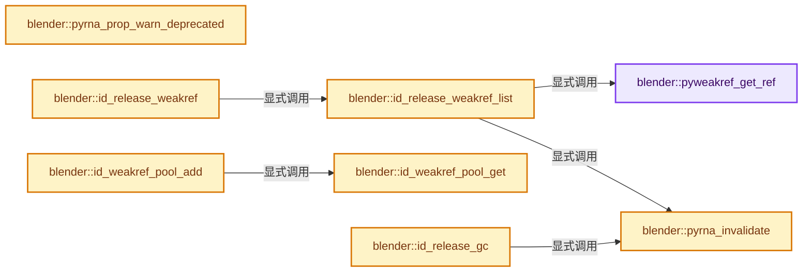
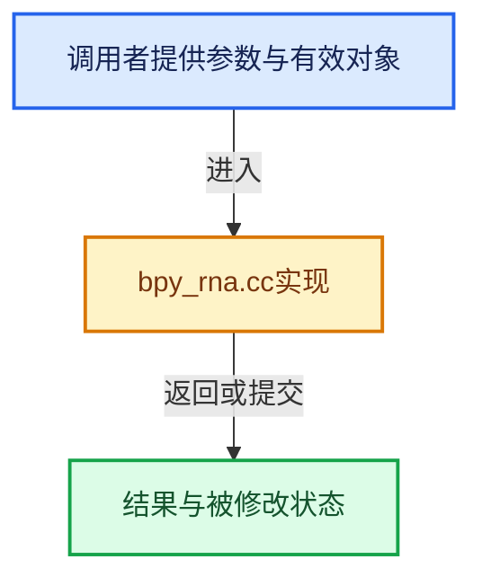

# 实现依赖专题：source/blender/python/intern/bpy_rna.cc

[实现依赖导航](../../../README.md) · [符号索引](../../../../00-课程指南/02-源码与提交索引/符号依赖与实现索引.md)

本专题从正文实际调用进入，集中保存共享实现。函数有稳定锚点，可从调用处直接跳到对应完整函数；递归与互相调用通过回链组织。

## 本文件的实现关系






<a id="m-358f0cfd0669"></a>

## 宏 `FROM_GC`

<!-- annotated:03eda733018268 -->

```cpp
#  define FROM_GC(g) ((PyObject *)(((PyGC_Head *)g) + 1))

```

<details>
<summary>核对原始源码：source/blender/python/intern/bpy_rna.cc · L255—L256</summary>

<!-- original:03eda733018268:source/blender/python/intern/bpy_rna.cc:255:256 -->

```cpp
#  define FROM_GC(g) ((PyObject *)(((PyGC_Head *)g) + 1))

```

</details>

宏在预处理阶段展开，参数替换、重复求值和条件编译应直接从该定义检查。与普通函数不同，宏不会自动提供参数类型检查；构建配置选择哪个定义需结合外围条件。

## 完整成员与函数实现

<a id="f-5e739217a418e5c9"></a>

### `blender::pyweakref_get_ref`

实现位置：[source/blender/python/intern/bpy_rna.cc](../../../../../../../../source/blender/python/intern/bpy_rna.cc) · L153—L163。

接口参数：

- `PyObject *ref`

**教学注释版**

<!-- annotated:275068ef39520e -->

```cpp
static PyObject *pyweakref_get_ref(PyObject *ref)
{
  PyObject *result = nullptr;
  if (PyWeakref_GetRef(ref, &result) == -1) [[unlikely]] {
    /* This hints at a bug, it's not expected so being noisy is OK. */
    CLOG_WARN(BPY_LOG_RNA, "unexpected error accessing weak-reference");
    /* Prints and clears the error. */
    PyErr_Print();
  }
  return result;
}
```

<details>
<summary>核对原始源码：source/blender/python/intern/bpy_rna.cc · L153—L163</summary>

<!-- original:275068ef39520e:source/blender/python/intern/bpy_rna.cc:153:163 -->

```cpp
static PyObject *pyweakref_get_ref(PyObject *ref)
{
  PyObject *result = nullptr;
  if (PyWeakref_GetRef(ref, &result) == -1) [[unlikely]] {
    /* This hints at a bug, it's not expected so being noisy is OK. */
    CLOG_WARN(BPY_LOG_RNA, "unexpected error accessing weak-reference");
    /* Prints and clears the error. */
    PyErr_Print();
  }
  return result;
}
```

</details>

**结果出口**

- `return result;`

**继续追踪实现**

- `PyWeakref_GetRef` → [调用协议](../../../../00-课程指南/01-路线与规范/模板宏与动态分派协议.md)：配置相关检测或外部运行时接口。调用位置L156。
- `CLOG_WARN` → [CLOG_WARN · L189](../../../07-Intern运行时与平台/clog/CLG_log.h.md#m-9da21a06cdbe)。宏定义由构建条件选择。
- `PyErr_Print` → [调用协议](../../../../00-课程指南/01-路线与规范/模板宏与动态分派协议.md)：配置相关检测或外部运行时接口。调用位置L160。

<a id="f-47bba28edd0a04f9"></a>

### `blender::pyrna_invalidate`

实现位置：[source/blender/python/intern/bpy_rna.cc](../../../../../../../../source/blender/python/intern/bpy_rna.cc) · L211—L214。

接口参数：

- `BPy_DummyPointerRNA *self`

**教学注释版**

<!-- annotated:e78f58f89b031a -->

```cpp
void pyrna_invalidate(BPy_DummyPointerRNA *self)
{
  self->ptr->invalidate();
}
```

<details>
<summary>核对原始源码：source/blender/python/intern/bpy_rna.cc · L211—L214</summary>

<!-- original:e78f58f89b031a:source/blender/python/intern/bpy_rna.cc:211:214 -->

```cpp
void pyrna_invalidate(BPy_DummyPointerRNA *self)
{
  self->ptr->invalidate();
}
```

</details>

**继续追踪实现**

- `self->ptr->invalidate` → [调用协议](../../../../00-课程指南/01-路线与规范/模板宏与动态分派协议.md)：接收对象类型依赖auto、返回值或模板实例；不按同名猜测目标。调用位置L213。

<a id="f-5d3bd1e61b3495fc"></a>

### `blender::pyrna_prop_warn_deprecated`

实现位置：[source/blender/python/intern/bpy_rna.cc](../../../../../../../../source/blender/python/intern/bpy_rna.cc) · L216—L228。

接口参数：

- `const PointerRNA *ptr`
- `const PropertyRNA *prop`
- `const DeprecatedRNA *deprecated`

**教学注释版**

<!-- annotated:cae5318cd6947f -->

```cpp
static void pyrna_prop_warn_deprecated(const PointerRNA *ptr,
                                       const PropertyRNA *prop,
                                       const DeprecatedRNA *deprecated)
{
  PyErr_WarnFormat(PyExc_DeprecationWarning,
                   1,
                   "'%s.%s' is expected to be removed in Blender %d.%d",
                   RNA_struct_identifier(ptr->type),
                   RNA_property_identifier(prop),
                   deprecated->removal_version / 100,
                   deprecated->removal_version % 100,
                   deprecated->note);
}
```

<details>
<summary>核对原始源码：source/blender/python/intern/bpy_rna.cc · L216—L228</summary>

<!-- original:cae5318cd6947f:source/blender/python/intern/bpy_rna.cc:216:228 -->

```cpp
static void pyrna_prop_warn_deprecated(const PointerRNA *ptr,
                                       const PropertyRNA *prop,
                                       const DeprecatedRNA *deprecated)
{
  PyErr_WarnFormat(PyExc_DeprecationWarning,
                   1,
                   "'%s.%s' is expected to be removed in Blender %d.%d",
                   RNA_struct_identifier(ptr->type),
                   RNA_property_identifier(prop),
                   deprecated->removal_version / 100,
                   deprecated->removal_version % 100,
                   deprecated->note);
}
```

</details>

**继续追踪实现**

- `PyErr_WarnFormat` → [调用协议](../../../../00-课程指南/01-路线与规范/模板宏与动态分派协议.md)：配置相关检测或外部运行时接口。调用位置L220。
- `RNA_struct_identifier` → [blender::RNA_struct_identifier · L711](../../makesrna/intern/rna_access.cc.md#f-754de32877e73311)。
- `RNA_property_identifier` → [blender::RNA_property_identifier · L1275](../../makesrna/intern/rna_access.cc.md#f-67de6dc6c76092df)。

<a id="f-3f3b1650fbab5f99"></a>

### `blender::id_release_gc`

实现位置：[source/blender/python/intern/bpy_rna.cc](../../../../../../../../source/blender/python/intern/bpy_rna.cc) · L264—L287。

接口参数：

- `struct ID *id`

**教学注释版**

<!-- annotated:4ce160b33b6d66 -->

```cpp
static void id_release_gc(struct ID *id)
{
  uint j;
  // uint i = 0;
  for (j = 0; j < 3; j++) {
    /* Hack below to get the 2 other lists from _PyGC_generation0 that are normally not exposed. */
    PyGC_Head *gen = (PyGC_Head *)(((char *)_PyGC_generation0) + (sizeof(gc_generation) * j));
    PyGC_Head *g = gen->gc.gc_next;
    while ((g = g->gc.gc_next) != gen) {
      PyObject *ob = FROM_GC(g);
      if (PyType_IsSubtype(Py_TYPE(ob), &pyrna_struct_Type) ||
          PyType_IsSubtype(Py_TYPE(ob), &pyrna_prop_Type))
      {
        BPy_DummyPointerRNA *ob_ptr = (BPy_DummyPointerRNA *)ob;
        if (ob_ptr->ptr->owner_id == id) {
          pyrna_invalidate(ob_ptr);
          // printf("freeing: %p %s, %.200s\n", (void *)ob, id->name, Py_TYPE(ob)->tp_name);
          // i++;
        }
      }
    }
  }
  // printf("id_release_gc freed '%s': %d\n", id->name, i);
}
```

<details>
<summary>核对原始源码：source/blender/python/intern/bpy_rna.cc · L264—L287</summary>

<!-- original:4ce160b33b6d66:source/blender/python/intern/bpy_rna.cc:264:287 -->

```cpp
static void id_release_gc(struct ID *id)
{
  uint j;
  // uint i = 0;
  for (j = 0; j < 3; j++) {
    /* Hack below to get the 2 other lists from _PyGC_generation0 that are normally not exposed. */
    PyGC_Head *gen = (PyGC_Head *)(((char *)_PyGC_generation0) + (sizeof(gc_generation) * j));
    PyGC_Head *g = gen->gc.gc_next;
    while ((g = g->gc.gc_next) != gen) {
      PyObject *ob = FROM_GC(g);
      if (PyType_IsSubtype(Py_TYPE(ob), &pyrna_struct_Type) ||
          PyType_IsSubtype(Py_TYPE(ob), &pyrna_prop_Type))
      {
        BPy_DummyPointerRNA *ob_ptr = (BPy_DummyPointerRNA *)ob;
        if (ob_ptr->ptr->owner_id == id) {
          pyrna_invalidate(ob_ptr);
          // printf("freeing: %p %s, %.200s\n", (void *)ob, id->name, Py_TYPE(ob)->tp_name);
          // i++;
        }
      }
    }
  }
  // printf("id_release_gc freed '%s': %d\n", id->name, i);
}
```

</details>

**继续追踪实现**

- `FROM_GC` → [FROM_GC · L255](bpy_rna.cc.md#m-358f0cfd0669)。宏定义由构建条件选择。
- `PyType_IsSubtype` → [调用协议](../../../../00-课程指南/01-路线与规范/模板宏与动态分派协议.md)：配置相关检测或外部运行时接口。调用位置L274。
- `Py_TYPE` → [调用协议](../../../../00-课程指南/01-路线与规范/模板宏与动态分派协议.md)：配置相关检测或外部运行时接口。调用位置L274。
- `pyrna_invalidate` → [blender::pyrna_invalidate · L211](bpy_rna.cc.md#f-47bba28edd0a04f9)。

<a id="f-43608b02643234c1"></a>

### `blender::id_weakref_pool_get`

实现位置：[source/blender/python/intern/bpy_rna.cc](../../../../../../../../source/blender/python/intern/bpy_rna.cc) · L308—L318。

接口参数：

- `ID *id`

**教学注释版**

<!-- annotated:b084b00799c09f -->

```cpp
static GHash *id_weakref_pool_get(ID *id)
{
  GHash *weakinfo_hash = static_cast<GHash *>(BLI_ghash_lookup(id_weakref_pool, (void *)id));
  if (weakinfo_hash == nullptr) {
    /* This could be a set, values are used to keep a reference back to the ID
     * (all of them are the same). */
    weakinfo_hash = BLI_ghash_ptr_new("rna_id");
    BLI_ghash_insert(id_weakref_pool, id, weakinfo_hash);
  }
  return weakinfo_hash;
}
```

<details>
<summary>核对原始源码：source/blender/python/intern/bpy_rna.cc · L308—L318</summary>

<!-- original:b084b00799c09f:source/blender/python/intern/bpy_rna.cc:308:318 -->

```cpp
static GHash *id_weakref_pool_get(ID *id)
{
  GHash *weakinfo_hash = static_cast<GHash *>(BLI_ghash_lookup(id_weakref_pool, (void *)id));
  if (weakinfo_hash == nullptr) {
    /* This could be a set, values are used to keep a reference back to the ID
     * (all of them are the same). */
    weakinfo_hash = BLI_ghash_ptr_new("rna_id");
    BLI_ghash_insert(id_weakref_pool, id, weakinfo_hash);
  }
  return weakinfo_hash;
}
```

</details>

**沿实际写入检查状态**

- `weakinfo_hash = BLI_ghash_ptr_new("rna_id");`

**结果出口**

- `return weakinfo_hash;`

**继续追踪实现**

- `BLI_ghash_lookup` → [blender::BLI_ghash_lookup · L735](../../../01-BLI基础库/intern/BLI_ghash.cc.md#f-8937b91445541501)。
- `BLI_ghash_ptr_new` → [blender::BLI_ghash_ptr_new · L195](../../../01-BLI基础库/intern/BLI_ghash_utils.cc.md#f-3f62c3ad44129174)。
- `BLI_ghash_insert` → [blender::BLI_ghash_insert · L711](../../../01-BLI基础库/intern/BLI_ghash.cc.md#f-b42d4e109f8d76f5)。

<a id="f-bb1a14ee86b9b786"></a>

### `blender::id_weakref_pool_add`

实现位置：[source/blender/python/intern/bpy_rna.cc](../../../../../../../../source/blender/python/intern/bpy_rna.cc) · L321—L345。

接口参数：

- `ID *id`
- `BPy_DummyPointerRNA *pyrna`

**教学注释版**

<!-- annotated:7755c7f4a39566 -->

```cpp
static void id_weakref_pool_add(ID *id, BPy_DummyPointerRNA *pyrna)
{
  PyObject *weakref;
  PyObject *weakref_capsule;
  PyObject *weakref_cb_py;

  /* Create a new function instance and insert the list as 'self'
   * so we can remove ourself from it. */
  GHash *weakinfo_hash = id_weakref_pool_get(id); /* New or existing. */

  weakref_capsule = PyCapsule_New(weakinfo_hash, nullptr, nullptr);
  weakref_cb_py = PyCFunction_New(&id_free_weakref_cb_def, weakref_capsule);
  Py_DECREF(weakref_capsule);

  /* Add weakref to weakinfo_hash list. */
  weakref = PyWeakref_NewRef((PyObject *)pyrna, weakref_cb_py);

  Py_DECREF(weakref_cb_py); /* Function owned by the weakref now. */

  /* Important to add at the end of the hash, since first removal looks at the end. */

  /* Using a hash table as a set, all 'id's are the same. */
  BLI_ghash_insert(weakinfo_hash, weakref, id);
  /* weakinfo_hash owns the weakref */
}
```

<details>
<summary>核对原始源码：source/blender/python/intern/bpy_rna.cc · L321—L345</summary>

<!-- original:7755c7f4a39566:source/blender/python/intern/bpy_rna.cc:321:345 -->

```cpp
static void id_weakref_pool_add(ID *id, BPy_DummyPointerRNA *pyrna)
{
  PyObject *weakref;
  PyObject *weakref_capsule;
  PyObject *weakref_cb_py;

  /* Create a new function instance and insert the list as 'self'
   * so we can remove ourself from it. */
  GHash *weakinfo_hash = id_weakref_pool_get(id); /* New or existing. */

  weakref_capsule = PyCapsule_New(weakinfo_hash, nullptr, nullptr);
  weakref_cb_py = PyCFunction_New(&id_free_weakref_cb_def, weakref_capsule);
  Py_DECREF(weakref_capsule);

  /* Add weakref to weakinfo_hash list. */
  weakref = PyWeakref_NewRef((PyObject *)pyrna, weakref_cb_py);

  Py_DECREF(weakref_cb_py); /* Function owned by the weakref now. */

  /* Important to add at the end of the hash, since first removal looks at the end. */

  /* Using a hash table as a set, all 'id's are the same. */
  BLI_ghash_insert(weakinfo_hash, weakref, id);
  /* weakinfo_hash owns the weakref */
}
```

</details>

**沿实际写入检查状态**

- `weakref_capsule = PyCapsule_New(weakinfo_hash, nullptr, nullptr);`
- `weakref_cb_py = PyCFunction_New(&id_free_weakref_cb_def, weakref_capsule);`
- `weakref = PyWeakref_NewRef((PyObject *)pyrna, weakref_cb_py);`

**继续追踪实现**

- `id_weakref_pool_get` → [blender::id_weakref_pool_get · L308](bpy_rna.cc.md#f-43608b02643234c1)。
- `PyCapsule_New` → [调用协议](../../../../00-课程指南/01-路线与规范/模板宏与动态分派协议.md)：配置相关检测或外部运行时接口。调用位置L331。
- `PyCFunction_New` → [调用协议](../../../../00-课程指南/01-路线与规范/模板宏与动态分派协议.md)：配置相关检测或外部运行时接口。调用位置L332。
- `Py_DECREF` → [调用协议](../../../../00-课程指南/01-路线与规范/模板宏与动态分派协议.md)：配置相关检测或外部运行时接口。调用位置L333。
- `PyWeakref_NewRef` → [调用协议](../../../../00-课程指南/01-路线与规范/模板宏与动态分派协议.md)：配置相关检测或外部运行时接口。调用位置L336。
- `BLI_ghash_insert` → [blender::BLI_ghash_insert · L711](../../../01-BLI基础库/intern/BLI_ghash.cc.md#f-b42d4e109f8d76f5)。

<a id="f-fffa04e4e7d4b576"></a>

### `blender::id_release_weakref_list`

实现位置：[source/blender/python/intern/bpy_rna.cc](../../../../../../../../source/blender/python/intern/bpy_rna.cc) · L373—L401。

接口参数：

- `struct ID *id`
- `GHash *weakinfo_hash`

**教学注释版**

<!-- annotated:f3562f210351a0 -->

```cpp
static void id_release_weakref_list(struct ID *id, GHash *weakinfo_hash)
{
  GHashIterator weakinfo_hash_iter;

  BLI_ghashIterator_init(&weakinfo_hash_iter, weakinfo_hash);

#  ifdef DEBUG_RNA_WEAKREF
  fprintf(stdout, "id_release_weakref: '%s', %d items\n", id->name, BLI_ghash_len(weakinfo_hash));
#  endif

  while (!BLI_ghashIterator_done(&weakinfo_hash_iter)) {
    PyObject *weakref = (PyObject *)BLI_ghashIterator_getKey(&weakinfo_hash_iter);
    PyObject *item = pyweakref_get_ref(weakref);
    if (item) {
#  ifdef DEBUG_RNA_WEAKREF
      PyC_ObSpit("id_release_weakref item ", item);
#  endif
      pyrna_invalidate((BPy_DummyPointerRNA *)item);
      Py_DECREF(item);
    }

    Py_DECREF(weakref);

    BLI_ghashIterator_step(&weakinfo_hash_iter);
  }

  BLI_ghash_remove(id_weakref_pool, (void *)id, nullptr, nullptr);
  BLI_ghash_free(weakinfo_hash, nullptr, nullptr);
}
```

<details>
<summary>核对原始源码：source/blender/python/intern/bpy_rna.cc · L373—L401</summary>

<!-- original:f3562f210351a0:source/blender/python/intern/bpy_rna.cc:373:401 -->

```cpp
static void id_release_weakref_list(struct ID *id, GHash *weakinfo_hash)
{
  GHashIterator weakinfo_hash_iter;

  BLI_ghashIterator_init(&weakinfo_hash_iter, weakinfo_hash);

#  ifdef DEBUG_RNA_WEAKREF
  fprintf(stdout, "id_release_weakref: '%s', %d items\n", id->name, BLI_ghash_len(weakinfo_hash));
#  endif

  while (!BLI_ghashIterator_done(&weakinfo_hash_iter)) {
    PyObject *weakref = (PyObject *)BLI_ghashIterator_getKey(&weakinfo_hash_iter);
    PyObject *item = pyweakref_get_ref(weakref);
    if (item) {
#  ifdef DEBUG_RNA_WEAKREF
      PyC_ObSpit("id_release_weakref item ", item);
#  endif
      pyrna_invalidate((BPy_DummyPointerRNA *)item);
      Py_DECREF(item);
    }

    Py_DECREF(weakref);

    BLI_ghashIterator_step(&weakinfo_hash_iter);
  }

  BLI_ghash_remove(id_weakref_pool, (void *)id, nullptr, nullptr);
  BLI_ghash_free(weakinfo_hash, nullptr, nullptr);
}
```

</details>

**继续追踪实现**

- `BLI_ghashIterator_init` → [blender::BLI_ghashIterator_init · L901](../../../01-BLI基础库/intern/BLI_ghash.cc.md#f-3b5ee4c6e4b99a5b)。
- `fprintf` → [外部契约](https://eel.is/c++draft/)：这个边界按实际表达式及所属类型核对参数、返回值、寿命与失败行为。这里提供接口入口，不声称已解释该第三方版本的内部实现。
- `BLI_ghash_len` → [blender::BLI_ghash_len · L706](../../../01-BLI基础库/intern/BLI_ghash.cc.md#f-39953bb4c11ba1a1)。
- `BLI_ghashIterator_done` → [blender::BLI_ghashIterator_done · L309](../../../01-BLI基础库/BLI_ghash.hh.md#f-5b202d49c701166b)。
- `BLI_ghashIterator_getKey` → [blender::BLI_ghashIterator_getKey · L297](../../../01-BLI基础库/BLI_ghash.hh.md#f-83e8a92cfae5b1bd)。
- `pyweakref_get_ref` → [blender::pyweakref_get_ref · L153](bpy_rna.cc.md#f-5e739217a418e5c9)。
- `PyC_ObSpit` → [blender::PyC_ObSpit · L700](../generic/py_capi_utils.cc.md#f-6a567835f288f974)。
- `pyrna_invalidate` → [blender::pyrna_invalidate · L211](bpy_rna.cc.md#f-47bba28edd0a04f9)。
- `Py_DECREF` → [调用协议](../../../../00-课程指南/01-路线与规范/模板宏与动态分派协议.md)：配置相关检测或外部运行时接口。调用位置L391。
- `BLI_ghashIterator_step` → [blender::BLI_ghashIterator_step · L917](../../../01-BLI基础库/intern/BLI_ghash.cc.md#f-aabffa4cfcbcb140)。
- `BLI_ghash_remove` → [blender::BLI_ghash_remove · L792](../../../01-BLI基础库/intern/BLI_ghash.cc.md#f-055d583b61662552)。
- `BLI_ghash_free` → [blender::BLI_ghash_free · L866](../../../01-BLI基础库/intern/BLI_ghash.cc.md#f-ab6fda2cc049587d)。

<a id="f-94ee6291b0e4421a"></a>

### `blender::id_release_weakref`

实现位置：[source/blender/python/intern/bpy_rna.cc](../../../../../../../../source/blender/python/intern/bpy_rna.cc) · L403—L409。

接口参数：

- `struct ID *id`

**教学注释版**

<!-- annotated:6c7fcd9af0fa4f -->

```cpp
static void id_release_weakref(struct ID *id)
{
  GHash *weakinfo_hash = static_cast<GHash *>(BLI_ghash_lookup(id_weakref_pool, (void *)id));
  if (weakinfo_hash) {
    id_release_weakref_list(id, weakinfo_hash);
  }
}
```

<details>
<summary>核对原始源码：source/blender/python/intern/bpy_rna.cc · L403—L409</summary>

<!-- original:6c7fcd9af0fa4f:source/blender/python/intern/bpy_rna.cc:403:409 -->

```cpp
static void id_release_weakref(struct ID *id)
{
  GHash *weakinfo_hash = static_cast<GHash *>(BLI_ghash_lookup(id_weakref_pool, (void *)id));
  if (weakinfo_hash) {
    id_release_weakref_list(id, weakinfo_hash);
  }
}
```

</details>

**继续追踪实现**

- `BLI_ghash_lookup` → [blender::BLI_ghash_lookup · L735](../../../01-BLI基础库/intern/BLI_ghash.cc.md#f-8937b91445541501)。
- `id_release_weakref_list` → [blender::id_release_weakref_list · L373](bpy_rna.cc.md#f-fffa04e4e7d4b576)。

<a id="f-9ca5600a81f2d897"></a>

### `blender::BPY_id_release`

实现位置：[source/blender/python/intern/bpy_rna.cc](../../../../../../../../source/blender/python/intern/bpy_rna.cc) · L453—L471。

接口参数：

- `ID *id`

**教学注释版**

<!-- annotated:cbcd963f731335 -->

```cpp
void BPY_id_release(ID *id)
{
#ifdef USE_PYRNA_INVALIDATE_GC
  id_release_gc(id);
#endif

#ifdef USE_PYRNA_INVALIDATE_WEAKREF
  /* Check for nullptr since this may run before Python has been started. */
  if (id_weakref_pool != nullptr) {
    PyGILState_STATE gilstate = PyGILState_Ensure();

    id_release_weakref(id);

    PyGILState_Release(gilstate);
  }
#endif /* USE_PYRNA_INVALIDATE_WEAKREF */

  (void)id;
}
```

<details>
<summary>核对原始源码：source/blender/python/intern/bpy_rna.cc · L453—L471</summary>

<!-- original:cbcd963f731335:source/blender/python/intern/bpy_rna.cc:453:471 -->

```cpp
void BPY_id_release(ID *id)
{
#ifdef USE_PYRNA_INVALIDATE_GC
  id_release_gc(id);
#endif

#ifdef USE_PYRNA_INVALIDATE_WEAKREF
  /* Check for nullptr since this may run before Python has been started. */
  if (id_weakref_pool != nullptr) {
    PyGILState_STATE gilstate = PyGILState_Ensure();

    id_release_weakref(id);

    PyGILState_Release(gilstate);
  }
#endif /* USE_PYRNA_INVALIDATE_WEAKREF */

  (void)id;
}
```

</details>

**继续追踪实现**

- `id_release_gc` → [blender::id_release_gc · L264](bpy_rna.cc.md#f-3f3b1650fbab5f99)。
- `PyGILState_Ensure` → [调用协议](../../../../00-课程指南/01-路线与规范/模板宏与动态分派协议.md)：配置相关检测或外部运行时接口。调用位置L462。
- `id_release_weakref` → [blender::id_release_weakref · L403](bpy_rna.cc.md#f-94ee6291b0e4421a)。
- `PyGILState_Release` → [调用协议](../../../../00-课程指南/01-路线与规范/模板宏与动态分派协议.md)：配置相关检测或外部运行时接口。调用位置L466。

<a id="f-063fa42a075a0255"></a>

### `blender::pyrna_context_init`

实现位置：[source/blender/python/intern/bpy_rna.cc](../../../../../../../../source/blender/python/intern/bpy_rna.cc) · L529—L532。

接口参数：

- `bContext *C`

**教学注释版**

<!-- annotated:464953ccb8849a -->

```cpp
void pyrna_context_init(bContext *C)
{
  CTX_rna_disallow_write_set_p(C, &rna_disallow_writes);
}
```

<details>
<summary>核对原始源码：source/blender/python/intern/bpy_rna.cc · L529—L532</summary>

<!-- original:464953ccb8849a:source/blender/python/intern/bpy_rna.cc:529:532 -->

```cpp
void pyrna_context_init(bContext *C)
{
  CTX_rna_disallow_write_set_p(C, &rna_disallow_writes);
}
```

</details>

**继续追踪实现**

- `CTX_rna_disallow_write_set_p` → [blender::CTX_rna_disallow_write_set_p · L285](../../../02-BKE几何与数据/intern/context.cc.md#f-b935ab49825222e7)。

<a id="f-97f414aa60d1cd91"></a>

### `blender::pyrna_context_clear`

实现位置：[source/blender/python/intern/bpy_rna.cc](../../../../../../../../source/blender/python/intern/bpy_rna.cc) · L534—L537。

接口参数：

- `bContext *C`

**教学注释版**

<!-- annotated:4dd5b89bf4fd07 -->

```cpp
void pyrna_context_clear(bContext *C)
{
  CTX_rna_disallow_write_set_p(C, nullptr);
}
```

<details>
<summary>核对原始源码：source/blender/python/intern/bpy_rna.cc · L534—L537</summary>

<!-- original:4dd5b89bf4fd07:source/blender/python/intern/bpy_rna.cc:534:537 -->

```cpp
void pyrna_context_clear(bContext *C)
{
  CTX_rna_disallow_write_set_p(C, nullptr);
}
```

</details>

**继续追踪实现**

- `CTX_rna_disallow_write_set_p` → [blender::CTX_rna_disallow_write_set_p · L285](../../../02-BKE几何与数据/intern/context.cc.md#f-b935ab49825222e7)。

<a id="f-9d90d4a52d581778"></a>

### `blender::pyrna_context_init`

实现位置：[source/blender/python/intern/bpy_rna.cc](../../../../../../../../source/blender/python/intern/bpy_rna.cc) · L551—L551。

接口参数：

- `bContext *`

**教学注释版**

<!-- annotated:b6525bb3cd567e -->

```cpp
void pyrna_context_init(bContext * /*C*/) {}
```

<details>
<summary>核对原始源码：source/blender/python/intern/bpy_rna.cc · L551—L551</summary>

<!-- original:b6525bb3cd567e:source/blender/python/intern/bpy_rna.cc:551:551 -->

```cpp
void pyrna_context_init(bContext * /*C*/) {}
```

</details>

**继续追踪实现**

本实现没有需要继续展开的显式调用；检查返回表达式、对象转换和调用者前置条件。

<a id="f-41871c1015571463"></a>

### `blender::pyrna_context_clear`

实现位置：[source/blender/python/intern/bpy_rna.cc](../../../../../../../../source/blender/python/intern/bpy_rna.cc) · L552—L552。

接口参数：

- `bContext *`

**教学注释版**

<!-- annotated:4ac295929e47f8 -->

```cpp
void pyrna_context_clear(bContext * /*C*/) {}
```

<details>
<summary>核对原始源码：source/blender/python/intern/bpy_rna.cc · L552—L552</summary>

<!-- original:4ac295929e47f8:source/blender/python/intern/bpy_rna.cc:552:552 -->

```cpp
void pyrna_context_clear(bContext * /*C*/) {}
```

</details>

**继续追踪实现**

本实现没有需要继续展开的显式调用；检查返回表达式、对象转换和调用者前置条件。

<a id="f-0f6f686a92e112ae"></a>

### `blender::pyrna_rotation_euler_order_get`

实现位置：[source/blender/python/intern/bpy_rna.cc](../../../../../../../../source/blender/python/intern/bpy_rna.cc) · L792—L810。

接口参数：

- `PointerRNA *ptr`
- `const short order_fallback`
- `PropertyRNA **r_prop_eul_order`

**教学注释版**

<!-- annotated:fce57c3147367d -->

```cpp
static short pyrna_rotation_euler_order_get(PointerRNA *ptr,
                                            const short order_fallback,
                                            PropertyRNA **r_prop_eul_order)
{
  /* Attempt to get order. */
  if (*r_prop_eul_order == nullptr) {
    *r_prop_eul_order = RNA_struct_find_property(ptr, "rotation_mode");
  }

  if (*r_prop_eul_order) {
    const short order = RNA_property_enum_get(ptr, *r_prop_eul_order);
    /* Could be quaternion or axis-angle. */
    if (order >= EULER_ORDER_XYZ && order <= EULER_ORDER_ZYX) {
      return order;
    }
  }

  return order_fallback;
}
```

<details>
<summary>核对原始源码：source/blender/python/intern/bpy_rna.cc · L792—L810</summary>

<!-- original:fce57c3147367d:source/blender/python/intern/bpy_rna.cc:792:810 -->

```cpp
static short pyrna_rotation_euler_order_get(PointerRNA *ptr,
                                            const short order_fallback,
                                            PropertyRNA **r_prop_eul_order)
{
  /* Attempt to get order. */
  if (*r_prop_eul_order == nullptr) {
    *r_prop_eul_order = RNA_struct_find_property(ptr, "rotation_mode");
  }

  if (*r_prop_eul_order) {
    const short order = RNA_property_enum_get(ptr, *r_prop_eul_order);
    /* Could be quaternion or axis-angle. */
    if (order >= EULER_ORDER_XYZ && order <= EULER_ORDER_ZYX) {
      return order;
    }
  }

  return order_fallback;
}
```

</details>

**结果出口**

- `return order;`
- `return order_fallback;`

**继续追踪实现**

- `RNA_struct_find_property` → [blender::RNA_struct_find_property · L855](../../makesrna/intern/rna_access.cc.md#f-75b0f3b3cc89dd4c)；[blender::RNA_struct_find_property · L874](../../makesrna/intern/rna_access.cc.md#f-7fb7ab238d64680f)。同名重载需按实参类型选择。
- `RNA_property_enum_get` → [blender::RNA_property_enum_get · L4499](../../makesrna/intern/rna_access.cc.md#f-7921c83822683274)。

<a id="f-8c022cc240228d17"></a>

### `blender::pyrna_math_object_from_array`

实现位置：[source/blender/python/intern/bpy_rna.cc](../../../../../../../../source/blender/python/intern/bpy_rna.cc) · L827—L985。

接口参数：

- `PointerRNA *ptr`
- `PropertyRNA *prop`

**教学注释版**

<!-- annotated:aad5f94578dca9 -->

```cpp
PyObject *pyrna_math_object_from_array(PointerRNA *ptr, PropertyRNA *prop)
{
  PyObject *ret = nullptr;

#ifdef USE_MATHUTILS
  int subtype, totdim;
  int len;
  const int flag = RNA_property_flag(prop);
  const int type = RNA_property_type(prop);
  const bool is_thick = (flag & PROP_THICK_WRAP) != 0;

  /* disallow dynamic sized arrays to be wrapped since the size could change
   * to a size mathutils does not support */
  if (flag & PROP_DYNAMIC) {
    return nullptr;
  }

  len = RNA_property_array_length(ptr, prop);
  if (type == PROP_FLOAT) {
    /* pass */
  }
  else if (type == PROP_INT) {
    if (is_thick) {
      goto thick_wrap_slice;
    }
    else {
      return nullptr;
    }
  }
  else {
    return nullptr;
  }

  subtype = RNA_property_subtype(prop);
  totdim = RNA_property_array_dimension(ptr, prop, nullptr);

  if (totdim == 1 || (totdim == 2 && subtype == PROP_MATRIX)) {
    if (!is_thick) {
      /* Owned by the mathutils PyObject. */
      ret = pyrna_prop_CreatePyObject(ptr, prop);
    }

    switch (subtype) {
      case PROP_ALL_VECTOR_SUBTYPES:
        if (len >= 2 && len <= 4) {
          if (is_thick) {
            ret = Vector_CreatePyObject(nullptr, len, nullptr);
            RNA_property_float_get_array(ptr, prop, (reinterpret_cast<VectorObject *>(ret))->vec);
          }
          else {
            PyObject *vec_cb = Vector_CreatePyObject_cb(
                ret, len, mathutils_rna_array_cb_index, MATHUTILS_CB_SUBTYPE_VEC);
            Py_DECREF(ret); /* The vector owns 'ret' now. */
            ret = vec_cb;   /* Return the vector instead. */
          }
        }
        break;
      case PROP_MATRIX:
        if (len == 16) {
          if (is_thick) {
            ret = Matrix_CreatePyObject(nullptr, 4, 4, nullptr);
            RNA_property_float_get_array(
                ptr, prop, (reinterpret_cast<MatrixObject *>(ret))->matrix);
          }
          else {
            PyObject *mat_cb = Matrix_CreatePyObject_cb(
                ret, 4, 4, mathutils_rna_matrix_cb_index, 0);
            Py_DECREF(ret); /* The matrix owns 'ret' now. */
            ret = mat_cb;   /* Return the matrix instead. */
          }
        }
        else if (len == 9) {
          if (is_thick) {
            ret = Matrix_CreatePyObject(nullptr, 3, 3, nullptr);
            RNA_property_float_get_array(
                ptr, prop, (reinterpret_cast<MatrixObject *>(ret))->matrix);
          }
          else {
            PyObject *mat_cb = Matrix_CreatePyObject_cb(
                ret, 3, 3, mathutils_rna_matrix_cb_index, 0);
            Py_DECREF(ret); /* The matrix owns 'ret' now. */
            ret = mat_cb;   /* Return the matrix instead. */
          }
        }
        break;
      case PROP_EULER:
      case PROP_QUATERNION:
        if (len == 3) { /* Euler. */
          if (is_thick) {
            /* Attempt to get order,
             * only needed for thick types since wrapped with update via callbacks. */
            PropertyRNA *prop_eul_order = nullptr;
            const short order = pyrna_rotation_euler_order_get(
                ptr, EULER_ORDER_XYZ, &prop_eul_order);

            ret = Euler_CreatePyObject(nullptr, order, nullptr); /* TODO: get order from RNA. */
            RNA_property_float_get_array(ptr, prop, (reinterpret_cast<EulerObject *>(ret))->eul);
          }
          else {
            /* Order will be updated from callback on use. */
            /* TODO: get order from RNA. */
            PyObject *eul_cb = Euler_CreatePyObject_cb(
                ret, EULER_ORDER_XYZ, mathutils_rna_array_cb_index, MATHUTILS_CB_SUBTYPE_EUL);
            Py_DECREF(ret); /* The euler owns 'ret' now. */
            ret = eul_cb;   /* Return the euler instead. */
          }
        }
        else if (len == 4) {
          if (is_thick) {
            ret = Quaternion_CreatePyObject(nullptr, nullptr);
            RNA_property_float_get_array(
                ptr, prop, (reinterpret_cast<QuaternionObject *>(ret))->quat);
          }
          else {
            PyObject *quat_cb = Quaternion_CreatePyObject_cb(
                ret, mathutils_rna_array_cb_index, MATHUTILS_CB_SUBTYPE_QUAT);
            Py_DECREF(ret); /* The quat owns 'ret' now. */
            ret = quat_cb;  /* Return the quat instead. */
          }
        }
        break;
      case PROP_COLOR:
      case PROP_COLOR_GAMMA:
        if (len == 3) { /* Color. */
          if (is_thick) {
            ret = Color_CreatePyObject(nullptr, nullptr);
            RNA_property_float_get_array(ptr, prop, (reinterpret_cast<ColorObject *>(ret))->col);
          }
          else {
            PyObject *col_cb = Color_CreatePyObject_cb(
                ret, mathutils_rna_array_cb_index, MATHUTILS_CB_SUBTYPE_COLOR);
            Py_DECREF(ret); /* The color owns 'ret' now. */
            ret = col_cb;   /* Return the color instead. */
          }
        }
        break;
      default:
        break;
    }
  }

  if (ret == nullptr) {
    if (is_thick) {
    /* This is an array we can't reference (since it is not thin wrappable)
     * and cannot be coerced into a mathutils type, so return as a list. */
    thick_wrap_slice:
      ret = pyrna_prop_array_subscript_slice(nullptr, ptr, prop, 0, 1, len, len);
    }
    else {
      ret = pyrna_prop_CreatePyObject(ptr, prop); /* Owned by the mathutils PyObject. */
    }
  }
#else  /* USE_MATHUTILS */
  (void)ptr;
  (void)prop;
#endif /* USE_MATHUTILS */

  return ret;
}
```

<details>
<summary>核对原始源码：source/blender/python/intern/bpy_rna.cc · L827—L985</summary>

<!-- original:aad5f94578dca9:source/blender/python/intern/bpy_rna.cc:827:985 -->

```cpp
PyObject *pyrna_math_object_from_array(PointerRNA *ptr, PropertyRNA *prop)
{
  PyObject *ret = nullptr;

#ifdef USE_MATHUTILS
  int subtype, totdim;
  int len;
  const int flag = RNA_property_flag(prop);
  const int type = RNA_property_type(prop);
  const bool is_thick = (flag & PROP_THICK_WRAP) != 0;

  /* disallow dynamic sized arrays to be wrapped since the size could change
   * to a size mathutils does not support */
  if (flag & PROP_DYNAMIC) {
    return nullptr;
  }

  len = RNA_property_array_length(ptr, prop);
  if (type == PROP_FLOAT) {
    /* pass */
  }
  else if (type == PROP_INT) {
    if (is_thick) {
      goto thick_wrap_slice;
    }
    else {
      return nullptr;
    }
  }
  else {
    return nullptr;
  }

  subtype = RNA_property_subtype(prop);
  totdim = RNA_property_array_dimension(ptr, prop, nullptr);

  if (totdim == 1 || (totdim == 2 && subtype == PROP_MATRIX)) {
    if (!is_thick) {
      /* Owned by the mathutils PyObject. */
      ret = pyrna_prop_CreatePyObject(ptr, prop);
    }

    switch (subtype) {
      case PROP_ALL_VECTOR_SUBTYPES:
        if (len >= 2 && len <= 4) {
          if (is_thick) {
            ret = Vector_CreatePyObject(nullptr, len, nullptr);
            RNA_property_float_get_array(ptr, prop, (reinterpret_cast<VectorObject *>(ret))->vec);
          }
          else {
            PyObject *vec_cb = Vector_CreatePyObject_cb(
                ret, len, mathutils_rna_array_cb_index, MATHUTILS_CB_SUBTYPE_VEC);
            Py_DECREF(ret); /* The vector owns 'ret' now. */
            ret = vec_cb;   /* Return the vector instead. */
          }
        }
        break;
      case PROP_MATRIX:
        if (len == 16) {
          if (is_thick) {
            ret = Matrix_CreatePyObject(nullptr, 4, 4, nullptr);
            RNA_property_float_get_array(
                ptr, prop, (reinterpret_cast<MatrixObject *>(ret))->matrix);
          }
          else {
            PyObject *mat_cb = Matrix_CreatePyObject_cb(
                ret, 4, 4, mathutils_rna_matrix_cb_index, 0);
            Py_DECREF(ret); /* The matrix owns 'ret' now. */
            ret = mat_cb;   /* Return the matrix instead. */
          }
        }
        else if (len == 9) {
          if (is_thick) {
            ret = Matrix_CreatePyObject(nullptr, 3, 3, nullptr);
            RNA_property_float_get_array(
                ptr, prop, (reinterpret_cast<MatrixObject *>(ret))->matrix);
          }
          else {
            PyObject *mat_cb = Matrix_CreatePyObject_cb(
                ret, 3, 3, mathutils_rna_matrix_cb_index, 0);
            Py_DECREF(ret); /* The matrix owns 'ret' now. */
            ret = mat_cb;   /* Return the matrix instead. */
          }
        }
        break;
      case PROP_EULER:
      case PROP_QUATERNION:
        if (len == 3) { /* Euler. */
          if (is_thick) {
            /* Attempt to get order,
             * only needed for thick types since wrapped with update via callbacks. */
            PropertyRNA *prop_eul_order = nullptr;
            const short order = pyrna_rotation_euler_order_get(
                ptr, EULER_ORDER_XYZ, &prop_eul_order);

            ret = Euler_CreatePyObject(nullptr, order, nullptr); /* TODO: get order from RNA. */
            RNA_property_float_get_array(ptr, prop, (reinterpret_cast<EulerObject *>(ret))->eul);
          }
          else {
            /* Order will be updated from callback on use. */
            /* TODO: get order from RNA. */
            PyObject *eul_cb = Euler_CreatePyObject_cb(
                ret, EULER_ORDER_XYZ, mathutils_rna_array_cb_index, MATHUTILS_CB_SUBTYPE_EUL);
            Py_DECREF(ret); /* The euler owns 'ret' now. */
            ret = eul_cb;   /* Return the euler instead. */
          }
        }
        else if (len == 4) {
          if (is_thick) {
            ret = Quaternion_CreatePyObject(nullptr, nullptr);
            RNA_property_float_get_array(
                ptr, prop, (reinterpret_cast<QuaternionObject *>(ret))->quat);
          }
          else {
            PyObject *quat_cb = Quaternion_CreatePyObject_cb(
                ret, mathutils_rna_array_cb_index, MATHUTILS_CB_SUBTYPE_QUAT);
            Py_DECREF(ret); /* The quat owns 'ret' now. */
            ret = quat_cb;  /* Return the quat instead. */
          }
        }
        break;
      case PROP_COLOR:
      case PROP_COLOR_GAMMA:
        if (len == 3) { /* Color. */
          if (is_thick) {
            ret = Color_CreatePyObject(nullptr, nullptr);
            RNA_property_float_get_array(ptr, prop, (reinterpret_cast<ColorObject *>(ret))->col);
          }
          else {
            PyObject *col_cb = Color_CreatePyObject_cb(
                ret, mathutils_rna_array_cb_index, MATHUTILS_CB_SUBTYPE_COLOR);
            Py_DECREF(ret); /* The color owns 'ret' now. */
            ret = col_cb;   /* Return the color instead. */
          }
        }
        break;
      default:
        break;
    }
  }

  if (ret == nullptr) {
    if (is_thick) {
    /* This is an array we can't reference (since it is not thin wrappable)
     * and cannot be coerced into a mathutils type, so return as a list. */
    thick_wrap_slice:
      ret = pyrna_prop_array_subscript_slice(nullptr, ptr, prop, 0, 1, len, len);
    }
    else {
      ret = pyrna_prop_CreatePyObject(ptr, prop); /* Owned by the mathutils PyObject. */
    }
  }
#else  /* USE_MATHUTILS */
  (void)ptr;
  (void)prop;
#endif /* USE_MATHUTILS */

  return ret;
}
```

</details>

**沿实际写入检查状态**

- `len = RNA_property_array_length(ptr, prop);`
- `subtype = RNA_property_subtype(prop);`
- `totdim = RNA_property_array_dimension(ptr, prop, nullptr);`
- `ret = pyrna_prop_CreatePyObject(ptr, prop);`
- `ret = Vector_CreatePyObject(nullptr, len, nullptr);`
- `ret = vec_cb;   /* Return the vector instead. */`
- `ret = Matrix_CreatePyObject(nullptr, 4, 4, nullptr);`
- `ret = mat_cb;   /* Return the matrix instead. */`
- `ret = Matrix_CreatePyObject(nullptr, 3, 3, nullptr);`
- `ret = Euler_CreatePyObject(nullptr, order, nullptr); /* TODO: get order from RNA. */`
- `ret = eul_cb;   /* Return the euler instead. */`
- `ret = Quaternion_CreatePyObject(nullptr, nullptr);`
- `ret = quat_cb;  /* Return the quat instead. */`
- `ret = Color_CreatePyObject(nullptr, nullptr);`
- `ret = col_cb;   /* Return the color instead. */`
- `ret = pyrna_prop_array_subscript_slice(nullptr, ptr, prop, 0, 1, len, len);`
- `ret = pyrna_prop_CreatePyObject(ptr, prop); /* Owned by the mathutils PyObject. */`

**结果出口**

- `return nullptr;`
- `return ret;`

**继续追踪实现**

- `RNA_property_flag` → [blender::RNA_property_flag · L1342](../../makesrna/intern/rna_access.cc.md#f-c36ad8058f3a533e)。
- `RNA_property_type` → [blender::RNA_property_type · L1293](../../makesrna/intern/rna_access.cc.md#f-4465a90d55f022df)。
- `RNA_property_array_length` → [blender::RNA_property_array_length · L1371](../../makesrna/intern/rna_access.cc.md#f-2258ce063a075147)。
- `RNA_property_subtype` → [blender::RNA_property_subtype · L1298](../../makesrna/intern/rna_access.cc.md#f-993b1583bfe2d18a)。
- `RNA_property_array_dimension` → [blender::RNA_property_array_dimension · L1381](../../makesrna/intern/rna_access.cc.md#f-6ea6bed1f6abd9fe)。
- `pyrna_prop_CreatePyObject` → [blender::pyrna_prop_CreatePyObject · L8928](bpy_rna.cc.md#f-4ac359d342a3e565)。
- `Vector_CreatePyObject` → [Vector_CreatePyObject · L3697](../mathutils/mathutils_Vector.cc.md#f-0f21e86f7cf656e7)。
- `RNA_property_float_get_array` → [blender::RNA_property_float_get_array · L3813](../../makesrna/intern/rna_access.cc.md#f-c757b16ab20791de)。
- `Vector_CreatePyObject_cb` → [Vector_CreatePyObject_cb · L3765](../mathutils/mathutils_Vector.cc.md#f-ea5832cdced57961)。
- `Py_DECREF` → [调用协议](../../../../00-课程指南/01-路线与规范/模板宏与动态分派协议.md)：配置相关检测或外部运行时接口。调用位置L879。
- `Matrix_CreatePyObject` → [blender::Matrix_CreatePyObject · L3788](../mathutils/mathutils_Matrix.cc.md#f-d244d74d8638a2ba)。
- `Matrix_CreatePyObject_cb` → [blender::Matrix_CreatePyObject_cb · L3872](../mathutils/mathutils_Matrix.cc.md#f-599ed79684b1cb88)。
- `pyrna_rotation_euler_order_get` → [blender::pyrna_rotation_euler_order_get · L792](bpy_rna.cc.md#f-0f6f686a92e112ae)。
- `Euler_CreatePyObject` → [blender::Euler_CreatePyObject · L999](../mathutils/mathutils_Euler.cc.md#f-7a12eeb2beadb2ae)。
- `Euler_CreatePyObject_cb` → [blender::Euler_CreatePyObject_cb · L1056](../mathutils/mathutils_Euler.cc.md#f-8ed7c9d5299baf8c)。
- `Quaternion_CreatePyObject` → [blender::Quaternion_CreatePyObject · L1963](../mathutils/mathutils_Quaternion.cc.md#f-ad97256da6db3f92)。
- `Quaternion_CreatePyObject_cb` → [blender::Quaternion_CreatePyObject_cb · L2016](../mathutils/mathutils_Quaternion.cc.md#f-cae33355b0577a69)。
- `Color_CreatePyObject` → [blender::Color_CreatePyObject · L1415](../mathutils/mathutils_Color.cc.md#f-44be93e4cf0749c8)。
- `Color_CreatePyObject_cb` → [blender::Color_CreatePyObject_cb · L1471](../mathutils/mathutils_Color.cc.md#f-907919d7b6dcfe02)。
- `pyrna_prop_array_subscript_slice` → [blender::pyrna_prop_array_subscript_slice · L2795](bpy_rna.cc.md#f-d651b0a625185a1b)。

<a id="f-fe877178e7f9078f"></a>

### `blender::pyrna_enum_to_py`

实现位置：[source/blender/python/intern/bpy_rna.cc](../../../../../../../../source/blender/python/intern/bpy_rna.cc) · L1458—L1531。

接口参数：

- `PointerRNA *ptr`
- `PropertyRNA *prop`
- `int val`

**教学注释版**

<!-- annotated:3b2f8f252d9df0 -->

```cpp
static PyObject *pyrna_enum_to_py(PointerRNA *ptr, PropertyRNA *prop, int val)
{
  PyObject *item, *ret = nullptr;

  if (RNA_property_flag(prop) & PROP_ENUM_FLAG) {
    const char *identifier[RNA_ENUM_BITFLAG_SIZE + 1];

    ret = PySet_New(nullptr);

    if (RNA_property_enum_bitflag_identifiers(BPY_context_get(), ptr, prop, val, identifier)) {
      int index;

      for (index = 0; identifier[index]; index++) {
        item = PyUnicode_FromString(identifier[index]);
        PySet_Add(ret, item);
        Py_DECREF(item);
      }
    }
  }
  else {
    const char *identifier;
    if (RNA_property_enum_identifier(BPY_context_get(), ptr, prop, val, &identifier)) {
      ret = PyUnicode_FromString(identifier);
    }
    else {
      /* Static, no need to free. */
      const EnumPropertyItem *enum_item;
      bool free_dummy;
      RNA_property_enum_items_ex(nullptr, ptr, prop, true, &enum_item, nullptr, &free_dummy);
      BLI_assert(!free_dummy);

      /* Do not print warning in case of #rna_enum_dummy_NULL_items,
       * this one will never match any value... */
      if (enum_item != rna_enum_dummy_NULL_items) {
        const char *ptr_name = RNA_struct_name_get_alloc(ptr, nullptr, 0, nullptr);

        /* Prefer not to fail silently in case of API errors, maybe disable it later. */
        CLOG_WARN(BPY_LOG_RNA,
                  "current value '%d' "
                  "matches no enum in '%s', '%s', '%s'",
                  val,
                  RNA_struct_identifier(ptr->type),
                  ptr_name,
                  RNA_property_identifier(prop));

#if 0 /* Gives Python decoding errors while generating docs :( */
        char error_str[256];
        BLI_snprintf_utf8(error_str,
                     sizeof(error_str),
                     "RNA Warning: Current value \"%d\" "
                     "matches no enum in '%s', '%s', '%s'",
                     val,
                     RNA_struct_identifier(ptr->type),
                     ptr_name,
                     RNA_property_identifier(prop));

        PyErr_Warn(PyExc_RuntimeWarning, error_str);
#endif

        if (ptr_name) {
          MEM_delete(ptr_name);
        }
      }

      ret = PyUnicode_FromString("");
#if 0
      PyErr_Format(PyExc_AttributeError, "RNA Error: Current value \"%d\" matches no enum", val);
      ret = nullptr;
#endif
    }
  }

  return ret;
}
```

<details>
<summary>核对原始源码：source/blender/python/intern/bpy_rna.cc · L1458—L1531</summary>

<!-- original:3b2f8f252d9df0:source/blender/python/intern/bpy_rna.cc:1458:1531 -->

```cpp
static PyObject *pyrna_enum_to_py(PointerRNA *ptr, PropertyRNA *prop, int val)
{
  PyObject *item, *ret = nullptr;

  if (RNA_property_flag(prop) & PROP_ENUM_FLAG) {
    const char *identifier[RNA_ENUM_BITFLAG_SIZE + 1];

    ret = PySet_New(nullptr);

    if (RNA_property_enum_bitflag_identifiers(BPY_context_get(), ptr, prop, val, identifier)) {
      int index;

      for (index = 0; identifier[index]; index++) {
        item = PyUnicode_FromString(identifier[index]);
        PySet_Add(ret, item);
        Py_DECREF(item);
      }
    }
  }
  else {
    const char *identifier;
    if (RNA_property_enum_identifier(BPY_context_get(), ptr, prop, val, &identifier)) {
      ret = PyUnicode_FromString(identifier);
    }
    else {
      /* Static, no need to free. */
      const EnumPropertyItem *enum_item;
      bool free_dummy;
      RNA_property_enum_items_ex(nullptr, ptr, prop, true, &enum_item, nullptr, &free_dummy);
      BLI_assert(!free_dummy);

      /* Do not print warning in case of #rna_enum_dummy_NULL_items,
       * this one will never match any value... */
      if (enum_item != rna_enum_dummy_NULL_items) {
        const char *ptr_name = RNA_struct_name_get_alloc(ptr, nullptr, 0, nullptr);

        /* Prefer not to fail silently in case of API errors, maybe disable it later. */
        CLOG_WARN(BPY_LOG_RNA,
                  "current value '%d' "
                  "matches no enum in '%s', '%s', '%s'",
                  val,
                  RNA_struct_identifier(ptr->type),
                  ptr_name,
                  RNA_property_identifier(prop));

#if 0 /* Gives Python decoding errors while generating docs :( */
        char error_str[256];
        BLI_snprintf_utf8(error_str,
                     sizeof(error_str),
                     "RNA Warning: Current value \"%d\" "
                     "matches no enum in '%s', '%s', '%s'",
                     val,
                     RNA_struct_identifier(ptr->type),
                     ptr_name,
                     RNA_property_identifier(prop));

        PyErr_Warn(PyExc_RuntimeWarning, error_str);
#endif

        if (ptr_name) {
          MEM_delete(ptr_name);
        }
      }

      ret = PyUnicode_FromString("");
#if 0
      PyErr_Format(PyExc_AttributeError, "RNA Error: Current value \"%d\" matches no enum", val);
      ret = nullptr;
#endif
    }
  }

  return ret;
}
```

</details>

**沿实际写入检查状态**

- `ret = PySet_New(nullptr);`
- `item = PyUnicode_FromString(identifier[index]);`
- `ret = PyUnicode_FromString(identifier);`
- `ret = PyUnicode_FromString("");`
- `ret = nullptr;`

**结果出口**

- `return ret;`

**继续追踪实现**

- `RNA_property_flag` → [blender::RNA_property_flag · L1342](../../makesrna/intern/rna_access.cc.md#f-c36ad8058f3a533e)。
- `PySet_New` → [调用协议](../../../../00-课程指南/01-路线与规范/模板宏与动态分派协议.md)：配置相关检测或外部运行时接口。调用位置L1465。
- `RNA_property_enum_bitflag_identifiers` → [blender::RNA_property_enum_bitflag_identifiers · L2258](../../makesrna/intern/rna_access.cc.md#f-12fe7421b49638d4)。
- `BPY_context_get` → [blender::BPY_context_get · L292](bpy_interface.cc.md#f-a74fd220750c1e54)。
- `PyUnicode_FromString` → [调用协议](../../../../00-课程指南/01-路线与规范/模板宏与动态分派协议.md)：配置相关检测或外部运行时接口。调用位置L1471。
- `PySet_Add` → [调用协议](../../../../00-课程指南/01-路线与规范/模板宏与动态分派协议.md)：配置相关检测或外部运行时接口。调用位置L1472。
- `Py_DECREF` → [调用协议](../../../../00-课程指南/01-路线与规范/模板宏与动态分派协议.md)：配置相关检测或外部运行时接口。调用位置L1473。
- `RNA_property_enum_identifier` → [blender::RNA_property_enum_identifier · L2164](../../makesrna/intern/rna_access.cc.md#f-435325cf40672ead)。
- `RNA_property_enum_items_ex` → [blender::RNA_property_enum_items_ex · L1779](../../makesrna/intern/rna_access.cc.md#f-b3e49d0f1d530c63)。
- `BLI_assert` → [BLI_assert · L48](../../../01-BLI基础库/BLI_assert.hh.md#m-57a88495704d)；[BLI_assert · L63](../../../01-BLI基础库/BLI_assert.hh.md#m-d07050020cb5)。宏定义由构建条件选择。
- `RNA_struct_name_get_alloc` → [blender::RNA_struct_name_get_alloc · L1176](../../makesrna/intern/rna_access.cc.md#f-7762519fe64a2347)。
- `CLOG_WARN` → [CLOG_WARN · L189](../../../07-Intern运行时与平台/clog/CLG_log.h.md#m-9da21a06cdbe)。宏定义由构建条件选择。
- `RNA_struct_identifier` → [blender::RNA_struct_identifier · L711](../../makesrna/intern/rna_access.cc.md#f-754de32877e73311)。
- `RNA_property_identifier` → [blender::RNA_property_identifier · L1275](../../makesrna/intern/rna_access.cc.md#f-67de6dc6c76092df)。
- `BLI_snprintf_utf8` → [blender::BLI_snprintf_utf8 · L597](../../../01-BLI基础库/intern/string_utf8.cc.md#f-47c5b052ec665ff6)。
- `PyErr_Warn` → [调用协议](../../../../00-课程指南/01-路线与规范/模板宏与动态分派协议.md)：配置相关检测或外部运行时接口。调用位置L1514。
- `MEM_delete` → [MEM_delete · L400](../../../07-Intern运行时与平台/guardedalloc/MEM_guardedalloc.h.md#f-9049ffdd1682887c)。
- `PyErr_Format` → [调用协议](../../../../00-课程指南/01-路线与规范/模板宏与动态分派协议.md)：配置相关检测或外部运行时接口。调用位置L1524。

<a id="f-d41a32068a27d567"></a>

### `blender::pyrna_prop_to_py`

实现位置：[source/blender/python/intern/bpy_rna.cc](../../../../../../../../source/blender/python/intern/bpy_rna.cc) · L1533—L1616。

接口参数：

- `PointerRNA *ptr`
- `PropertyRNA *prop`

**教学注释版**

<!-- annotated:893f8c2db6c6c3 -->

```cpp
PyObject *pyrna_prop_to_py(PointerRNA *ptr, PropertyRNA *prop)
{
  PyObject *ret;
  const int type = RNA_property_type(prop);

  if (const DeprecatedRNA *deprecated = RNA_property_deprecated(prop)) {
    pyrna_prop_warn_deprecated(ptr, prop, deprecated);
  }

  if (RNA_property_array_check(prop)) {
    return pyrna_py_from_array(ptr, prop);
  }

  /* See if we can coerce into a Python type - 'PropertyType'. */
  switch (type) {
    case PROP_BOOLEAN:
      ret = PyBool_FromLong(RNA_property_boolean_get(ptr, prop));
      break;
    case PROP_INT:
      ret = PyLong_FromLong(RNA_property_int_get(ptr, prop));
      break;
    case PROP_FLOAT:
      ret = PyFloat_FromDouble(RNA_property_float_get(ptr, prop));
      break;
    case PROP_STRING: {
      const int subtype = RNA_property_subtype(prop);
      const char *buf;
      int buf_len;
      char buf_fixed[32];

      buf = RNA_property_string_get_alloc(ptr, prop, buf_fixed, sizeof(buf_fixed), &buf_len);
#ifdef USE_STRING_COERCE
      /* Only file paths get special treatment, they may contain non UTF8 chars. */
      if (subtype == PROP_BYTESTRING) {
        ret = PyBytes_FromStringAndSize(buf, buf_len);
      }
      else if (ELEM(subtype, PROP_FILEPATH, PROP_DIRPATH, PROP_FILENAME)) {
        ret = PyC_UnicodeFromBytesAndSize(buf, buf_len);
      }
      else {
        ret = PyUnicode_FromStringAndSize(buf, buf_len);
      }
#else  /* USE_STRING_COERCE */
      if (subtype == PROP_BYTESTRING) {
        ret = PyBytes_FromStringAndSize(buf, buf_len);
      }
      else {
        ret = PyUnicode_FromStringAndSize(buf, buf_len);
      }
#endif /* USE_STRING_COERCE */
      if (buf_fixed != buf) {
        MEM_delete(buf);
      }
      break;
    }
    case PROP_ENUM: {
      ret = pyrna_enum_to_py(ptr, prop, RNA_property_enum_get(ptr, prop));
      break;
    }
    case PROP_POINTER: {
      PointerRNA newptr;
      newptr = RNA_property_pointer_get(ptr, prop);
      if (newptr) {
        ret = pyrna_struct_CreatePyObject(&newptr);
      }
      else {
        ret = Py_None;
        Py_INCREF(ret);
      }
      break;
    }
    case PROP_COLLECTION:
      ret = pyrna_prop_CreatePyObject(ptr, prop);
      break;
    default:
      PyErr_Format(PyExc_TypeError,
                   "bpy_struct internal error: unknown type '%d' (pyrna_prop_to_py)",
                   type);
      ret = nullptr;
      break;
  }

  return ret;
}
```

<details>
<summary>核对原始源码：source/blender/python/intern/bpy_rna.cc · L1533—L1616</summary>

<!-- original:893f8c2db6c6c3:source/blender/python/intern/bpy_rna.cc:1533:1616 -->

```cpp
PyObject *pyrna_prop_to_py(PointerRNA *ptr, PropertyRNA *prop)
{
  PyObject *ret;
  const int type = RNA_property_type(prop);

  if (const DeprecatedRNA *deprecated = RNA_property_deprecated(prop)) {
    pyrna_prop_warn_deprecated(ptr, prop, deprecated);
  }

  if (RNA_property_array_check(prop)) {
    return pyrna_py_from_array(ptr, prop);
  }

  /* See if we can coerce into a Python type - 'PropertyType'. */
  switch (type) {
    case PROP_BOOLEAN:
      ret = PyBool_FromLong(RNA_property_boolean_get(ptr, prop));
      break;
    case PROP_INT:
      ret = PyLong_FromLong(RNA_property_int_get(ptr, prop));
      break;
    case PROP_FLOAT:
      ret = PyFloat_FromDouble(RNA_property_float_get(ptr, prop));
      break;
    case PROP_STRING: {
      const int subtype = RNA_property_subtype(prop);
      const char *buf;
      int buf_len;
      char buf_fixed[32];

      buf = RNA_property_string_get_alloc(ptr, prop, buf_fixed, sizeof(buf_fixed), &buf_len);
#ifdef USE_STRING_COERCE
      /* Only file paths get special treatment, they may contain non UTF8 chars. */
      if (subtype == PROP_BYTESTRING) {
        ret = PyBytes_FromStringAndSize(buf, buf_len);
      }
      else if (ELEM(subtype, PROP_FILEPATH, PROP_DIRPATH, PROP_FILENAME)) {
        ret = PyC_UnicodeFromBytesAndSize(buf, buf_len);
      }
      else {
        ret = PyUnicode_FromStringAndSize(buf, buf_len);
      }
#else  /* USE_STRING_COERCE */
      if (subtype == PROP_BYTESTRING) {
        ret = PyBytes_FromStringAndSize(buf, buf_len);
      }
      else {
        ret = PyUnicode_FromStringAndSize(buf, buf_len);
      }
#endif /* USE_STRING_COERCE */
      if (buf_fixed != buf) {
        MEM_delete(buf);
      }
      break;
    }
    case PROP_ENUM: {
      ret = pyrna_enum_to_py(ptr, prop, RNA_property_enum_get(ptr, prop));
      break;
    }
    case PROP_POINTER: {
      PointerRNA newptr;
      newptr = RNA_property_pointer_get(ptr, prop);
      if (newptr) {
        ret = pyrna_struct_CreatePyObject(&newptr);
      }
      else {
        ret = Py_None;
        Py_INCREF(ret);
      }
      break;
    }
    case PROP_COLLECTION:
      ret = pyrna_prop_CreatePyObject(ptr, prop);
      break;
    default:
      PyErr_Format(PyExc_TypeError,
                   "bpy_struct internal error: unknown type '%d' (pyrna_prop_to_py)",
                   type);
      ret = nullptr;
      break;
  }

  return ret;
}
```

</details>

**沿实际写入检查状态**

- `ret = PyBool_FromLong(RNA_property_boolean_get(ptr, prop));`
- `ret = PyLong_FromLong(RNA_property_int_get(ptr, prop));`
- `ret = PyFloat_FromDouble(RNA_property_float_get(ptr, prop));`
- `buf = RNA_property_string_get_alloc(ptr, prop, buf_fixed, sizeof(buf_fixed), &buf_len);`
- `ret = PyBytes_FromStringAndSize(buf, buf_len);`
- `ret = PyC_UnicodeFromBytesAndSize(buf, buf_len);`
- `ret = PyUnicode_FromStringAndSize(buf, buf_len);`
- `ret = pyrna_enum_to_py(ptr, prop, RNA_property_enum_get(ptr, prop));`
- `newptr = RNA_property_pointer_get(ptr, prop);`
- `ret = pyrna_struct_CreatePyObject(&newptr);`
- `ret = Py_None;`
- `ret = pyrna_prop_CreatePyObject(ptr, prop);`
- `ret = nullptr;`

**结果出口**

- `return pyrna_py_from_array(ptr, prop);`
- `return ret;`

**继续追踪实现**

- `RNA_property_type` → [blender::RNA_property_type · L1293](../../makesrna/intern/rna_access.cc.md#f-4465a90d55f022df)。
- `RNA_property_deprecated` → [blender::RNA_property_deprecated · L1285](../../makesrna/intern/rna_access.cc.md#f-2fb123cadd17fe05)。
- `pyrna_prop_warn_deprecated` → [blender::pyrna_prop_warn_deprecated · L216](bpy_rna.cc.md#f-5d3bd1e61b3495fc)。
- `RNA_property_array_check` → [blender::RNA_property_array_check · L1376](../../makesrna/intern/rna_access.cc.md#f-efbdada33e42c28c)。
- `pyrna_py_from_array` → [blender::pyrna_py_from_array · L977](bpy_rna_array.cc.md#f-75673bc3491769d8)。
- `PyBool_FromLong` → [调用协议](../../../../00-课程指南/01-路线与规范/模板宏与动态分派协议.md)：配置相关检测或外部运行时接口。调用位置L1549。
- `RNA_property_boolean_get` → [blender::RNA_property_boolean_get · L2682](../../makesrna/intern/rna_access.cc.md#f-16ebc777a7f8eb66)。
- `PyLong_FromLong` → [调用协议](../../../../00-课程指南/01-路线与规范/模板宏与动态分派协议.md)：配置相关检测或外部运行时接口。调用位置L1552。
- `RNA_property_int_get` → [blender::RNA_property_int_get · L3198](../../makesrna/intern/rna_access.cc.md#f-09c89e28122fa344)。
- `PyFloat_FromDouble` → [调用协议](../../../../00-课程指南/01-路线与规范/模板宏与动态分派协议.md)：配置相关检测或外部运行时接口。调用位置L1555。
- `RNA_property_float_get` → [blender::RNA_property_float_get · L3656](../../makesrna/intern/rna_access.cc.md#f-715b911efa49b6ab)。
- `RNA_property_subtype` → [blender::RNA_property_subtype · L1298](../../makesrna/intern/rna_access.cc.md#f-993b1583bfe2d18a)。
- `RNA_property_string_get_alloc` → [blender::RNA_property_string_get_alloc · L4220](../../makesrna/intern/rna_access.cc.md#f-7aaf908f724ade76)。
- `PyBytes_FromStringAndSize` → [调用协议](../../../../00-课程指南/01-路线与规范/模板宏与动态分派协议.md)：配置相关检测或外部运行时接口。调用位置L1567。
- `ELEM` → [ELEM · L88](../../../07-Intern运行时与平台/ghost/intern/GHOST_utildefines.hh.md#m-d28724a15928)；[ELEM · L135](../../../01-BLI基础库/BLI_utildefines.hh.md#m-d6572de7cae0)。宏定义由构建条件选择。
- `PyC_UnicodeFromBytesAndSize` → [blender::PyC_UnicodeFromBytesAndSize · L1173](../generic/py_capi_utils.cc.md#f-f6456f432eb1b887)。
- `PyUnicode_FromStringAndSize` → [调用协议](../../../../00-课程指南/01-路线与规范/模板宏与动态分派协议.md)：配置相关检测或外部运行时接口。调用位置L1573。
- `MEM_delete` → [MEM_delete · L400](../../../07-Intern运行时与平台/guardedalloc/MEM_guardedalloc.h.md#f-9049ffdd1682887c)。
- `pyrna_enum_to_py` → [blender::pyrna_enum_to_py · L1458](bpy_rna.cc.md#f-fe877178e7f9078f)。
- `RNA_property_enum_get` → [blender::RNA_property_enum_get · L4499](../../makesrna/intern/rna_access.cc.md#f-7921c83822683274)。
- `RNA_property_pointer_get` → [blender::RNA_property_pointer_get · L4660](../../makesrna/intern/rna_access.cc.md#f-bca774eb7a868daa)。
- `pyrna_struct_CreatePyObject` → [blender::pyrna_struct_CreatePyObject · L8871](bpy_rna.cc.md#f-8d72c1b6149f0dee)。
- `Py_INCREF` → [调用协议](../../../../00-课程指南/01-路线与规范/模板宏与动态分派协议.md)：配置相关检测或外部运行时接口。调用位置L1600。
- `pyrna_prop_CreatePyObject` → [blender::pyrna_prop_CreatePyObject · L8928](bpy_rna.cc.md#f-4ac359d342a3e565)。
- `PyErr_Format` → [调用协议](../../../../00-课程指南/01-路线与规范/模板宏与动态分派协议.md)：配置相关检测或外部运行时接口。调用位置L1608。

<a id="f-ce259c8ec93aec7c"></a>

### `blender::pyrna_prop_array_to_py_index`

实现位置：[source/blender/python/intern/bpy_rna.cc](../../../../../../../../source/blender/python/intern/bpy_rna.cc) · L2297—L2301。

接口参数：

- `BPy_PropertyArrayRNA *self`
- `int index`

**教学注释版**

<!-- annotated:b3fdfa2cc2c91c -->

```cpp
static PyObject *pyrna_prop_array_to_py_index(BPy_PropertyArrayRNA *self, int index)
{
  PYRNA_PROP_CHECK_OBJ((BPy_PropertyRNA *)self);
  return pyrna_py_from_array_index(self, &self->ptr.value(), self->prop, index);
}
```

<details>
<summary>核对原始源码：source/blender/python/intern/bpy_rna.cc · L2297—L2301</summary>

<!-- original:b3fdfa2cc2c91c:source/blender/python/intern/bpy_rna.cc:2297:2301 -->

```cpp
static PyObject *pyrna_prop_array_to_py_index(BPy_PropertyArrayRNA *self, int index)
{
  PYRNA_PROP_CHECK_OBJ((BPy_PropertyRNA *)self);
  return pyrna_py_from_array_index(self, &self->ptr.value(), self->prop, index);
}
```

</details>

**结果出口**

- `return pyrna_py_from_array_index(self, &self->ptr.value(), self->prop, index);`

**继续追踪实现**

- `PYRNA_PROP_CHECK_OBJ` → [PYRNA_PROP_CHECK_OBJ · L92](bpy_rna.hh.md#m-9e3de6c50fc6)。宏定义由构建条件选择。
- `pyrna_py_from_array_index` → [blender::pyrna_py_from_array_index · L928](bpy_rna_array.cc.md#f-14feafa94f6048c3)。
- `self->ptr.value` → [调用协议](../../../../00-课程指南/01-路线与规范/模板宏与动态分派协议.md)：接收对象类型依赖auto、返回值或模板实例；不按同名猜测目标。调用位置L2300。

<a id="f-d651b0a625185a1b"></a>

### `blender::pyrna_prop_array_subscript_slice`

实现位置：[source/blender/python/intern/bpy_rna.cc](../../../../../../../../source/blender/python/intern/bpy_rna.cc) · L2795—L2891。

接口参数：

- `BPy_PropertyArrayRNA *self`
- `PointerRNA *ptr`
- `PropertyRNA *prop`
- `Py_ssize_t start`
- `Py_ssize_t step`
- `Py_ssize_t slice_length`
- `Py_ssize_t array_length`

**教学注释版**

<!-- annotated:e21755f40e1fa9 -->

```cpp
static PyObject *pyrna_prop_array_subscript_slice(BPy_PropertyArrayRNA *self,
                                                  PointerRNA *ptr,
                                                  PropertyRNA *prop,
                                                  Py_ssize_t start,
                                                  Py_ssize_t step,
                                                  Py_ssize_t slice_length,
                                                  Py_ssize_t array_length)
{
  Py_ssize_t count, index;
  int totdim;
  PyObject *tuple;

  /* Isn't needed, internal use only. */
  // PYRNA_PROP_CHECK_OBJ((BPy_PropertyRNA *)self);

  tuple = PyTuple_New(slice_length);

  totdim = RNA_property_array_dimension(ptr, prop, nullptr);

  if (totdim > 1) {
    for (count = 0, index = start; count < slice_length; count++, index += step) {
      PyTuple_SET_ITEM(tuple, count, pyrna_prop_array_to_py_index(self, int(index)));
    }
  }
  else {
    switch (RNA_property_type(prop)) {
      case PROP_FLOAT: {
        float values_stack[PYRNA_STACK_ARRAY];
        float *values;
        if (array_length > PYRNA_STACK_ARRAY) {
          values = static_cast<float *>(PyMem_MALLOC(sizeof(float) * array_length));
        }
        else {
          values = values_stack;
        }
        RNA_property_float_get_array(ptr, prop, values);

        for (count = 0, index = start; count < slice_length; count++, index += step) {
          PyTuple_SET_ITEM(tuple, count, PyFloat_FromDouble(values[index]));
        }

        if (values != values_stack) {
          PyMem_FREE(values);
        }
        break;
      }
      case PROP_BOOLEAN: {
        bool values_stack[PYRNA_STACK_ARRAY];
        bool *values;
        if (array_length > PYRNA_STACK_ARRAY) {
          values = static_cast<bool *>(PyMem_MALLOC(sizeof(bool) * array_length));
        }
        else {
          values = values_stack;
        }

        RNA_property_boolean_get_array(ptr, prop, values);
        for (count = 0, index = start; count < slice_length; count++, index += step) {
          PyTuple_SET_ITEM(tuple, count, PyBool_FromLong(values[index]));
        }

        if (values != values_stack) {
          PyMem_FREE(values);
        }
        break;
      }
      case PROP_INT: {
        int values_stack[PYRNA_STACK_ARRAY];
        int *values;
        if (array_length > PYRNA_STACK_ARRAY) {
          values = static_cast<int *>(PyMem_MALLOC(sizeof(int) * array_length));
        }
        else {
          values = values_stack;
        }

        RNA_property_int_get_array(ptr, prop, values);
        for (count = 0, index = start; count < slice_length; count++, index += step) {
          PyTuple_SET_ITEM(tuple, count, PyLong_FromLong(values[index]));
        }

        if (values != values_stack) {
          PyMem_FREE(values);
        }
        break;
      }
      default:
        BLI_assert_msg(0, "Invalid array type");

        PyErr_SetString(PyExc_TypeError, "not an array type");
        Py_DECREF(tuple);
        tuple = nullptr;
        break;
    }
  }
  return tuple;
}
```

<details>
<summary>核对原始源码：source/blender/python/intern/bpy_rna.cc · L2795—L2891</summary>

<!-- original:e21755f40e1fa9:source/blender/python/intern/bpy_rna.cc:2795:2891 -->

```cpp
static PyObject *pyrna_prop_array_subscript_slice(BPy_PropertyArrayRNA *self,
                                                  PointerRNA *ptr,
                                                  PropertyRNA *prop,
                                                  Py_ssize_t start,
                                                  Py_ssize_t step,
                                                  Py_ssize_t slice_length,
                                                  Py_ssize_t array_length)
{
  Py_ssize_t count, index;
  int totdim;
  PyObject *tuple;

  /* Isn't needed, internal use only. */
  // PYRNA_PROP_CHECK_OBJ((BPy_PropertyRNA *)self);

  tuple = PyTuple_New(slice_length);

  totdim = RNA_property_array_dimension(ptr, prop, nullptr);

  if (totdim > 1) {
    for (count = 0, index = start; count < slice_length; count++, index += step) {
      PyTuple_SET_ITEM(tuple, count, pyrna_prop_array_to_py_index(self, int(index)));
    }
  }
  else {
    switch (RNA_property_type(prop)) {
      case PROP_FLOAT: {
        float values_stack[PYRNA_STACK_ARRAY];
        float *values;
        if (array_length > PYRNA_STACK_ARRAY) {
          values = static_cast<float *>(PyMem_MALLOC(sizeof(float) * array_length));
        }
        else {
          values = values_stack;
        }
        RNA_property_float_get_array(ptr, prop, values);

        for (count = 0, index = start; count < slice_length; count++, index += step) {
          PyTuple_SET_ITEM(tuple, count, PyFloat_FromDouble(values[index]));
        }

        if (values != values_stack) {
          PyMem_FREE(values);
        }
        break;
      }
      case PROP_BOOLEAN: {
        bool values_stack[PYRNA_STACK_ARRAY];
        bool *values;
        if (array_length > PYRNA_STACK_ARRAY) {
          values = static_cast<bool *>(PyMem_MALLOC(sizeof(bool) * array_length));
        }
        else {
          values = values_stack;
        }

        RNA_property_boolean_get_array(ptr, prop, values);
        for (count = 0, index = start; count < slice_length; count++, index += step) {
          PyTuple_SET_ITEM(tuple, count, PyBool_FromLong(values[index]));
        }

        if (values != values_stack) {
          PyMem_FREE(values);
        }
        break;
      }
      case PROP_INT: {
        int values_stack[PYRNA_STACK_ARRAY];
        int *values;
        if (array_length > PYRNA_STACK_ARRAY) {
          values = static_cast<int *>(PyMem_MALLOC(sizeof(int) * array_length));
        }
        else {
          values = values_stack;
        }

        RNA_property_int_get_array(ptr, prop, values);
        for (count = 0, index = start; count < slice_length; count++, index += step) {
          PyTuple_SET_ITEM(tuple, count, PyLong_FromLong(values[index]));
        }

        if (values != values_stack) {
          PyMem_FREE(values);
        }
        break;
      }
      default:
        BLI_assert_msg(0, "Invalid array type");

        PyErr_SetString(PyExc_TypeError, "not an array type");
        Py_DECREF(tuple);
        tuple = nullptr;
        break;
    }
  }
  return tuple;
}
```

</details>

**沿实际写入检查状态**

- `tuple = PyTuple_New(slice_length);`
- `totdim = RNA_property_array_dimension(ptr, prop, nullptr);`
- `values = static_cast<float *>(PyMem_MALLOC(sizeof(float) * array_length));`
- `values = values_stack;`
- `values = static_cast<bool *>(PyMem_MALLOC(sizeof(bool) * array_length));`
- `values = static_cast<int *>(PyMem_MALLOC(sizeof(int) * array_length));`
- `tuple = nullptr;`

**结果出口**

- `return tuple;`

**继续追踪实现**

- `PyTuple_New` → [调用协议](../../../../00-课程指南/01-路线与规范/模板宏与动态分派协议.md)：配置相关检测或外部运行时接口。调用位置L2810。
- `RNA_property_array_dimension` → [blender::RNA_property_array_dimension · L1381](../../makesrna/intern/rna_access.cc.md#f-6ea6bed1f6abd9fe)。
- `PyTuple_SET_ITEM` → [调用协议](../../../../00-课程指南/01-路线与规范/模板宏与动态分派协议.md)：配置相关检测或外部运行时接口。调用位置L2816。
- `pyrna_prop_array_to_py_index` → [blender::pyrna_prop_array_to_py_index · L2297](bpy_rna.cc.md#f-ce259c8ec93aec7c)。
- `RNA_property_type` → [blender::RNA_property_type · L1293](../../makesrna/intern/rna_access.cc.md#f-4465a90d55f022df)。
- `PyMem_MALLOC` → [调用协议](../../../../00-课程指南/01-路线与规范/模板宏与动态分派协议.md)：配置相关检测或外部运行时接口。调用位置L2825。
- `RNA_property_float_get_array` → [blender::RNA_property_float_get_array · L3813](../../makesrna/intern/rna_access.cc.md#f-c757b16ab20791de)。
- `PyFloat_FromDouble` → [调用协议](../../../../00-课程指南/01-路线与规范/模板宏与动态分派协议.md)：配置相关检测或外部运行时接口。调用位置L2833。
- `PyMem_FREE` → [调用协议](../../../../00-课程指南/01-路线与规范/模板宏与动态分派协议.md)：配置相关检测或外部运行时接口。调用位置L2837。
- `RNA_property_boolean_get_array` → [blender::RNA_property_boolean_get_array · L2844](../../makesrna/intern/rna_access.cc.md#f-3643cfa3ec19b142)。
- `PyBool_FromLong` → [调用协议](../../../../00-课程指南/01-路线与规范/模板宏与动态分派协议.md)：配置相关检测或外部运行时接口。调用位置L2853。
- `RNA_property_int_get_array` → [blender::RNA_property_int_get_array · L3324](../../makesrna/intern/rna_access.cc.md#f-2ebac95fe0b03ee3)。
- `PyLong_FromLong` → [调用协议](../../../../00-课程指南/01-路线与规范/模板宏与动态分派协议.md)：配置相关检测或外部运行时接口。调用位置L2873。
- `BLI_assert_msg` → [BLI_assert_msg · L55](../../../01-BLI基础库/BLI_assert.hh.md#m-695eed20dceb)；[BLI_assert_msg · L64](../../../01-BLI基础库/BLI_assert.hh.md#m-7de5563de4db)。宏定义由构建条件选择。
- `PyErr_SetString` → [调用协议](../../../../00-课程指南/01-路线与规范/模板宏与动态分派协议.md)：配置相关检测或外部运行时接口。调用位置L2884。
- `Py_DECREF` → [调用协议](../../../../00-课程指南/01-路线与规范/模板宏与动态分派协议.md)：配置相关检测或外部运行时接口。调用位置L2885。

<a id="f-f161ee4195fa03e9"></a>

### `blender::pyrna_func_CreatePyObject`

实现位置：[source/blender/python/intern/bpy_rna.cc](../../../../../../../../source/blender/python/intern/bpy_rna.cc) · L8481—L8499。

接口参数：

- `const PointerRNA *ptr`
- `FunctionRNA *func`

**教学注释版**

<!-- annotated:3e7d72a7a91887 -->

```cpp
static PyObject *pyrna_func_CreatePyObject(const PointerRNA *ptr, FunctionRNA *func)
{
  PyObject *self = pyrna_func_Type.tp_alloc(&pyrna_func_Type, 0);
  BPy_FunctionRNA *pyfunc = reinterpret_cast<BPy_FunctionRNA *>(self);
  if (pyfunc) {
    pyfunc->func = func;
    pyfunc->ptr = *ptr;
    pyfunc->vectorcall = pyrna_func_vectorcall;
  }

  if (!pyfunc) {
    PyErr_SetString(PyExc_MemoryError, "couldn't create bpy_func object");
    return nullptr;
  }

  BLI_assert(pyfunc->ptr.has_value());

  return reinterpret_cast<PyObject *>(pyfunc);
}
```

<details>
<summary>核对原始源码：source/blender/python/intern/bpy_rna.cc · L8481—L8499</summary>

<!-- original:3e7d72a7a91887:source/blender/python/intern/bpy_rna.cc:8481:8499 -->

```cpp
static PyObject *pyrna_func_CreatePyObject(const PointerRNA *ptr, FunctionRNA *func)
{
  PyObject *self = pyrna_func_Type.tp_alloc(&pyrna_func_Type, 0);
  BPy_FunctionRNA *pyfunc = reinterpret_cast<BPy_FunctionRNA *>(self);
  if (pyfunc) {
    pyfunc->func = func;
    pyfunc->ptr = *ptr;
    pyfunc->vectorcall = pyrna_func_vectorcall;
  }

  if (!pyfunc) {
    PyErr_SetString(PyExc_MemoryError, "couldn't create bpy_func object");
    return nullptr;
  }

  BLI_assert(pyfunc->ptr.has_value());

  return reinterpret_cast<PyObject *>(pyfunc);
}
```

</details>

**沿实际写入检查状态**

- `pyfunc->func = func;`
- `pyfunc->ptr = *ptr;`
- `pyfunc->vectorcall = pyrna_func_vectorcall;`

**结果出口**

- `return nullptr;`
- `return reinterpret_cast<PyObject *>(pyfunc);`

**继续追踪实现**

- `pyrna_func_Type.tp_alloc` → [调用协议](../../../../00-课程指南/01-路线与规范/模板宏与动态分派协议.md)：接收对象类型依赖auto、返回值或模板实例；不按同名猜测目标。调用位置L8483。
- `PyErr_SetString` → [调用协议](../../../../00-课程指南/01-路线与规范/模板宏与动态分派协议.md)：配置相关检测或外部运行时接口。调用位置L8492。
- `BLI_assert` → [BLI_assert · L48](../../../01-BLI基础库/BLI_assert.hh.md#m-57a88495704d)；[BLI_assert · L63](../../../01-BLI基础库/BLI_assert.hh.md#m-d07050020cb5)。宏定义由构建条件选择。
- `pyfunc->ptr.has_value` → [调用协议](../../../../00-课程指南/01-路线与规范/模板宏与动态分派协议.md)：接收对象类型依赖auto、返回值或模板实例；不按同名猜测目标。调用位置L8496。

<a id="f-d60ea5c116941f01"></a>

### `blender::pyrna_subtype_set_rna`

实现位置：[source/blender/python/intern/bpy_rna.cc](../../../../../../../../source/blender/python/intern/bpy_rna.cc) · L8525—L8579。

接口参数：

- `PyObject *newclass`
- `StructRNA *srna`

**教学注释版**

<!-- annotated:73f5efea71f6f1 -->

```cpp
static void pyrna_subtype_set_rna(PyObject *newclass, StructRNA *srna)
{
  Py_INCREF(newclass);

  if (PyObject *oldclass = static_cast<PyObject *>(RNA_struct_py_type_get(srna))) {
    PyC_ObSpit("RNA WAS SET - ", oldclass);
    Py_DECREF(oldclass);
  }
  RNA_struct_py_type_set(srna, static_cast<void *>(newclass)); /* Store for later use */

  /* Not 100% needed, but useful,
   * having an instance within a type looks wrong, but this instance _is_ an RNA type. */

  /* Python deals with the circular reference. */
  PointerRNA ptr = RNA_pointer_create_discrete(nullptr, RNA_Struct, srna);

  /* NOTE: using `pyrna_struct_CreatePyObject(&ptr)` is close to what is needed,
   * however the it isn't correct because the result of:
   * `type(bpy.types.Object.bl_rna) == bpy.types.Object`.
   * In this case the type of `bl_rna` should be `bpy.types.Struct`.
   * This is passed in explicitly, while #pyrna_struct_CreatePyObject could
   * take this as an argument it's such a corner case that using a lower level
   * function that takes the type is preferable. */
  {
    BLI_assert(RNA_struct_instance(&ptr) == nullptr);
    PyTypeObject *tp = reinterpret_cast<PyTypeObject *>(pyrna_srna_Subtype(RNA_Struct));
    PyObject *item = pyrna_struct_CreatePyObject_from_type(&ptr, tp, nullptr);
    Py_DECREF(tp); /* `srna` owns, can't hold a reference. */

    /* NOTE: must set the class not the `__dict__`
     * else the internal slots are not updated correctly. */
    PyObject_SetAttr(newclass, bpy_intern_str_bl_rna, item);
    Py_DECREF(item);
  }

  /* Add `staticmethod` and `classmethod` functions. */
  {
    const PointerRNA func_ptr = {nullptr, srna, nullptr};
    Span<std::unique_ptr<FunctionRNA>> lb = RNA_struct_type_functions(srna);
    for (const std::unique_ptr<FunctionRNA> &link : lb) {
      FunctionRNA *func = link.get();
      const int flag = RNA_function_flag(func);
      if ((flag & FUNC_NO_SELF) &&         /* Is `staticmethod` or `classmethod`. */
          (flag & FUNC_REGISTER) == false) /* Is not for registration. */
      {
        /* We may want to set the type of this later. */
        PyObject *func_py = pyrna_func_CreatePyObject(&func_ptr, func);
        PyObject_SetAttrString(newclass, RNA_function_identifier(func), func_py);
        Py_DECREF(func_py);
      }
    }
  }

  /* Done with RNA instance. */
}
```

<details>
<summary>核对原始源码：source/blender/python/intern/bpy_rna.cc · L8525—L8579</summary>

<!-- original:73f5efea71f6f1:source/blender/python/intern/bpy_rna.cc:8525:8579 -->

```cpp
static void pyrna_subtype_set_rna(PyObject *newclass, StructRNA *srna)
{
  Py_INCREF(newclass);

  if (PyObject *oldclass = static_cast<PyObject *>(RNA_struct_py_type_get(srna))) {
    PyC_ObSpit("RNA WAS SET - ", oldclass);
    Py_DECREF(oldclass);
  }
  RNA_struct_py_type_set(srna, static_cast<void *>(newclass)); /* Store for later use */

  /* Not 100% needed, but useful,
   * having an instance within a type looks wrong, but this instance _is_ an RNA type. */

  /* Python deals with the circular reference. */
  PointerRNA ptr = RNA_pointer_create_discrete(nullptr, RNA_Struct, srna);

  /* NOTE: using `pyrna_struct_CreatePyObject(&ptr)` is close to what is needed,
   * however the it isn't correct because the result of:
   * `type(bpy.types.Object.bl_rna) == bpy.types.Object`.
   * In this case the type of `bl_rna` should be `bpy.types.Struct`.
   * This is passed in explicitly, while #pyrna_struct_CreatePyObject could
   * take this as an argument it's such a corner case that using a lower level
   * function that takes the type is preferable. */
  {
    BLI_assert(RNA_struct_instance(&ptr) == nullptr);
    PyTypeObject *tp = reinterpret_cast<PyTypeObject *>(pyrna_srna_Subtype(RNA_Struct));
    PyObject *item = pyrna_struct_CreatePyObject_from_type(&ptr, tp, nullptr);
    Py_DECREF(tp); /* `srna` owns, can't hold a reference. */

    /* NOTE: must set the class not the `__dict__`
     * else the internal slots are not updated correctly. */
    PyObject_SetAttr(newclass, bpy_intern_str_bl_rna, item);
    Py_DECREF(item);
  }

  /* Add `staticmethod` and `classmethod` functions. */
  {
    const PointerRNA func_ptr = {nullptr, srna, nullptr};
    Span<std::unique_ptr<FunctionRNA>> lb = RNA_struct_type_functions(srna);
    for (const std::unique_ptr<FunctionRNA> &link : lb) {
      FunctionRNA *func = link.get();
      const int flag = RNA_function_flag(func);
      if ((flag & FUNC_NO_SELF) &&         /* Is `staticmethod` or `classmethod`. */
          (flag & FUNC_REGISTER) == false) /* Is not for registration. */
      {
        /* We may want to set the type of this later. */
        PyObject *func_py = pyrna_func_CreatePyObject(&func_ptr, func);
        PyObject_SetAttrString(newclass, RNA_function_identifier(func), func_py);
        Py_DECREF(func_py);
      }
    }
  }

  /* Done with RNA instance. */
}
```

</details>

**继续追踪实现**

- `Py_INCREF` → [调用协议](../../../../00-课程指南/01-路线与规范/模板宏与动态分派协议.md)：配置相关检测或外部运行时接口。调用位置L8527。
- `RNA_struct_py_type_get` → [blender::RNA_struct_py_type_get · L1144](../../makesrna/intern/rna_access.cc.md#f-3fc8f2561322825c)。
- `PyC_ObSpit` → [blender::PyC_ObSpit · L700](../generic/py_capi_utils.cc.md#f-6a567835f288f974)。
- `Py_DECREF` → [调用协议](../../../../00-课程指南/01-路线与规范/模板宏与动态分派协议.md)：配置相关检测或外部运行时接口。调用位置L8531。
- `RNA_struct_py_type_set` → [blender::RNA_struct_py_type_set · L1149](../../makesrna/intern/rna_access.cc.md#f-276525ac9f0ccac1)。
- `RNA_pointer_create_discrete` → [blender::RNA_pointer_create_discrete · L181](../../makesrna/intern/rna_access.cc.md#f-592a276e869c6d94)。
- `BLI_assert` → [BLI_assert · L48](../../../01-BLI基础库/BLI_assert.hh.md#m-57a88495704d)；[BLI_assert · L63](../../../01-BLI基础库/BLI_assert.hh.md#m-d07050020cb5)。宏定义由构建条件选择。
- `RNA_struct_instance` → [blender::RNA_struct_instance · L1131](../../makesrna/intern/rna_access.cc.md#f-7b25f3b113981607)。
- `pyrna_srna_Subtype` → [blender::pyrna_srna_Subtype · L8671](bpy_rna.cc.md#f-8b575a31a05af649)。
- `pyrna_struct_CreatePyObject_from_type` → [blender::pyrna_struct_CreatePyObject_from_type · L8803](bpy_rna.cc.md#f-f424d5d5e675339c)。
- `PyObject_SetAttr` → [调用协议](../../../../00-课程指南/01-路线与规范/模板宏与动态分派协议.md)：配置相关检测或外部运行时接口。调用位置L8556。
- `RNA_struct_type_functions` → [blender::RNA_struct_type_functions · L1110](../../makesrna/intern/rna_access.cc.md#f-53a61465290eebcf)。
- `link.get` → [调用协议](../../../../00-课程指南/01-路线与规范/模板宏与动态分派协议.md)：接收对象类型依赖auto、返回值或模板实例；不按同名猜测目标。调用位置L8565。
- `RNA_function_flag` → [blender::RNA_function_flag · L7630](../../makesrna/intern/rna_access.cc.md#f-d649beb4a5cc63ec)。
- `pyrna_func_CreatePyObject` → [blender::pyrna_func_CreatePyObject · L8481](bpy_rna.cc.md#f-f161ee4195fa03e9)。
- `PyObject_SetAttrString` → [调用协议](../../../../00-课程指南/01-路线与规范/模板宏与动态分派协议.md)：配置相关检测或外部运行时接口。调用位置L8572。
- `RNA_function_identifier` → [blender::RNA_function_identifier · L7615](../../makesrna/intern/rna_access.cc.md#f-858002b8f9c5167c)。

<a id="f-3d706a8f8fe2f4fd"></a>

### `blender::pyrna_srna_PyBase`

实现位置：[source/blender/python/intern/bpy_rna.cc](../../../../../../../../source/blender/python/intern/bpy_rna.cc) · L8584—L8605。

接口参数：

- `StructRNA *srna`

**教学注释版**

<!-- annotated:0a020310a93d7f -->

```cpp
static PyObject *pyrna_srna_PyBase(StructRNA *srna)
{
  /* Assume RNA_struct_py_type_get(srna) was already checked. */
  StructRNA *base;

  PyObject *py_base = nullptr;

  /* Get the base type. */
  base = RNA_struct_base(srna);

  if (base && base != srna) {
    // printf("debug subtype %s %p\n", RNA_struct_identifier(srna), srna);
    py_base = pyrna_srna_Subtype(base);  //, bpy_types_dict);
    Py_DECREF(py_base);                  /* `srna` owns, this is only to pass as an argument. */
  }

  if (py_base == nullptr) {
    py_base = reinterpret_cast<PyObject *>(&pyrna_struct_Type);
  }

  return py_base;
}
```

<details>
<summary>核对原始源码：source/blender/python/intern/bpy_rna.cc · L8584—L8605</summary>

<!-- original:0a020310a93d7f:source/blender/python/intern/bpy_rna.cc:8584:8605 -->

```cpp
static PyObject *pyrna_srna_PyBase(StructRNA *srna)
{
  /* Assume RNA_struct_py_type_get(srna) was already checked. */
  StructRNA *base;

  PyObject *py_base = nullptr;

  /* Get the base type. */
  base = RNA_struct_base(srna);

  if (base && base != srna) {
    // printf("debug subtype %s %p\n", RNA_struct_identifier(srna), srna);
    py_base = pyrna_srna_Subtype(base);  //, bpy_types_dict);
    Py_DECREF(py_base);                  /* `srna` owns, this is only to pass as an argument. */
  }

  if (py_base == nullptr) {
    py_base = reinterpret_cast<PyObject *>(&pyrna_struct_Type);
  }

  return py_base;
}
```

</details>

**沿实际写入检查状态**

- `base = RNA_struct_base(srna);`
- `py_base = pyrna_srna_Subtype(base);  //, bpy_types_dict);`
- `py_base = reinterpret_cast<PyObject *>(&pyrna_struct_Type);`

**结果出口**

- `return py_base;`

**继续追踪实现**

- `RNA_struct_base` → [blender::RNA_struct_base · L777](../../makesrna/intern/rna_access.cc.md#f-10bc7f177f9be908)。
- `pyrna_srna_Subtype` → [blender::pyrna_srna_Subtype · L8671](bpy_rna.cc.md#f-8b575a31a05af649)。
- `Py_DECREF` → [调用协议](../../../../00-课程指南/01-路线与规范/模板宏与动态分派协议.md)：配置相关检测或外部运行时接口。调用位置L8597。

<a id="f-afe31695cbdb8df1"></a>

### `blender::pyrna_srna_ExternalType`

实现位置：[source/blender/python/intern/bpy_rna.cc](../../../../../../../../source/blender/python/intern/bpy_rna.cc) · L8622—L8664。

接口参数：

- `StructRNA *srna`

**教学注释版**

<!-- annotated:50163a8656cfcb -->

```cpp
static PyObject *pyrna_srna_ExternalType(StructRNA *srna)
{
  BLI_assert(bpy_types_dict);

  const char *idname = RNA_struct_identifier(srna);
  PyObject *newclass = PyDict_GetItemString(bpy_types_dict, idname);

  /* Sanity check, could skip this unless in debug mode. */
  if (newclass) {
    PyObject *base_compare = pyrna_srna_PyBase(srna);
    /* Can't do this because it gets super-classes values! */
    // PyObject *slots = PyObject_GetAttrString(newclass, "__slots__");
    /* Can do this, but faster not to. */
    // PyObject *bases = PyObject_GetAttrString(newclass, "__bases__");
    PyObject *tp_bases = (reinterpret_cast<PyTypeObject *>(newclass))->tp_bases;
    PyObject *tp_slots = PyDict_GetItem((reinterpret_cast<PyTypeObject *>(newclass))->tp_dict,
                                        bpy_intern_str___slots__);

    if (tp_slots == nullptr) {
      CLOG_ERROR(
          BPY_LOG_RNA, "expected class '%s' to have __slots__ defined, see _bpy_types.py", idname);
      newclass = nullptr;
    }
    else if (PyTuple_GET_SIZE(tp_bases)) {
      PyObject *base = PyTuple_GET_ITEM(tp_bases, 0);

      if (base_compare != base) {
        char pyob_info[256];
        PyC_ObSpitStr(pyob_info, sizeof(pyob_info), base_compare);
        CLOG_ERROR(BPY_LOG_RNA,
                   "incorrect subclassing of SRNA '%s', expected '%s', see _bpy_types.py",
                   idname,
                   pyob_info);
        newclass = nullptr;
      }
      else {
        CLOG_TRACE(BPY_LOG_RNA, "SRNA sub-classed: '%s'", idname);
      }
    }
  }

  return newclass;
}
```

<details>
<summary>核对原始源码：source/blender/python/intern/bpy_rna.cc · L8622—L8664</summary>

<!-- original:50163a8656cfcb:source/blender/python/intern/bpy_rna.cc:8622:8664 -->

```cpp
static PyObject *pyrna_srna_ExternalType(StructRNA *srna)
{
  BLI_assert(bpy_types_dict);

  const char *idname = RNA_struct_identifier(srna);
  PyObject *newclass = PyDict_GetItemString(bpy_types_dict, idname);

  /* Sanity check, could skip this unless in debug mode. */
  if (newclass) {
    PyObject *base_compare = pyrna_srna_PyBase(srna);
    /* Can't do this because it gets super-classes values! */
    // PyObject *slots = PyObject_GetAttrString(newclass, "__slots__");
    /* Can do this, but faster not to. */
    // PyObject *bases = PyObject_GetAttrString(newclass, "__bases__");
    PyObject *tp_bases = (reinterpret_cast<PyTypeObject *>(newclass))->tp_bases;
    PyObject *tp_slots = PyDict_GetItem((reinterpret_cast<PyTypeObject *>(newclass))->tp_dict,
                                        bpy_intern_str___slots__);

    if (tp_slots == nullptr) {
      CLOG_ERROR(
          BPY_LOG_RNA, "expected class '%s' to have __slots__ defined, see _bpy_types.py", idname);
      newclass = nullptr;
    }
    else if (PyTuple_GET_SIZE(tp_bases)) {
      PyObject *base = PyTuple_GET_ITEM(tp_bases, 0);

      if (base_compare != base) {
        char pyob_info[256];
        PyC_ObSpitStr(pyob_info, sizeof(pyob_info), base_compare);
        CLOG_ERROR(BPY_LOG_RNA,
                   "incorrect subclassing of SRNA '%s', expected '%s', see _bpy_types.py",
                   idname,
                   pyob_info);
        newclass = nullptr;
      }
      else {
        CLOG_TRACE(BPY_LOG_RNA, "SRNA sub-classed: '%s'", idname);
      }
    }
  }

  return newclass;
}
```

</details>

**沿实际写入检查状态**

- `newclass = nullptr;`

**结果出口**

- `return newclass;`

**继续追踪实现**

- `BLI_assert` → [BLI_assert · L48](../../../01-BLI基础库/BLI_assert.hh.md#m-57a88495704d)；[BLI_assert · L63](../../../01-BLI基础库/BLI_assert.hh.md#m-d07050020cb5)。宏定义由构建条件选择。
- `RNA_struct_identifier` → [blender::RNA_struct_identifier · L711](../../makesrna/intern/rna_access.cc.md#f-754de32877e73311)。
- `PyDict_GetItemString` → [调用协议](../../../../00-课程指南/01-路线与规范/模板宏与动态分派协议.md)：配置相关检测或外部运行时接口。调用位置L8627。
- `pyrna_srna_PyBase` → [blender::pyrna_srna_PyBase · L8584](bpy_rna.cc.md#f-3d706a8f8fe2f4fd)。
- `PyDict_GetItem` → [调用协议](../../../../00-课程指南/01-路线与规范/模板宏与动态分派协议.md)：配置相关检测或外部运行时接口。调用位置L8637。
- `CLOG_ERROR` → [CLOG_ERROR · L188](../../../07-Intern运行时与平台/clog/CLG_log.h.md#m-081575cdc8d0)。宏定义由构建条件选择。
- `PyTuple_GET_SIZE` → [调用协议](../../../../00-课程指南/01-路线与规范/模板宏与动态分派协议.md)：配置相关检测或外部运行时接口。调用位置L8645。
- `PyTuple_GET_ITEM` → [调用协议](../../../../00-课程指南/01-路线与规范/模板宏与动态分派协议.md)：配置相关检测或外部运行时接口。调用位置L8646。
- `PyC_ObSpitStr` → [blender::PyC_ObSpitStr · L718](../generic/py_capi_utils.cc.md#f-ef32e8ca587527fe)。
- `CLOG_TRACE` → [CLOG_TRACE · L192](../../../07-Intern运行时与平台/clog/CLG_log.h.md#m-46273bee5728)。宏定义由构建条件选择。

<a id="f-8b575a31a05af649"></a>

### `blender::pyrna_srna_Subtype`

实现位置：[source/blender/python/intern/bpy_rna.cc](../../../../../../../../source/blender/python/intern/bpy_rna.cc) · L8671—L8773。

接口参数：

- `StructRNA *srna`

**教学注释版**

<!-- annotated:83eeec0e5e2354 -->

```cpp
static PyObject *pyrna_srna_Subtype(StructRNA *srna)
{
  PyObject *newclass = nullptr;

  /* Stupid/simple case. */
  if (srna == nullptr) {
    newclass = nullptr; /* Nothing to do. */
  } /* The class may have already been declared & allocated. */
  else if ((newclass = static_cast<PyObject *>(RNA_struct_py_type_get(srna)))) {
    /* Add a reference for the return value. */
    Py_INCREF(newclass);
  } /* Check if `_bpy_types.py` module has the class defined in it. */
  else if ((newclass = pyrna_srna_ExternalType(srna))) {
    pyrna_subtype_set_rna(newclass, srna);
    /* Add a reference for the return value. */
    Py_INCREF(newclass);
  } /* Create a new class instance with the C API
     * mainly for the purposing of matching the C/RNA type hierarchy. */
  else {
    /* subclass equivalents
     * - class myClass(myBase):
     *     some = 'value' # or ...
     * - myClass = type(
     *       name='myClass',
     *       bases=(myBase,), dict={'__module__': 'bpy.types', '__slots__': ()}
     *   )
     */

    /* Assume `RNA_struct_py_type_get(srna)` was already checked. */
    PyObject *py_base = pyrna_srna_PyBase(srna);
    PyObject *metaclass;
    const char *idname = RNA_struct_identifier(srna);

/* Remove `__doc__` for now because we don't need it to generate docs. */
#if 0
    const char *descr = RNA_struct_ui_description(srna);
    if (!descr) {
      descr = "(no docs)";
    }
#endif

    if (RNA_struct_system_idprops_check(srna) &&
        !PyObject_IsSubclass(py_base,
                             reinterpret_cast<PyObject *>(&pyrna_struct_meta_idprop_Type)))
    {
      metaclass = reinterpret_cast<PyObject *>(&pyrna_struct_meta_idprop_Type);
    }
    else {
      metaclass = reinterpret_cast<PyObject *>(&PyType_Type);
    }

/* Always use O not N when calling, N causes refcount errors. */
#if 0
    newclass = PyObject_CallFunction(
        metaclass, "s(O) {sss()}", idname, py_base, "__module__", "bpy.types", "__slots__");
#else
    {
      /* Longhand of the call above. */
      PyObject *args, *item, *value;
      int ok;

      args = PyTuple_New(3);

      /* arg[0] (name=...) */
      PyTuple_SET_ITEM(args, 0, PyUnicode_FromString(idname));

      /* arg[1] (bases=...) */
      PyTuple_SET_ITEM(args, 1, item = PyTuple_New(1));
      PyTuple_SET_ITEM(item, 0, Py_NewRef(py_base));

      /* arg[2] (dict=...) */
      PyTuple_SET_ITEM(args, 2, item = PyDict_New());
      ok = PyDict_SetItem(item, bpy_intern_str___module__, bpy_intern_str_bpy_types);
      BLI_assert(ok != -1);
      ok = PyDict_SetItem(item, bpy_intern_str___slots__, value = PyTuple_New(0));
      Py_DECREF(value);
      BLI_assert(ok != -1);

      newclass = PyObject_CallObject(metaclass, args);
      Py_DECREF(args);

      (void)ok;
    }
#endif

    /* Newclass will now have 2 ref's, ???,
     * probably 1 is internal since #Py_DECREF here segfaults. */

    // PyC_ObSpit("new class ref", newclass);

    if (newclass) {
      /* srna owns one, and the other is owned by the caller. */
      pyrna_subtype_set_rna(newclass, srna);
    }
    else {
      /* This should not happen. */
      CLOG_ERROR(BPY_LOG_RNA, "failed to register '%s'", idname);
      PyErr_Print();
    }
  }

  return newclass;
}
```

<details>
<summary>核对原始源码：source/blender/python/intern/bpy_rna.cc · L8671—L8773</summary>

<!-- original:83eeec0e5e2354:source/blender/python/intern/bpy_rna.cc:8671:8773 -->

```cpp
static PyObject *pyrna_srna_Subtype(StructRNA *srna)
{
  PyObject *newclass = nullptr;

  /* Stupid/simple case. */
  if (srna == nullptr) {
    newclass = nullptr; /* Nothing to do. */
  } /* The class may have already been declared & allocated. */
  else if ((newclass = static_cast<PyObject *>(RNA_struct_py_type_get(srna)))) {
    /* Add a reference for the return value. */
    Py_INCREF(newclass);
  } /* Check if `_bpy_types.py` module has the class defined in it. */
  else if ((newclass = pyrna_srna_ExternalType(srna))) {
    pyrna_subtype_set_rna(newclass, srna);
    /* Add a reference for the return value. */
    Py_INCREF(newclass);
  } /* Create a new class instance with the C API
     * mainly for the purposing of matching the C/RNA type hierarchy. */
  else {
    /* subclass equivalents
     * - class myClass(myBase):
     *     some = 'value' # or ...
     * - myClass = type(
     *       name='myClass',
     *       bases=(myBase,), dict={'__module__': 'bpy.types', '__slots__': ()}
     *   )
     */

    /* Assume `RNA_struct_py_type_get(srna)` was already checked. */
    PyObject *py_base = pyrna_srna_PyBase(srna);
    PyObject *metaclass;
    const char *idname = RNA_struct_identifier(srna);

/* Remove `__doc__` for now because we don't need it to generate docs. */
#if 0
    const char *descr = RNA_struct_ui_description(srna);
    if (!descr) {
      descr = "(no docs)";
    }
#endif

    if (RNA_struct_system_idprops_check(srna) &&
        !PyObject_IsSubclass(py_base,
                             reinterpret_cast<PyObject *>(&pyrna_struct_meta_idprop_Type)))
    {
      metaclass = reinterpret_cast<PyObject *>(&pyrna_struct_meta_idprop_Type);
    }
    else {
      metaclass = reinterpret_cast<PyObject *>(&PyType_Type);
    }

/* Always use O not N when calling, N causes refcount errors. */
#if 0
    newclass = PyObject_CallFunction(
        metaclass, "s(O) {sss()}", idname, py_base, "__module__", "bpy.types", "__slots__");
#else
    {
      /* Longhand of the call above. */
      PyObject *args, *item, *value;
      int ok;

      args = PyTuple_New(3);

      /* arg[0] (name=...) */
      PyTuple_SET_ITEM(args, 0, PyUnicode_FromString(idname));

      /* arg[1] (bases=...) */
      PyTuple_SET_ITEM(args, 1, item = PyTuple_New(1));
      PyTuple_SET_ITEM(item, 0, Py_NewRef(py_base));

      /* arg[2] (dict=...) */
      PyTuple_SET_ITEM(args, 2, item = PyDict_New());
      ok = PyDict_SetItem(item, bpy_intern_str___module__, bpy_intern_str_bpy_types);
      BLI_assert(ok != -1);
      ok = PyDict_SetItem(item, bpy_intern_str___slots__, value = PyTuple_New(0));
      Py_DECREF(value);
      BLI_assert(ok != -1);

      newclass = PyObject_CallObject(metaclass, args);
      Py_DECREF(args);

      (void)ok;
    }
#endif

    /* Newclass will now have 2 ref's, ???,
     * probably 1 is internal since #Py_DECREF here segfaults. */

    // PyC_ObSpit("new class ref", newclass);

    if (newclass) {
      /* srna owns one, and the other is owned by the caller. */
      pyrna_subtype_set_rna(newclass, srna);
    }
    else {
      /* This should not happen. */
      CLOG_ERROR(BPY_LOG_RNA, "failed to register '%s'", idname);
      PyErr_Print();
    }
  }

  return newclass;
}
```

</details>

**沿实际写入检查状态**

- `newclass = nullptr; /* Nothing to do. */`
- `descr = "(no docs)";`
- `metaclass = reinterpret_cast<PyObject *>(&pyrna_struct_meta_idprop_Type);`
- `metaclass = reinterpret_cast<PyObject *>(&PyType_Type);`
- `newclass = PyObject_CallFunction(`
- `args = PyTuple_New(3);`
- `ok = PyDict_SetItem(item, bpy_intern_str___module__, bpy_intern_str_bpy_types);`
- `ok = PyDict_SetItem(item, bpy_intern_str___slots__, value = PyTuple_New(0));`
- `newclass = PyObject_CallObject(metaclass, args);`

**结果出口**

- `return newclass;`

**继续追踪实现**

- `RNA_struct_py_type_get` → [blender::RNA_struct_py_type_get · L1144](../../makesrna/intern/rna_access.cc.md#f-3fc8f2561322825c)。
- `Py_INCREF` → [调用协议](../../../../00-课程指南/01-路线与规范/模板宏与动态分派协议.md)：配置相关检测或外部运行时接口。调用位置L8681。
- `pyrna_srna_ExternalType` → [blender::pyrna_srna_ExternalType · L8622](bpy_rna.cc.md#f-afe31695cbdb8df1)。
- `pyrna_subtype_set_rna` → [blender::pyrna_subtype_set_rna · L8525](bpy_rna.cc.md#f-d60ea5c116941f01)。
- `pyrna_srna_PyBase` → [blender::pyrna_srna_PyBase · L8584](bpy_rna.cc.md#f-3d706a8f8fe2f4fd)。
- `RNA_struct_identifier` → [blender::RNA_struct_identifier · L711](../../makesrna/intern/rna_access.cc.md#f-754de32877e73311)。
- `RNA_struct_ui_description` → [blender::RNA_struct_ui_description · L734](../../makesrna/intern/rna_access.cc.md#f-d8fd1f46ba90aff7)。
- `RNA_struct_system_idprops_check` → [blender::RNA_struct_system_idprops_check · L350](../../makesrna/intern/rna_access.cc.md#f-1dc923cd471c7bc8)。
- `PyObject_IsSubclass` → [调用协议](../../../../00-课程指南/01-路线与规范/模板宏与动态分派协议.md)：配置相关检测或外部运行时接口。调用位置L8713。
- `PyObject_CallFunction` → [调用协议](../../../../00-课程指南/01-路线与规范/模板宏与动态分派协议.md)：配置相关检测或外部运行时接口。调用位置L8724。
- `PyTuple_New` → [调用协议](../../../../00-课程指南/01-路线与规范/模板宏与动态分派协议.md)：配置相关检测或外部运行时接口。调用位置L8732。
- `PyTuple_SET_ITEM` → [调用协议](../../../../00-课程指南/01-路线与规范/模板宏与动态分派协议.md)：配置相关检测或外部运行时接口。调用位置L8735。
- `PyUnicode_FromString` → [调用协议](../../../../00-课程指南/01-路线与规范/模板宏与动态分派协议.md)：配置相关检测或外部运行时接口。调用位置L8735。
- `Py_NewRef` → [调用协议](../../../../00-课程指南/01-路线与规范/模板宏与动态分派协议.md)：配置相关检测或外部运行时接口。调用位置L8739。
- `PyDict_New` → [调用协议](../../../../00-课程指南/01-路线与规范/模板宏与动态分派协议.md)：配置相关检测或外部运行时接口。调用位置L8742。
- `PyDict_SetItem` → [调用协议](../../../../00-课程指南/01-路线与规范/模板宏与动态分派协议.md)：配置相关检测或外部运行时接口。调用位置L8743。
- `BLI_assert` → [BLI_assert · L48](../../../01-BLI基础库/BLI_assert.hh.md#m-57a88495704d)；[BLI_assert · L63](../../../01-BLI基础库/BLI_assert.hh.md#m-d07050020cb5)。宏定义由构建条件选择。
- `Py_DECREF` → [调用协议](../../../../00-课程指南/01-路线与规范/模板宏与动态分派协议.md)：配置相关检测或外部运行时接口。调用位置L8746。
- `PyObject_CallObject` → [调用协议](../../../../00-课程指南/01-路线与规范/模板宏与动态分派协议.md)：配置相关检测或外部运行时接口。调用位置L8749。
- `CLOG_ERROR` → [CLOG_ERROR · L188](../../../07-Intern运行时与平台/clog/CLG_log.h.md#m-081575cdc8d0)。宏定义由构建条件选择。
- `PyErr_Print` → [调用协议](../../../../00-课程指南/01-路线与规范/模板宏与动态分派协议.md)：配置相关检测或外部运行时接口。调用位置L8768。

<a id="f-1a2c6e3979c19564"></a>

### `blender::srna_from_ptr`

实现位置：[source/blender/python/intern/bpy_rna.cc](../../../../../../../../source/blender/python/intern/bpy_rna.cc) · L8778—L8785。

接口参数：

- `PointerRNA *ptr`

**教学注释版**

<!-- annotated:2989fd5e4198d0 -->

```cpp
static StructRNA *srna_from_ptr(PointerRNA *ptr)
{
  if (ptr->type == RNA_Struct) {
    return static_cast<StructRNA *>(ptr->data);
  }

  return ptr->type;
}
```

<details>
<summary>核对原始源码：source/blender/python/intern/bpy_rna.cc · L8778—L8785</summary>

<!-- original:2989fd5e4198d0:source/blender/python/intern/bpy_rna.cc:8778:8785 -->

```cpp
static StructRNA *srna_from_ptr(PointerRNA *ptr)
{
  if (ptr->type == RNA_Struct) {
    return static_cast<StructRNA *>(ptr->data);
  }

  return ptr->type;
}
```

</details>

**结果出口**

- `return static_cast<StructRNA *>(ptr->data);`
- `return ptr->type;`

**继续追踪实现**

本实现没有需要继续展开的显式调用；检查返回表达式、对象转换和调用者前置条件。

<a id="f-17afd5ca6b5953a7"></a>

### `blender::pyrna_struct_Subtype`

实现位置：[source/blender/python/intern/bpy_rna.cc](../../../../../../../../source/blender/python/intern/bpy_rna.cc) · L8790—L8793。

接口参数：

- `PointerRNA *ptr`

**教学注释版**

<!-- annotated:fef7073b2de541 -->

```cpp
static PyObject *pyrna_struct_Subtype(PointerRNA *ptr)
{
  return pyrna_srna_Subtype(srna_from_ptr(ptr));
}
```

<details>
<summary>核对原始源码：source/blender/python/intern/bpy_rna.cc · L8790—L8793</summary>

<!-- original:fef7073b2de541:source/blender/python/intern/bpy_rna.cc:8790:8793 -->

```cpp
static PyObject *pyrna_struct_Subtype(PointerRNA *ptr)
{
  return pyrna_srna_Subtype(srna_from_ptr(ptr));
}
```

</details>

**结果出口**

- `return pyrna_srna_Subtype(srna_from_ptr(ptr));`

**继续追踪实现**

- `pyrna_srna_Subtype` → [blender::pyrna_srna_Subtype · L8671](bpy_rna.cc.md#f-8b575a31a05af649)。
- `srna_from_ptr` → [blender::srna_from_ptr · L8778](bpy_rna.cc.md#f-1a2c6e3979c19564)。

<a id="f-f424d5d5e675339c"></a>

### `blender::pyrna_struct_CreatePyObject_from_type`

实现位置：[source/blender/python/intern/bpy_rna.cc](../../../../../../../../source/blender/python/intern/bpy_rna.cc) · L8803—L8869。

接口参数：

- `const PointerRNA *ptr`
- `PyTypeObject *tp`
- `void **instance`

**教学注释版**

<!-- annotated:f851f1cee94127 -->

```cpp
static PyObject *pyrna_struct_CreatePyObject_from_type(const PointerRNA *ptr,
                                                       PyTypeObject *tp,
                                                       void **instance)
{
  /* Pass the PointerRNA to `__new__`/`__init__` functions as an opaque PyCapsule object. */
  PyObject *pyptr_rna = PyCapsule_New(
      const_cast<PointerRNA *>(ptr), BPy_capsule_PointerRNA_identifier, nullptr);

  BPy_StructRNA *pyrna = nullptr;
  if (tp) {
    pyrna = reinterpret_cast<BPy_StructRNA *>(
        PyObject_CallOneArg(reinterpret_cast<PyObject *>(tp), pyptr_rna));
  }
  else {
    CLOG_WARN(BPY_LOG_RNA, "could not make type '%s'", RNA_struct_identifier(ptr->type));

    pyrna = reinterpret_cast<BPy_StructRNA *>(
        PyObject_CallOneArg(reinterpret_cast<PyObject *>(&pyrna_struct_Type), pyptr_rna));
  }

#ifdef USE_PYRNA_STRUCT_REFERENCE
  /* #PyType_GenericAlloc will have set tracking.
   * We only want tracking when `StructRNA.reference` has been set. */
  if (pyrna != nullptr) {
    PyObject_GC_UnTrack(pyrna);
  }
#endif

#ifdef USE_WEAKREFS
  if (pyrna != nullptr) {
    pyrna->in_weakreflist = nullptr;
  }
#endif

  BLI_assert(pyrna == nullptr || pyrna->ptr.has_value());
  Py_DECREF(pyptr_rna);
  if (pyrna == nullptr) {
    if (!PyErr_Occurred()) {
      PyErr_SetString(PyExc_MemoryError, "couldn't create bpy_struct object");
    }
    return nullptr;
  }

  /* Blender's instance owns a reference (to avoid Python freeing it). */
  if (instance) {
    *instance = pyrna;
    Py_INCREF(pyrna);
  }

#ifdef PYRNA_FREE_SUPPORT
  pyrna->freeptr = false;
#endif

#ifdef USE_PYRNA_STRUCT_REFERENCE
  pyrna->reference = nullptr;
#endif

  // PyC_ObSpit("NewStructRNA: ", (PyObject *)pyrna);

#ifdef USE_PYRNA_INVALIDATE_WEAKREF
  if (ptr->owner_id) {
    id_weakref_pool_add(ptr->owner_id, (BPy_DummyPointerRNA *)pyrna);
  }
#endif

  return reinterpret_cast<PyObject *>(pyrna);
}
```

<details>
<summary>核对原始源码：source/blender/python/intern/bpy_rna.cc · L8803—L8869</summary>

<!-- original:f851f1cee94127:source/blender/python/intern/bpy_rna.cc:8803:8869 -->

```cpp
static PyObject *pyrna_struct_CreatePyObject_from_type(const PointerRNA *ptr,
                                                       PyTypeObject *tp,
                                                       void **instance)
{
  /* Pass the PointerRNA to `__new__`/`__init__` functions as an opaque PyCapsule object. */
  PyObject *pyptr_rna = PyCapsule_New(
      const_cast<PointerRNA *>(ptr), BPy_capsule_PointerRNA_identifier, nullptr);

  BPy_StructRNA *pyrna = nullptr;
  if (tp) {
    pyrna = reinterpret_cast<BPy_StructRNA *>(
        PyObject_CallOneArg(reinterpret_cast<PyObject *>(tp), pyptr_rna));
  }
  else {
    CLOG_WARN(BPY_LOG_RNA, "could not make type '%s'", RNA_struct_identifier(ptr->type));

    pyrna = reinterpret_cast<BPy_StructRNA *>(
        PyObject_CallOneArg(reinterpret_cast<PyObject *>(&pyrna_struct_Type), pyptr_rna));
  }

#ifdef USE_PYRNA_STRUCT_REFERENCE
  /* #PyType_GenericAlloc will have set tracking.
   * We only want tracking when `StructRNA.reference` has been set. */
  if (pyrna != nullptr) {
    PyObject_GC_UnTrack(pyrna);
  }
#endif

#ifdef USE_WEAKREFS
  if (pyrna != nullptr) {
    pyrna->in_weakreflist = nullptr;
  }
#endif

  BLI_assert(pyrna == nullptr || pyrna->ptr.has_value());
  Py_DECREF(pyptr_rna);
  if (pyrna == nullptr) {
    if (!PyErr_Occurred()) {
      PyErr_SetString(PyExc_MemoryError, "couldn't create bpy_struct object");
    }
    return nullptr;
  }

  /* Blender's instance owns a reference (to avoid Python freeing it). */
  if (instance) {
    *instance = pyrna;
    Py_INCREF(pyrna);
  }

#ifdef PYRNA_FREE_SUPPORT
  pyrna->freeptr = false;
#endif

#ifdef USE_PYRNA_STRUCT_REFERENCE
  pyrna->reference = nullptr;
#endif

  // PyC_ObSpit("NewStructRNA: ", (PyObject *)pyrna);

#ifdef USE_PYRNA_INVALIDATE_WEAKREF
  if (ptr->owner_id) {
    id_weakref_pool_add(ptr->owner_id, (BPy_DummyPointerRNA *)pyrna);
  }
#endif

  return reinterpret_cast<PyObject *>(pyrna);
}
```

</details>

**沿实际写入检查状态**

- `pyrna = reinterpret_cast<BPy_StructRNA *>(`
- `pyrna->in_weakreflist = nullptr;`
- `pyrna->freeptr = false;`
- `pyrna->reference = nullptr;`

**结果出口**

- `return nullptr;`
- `return reinterpret_cast<PyObject *>(pyrna);`

**继续追踪实现**

- `PyCapsule_New` → [调用协议](../../../../00-课程指南/01-路线与规范/模板宏与动态分派协议.md)：配置相关检测或外部运行时接口。调用位置L8808。
- `PyObject_CallOneArg` → [调用协议](../../../../00-课程指南/01-路线与规范/模板宏与动态分派协议.md)：配置相关检测或外部运行时接口。调用位置L8814。
- `CLOG_WARN` → [CLOG_WARN · L189](../../../07-Intern运行时与平台/clog/CLG_log.h.md#m-9da21a06cdbe)。宏定义由构建条件选择。
- `RNA_struct_identifier` → [blender::RNA_struct_identifier · L711](../../makesrna/intern/rna_access.cc.md#f-754de32877e73311)。
- `PyObject_GC_UnTrack` → [调用协议](../../../../00-课程指南/01-路线与规范/模板宏与动态分派协议.md)：配置相关检测或外部运行时接口。调用位置L8827。
- `BLI_assert` → [BLI_assert · L48](../../../01-BLI基础库/BLI_assert.hh.md#m-57a88495704d)；[BLI_assert · L63](../../../01-BLI基础库/BLI_assert.hh.md#m-d07050020cb5)。宏定义由构建条件选择。
- `pyrna->ptr.has_value` → [调用协议](../../../../00-课程指南/01-路线与规范/模板宏与动态分派协议.md)：接收对象类型依赖auto、返回值或模板实例；不按同名猜测目标。调用位置L8837。
- `Py_DECREF` → [调用协议](../../../../00-课程指南/01-路线与规范/模板宏与动态分派协议.md)：配置相关检测或外部运行时接口。调用位置L8838。
- `PyErr_Occurred` → [调用协议](../../../../00-课程指南/01-路线与规范/模板宏与动态分派协议.md)：配置相关检测或外部运行时接口。调用位置L8840。
- `PyErr_SetString` → [调用协议](../../../../00-课程指南/01-路线与规范/模板宏与动态分派协议.md)：配置相关检测或外部运行时接口。调用位置L8841。
- `Py_INCREF` → [调用协议](../../../../00-课程指南/01-路线与规范/模板宏与动态分派协议.md)：配置相关检测或外部运行时接口。调用位置L8849。
- `id_weakref_pool_add` → [blender::id_weakref_pool_add · L321](bpy_rna.cc.md#f-bb1a14ee86b9b786)。

<a id="f-8d72c1b6149f0dee"></a>

### `blender::pyrna_struct_CreatePyObject`

实现位置：[source/blender/python/intern/bpy_rna.cc](../../../../../../../../source/blender/python/intern/bpy_rna.cc) · L8871—L8905。

接口参数：

- `PointerRNA *ptr`

**教学注释版**

<!-- annotated:82ce761ba6f806 -->

```cpp
PyObject *pyrna_struct_CreatePyObject(PointerRNA *ptr)
{
  /* NOTE: don't rely on this to return None since nullptr data with a valid type can often crash.
   * Operator RNA can have null data with a type set; only treat untyped pointers as None. */
  if (!ptr->has_type()) {
    Py_RETURN_NONE;
  }

  BPy_StructRNA *pyrna = nullptr;

  /* NOTE(@ideasman42): New in 2.8x, since not many types support instancing
   * we may want to use a flag to avoid looping over all classes. */
  void **instance = *ptr ? RNA_struct_instance(ptr) : nullptr;
  if (instance && *instance) {
    pyrna = static_cast<BPy_StructRNA *>(*instance);

    /* Refine may have changed types after the first instance was created. */
    if (ptr->type == pyrna->ptr->type) {
      Py_INCREF(pyrna);
      return reinterpret_cast<PyObject *>(pyrna);
    }

    /* Existing users will need to use 'type_recast' method. */
    Py_DECREF(pyrna);
    *instance = nullptr;
    /* Continue as if no instance was available. */
  }

  PyTypeObject *tp = reinterpret_cast<PyTypeObject *>(pyrna_struct_Subtype(ptr));
  pyrna = reinterpret_cast<BPy_StructRNA *>(
      pyrna_struct_CreatePyObject_from_type(ptr, tp, instance));
  Py_XDECREF(tp); /* `srna` owns, can't hold a reference. */

  return reinterpret_cast<PyObject *>(pyrna);
}
```

<details>
<summary>核对原始源码：source/blender/python/intern/bpy_rna.cc · L8871—L8905</summary>

<!-- original:82ce761ba6f806:source/blender/python/intern/bpy_rna.cc:8871:8905 -->

```cpp
PyObject *pyrna_struct_CreatePyObject(PointerRNA *ptr)
{
  /* NOTE: don't rely on this to return None since nullptr data with a valid type can often crash.
   * Operator RNA can have null data with a type set; only treat untyped pointers as None. */
  if (!ptr->has_type()) {
    Py_RETURN_NONE;
  }

  BPy_StructRNA *pyrna = nullptr;

  /* NOTE(@ideasman42): New in 2.8x, since not many types support instancing
   * we may want to use a flag to avoid looping over all classes. */
  void **instance = *ptr ? RNA_struct_instance(ptr) : nullptr;
  if (instance && *instance) {
    pyrna = static_cast<BPy_StructRNA *>(*instance);

    /* Refine may have changed types after the first instance was created. */
    if (ptr->type == pyrna->ptr->type) {
      Py_INCREF(pyrna);
      return reinterpret_cast<PyObject *>(pyrna);
    }

    /* Existing users will need to use 'type_recast' method. */
    Py_DECREF(pyrna);
    *instance = nullptr;
    /* Continue as if no instance was available. */
  }

  PyTypeObject *tp = reinterpret_cast<PyTypeObject *>(pyrna_struct_Subtype(ptr));
  pyrna = reinterpret_cast<BPy_StructRNA *>(
      pyrna_struct_CreatePyObject_from_type(ptr, tp, instance));
  Py_XDECREF(tp); /* `srna` owns, can't hold a reference. */

  return reinterpret_cast<PyObject *>(pyrna);
}
```

</details>

**沿实际写入检查状态**

- `pyrna = static_cast<BPy_StructRNA *>(*instance);`
- `pyrna = reinterpret_cast<BPy_StructRNA *>(`

**结果出口**

- `return reinterpret_cast<PyObject *>(pyrna);`

**继续追踪实现**

- `ptr->has_type` → [blender::PointerRNA::has_type · L180](../../makesrna/RNA_types.hh.md#f-6af0d77c8dc96e2d)。
- `RNA_struct_instance` → [blender::RNA_struct_instance · L1131](../../makesrna/intern/rna_access.cc.md#f-7b25f3b113981607)。
- `Py_INCREF` → [调用协议](../../../../00-课程指南/01-路线与规范/模板宏与动态分派协议.md)：配置相关检测或外部运行时接口。调用位置L8889。
- `Py_DECREF` → [调用协议](../../../../00-课程指南/01-路线与规范/模板宏与动态分派协议.md)：配置相关检测或外部运行时接口。调用位置L8894。
- `pyrna_struct_Subtype` → [blender::pyrna_struct_Subtype · L8790](bpy_rna.cc.md#f-17afd5ca6b5953a7)。
- `pyrna_struct_CreatePyObject_from_type` → [blender::pyrna_struct_CreatePyObject_from_type · L8803](bpy_rna.cc.md#f-f424d5d5e675339c)。
- `Py_XDECREF` → [调用协议](../../../../00-课程指南/01-路线与规范/模板宏与动态分派协议.md)：配置相关检测或外部运行时接口。调用位置L8902。

<a id="f-4ac359d342a3e565"></a>

### `blender::pyrna_prop_CreatePyObject`

实现位置：[source/blender/python/intern/bpy_rna.cc](../../../../../../../../source/blender/python/intern/bpy_rna.cc) · L8928—L8973。

接口参数：

- `PointerRNA *ptr`
- `PropertyRNA *prop`

**教学注释版**

<!-- annotated:93513769fa550c -->

```cpp
PyObject *pyrna_prop_CreatePyObject(PointerRNA *ptr, PropertyRNA *prop)
{
  PyTypeObject *type;
  if (RNA_property_array_check(prop)) {
    type = &pyrna_prop_array_Type;
  }
  else if (RNA_property_type(prop) == PROP_COLLECTION) {
    if (RNA_property_flag(prop) & PROP_IDPROPERTY) {
      type = &pyrna_prop_collection_idprop_Type;
    }
    else {
      type = &pyrna_prop_collection_Type;
    }
  }
  else {
    type = &pyrna_prop_Type;
  }

  /* Pass the PointerRNA and PropertyRNA to `__new__`/`__init__` functions as an opaque PyCapsule
   * object. */
  BPy_PropertyPointerRNA_Reference prop_ptr{ptr, prop};
  PyObject *pypropptr_rna = PyCapsule_New(
      &prop_ptr, BPy_PropertyPointerRNA_capsule_identifier, nullptr);

  BPy_PropertyRNA *pyrna = reinterpret_cast<BPy_PropertyRNA *>(
      PyObject_CallOneArg(reinterpret_cast<PyObject *>(type), pypropptr_rna));

  BLI_assert(pyrna == nullptr || pyrna->ptr.has_value());
  Py_DECREF(pypropptr_rna);
  if (pyrna == nullptr) {
    PyErr_SetString(PyExc_MemoryError, "couldn't create BPy_rna object");
    return nullptr;
  }

#ifdef USE_WEAKREFS
  pyrna->in_weakreflist = nullptr;
#endif

#ifdef USE_PYRNA_INVALIDATE_WEAKREF
  if (ptr->owner_id) {
    id_weakref_pool_add(ptr->owner_id, (BPy_DummyPointerRNA *)pyrna);
  }
#endif

  return reinterpret_cast<PyObject *>(pyrna);
}
```

<details>
<summary>核对原始源码：source/blender/python/intern/bpy_rna.cc · L8928—L8973</summary>

<!-- original:93513769fa550c:source/blender/python/intern/bpy_rna.cc:8928:8973 -->

```cpp
PyObject *pyrna_prop_CreatePyObject(PointerRNA *ptr, PropertyRNA *prop)
{
  PyTypeObject *type;
  if (RNA_property_array_check(prop)) {
    type = &pyrna_prop_array_Type;
  }
  else if (RNA_property_type(prop) == PROP_COLLECTION) {
    if (RNA_property_flag(prop) & PROP_IDPROPERTY) {
      type = &pyrna_prop_collection_idprop_Type;
    }
    else {
      type = &pyrna_prop_collection_Type;
    }
  }
  else {
    type = &pyrna_prop_Type;
  }

  /* Pass the PointerRNA and PropertyRNA to `__new__`/`__init__` functions as an opaque PyCapsule
   * object. */
  BPy_PropertyPointerRNA_Reference prop_ptr{ptr, prop};
  PyObject *pypropptr_rna = PyCapsule_New(
      &prop_ptr, BPy_PropertyPointerRNA_capsule_identifier, nullptr);

  BPy_PropertyRNA *pyrna = reinterpret_cast<BPy_PropertyRNA *>(
      PyObject_CallOneArg(reinterpret_cast<PyObject *>(type), pypropptr_rna));

  BLI_assert(pyrna == nullptr || pyrna->ptr.has_value());
  Py_DECREF(pypropptr_rna);
  if (pyrna == nullptr) {
    PyErr_SetString(PyExc_MemoryError, "couldn't create BPy_rna object");
    return nullptr;
  }

#ifdef USE_WEAKREFS
  pyrna->in_weakreflist = nullptr;
#endif

#ifdef USE_PYRNA_INVALIDATE_WEAKREF
  if (ptr->owner_id) {
    id_weakref_pool_add(ptr->owner_id, (BPy_DummyPointerRNA *)pyrna);
  }
#endif

  return reinterpret_cast<PyObject *>(pyrna);
}
```

</details>

**沿实际写入检查状态**

- `type = &pyrna_prop_array_Type;`
- `type = &pyrna_prop_collection_idprop_Type;`
- `type = &pyrna_prop_collection_Type;`
- `type = &pyrna_prop_Type;`
- `pyrna->in_weakreflist = nullptr;`

**结果出口**

- `return nullptr;`
- `return reinterpret_cast<PyObject *>(pyrna);`

**继续追踪实现**

- `RNA_property_array_check` → [blender::RNA_property_array_check · L1376](../../makesrna/intern/rna_access.cc.md#f-efbdada33e42c28c)。
- `RNA_property_type` → [blender::RNA_property_type · L1293](../../makesrna/intern/rna_access.cc.md#f-4465a90d55f022df)。
- `RNA_property_flag` → [blender::RNA_property_flag · L1342](../../makesrna/intern/rna_access.cc.md#f-c36ad8058f3a533e)。
- `PyCapsule_New` → [调用协议](../../../../00-课程指南/01-路线与规范/模板宏与动态分派协议.md)：配置相关检测或外部运行时接口。调用位置L8949。
- `PyObject_CallOneArg` → [调用协议](../../../../00-课程指南/01-路线与规范/模板宏与动态分派协议.md)：配置相关检测或外部运行时接口。调用位置L8953。
- `BLI_assert` → [BLI_assert · L48](../../../01-BLI基础库/BLI_assert.hh.md#m-57a88495704d)；[BLI_assert · L63](../../../01-BLI基础库/BLI_assert.hh.md#m-d07050020cb5)。宏定义由构建条件选择。
- `pyrna->ptr.has_value` → [调用协议](../../../../00-课程指南/01-路线与规范/模板宏与动态分派协议.md)：接收对象类型依赖auto、返回值或模板实例；不按同名猜测目标。调用位置L8955。
- `Py_DECREF` → [调用协议](../../../../00-课程指南/01-路线与规范/模板宏与动态分派协议.md)：配置相关检测或外部运行时接口。调用位置L8956。
- `PyErr_SetString` → [调用协议](../../../../00-课程指南/01-路线与规范/模板宏与动态分派协议.md)：配置相关检测或外部运行时接口。调用位置L8958。
- `id_weakref_pool_add` → [blender::id_weakref_pool_add · L321](bpy_rna.cc.md#f-bb1a14ee86b9b786)。

<a id="f-593101571c8b0247"></a>

### `blender::BPY_rna_module`

实现位置：[source/blender/python/intern/bpy_rna.cc](../../../../../../../../source/blender/python/intern/bpy_rna.cc) · L9078—L9088。

**教学注释版**

<!-- annotated:a217ddb3ea3f91 -->

```cpp
PyObject *BPY_rna_module()
{
  BPy_StructRNA *pyrna;

  /* For now, return the base RNA type rather than a real module. */
  PointerRNA ptr = RNA_main_pointer_create(G_MAIN);
  pyrna = reinterpret_cast<BPy_StructRNA *>(pyrna_struct_CreatePyObject(&ptr));

  rna_module_ptr = &pyrna->ptr.value();
  return reinterpret_cast<PyObject *>(pyrna);
}
```

<details>
<summary>核对原始源码：source/blender/python/intern/bpy_rna.cc · L9078—L9088</summary>

<!-- original:a217ddb3ea3f91:source/blender/python/intern/bpy_rna.cc:9078:9088 -->

```cpp
PyObject *BPY_rna_module()
{
  BPy_StructRNA *pyrna;

  /* For now, return the base RNA type rather than a real module. */
  PointerRNA ptr = RNA_main_pointer_create(G_MAIN);
  pyrna = reinterpret_cast<BPy_StructRNA *>(pyrna_struct_CreatePyObject(&ptr));

  rna_module_ptr = &pyrna->ptr.value();
  return reinterpret_cast<PyObject *>(pyrna);
}
```

</details>

**沿实际写入检查状态**

- `pyrna = reinterpret_cast<BPy_StructRNA *>(pyrna_struct_CreatePyObject(&ptr));`
- `rna_module_ptr = &pyrna->ptr.value();`

**结果出口**

- `return reinterpret_cast<PyObject *>(pyrna);`

**继续追踪实现**

- `RNA_main_pointer_create` → [blender::RNA_main_pointer_create · L165](../../makesrna/intern/rna_access.cc.md#f-f7a37df85a5fe1f1)。
- `pyrna_struct_CreatePyObject` → [blender::pyrna_struct_CreatePyObject · L8871](bpy_rna.cc.md#f-8d72c1b6149f0dee)。
- `pyrna->ptr.value` → [调用协议](../../../../00-课程指南/01-路线与规范/模板宏与动态分派协议.md)：接收对象类型依赖auto、返回值或模板实例；不按同名猜测目标。调用位置L9086。

<a id="f-d977d2b3acf69f93"></a>

### `blender::BPY_update_rna_module`

实现位置：[source/blender/python/intern/bpy_rna.cc](../../../../../../../../source/blender/python/intern/bpy_rna.cc) · L9090—L9099。

**教学注释版**

<!-- annotated:d5312dbe71e1b6 -->

```cpp
void BPY_update_rna_module()
{
  if (rna_module_ptr) {
#if 0
    *rna_module_ptr = RNA_main_pointer_create(G_MAIN);
#else
    rna_module_ptr->data = G_MAIN; /* Just set data is enough. */
#endif
  }
}
```

<details>
<summary>核对原始源码：source/blender/python/intern/bpy_rna.cc · L9090—L9099</summary>

<!-- original:d5312dbe71e1b6:source/blender/python/intern/bpy_rna.cc:9090:9099 -->

```cpp
void BPY_update_rna_module()
{
  if (rna_module_ptr) {
#if 0
    *rna_module_ptr = RNA_main_pointer_create(G_MAIN);
#else
    rna_module_ptr->data = G_MAIN; /* Just set data is enough. */
#endif
  }
}
```

</details>

**沿实际写入检查状态**

- `rna_module_ptr->data = G_MAIN; /* Just set data is enough. */`

**继续追踪实现**

- `RNA_main_pointer_create` → [blender::RNA_main_pointer_create · L165](../../makesrna/intern/rna_access.cc.md#f-f7a37df85a5fe1f1)。

<a id="f-e2dd1f6f590e7968"></a>

### `blender::BPY_rna_types`

实现位置：[source/blender/python/intern/bpy_rna.cc](../../../../../../../../source/blender/python/intern/bpy_rna.cc) · L9243—L9272。

**教学注释版**

<!-- annotated:9c328156edd6d7 -->

```cpp
PyObject *BPY_rna_types()
{
  PyObject *submodule = PyModule_Create(&bpy_types_module_def);
  BPy_TypesModule_State *state = static_cast<BPy_TypesModule_State *>(
      PyModule_GetState(submodule));

  state->ptr = RNA_blender_rna_pointer_create();
  state->prop = RNA_struct_find_property(&state->ptr.value(), "structs");

  /* Internal base types we have no other accessors for. */
  {
    static PyTypeObject *pyrna_types[] = {
        &pyrna_struct_meta_idprop_Type,
        &pyrna_struct_Type,
        &pyrna_prop_Type,
        &pyrna_prop_array_Type,
        &pyrna_prop_collection_Type,
        &pyrna_prop_collection_idprop_Type,
        &pyrna_func_Type,
    };

    PyObject *submodule_dict = PyModule_GetDict(submodule);
    for (int i = 0; i < ARRAY_SIZE(pyrna_types); i += 1) {
      PyDict_SetItemString(
          submodule_dict, pyrna_types[i]->tp_name, reinterpret_cast<PyObject *>(pyrna_types[i]));
    }
  }

  return submodule;
}
```

<details>
<summary>核对原始源码：source/blender/python/intern/bpy_rna.cc · L9243—L9272</summary>

<!-- original:9c328156edd6d7:source/blender/python/intern/bpy_rna.cc:9243:9272 -->

```cpp
PyObject *BPY_rna_types()
{
  PyObject *submodule = PyModule_Create(&bpy_types_module_def);
  BPy_TypesModule_State *state = static_cast<BPy_TypesModule_State *>(
      PyModule_GetState(submodule));

  state->ptr = RNA_blender_rna_pointer_create();
  state->prop = RNA_struct_find_property(&state->ptr.value(), "structs");

  /* Internal base types we have no other accessors for. */
  {
    static PyTypeObject *pyrna_types[] = {
        &pyrna_struct_meta_idprop_Type,
        &pyrna_struct_Type,
        &pyrna_prop_Type,
        &pyrna_prop_array_Type,
        &pyrna_prop_collection_Type,
        &pyrna_prop_collection_idprop_Type,
        &pyrna_func_Type,
    };

    PyObject *submodule_dict = PyModule_GetDict(submodule);
    for (int i = 0; i < ARRAY_SIZE(pyrna_types); i += 1) {
      PyDict_SetItemString(
          submodule_dict, pyrna_types[i]->tp_name, reinterpret_cast<PyObject *>(pyrna_types[i]));
    }
  }

  return submodule;
}
```

</details>

**沿实际写入检查状态**

- `state->ptr = RNA_blender_rna_pointer_create();`
- `state->prop = RNA_struct_find_property(&state->ptr.value(), "structs");`

**结果出口**

- `return submodule;`

**继续追踪实现**

- `PyModule_Create` → [调用协议](../../../../00-课程指南/01-路线与规范/模板宏与动态分派协议.md)：配置相关检测或外部运行时接口。调用位置L9245。
- `PyModule_GetState` → [调用协议](../../../../00-课程指南/01-路线与规范/模板宏与动态分派协议.md)：配置相关检测或外部运行时接口。调用位置L9247。
- `RNA_blender_rna_pointer_create` → [blender::RNA_blender_rna_pointer_create · L229](../../makesrna/intern/rna_access.cc.md#f-309e350c41005ad8)。
- `RNA_struct_find_property` → [blender::RNA_struct_find_property · L855](../../makesrna/intern/rna_access.cc.md#f-75b0f3b3cc89dd4c)；[blender::RNA_struct_find_property · L874](../../makesrna/intern/rna_access.cc.md#f-7fb7ab238d64680f)。同名重载需按实参类型选择。
- `state->ptr.value` → [调用协议](../../../../00-课程指南/01-路线与规范/模板宏与动态分派协议.md)：接收对象类型依赖auto、返回值或模板实例；不按同名猜测目标。调用位置L9250。
- `PyModule_GetDict` → [调用协议](../../../../00-课程指南/01-路线与规范/模板宏与动态分派协议.md)：配置相关检测或外部运行时接口。调用位置L9264。
- `ARRAY_SIZE` → [blender::ARRAY_SIZE · L608](../../../01-BLI基础库/BLI_utildefines.hh.md#f-eaec3a7e47b85c7c)。
- `PyDict_SetItemString` → [调用协议](../../../../00-课程指南/01-路线与规范/模板宏与动态分派协议.md)：配置相关检测或外部运行时接口。调用位置L9266。
