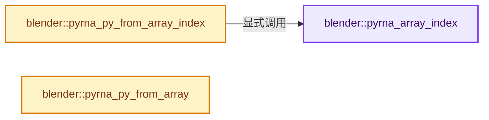
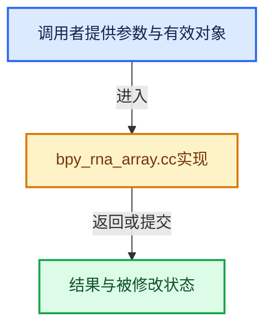

# 实现依赖专题：source/blender/python/intern/bpy_rna_array.cc

[实现依赖导航](../../../README.md) · [符号索引](../../../../00-课程指南/02-源码与提交索引/符号依赖与实现索引.md)

本专题从正文实际调用进入，集中保存共享实现。函数有稳定锚点，可从调用处直接跳到对应完整函数；递归与互相调用通过回链组织。

## 本文件的实现关系






## 完整成员与函数实现

<a id="f-85b2e6d6b71b7eea"></a>

### `blender::pyrna_array_index`

实现位置：[source/blender/python/intern/bpy_rna_array.cc](../../../../../../../../source/blender/python/intern/bpy_rna_array.cc) · L866—L887。

接口参数：

- `PointerRNA *ptr`
- `PropertyRNA *prop`
- `int index`

**教学注释版**

<!-- annotated:1f061476ae8d69 -->

```cpp
PyObject *pyrna_array_index(PointerRNA *ptr, PropertyRNA *prop, int index)
{
  PyObject *item;

  switch (RNA_property_type(prop)) {
    case PROP_FLOAT:
      item = PyFloat_FromDouble(RNA_property_float_get_index(ptr, prop, index));
      break;
    case PROP_BOOLEAN:
      item = PyBool_FromLong(RNA_property_boolean_get_index(ptr, prop, index));
      break;
    case PROP_INT:
      item = PyLong_FromLong(RNA_property_int_get_index(ptr, prop, index));
      break;
    default:
      PyErr_SetString(PyExc_TypeError, "not an array type");
      item = nullptr;
      break;
  }

  return item;
}
```

<details>
<summary>核对原始源码：source/blender/python/intern/bpy_rna_array.cc · L866—L887</summary>

<!-- original:1f061476ae8d69:source/blender/python/intern/bpy_rna_array.cc:866:887 -->

```cpp
PyObject *pyrna_array_index(PointerRNA *ptr, PropertyRNA *prop, int index)
{
  PyObject *item;

  switch (RNA_property_type(prop)) {
    case PROP_FLOAT:
      item = PyFloat_FromDouble(RNA_property_float_get_index(ptr, prop, index));
      break;
    case PROP_BOOLEAN:
      item = PyBool_FromLong(RNA_property_boolean_get_index(ptr, prop, index));
      break;
    case PROP_INT:
      item = PyLong_FromLong(RNA_property_int_get_index(ptr, prop, index));
      break;
    default:
      PyErr_SetString(PyExc_TypeError, "not an array type");
      item = nullptr;
      break;
  }

  return item;
}
```

</details>

**沿实际写入检查状态**

- `item = PyFloat_FromDouble(RNA_property_float_get_index(ptr, prop, index));`
- `item = PyBool_FromLong(RNA_property_boolean_get_index(ptr, prop, index));`
- `item = PyLong_FromLong(RNA_property_int_get_index(ptr, prop, index));`
- `item = nullptr;`

**结果出口**

- `return item;`

**继续追踪实现**

- `RNA_property_type` → [blender::RNA_property_type · L1293](../../makesrna/intern/rna_access.cc.md#f-4465a90d55f022df)。
- `PyFloat_FromDouble` → [调用协议](../../../../00-课程指南/01-路线与规范/模板宏与动态分派协议.md)：配置相关检测或外部运行时接口。调用位置L872。
- `RNA_property_float_get_index` → [blender::RNA_property_float_get_index · L3894](../../makesrna/intern/rna_access.cc.md#f-be851c32bd58e17b)。
- `PyBool_FromLong` → [调用协议](../../../../00-课程指南/01-路线与规范/模板宏与动态分派协议.md)：配置相关检测或外部运行时接口。调用位置L875。
- `RNA_property_boolean_get_index` → [blender::RNA_property_boolean_get_index · L2887](../../makesrna/intern/rna_access.cc.md#f-e8d48870c3e2ceac)。
- `PyLong_FromLong` → [调用协议](../../../../00-课程指南/01-路线与规范/模板宏与动态分派协议.md)：配置相关检测或外部运行时接口。调用位置L878。
- `RNA_property_int_get_index` → [blender::RNA_property_int_get_index · L3404](../../makesrna/intern/rna_access.cc.md#f-0f7616199232ca55)。
- `PyErr_SetString` → [调用协议](../../../../00-课程指南/01-路线与规范/模板宏与动态分派协议.md)：配置相关检测或外部运行时接口。调用位置L881。

<a id="f-14feafa94f6048c3"></a>

### `blender::pyrna_py_from_array_index`

实现位置：[source/blender/python/intern/bpy_rna_array.cc](../../../../../../../../source/blender/python/intern/bpy_rna_array.cc) · L928—L975。

接口参数：

- `BPy_PropertyArrayRNA *self`
- `PointerRNA *ptr`
- `PropertyRNA *prop`
- `int index`

**教学注释版**

<!-- annotated:f1d87c8d2ac2ab -->

```cpp
PyObject *pyrna_py_from_array_index(BPy_PropertyArrayRNA *self,
                                    PointerRNA *ptr,
                                    PropertyRNA *prop,
                                    int index)
{
  int totdim, arraydim, arrayoffset, dimsize[MAX_ARRAY_DIMENSION], i, len;
  BPy_PropertyArrayRNA *ret = nullptr;

  arraydim = self ? self->arraydim : 0;
  arrayoffset = self ? self->arrayoffset : 0;

  /* just in case check */
  len = RNA_property_multi_array_length(ptr, prop, arraydim);
  if (index >= len || index < 0) {
    /* This shouldn't happen because higher level functions must check for invalid index. */
    CLOG_WARN(BPY_LOG_RNA, "invalid index %d for array with length=%d", index, len);

    PyErr_SetString(PyExc_IndexError, "out of range");
    return nullptr;
  }

  totdim = RNA_property_array_dimension(ptr, prop, dimsize);

  if (arraydim + 1 < totdim) {
    ret = reinterpret_cast<BPy_PropertyArrayRNA *>(pyrna_prop_CreatePyObject(ptr, prop));
    ret->arraydim = arraydim + 1;

    /* arr[3][4][5]
     *
     *    x = arr[2]
     *    index = 0 + 2 * 4 * 5
     *
     *    x = arr[2][3]
     *    index = offset + 3 * 5 */

    for (i = arraydim + 1; i < totdim; i++) {
      index *= dimsize[i];
    }

    ret->arrayoffset = arrayoffset + index;
  }
  else {
    index = arrayoffset + index;
    ret = reinterpret_cast<BPy_PropertyArrayRNA *>(pyrna_array_index(ptr, prop, index));
  }

  return reinterpret_cast<PyObject *>(ret);
}
```

<details>
<summary>核对原始源码：source/blender/python/intern/bpy_rna_array.cc · L928—L975</summary>

<!-- original:f1d87c8d2ac2ab:source/blender/python/intern/bpy_rna_array.cc:928:975 -->

```cpp
PyObject *pyrna_py_from_array_index(BPy_PropertyArrayRNA *self,
                                    PointerRNA *ptr,
                                    PropertyRNA *prop,
                                    int index)
{
  int totdim, arraydim, arrayoffset, dimsize[MAX_ARRAY_DIMENSION], i, len;
  BPy_PropertyArrayRNA *ret = nullptr;

  arraydim = self ? self->arraydim : 0;
  arrayoffset = self ? self->arrayoffset : 0;

  /* just in case check */
  len = RNA_property_multi_array_length(ptr, prop, arraydim);
  if (index >= len || index < 0) {
    /* This shouldn't happen because higher level functions must check for invalid index. */
    CLOG_WARN(BPY_LOG_RNA, "invalid index %d for array with length=%d", index, len);

    PyErr_SetString(PyExc_IndexError, "out of range");
    return nullptr;
  }

  totdim = RNA_property_array_dimension(ptr, prop, dimsize);

  if (arraydim + 1 < totdim) {
    ret = reinterpret_cast<BPy_PropertyArrayRNA *>(pyrna_prop_CreatePyObject(ptr, prop));
    ret->arraydim = arraydim + 1;

    /* arr[3][4][5]
     *
     *    x = arr[2]
     *    index = 0 + 2 * 4 * 5
     *
     *    x = arr[2][3]
     *    index = offset + 3 * 5 */

    for (i = arraydim + 1; i < totdim; i++) {
      index *= dimsize[i];
    }

    ret->arrayoffset = arrayoffset + index;
  }
  else {
    index = arrayoffset + index;
    ret = reinterpret_cast<BPy_PropertyArrayRNA *>(pyrna_array_index(ptr, prop, index));
  }

  return reinterpret_cast<PyObject *>(ret);
}
```

</details>

**沿实际写入检查状态**

- `arraydim = self ? self->arraydim : 0;`
- `arrayoffset = self ? self->arrayoffset : 0;`
- `len = RNA_property_multi_array_length(ptr, prop, arraydim);`
- `totdim = RNA_property_array_dimension(ptr, prop, dimsize);`
- `ret = reinterpret_cast<BPy_PropertyArrayRNA *>(pyrna_prop_CreatePyObject(ptr, prop));`
- `ret->arraydim = arraydim + 1;`
- `index *= dimsize[i];`
- `ret->arrayoffset = arrayoffset + index;`
- `index = arrayoffset + index;`
- `ret = reinterpret_cast<BPy_PropertyArrayRNA *>(pyrna_array_index(ptr, prop, index));`

**结果出口**

- `return nullptr;`
- `return reinterpret_cast<PyObject *>(ret);`

**继续追踪实现**

- `RNA_property_multi_array_length` → [blender::RNA_property_multi_array_length · L1392](../../makesrna/intern/rna_access.cc.md#f-b352036bfcd911d9)。
- `CLOG_WARN` → [CLOG_WARN · L189](../../../07-Intern运行时与平台/clog/CLG_log.h.md#m-9da21a06cdbe)。宏定义由构建条件选择。
- `PyErr_SetString` → [调用协议](../../../../00-课程指南/01-路线与规范/模板宏与动态分派协议.md)：配置相关检测或外部运行时接口。调用位置L945。
- `RNA_property_array_dimension` → [blender::RNA_property_array_dimension · L1381](../../makesrna/intern/rna_access.cc.md#f-6ea6bed1f6abd9fe)。
- `pyrna_prop_CreatePyObject` → [blender::pyrna_prop_CreatePyObject · L8928](bpy_rna.cc.md#f-4ac359d342a3e565)。
- `pyrna_array_index` → [blender::pyrna_array_index · L866](bpy_rna_array.cc.md#f-85b2e6d6b71b7eea)。

<a id="f-75673bc3491769d8"></a>

### `blender::pyrna_py_from_array`

实现位置：[source/blender/python/intern/bpy_rna_array.cc](../../../../../../../../source/blender/python/intern/bpy_rna_array.cc) · L977—L989。

接口参数：

- `PointerRNA *ptr`
- `PropertyRNA *prop`

**教学注释版**

<!-- annotated:ba385931a86dae -->

```cpp
PyObject *pyrna_py_from_array(PointerRNA *ptr, PropertyRNA *prop)
{
  PyObject *ret;

  ret = pyrna_math_object_from_array(ptr, prop);

  /* Is this a math object? */
  if (ret) {
    return ret;
  }

  return pyrna_prop_CreatePyObject(ptr, prop);
}
```

<details>
<summary>核对原始源码：source/blender/python/intern/bpy_rna_array.cc · L977—L989</summary>

<!-- original:ba385931a86dae:source/blender/python/intern/bpy_rna_array.cc:977:989 -->

```cpp
PyObject *pyrna_py_from_array(PointerRNA *ptr, PropertyRNA *prop)
{
  PyObject *ret;

  ret = pyrna_math_object_from_array(ptr, prop);

  /* Is this a math object? */
  if (ret) {
    return ret;
  }

  return pyrna_prop_CreatePyObject(ptr, prop);
}
```

</details>

**沿实际写入检查状态**

- `ret = pyrna_math_object_from_array(ptr, prop);`

**结果出口**

- `return ret;`
- `return pyrna_prop_CreatePyObject(ptr, prop);`

**继续追踪实现**

- `pyrna_math_object_from_array` → [blender::pyrna_math_object_from_array · L827](bpy_rna.cc.md#f-8c022cc240228d17)。
- `pyrna_prop_CreatePyObject` → [blender::pyrna_prop_CreatePyObject · L8928](bpy_rna.cc.md#f-4ac359d342a3e565)。
