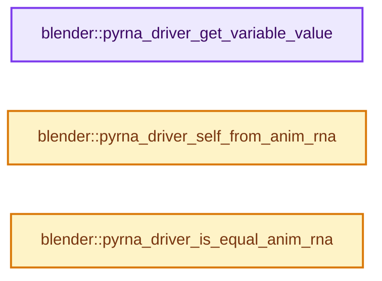

# 实现依赖专题：source/blender/python/intern/bpy_rna_driver.cc

[实现依赖导航](../../../README.md) · [符号索引](../../../../00-课程指南/02-源码与提交索引/符号依赖与实现索引.md)

本专题从正文实际调用进入，集中保存共享实现。函数有稳定锚点，可从调用处直接跳到对应完整函数；递归与互相调用通过回链组织。

## 本文件的实现关系




## 完整成员与函数实现

<a id="f-b4b88a3ebf0875f7"></a>

### `blender::pyrna_driver_get_variable_value`

实现位置：[source/blender/python/intern/bpy_rna_driver.cc](../../../../../../../../source/blender/python/intern/bpy_rna_driver.cc) · L25—L67。

接口参数：

- `const AnimationEvalContext *anim_eval_context`
- `ChannelDriver *driver`
- `DriverVar *dvar`
- `DriverTarget *dtar`

**教学注释版**

<!-- annotated:afb1625e25399e -->

```cpp
PyObject *pyrna_driver_get_variable_value(const AnimationEvalContext *anim_eval_context,
                                          ChannelDriver *driver,
                                          DriverVar *dvar,
                                          DriverTarget *dtar)
{
  PointerRNA ptr;
  PropertyRNA *prop = nullptr;
  int index;

  switch (driver_get_variable_property(anim_eval_context, driver, dvar, dtar, &ptr, &prop, &index))
  {
    case DRIVER_VAR_PROPERTY_SUCCESS:
      /* object only */
      if (!prop) {
        return pyrna_struct_CreatePyObject(&ptr);
      }

      /* object, property & index */
      if (index >= 0) {
        return pyrna_array_index(&ptr, prop, index);
      }

      /* object & property (enum) */
      if (RNA_property_type(prop) == PROP_ENUM) {
        /* Note that enum's are converted to strings by default,
         * we want to avoid that, see: #52213 */
        return PyLong_FromLong(RNA_property_enum_get(&ptr, prop));
      }

      /* object & property */
      return pyrna_prop_to_py(&ptr, prop);

    case DRIVER_VAR_PROPERTY_FALLBACK:
      return PyFloat_FromDouble(dtar->fallback_value);

    case DRIVER_VAR_PROPERTY_INVALID:
    case DRIVER_VAR_PROPERTY_INVALID_INDEX:
      /* can't resolve path, pass */
      return nullptr;
  }

  return nullptr;
}
```

<details>
<summary>核对原始源码：source/blender/python/intern/bpy_rna_driver.cc · L25—L67</summary>

<!-- original:afb1625e25399e:source/blender/python/intern/bpy_rna_driver.cc:25:67 -->

```cpp
PyObject *pyrna_driver_get_variable_value(const AnimationEvalContext *anim_eval_context,
                                          ChannelDriver *driver,
                                          DriverVar *dvar,
                                          DriverTarget *dtar)
{
  PointerRNA ptr;
  PropertyRNA *prop = nullptr;
  int index;

  switch (driver_get_variable_property(anim_eval_context, driver, dvar, dtar, &ptr, &prop, &index))
  {
    case DRIVER_VAR_PROPERTY_SUCCESS:
      /* object only */
      if (!prop) {
        return pyrna_struct_CreatePyObject(&ptr);
      }

      /* object, property & index */
      if (index >= 0) {
        return pyrna_array_index(&ptr, prop, index);
      }

      /* object & property (enum) */
      if (RNA_property_type(prop) == PROP_ENUM) {
        /* Note that enum's are converted to strings by default,
         * we want to avoid that, see: #52213 */
        return PyLong_FromLong(RNA_property_enum_get(&ptr, prop));
      }

      /* object & property */
      return pyrna_prop_to_py(&ptr, prop);

    case DRIVER_VAR_PROPERTY_FALLBACK:
      return PyFloat_FromDouble(dtar->fallback_value);

    case DRIVER_VAR_PROPERTY_INVALID:
    case DRIVER_VAR_PROPERTY_INVALID_INDEX:
      /* can't resolve path, pass */
      return nullptr;
  }

  return nullptr;
}
```

</details>

**结果出口**

- `return pyrna_struct_CreatePyObject(&ptr);`
- `return pyrna_array_index(&ptr, prop, index);`
- `return PyLong_FromLong(RNA_property_enum_get(&ptr, prop));`
- `return pyrna_prop_to_py(&ptr, prop);`
- `return PyFloat_FromDouble(dtar->fallback_value);`
- `return nullptr;`

**继续追踪实现**

- `driver_get_variable_property` → [blender::driver_get_variable_property · L281](../../../02-BKE几何与数据/intern/fcurve_driver.cc.md#f-0f5b6f7072456d64)。
- `pyrna_struct_CreatePyObject` → [blender::pyrna_struct_CreatePyObject · L8871](bpy_rna.cc.md#f-8d72c1b6149f0dee)。
- `pyrna_array_index` → [blender::pyrna_array_index · L866](bpy_rna_array.cc.md#f-85b2e6d6b71b7eea)。
- `RNA_property_type` → [blender::RNA_property_type · L1293](../../makesrna/intern/rna_access.cc.md#f-4465a90d55f022df)。
- `PyLong_FromLong` → [调用协议](../../../../00-课程指南/01-路线与规范/模板宏与动态分派协议.md)：配置相关检测或外部运行时接口。调用位置L51。
- `RNA_property_enum_get` → [blender::RNA_property_enum_get · L4499](../../makesrna/intern/rna_access.cc.md#f-7921c83822683274)。
- `pyrna_prop_to_py` → [blender::pyrna_prop_to_py · L1533](bpy_rna.cc.md#f-d41a32068a27d567)。
- `PyFloat_FromDouble` → [调用协议](../../../../00-课程指南/01-路线与规范/模板宏与动态分派协议.md)：配置相关检测或外部运行时接口。调用位置L58。

<a id="f-13366c4a4aa396d3"></a>

### `blender::pyrna_driver_self_from_anim_rna`

实现位置：[source/blender/python/intern/bpy_rna_driver.cc](../../../../../../../../source/blender/python/intern/bpy_rna_driver.cc) · L69—L72。

接口参数：

- `PathResolvedRNA *anim_rna`

**教学注释版**

<!-- annotated:173e56bf817302 -->

```cpp
PyObject *pyrna_driver_self_from_anim_rna(PathResolvedRNA *anim_rna)
{
  return pyrna_struct_CreatePyObject(&anim_rna->ptr);
}
```

<details>
<summary>核对原始源码：source/blender/python/intern/bpy_rna_driver.cc · L69—L72</summary>

<!-- original:173e56bf817302:source/blender/python/intern/bpy_rna_driver.cc:69:72 -->

```cpp
PyObject *pyrna_driver_self_from_anim_rna(PathResolvedRNA *anim_rna)
{
  return pyrna_struct_CreatePyObject(&anim_rna->ptr);
}
```

</details>

**结果出口**

- `return pyrna_struct_CreatePyObject(&anim_rna->ptr);`

**继续追踪实现**

- `pyrna_struct_CreatePyObject` → [blender::pyrna_struct_CreatePyObject · L8871](bpy_rna.cc.md#f-8d72c1b6149f0dee)。

<a id="f-6708dfc428e6326e"></a>

### `blender::pyrna_driver_is_equal_anim_rna`

实现位置：[source/blender/python/intern/bpy_rna_driver.cc](../../../../../../../../source/blender/python/intern/bpy_rna_driver.cc) · L74—L87。

接口参数：

- `const PathResolvedRNA *anim_rna`
- `const PyObject *py_anim_rna`

**教学注释版**

<!-- annotated:2a7da0c51e3866 -->

```cpp
bool pyrna_driver_is_equal_anim_rna(const PathResolvedRNA *anim_rna, const PyObject *py_anim_rna)
{
  if (BPy_StructRNA_Check(py_anim_rna)) {
    const PointerRNA *ptr_a = &anim_rna->ptr;
    const PointerRNA *ptr_b = &reinterpret_cast<const BPy_StructRNA *>(py_anim_rna)->ptr.value();

    if ((ptr_a->owner_id == ptr_b->owner_id) && (ptr_a->type == ptr_b->type) &&
        (ptr_a->data == ptr_b->data))
    {
      return true;
    }
  }
  return false;
}
```

<details>
<summary>核对原始源码：source/blender/python/intern/bpy_rna_driver.cc · L74—L87</summary>

<!-- original:2a7da0c51e3866:source/blender/python/intern/bpy_rna_driver.cc:74:87 -->

```cpp
bool pyrna_driver_is_equal_anim_rna(const PathResolvedRNA *anim_rna, const PyObject *py_anim_rna)
{
  if (BPy_StructRNA_Check(py_anim_rna)) {
    const PointerRNA *ptr_a = &anim_rna->ptr;
    const PointerRNA *ptr_b = &reinterpret_cast<const BPy_StructRNA *>(py_anim_rna)->ptr.value();

    if ((ptr_a->owner_id == ptr_b->owner_id) && (ptr_a->type == ptr_b->type) &&
        (ptr_a->data == ptr_b->data))
    {
      return true;
    }
  }
  return false;
}
```

</details>

**结果出口**

- `return true;`
- `return false;`

**继续追踪实现**

- `BPy_StructRNA_Check` → [BPy_StructRNA_Check · L76](bpy_rna.hh.md#m-4b2941585386)。宏定义由构建条件选择。
- `reinterpret_cast<const BPy_StructRNA *>(py_anim_rna)->ptr.value` → [调用协议](../../../../00-课程指南/01-路线与规范/模板宏与动态分派协议.md)：接收对象类型依赖auto、返回值或模板实例；不按同名猜测目标。调用位置L78。
