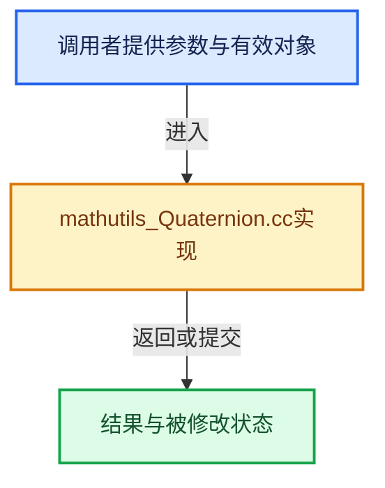

# 实现依赖专题：source/blender/python/mathutils/mathutils_Quaternion.cc

[实现依赖导航](../../../README.md) · [符号索引](../../../../00-课程指南/02-源码与提交索引/符号依赖与实现索引.md)

本专题从正文实际调用进入，集中保存共享实现。函数有稳定锚点，可从调用处直接跳到对应完整函数；递归与互相调用通过回链组织。

## 本文件的实现关系





## 完整成员与函数实现

<a id="f-ad97256da6db3f92"></a>

### `blender::Quaternion_CreatePyObject`

实现位置：[source/blender/python/mathutils/mathutils_Quaternion.cc](../../../../../../../../source/blender/python/mathutils/mathutils_Quaternion.cc) · L1963—L1997。

接口参数：

- `const float quat[4]`
- `PyTypeObject *base_type`

**教学注释版**

<!-- annotated:079d1409d8f002 -->

```cpp
PyObject *Quaternion_CreatePyObject(const float quat[4], PyTypeObject *base_type)
{
  QuaternionObject *self;
  float *quat_alloc;

  quat_alloc = static_cast<float *>(PyMem_Malloc(QUAT_SIZE * sizeof(float)));
  if (quat_alloc == nullptr) [[unlikely]] {
    PyErr_SetString(PyExc_MemoryError,
                    "Quaternion(): "
                    "problem allocating data");
    return nullptr;
  }

  self = BASE_MATH_NEW(QuaternionObject, quaternion_Type, base_type);
  if (self) {
    self->quat = quat_alloc;
    /* init callbacks as nullptr */
    self->cb_user = nullptr;
    self->cb_type = self->cb_subtype = 0;

    /* NEW */
    if (!quat) { /* new empty */
      unit_qt(self->quat);
    }
    else {
      copy_qt_qt(self->quat, quat);
    }
    self->flag = BASE_MATH_FLAG_DEFAULT;
  }
  else {
    PyMem_Free(quat_alloc);
  }

  return reinterpret_cast<PyObject *>(self);
}
```

<details>
<summary>核对原始源码：source/blender/python/mathutils/mathutils_Quaternion.cc · L1963—L1997</summary>

<!-- original:079d1409d8f002:source/blender/python/mathutils/mathutils_Quaternion.cc:1963:1997 -->

```cpp
PyObject *Quaternion_CreatePyObject(const float quat[4], PyTypeObject *base_type)
{
  QuaternionObject *self;
  float *quat_alloc;

  quat_alloc = static_cast<float *>(PyMem_Malloc(QUAT_SIZE * sizeof(float)));
  if (quat_alloc == nullptr) [[unlikely]] {
    PyErr_SetString(PyExc_MemoryError,
                    "Quaternion(): "
                    "problem allocating data");
    return nullptr;
  }

  self = BASE_MATH_NEW(QuaternionObject, quaternion_Type, base_type);
  if (self) {
    self->quat = quat_alloc;
    /* init callbacks as nullptr */
    self->cb_user = nullptr;
    self->cb_type = self->cb_subtype = 0;

    /* NEW */
    if (!quat) { /* new empty */
      unit_qt(self->quat);
    }
    else {
      copy_qt_qt(self->quat, quat);
    }
    self->flag = BASE_MATH_FLAG_DEFAULT;
  }
  else {
    PyMem_Free(quat_alloc);
  }

  return reinterpret_cast<PyObject *>(self);
}
```

</details>

**沿实际写入检查状态**

- `quat_alloc = static_cast<float *>(PyMem_Malloc(QUAT_SIZE * sizeof(float)));`
- `self = BASE_MATH_NEW(QuaternionObject, quaternion_Type, base_type);`
- `self->quat = quat_alloc;`
- `self->cb_user = nullptr;`
- `self->cb_type = self->cb_subtype = 0;`
- `self->flag = BASE_MATH_FLAG_DEFAULT;`

**结果出口**

- `return nullptr;`
- `return reinterpret_cast<PyObject *>(self);`

**继续追踪实现**

- `PyMem_Malloc` → [调用协议](../../../../00-课程指南/01-路线与规范/模板宏与动态分派协议.md)：配置相关检测或外部运行时接口。调用位置L1968。
- `PyErr_SetString` → [调用协议](../../../../00-课程指南/01-路线与规范/模板宏与动态分派协议.md)：配置相关检测或外部运行时接口。调用位置L1970。
- `BASE_MATH_NEW` → [BASE_MATH_NEW · L29](mathutils.hh.md#m-c1b2025904e4)。宏定义由构建条件选择。
- `unit_qt` → [blender::unit_qt · L45](../../../01-BLI基础库/intern/math_rotation_c.cc.md#f-6323eadd66d3989a)。
- `copy_qt_qt` → [blender::copy_qt_qt · L51](../../../01-BLI基础库/intern/math_rotation_c.cc.md#f-503531a8e10b755b)。
- `PyMem_Free` → [调用协议](../../../../00-课程指南/01-路线与规范/模板宏与动态分派协议.md)：配置相关检测或外部运行时接口。调用位置L1993。

<a id="f-cae33355b0577a69"></a>

### `blender::Quaternion_CreatePyObject_cb`

实现位置：[source/blender/python/mathutils/mathutils_Quaternion.cc](../../../../../../../../source/blender/python/mathutils/mathutils_Quaternion.cc) · L2016—L2030。

接口参数：

- `PyObject *cb_user`
- `uchar cb_type`
- `uchar cb_subtype`

**教学注释版**

<!-- annotated:33e7d916c41e74 -->

```cpp
PyObject *Quaternion_CreatePyObject_cb(PyObject *cb_user, uchar cb_type, uchar cb_subtype)
{
  QuaternionObject *self = reinterpret_cast<QuaternionObject *>(
      Quaternion_CreatePyObject(nullptr, nullptr));
  if (self) {
    Py_INCREF(cb_user);
    self->cb_user = cb_user;
    self->cb_type = cb_type;
    self->cb_subtype = cb_subtype;
    BLI_assert(!PyObject_GC_IsTracked((PyObject *)self));
    PyObject_GC_Track(self);
  }

  return reinterpret_cast<PyObject *>(self);
}
```

<details>
<summary>核对原始源码：source/blender/python/mathutils/mathutils_Quaternion.cc · L2016—L2030</summary>

<!-- original:33e7d916c41e74:source/blender/python/mathutils/mathutils_Quaternion.cc:2016:2030 -->

```cpp
PyObject *Quaternion_CreatePyObject_cb(PyObject *cb_user, uchar cb_type, uchar cb_subtype)
{
  QuaternionObject *self = reinterpret_cast<QuaternionObject *>(
      Quaternion_CreatePyObject(nullptr, nullptr));
  if (self) {
    Py_INCREF(cb_user);
    self->cb_user = cb_user;
    self->cb_type = cb_type;
    self->cb_subtype = cb_subtype;
    BLI_assert(!PyObject_GC_IsTracked((PyObject *)self));
    PyObject_GC_Track(self);
  }

  return reinterpret_cast<PyObject *>(self);
}
```

</details>

**沿实际写入检查状态**

- `self->cb_user = cb_user;`
- `self->cb_type = cb_type;`
- `self->cb_subtype = cb_subtype;`

**结果出口**

- `return reinterpret_cast<PyObject *>(self);`

**继续追踪实现**

- `Quaternion_CreatePyObject` → [blender::Quaternion_CreatePyObject · L1963](mathutils_Quaternion.cc.md#f-ad97256da6db3f92)。
- `Py_INCREF` → [调用协议](../../../../00-课程指南/01-路线与规范/模板宏与动态分派协议.md)：配置相关检测或外部运行时接口。调用位置L2021。
- `BLI_assert` → [BLI_assert · L48](../../../01-BLI基础库/BLI_assert.hh.md#m-57a88495704d)；[BLI_assert · L63](../../../01-BLI基础库/BLI_assert.hh.md#m-d07050020cb5)。宏定义由构建条件选择。
- `PyObject_GC_IsTracked` → [调用协议](../../../../00-课程指南/01-路线与规范/模板宏与动态分派协议.md)：配置相关检测或外部运行时接口。调用位置L2025。
- `PyObject_GC_Track` → [调用协议](../../../../00-课程指南/01-路线与规范/模板宏与动态分派协议.md)：配置相关检测或外部运行时接口。调用位置L2026。
