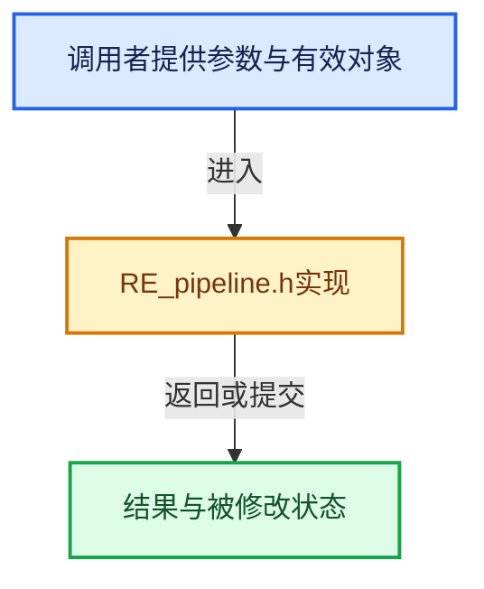

# 实现依赖专题：source/blender/render/RE_pipeline.h

[实现依赖导航](../../README.md) · [符号索引](../../../00-课程指南/02-源码与提交索引/符号依赖与实现索引.md)

本专题从正文实际调用进入，集中保存共享实现。函数有稳定锚点，可从调用处直接跳到对应完整函数；递归与互相调用通过回链组织。

## 本文件的实现关系





## 相关类型布局与成员入口

<a id="t-6cff205337a2"></a>

### `blender::ImageFormatData`

原始声明：[source/blender/render/RE_pipeline.h](../../../../../../../source/blender/render/RE_pipeline.h) · L26—L26。

以下保留类的数据声明与编译条件，成员函数实现通过后面的精确链接阅读。

<!-- annotated:70ea7f343a5be1 -->

```cpp
struct ImageFormatData;
```

<details>
<summary>核对原始源码：source/blender/render/RE_pipeline.h · L26—L26</summary>

<!-- original:70ea7f343a5be1:source/blender/render/RE_pipeline.h:26:26 -->

```cpp
struct ImageFormatData;
```

</details>


<a id="t-8ff75565da18"></a>

### `blender::RenderResult`

原始声明：[source/blender/render/RE_pipeline.h](../../../../../../../source/blender/render/RE_pipeline.h) · L31—L31。

成员布局：

- `struct RenderResult next`
- `int user_counter`
- `int rectx`
- `struct ImBuf ibuf`
- `rcti tilerect`
- `ListBaseT<RenderLayer> layers`
- `ListBaseT<RenderView> views`
- `RenderLayer renlay`
- `int framenr`
- `double ppm`
- `bool have_combined`
- `char text`
- `char error`
- `struct StampData stamp_data`
- `bool passes_allocated`

以下保留类的数据声明与编译条件，成员函数实现通过后面的精确链接阅读。

<!-- annotated:19b75cf4c6632a -->

```cpp
struct RenderResult;
```

<details>
<summary>核对原始源码：source/blender/render/RE_pipeline.h · L31—L31</summary>

<!-- original:19b75cf4c6632a:source/blender/render/RE_pipeline.h:31:31 -->

```cpp
struct RenderResult;
```

</details>


<a id="t-84d949508520"></a>

### `blender::RenderResult`

原始声明：[source/blender/render/RE_pipeline.h](../../../../../../../source/blender/render/RE_pipeline.h) · L102—L157。

成员布局：

- `struct RenderResult next`
- `int user_counter`
- `int rectx`
- `struct ImBuf ibuf`
- `rcti tilerect`
- `ListBaseT<RenderLayer> layers`
- `ListBaseT<RenderView> views`
- `RenderLayer renlay`
- `int framenr`
- `double ppm`
- `bool have_combined`
- `char text`
- `char error`
- `struct StampData stamp_data`
- `bool passes_allocated`

以下保留类的数据声明与编译条件，成员函数实现通过后面的精确链接阅读。

<!-- annotated:75258b84ec097c -->

```cpp
struct RenderResult {
  struct RenderResult *next = nullptr, *prev = nullptr;

  /* The number of users of this render result. Default value is 0. The result is freed when
   * #RE_FreeRenderResult is called with the render result with 0 users. In a way this is
   * off-by-one, but it is the easiest for the currently used zero-initialized state. The way to
   * think of it is the number of extra users.
   *
   * TODO: Make it an actual number of users, so the #RE_FreeRenderResult frees the result when
   * the number of users goes to 0.
   *
   * TODO: Make it atomic. Currently it is not to allow shallow copying. */
  int user_counter = 0;

  /* target image size */
  int rectx = 0, recty = 0;

  /* The temporary storage to pass image data from #RE_AcquireResultImage.
   * Is null pointer when the RenderResult is not coming from the #RE_AcquireResultImage, and is
   * a pointer to an existing ibuf in either RenderView or a RenderPass otherwise. */
  struct ImBuf *ibuf = nullptr;

  /* coordinates within final image (after cropping) */
  rcti tilerect;

  /* the main buffers */
  ListBaseT<RenderLayer> layers = {};

  /* multiView maps to a StringVector in OpenEXR */
  ListBaseT<RenderView> views = {};

  /* Render layer to display. */
  RenderLayer *renlay = nullptr;

  /* for render results in Image, verify validity for sequences */
  int framenr = 0;

  /**
   * Pixels per meter (for image output).
   * - Typically initialized via #BKE_scene_ppm_get.
   * - May be zero which indicates the PPM being "unset".
   *   Although in most cases a scene is available.
   */
  double ppm[2];

  /* for acquire image, to indicate if it there is a combined layer */
  bool have_combined = false;

  /* render info text */
  char *text = nullptr;
  char *error = nullptr;

  struct StampData *stamp_data = nullptr;

  bool passes_allocated = false;
};
```

<details>
<summary>核对原始源码：source/blender/render/RE_pipeline.h · L102—L157</summary>

<!-- original:75258b84ec097c:source/blender/render/RE_pipeline.h:102:157 -->

```cpp
struct RenderResult {
  struct RenderResult *next = nullptr, *prev = nullptr;

  /* The number of users of this render result. Default value is 0. The result is freed when
   * #RE_FreeRenderResult is called with the render result with 0 users. In a way this is
   * off-by-one, but it is the easiest for the currently used zero-initialized state. The way to
   * think of it is the number of extra users.
   *
   * TODO: Make it an actual number of users, so the #RE_FreeRenderResult frees the result when
   * the number of users goes to 0.
   *
   * TODO: Make it atomic. Currently it is not to allow shallow copying. */
  int user_counter = 0;

  /* target image size */
  int rectx = 0, recty = 0;

  /* The temporary storage to pass image data from #RE_AcquireResultImage.
   * Is null pointer when the RenderResult is not coming from the #RE_AcquireResultImage, and is
   * a pointer to an existing ibuf in either RenderView or a RenderPass otherwise. */
  struct ImBuf *ibuf = nullptr;

  /* coordinates within final image (after cropping) */
  rcti tilerect;

  /* the main buffers */
  ListBaseT<RenderLayer> layers = {};

  /* multiView maps to a StringVector in OpenEXR */
  ListBaseT<RenderView> views = {};

  /* Render layer to display. */
  RenderLayer *renlay = nullptr;

  /* for render results in Image, verify validity for sequences */
  int framenr = 0;

  /**
   * Pixels per meter (for image output).
   * - Typically initialized via #BKE_scene_ppm_get.
   * - May be zero which indicates the PPM being "unset".
   *   Although in most cases a scene is available.
   */
  double ppm[2];

  /* for acquire image, to indicate if it there is a combined layer */
  bool have_combined = false;

  /* render info text */
  char *text = nullptr;
  char *error = nullptr;

  struct StampData *stamp_data = nullptr;

  bool passes_allocated = false;
};
```

</details>


<a id="t-72e14c60c58c"></a>

### `blender::RenderResult::RenderResult`

原始声明：[source/blender/render/RE_pipeline.h](../../../../../../../source/blender/render/RE_pipeline.h) · L103—L103。

成员布局：

- `struct RenderResult next`
- `int user_counter`
- `int rectx`
- `struct ImBuf ibuf`
- `rcti tilerect`
- `ListBaseT<RenderLayer> layers`
- `ListBaseT<RenderView> views`
- `RenderLayer renlay`
- `int framenr`
- `double ppm`
- `bool have_combined`
- `char text`
- `char error`
- `struct StampData stamp_data`
- `bool passes_allocated`

以下保留类的数据声明与编译条件，成员函数实现通过后面的精确链接阅读。

<!-- annotated:af79e455ca0f9a -->

```cpp
  struct RenderResult *next = nullptr, *prev = nullptr;
```

<details>
<summary>核对原始源码：source/blender/render/RE_pipeline.h · L103—L103</summary>

<!-- original:af79e455ca0f9a:source/blender/render/RE_pipeline.h:103:103 -->

```cpp
  struct RenderResult *next = nullptr, *prev = nullptr;
```

</details>


<a id="t-f433c3f2af06"></a>

### `blender::RenderResult`

原始声明：[source/blender/render/RE_pipeline.h](../../../../../../../source/blender/render/RE_pipeline.h) · L238—L238。

成员布局：

- `struct RenderResult next`
- `int user_counter`
- `int rectx`
- `struct ImBuf ibuf`
- `rcti tilerect`
- `ListBaseT<RenderLayer> layers`
- `ListBaseT<RenderView> views`
- `RenderLayer renlay`
- `int framenr`
- `double ppm`
- `bool have_combined`
- `char text`
- `char error`
- `struct StampData stamp_data`
- `bool passes_allocated`

以下保留类的数据声明与编译条件，成员函数实现通过后面的精确链接阅读。

<!-- annotated:c0e4f056f6d0bd -->

```cpp
void RE_FreeRenderResult(struct RenderResult *rr);
```

<details>
<summary>核对原始源码：source/blender/render/RE_pipeline.h · L238—L238</summary>

<!-- original:c0e4f056f6d0bd:source/blender/render/RE_pipeline.h:238:238 -->

```cpp
void RE_FreeRenderResult(struct RenderResult *rr);
```

</details>


<a id="t-058762f937b4"></a>

### `blender::RenderResult`

原始声明：[source/blender/render/RE_pipeline.h](../../../../../../../source/blender/render/RE_pipeline.h) · L242—L242。

成员布局：

- `struct RenderResult next`
- `int user_counter`
- `int rectx`
- `struct ImBuf ibuf`
- `rcti tilerect`
- `ListBaseT<RenderLayer> layers`
- `ListBaseT<RenderView> views`
- `RenderLayer renlay`
- `int framenr`
- `double ppm`
- `bool have_combined`
- `char text`
- `char error`
- `struct StampData stamp_data`
- `bool passes_allocated`

以下保留类的数据声明与编译条件，成员函数实现通过后面的精确链接阅读。

<!-- annotated:422a2384b0cf7f -->

```cpp
struct RenderResult *RE_AcquireResultRead(struct Render *re);
```

<details>
<summary>核对原始源码：source/blender/render/RE_pipeline.h · L242—L242</summary>

<!-- original:422a2384b0cf7f:source/blender/render/RE_pipeline.h:242:242 -->

```cpp
struct RenderResult *RE_AcquireResultRead(struct Render *re);
```

</details>


<a id="t-70e9d825ee41"></a>

### `blender::RenderResult`

原始声明：[source/blender/render/RE_pipeline.h](../../../../../../../source/blender/render/RE_pipeline.h) · L243—L243。

成员布局：

- `struct RenderResult next`
- `int user_counter`
- `int rectx`
- `struct ImBuf ibuf`
- `rcti tilerect`
- `ListBaseT<RenderLayer> layers`
- `ListBaseT<RenderView> views`
- `RenderLayer renlay`
- `int framenr`
- `double ppm`
- `bool have_combined`
- `char text`
- `char error`
- `struct StampData stamp_data`
- `bool passes_allocated`

以下保留类的数据声明与编译条件，成员函数实现通过后面的精确链接阅读。

<!-- annotated:f7b9ac96d56094 -->

```cpp
struct RenderResult *RE_AcquireResultWrite(struct Render *re);
```

<details>
<summary>核对原始源码：source/blender/render/RE_pipeline.h · L243—L243</summary>

<!-- original:f7b9ac96d56094:source/blender/render/RE_pipeline.h:243:243 -->

```cpp
struct RenderResult *RE_AcquireResultWrite(struct Render *re);
```

</details>


<a id="t-162d1b06922f"></a>

### `blender::RenderResult`

原始声明：[source/blender/render/RE_pipeline.h](../../../../../../../source/blender/render/RE_pipeline.h) · L244—L244。

成员布局：

- `struct RenderResult next`
- `int user_counter`
- `int rectx`
- `struct ImBuf ibuf`
- `rcti tilerect`
- `ListBaseT<RenderLayer> layers`
- `ListBaseT<RenderView> views`
- `RenderLayer renlay`
- `int framenr`
- `double ppm`
- `bool have_combined`
- `char text`
- `char error`
- `struct StampData stamp_data`
- `bool passes_allocated`

以下保留类的数据声明与编译条件，成员函数实现通过后面的精确链接阅读。

<!-- annotated:4c89707850a065 -->

```cpp
void RE_ReferenceRenderResult(struct RenderResult *rr);
```

<details>
<summary>核对原始源码：source/blender/render/RE_pipeline.h · L244—L244</summary>

<!-- original:4c89707850a065:source/blender/render/RE_pipeline.h:244:244 -->

```cpp
void RE_ReferenceRenderResult(struct RenderResult *rr);
```

</details>


<a id="t-9c4fb7a6809e"></a>

### `blender::RenderResult`

原始声明：[source/blender/render/RE_pipeline.h](../../../../../../../source/blender/render/RE_pipeline.h) · L251—L251。

成员布局：

- `struct RenderResult next`
- `int user_counter`
- `int rectx`
- `struct ImBuf ibuf`
- `rcti tilerect`
- `ListBaseT<RenderLayer> layers`
- `ListBaseT<RenderView> views`
- `RenderLayer renlay`
- `int framenr`
- `double ppm`
- `bool have_combined`
- `char text`
- `char error`
- `struct StampData stamp_data`
- `bool passes_allocated`

以下保留类的数据声明与编译条件，成员函数实现通过后面的精确链接阅读。

<!-- annotated:b64b6b9b6ac72b -->

```cpp
void RE_AcquireResultImageViews(struct Render *re, struct RenderResult *rr);
```

<details>
<summary>核对原始源码：source/blender/render/RE_pipeline.h · L251—L251</summary>

<!-- original:b64b6b9b6ac72b:source/blender/render/RE_pipeline.h:251:251 -->

```cpp
void RE_AcquireResultImageViews(struct Render *re, struct RenderResult *rr);
```

</details>


<a id="t-3ed440b1b0ea"></a>

### `blender::RenderResult`

原始声明：[source/blender/render/RE_pipeline.h](../../../../../../../source/blender/render/RE_pipeline.h) · L255—L255。

成员布局：

- `struct RenderResult next`
- `int user_counter`
- `int rectx`
- `struct ImBuf ibuf`
- `rcti tilerect`
- `ListBaseT<RenderLayer> layers`
- `ListBaseT<RenderView> views`
- `RenderLayer renlay`
- `int framenr`
- `double ppm`
- `bool have_combined`
- `char text`
- `char error`
- `struct StampData stamp_data`
- `bool passes_allocated`

以下保留类的数据声明与编译条件，成员函数实现通过后面的精确链接阅读。

<!-- annotated:e0dae235cdfd3f -->

```cpp
void RE_ReleaseResultImageViews(struct Render *re, struct RenderResult *rr);
```

<details>
<summary>核对原始源码：source/blender/render/RE_pipeline.h · L255—L255</summary>

<!-- original:e0dae235cdfd3f:source/blender/render/RE_pipeline.h:255:255 -->

```cpp
void RE_ReleaseResultImageViews(struct Render *re, struct RenderResult *rr);
```

</details>


<a id="t-80ed9776dce2"></a>

### `blender::RenderResult`

原始声明：[source/blender/render/RE_pipeline.h](../../../../../../../source/blender/render/RE_pipeline.h) · L262—L262。

成员布局：

- `struct RenderResult next`
- `int user_counter`
- `int rectx`
- `struct ImBuf ibuf`
- `rcti tilerect`
- `ListBaseT<RenderLayer> layers`
- `ListBaseT<RenderView> views`
- `RenderLayer renlay`
- `int framenr`
- `double ppm`
- `bool have_combined`
- `char text`
- `char error`
- `struct StampData stamp_data`
- `bool passes_allocated`

以下保留类的数据声明与编译条件，成员函数实现通过后面的精确链接阅读。

<!-- annotated:0fdba0a2f6d235 -->

```cpp
void RE_AcquireResultImage(struct Render *re, struct RenderResult *rr, int view_id);
```

<details>
<summary>核对原始源码：source/blender/render/RE_pipeline.h · L262—L262</summary>

<!-- original:0fdba0a2f6d235:source/blender/render/RE_pipeline.h:262:262 -->

```cpp
void RE_AcquireResultImage(struct Render *re, struct RenderResult *rr, int view_id);
```

</details>


<a id="t-7e39b6bff6f5"></a>

### `blender::RenderResult`

原始声明：[source/blender/render/RE_pipeline.h](../../../../../../../source/blender/render/RE_pipeline.h) · L264—L264。

成员布局：

- `struct RenderResult next`
- `int user_counter`
- `int rectx`
- `struct ImBuf ibuf`
- `rcti tilerect`
- `ListBaseT<RenderLayer> layers`
- `ListBaseT<RenderView> views`
- `RenderLayer renlay`
- `int framenr`
- `double ppm`
- `bool have_combined`
- `char text`
- `char error`
- `struct StampData stamp_data`
- `bool passes_allocated`

以下保留类的数据声明与编译条件，成员函数实现通过后面的精确链接阅读。

<!-- annotated:b551f3cbfbfee3 -->

```cpp
void RE_SwapResult(struct Render *re, struct RenderResult **rr);
```

<details>
<summary>核对原始源码：source/blender/render/RE_pipeline.h · L264—L264</summary>

<!-- original:b551f3cbfbfee3:source/blender/render/RE_pipeline.h:264:264 -->

```cpp
void RE_SwapResult(struct Render *re, struct RenderResult **rr);
```

</details>


<a id="t-0e96157f2f21"></a>

### `blender::RenderResult`

原始声明：[source/blender/render/RE_pipeline.h](../../../../../../../source/blender/render/RE_pipeline.h) · L273—L273。

成员布局：

- `struct RenderResult next`
- `int user_counter`
- `int rectx`
- `struct ImBuf ibuf`
- `rcti tilerect`
- `ListBaseT<RenderLayer> layers`
- `ListBaseT<RenderView> views`
- `RenderLayer renlay`
- `int framenr`
- `double ppm`
- `bool have_combined`
- `char text`
- `char error`
- `struct StampData stamp_data`
- `bool passes_allocated`

以下保留类的数据声明与编译条件，成员函数实现通过后面的精确链接阅读。

<!-- annotated:4b736d78e7c167 -->

```cpp
bool RE_ResultIsMultiView(struct RenderResult *rr);
```

<details>
<summary>核对原始源码：source/blender/render/RE_pipeline.h · L273—L273</summary>

<!-- original:4b736d78e7c167:source/blender/render/RE_pipeline.h:273:273 -->

```cpp
bool RE_ResultIsMultiView(struct RenderResult *rr);
```

</details>


<a id="t-19a1b304cc84"></a>

### `blender::RenderResult`

原始声明：[source/blender/render/RE_pipeline.h](../../../../../../../source/blender/render/RE_pipeline.h) · L282—L282。

成员布局：

- `struct RenderResult next`
- `int user_counter`
- `int rectx`
- `struct ImBuf ibuf`
- `rcti tilerect`
- `ListBaseT<RenderLayer> layers`
- `ListBaseT<RenderView> views`
- `RenderLayer renlay`
- `int framenr`
- `double ppm`
- `bool have_combined`
- `char text`
- `char error`
- `struct StampData stamp_data`
- `bool passes_allocated`

以下保留类的数据声明与编译条件，成员函数实现通过后面的精确链接阅读。

<!-- annotated:cbf76dea1d4823 -->

```cpp
struct ImBuf *RE_render_result_rect_to_ibuf(struct RenderResult *rr,
```

<details>
<summary>核对原始源码：source/blender/render/RE_pipeline.h · L282—L282</summary>

<!-- original:cbf76dea1d4823:source/blender/render/RE_pipeline.h:282:282 -->

```cpp
struct ImBuf *RE_render_result_rect_to_ibuf(struct RenderResult *rr,
```

</details>


<a id="t-8f2e175e5c78"></a>

### `blender::ImageFormatData`

原始声明：[source/blender/render/RE_pipeline.h](../../../../../../../source/blender/render/RE_pipeline.h) · L283—L283。

以下保留类的数据声明与编译条件，成员函数实现通过后面的精确链接阅读。

<!-- annotated:65866f141983b8 -->

```cpp
                                            const struct ImageFormatData *imf,
```

<details>
<summary>核对原始源码：source/blender/render/RE_pipeline.h · L283—L283</summary>

<!-- original:65866f141983b8:source/blender/render/RE_pipeline.h:283:283 -->

```cpp
                                            const struct ImageFormatData *imf,
```

</details>


<a id="t-16b5d7af1e1d"></a>

### `blender::RenderResult`

原始声明：[source/blender/render/RE_pipeline.h](../../../../../../../source/blender/render/RE_pipeline.h) · L286—L286。

成员布局：

- `struct RenderResult next`
- `int user_counter`
- `int rectx`
- `struct ImBuf ibuf`
- `rcti tilerect`
- `ListBaseT<RenderLayer> layers`
- `ListBaseT<RenderView> views`
- `RenderLayer renlay`
- `int framenr`
- `double ppm`
- `bool have_combined`
- `char text`
- `char error`
- `struct StampData stamp_data`
- `bool passes_allocated`

以下保留类的数据声明与编译条件，成员函数实现通过后面的精确链接阅读。

<!-- annotated:74c3a730f84aea -->

```cpp
void RE_render_result_rect_from_ibuf(struct RenderResult *rr,
```

<details>
<summary>核对原始源码：source/blender/render/RE_pipeline.h · L286—L286</summary>

<!-- original:74c3a730f84aea:source/blender/render/RE_pipeline.h:286:286 -->

```cpp
void RE_render_result_rect_from_ibuf(struct RenderResult *rr,
```

</details>


<a id="t-33d11811ca6c"></a>

### `blender::RenderResult`

原始声明：[source/blender/render/RE_pipeline.h](../../../../../../../source/blender/render/RE_pipeline.h) · L290—L290。

成员布局：

- `struct RenderResult next`
- `int user_counter`
- `int rectx`
- `struct ImBuf ibuf`
- `rcti tilerect`
- `ListBaseT<RenderLayer> layers`
- `ListBaseT<RenderView> views`
- `RenderLayer renlay`
- `int framenr`
- `double ppm`
- `bool have_combined`
- `char text`
- `char error`
- `struct StampData stamp_data`
- `bool passes_allocated`

以下保留类的数据声明与编译条件，成员函数实现通过后面的精确链接阅读。

<!-- annotated:3e63c3f4397b74 -->

```cpp
struct RenderLayer *RE_GetRenderLayer(struct RenderResult *rr, const char *name);
```

<details>
<summary>核对原始源码：source/blender/render/RE_pipeline.h · L290—L290</summary>

<!-- original:3e63c3f4397b74:source/blender/render/RE_pipeline.h:290:290 -->

```cpp
struct RenderLayer *RE_GetRenderLayer(struct RenderResult *rr, const char *name);
```

</details>


<a id="t-4fba0c79749c"></a>

### `blender::RenderResult`

原始声明：[source/blender/render/RE_pipeline.h](../../../../../../../source/blender/render/RE_pipeline.h) · L302—L302。

成员布局：

- `struct RenderResult next`
- `int user_counter`
- `int rectx`
- `struct ImBuf ibuf`
- `rcti tilerect`
- `ListBaseT<RenderLayer> layers`
- `ListBaseT<RenderView> views`
- `RenderLayer renlay`
- `int framenr`
- `double ppm`
- `bool have_combined`
- `char text`
- `char error`
- `struct StampData stamp_data`
- `bool passes_allocated`

以下保留类的数据声明与编译条件，成员函数实现通过后面的精确链接阅读。

<!-- annotated:060d6bb5ee228d -->

```cpp
struct RenderPass *RE_create_gp_pass(struct RenderResult *rr,
```

<details>
<summary>核对原始源码：source/blender/render/RE_pipeline.h · L302—L302</summary>

<!-- original:060d6bb5ee228d:source/blender/render/RE_pipeline.h:302:302 -->

```cpp
struct RenderPass *RE_create_gp_pass(struct RenderResult *rr,
```

</details>


<a id="t-cb1646fe982b"></a>

### `blender::RenderResult`

原始声明：[source/blender/render/RE_pipeline.h](../../../../../../../source/blender/render/RE_pipeline.h) · L306—L306。

成员布局：

- `struct RenderResult next`
- `int user_counter`
- `int rectx`
- `struct ImBuf ibuf`
- `rcti tilerect`
- `ListBaseT<RenderLayer> layers`
- `ListBaseT<RenderView> views`
- `RenderLayer renlay`
- `int framenr`
- `double ppm`
- `bool have_combined`
- `char text`
- `char error`
- `struct StampData stamp_data`
- `bool passes_allocated`

以下保留类的数据声明与编译条件，成员函数实现通过后面的精确链接阅读。

<!-- annotated:5003bfc06336c7 -->

```cpp
void RE_create_render_pass(struct RenderResult *rr,
```

<details>
<summary>核对原始源码：source/blender/render/RE_pipeline.h · L306—L306</summary>

<!-- original:5003bfc06336c7:source/blender/render/RE_pipeline.h:306:306 -->

```cpp
void RE_create_render_pass(struct RenderResult *rr,
```

</details>


<a id="t-e8a9f362dc1f"></a>

### `blender::RenderResult`

原始声明：[source/blender/render/RE_pipeline.h](../../../../../../../source/blender/render/RE_pipeline.h) · L352—L352。

成员布局：

- `struct RenderResult next`
- `int user_counter`
- `int rectx`
- `struct ImBuf ibuf`
- `rcti tilerect`
- `ListBaseT<RenderLayer> layers`
- `ListBaseT<RenderView> views`
- `RenderLayer renlay`
- `int framenr`
- `double ppm`
- `bool have_combined`
- `char text`
- `char error`
- `struct StampData stamp_data`
- `bool passes_allocated`

以下保留类的数据声明与编译条件，成员函数实现通过后面的精确链接阅读。

<!-- annotated:08191a7bcb4dbb -->

```cpp
                              struct RenderResult *rr,
```

<details>
<summary>核对原始源码：source/blender/render/RE_pipeline.h · L352—L352</summary>

<!-- original:08191a7bcb4dbb:source/blender/render/RE_pipeline.h:352:352 -->

```cpp
                              struct RenderResult *rr,
```

</details>


<a id="t-c551b2723497"></a>

### `blender::RenderResult`

原始声明：[source/blender/render/RE_pipeline.h](../../../../../../../source/blender/render/RE_pipeline.h) · L414—L414。

成员布局：

- `struct RenderResult next`
- `int user_counter`
- `int rectx`
- `struct ImBuf ibuf`
- `rcti tilerect`
- `ListBaseT<RenderLayer> layers`
- `ListBaseT<RenderView> views`
- `RenderLayer renlay`
- `int framenr`
- `double ppm`
- `bool have_combined`
- `char text`
- `char error`
- `struct StampData stamp_data`
- `bool passes_allocated`

以下保留类的数据声明与编译条件，成员函数实现通过后面的精确链接阅读。

<!-- annotated:35701b04b5fc9c -->

```cpp
struct RenderResult *RE_MultilayerConvert(
```

<details>
<summary>核对原始源码：source/blender/render/RE_pipeline.h · L414—L414</summary>

<!-- original:35701b04b5fc9c:source/blender/render/RE_pipeline.h:414:414 -->

```cpp
struct RenderResult *RE_MultilayerConvert(
```

</details>


<a id="t-9c499f6bcdfc"></a>

### `blender::RenderResult`

原始声明：[source/blender/render/RE_pipeline.h](../../../../../../../source/blender/render/RE_pipeline.h) · L448—L448。

成员布局：

- `struct RenderResult next`
- `int user_counter`
- `int rectx`
- `struct ImBuf ibuf`
- `rcti tilerect`
- `ListBaseT<RenderLayer> layers`
- `ListBaseT<RenderView> views`
- `RenderLayer renlay`
- `int framenr`
- `double ppm`
- `bool have_combined`
- `char text`
- `char error`
- `struct StampData stamp_data`
- `bool passes_allocated`

以下保留类的数据声明与编译条件，成员函数实现通过后面的精确链接阅读。

<!-- annotated:205913fbd14eb3 -->

```cpp
bool RE_layers_have_name(struct RenderResult *result);
```

<details>
<summary>核对原始源码：source/blender/render/RE_pipeline.h · L448—L448</summary>

<!-- original:205913fbd14eb3:source/blender/render/RE_pipeline.h:448:448 -->

```cpp
bool RE_layers_have_name(struct RenderResult *result);
```

</details>


<a id="t-a8a3172a671f"></a>

### `blender::RenderResult`

原始声明：[source/blender/render/RE_pipeline.h](../../../../../../../source/blender/render/RE_pipeline.h) · L498—L498。

成员布局：

- `struct RenderResult next`
- `int user_counter`
- `int rectx`
- `struct ImBuf ibuf`
- `rcti tilerect`
- `ListBaseT<RenderLayer> layers`
- `ListBaseT<RenderView> views`
- `RenderLayer renlay`
- `int framenr`
- `double ppm`
- `bool have_combined`
- `char text`
- `char error`
- `struct StampData stamp_data`
- `bool passes_allocated`

以下保留类的数据声明与编译条件，成员函数实现通过后面的精确链接阅读。

<!-- annotated:91141df099e611 -->

```cpp
struct RenderView *RE_RenderViewGetById(struct RenderResult *rr, int view_id);
```

<details>
<summary>核对原始源码：source/blender/render/RE_pipeline.h · L498—L498</summary>

<!-- original:91141df099e611:source/blender/render/RE_pipeline.h:498:498 -->

```cpp
struct RenderView *RE_RenderViewGetById(struct RenderResult *rr, int view_id);
```

</details>


<a id="t-e00efa15648c"></a>

### `blender::RenderResult`

原始声明：[source/blender/render/RE_pipeline.h](../../../../../../../source/blender/render/RE_pipeline.h) · L499—L499。

成员布局：

- `struct RenderResult next`
- `int user_counter`
- `int rectx`
- `struct ImBuf ibuf`
- `rcti tilerect`
- `ListBaseT<RenderLayer> layers`
- `ListBaseT<RenderView> views`
- `RenderLayer renlay`
- `int framenr`
- `double ppm`
- `bool have_combined`
- `char text`
- `char error`
- `struct StampData stamp_data`
- `bool passes_allocated`

以下保留类的数据声明与编译条件，成员函数实现通过后面的精确链接阅读。

<!-- annotated:d7ca4866b442b7 -->

```cpp
struct RenderView *RE_RenderViewGetByName(struct RenderResult *rr, const char *viewname);
```

<details>
<summary>核对原始源码：source/blender/render/RE_pipeline.h · L499—L499</summary>

<!-- original:d7ca4866b442b7:source/blender/render/RE_pipeline.h:499:499 -->

```cpp
struct RenderView *RE_RenderViewGetByName(struct RenderResult *rr, const char *viewname);
```

</details>


## 完整成员与函数实现
