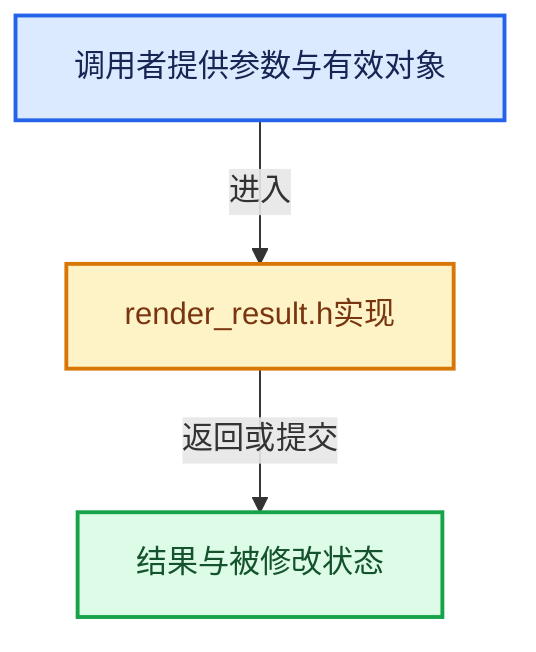

# 实现依赖专题：source/blender/render/intern/render_result.h

[实现依赖导航](../../../README.md) · [符号索引](../../../../00-课程指南/02-源码与提交索引/符号依赖与实现索引.md)

本专题从正文实际调用进入，集中保存共享实现。函数有稳定锚点，可从调用处直接跳到对应完整函数；递归与互相调用通过回链组织。

## 本文件的实现关系





## 相关类型布局与成员入口

<a id="t-ede9f87e01f5"></a>

### `blender::RenderResult`

原始声明：[source/blender/render/intern/render_result.h](../../../../../../../../source/blender/render/intern/render_result.h) · L27—L27。

以下保留类的数据声明与编译条件，成员函数实现通过后面的精确链接阅读。

<!-- annotated:c5d2c702cd8ae3 -->

```cpp
struct RenderResult;
```

<details>
<summary>核对原始源码：source/blender/render/intern/render_result.h · L27—L27</summary>

<!-- original:c5d2c702cd8ae3:source/blender/render/intern/render_result.h:27:27 -->

```cpp
struct RenderResult;
```

</details>


<a id="t-c2c5b02dc7bb"></a>

### `blender::RenderResult`

原始声明：[source/blender/render/intern/render_result.h](../../../../../../../../source/blender/render/intern/render_result.h) · L39—L39。

以下保留类的数据声明与编译条件，成员函数实现通过后面的精确链接阅读。

<!-- annotated:449fd0173e592c -->

```cpp
struct RenderResult *render_result_new(struct Render *re,
```

<details>
<summary>核对原始源码：source/blender/render/intern/render_result.h · L39—L39</summary>

<!-- original:449fd0173e592c:source/blender/render/intern/render_result.h:39:39 -->

```cpp
struct RenderResult *render_result_new(struct Render *re,
```

</details>


<a id="t-75333e50b778"></a>

### `blender::RenderResult`

原始声明：[source/blender/render/intern/render_result.h](../../../../../../../../source/blender/render/intern/render_result.h) · L44—L44。

以下保留类的数据声明与编译条件，成员函数实现通过后面的精确链接阅读。

<!-- annotated:38c54cb3a04f43 -->

```cpp
void render_result_passes_allocated_ensure(struct RenderResult *rr);
```

<details>
<summary>核对原始源码：source/blender/render/intern/render_result.h · L44—L44</summary>

<!-- original:38c54cb3a04f43:source/blender/render/intern/render_result.h:44:44 -->

```cpp
void render_result_passes_allocated_ensure(struct RenderResult *rr);
```

</details>


<a id="t-7ca5d8f3de46"></a>

### `blender::RenderResult`

原始声明：[source/blender/render/intern/render_result.h](../../../../../../../../source/blender/render/intern/render_result.h) · L50—L50。

以下保留类的数据声明与编译条件，成员函数实现通过后面的精确链接阅读。

<!-- annotated:2114e7c7096e49 -->

```cpp
struct RenderResult *render_result_new_from_exr(
```

<details>
<summary>核对原始源码：source/blender/render/intern/render_result.h · L50—L50</summary>

<!-- original:2114e7c7096e49:source/blender/render/intern/render_result.h:50:50 -->

```cpp
struct RenderResult *render_result_new_from_exr(
```

</details>


<a id="t-5862974b859f"></a>

### `blender::RenderResult`

原始声明：[source/blender/render/intern/render_result.h](../../../../../../../../source/blender/render/intern/render_result.h) · L53—L53。

以下保留类的数据声明与编译条件，成员函数实现通过后面的精确链接阅读。

<!-- annotated:970d3718e6aa32 -->

```cpp
void render_result_view_new(struct RenderResult *rr, const char *viewname);
```

<details>
<summary>核对原始源码：source/blender/render/intern/render_result.h · L53—L53</summary>

<!-- original:970d3718e6aa32:source/blender/render/intern/render_result.h:53:53 -->

```cpp
void render_result_view_new(struct RenderResult *rr, const char *viewname);
```

</details>


<a id="t-bb339516e931"></a>

### `blender::RenderResult`

原始声明：[source/blender/render/intern/render_result.h](../../../../../../../../source/blender/render/intern/render_result.h) · L54—L54。

以下保留类的数据声明与编译条件，成员函数实现通过后面的精确链接阅读。

<!-- annotated:1611cf7840a3a7 -->

```cpp
void render_result_views_new(struct RenderResult *rr, const struct RenderData *rd);
```

<details>
<summary>核对原始源码：source/blender/render/intern/render_result.h · L54—L54</summary>

<!-- original:1611cf7840a3a7:source/blender/render/intern/render_result.h:54:54 -->

```cpp
void render_result_views_new(struct RenderResult *rr, const struct RenderData *rd);
```

</details>


<a id="t-3296d0792ce7"></a>

### `blender::RenderResult`

原始声明：[source/blender/render/intern/render_result.h](../../../../../../../../source/blender/render/intern/render_result.h) · L63—L63。

以下保留类的数据声明与编译条件，成员函数实现通过后面的精确链接阅读。

<!-- annotated:1617f08f767f5b -->

```cpp
void render_result_merge(struct RenderResult *rr, struct RenderResult *rrpart);
```

<details>
<summary>核对原始源码：source/blender/render/intern/render_result.h · L63—L63</summary>

<!-- original:1617f08f767f5b:source/blender/render/intern/render_result.h:63:63 -->

```cpp
void render_result_merge(struct RenderResult *rr, struct RenderResult *rrpart);
```

</details>


<a id="t-c58b10f54114"></a>

### `blender::RenderResult`

原始声明：[source/blender/render/intern/render_result.h](../../../../../../../../source/blender/render/intern/render_result.h) · L67—L67。

以下保留类的数据声明与编译条件，成员函数实现通过后面的精确链接阅读。

<!-- annotated:f15a742ce0958a -->

```cpp
void render_result_clone_passes(struct Render *re, struct RenderResult *rr, const char *viewname);
```

<details>
<summary>核对原始源码：source/blender/render/intern/render_result.h · L67—L67</summary>

<!-- original:f15a742ce0958a:source/blender/render/intern/render_result.h:67:67 -->

```cpp
void render_result_clone_passes(struct Render *re, struct RenderResult *rr, const char *viewname);
```

</details>


<a id="t-49363be57849"></a>

### `blender::RenderResult`

原始声明：[source/blender/render/intern/render_result.h](../../../../../../../../source/blender/render/intern/render_result.h) · L71—L71。

以下保留类的数据声明与编译条件，成员函数实现通过后面的精确链接阅读。

<!-- annotated:b17d8ab95933a8 -->

```cpp
void render_result_free(struct RenderResult *rr);
```

<details>
<summary>核对原始源码：source/blender/render/intern/render_result.h · L71—L71</summary>

<!-- original:b17d8ab95933a8:source/blender/render/intern/render_result.h:71:71 -->

```cpp
void render_result_free(struct RenderResult *rr);
```

</details>


<a id="t-4a8e51805a94"></a>

### `blender::RenderResult`

原始声明：[source/blender/render/intern/render_result.h](../../../../../../../../source/blender/render/intern/render_result.h) · L75—L75。

以下保留类的数据声明与编译条件，成员函数实现通过后面的精确链接阅读。

<!-- annotated:3720c2a495d751 -->

```cpp
void render_result_free_list(ListBaseT<RenderResult> *lb, struct RenderResult *rr);
```

<details>
<summary>核对原始源码：source/blender/render/intern/render_result.h · L75—L75</summary>

<!-- original:3720c2a495d751:source/blender/render/intern/render_result.h:75:75 -->

```cpp
void render_result_free_list(ListBaseT<RenderResult> *lb, struct RenderResult *rr);
```

</details>


<a id="t-09b66e48bdbe"></a>

### `blender::RenderResult`

原始声明：[source/blender/render/intern/render_result.h](../../../../../../../../source/blender/render/intern/render_result.h) · L88—L88。

以下保留类的数据声明与编译条件，成员函数实现通过后面的精确链接阅读。

<!-- annotated:d26052f250537c -->

```cpp
struct RenderPass *render_layer_add_pass(struct RenderResult *rr,
```

<details>
<summary>核对原始源码：source/blender/render/intern/render_result.h · L88—L88</summary>

<!-- original:d26052f250537c:source/blender/render/intern/render_result.h:88:88 -->

```cpp
struct RenderPass *render_layer_add_pass(struct RenderResult *rr,
```

</details>


<a id="t-0059671169f6"></a>

### `blender::RenderResult`

原始声明：[source/blender/render/intern/render_result.h](../../../../../../../../source/blender/render/intern/render_result.h) · L99—L99。

以下保留类的数据声明与编译条件，成员函数实现通过后面的精确链接阅读。

<!-- annotated:68c1d4b818e9bf -->

```cpp
bool render_result_exr_file_read_path(struct RenderResult *rr,
```

<details>
<summary>核对原始源码：source/blender/render/intern/render_result.h · L99—L99</summary>

<!-- original:68c1d4b818e9bf:source/blender/render/intern/render_result.h:99:99 -->

```cpp
bool render_result_exr_file_read_path(struct RenderResult *rr,
```

</details>


<a id="t-f6c1e045cec6"></a>

### `blender::RenderResult`

原始声明：[source/blender/render/intern/render_result.h](../../../../../../../../source/blender/render/intern/render_result.h) · L114—L114。

以下保留类的数据声明与编译条件，成员函数实现通过后面的精确链接阅读。

<!-- annotated:60fd904f0274e1 -->

```cpp
struct ImBuf *render_result_rect_to_ibuf(struct RenderResult *rr,
```

<details>
<summary>核对原始源码：source/blender/render/intern/render_result.h · L114—L114</summary>

<!-- original:60fd904f0274e1:source/blender/render/intern/render_result.h:114:114 -->

```cpp
struct ImBuf *render_result_rect_to_ibuf(struct RenderResult *rr,
```

</details>


<a id="t-083968d4fc57"></a>

### `blender::RenderResult`

原始声明：[source/blender/render/intern/render_result.h](../../../../../../../../source/blender/render/intern/render_result.h) · L118—L118。

以下保留类的数据声明与编译条件，成员函数实现通过后面的精确链接阅读。

<!-- annotated:6d65d0587f2ec6 -->

```cpp
void render_result_rect_fill_zero(struct RenderResult *rr, int view_id);
```

<details>
<summary>核对原始源码：source/blender/render/intern/render_result.h · L118—L118</summary>

<!-- original:6d65d0587f2ec6:source/blender/render/intern/render_result.h:118:118 -->

```cpp
void render_result_rect_fill_zero(struct RenderResult *rr, int view_id);
```

</details>


<a id="t-8ff3e8c66449"></a>

### `blender::RenderResult`

原始声明：[source/blender/render/intern/render_result.h](../../../../../../../../source/blender/render/intern/render_result.h) · L119—L119。

以下保留类的数据声明与编译条件，成员函数实现通过后面的精确链接阅读。

<!-- annotated:2355bd84bf2d1c -->

```cpp
void render_result_rect_get_pixels(struct RenderResult *rr,
```

<details>
<summary>核对原始源码：source/blender/render/intern/render_result.h · L119—L119</summary>

<!-- original:2355bd84bf2d1c:source/blender/render/intern/render_result.h:119:119 -->

```cpp
void render_result_rect_get_pixels(struct RenderResult *rr,
```

</details>


<a id="t-00399139f631"></a>

### `blender::RenderResult`

原始声明：[source/blender/render/intern/render_result.h](../../../../../../../../source/blender/render/intern/render_result.h) · L130—L130。

以下保留类的数据声明与编译条件，成员函数实现通过后面的精确链接阅读。

<!-- annotated:c76c981f6a23e1 -->

```cpp
void render_result_views_shallowcopy(struct RenderResult *dst, struct RenderResult *src);
```

<details>
<summary>核对原始源码：source/blender/render/intern/render_result.h · L130—L130</summary>

<!-- original:c76c981f6a23e1:source/blender/render/intern/render_result.h:130:130 -->

```cpp
void render_result_views_shallowcopy(struct RenderResult *dst, struct RenderResult *src);
```

</details>


<a id="t-e07c3c95f5f0"></a>

### `blender::RenderResult`

原始声明：[source/blender/render/intern/render_result.h](../../../../../../../../source/blender/render/intern/render_result.h) · L134—L134。

以下保留类的数据声明与编译条件，成员函数实现通过后面的精确链接阅读。

<!-- annotated:c417b96240c246 -->

```cpp
void render_result_views_shallowdelete(struct RenderResult *rr);
```

<details>
<summary>核对原始源码：source/blender/render/intern/render_result.h · L134—L134</summary>

<!-- original:c417b96240c246:source/blender/render/intern/render_result.h:134:134 -->

```cpp
void render_result_views_shallowdelete(struct RenderResult *rr);
```

</details>


<a id="t-b0a8dae5c376"></a>

### `blender::RenderResult`

原始声明：[source/blender/render/intern/render_result.h](../../../../../../../../source/blender/render/intern/render_result.h) · L139—L139。

以下保留类的数据声明与编译条件，成员函数实现通过后面的精确链接阅读。

<!-- annotated:c2c919ff92486e -->

```cpp
void render_result_free_gpu_texture_caches(struct RenderResult *rr);
```

<details>
<summary>核对原始源码：source/blender/render/intern/render_result.h · L139—L139</summary>

<!-- original:c2c919ff92486e:source/blender/render/intern/render_result.h:139:139 -->

```cpp
void render_result_free_gpu_texture_caches(struct RenderResult *rr);
```

</details>


## 完整成员与函数实现
