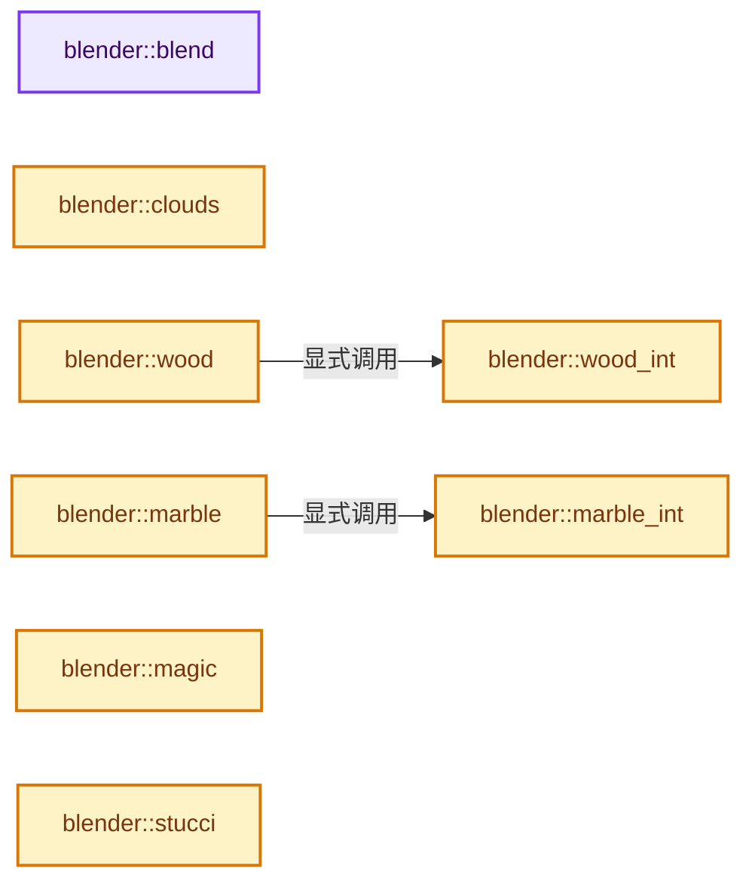

# 实现依赖专题：source/blender/render/intern/texture_procedural.cc

[实现依赖导航](../../../README.md) · [符号索引](../../../../00-课程指南/02-源码与提交索引/符号依赖与实现索引.md)

本专题从正文实际调用进入，集中保存共享实现。函数有稳定锚点，可从调用处直接跳到对应完整函数；递归与互相调用通过回链组织。

## 本文件的实现关系




## 完整成员与函数实现

<a id="f-e4cf78b1de6899e6"></a>

### `blender::blend`

实现位置：[source/blender/render/intern/texture_procedural.cc](../../../../../../../../source/blender/render/intern/texture_procedural.cc) · L55—L110。

接口参数：

- `const Tex *tex`
- `const float texvec[3]`
- `TexResult *texres`

**教学注释版**

<!-- annotated:898f190eaa866c -->

```cpp
static int blend(const Tex *tex, const float texvec[3], TexResult *texres)
{
  float x, y, t;

  if (tex->flag & TEX_FLIPBLEND) {
    x = texvec[1];
    y = texvec[0];
  }
  else {
    x = texvec[0];
    y = texvec[1];
  }

  if (tex->stype == TEX_LIN) { /* Linear. */
    texres->tin = (1.0f + x) / 2.0f;
  }
  else if (tex->stype == TEX_QUAD) { /* Quadratic. */
    texres->tin = (1.0f + x) / 2.0f;
    if (texres->tin < 0.0f) {
      texres->tin = 0.0f;
    }
    else {
      texres->tin *= texres->tin;
    }
  }
  else if (tex->stype == TEX_EASE) { /* Ease. */
    texres->tin = (1.0f + x) / 2.0f;
    if (texres->tin <= 0.0f) {
      texres->tin = 0.0f;
    }
    else if (texres->tin >= 1.0f) {
      texres->tin = 1.0f;
    }
    else {
      t = texres->tin * texres->tin;
      texres->tin = (3.0f * t - 2.0f * t * texres->tin);
    }
  }
  else if (tex->stype == TEX_DIAG) { /* Diagonal. */
    texres->tin = (2.0f + x + y) / 4.0f;
  }
  else if (tex->stype == TEX_RAD) { /* Radial. */
    texres->tin = (atan2f(y, x) / float(2 * M_PI) + 0.5f);
  }
  else { /* sphere TEX_SPHERE */
    texres->tin = 1.0f - sqrtf(x * x + y * y + texvec[2] * texvec[2]);
    // [讲解] std::max：按比较关系选取较大值。本讲解中的增长公式同时满足最低请求和几何增长；若保存返回引用，还需注意实参寿命。
    texres->tin = std::max(texres->tin, 0.0f);
    if (tex->stype == TEX_HALO) {
      texres->tin *= texres->tin; /* Halo. */
    }
  }

  BRICONT;

  return TEX_INT;
}
```

<details>
<summary>核对原始源码：source/blender/render/intern/texture_procedural.cc · L55—L110</summary>

<!-- original:898f190eaa866c:source/blender/render/intern/texture_procedural.cc:55:110 -->

```cpp
static int blend(const Tex *tex, const float texvec[3], TexResult *texres)
{
  float x, y, t;

  if (tex->flag & TEX_FLIPBLEND) {
    x = texvec[1];
    y = texvec[0];
  }
  else {
    x = texvec[0];
    y = texvec[1];
  }

  if (tex->stype == TEX_LIN) { /* Linear. */
    texres->tin = (1.0f + x) / 2.0f;
  }
  else if (tex->stype == TEX_QUAD) { /* Quadratic. */
    texres->tin = (1.0f + x) / 2.0f;
    if (texres->tin < 0.0f) {
      texres->tin = 0.0f;
    }
    else {
      texres->tin *= texres->tin;
    }
  }
  else if (tex->stype == TEX_EASE) { /* Ease. */
    texres->tin = (1.0f + x) / 2.0f;
    if (texres->tin <= 0.0f) {
      texres->tin = 0.0f;
    }
    else if (texres->tin >= 1.0f) {
      texres->tin = 1.0f;
    }
    else {
      t = texres->tin * texres->tin;
      texres->tin = (3.0f * t - 2.0f * t * texres->tin);
    }
  }
  else if (tex->stype == TEX_DIAG) { /* Diagonal. */
    texres->tin = (2.0f + x + y) / 4.0f;
  }
  else if (tex->stype == TEX_RAD) { /* Radial. */
    texres->tin = (atan2f(y, x) / float(2 * M_PI) + 0.5f);
  }
  else { /* sphere TEX_SPHERE */
    texres->tin = 1.0f - sqrtf(x * x + y * y + texvec[2] * texvec[2]);
    texres->tin = std::max(texres->tin, 0.0f);
    if (tex->stype == TEX_HALO) {
      texres->tin *= texres->tin; /* Halo. */
    }
  }

  BRICONT;

  return TEX_INT;
}
```

</details>

**沿实际写入检查状态**

- `x = texvec[1];`
- `y = texvec[0];`
- `x = texvec[0];`
- `y = texvec[1];`
- `texres->tin = (1.0f + x) / 2.0f;`
- `texres->tin = 0.0f;`
- `texres->tin *= texres->tin;`
- `texres->tin = 1.0f;`
- `t = texres->tin * texres->tin;`
- `texres->tin = (3.0f * t - 2.0f * t * texres->tin);`
- `texres->tin = (2.0f + x + y) / 4.0f;`
- `texres->tin = (atan2f(y, x) / float(2 * M_PI) + 0.5f);`
- `texres->tin = 1.0f - sqrtf(x * x + y * y + texvec[2] * texvec[2]);`
- `texres->tin = std::max(texres->tin, 0.0f);`
- `texres->tin *= texres->tin; /* Halo. */`

**结果出口**

- `return TEX_INT;`

**继续追踪实现**

- `atan2f` → [atan2f · L18](../../../07-Intern运行时与平台/cycles/kernel/svm/radial_tiling_shared.h.md#m-a77af3382db2)；[atan2f · L40](../../../07-Intern运行时与平台/cycles/kernel/svm/radial_tiling_shared.h.md#m-cec47b2ce998)；[atan2f · L71](../../../07-Intern运行时与平台/cycles/kernel/svm/radial_tiling_shared.h.md#m-bd31b1779092)；[atan2f · L22](../../../01-BLI基础库/intern/radial_tiling_shared.hh.md#m-9b9c2a707484)；[atan2f · L44](../../../01-BLI基础库/intern/radial_tiling_shared.hh.md#m-63f49b7d81dc)；[atan2f · L75](../../../01-BLI基础库/intern/radial_tiling_shared.hh.md#m-4201e8b4c423)；[atan2f · L18](../../../07-Intern运行时与平台/cycles/kernel/osl/shaders/node_radial_tiling_shared.h.md#m-ec4f8238af32)；[atan2f · L40](../../../07-Intern运行时与平台/cycles/kernel/osl/shaders/node_radial_tiling_shared.h.md#m-980162d675e3)；[atan2f · L71](../../../07-Intern运行时与平台/cycles/kernel/osl/shaders/node_radial_tiling_shared.h.md#m-bcd4c102a83d)；[atan2f · L179](../../../07-Intern运行时与平台/cycles/kernel/device/oneapi/compat.h.md#m-5be26d38bfa7)；[atan2f · L274](../../../07-Intern运行时与平台/cycles/kernel/device/metal/compat.h.md#m-1b9636d3b02f)。宏定义由构建条件选择。
- `sqrtf` → [外部契约](https://eel.is/c++draft/)：这个边界按实际表达式及所属类型核对参数、返回值、寿命与失败行为。这里提供接口入口，不声称已解释该第三方版本的内部实现。
- `std::max` → [外部契约](https://eel.is/c++draft/alg.min.max)：按比较关系选取较大值。本讲解中的增长公式同时满足最低请求和几何增长；若保存返回引用，还需注意实参寿命。

<a id="f-625b3dfa57341310"></a>

### `blender::clouds`

实现位置：[source/blender/render/intern/texture_procedural.cc](../../../../../../../../source/blender/render/intern/texture_procedural.cc) · L117—L153。

接口参数：

- `const Tex *tex`
- `const float texvec[3]`
- `TexResult *texres`

**教学注释版**

<!-- annotated:15efc7cbfa233b -->

```cpp
static int clouds(const Tex *tex, const float texvec[3], TexResult *texres)
{
  int rv = TEX_INT;

  texres->tin = BLI_noise_generic_turbulence(tex->noisesize,
                                             texvec[0],
                                             texvec[1],
                                             texvec[2],
                                             tex->noisedepth,
                                             (tex->noisetype != TEX_NOISESOFT),
                                             tex->noisebasis);

  if (tex->stype == TEX_COLOR) {
    texres->trgba[0] = texres->tin;
    texres->trgba[1] = BLI_noise_generic_turbulence(tex->noisesize,
                                                    texvec[1],
                                                    texvec[0],
                                                    texvec[2],
                                                    tex->noisedepth,
                                                    (tex->noisetype != TEX_NOISESOFT),
                                                    tex->noisebasis);
    texres->trgba[2] = BLI_noise_generic_turbulence(tex->noisesize,
                                                    texvec[1],
                                                    texvec[2],
                                                    texvec[0],
                                                    tex->noisedepth,
                                                    (tex->noisetype != TEX_NOISESOFT),
                                                    tex->noisebasis);
    BRICONTRGB;
    texres->trgba[3] = 1.0;
    return (rv | TEX_RGB);
  }

  BRICONT;

  return rv;
}
```

<details>
<summary>核对原始源码：source/blender/render/intern/texture_procedural.cc · L117—L153</summary>

<!-- original:15efc7cbfa233b:source/blender/render/intern/texture_procedural.cc:117:153 -->

```cpp
static int clouds(const Tex *tex, const float texvec[3], TexResult *texres)
{
  int rv = TEX_INT;

  texres->tin = BLI_noise_generic_turbulence(tex->noisesize,
                                             texvec[0],
                                             texvec[1],
                                             texvec[2],
                                             tex->noisedepth,
                                             (tex->noisetype != TEX_NOISESOFT),
                                             tex->noisebasis);

  if (tex->stype == TEX_COLOR) {
    texres->trgba[0] = texres->tin;
    texres->trgba[1] = BLI_noise_generic_turbulence(tex->noisesize,
                                                    texvec[1],
                                                    texvec[0],
                                                    texvec[2],
                                                    tex->noisedepth,
                                                    (tex->noisetype != TEX_NOISESOFT),
                                                    tex->noisebasis);
    texres->trgba[2] = BLI_noise_generic_turbulence(tex->noisesize,
                                                    texvec[1],
                                                    texvec[2],
                                                    texvec[0],
                                                    tex->noisedepth,
                                                    (tex->noisetype != TEX_NOISESOFT),
                                                    tex->noisebasis);
    BRICONTRGB;
    texres->trgba[3] = 1.0;
    return (rv | TEX_RGB);
  }

  BRICONT;

  return rv;
}
```

</details>

**沿实际写入检查状态**

- `texres->tin = BLI_noise_generic_turbulence(tex->noisesize,`
- `texres->trgba[0] = texres->tin;`
- `texres->trgba[1] = BLI_noise_generic_turbulence(tex->noisesize,`
- `texres->trgba[2] = BLI_noise_generic_turbulence(tex->noisesize,`
- `texres->trgba[3] = 1.0;`

**结果出口**

- `return (rv | TEX_RGB);`
- `return rv;`

**继续追踪实现**

- `BLI_noise_generic_turbulence` → [blender::BLI_noise_generic_turbulence · L1212](../../../01-BLI基础库/intern/noise_c.cc.md#f-de528bb4e81cd83e)。

<a id="f-825ad256f9eaf89a"></a>

### `blender::wood_int`

实现位置：[source/blender/render/intern/texture_procedural.cc](../../../../../../../../source/blender/render/intern/texture_procedural.cc) · L188—L225。

接口参数：

- `const Tex *tex`
- `float x`
- `float y`
- `float z`

**教学注释版**

<!-- annotated:5bf750996f3963 -->

```cpp
static float wood_int(const Tex *tex, float x, float y, float z)
{
  float wi = 0;
  /* wave form: TEX_SIN=0, TEX_SAW=1, TEX_TRI=2. */
  short wf = tex->noisebasis2;
  /* wood type: TEX_BAND=0, TEX_RING=1, TEX_BANDNOISE=2, TEX_RINGNOISE=3. */
  short wt = tex->stype;

  float (*waveform[3])(float); /* create array of pointers to waveform functions */
  waveform[0] = tex_sin;       /* assign address of tex_sin() function to pointer array */
  waveform[1] = tex_saw;
  waveform[2] = tex_tri;

  if ((wf > TEX_TRI) || (wf < TEX_SIN)) {
    wf = 0; /* check to be sure noisebasis2 is initialized ahead of time */
  }

  if (wt == TEX_BAND) {
    wi = waveform[wf]((x + y + z) * 10.0f);
  }
  else if (wt == TEX_RING) {
    wi = waveform[wf](sqrtf(x * x + y * y + z * z) * 20.0f);
  }
  else if (wt == TEX_BANDNOISE) {
    wi = tex->turbul *
         BLI_noise_generic_noise(
             tex->noisesize, x, y, z, (tex->noisetype != TEX_NOISESOFT), tex->noisebasis);
    wi = waveform[wf]((x + y + z) * 10.0f + wi);
  }
  else if (wt == TEX_RINGNOISE) {
    wi = tex->turbul *
         BLI_noise_generic_noise(
             tex->noisesize, x, y, z, (tex->noisetype != TEX_NOISESOFT), tex->noisebasis);
    wi = waveform[wf](sqrtf(x * x + y * y + z * z) * 20.0f + wi);
  }

  return wi;
}
```

<details>
<summary>核对原始源码：source/blender/render/intern/texture_procedural.cc · L188—L225</summary>

<!-- original:5bf750996f3963:source/blender/render/intern/texture_procedural.cc:188:225 -->

```cpp
static float wood_int(const Tex *tex, float x, float y, float z)
{
  float wi = 0;
  /* wave form: TEX_SIN=0, TEX_SAW=1, TEX_TRI=2. */
  short wf = tex->noisebasis2;
  /* wood type: TEX_BAND=0, TEX_RING=1, TEX_BANDNOISE=2, TEX_RINGNOISE=3. */
  short wt = tex->stype;

  float (*waveform[3])(float); /* create array of pointers to waveform functions */
  waveform[0] = tex_sin;       /* assign address of tex_sin() function to pointer array */
  waveform[1] = tex_saw;
  waveform[2] = tex_tri;

  if ((wf > TEX_TRI) || (wf < TEX_SIN)) {
    wf = 0; /* check to be sure noisebasis2 is initialized ahead of time */
  }

  if (wt == TEX_BAND) {
    wi = waveform[wf]((x + y + z) * 10.0f);
  }
  else if (wt == TEX_RING) {
    wi = waveform[wf](sqrtf(x * x + y * y + z * z) * 20.0f);
  }
  else if (wt == TEX_BANDNOISE) {
    wi = tex->turbul *
         BLI_noise_generic_noise(
             tex->noisesize, x, y, z, (tex->noisetype != TEX_NOISESOFT), tex->noisebasis);
    wi = waveform[wf]((x + y + z) * 10.0f + wi);
  }
  else if (wt == TEX_RINGNOISE) {
    wi = tex->turbul *
         BLI_noise_generic_noise(
             tex->noisesize, x, y, z, (tex->noisetype != TEX_NOISESOFT), tex->noisebasis);
    wi = waveform[wf](sqrtf(x * x + y * y + z * z) * 20.0f + wi);
  }

  return wi;
}
```

</details>

**沿实际写入检查状态**

- `waveform[0] = tex_sin;       /* assign address of tex_sin() function to pointer array */`
- `waveform[1] = tex_saw;`
- `waveform[2] = tex_tri;`
- `wf = 0; /* check to be sure noisebasis2 is initialized ahead of time */`
- `wi = waveform[wf]((x + y + z) * 10.0f);`
- `wi = waveform[wf](sqrtf(x * x + y * y + z * z) * 20.0f);`
- `wi = tex->turbul *`
- `wi = waveform[wf]((x + y + z) * 10.0f + wi);`
- `wi = waveform[wf](sqrtf(x * x + y * y + z * z) * 20.0f + wi);`

**结果出口**

- `return wi;`

**继续追踪实现**

- `waveform[wf]` → [调用协议](../../../../00-课程指南/01-路线与规范/模板宏与动态分派协议.md)：局部可调用对象，须结合其初始化与捕获环境。调用位置L206。
- `sqrtf` → [外部契约](https://eel.is/c++draft/)：这个边界按实际表达式及所属类型核对参数、返回值、寿命与失败行为。这里提供接口入口，不声称已解释该第三方版本的内部实现。
- `BLI_noise_generic_noise` → [blender::BLI_noise_generic_noise · L1155](../../../01-BLI基础库/intern/noise_c.cc.md#f-719c032123ea9e4d)。

<a id="f-5714f9d802b642a1"></a>

### `blender::wood`

实现位置：[source/blender/render/intern/texture_procedural.cc](../../../../../../../../source/blender/render/intern/texture_procedural.cc) · L227—L236。

接口参数：

- `const Tex *tex`
- `const float texvec[3]`
- `TexResult *texres`

**教学注释版**

<!-- annotated:d02b352798d8a3 -->

```cpp
static int wood(const Tex *tex, const float texvec[3], TexResult *texres)
{
  int rv = TEX_INT;

  texres->tin = wood_int(tex, texvec[0], texvec[1], texvec[2]);

  BRICONT;

  return rv;
}
```

<details>
<summary>核对原始源码：source/blender/render/intern/texture_procedural.cc · L227—L236</summary>

<!-- original:d02b352798d8a3:source/blender/render/intern/texture_procedural.cc:227:236 -->

```cpp
static int wood(const Tex *tex, const float texvec[3], TexResult *texres)
{
  int rv = TEX_INT;

  texres->tin = wood_int(tex, texvec[0], texvec[1], texvec[2]);

  BRICONT;

  return rv;
}
```

</details>

**沿实际写入检查状态**

- `texres->tin = wood_int(tex, texvec[0], texvec[1], texvec[2]);`

**结果出口**

- `return rv;`

**继续追踪实现**

- `wood_int` → [blender::wood_int · L188](texture_procedural.cc.md#f-825ad256f9eaf89a)。

<a id="f-0b86cb5abec8d38c"></a>

### `blender::marble_int`

实现位置：[source/blender/render/intern/texture_procedural.cc](../../../../../../../../source/blender/render/intern/texture_procedural.cc) · L239—L275。

接口参数：

- `const Tex *tex`
- `float x`
- `float y`
- `float z`

**教学注释版**

<!-- annotated:7a74fffca57e36 -->

```cpp
static float marble_int(const Tex *tex, float x, float y, float z)
{
  float n, mi;
  short wf = tex->noisebasis2; /* wave form:   TEX_SIN=0, TEX_SAW=1, TEX_TRI=2 */
  short mt = tex->stype;       /* marble type: TEX_SOFT=0, TEX_SHARP=1, TEX_SHAPER=2 */

  float (*waveform[3])(float); /* create array of pointers to waveform functions */
  waveform[0] = tex_sin;       /* assign address of tex_sin() function to pointer array */
  waveform[1] = tex_saw;
  waveform[2] = tex_tri;

  if ((wf > TEX_TRI) || (wf < TEX_SIN)) {
    wf = 0; /* check to be sure noisebasis2 isn't initialized ahead of time */
  }

  n = 5.0f * (x + y + z);

  mi = n + tex->turbul * BLI_noise_generic_turbulence(tex->noisesize,
                                                      x,
                                                      y,
                                                      z,
                                                      tex->noisedepth,
                                                      (tex->noisetype != TEX_NOISESOFT),
                                                      tex->noisebasis);

  if (mt >= TEX_SOFT) { /* TEX_SOFT always true */
    mi = waveform[wf](mi);
    if (mt == TEX_SHARP) {
      mi = sqrtf(mi);
    }
    else if (mt == TEX_SHARPER) {
      mi = sqrtf(sqrtf(mi));
    }
  }

  return mi;
}
```

<details>
<summary>核对原始源码：source/blender/render/intern/texture_procedural.cc · L239—L275</summary>

<!-- original:7a74fffca57e36:source/blender/render/intern/texture_procedural.cc:239:275 -->

```cpp
static float marble_int(const Tex *tex, float x, float y, float z)
{
  float n, mi;
  short wf = tex->noisebasis2; /* wave form:   TEX_SIN=0, TEX_SAW=1, TEX_TRI=2 */
  short mt = tex->stype;       /* marble type: TEX_SOFT=0, TEX_SHARP=1, TEX_SHAPER=2 */

  float (*waveform[3])(float); /* create array of pointers to waveform functions */
  waveform[0] = tex_sin;       /* assign address of tex_sin() function to pointer array */
  waveform[1] = tex_saw;
  waveform[2] = tex_tri;

  if ((wf > TEX_TRI) || (wf < TEX_SIN)) {
    wf = 0; /* check to be sure noisebasis2 isn't initialized ahead of time */
  }

  n = 5.0f * (x + y + z);

  mi = n + tex->turbul * BLI_noise_generic_turbulence(tex->noisesize,
                                                      x,
                                                      y,
                                                      z,
                                                      tex->noisedepth,
                                                      (tex->noisetype != TEX_NOISESOFT),
                                                      tex->noisebasis);

  if (mt >= TEX_SOFT) { /* TEX_SOFT always true */
    mi = waveform[wf](mi);
    if (mt == TEX_SHARP) {
      mi = sqrtf(mi);
    }
    else if (mt == TEX_SHARPER) {
      mi = sqrtf(sqrtf(mi));
    }
  }

  return mi;
}
```

</details>

**沿实际写入检查状态**

- `waveform[0] = tex_sin;       /* assign address of tex_sin() function to pointer array */`
- `waveform[1] = tex_saw;`
- `waveform[2] = tex_tri;`
- `wf = 0; /* check to be sure noisebasis2 isn't initialized ahead of time */`
- `n = 5.0f * (x + y + z);`
- `mi = n + tex->turbul * BLI_noise_generic_turbulence(tex->noisesize,`
- `mi = waveform[wf](mi);`
- `mi = sqrtf(mi);`
- `mi = sqrtf(sqrtf(mi));`

**结果出口**

- `return mi;`

**继续追踪实现**

- `BLI_noise_generic_turbulence` → [blender::BLI_noise_generic_turbulence · L1212](../../../01-BLI基础库/intern/noise_c.cc.md#f-de528bb4e81cd83e)。
- `waveform[wf]` → [调用协议](../../../../00-课程指南/01-路线与规范/模板宏与动态分派协议.md)：局部可调用对象，须结合其初始化与捕获环境。调用位置L265。
- `sqrtf` → [外部契约](https://eel.is/c++draft/)：这个边界按实际表达式及所属类型核对参数、返回值、寿命与失败行为。这里提供接口入口，不声称已解释该第三方版本的内部实现。

<a id="f-28af743a91d50cf8"></a>

### `blender::marble`

实现位置：[source/blender/render/intern/texture_procedural.cc](../../../../../../../../source/blender/render/intern/texture_procedural.cc) · L277—L286。

接口参数：

- `const Tex *tex`
- `const float texvec[3]`
- `TexResult *texres`

**教学注释版**

<!-- annotated:ac8d381fb6171c -->

```cpp
static int marble(const Tex *tex, const float texvec[3], TexResult *texres)
{
  int rv = TEX_INT;

  texres->tin = marble_int(tex, texvec[0], texvec[1], texvec[2]);

  BRICONT;

  return rv;
}
```

<details>
<summary>核对原始源码：source/blender/render/intern/texture_procedural.cc · L277—L286</summary>

<!-- original:ac8d381fb6171c:source/blender/render/intern/texture_procedural.cc:277:286 -->

```cpp
static int marble(const Tex *tex, const float texvec[3], TexResult *texres)
{
  int rv = TEX_INT;

  texres->tin = marble_int(tex, texvec[0], texvec[1], texvec[2]);

  BRICONT;

  return rv;
}
```

</details>

**沿实际写入检查状态**

- `texres->tin = marble_int(tex, texvec[0], texvec[1], texvec[2]);`

**结果出口**

- `return rv;`

**继续追踪实现**

- `marble_int` → [blender::marble_int · L239](texture_procedural.cc.md#f-0b86cb5abec8d38c)。

<a id="f-d6b31024bff2e09b"></a>

### `blender::magic`

实现位置：[source/blender/render/intern/texture_procedural.cc](../../../../../../../../source/blender/render/intern/texture_procedural.cc) · L290—L361。

接口参数：

- `const Tex *tex`
- `const float texvec[3]`
- `TexResult *texres`

**教学注释版**

<!-- annotated:f404b0d7895acd -->

```cpp
static int magic(const Tex *tex, const float texvec[3], TexResult *texres)
{
  float x, y, z, turb;
  int n;

  n = tex->noisedepth;
  turb = tex->turbul / 5.0f;

  x = sinf((texvec[0] + texvec[1] + texvec[2]) * 5.0f);
  y = cosf((-texvec[0] + texvec[1] - texvec[2]) * 5.0f);
  z = -cosf((-texvec[0] - texvec[1] + texvec[2]) * 5.0f);
  if (n > 0) {
    x *= turb;
    y *= turb;
    z *= turb;
    y = -cosf(x - y + z);
    y *= turb;
    if (n > 1) {
      x = cosf(x - y - z);
      x *= turb;
      if (n > 2) {
        z = sinf(-x - y - z);
        z *= turb;
        if (n > 3) {
          x = -cosf(-x + y - z);
          x *= turb;
          if (n > 4) {
            y = -sinf(-x + y + z);
            y *= turb;
            if (n > 5) {
              y = -cosf(-x + y + z);
              y *= turb;
              if (n > 6) {
                x = cosf(x + y + z);
                x *= turb;
                if (n > 7) {
                  z = sinf(x + y - z);
                  z *= turb;
                  if (n > 8) {
                    x = -cosf(-x - y + z);
                    x *= turb;
                    if (n > 9) {
                      y = -sinf(x - y + z);
                      y *= turb;
                    }
                  }
                }
              }
            }
          }
        }
      }
    }
  }

  if (turb != 0.0f) {
    turb *= 2.0f;
    x /= turb;
    y /= turb;
    z /= turb;
  }
  texres->trgba[0] = 0.5f - x;
  texres->trgba[1] = 0.5f - y;
  texres->trgba[2] = 0.5f - z;

  texres->tin = (1.0f / 3.0f) * (texres->trgba[0] + texres->trgba[1] + texres->trgba[2]);

  BRICONTRGB;
  texres->trgba[3] = 1.0f;

  return TEX_RGB;
}
```

<details>
<summary>核对原始源码：source/blender/render/intern/texture_procedural.cc · L290—L361</summary>

<!-- original:f404b0d7895acd:source/blender/render/intern/texture_procedural.cc:290:361 -->

```cpp
static int magic(const Tex *tex, const float texvec[3], TexResult *texres)
{
  float x, y, z, turb;
  int n;

  n = tex->noisedepth;
  turb = tex->turbul / 5.0f;

  x = sinf((texvec[0] + texvec[1] + texvec[2]) * 5.0f);
  y = cosf((-texvec[0] + texvec[1] - texvec[2]) * 5.0f);
  z = -cosf((-texvec[0] - texvec[1] + texvec[2]) * 5.0f);
  if (n > 0) {
    x *= turb;
    y *= turb;
    z *= turb;
    y = -cosf(x - y + z);
    y *= turb;
    if (n > 1) {
      x = cosf(x - y - z);
      x *= turb;
      if (n > 2) {
        z = sinf(-x - y - z);
        z *= turb;
        if (n > 3) {
          x = -cosf(-x + y - z);
          x *= turb;
          if (n > 4) {
            y = -sinf(-x + y + z);
            y *= turb;
            if (n > 5) {
              y = -cosf(-x + y + z);
              y *= turb;
              if (n > 6) {
                x = cosf(x + y + z);
                x *= turb;
                if (n > 7) {
                  z = sinf(x + y - z);
                  z *= turb;
                  if (n > 8) {
                    x = -cosf(-x - y + z);
                    x *= turb;
                    if (n > 9) {
                      y = -sinf(x - y + z);
                      y *= turb;
                    }
                  }
                }
              }
            }
          }
        }
      }
    }
  }

  if (turb != 0.0f) {
    turb *= 2.0f;
    x /= turb;
    y /= turb;
    z /= turb;
  }
  texres->trgba[0] = 0.5f - x;
  texres->trgba[1] = 0.5f - y;
  texres->trgba[2] = 0.5f - z;

  texres->tin = (1.0f / 3.0f) * (texres->trgba[0] + texres->trgba[1] + texres->trgba[2]);

  BRICONTRGB;
  texres->trgba[3] = 1.0f;

  return TEX_RGB;
}
```

</details>

**沿实际写入检查状态**

- `n = tex->noisedepth;`
- `turb = tex->turbul / 5.0f;`
- `x = sinf((texvec[0] + texvec[1] + texvec[2]) * 5.0f);`
- `y = cosf((-texvec[0] + texvec[1] - texvec[2]) * 5.0f);`
- `z = -cosf((-texvec[0] - texvec[1] + texvec[2]) * 5.0f);`
- `x *= turb;`
- `y *= turb;`
- `z *= turb;`
- `y = -cosf(x - y + z);`
- `x = cosf(x - y - z);`
- `z = sinf(-x - y - z);`
- `x = -cosf(-x + y - z);`
- `y = -sinf(-x + y + z);`
- `y = -cosf(-x + y + z);`
- `x = cosf(x + y + z);`
- `z = sinf(x + y - z);`
- `x = -cosf(-x - y + z);`
- `y = -sinf(x - y + z);`
- `turb *= 2.0f;`
- `texres->trgba[0] = 0.5f - x;`
- `texres->trgba[1] = 0.5f - y;`
- `texres->trgba[2] = 0.5f - z;`
- `texres->tin = (1.0f / 3.0f) * (texres->trgba[0] + texres->trgba[1] + texres->trgba[2]);`
- `texres->trgba[3] = 1.0f;`

**结果出口**

- `return TEX_RGB;`

**继续追踪实现**

- `sinf` → [sinf · L27](../../../07-Intern运行时与平台/cycles/kernel/svm/radial_tiling_shared.h.md#m-40547e913688)；[sinf · L49](../../../07-Intern运行时与平台/cycles/kernel/svm/radial_tiling_shared.h.md#m-8908e5f49833)；[sinf · L80](../../../07-Intern运行时与平台/cycles/kernel/svm/radial_tiling_shared.h.md#m-71130f6adcc4)；[sinf · L31](../../../01-BLI基础库/intern/radial_tiling_shared.hh.md#m-a51a6c88deca)；[sinf · L53](../../../01-BLI基础库/intern/radial_tiling_shared.hh.md#m-9a4db95358ff)；[sinf · L84](../../../01-BLI基础库/intern/radial_tiling_shared.hh.md#m-d26cdafe5b93)；[sinf · L27](../../../07-Intern运行时与平台/cycles/kernel/osl/shaders/node_radial_tiling_shared.h.md#m-9f80b4d363af)；[sinf · L49](../../../07-Intern运行时与平台/cycles/kernel/osl/shaders/node_radial_tiling_shared.h.md#m-f52c29b37ed1)；[sinf · L80](../../../07-Intern运行时与平台/cycles/kernel/osl/shaders/node_radial_tiling_shared.h.md#m-7f1f234ef9ec)；[sinf · L187](../../../07-Intern运行时与平台/cycles/kernel/device/oneapi/compat.h.md#m-aab07e522dda)；[sinf · L287](../../../07-Intern运行时与平台/cycles/kernel/device/metal/compat.h.md#m-7009b99c07ca)；[sinf · L94](../../../07-Intern运行时与平台/cycles/kernel/device/hip/compat.h.md#m-4a1f5d760325)；[sinf · L92](../../../07-Intern运行时与平台/cycles/kernel/device/cuda/compat.h.md#m-e63872738f13)；[sinf · L44](../../gpu/GPU_shader_shared_utils.hh.md#m-a916f31e38c4)；[sinf · L65](../../gpu/GPU_shader_shared_utils.hh.md#m-268edbf6d41e)。宏定义由构建条件选择。
- `cosf` → [cosf · L20](../../../07-Intern运行时与平台/cycles/kernel/svm/radial_tiling_shared.h.md#m-cee9ebf67d86)；[cosf · L42](../../../07-Intern运行时与平台/cycles/kernel/svm/radial_tiling_shared.h.md#m-346533627567)；[cosf · L73](../../../07-Intern运行时与平台/cycles/kernel/svm/radial_tiling_shared.h.md#m-e01b94a43b72)；[cosf · L24](../../../01-BLI基础库/intern/radial_tiling_shared.hh.md#m-c317cb08dec6)；[cosf · L46](../../../01-BLI基础库/intern/radial_tiling_shared.hh.md#m-93325b515297)；[cosf · L77](../../../01-BLI基础库/intern/radial_tiling_shared.hh.md#m-d3058af0b490)；[cosf · L20](../../../07-Intern运行时与平台/cycles/kernel/osl/shaders/node_radial_tiling_shared.h.md#m-4c6aea22a560)；[cosf · L42](../../../07-Intern运行时与平台/cycles/kernel/osl/shaders/node_radial_tiling_shared.h.md#m-1fd6a5414477)；[cosf · L73](../../../07-Intern运行时与平台/cycles/kernel/osl/shaders/node_radial_tiling_shared.h.md#m-de2402f85270)；[cosf · L186](../../../07-Intern运行时与平台/cycles/kernel/device/oneapi/compat.h.md#m-7fdbd99009e0)；[cosf · L288](../../../07-Intern运行时与平台/cycles/kernel/device/metal/compat.h.md#m-68fe984e8b68)；[cosf · L93](../../../07-Intern运行时与平台/cycles/kernel/device/hip/compat.h.md#m-21bb557a23f1)；[cosf · L91](../../../07-Intern运行时与平台/cycles/kernel/device/cuda/compat.h.md#m-7721be419a49)；[cosf · L43](../../gpu/GPU_shader_shared_utils.hh.md#m-25d02fd11b3b)；[cosf · L64](../../gpu/GPU_shader_shared_utils.hh.md#m-698fc51ccda3)。宏定义由构建条件选择。

<a id="f-bc5a41e8617f283c"></a>

### `blender::stucci`

实现位置：[source/blender/render/intern/texture_procedural.cc](../../../../../../../../source/blender/render/intern/texture_procedural.cc) · L366—L398。

接口参数：

- `const Tex *tex`
- `const float texvec[3]`
- `TexResult *texres`

**教学注释版**

<!-- annotated:5f57edc4b69f3c -->

```cpp
static int stucci(const Tex *tex, const float texvec[3], TexResult *texres)
{
  float b2, ofs;
  int retval = TEX_INT;

  b2 = BLI_noise_generic_noise(tex->noisesize,
                               texvec[0],
                               texvec[1],
                               texvec[2],
                               (tex->noisetype != TEX_NOISESOFT),
                               tex->noisebasis);

  ofs = tex->turbul / 200.0f;

  if (tex->stype) {
    ofs *= (b2 * b2);
  }

  texres->tin = BLI_noise_generic_noise(tex->noisesize,
                                        texvec[0],
                                        texvec[1],
                                        texvec[2] + ofs,
                                        (tex->noisetype != TEX_NOISESOFT),
                                        tex->noisebasis);

  if (tex->stype == TEX_WALLOUT) {
    texres->tin = 1.0f - texres->tin;
  }

  // [讲解] std::max：按比较关系选取较大值。本讲解中的增长公式同时满足最低请求和几何增长；若保存返回引用，还需注意实参寿命。
  texres->tin = std::max(texres->tin, 0.0f);

  return retval;
}
```

<details>
<summary>核对原始源码：source/blender/render/intern/texture_procedural.cc · L366—L398</summary>

<!-- original:5f57edc4b69f3c:source/blender/render/intern/texture_procedural.cc:366:398 -->

```cpp
static int stucci(const Tex *tex, const float texvec[3], TexResult *texres)
{
  float b2, ofs;
  int retval = TEX_INT;

  b2 = BLI_noise_generic_noise(tex->noisesize,
                               texvec[0],
                               texvec[1],
                               texvec[2],
                               (tex->noisetype != TEX_NOISESOFT),
                               tex->noisebasis);

  ofs = tex->turbul / 200.0f;

  if (tex->stype) {
    ofs *= (b2 * b2);
  }

  texres->tin = BLI_noise_generic_noise(tex->noisesize,
                                        texvec[0],
                                        texvec[1],
                                        texvec[2] + ofs,
                                        (tex->noisetype != TEX_NOISESOFT),
                                        tex->noisebasis);

  if (tex->stype == TEX_WALLOUT) {
    texres->tin = 1.0f - texres->tin;
  }

  texres->tin = std::max(texres->tin, 0.0f);

  return retval;
}
```

</details>

**沿实际写入检查状态**

- `b2 = BLI_noise_generic_noise(tex->noisesize,`
- `ofs = tex->turbul / 200.0f;`
- `ofs *= (b2 * b2);`
- `texres->tin = BLI_noise_generic_noise(tex->noisesize,`
- `texres->tin = 1.0f - texres->tin;`
- `texres->tin = std::max(texres->tin, 0.0f);`

**结果出口**

- `return retval;`

**继续追踪实现**

- `BLI_noise_generic_noise` → [blender::BLI_noise_generic_noise · L1155](../../../01-BLI基础库/intern/noise_c.cc.md#f-719c032123ea9e4d)。
- `std::max` → [外部契约](https://eel.is/c++draft/alg.min.max)：按比较关系选取较大值。本讲解中的增长公式同时满足最低请求和几何增长；若保存返回引用，还需注意实参寿命。

<a id="f-cfc7a5feea35b6d2"></a>

### `blender::mg_mFractalOrfBmTex`

实现位置：[source/blender/render/intern/texture_procedural.cc](../../../../../../../../source/blender/render/intern/texture_procedural.cc) · L403—L426。

接口参数：

- `const Tex *tex`
- `const float texvec[3]`
- `TexResult *texres`

**教学注释版**

<!-- annotated:90c427277ae902 -->

```cpp
static int mg_mFractalOrfBmTex(const Tex *tex, const float texvec[3], TexResult *texres)
{
  int rv = TEX_INT;
  float (*mgravefunc)(float, float, float, float, float, float, int);

  if (tex->stype == TEX_MFRACTAL) {
    mgravefunc = BLI_noise_mg_multi_fractal;
  }
  else {
    mgravefunc = BLI_noise_mg_fbm;
  }

  texres->tin = tex->ns_outscale * mgravefunc(texvec[0],
                                              texvec[1],
                                              texvec[2],
                                              tex->mg_H,
                                              tex->mg_lacunarity,
                                              tex->mg_octaves,
                                              tex->noisebasis);

  BRICONT;

  return rv;
}
```

<details>
<summary>核对原始源码：source/blender/render/intern/texture_procedural.cc · L403—L426</summary>

<!-- original:90c427277ae902:source/blender/render/intern/texture_procedural.cc:403:426 -->

```cpp
static int mg_mFractalOrfBmTex(const Tex *tex, const float texvec[3], TexResult *texres)
{
  int rv = TEX_INT;
  float (*mgravefunc)(float, float, float, float, float, float, int);

  if (tex->stype == TEX_MFRACTAL) {
    mgravefunc = BLI_noise_mg_multi_fractal;
  }
  else {
    mgravefunc = BLI_noise_mg_fbm;
  }

  texres->tin = tex->ns_outscale * mgravefunc(texvec[0],
                                              texvec[1],
                                              texvec[2],
                                              tex->mg_H,
                                              tex->mg_lacunarity,
                                              tex->mg_octaves,
                                              tex->noisebasis);

  BRICONT;

  return rv;
}
```

</details>

**沿实际写入检查状态**

- `mgravefunc = BLI_noise_mg_multi_fractal;`
- `mgravefunc = BLI_noise_mg_fbm;`
- `texres->tin = tex->ns_outscale * mgravefunc(texvec[0],`

**结果出口**

- `return rv;`

**继续追踪实现**

- `mgravefunc` → [调用协议](../../../../00-课程指南/01-路线与规范/模板宏与动态分派协议.md)：局部可调用对象，须结合其初始化与捕获环境。调用位置L415。

<a id="f-52eaa110ce1e4f27"></a>

### `blender::mg_ridgedOrHybridMFTex`

实现位置：[source/blender/render/intern/texture_procedural.cc](../../../../../../../../source/blender/render/intern/texture_procedural.cc) · L428—L453。

接口参数：

- `const Tex *tex`
- `const float texvec[3]`
- `TexResult *texres`

**教学注释版**

<!-- annotated:ba7a8d09a22b99 -->

```cpp
static int mg_ridgedOrHybridMFTex(const Tex *tex, const float texvec[3], TexResult *texres)
{
  int rv = TEX_INT;
  float (*mgravefunc)(float, float, float, float, float, float, float, float, int);

  if (tex->stype == TEX_RIDGEDMF) {
    mgravefunc = BLI_noise_mg_ridged_multi_fractal;
  }
  else {
    mgravefunc = BLI_noise_mg_hybrid_multi_fractal;
  }

  texres->tin = tex->ns_outscale * mgravefunc(texvec[0],
                                              texvec[1],
                                              texvec[2],
                                              tex->mg_H,
                                              tex->mg_lacunarity,
                                              tex->mg_octaves,
                                              tex->mg_offset,
                                              tex->mg_gain,
                                              tex->noisebasis);

  BRICONT;

  return rv;
}
```

<details>
<summary>核对原始源码：source/blender/render/intern/texture_procedural.cc · L428—L453</summary>

<!-- original:ba7a8d09a22b99:source/blender/render/intern/texture_procedural.cc:428:453 -->

```cpp
static int mg_ridgedOrHybridMFTex(const Tex *tex, const float texvec[3], TexResult *texres)
{
  int rv = TEX_INT;
  float (*mgravefunc)(float, float, float, float, float, float, float, float, int);

  if (tex->stype == TEX_RIDGEDMF) {
    mgravefunc = BLI_noise_mg_ridged_multi_fractal;
  }
  else {
    mgravefunc = BLI_noise_mg_hybrid_multi_fractal;
  }

  texres->tin = tex->ns_outscale * mgravefunc(texvec[0],
                                              texvec[1],
                                              texvec[2],
                                              tex->mg_H,
                                              tex->mg_lacunarity,
                                              tex->mg_octaves,
                                              tex->mg_offset,
                                              tex->mg_gain,
                                              tex->noisebasis);

  BRICONT;

  return rv;
}
```

</details>

**沿实际写入检查状态**

- `mgravefunc = BLI_noise_mg_ridged_multi_fractal;`
- `mgravefunc = BLI_noise_mg_hybrid_multi_fractal;`
- `texres->tin = tex->ns_outscale * mgravefunc(texvec[0],`

**结果出口**

- `return rv;`

**继续追踪实现**

- `mgravefunc` → [调用协议](../../../../00-课程指南/01-路线与规范/模板宏与动态分派协议.md)：局部可调用对象，须结合其初始化与捕获环境。调用位置L440。

<a id="f-00453c1b6e438fcb"></a>

### `blender::mg_HTerrainTex`

实现位置：[source/blender/render/intern/texture_procedural.cc](../../../../../../../../source/blender/render/intern/texture_procedural.cc) · L455—L471。

接口参数：

- `const Tex *tex`
- `const float texvec[3]`
- `TexResult *texres`

**教学注释版**

<!-- annotated:b195422db2e495 -->

```cpp
static int mg_HTerrainTex(const Tex *tex, const float texvec[3], TexResult *texres)
{
  int rv = TEX_INT;

  texres->tin = tex->ns_outscale * BLI_noise_mg_hetero_terrain(texvec[0],
                                                               texvec[1],
                                                               texvec[2],
                                                               tex->mg_H,
                                                               tex->mg_lacunarity,
                                                               tex->mg_octaves,
                                                               tex->mg_offset,
                                                               tex->noisebasis);

  BRICONT;

  return rv;
}
```

<details>
<summary>核对原始源码：source/blender/render/intern/texture_procedural.cc · L455—L471</summary>

<!-- original:b195422db2e495:source/blender/render/intern/texture_procedural.cc:455:471 -->

```cpp
static int mg_HTerrainTex(const Tex *tex, const float texvec[3], TexResult *texres)
{
  int rv = TEX_INT;

  texres->tin = tex->ns_outscale * BLI_noise_mg_hetero_terrain(texvec[0],
                                                               texvec[1],
                                                               texvec[2],
                                                               tex->mg_H,
                                                               tex->mg_lacunarity,
                                                               tex->mg_octaves,
                                                               tex->mg_offset,
                                                               tex->noisebasis);

  BRICONT;

  return rv;
}
```

</details>

**沿实际写入检查状态**

- `texres->tin = tex->ns_outscale * BLI_noise_mg_hetero_terrain(texvec[0],`

**结果出口**

- `return rv;`

**继续追踪实现**

- `BLI_noise_mg_hetero_terrain` → [blender::BLI_noise_mg_hetero_terrain · L1393](../../../01-BLI基础库/intern/noise_c.cc.md#f-a28b05e10b73633d)。

<a id="f-a07fbb2667251e87"></a>

### `blender::mg_distNoiseTex`

实现位置：[source/blender/render/intern/texture_procedural.cc](../../../../../../../../source/blender/render/intern/texture_procedural.cc) · L473—L483。

接口参数：

- `const Tex *tex`
- `const float texvec[3]`
- `TexResult *texres`

**教学注释版**

<!-- annotated:f8bb594b0e5740 -->

```cpp
static int mg_distNoiseTex(const Tex *tex, const float texvec[3], TexResult *texres)
{
  int rv = TEX_INT;

  texres->tin = BLI_noise_mg_variable_lacunarity(
      texvec[0], texvec[1], texvec[2], tex->dist_amount, tex->noisebasis, tex->noisebasis2);

  BRICONT;

  return rv;
}
```

<details>
<summary>核对原始源码：source/blender/render/intern/texture_procedural.cc · L473—L483</summary>

<!-- original:f8bb594b0e5740:source/blender/render/intern/texture_procedural.cc:473:483 -->

```cpp
static int mg_distNoiseTex(const Tex *tex, const float texvec[3], TexResult *texres)
{
  int rv = TEX_INT;

  texres->tin = BLI_noise_mg_variable_lacunarity(
      texvec[0], texvec[1], texvec[2], tex->dist_amount, tex->noisebasis, tex->noisebasis2);

  BRICONT;

  return rv;
}
```

</details>

**沿实际写入检查状态**

- `texres->tin = BLI_noise_mg_variable_lacunarity(`

**结果出口**

- `return rv;`

**继续追踪实现**

- `BLI_noise_mg_variable_lacunarity` → [blender::BLI_noise_mg_variable_lacunarity · L1608](../../../01-BLI基础库/intern/noise_c.cc.md#f-5efa2ba0d6ae3791)。

<a id="f-a444182f4d7a8c82"></a>

### `blender::voronoiTex`

实现位置：[source/blender/render/intern/texture_procedural.cc](../../../../../../../../source/blender/render/intern/texture_procedural.cc) · L491—L555。

接口参数：

- `const Tex *tex`
- `const float texvec[3]`
- `TexResult *texres`

**教学注释版**

<!-- annotated:8b19fa8b3779f3 -->

```cpp
static int voronoiTex(const Tex *tex, const float texvec[3], TexResult *texres)
{
  int rv = TEX_INT;
  float da[4], pa[12]; /* distance and point coordinate arrays of 4 nearest neighbors */
  float aw1 = fabsf(tex->vn_w1);
  float aw2 = fabsf(tex->vn_w2);
  float aw3 = fabsf(tex->vn_w3);
  float aw4 = fabsf(tex->vn_w4);
  float sc = (aw1 + aw2 + aw3 + aw4);
  if (sc != 0.0f) {
    sc = tex->ns_outscale / sc;
  }

  BLI_noise_voronoi(texvec[0], texvec[1], texvec[2], da, pa, tex->vn_mexp, tex->vn_distm);
  texres->tin = sc * fabsf(dot_v4v4(&tex->vn_w1, da));

  const bool is_color = ELEM(tex->vn_coltype, TEX_COL1, TEX_COL2, TEX_COL3);
  if (is_color) {
    float ca[3]; /* cell color */
    BLI_noise_cell_v3(pa[0], pa[1], pa[2], ca);
    texres->trgba[0] = aw1 * ca[0];
    texres->trgba[1] = aw1 * ca[1];
    texres->trgba[2] = aw1 * ca[2];
    BLI_noise_cell_v3(pa[3], pa[4], pa[5], ca);
    texres->trgba[0] += aw2 * ca[0];
    texres->trgba[1] += aw2 * ca[1];
    texres->trgba[2] += aw2 * ca[2];
    BLI_noise_cell_v3(pa[6], pa[7], pa[8], ca);
    texres->trgba[0] += aw3 * ca[0];
    texres->trgba[1] += aw3 * ca[1];
    texres->trgba[2] += aw3 * ca[2];
    BLI_noise_cell_v3(pa[9], pa[10], pa[11], ca);
    texres->trgba[0] += aw4 * ca[0];
    texres->trgba[1] += aw4 * ca[1];
    texres->trgba[2] += aw4 * ca[2];
    if (ELEM(tex->vn_coltype, TEX_COL2, TEX_COL3)) {
      float t1 = (da[1] - da[0]) * 10;
      // [讲解] std::min<float>：按比较关系选取较小值；截断范围时还需先满足非负和可表示范围，min本身不会证明边界安全。
      t1 = std::min<float>(t1, 1);
      if (tex->vn_coltype == TEX_COL3) {
        t1 *= texres->tin;
      }
      else {
        t1 *= sc;
      }
      texres->trgba[0] *= t1;
      texres->trgba[1] *= t1;
      texres->trgba[2] *= t1;
    }
    else {
      texres->trgba[0] *= sc;
      texres->trgba[1] *= sc;
      texres->trgba[2] *= sc;
    }
  }

  if (is_color) {
    BRICONTRGB;
    texres->trgba[3] = 1.0;
    return (rv | TEX_RGB);
  }

  BRICONT;

  return rv;
}
```

<details>
<summary>核对原始源码：source/blender/render/intern/texture_procedural.cc · L491—L555</summary>

<!-- original:8b19fa8b3779f3:source/blender/render/intern/texture_procedural.cc:491:555 -->

```cpp
static int voronoiTex(const Tex *tex, const float texvec[3], TexResult *texres)
{
  int rv = TEX_INT;
  float da[4], pa[12]; /* distance and point coordinate arrays of 4 nearest neighbors */
  float aw1 = fabsf(tex->vn_w1);
  float aw2 = fabsf(tex->vn_w2);
  float aw3 = fabsf(tex->vn_w3);
  float aw4 = fabsf(tex->vn_w4);
  float sc = (aw1 + aw2 + aw3 + aw4);
  if (sc != 0.0f) {
    sc = tex->ns_outscale / sc;
  }

  BLI_noise_voronoi(texvec[0], texvec[1], texvec[2], da, pa, tex->vn_mexp, tex->vn_distm);
  texres->tin = sc * fabsf(dot_v4v4(&tex->vn_w1, da));

  const bool is_color = ELEM(tex->vn_coltype, TEX_COL1, TEX_COL2, TEX_COL3);
  if (is_color) {
    float ca[3]; /* cell color */
    BLI_noise_cell_v3(pa[0], pa[1], pa[2], ca);
    texres->trgba[0] = aw1 * ca[0];
    texres->trgba[1] = aw1 * ca[1];
    texres->trgba[2] = aw1 * ca[2];
    BLI_noise_cell_v3(pa[3], pa[4], pa[5], ca);
    texres->trgba[0] += aw2 * ca[0];
    texres->trgba[1] += aw2 * ca[1];
    texres->trgba[2] += aw2 * ca[2];
    BLI_noise_cell_v3(pa[6], pa[7], pa[8], ca);
    texres->trgba[0] += aw3 * ca[0];
    texres->trgba[1] += aw3 * ca[1];
    texres->trgba[2] += aw3 * ca[2];
    BLI_noise_cell_v3(pa[9], pa[10], pa[11], ca);
    texres->trgba[0] += aw4 * ca[0];
    texres->trgba[1] += aw4 * ca[1];
    texres->trgba[2] += aw4 * ca[2];
    if (ELEM(tex->vn_coltype, TEX_COL2, TEX_COL3)) {
      float t1 = (da[1] - da[0]) * 10;
      t1 = std::min<float>(t1, 1);
      if (tex->vn_coltype == TEX_COL3) {
        t1 *= texres->tin;
      }
      else {
        t1 *= sc;
      }
      texres->trgba[0] *= t1;
      texres->trgba[1] *= t1;
      texres->trgba[2] *= t1;
    }
    else {
      texres->trgba[0] *= sc;
      texres->trgba[1] *= sc;
      texres->trgba[2] *= sc;
    }
  }

  if (is_color) {
    BRICONTRGB;
    texres->trgba[3] = 1.0;
    return (rv | TEX_RGB);
  }

  BRICONT;

  return rv;
}
```

</details>

**沿实际写入检查状态**

- `sc = tex->ns_outscale / sc;`
- `texres->tin = sc * fabsf(dot_v4v4(&tex->vn_w1, da));`
- `texres->trgba[0] = aw1 * ca[0];`
- `texres->trgba[1] = aw1 * ca[1];`
- `texres->trgba[2] = aw1 * ca[2];`
- `texres->trgba[0] += aw2 * ca[0];`
- `texres->trgba[1] += aw2 * ca[1];`
- `texres->trgba[2] += aw2 * ca[2];`
- `texres->trgba[0] += aw3 * ca[0];`
- `texres->trgba[1] += aw3 * ca[1];`
- `texres->trgba[2] += aw3 * ca[2];`
- `texres->trgba[0] += aw4 * ca[0];`
- `texres->trgba[1] += aw4 * ca[1];`
- `texres->trgba[2] += aw4 * ca[2];`
- `t1 = std::min<float>(t1, 1);`
- `t1 *= texres->tin;`
- `t1 *= sc;`
- `texres->trgba[0] *= t1;`
- `texres->trgba[1] *= t1;`
- `texres->trgba[2] *= t1;`
- `texres->trgba[0] *= sc;`
- `texres->trgba[1] *= sc;`
- `texres->trgba[2] *= sc;`
- `texres->trgba[3] = 1.0;`

**结果出口**

- `return (rv | TEX_RGB);`
- `return rv;`

**继续追踪实现**

- `fabsf` → [fabsf · L21](../../../07-Intern运行时与平台/cycles/kernel/svm/radial_tiling_shared.h.md#m-02cc4c69cfb3)；[fabsf · L43](../../../07-Intern运行时与平台/cycles/kernel/svm/radial_tiling_shared.h.md#m-04effe61803b)；[fabsf · L74](../../../07-Intern运行时与平台/cycles/kernel/svm/radial_tiling_shared.h.md#m-927dd4eba7dc)；[fabsf · L25](../../../01-BLI基础库/intern/radial_tiling_shared.hh.md#m-8348d6b3d08f)；[fabsf · L47](../../../01-BLI基础库/intern/radial_tiling_shared.hh.md#m-13b7e0b6d84f)；[fabsf · L78](../../../01-BLI基础库/intern/radial_tiling_shared.hh.md#m-326c83464a0d)；[fabsf · L21](../../../07-Intern运行时与平台/cycles/kernel/osl/shaders/node_radial_tiling_shared.h.md#m-7c3ee12fc119)；[fabsf · L43](../../../07-Intern运行时与平台/cycles/kernel/osl/shaders/node_radial_tiling_shared.h.md#m-9112db0e2dd1)；[fabsf · L74](../../../07-Intern运行时与平台/cycles/kernel/osl/shaders/node_radial_tiling_shared.h.md#m-ee4e61908a6f)；[fabsf · L167](../../../07-Intern运行时与平台/cycles/kernel/device/oneapi/compat.h.md#m-b039ee6c1601)；[fabsf · L265](../../../07-Intern运行时与平台/cycles/kernel/device/metal/compat.h.md#m-6b21869e9f3f)。宏定义由构建条件选择。
- `BLI_noise_voronoi` → [blender::BLI_noise_voronoi · L917](../../../01-BLI基础库/intern/noise_c.cc.md#f-c92e23f49bb3c61d)。
- `dot_v4v4` → [blender::dot_v4v4 · L665](../../../01-BLI基础库/intern/math_vector_inline.cc.md#f-37ac8b268794e6b0)。
- `ELEM` → [ELEM · L88](../../../07-Intern运行时与平台/ghost/intern/GHOST_utildefines.hh.md#m-d28724a15928)；[ELEM · L135](../../../01-BLI基础库/BLI_utildefines.hh.md#m-d6572de7cae0)。宏定义由构建条件选择。
- `BLI_noise_cell_v3` → [blender::BLI_noise_cell_v3 · L1133](../../../01-BLI基础库/intern/noise_c.cc.md#f-67bebe3166706f71)。
- `std::min<float>` → [外部契约](https://eel.is/c++draft/alg.min.max)：按比较关系选取较小值；截断范围时还需先满足非负和可表示范围，min本身不会证明边界安全。

<a id="f-8340ea313cd5cfca"></a>

### `blender::texnoise`

实现位置：[source/blender/render/intern/texture_procedural.cc](../../../../../../../../source/blender/render/intern/texture_procedural.cc) · L559—L581。

接口参数：

- `const Tex *tex`
- `TexResult *texres`
- `int thread`

**教学注释版**

<!-- annotated:76c6ea8f044787 -->

```cpp
static int texnoise(const Tex *tex, TexResult *texres, int thread)
{
  float div = 3.0;
  int val, ran, loop, shift = 29;

  ran = BLI_rng_thread_rand(random_tex_array, thread);

  loop = tex->noisedepth;

  /* start from top bits since they have more variance */
  val = ((ran >> shift) & 3);

  while (loop--) {
    shift -= 2;
    val *= ((ran >> shift) & 3);
    div *= 3.0f;
  }

  texres->tin = float(val) / div;

  BRICONT;
  return TEX_INT;
}
```

<details>
<summary>核对原始源码：source/blender/render/intern/texture_procedural.cc · L559—L581</summary>

<!-- original:76c6ea8f044787:source/blender/render/intern/texture_procedural.cc:559:581 -->

```cpp
static int texnoise(const Tex *tex, TexResult *texres, int thread)
{
  float div = 3.0;
  int val, ran, loop, shift = 29;

  ran = BLI_rng_thread_rand(random_tex_array, thread);

  loop = tex->noisedepth;

  /* start from top bits since they have more variance */
  val = ((ran >> shift) & 3);

  while (loop--) {
    shift -= 2;
    val *= ((ran >> shift) & 3);
    div *= 3.0f;
  }

  texres->tin = float(val) / div;

  BRICONT;
  return TEX_INT;
}
```

</details>

**沿实际写入检查状态**

- `ran = BLI_rng_thread_rand(random_tex_array, thread);`
- `loop = tex->noisedepth;`
- `val = ((ran >> shift) & 3);`
- `shift -= 2;`
- `val *= ((ran >> shift) & 3);`
- `div *= 3.0f;`
- `texres->tin = float(val) / div;`

**结果出口**

- `return TEX_INT;`

**继续追踪实现**

- `BLI_rng_thread_rand` → [RNG::BLI_rng_thread_rand · L197](../../../01-BLI基础库/intern/rand.cc.md#f-9ae38c6fa45fba1f)。

<a id="f-91172a92fe0084e9"></a>

### `blender::cubemap_glob`

实现位置：[source/blender/render/intern/texture_procedural.cc](../../../../../../../../source/blender/render/intern/texture_procedural.cc) · L585—L619。

接口参数：

- `const float n[3]`
- `float x`
- `float y`
- `float z`
- `float *adr1`
- `float *adr2`

**教学注释版**

<!-- annotated:7f56f093bb4fdd -->

```cpp
static int cubemap_glob(const float n[3], float x, float y, float z, float *adr1, float *adr2)
{
  float x1, y1, z1, nor[3];
  int ret;

  if (n == nullptr) {
    nor[0] = x;
    nor[1] = y;
    nor[2] = z; /* use local render coord */
  }
  else {
    copy_v3_v3(nor, n);
  }

  x1 = fabsf(nor[0]);
  y1 = fabsf(nor[1]);
  z1 = fabsf(nor[2]);

  if (z1 >= x1 && z1 >= y1) {
    *adr1 = (x + 1.0f) / 2.0f;
    *adr2 = (y + 1.0f) / 2.0f;
    ret = 0;
  }
  else if (y1 >= x1 && y1 >= z1) {
    *adr1 = (x + 1.0f) / 2.0f;
    *adr2 = (z + 1.0f) / 2.0f;
    ret = 1;
  }
  else {
    *adr1 = (y + 1.0f) / 2.0f;
    *adr2 = (z + 1.0f) / 2.0f;
    ret = 2;
  }
  return ret;
}
```

<details>
<summary>核对原始源码：source/blender/render/intern/texture_procedural.cc · L585—L619</summary>

<!-- original:7f56f093bb4fdd:source/blender/render/intern/texture_procedural.cc:585:619 -->

```cpp
static int cubemap_glob(const float n[3], float x, float y, float z, float *adr1, float *adr2)
{
  float x1, y1, z1, nor[3];
  int ret;

  if (n == nullptr) {
    nor[0] = x;
    nor[1] = y;
    nor[2] = z; /* use local render coord */
  }
  else {
    copy_v3_v3(nor, n);
  }

  x1 = fabsf(nor[0]);
  y1 = fabsf(nor[1]);
  z1 = fabsf(nor[2]);

  if (z1 >= x1 && z1 >= y1) {
    *adr1 = (x + 1.0f) / 2.0f;
    *adr2 = (y + 1.0f) / 2.0f;
    ret = 0;
  }
  else if (y1 >= x1 && y1 >= z1) {
    *adr1 = (x + 1.0f) / 2.0f;
    *adr2 = (z + 1.0f) / 2.0f;
    ret = 1;
  }
  else {
    *adr1 = (y + 1.0f) / 2.0f;
    *adr2 = (z + 1.0f) / 2.0f;
    ret = 2;
  }
  return ret;
}
```

</details>

**沿实际写入检查状态**

- `nor[0] = x;`
- `nor[1] = y;`
- `nor[2] = z; /* use local render coord */`
- `x1 = fabsf(nor[0]);`
- `y1 = fabsf(nor[1]);`
- `z1 = fabsf(nor[2]);`
- `ret = 0;`
- `ret = 1;`
- `ret = 2;`

**结果出口**

- `return ret;`

**继续追踪实现**

- `copy_v3_v3` → [blender::copy_v3_v3 · L47](../../../01-BLI基础库/intern/math_vector_inline.cc.md#f-037a0d5fa5060bd6)。
- `fabsf` → [fabsf · L21](../../../07-Intern运行时与平台/cycles/kernel/svm/radial_tiling_shared.h.md#m-02cc4c69cfb3)；[fabsf · L43](../../../07-Intern运行时与平台/cycles/kernel/svm/radial_tiling_shared.h.md#m-04effe61803b)；[fabsf · L74](../../../07-Intern运行时与平台/cycles/kernel/svm/radial_tiling_shared.h.md#m-927dd4eba7dc)；[fabsf · L25](../../../01-BLI基础库/intern/radial_tiling_shared.hh.md#m-8348d6b3d08f)；[fabsf · L47](../../../01-BLI基础库/intern/radial_tiling_shared.hh.md#m-13b7e0b6d84f)；[fabsf · L78](../../../01-BLI基础库/intern/radial_tiling_shared.hh.md#m-326c83464a0d)；[fabsf · L21](../../../07-Intern运行时与平台/cycles/kernel/osl/shaders/node_radial_tiling_shared.h.md#m-7c3ee12fc119)；[fabsf · L43](../../../07-Intern运行时与平台/cycles/kernel/osl/shaders/node_radial_tiling_shared.h.md#m-9112db0e2dd1)；[fabsf · L74](../../../07-Intern运行时与平台/cycles/kernel/osl/shaders/node_radial_tiling_shared.h.md#m-ee4e61908a6f)；[fabsf · L167](../../../07-Intern运行时与平台/cycles/kernel/device/oneapi/compat.h.md#m-b039ee6c1601)；[fabsf · L265](../../../07-Intern运行时与平台/cycles/kernel/device/metal/compat.h.md#m-6b21869e9f3f)。宏定义由构建条件选择。

<a id="f-06329c8b14f31aff"></a>

### `blender::do_2d_mapping`

实现位置：[source/blender/render/intern/texture_procedural.cc](../../../../../../../../source/blender/render/intern/texture_procedural.cc) · L623—L699。

接口参数：

- `const MTex *mtex`
- `float texvec[3]`
- `const float n[3]`

**教学注释版**

<!-- annotated:20f53dc3e24e34 -->

```cpp
static void do_2d_mapping(const MTex *mtex, float texvec[3], const float n[3])
{
  Tex *tex;
  float fx, fy, fac1;
  int wrap;

  /* #MTex variables localized, only cube-map doesn't cooperate yet. */
  wrap = mtex->mapping;
  tex = mtex->tex;

  {

    if (wrap == MTEX_FLAT) {
      fx = (texvec[0] + 1.0f) / 2.0f;
      fy = (texvec[1] + 1.0f) / 2.0f;
    }
    else if (wrap == MTEX_TUBE) {
      map_to_tube(&fx, &fy, texvec[0], texvec[1], texvec[2]);
    }
    else if (wrap == MTEX_SPHERE) {
      map_to_sphere(&fx, &fy, texvec[0], texvec[1], texvec[2]);
    }
    else {
      cubemap_glob(n, texvec[0], texvec[1], texvec[2], &fx, &fy);
    }

    /* repeat */
    if (tex->extend == TEX_REPEAT) {
      if (tex->xrepeat > 1) {
        float origf = fx *= tex->xrepeat;

        if (fx > 1.0f) {
          fx -= int(fx);
        }
        else if (fx < 0.0f) {
          fx += 1 - int(fx);
        }

        if (tex->flag & TEX_REPEAT_XMIR) {
          int orig = int(floor(origf));
          if (orig & 1) {
            fx = 1.0f - fx;
          }
        }
      }
      if (tex->yrepeat > 1) {
        float origf = fy *= tex->yrepeat;

        if (fy > 1.0f) {
          fy -= int(fy);
        }
        else if (fy < 0.0f) {
          fy += 1 - int(fy);
        }

        if (tex->flag & TEX_REPEAT_YMIR) {
          int orig = int(floor(origf));
          if (orig & 1) {
            fy = 1.0f - fy;
          }
        }
      }
    }
    /* crop */
    if (tex->cropxmin != 0.0f || tex->cropxmax != 1.0f) {
      fac1 = tex->cropxmax - tex->cropxmin;
      fx = tex->cropxmin + fx * fac1;
    }
    if (tex->cropymin != 0.0f || tex->cropymax != 1.0f) {
      fac1 = tex->cropymax - tex->cropymin;
      fy = tex->cropymin + fy * fac1;
    }

    texvec[0] = fx;
    texvec[1] = fy;
  }
}
```

<details>
<summary>核对原始源码：source/blender/render/intern/texture_procedural.cc · L623—L699</summary>

<!-- original:20f53dc3e24e34:source/blender/render/intern/texture_procedural.cc:623:699 -->

```cpp
static void do_2d_mapping(const MTex *mtex, float texvec[3], const float n[3])
{
  Tex *tex;
  float fx, fy, fac1;
  int wrap;

  /* #MTex variables localized, only cube-map doesn't cooperate yet. */
  wrap = mtex->mapping;
  tex = mtex->tex;

  {

    if (wrap == MTEX_FLAT) {
      fx = (texvec[0] + 1.0f) / 2.0f;
      fy = (texvec[1] + 1.0f) / 2.0f;
    }
    else if (wrap == MTEX_TUBE) {
      map_to_tube(&fx, &fy, texvec[0], texvec[1], texvec[2]);
    }
    else if (wrap == MTEX_SPHERE) {
      map_to_sphere(&fx, &fy, texvec[0], texvec[1], texvec[2]);
    }
    else {
      cubemap_glob(n, texvec[0], texvec[1], texvec[2], &fx, &fy);
    }

    /* repeat */
    if (tex->extend == TEX_REPEAT) {
      if (tex->xrepeat > 1) {
        float origf = fx *= tex->xrepeat;

        if (fx > 1.0f) {
          fx -= int(fx);
        }
        else if (fx < 0.0f) {
          fx += 1 - int(fx);
        }

        if (tex->flag & TEX_REPEAT_XMIR) {
          int orig = int(floor(origf));
          if (orig & 1) {
            fx = 1.0f - fx;
          }
        }
      }
      if (tex->yrepeat > 1) {
        float origf = fy *= tex->yrepeat;

        if (fy > 1.0f) {
          fy -= int(fy);
        }
        else if (fy < 0.0f) {
          fy += 1 - int(fy);
        }

        if (tex->flag & TEX_REPEAT_YMIR) {
          int orig = int(floor(origf));
          if (orig & 1) {
            fy = 1.0f - fy;
          }
        }
      }
    }
    /* crop */
    if (tex->cropxmin != 0.0f || tex->cropxmax != 1.0f) {
      fac1 = tex->cropxmax - tex->cropxmin;
      fx = tex->cropxmin + fx * fac1;
    }
    if (tex->cropymin != 0.0f || tex->cropymax != 1.0f) {
      fac1 = tex->cropymax - tex->cropymin;
      fy = tex->cropymin + fy * fac1;
    }

    texvec[0] = fx;
    texvec[1] = fy;
  }
}
```

</details>

**沿实际写入检查状态**

- `wrap = mtex->mapping;`
- `tex = mtex->tex;`
- `fx = (texvec[0] + 1.0f) / 2.0f;`
- `fy = (texvec[1] + 1.0f) / 2.0f;`
- `fx -= int(fx);`
- `fx += 1 - int(fx);`
- `fx = 1.0f - fx;`
- `fy -= int(fy);`
- `fy += 1 - int(fy);`
- `fy = 1.0f - fy;`
- `fac1 = tex->cropxmax - tex->cropxmin;`
- `fx = tex->cropxmin + fx * fac1;`
- `fac1 = tex->cropymax - tex->cropymin;`
- `fy = tex->cropymin + fy * fac1;`
- `texvec[0] = fx;`
- `texvec[1] = fy;`

**继续追踪实现**

- `map_to_tube` → [blender::map_to_tube · L5146](../../../01-BLI基础库/intern/math_geom.cc.md#f-7918cb34162415f0)。
- `map_to_sphere` → [blender::map_to_sphere · L5161](../../../01-BLI基础库/intern/math_geom.cc.md#f-1cfa1f668c37a924)。
- `cubemap_glob` → [blender::cubemap_glob · L585](texture_procedural.cc.md#f-91172a92fe0084e9)。
- `floor` → [外部契约](https://eel.is/c++draft/)：这个边界按实际表达式及所属类型核对参数、返回值、寿命与失败行为。这里提供接口入口，不声称已解释该第三方版本的内部实现。

<a id="f-8cba7a302e89669b"></a>

### `blender::multitex`

实现位置：[source/blender/render/intern/texture_procedural.cc](../../../../../../../../source/blender/render/intern/texture_procedural.cc) · L703—L804。

接口参数：

- `Tex *tex`
- `const float texvec[3]`
- `TexResult *texres`
- `const short thread`
- `const short which_output`
- `ImagePool *pool`
- `const bool skip_load_image`
- `const bool texnode_preview`
- `const bool use_nodes`

**教学注释版**

<!-- annotated:07ff5ba6c5a535 -->

```cpp
static int multitex(Tex *tex,
                    const float texvec[3],
                    TexResult *texres,
                    const short thread,
                    const short which_output,
                    ImagePool *pool,
                    const bool skip_load_image,
                    const bool texnode_preview,
                    const bool use_nodes)
{
  float tmpvec[3];
  int retval = 0; /* return value, TEX_INT or TEX_RGB. */

  texres->talpha = false; /* Is set when image texture returns alpha (considered pre-multiplied) */

  if (use_nodes && tex->use_nodes && tex->nodetree) {
    const float cfra = 1.0f; /* This was only set for Blender Internal render before. */
    retval = ntreeTexExecTree(
        tex->nodetree, texres, texvec, thread, tex, which_output, cfra, texnode_preview, nullptr);
  }
  else {
    if (tex->type == eTex_Type(0)) {
      texres->tin = 0.0f;
      return 0;
    }
    switch (tex->type) {
      case TEX_CLOUDS:
        retval = clouds(tex, texvec, texres);
        break;
      case TEX_WOOD:
        retval = wood(tex, texvec, texres);
        break;
      case TEX_MARBLE:
        retval = marble(tex, texvec, texres);
        break;
      case TEX_MAGIC:
        retval = magic(tex, texvec, texres);
        break;
      case TEX_BLEND:
        retval = blend(tex, texvec, texres);
        break;
      case TEX_STUCCI:
        retval = stucci(tex, texvec, texres);
        break;
      case TEX_NOISE:
        retval = texnoise(tex, texres, thread);
        break;
      case TEX_IMAGE:
        retval = imagewrap(tex, tex->ima, texvec, texres, pool, skip_load_image);
        break;
      case TEX_MUSGRAVE:
        /* newnoise: musgrave types */

        /* NOTE(@ton): added this, for Blender convention reason.
         * NOTE(@artificer): added the use of tmpvec to avoid scaling texvec. */
        copy_v3_v3(tmpvec, texvec);
        mul_v3_fl(tmpvec, 1.0f / tex->noisesize);

        switch (tex->stype) {
          case TEX_MFRACTAL:
          case TEX_FBM:
            retval = mg_mFractalOrfBmTex(tex, tmpvec, texres);
            break;
          case TEX_RIDGEDMF:
          case TEX_HYBRIDMF:
            retval = mg_ridgedOrHybridMFTex(tex, tmpvec, texres);
            break;
          case TEX_HTERRAIN:
            retval = mg_HTerrainTex(tex, tmpvec, texres);
            break;
        }
        break;
      /* newnoise: voronoi type */
      case TEX_VORONOI:
        /* NOTE(@ton): added this, for Blender convention reason.
         * NOTE(@artificer): added the use of tmpvec to avoid scaling texvec. */
        copy_v3_v3(tmpvec, texvec);
        mul_v3_fl(tmpvec, 1.0f / tex->noisesize);

        retval = voronoiTex(tex, tmpvec, texres);
        break;
      case TEX_DISTNOISE:
        /* NOTE(@ton): added this, for Blender convention reason.
         * NOTE(@artificer): added the use of tmpvec to avoid scaling texvec. */
        copy_v3_v3(tmpvec, texvec);
        mul_v3_fl(tmpvec, 1.0f / tex->noisesize);

        retval = mg_distNoiseTex(tex, tmpvec, texres);
        break;
    }
  }

  if (tex->flag & TEX_COLORBAND) {
    float col[4];
    if (BKE_colorband_evaluate(tex->coba, texres->tin, col)) {
      texres->talpha = true;
      copy_v4_v4(texres->trgba, col);
      retval |= TEX_RGB;
    }
  }
  return retval;
}
```

<details>
<summary>核对原始源码：source/blender/render/intern/texture_procedural.cc · L703—L804</summary>

<!-- original:07ff5ba6c5a535:source/blender/render/intern/texture_procedural.cc:703:804 -->

```cpp
static int multitex(Tex *tex,
                    const float texvec[3],
                    TexResult *texres,
                    const short thread,
                    const short which_output,
                    ImagePool *pool,
                    const bool skip_load_image,
                    const bool texnode_preview,
                    const bool use_nodes)
{
  float tmpvec[3];
  int retval = 0; /* return value, TEX_INT or TEX_RGB. */

  texres->talpha = false; /* Is set when image texture returns alpha (considered pre-multiplied) */

  if (use_nodes && tex->use_nodes && tex->nodetree) {
    const float cfra = 1.0f; /* This was only set for Blender Internal render before. */
    retval = ntreeTexExecTree(
        tex->nodetree, texres, texvec, thread, tex, which_output, cfra, texnode_preview, nullptr);
  }
  else {
    if (tex->type == eTex_Type(0)) {
      texres->tin = 0.0f;
      return 0;
    }
    switch (tex->type) {
      case TEX_CLOUDS:
        retval = clouds(tex, texvec, texres);
        break;
      case TEX_WOOD:
        retval = wood(tex, texvec, texres);
        break;
      case TEX_MARBLE:
        retval = marble(tex, texvec, texres);
        break;
      case TEX_MAGIC:
        retval = magic(tex, texvec, texres);
        break;
      case TEX_BLEND:
        retval = blend(tex, texvec, texres);
        break;
      case TEX_STUCCI:
        retval = stucci(tex, texvec, texres);
        break;
      case TEX_NOISE:
        retval = texnoise(tex, texres, thread);
        break;
      case TEX_IMAGE:
        retval = imagewrap(tex, tex->ima, texvec, texres, pool, skip_load_image);
        break;
      case TEX_MUSGRAVE:
        /* newnoise: musgrave types */

        /* NOTE(@ton): added this, for Blender convention reason.
         * NOTE(@artificer): added the use of tmpvec to avoid scaling texvec. */
        copy_v3_v3(tmpvec, texvec);
        mul_v3_fl(tmpvec, 1.0f / tex->noisesize);

        switch (tex->stype) {
          case TEX_MFRACTAL:
          case TEX_FBM:
            retval = mg_mFractalOrfBmTex(tex, tmpvec, texres);
            break;
          case TEX_RIDGEDMF:
          case TEX_HYBRIDMF:
            retval = mg_ridgedOrHybridMFTex(tex, tmpvec, texres);
            break;
          case TEX_HTERRAIN:
            retval = mg_HTerrainTex(tex, tmpvec, texres);
            break;
        }
        break;
      /* newnoise: voronoi type */
      case TEX_VORONOI:
        /* NOTE(@ton): added this, for Blender convention reason.
         * NOTE(@artificer): added the use of tmpvec to avoid scaling texvec. */
        copy_v3_v3(tmpvec, texvec);
        mul_v3_fl(tmpvec, 1.0f / tex->noisesize);

        retval = voronoiTex(tex, tmpvec, texres);
        break;
      case TEX_DISTNOISE:
        /* NOTE(@ton): added this, for Blender convention reason.
         * NOTE(@artificer): added the use of tmpvec to avoid scaling texvec. */
        copy_v3_v3(tmpvec, texvec);
        mul_v3_fl(tmpvec, 1.0f / tex->noisesize);

        retval = mg_distNoiseTex(tex, tmpvec, texres);
        break;
    }
  }

  if (tex->flag & TEX_COLORBAND) {
    float col[4];
    if (BKE_colorband_evaluate(tex->coba, texres->tin, col)) {
      texres->talpha = true;
      copy_v4_v4(texres->trgba, col);
      retval |= TEX_RGB;
    }
  }
  return retval;
}
```

</details>

**沿实际写入检查状态**

- `texres->talpha = false; /* Is set when image texture returns alpha (considered pre-multiplied) */`
- `retval = ntreeTexExecTree(`
- `texres->tin = 0.0f;`
- `retval = clouds(tex, texvec, texres);`
- `retval = wood(tex, texvec, texres);`
- `retval = marble(tex, texvec, texres);`
- `retval = magic(tex, texvec, texres);`
- `retval = blend(tex, texvec, texres);`
- `retval = stucci(tex, texvec, texres);`
- `retval = texnoise(tex, texres, thread);`
- `retval = imagewrap(tex, tex->ima, texvec, texres, pool, skip_load_image);`
- `retval = mg_mFractalOrfBmTex(tex, tmpvec, texres);`
- `retval = mg_ridgedOrHybridMFTex(tex, tmpvec, texres);`
- `retval = mg_HTerrainTex(tex, tmpvec, texres);`
- `retval = voronoiTex(tex, tmpvec, texres);`
- `retval = mg_distNoiseTex(tex, tmpvec, texres);`
- `texres->talpha = true;`
- `retval |= TEX_RGB;`

**结果出口**

- `return 0;`
- `return retval;`

**继续追踪实现**

- `ntreeTexExecTree` → [blender::ntreeTexExecTree · L312](../../../04-Nodes节点系统/texture/node_texture_tree.cc.md#f-0efe8001beed3abe)。
- `eTex_Type` → [blender::eTex_Type](../../../02-BKE几何与数据/BKE_texture.h.md#t-479eb1dce525)；[blender::eTex_Type](../../makesdna/DNA_texture_types.h.md#t-0e87687008a1)。
- `clouds` → [blender::clouds · L117](texture_procedural.cc.md#f-625b3dfa57341310)。
- `wood` → [blender::wood · L227](texture_procedural.cc.md#f-5714f9d802b642a1)。
- `marble` → [blender::marble · L277](texture_procedural.cc.md#f-28af743a91d50cf8)。
- `magic` → [blender::magic · L290](texture_procedural.cc.md#f-d6b31024bff2e09b)。
- `blend` → [blender::blend · L55](texture_procedural.cc.md#f-e4cf78b1de6899e6)。
- `stucci` → [blender::stucci · L366](texture_procedural.cc.md#f-bc5a41e8617f283c)。
- `texnoise` → [blender::texnoise · L559](texture_procedural.cc.md#f-8340ea313cd5cfca)。
- `imagewrap` → [blender::imagewrap · L85](texture_image.cc.md#f-dfab1db9a68b49eb)。
- `copy_v3_v3` → [blender::copy_v3_v3 · L47](../../../01-BLI基础库/intern/math_vector_inline.cc.md#f-037a0d5fa5060bd6)。
- `mul_v3_fl` → [blender::mul_v3_fl · L414](../../../01-BLI基础库/intern/math_vector_inline.cc.md#f-00165156a06d1224)。
- `mg_mFractalOrfBmTex` → [blender::mg_mFractalOrfBmTex · L403](texture_procedural.cc.md#f-cfc7a5feea35b6d2)。
- `mg_ridgedOrHybridMFTex` → [blender::mg_ridgedOrHybridMFTex · L428](texture_procedural.cc.md#f-52eaa110ce1e4f27)。
- `mg_HTerrainTex` → [blender::mg_HTerrainTex · L455](texture_procedural.cc.md#f-00453c1b6e438fcb)。
- `voronoiTex` → [blender::voronoiTex · L491](texture_procedural.cc.md#f-a444182f4d7a8c82)。
- `mg_distNoiseTex` → [blender::mg_distNoiseTex · L473](texture_procedural.cc.md#f-a07fbb2667251e87)。
- `BKE_colorband_evaluate` → [blender::BKE_colorband_evaluate · L399](../../../02-BKE几何与数据/intern/colorband.cc.md#f-eaf01798b5e01b4c)。
- `copy_v4_v4` → [blender::copy_v4_v4 · L54](../../../01-BLI基础库/intern/math_vector_inline.cc.md#f-0cf225fc326edf4a)。

<a id="f-c36d9a20dbf35082"></a>

### `blender::multitex_nodes_intern`

实现位置：[source/blender/render/intern/texture_procedural.cc](../../../../../../../../source/blender/render/intern/texture_procedural.cc) · L806—L909。

接口参数：

- `Tex *tex`
- `const float texvec[3]`
- `TexResult *texres`
- `const short thread`
- `short which_output`
- `const MTex *mtex`
- `ImagePool *pool`
- `const bool scene_color_manage`
- `const bool skip_load_image`
- `const bool texnode_preview`
- `const bool use_nodes`

**教学注释版**

<!-- annotated:fe8543b148e3b7 -->

```cpp
static int multitex_nodes_intern(Tex *tex,
                                 const float texvec[3],
                                 TexResult *texres,
                                 const short thread,
                                 short which_output,
                                 const MTex *mtex,
                                 ImagePool *pool,
                                 const bool scene_color_manage,
                                 const bool skip_load_image,
                                 const bool texnode_preview,
                                 const bool use_nodes)
{
  if (tex == nullptr) {
    // [讲解] memset：填充字节，不调用T构造函数，也不保证任意类型的全零表示是合法或期望值。
    memset(texres, 0, sizeof(TexResult));
    return 0;
  }

  if (mtex) {
    which_output = mtex->which_output;
  }

  if (tex->type == TEX_IMAGE) {
    int retval;

    if (mtex) {
      float texvec_l[3];
      copy_v3_v3(texvec_l, texvec);
      /* we have mtex, use it for 2d mapping images only */
      do_2d_mapping(mtex, texvec_l, nullptr);
      retval = multitex(tex,
                        texvec_l,
                        texres,
                        thread,
                        which_output,
                        pool,
                        skip_load_image,
                        texnode_preview,
                        use_nodes);

      if (mtex->mapto & MAP_COL) {
        ImBuf *ibuf = BKE_image_pool_acquire_ibuf(tex->ima, &tex->iuser, pool);

        /* don't linearize float buffers, assumed to be linear */
        if (ibuf != nullptr && ibuf->float_data() == nullptr && (retval & TEX_RGB) &&
            scene_color_manage)
        {
          IMB_colormanagement_colorspace_to_scene_linear_v3(texres->trgba,
                                                            ibuf->byte_buffer.colorspace);
        }

        BKE_image_pool_release_ibuf(tex->ima, ibuf, pool);
      }
    }
    else {
      /* we don't have mtex, do default flat 2d projection */
      MTex localmtex;
      float texvec_l[3];

      localmtex.mapping = MTEX_FLAT;
      localmtex.tex = tex;
      localmtex.object = nullptr;
      localmtex.texco = TEXCO_ORCO;

      copy_v3_v3(texvec_l, texvec);

      do_2d_mapping(&localmtex, texvec_l, nullptr);
      retval = multitex(tex,
                        texvec_l,
                        texres,
                        thread,
                        which_output,
                        pool,
                        skip_load_image,
                        texnode_preview,
                        use_nodes);

      {
        ImBuf *ibuf = BKE_image_pool_acquire_ibuf(tex->ima, &tex->iuser, pool);

        /* don't linearize float buffers, assumed to be linear */
        if (ibuf != nullptr && ibuf->float_data() == nullptr && (retval & TEX_RGB) &&
            scene_color_manage)
        {
          IMB_colormanagement_colorspace_to_scene_linear_v3(texres->trgba,
                                                            ibuf->byte_buffer.colorspace);
        }

        BKE_image_pool_release_ibuf(tex->ima, ibuf, pool);
      }
    }

    return retval;
  }

  return multitex(tex,
                  texvec,
                  texres,
                  thread,
                  which_output,
                  pool,
                  skip_load_image,
                  texnode_preview,
                  use_nodes);
}
```

<details>
<summary>核对原始源码：source/blender/render/intern/texture_procedural.cc · L806—L909</summary>

<!-- original:fe8543b148e3b7:source/blender/render/intern/texture_procedural.cc:806:909 -->

```cpp
static int multitex_nodes_intern(Tex *tex,
                                 const float texvec[3],
                                 TexResult *texres,
                                 const short thread,
                                 short which_output,
                                 const MTex *mtex,
                                 ImagePool *pool,
                                 const bool scene_color_manage,
                                 const bool skip_load_image,
                                 const bool texnode_preview,
                                 const bool use_nodes)
{
  if (tex == nullptr) {
    memset(texres, 0, sizeof(TexResult));
    return 0;
  }

  if (mtex) {
    which_output = mtex->which_output;
  }

  if (tex->type == TEX_IMAGE) {
    int retval;

    if (mtex) {
      float texvec_l[3];
      copy_v3_v3(texvec_l, texvec);
      /* we have mtex, use it for 2d mapping images only */
      do_2d_mapping(mtex, texvec_l, nullptr);
      retval = multitex(tex,
                        texvec_l,
                        texres,
                        thread,
                        which_output,
                        pool,
                        skip_load_image,
                        texnode_preview,
                        use_nodes);

      if (mtex->mapto & MAP_COL) {
        ImBuf *ibuf = BKE_image_pool_acquire_ibuf(tex->ima, &tex->iuser, pool);

        /* don't linearize float buffers, assumed to be linear */
        if (ibuf != nullptr && ibuf->float_data() == nullptr && (retval & TEX_RGB) &&
            scene_color_manage)
        {
          IMB_colormanagement_colorspace_to_scene_linear_v3(texres->trgba,
                                                            ibuf->byte_buffer.colorspace);
        }

        BKE_image_pool_release_ibuf(tex->ima, ibuf, pool);
      }
    }
    else {
      /* we don't have mtex, do default flat 2d projection */
      MTex localmtex;
      float texvec_l[3];

      localmtex.mapping = MTEX_FLAT;
      localmtex.tex = tex;
      localmtex.object = nullptr;
      localmtex.texco = TEXCO_ORCO;

      copy_v3_v3(texvec_l, texvec);

      do_2d_mapping(&localmtex, texvec_l, nullptr);
      retval = multitex(tex,
                        texvec_l,
                        texres,
                        thread,
                        which_output,
                        pool,
                        skip_load_image,
                        texnode_preview,
                        use_nodes);

      {
        ImBuf *ibuf = BKE_image_pool_acquire_ibuf(tex->ima, &tex->iuser, pool);

        /* don't linearize float buffers, assumed to be linear */
        if (ibuf != nullptr && ibuf->float_data() == nullptr && (retval & TEX_RGB) &&
            scene_color_manage)
        {
          IMB_colormanagement_colorspace_to_scene_linear_v3(texres->trgba,
                                                            ibuf->byte_buffer.colorspace);
        }

        BKE_image_pool_release_ibuf(tex->ima, ibuf, pool);
      }
    }

    return retval;
  }

  return multitex(tex,
                  texvec,
                  texres,
                  thread,
                  which_output,
                  pool,
                  skip_load_image,
                  texnode_preview,
                  use_nodes);
}
```

</details>

**沿实际写入检查状态**

- `which_output = mtex->which_output;`
- `retval = multitex(tex,`
- `localmtex.mapping = MTEX_FLAT;`
- `localmtex.tex = tex;`
- `localmtex.object = nullptr;`
- `localmtex.texco = TEXCO_ORCO;`

**结果出口**

- `return 0;`
- `return retval;`
- `return multitex(tex,`

**继续追踪实现**

- `memset` → [外部契约](https://eel.is/c++draft/cstring.syn)：填充字节，不调用T构造函数，也不保证任意类型的全零表示是合法或期望值。
- `copy_v3_v3` → [blender::copy_v3_v3 · L47](../../../01-BLI基础库/intern/math_vector_inline.cc.md#f-037a0d5fa5060bd6)。
- `do_2d_mapping` → [blender::do_2d_mapping · L623](texture_procedural.cc.md#f-06329c8b14f31aff)。
- `multitex` → [blender::multitex · L703](texture_procedural.cc.md#f-8cba7a302e89669b)。
- `BKE_image_pool_acquire_ibuf` → [blender::BKE_image_pool_acquire_ibuf · L5247](../../../02-BKE几何与数据/intern/image.cc.md#f-9e0e17fe49f5c333)。
- `ibuf->float_data` → [blender::ImBuf::float_data · L358](../../imbuf/IMB_imbuf_types.hh.md#f-2e52aa77544ffaee)。
- `IMB_colormanagement_colorspace_to_scene_linear_v3` → [blender::IMB_colormanagement_colorspace_to_scene_linear_v3 · L2371](../../imbuf/intern/colormanagement.cc.md#f-1d3d0c62921f618a)。
- `BKE_image_pool_release_ibuf` → [blender::BKE_image_pool_release_ibuf · L5299](../../../02-BKE几何与数据/intern/image.cc.md#f-747d87db7ccd9178)。

<a id="f-2771460b395003f3"></a>

### `blender::multitex_ext`

实现位置：[source/blender/render/intern/texture_procedural.cc](../../../../../../../../source/blender/render/intern/texture_procedural.cc) · L923—L942。

接口参数：

- `Tex *tex`
- `const float texvec[3]`
- `TexResult *texres`
- `const short thread`
- `ImagePool *pool`
- `bool scene_color_manage`
- `const bool skip_load_image`

**教学注释版**

<!-- annotated:fd0a4b6ebaa2b3 -->

```cpp
int multitex_ext(Tex *tex,
                 const float texvec[3],
                 TexResult *texres,
                 const short thread,
                 ImagePool *pool,
                 bool scene_color_manage,
                 const bool skip_load_image)
{
  return multitex_nodes_intern(tex,
                               texvec,
                               texres,
                               thread,
                               0,
                               nullptr,
                               pool,
                               scene_color_manage,
                               skip_load_image,
                               false,
                               true);
}
```

<details>
<summary>核对原始源码：source/blender/render/intern/texture_procedural.cc · L923—L942</summary>

<!-- original:fd0a4b6ebaa2b3:source/blender/render/intern/texture_procedural.cc:923:942 -->

```cpp
int multitex_ext(Tex *tex,
                 const float texvec[3],
                 TexResult *texres,
                 const short thread,
                 ImagePool *pool,
                 bool scene_color_manage,
                 const bool skip_load_image)
{
  return multitex_nodes_intern(tex,
                               texvec,
                               texres,
                               thread,
                               0,
                               nullptr,
                               pool,
                               scene_color_manage,
                               skip_load_image,
                               false,
                               true);
}
```

</details>

**结果出口**

- `return multitex_nodes_intern(tex,`

**继续追踪实现**

- `multitex_nodes_intern` → [blender::multitex_nodes_intern · L806](texture_procedural.cc.md#f-c36d9a20dbf35082)。

<a id="f-62e212e4daef4f99"></a>

### `blender::multitex_ext_safe`

实现位置：[source/blender/render/intern/texture_procedural.cc](../../../../../../../../source/blender/render/intern/texture_procedural.cc) · L944—L953。

接口参数：

- `Tex *tex`
- `const float texvec[3]`
- `TexResult *texres`
- `ImagePool *pool`
- `bool scene_color_manage`
- `const bool skip_load_image`

**教学注释版**

<!-- annotated:480ef3d23eb354 -->

```cpp
int multitex_ext_safe(Tex *tex,
                      const float texvec[3],
                      TexResult *texres,
                      ImagePool *pool,
                      bool scene_color_manage,
                      const bool skip_load_image)
{
  return multitex_nodes_intern(
      tex, texvec, texres, 0, 0, nullptr, pool, scene_color_manage, skip_load_image, false, false);
}
```

<details>
<summary>核对原始源码：source/blender/render/intern/texture_procedural.cc · L944—L953</summary>

<!-- original:480ef3d23eb354:source/blender/render/intern/texture_procedural.cc:944:953 -->

```cpp
int multitex_ext_safe(Tex *tex,
                      const float texvec[3],
                      TexResult *texres,
                      ImagePool *pool,
                      bool scene_color_manage,
                      const bool skip_load_image)
{
  return multitex_nodes_intern(
      tex, texvec, texres, 0, 0, nullptr, pool, scene_color_manage, skip_load_image, false, false);
}
```

</details>

**结果出口**

- `return multitex_nodes_intern(`

**继续追踪实现**

- `multitex_nodes_intern` → [blender::multitex_nodes_intern · L806](texture_procedural.cc.md#f-c36d9a20dbf35082)。

<a id="f-c61bb48d74c74bd6"></a>

### `blender::texture_value_blend`

实现位置：[source/blender/render/intern/texture_procedural.cc](../../../../../../../../source/blender/render/intern/texture_procedural.cc) · L957—L1036。

接口参数：

- `float tex`
- `float out`
- `float fact`
- `float facg`
- `int blendtype`

**教学注释版**

<!-- annotated:19d7f8764f81f3 -->

```cpp
float texture_value_blend(float tex, float out, float fact, float facg, int blendtype)
{
  float in = 0.0, facm, scf;
  int flip = (facg < 0.0f);

  facg = fabsf(facg);

  fact *= facg;
  facm = 1.0f - fact;
  if (flip) {
    std::swap(fact, facm);
  }

  switch (blendtype) {
    case MTEX_BLEND:
      in = fact * tex + facm * out;
      break;

    case MTEX_MUL:
      facm = 1.0f - facg;
      in = (facm + fact * tex) * out;
      break;

    case MTEX_SCREEN:
      facm = 1.0f - facg;
      in = 1.0f - (facm + fact * (1.0f - tex)) * (1.0f - out);
      break;

    case MTEX_OVERLAY:
      facm = 1.0f - facg;
      if (out < 0.5f) {
        in = out * (facm + 2.0f * fact * tex);
      }
      else {
        in = 1.0f - (facm + 2.0f * fact * (1.0f - tex)) * (1.0f - out);
      }
      break;

    case MTEX_SUB:
      fact = -fact;
      ATTR_FALLTHROUGH;
    case MTEX_ADD:
      in = fact * tex + out;
      break;

    case MTEX_DIV:
      if (tex != 0.0f) {
        in = facm * out + fact * out / tex;
      }
      break;

    case MTEX_DIFF:
      in = facm * out + fact * fabsf(tex - out);
      break;

    case MTEX_DARK:
      in = min_ff(out, tex) * fact + out * facm;
      break;

    case MTEX_LIGHT:
      in = max_ff(out, tex) * fact + out * facm;
      break;

    case MTEX_SOFT_LIGHT:
      scf = 1.0f - (1.0f - tex) * (1.0f - out);
      in = facm * out + fact * ((1.0f - out) * tex * out) + (out * scf);
      break;

    case MTEX_LIN_LIGHT:
      if (tex > 0.5f) {
        in = out + fact * (2.0f * (tex - 0.5f));
      }
      else {
        in = out + fact * (2.0f * tex - 1.0f);
      }
      break;
  }

  return in;
}
```

<details>
<summary>核对原始源码：source/blender/render/intern/texture_procedural.cc · L957—L1036</summary>

<!-- original:19d7f8764f81f3:source/blender/render/intern/texture_procedural.cc:957:1036 -->

```cpp
float texture_value_blend(float tex, float out, float fact, float facg, int blendtype)
{
  float in = 0.0, facm, scf;
  int flip = (facg < 0.0f);

  facg = fabsf(facg);

  fact *= facg;
  facm = 1.0f - fact;
  if (flip) {
    std::swap(fact, facm);
  }

  switch (blendtype) {
    case MTEX_BLEND:
      in = fact * tex + facm * out;
      break;

    case MTEX_MUL:
      facm = 1.0f - facg;
      in = (facm + fact * tex) * out;
      break;

    case MTEX_SCREEN:
      facm = 1.0f - facg;
      in = 1.0f - (facm + fact * (1.0f - tex)) * (1.0f - out);
      break;

    case MTEX_OVERLAY:
      facm = 1.0f - facg;
      if (out < 0.5f) {
        in = out * (facm + 2.0f * fact * tex);
      }
      else {
        in = 1.0f - (facm + 2.0f * fact * (1.0f - tex)) * (1.0f - out);
      }
      break;

    case MTEX_SUB:
      fact = -fact;
      ATTR_FALLTHROUGH;
    case MTEX_ADD:
      in = fact * tex + out;
      break;

    case MTEX_DIV:
      if (tex != 0.0f) {
        in = facm * out + fact * out / tex;
      }
      break;

    case MTEX_DIFF:
      in = facm * out + fact * fabsf(tex - out);
      break;

    case MTEX_DARK:
      in = min_ff(out, tex) * fact + out * facm;
      break;

    case MTEX_LIGHT:
      in = max_ff(out, tex) * fact + out * facm;
      break;

    case MTEX_SOFT_LIGHT:
      scf = 1.0f - (1.0f - tex) * (1.0f - out);
      in = facm * out + fact * ((1.0f - out) * tex * out) + (out * scf);
      break;

    case MTEX_LIN_LIGHT:
      if (tex > 0.5f) {
        in = out + fact * (2.0f * (tex - 0.5f));
      }
      else {
        in = out + fact * (2.0f * tex - 1.0f);
      }
      break;
  }

  return in;
}
```

</details>

**沿实际写入检查状态**

- `facg = fabsf(facg);`
- `fact *= facg;`
- `facm = 1.0f - fact;`
- `in = fact * tex + facm * out;`
- `facm = 1.0f - facg;`
- `in = (facm + fact * tex) * out;`
- `in = 1.0f - (facm + fact * (1.0f - tex)) * (1.0f - out);`
- `in = out * (facm + 2.0f * fact * tex);`
- `in = 1.0f - (facm + 2.0f * fact * (1.0f - tex)) * (1.0f - out);`
- `fact = -fact;`
- `in = fact * tex + out;`
- `in = facm * out + fact * out / tex;`
- `in = facm * out + fact * fabsf(tex - out);`
- `in = min_ff(out, tex) * fact + out * facm;`
- `in = max_ff(out, tex) * fact + out * facm;`
- `scf = 1.0f - (1.0f - tex) * (1.0f - out);`
- `in = facm * out + fact * ((1.0f - out) * tex * out) + (out * scf);`
- `in = out + fact * (2.0f * (tex - 0.5f));`
- `in = out + fact * (2.0f * tex - 1.0f);`

**结果出口**

- `return in;`

**继续追踪实现**

- `fabsf` → [fabsf · L21](../../../07-Intern运行时与平台/cycles/kernel/svm/radial_tiling_shared.h.md#m-02cc4c69cfb3)；[fabsf · L43](../../../07-Intern运行时与平台/cycles/kernel/svm/radial_tiling_shared.h.md#m-04effe61803b)；[fabsf · L74](../../../07-Intern运行时与平台/cycles/kernel/svm/radial_tiling_shared.h.md#m-927dd4eba7dc)；[fabsf · L25](../../../01-BLI基础库/intern/radial_tiling_shared.hh.md#m-8348d6b3d08f)；[fabsf · L47](../../../01-BLI基础库/intern/radial_tiling_shared.hh.md#m-13b7e0b6d84f)；[fabsf · L78](../../../01-BLI基础库/intern/radial_tiling_shared.hh.md#m-326c83464a0d)；[fabsf · L21](../../../07-Intern运行时与平台/cycles/kernel/osl/shaders/node_radial_tiling_shared.h.md#m-7c3ee12fc119)；[fabsf · L43](../../../07-Intern运行时与平台/cycles/kernel/osl/shaders/node_radial_tiling_shared.h.md#m-9112db0e2dd1)；[fabsf · L74](../../../07-Intern运行时与平台/cycles/kernel/osl/shaders/node_radial_tiling_shared.h.md#m-ee4e61908a6f)；[fabsf · L167](../../../07-Intern运行时与平台/cycles/kernel/device/oneapi/compat.h.md#m-b039ee6c1601)；[fabsf · L265](../../../07-Intern运行时与平台/cycles/kernel/device/metal/compat.h.md#m-6b21869e9f3f)。宏定义由构建条件选择。
- `std::swap` → [外部契约](https://eel.is/c++draft/)：这个边界按实际表达式及所属类型核对参数、返回值、寿命与失败行为。这里提供接口入口，不声称已解释该第三方版本的内部实现。
- `min_ff` → [blender::min_ff · L321](../../../01-BLI基础库/intern/math_base_inline.cc.md#f-5b8d83d6f191be1a)。
- `max_ff` → [blender::max_ff · L325](../../../01-BLI基础库/intern/math_base_inline.cc.md#f-05a351a3afd7dc2a)。

<a id="f-101578976095963c"></a>

### `blender::RE_texture_evaluate`

实现位置：[source/blender/render/intern/texture_procedural.cc](../../../../../../../../source/blender/render/intern/texture_procedural.cc) · L1040—L1108。

接口参数：

- `const MTex *mtex`
- `const float vec[3]`
- `const int thread`
- `ImagePool *pool`
- `const bool skip_load_image`
- `const bool texnode_preview`
- `float *r_intensity`
- `float r_rgba[4]`

**教学注释版**

<!-- annotated:248563577fc496 -->

```cpp
bool RE_texture_evaluate(const MTex *mtex,
                         const float vec[3],
                         const int thread,
                         ImagePool *pool,
                         const bool skip_load_image,
                         const bool texnode_preview,
                         /* Return arguments. */
                         float *r_intensity,
                         float r_rgba[4])
{
  Tex *tex;
  TexResult texr;
  float texvec[3];
  int rgb;

  tex = mtex->tex;
  if (tex == nullptr) {
    return false;
  }

  /* placement */
  if (mtex->projx) {
    texvec[0] = mtex->size[0] * (vec[mtex->projx - 1] + mtex->ofs[0]);
  }
  else {
    texvec[0] = mtex->size[0] * (mtex->ofs[0]);
  }

  if (mtex->projy) {
    texvec[1] = mtex->size[1] * (vec[mtex->projy - 1] + mtex->ofs[1]);
  }
  else {
    texvec[1] = mtex->size[1] * (mtex->ofs[1]);
  }

  if (mtex->projz) {
    texvec[2] = mtex->size[2] * (vec[mtex->projz - 1] + mtex->ofs[2]);
  }
  else {
    texvec[2] = mtex->size[2] * (mtex->ofs[2]);
  }

  /* texture */
  if (tex->type == TEX_IMAGE) {
    do_2d_mapping(mtex, texvec, nullptr);
  }

  rgb = multitex(tex,
                 texvec,
                 &texr,
                 thread,
                 mtex->which_output,
                 pool,
                 skip_load_image,
                 texnode_preview,
                 true);

  if (rgb) {
    texr.tin = IMB_colormanagement_get_luminance(texr.trgba);
  }
  else {
    copy_v3_fl3(texr.trgba, mtex->r, mtex->g, mtex->b);
  }

  *r_intensity = texr.tin;
  copy_v4_v4(r_rgba, texr.trgba);

  return (rgb != 0);
}
```

<details>
<summary>核对原始源码：source/blender/render/intern/texture_procedural.cc · L1040—L1108</summary>

<!-- original:248563577fc496:source/blender/render/intern/texture_procedural.cc:1040:1108 -->

```cpp
bool RE_texture_evaluate(const MTex *mtex,
                         const float vec[3],
                         const int thread,
                         ImagePool *pool,
                         const bool skip_load_image,
                         const bool texnode_preview,
                         /* Return arguments. */
                         float *r_intensity,
                         float r_rgba[4])
{
  Tex *tex;
  TexResult texr;
  float texvec[3];
  int rgb;

  tex = mtex->tex;
  if (tex == nullptr) {
    return false;
  }

  /* placement */
  if (mtex->projx) {
    texvec[0] = mtex->size[0] * (vec[mtex->projx - 1] + mtex->ofs[0]);
  }
  else {
    texvec[0] = mtex->size[0] * (mtex->ofs[0]);
  }

  if (mtex->projy) {
    texvec[1] = mtex->size[1] * (vec[mtex->projy - 1] + mtex->ofs[1]);
  }
  else {
    texvec[1] = mtex->size[1] * (mtex->ofs[1]);
  }

  if (mtex->projz) {
    texvec[2] = mtex->size[2] * (vec[mtex->projz - 1] + mtex->ofs[2]);
  }
  else {
    texvec[2] = mtex->size[2] * (mtex->ofs[2]);
  }

  /* texture */
  if (tex->type == TEX_IMAGE) {
    do_2d_mapping(mtex, texvec, nullptr);
  }

  rgb = multitex(tex,
                 texvec,
                 &texr,
                 thread,
                 mtex->which_output,
                 pool,
                 skip_load_image,
                 texnode_preview,
                 true);

  if (rgb) {
    texr.tin = IMB_colormanagement_get_luminance(texr.trgba);
  }
  else {
    copy_v3_fl3(texr.trgba, mtex->r, mtex->g, mtex->b);
  }

  *r_intensity = texr.tin;
  copy_v4_v4(r_rgba, texr.trgba);

  return (rgb != 0);
}
```

</details>

**沿实际写入检查状态**

- `tex = mtex->tex;`
- `texvec[0] = mtex->size[0] * (vec[mtex->projx - 1] + mtex->ofs[0]);`
- `texvec[0] = mtex->size[0] * (mtex->ofs[0]);`
- `texvec[1] = mtex->size[1] * (vec[mtex->projy - 1] + mtex->ofs[1]);`
- `texvec[1] = mtex->size[1] * (mtex->ofs[1]);`
- `texvec[2] = mtex->size[2] * (vec[mtex->projz - 1] + mtex->ofs[2]);`
- `texvec[2] = mtex->size[2] * (mtex->ofs[2]);`
- `rgb = multitex(tex,`
- `texr.tin = IMB_colormanagement_get_luminance(texr.trgba);`

**结果出口**

- `return false;`
- `return (rgb != 0);`

**继续追踪实现**

- `do_2d_mapping` → [blender::do_2d_mapping · L623](texture_procedural.cc.md#f-06329c8b14f31aff)。
- `multitex` → [blender::multitex · L703](texture_procedural.cc.md#f-8cba7a302e89669b)。
- `IMB_colormanagement_get_luminance` → [blender::IMB_colormanagement_get_luminance · L24](../../imbuf/intern/colormanagement_inline.h.md#f-78b5e1ba25ca496b)。
- `copy_v3_fl3` → [blender::copy_v3_fl3 · L240](../../../01-BLI基础库/intern/math_vector_inline.cc.md#f-16dac73e7ccf137f)。
- `copy_v4_v4` → [blender::copy_v4_v4 · L54](../../../01-BLI基础库/intern/math_vector_inline.cc.md#f-0cf225fc326edf4a)。
