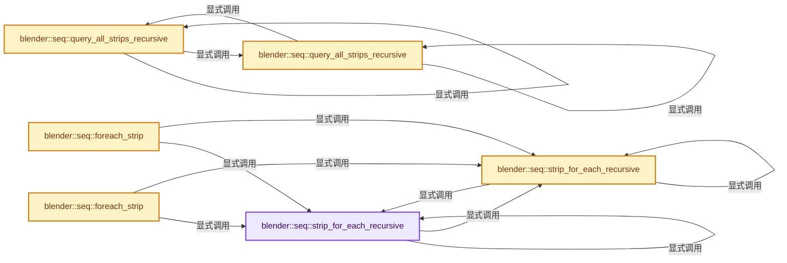
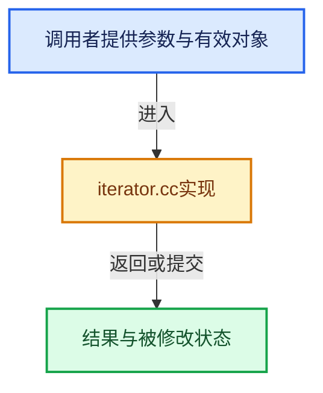

# 实现依赖专题：source/blender/sequencer/intern/iterator.cc

[实现依赖导航](../../../README.md) · [符号索引](../../../../00-课程指南/02-源码与提交索引/符号依赖与实现索引.md)

本专题从正文实际调用进入，集中保存共享实现。函数有稳定锚点，可从调用处直接跳到对应完整函数；递归与互相调用通过回链组织。

## 本文件的实现关系






## 完整成员与函数实现

<a id="f-a7db279d96191fa8"></a>

### `blender::seq::strip_for_each_recursive`

实现位置：[source/blender/sequencer/intern/iterator.cc](../../../../../../../../source/blender/sequencer/intern/iterator.cc) · L25—L41。

接口参数：

- `ListBaseT<Strip> *seqbase`
- `ForEachFunc callback`
- `void *user_data`

**教学注释版**

<!-- annotated:464c026a5fbe49 -->

```cpp
static bool strip_for_each_recursive(ListBaseT<Strip> *seqbase,
                                     ForEachFunc callback,
                                     void *user_data)
{
  for (Strip &strip : *seqbase) {
    if (!callback(&strip, user_data)) {
      /* Callback signaled stop, return. */
      return false;
    }
    if (strip.type == STRIP_TYPE_META) {
      if (!strip_for_each_recursive(&strip.seqbase, callback, user_data)) {
        return false;
      }
    }
  }
  return true;
}
```

<details>
<summary>核对原始源码：source/blender/sequencer/intern/iterator.cc · L25—L41</summary>

<!-- original:464c026a5fbe49:source/blender/sequencer/intern/iterator.cc:25:41 -->

```cpp
static bool strip_for_each_recursive(ListBaseT<Strip> *seqbase,
                                     ForEachFunc callback,
                                     void *user_data)
{
  for (Strip &strip : *seqbase) {
    if (!callback(&strip, user_data)) {
      /* Callback signaled stop, return. */
      return false;
    }
    if (strip.type == STRIP_TYPE_META) {
      if (!strip_for_each_recursive(&strip.seqbase, callback, user_data)) {
        return false;
      }
    }
  }
  return true;
}
```

</details>

**结果出口**

- `return false;`
- `return true;`

**继续追踪实现**

- `callback` → [调用协议](../../../../00-课程指南/01-路线与规范/模板宏与动态分派协议.md)：局部可调用对象，须结合其初始化与捕获环境。调用位置L30。
- `strip_for_each_recursive` → [blender::seq::strip_for_each_recursive · L25](iterator.cc.md#f-a7db279d96191fa8)；[blender::seq::strip_for_each_recursive · L43](iterator.cc.md#f-b0e14dea16e2d28d)。同名重载需按实参类型选择。

<a id="f-b0e14dea16e2d28d"></a>

### `blender::seq::strip_for_each_recursive`

实现位置：[source/blender/sequencer/intern/iterator.cc](../../../../../../../../source/blender/sequencer/intern/iterator.cc) · L43—L58。

接口参数：

- `ListBaseT<Strip> *seqbase`
- `FunctionRef<bool(Strip *)> callback`
- `Strip *`

**教学注释版**

<!-- annotated:9e6db5695f8cb4 -->

```cpp
static bool strip_for_each_recursive(ListBaseT<Strip> *seqbase,
                                     FunctionRef<bool(Strip *)> callback)
{
  for (Strip &strip : *seqbase) {
    if (!callback(&strip)) {
      /* Callback signaled stop, return. */
      return false;
    }
    if (strip.type == STRIP_TYPE_META) {
      if (!strip_for_each_recursive(&strip.seqbase, callback)) {
        return false;
      }
    }
  }
  return true;
}
```

<details>
<summary>核对原始源码：source/blender/sequencer/intern/iterator.cc · L43—L58</summary>

<!-- original:9e6db5695f8cb4:source/blender/sequencer/intern/iterator.cc:43:58 -->

```cpp
static bool strip_for_each_recursive(ListBaseT<Strip> *seqbase,
                                     FunctionRef<bool(Strip *)> callback)
{
  for (Strip &strip : *seqbase) {
    if (!callback(&strip)) {
      /* Callback signaled stop, return. */
      return false;
    }
    if (strip.type == STRIP_TYPE_META) {
      if (!strip_for_each_recursive(&strip.seqbase, callback)) {
        return false;
      }
    }
  }
  return true;
}
```

</details>

**结果出口**

- `return false;`
- `return true;`

**继续追踪实现**

- `callback` → [调用协议](../../../../00-课程指南/01-路线与规范/模板宏与动态分派协议.md)：局部可调用对象，须结合其初始化与捕获环境。调用位置L47。
- `strip_for_each_recursive` → [blender::seq::strip_for_each_recursive · L25](iterator.cc.md#f-a7db279d96191fa8)；[blender::seq::strip_for_each_recursive · L43](iterator.cc.md#f-b0e14dea16e2d28d)。同名重载需按实参类型选择。

<a id="f-86cee6cf86eb707c"></a>

### `blender::seq::foreach_strip`

实现位置：[source/blender/sequencer/intern/iterator.cc](../../../../../../../../source/blender/sequencer/intern/iterator.cc) · L60—L63。

接口参数：

- `ListBaseT<Strip> *seqbase`
- `ForEachFunc callback`
- `void *user_data`

**教学注释版**

<!-- annotated:5a6e64738500d1 -->

```cpp
void foreach_strip(ListBaseT<Strip> *seqbase, ForEachFunc callback, void *user_data)
{
  strip_for_each_recursive(seqbase, callback, user_data);
}
```

<details>
<summary>核对原始源码：source/blender/sequencer/intern/iterator.cc · L60—L63</summary>

<!-- original:5a6e64738500d1:source/blender/sequencer/intern/iterator.cc:60:63 -->

```cpp
void foreach_strip(ListBaseT<Strip> *seqbase, ForEachFunc callback, void *user_data)
{
  strip_for_each_recursive(seqbase, callback, user_data);
}
```

</details>

**继续追踪实现**

- `strip_for_each_recursive` → [blender::seq::strip_for_each_recursive · L25](iterator.cc.md#f-a7db279d96191fa8)；[blender::seq::strip_for_each_recursive · L43](iterator.cc.md#f-b0e14dea16e2d28d)。同名重载需按实参类型选择。

<a id="f-f628b6218602a592"></a>

### `blender::seq::foreach_strip`

实现位置：[source/blender/sequencer/intern/iterator.cc](../../../../../../../../source/blender/sequencer/intern/iterator.cc) · L65—L68。

接口参数：

- `ListBaseT<Strip> *seqbase`
- `FunctionRef<bool(Strip *)> callback`
- `Strip *`

**教学注释版**

<!-- annotated:6e721aaa303835 -->

```cpp
void foreach_strip(ListBaseT<Strip> *seqbase, FunctionRef<bool(Strip *)> callback)
{
  strip_for_each_recursive(seqbase, callback);
}
```

<details>
<summary>核对原始源码：source/blender/sequencer/intern/iterator.cc · L65—L68</summary>

<!-- original:6e721aaa303835:source/blender/sequencer/intern/iterator.cc:65:68 -->

```cpp
void foreach_strip(ListBaseT<Strip> *seqbase, FunctionRef<bool(Strip *)> callback)
{
  strip_for_each_recursive(seqbase, callback);
}
```

</details>

**继续追踪实现**

- `strip_for_each_recursive` → [blender::seq::strip_for_each_recursive · L25](iterator.cc.md#f-a7db279d96191fa8)；[blender::seq::strip_for_each_recursive · L43](iterator.cc.md#f-b0e14dea16e2d28d)。同名重载需按实参类型选择。

<a id="f-8d08ab5e847d58a5"></a>

### `blender::seq::query_all_strips_recursive`

实现位置：[source/blender/sequencer/intern/iterator.cc](../../../../../../../../source/blender/sequencer/intern/iterator.cc) · L104—L112。

接口参数：

- `const ListBaseT<Strip> *seqbase`
- `VectorSet<Strip *> &strips`

**教学注释版**

<!-- annotated:af5cc0e24cae93 -->

```cpp
static void query_all_strips_recursive(const ListBaseT<Strip> *seqbase, VectorSet<Strip *> &strips)
{
  for (Strip &strip : *seqbase) {
    if (strip.type == STRIP_TYPE_META) {
      query_all_strips_recursive(&strip.seqbase, strips);
    }
    // [讲解] strips.add：按哈希与相等关系加入键或键值。
    strips.add(&strip);
  }
}
```

<details>
<summary>核对原始源码：source/blender/sequencer/intern/iterator.cc · L104—L112</summary>

<!-- original:af5cc0e24cae93:source/blender/sequencer/intern/iterator.cc:104:112 -->

```cpp
static void query_all_strips_recursive(const ListBaseT<Strip> *seqbase, VectorSet<Strip *> &strips)
{
  for (Strip &strip : *seqbase) {
    if (strip.type == STRIP_TYPE_META) {
      query_all_strips_recursive(&strip.seqbase, strips);
    }
    strips.add(&strip);
  }
}
```

</details>

**继续追踪实现**

- `query_all_strips_recursive` → [blender::seq::query_all_strips_recursive · L104](iterator.cc.md#f-8d08ab5e847d58a5)；[blender::seq::query_all_strips_recursive · L114](iterator.cc.md#f-f65713cec7bc135e)。同名重载需按实参类型选择。
- `strips.add` → [blender::VectorSet::add · L351](../../../../01-基础容器与现代CPP/14-VectorSet稳定索引与去重.md#f-96bfe2bf376d6298)；[blender::VectorSet::add · L355](../../../../01-基础容器与现代CPP/14-VectorSet稳定索引与去重.md#f-c0474f6a0568033b)。同名重载需按实参类型选择。

<a id="f-f65713cec7bc135e"></a>

### `blender::seq::query_all_strips_recursive`

实现位置：[source/blender/sequencer/intern/iterator.cc](../../../../../../../../source/blender/sequencer/intern/iterator.cc) · L114—L119。

接口参数：

- `const ListBaseT<Strip> *seqbase`

**教学注释版**

<!-- annotated:1e5e6ef999f1a2 -->

```cpp
VectorSet<Strip *> query_all_strips_recursive(const ListBaseT<Strip> *seqbase)
{
  VectorSet<Strip *> strips;
  query_all_strips_recursive(seqbase, strips);
  return strips;
}
```

<details>
<summary>核对原始源码：source/blender/sequencer/intern/iterator.cc · L114—L119</summary>

<!-- original:1e5e6ef999f1a2:source/blender/sequencer/intern/iterator.cc:114:119 -->

```cpp
VectorSet<Strip *> query_all_strips_recursive(const ListBaseT<Strip> *seqbase)
{
  VectorSet<Strip *> strips;
  query_all_strips_recursive(seqbase, strips);
  return strips;
}
```

</details>

**结果出口**

- `return strips;`

**继续追踪实现**

- `query_all_strips_recursive` → [blender::seq::query_all_strips_recursive · L104](iterator.cc.md#f-8d08ab5e847d58a5)；[blender::seq::query_all_strips_recursive · L114](iterator.cc.md#f-f65713cec7bc135e)。同名重载需按实参类型选择。
