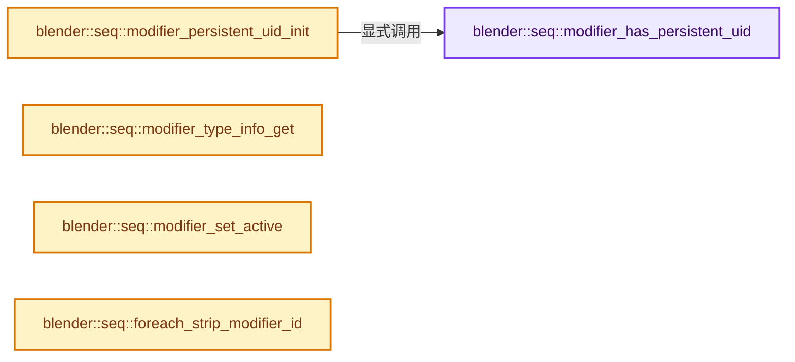
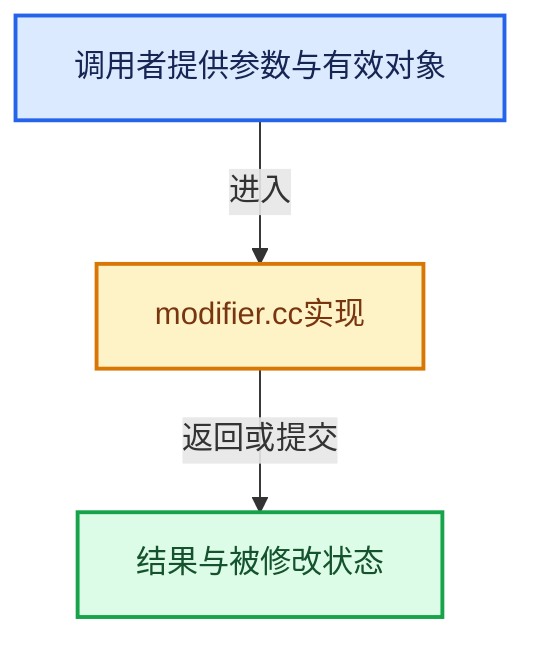

# 实现依赖专题：source/blender/sequencer/intern/modifiers/modifier.cc

[实现依赖导航](../../../../README.md) · [符号索引](../../../../../00-课程指南/02-源码与提交索引/符号依赖与实现索引.md)

本专题从正文实际调用进入，集中保存共享实现。函数有稳定锚点，可从调用处直接跳到对应完整函数；递归与互相调用通过回链组织。

## 本文件的实现关系






## 完整成员与函数实现

<a id="f-c321a7e1cf6803e0"></a>

### `blender::seq::modifier_has_persistent_uid`

实现位置：[source/blender/sequencer/intern/modifiers/modifier.cc](../../../../../../../../../source/blender/sequencer/intern/modifiers/modifier.cc) · L52—L60。

接口参数：

- `const Strip &strip`
- `int uid`

**教学注释版**

<!-- annotated:cb67d7982abfe8 -->

```cpp
static bool modifier_has_persistent_uid(const Strip &strip, int uid)
{
  for (StripModifierData &smd : strip.modifiers) {
    if (smd.persistent_uid == uid) {
      return true;
    }
  }
  return false;
}
```

<details>
<summary>核对原始源码：source/blender/sequencer/intern/modifiers/modifier.cc · L52—L60</summary>

<!-- original:cb67d7982abfe8:source/blender/sequencer/intern/modifiers/modifier.cc:52:60 -->

```cpp
static bool modifier_has_persistent_uid(const Strip &strip, int uid)
{
  for (StripModifierData &smd : strip.modifiers) {
    if (smd.persistent_uid == uid) {
      return true;
    }
  }
  return false;
}
```

</details>

**结果出口**

- `return true;`
- `return false;`

**继续追踪实现**

本实现没有需要继续展开的显式调用；检查返回表达式、对象转换和调用者前置条件。

<a id="f-08629f38ab2827df"></a>

### `blender::seq::modifier_persistent_uid_init`

实现位置：[source/blender/sequencer/intern/modifiers/modifier.cc](../../../../../../../../../source/blender/sequencer/intern/modifiers/modifier.cc) · L62—L77。

接口参数：

- `const Strip &strip`
- `StripModifierData &smd`

**教学注释版**

<!-- annotated:80487c7ef67c04 -->

```cpp
void modifier_persistent_uid_init(const Strip &strip, StripModifierData &smd)
{
  uint64_t hash = get_default_hash(StringRef(smd.name));
  RandomNumberGenerator rng{uint32_t(hash)};
  while (true) {
    const int new_uid = rng.get_int32();
    if (new_uid <= 0) {
      continue;
    }
    if (modifier_has_persistent_uid(strip, new_uid)) {
      continue;
    }
    smd.persistent_uid = new_uid;
    break;
  }
}
```

<details>
<summary>核对原始源码：source/blender/sequencer/intern/modifiers/modifier.cc · L62—L77</summary>

<!-- original:80487c7ef67c04:source/blender/sequencer/intern/modifiers/modifier.cc:62:77 -->

```cpp
void modifier_persistent_uid_init(const Strip &strip, StripModifierData &smd)
{
  uint64_t hash = get_default_hash(StringRef(smd.name));
  RandomNumberGenerator rng{uint32_t(hash)};
  while (true) {
    const int new_uid = rng.get_int32();
    if (new_uid <= 0) {
      continue;
    }
    if (modifier_has_persistent_uid(strip, new_uid)) {
      continue;
    }
    smd.persistent_uid = new_uid;
    break;
  }
}
```

</details>

**沿实际写入检查状态**

- `smd.persistent_uid = new_uid;`

**继续追踪实现**

- `get_default_hash` → [blender::get_default_hash · L251](../../../../../02-哈希表与关联数据结构/01-哈希与相等契约.md#f-5f2c246aedf3dc0a)。
- `StringRef` → [blender::StringRef::StringRef · L555](../../../../../01-基础容器与现代CPP/15-StringRef字符串视图.md#f-f6aca324a36faa7e)；[blender::StringRef::StringRef · L560](../../../../../01-基础容器与现代CPP/15-StringRef字符串视图.md#f-ab9714781ca51bac)；[blender::StringRef::StringRef · L565](../../../../../01-基础容器与现代CPP/15-StringRef字符串视图.md#f-95f0b483bbdd7739)；[blender::StringRef::StringRef · L570](../../../../../01-基础容器与现代CPP/15-StringRef字符串视图.md#f-808d05699cb33334)；[blender::StringRef::StringRef · L631](../../../../../01-基础容器与现代CPP/15-StringRef字符串视图.md#f-37788e5f3fa3b736)；[blender::StringRef::StringRef · L641](../../../../../01-基础容器与现代CPP/15-StringRef字符串视图.md#f-11abd0510fb6b926)；[blender::StringRef::StringRef · L646](../../../../../01-基础容器与现代CPP/15-StringRef字符串视图.md#f-8437dbd8a582eefd)；[blender::StringRef::StringRef · L651](../../../../../01-基础容器与现代CPP/15-StringRef字符串视图.md#f-70bcb338de0db978)。同名重载需按实参类型选择。
- `rng.get_int32` → [blender::RandomNumberGenerator::get_int32 · L52](../../../../01-BLI基础库/BLI_rand.hh.md#f-2241ace1b1d89483)；[blender::RandomNumberGenerator::get_int32 · L66](../../../../01-BLI基础库/BLI_rand.hh.md#f-749e1881a54f698a)。同名重载需按实参类型选择。
- `modifier_has_persistent_uid` → [blender::seq::modifier_has_persistent_uid · L52](modifier.cc.md#f-c321a7e1cf6803e0)。

<a id="f-de48cd1b87918836"></a>

### `blender::seq::modifier_type_info_get`

实现位置：[source/blender/sequencer/intern/modifiers/modifier.cc](../../../../../../../../../source/blender/sequencer/intern/modifiers/modifier.cc) · L416—L422。

接口参数：

- `eStripModifierType type`

**教学注释版**

<!-- annotated:cc8ad8b075715e -->

```cpp
const StripModifierTypeInfo *modifier_type_info_get(eStripModifierType type)
{
  if (type <= 0 || type >= NUM_STRIP_MODIFIER_TYPES) {
    return nullptr;
  }
  return modifiersTypes[type];
}
```

<details>
<summary>核对原始源码：source/blender/sequencer/intern/modifiers/modifier.cc · L416—L422</summary>

<!-- original:cc8ad8b075715e:source/blender/sequencer/intern/modifiers/modifier.cc:416:422 -->

```cpp
const StripModifierTypeInfo *modifier_type_info_get(eStripModifierType type)
{
  if (type <= 0 || type >= NUM_STRIP_MODIFIER_TYPES) {
    return nullptr;
  }
  return modifiersTypes[type];
}
```

</details>

**结果出口**

- `return nullptr;`
- `return modifiersTypes[type];`

**继续追踪实现**

本实现没有需要继续展开的显式调用；检查返回表达式、对象转换和调用者前置条件。

<a id="f-6f8607a742a8479a"></a>

### `blender::seq::modifier_set_active`

实现位置：[source/blender/sequencer/intern/modifiers/modifier.cc](../../../../../../../../../source/blender/sequencer/intern/modifiers/modifier.cc) · L643—L653。

接口参数：

- `Strip *strip`
- `StripModifierData *smd`

**教学注释版**

<!-- annotated:68c13243a758bc -->

```cpp
void modifier_set_active(Strip *strip, StripModifierData *smd)
{
  for (StripModifierData &smd_iter : strip->modifiers) {
    smd_iter.flag &= ~STRIP_MODIFIER_FLAG_ACTIVE;
  }

  if (smd != nullptr) {
    BLI_assert(BLI_findindex(&strip->modifiers, smd) != -1);
    smd->flag |= STRIP_MODIFIER_FLAG_ACTIVE;
  }
}
```

<details>
<summary>核对原始源码：source/blender/sequencer/intern/modifiers/modifier.cc · L643—L653</summary>

<!-- original:68c13243a758bc:source/blender/sequencer/intern/modifiers/modifier.cc:643:653 -->

```cpp
void modifier_set_active(Strip *strip, StripModifierData *smd)
{
  for (StripModifierData &smd_iter : strip->modifiers) {
    smd_iter.flag &= ~STRIP_MODIFIER_FLAG_ACTIVE;
  }

  if (smd != nullptr) {
    BLI_assert(BLI_findindex(&strip->modifiers, smd) != -1);
    smd->flag |= STRIP_MODIFIER_FLAG_ACTIVE;
  }
}
```

</details>

**沿实际写入检查状态**

- `smd_iter.flag &= ~STRIP_MODIFIER_FLAG_ACTIVE;`
- `smd->flag |= STRIP_MODIFIER_FLAG_ACTIVE;`

**继续追踪实现**

- `BLI_assert` → [BLI_assert · L48](../../../../01-BLI基础库/BLI_assert.hh.md#m-57a88495704d)；[BLI_assert · L63](../../../../01-BLI基础库/BLI_assert.hh.md#m-d07050020cb5)。宏定义由构建条件选择。
- `BLI_findindex` → [blender::BLI_findindex · L593](../../../../01-BLI基础库/intern/listbase.cc.md#f-cb9036f12bd486b7)。

<a id="f-6f66f3ccf1e06cf2"></a>

### `blender::seq::foreach_strip_modifier_id`

实现位置：[source/blender/sequencer/intern/modifiers/modifier.cc](../../../../../../../../../source/blender/sequencer/intern/modifiers/modifier.cc) · L662—L680。

接口参数：

- `Strip *strip`
- `const FunctionRef<void(ID *)> fn`
- `ID *`

**教学注释版**

<!-- annotated:38e0e4c3234ad7 -->

```cpp
void foreach_strip_modifier_id(Strip *strip, const FunctionRef<void(ID *)> fn)
{
  for (StripModifierData &smd : strip->modifiers) {
    if (smd.mask_id) {
      fn(reinterpret_cast<ID *>(smd.mask_id));
    }
    if (smd.type == eSeqModifierType_Compositor) {
      auto *modifier_data = reinterpret_cast<SequencerCompositorModifierData *>(&smd);
      if (modifier_data->node_group) {
        fn(reinterpret_cast<ID *>(modifier_data->node_group));
      }
    }
    if (smd.system_properties) {
      IDP_foreach_property(smd.system_properties, IDP_TYPE_FILTER_ID, [&](IDProperty *id_prop) {
        fn((ID *)id_prop->data.pointer);
      });
    }
  }
}
```

<details>
<summary>核对原始源码：source/blender/sequencer/intern/modifiers/modifier.cc · L662—L680</summary>

<!-- original:38e0e4c3234ad7:source/blender/sequencer/intern/modifiers/modifier.cc:662:680 -->

```cpp
void foreach_strip_modifier_id(Strip *strip, const FunctionRef<void(ID *)> fn)
{
  for (StripModifierData &smd : strip->modifiers) {
    if (smd.mask_id) {
      fn(reinterpret_cast<ID *>(smd.mask_id));
    }
    if (smd.type == eSeqModifierType_Compositor) {
      auto *modifier_data = reinterpret_cast<SequencerCompositorModifierData *>(&smd);
      if (modifier_data->node_group) {
        fn(reinterpret_cast<ID *>(modifier_data->node_group));
      }
    }
    if (smd.system_properties) {
      IDP_foreach_property(smd.system_properties, IDP_TYPE_FILTER_ID, [&](IDProperty *id_prop) {
        fn((ID *)id_prop->data.pointer);
      });
    }
  }
}
```

</details>

**继续追踪实现**

- `fn` → [调用协议](../../../../../00-课程指南/01-路线与规范/模板宏与动态分派协议.md)：局部可调用对象，须结合其初始化与捕获环境。调用位置L666。
- `IDP_foreach_property` → [blender::IDP_foreach_property · L1469](../../../../02-BKE几何与数据/intern/idprop.cc.md#f-63095cdb2dc834a9)。
