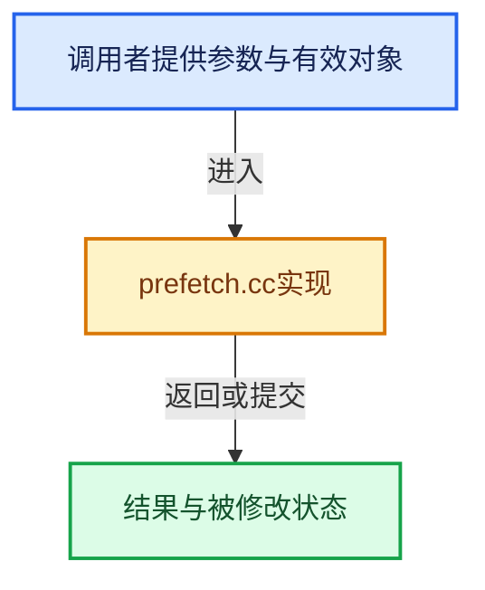

# 实现依赖专题：source/blender/sequencer/intern/prefetch.cc

[实现依赖导航](../../../README.md) · [符号索引](../../../../00-课程指南/02-源码与提交索引/符号依赖与实现索引.md)

本专题从正文实际调用进入，集中保存共享实现。函数有稳定锚点，可从调用处直接跳到对应完整函数；递归与互相调用通过回链组织。

## 本文件的实现关系





## 相关类型布局与成员入口

<a id="t-9e0b2b56afb9"></a>

### `blender::RenderResult`

原始声明：[source/blender/sequencer/intern/prefetch.cc](../../../../../../../../source/blender/sequencer/intern/prefetch.cc) · L53—L53。

以下保留类的数据声明与编译条件，成员函数实现通过后面的精确链接阅读。

<!-- annotated:b47c2da7d13fe6 -->

```cpp
struct RenderResult;
```

<details>
<summary>核对原始源码：source/blender/sequencer/intern/prefetch.cc · L53—L53</summary>

<!-- original:b47c2da7d13fe6:source/blender/sequencer/intern/prefetch.cc:53:53 -->

```cpp
struct RenderResult;
```

</details>


## 完整成员与函数实现

<a id="f-c18f42e1173e47a4"></a>

### `blender::seq::seq_prefetch_job_get`

实现位置：[source/blender/sequencer/intern/prefetch.cc](../../../../../../../../source/blender/sequencer/intern/prefetch.cc) · L105—L111。

接口参数：

- `Scene *scene`

**教学注释版**

<!-- annotated:093d4d342c811a -->

```cpp
static PrefetchJob *seq_prefetch_job_get(Scene *scene)
{
  if (scene && scene->ed) {
    return scene->ed->runtime->prefetch_job;
  }
  return nullptr;
}
```

<details>
<summary>核对原始源码：source/blender/sequencer/intern/prefetch.cc · L105—L111</summary>

<!-- original:093d4d342c811a:source/blender/sequencer/intern/prefetch.cc:105:111 -->

```cpp
static PrefetchJob *seq_prefetch_job_get(Scene *scene)
{
  if (scene && scene->ed) {
    return scene->ed->runtime->prefetch_job;
  }
  return nullptr;
}
```

</details>

**结果出口**

- `return scene->ed->runtime->prefetch_job;`
- `return nullptr;`

**继续追踪实现**

本实现没有需要继续展开的显式调用；检查返回表达式、对象转换和调用者前置条件。

<a id="f-c132adb52d81dd07"></a>

### `blender::seq::prefetch_stop_all`

实现位置：[source/blender/sequencer/intern/prefetch.cc](../../../../../../../../source/blender/sequencer/intern/prefetch.cc) · L327—L334。

**教学注释版**

<!-- annotated:f0cdaf0cc802f1 -->

```cpp
void prefetch_stop_all()
{
  /* TODO(Richard): Use wm_jobs for prefetch, or pass main. */
  for (Scene *scene = G.main->scenes.first(); scene; scene = static_cast<Scene *>(scene->id.next))
  {
    prefetch_stop(scene);
  }
}
```

<details>
<summary>核对原始源码：source/blender/sequencer/intern/prefetch.cc · L327—L334</summary>

<!-- original:f0cdaf0cc802f1:source/blender/sequencer/intern/prefetch.cc:327:334 -->

```cpp
void prefetch_stop_all()
{
  /* TODO(Richard): Use wm_jobs for prefetch, or pass main. */
  for (Scene *scene = G.main->scenes.first(); scene; scene = static_cast<Scene *>(scene->id.next))
  {
    prefetch_stop(scene);
  }
}
```

</details>

**继续追踪实现**

- `G.main->scenes.first` → [调用协议](../../../../00-课程指南/01-路线与规范/模板宏与动态分派协议.md)：接收对象类型依赖auto、返回值或模板实例；不按同名猜测目标。调用位置L330。
- `prefetch_stop` → [blender::seq::prefetch_stop · L336](prefetch.cc.md#f-52e20115860d6917)。

<a id="f-52e20115860d6917"></a>

### `blender::seq::prefetch_stop`

实现位置：[source/blender/sequencer/intern/prefetch.cc](../../../../../../../../source/blender/sequencer/intern/prefetch.cc) · L336—L349。

接口参数：

- `Scene *scene`

**教学注释版**

<!-- annotated:be3cac455e33d1 -->

```cpp
void prefetch_stop(Scene *scene)
{
  PrefetchJob *pfjob = seq_prefetch_job_get(scene);

  if (!pfjob) {
    return;
  }

  pfjob->stop = true;

  while (pfjob->running) {
    BLI_condition_notify_one(&pfjob->prefetch_suspend_cond);
  }
}
```

<details>
<summary>核对原始源码：source/blender/sequencer/intern/prefetch.cc · L336—L349</summary>

<!-- original:be3cac455e33d1:source/blender/sequencer/intern/prefetch.cc:336:349 -->

```cpp
void prefetch_stop(Scene *scene)
{
  PrefetchJob *pfjob = seq_prefetch_job_get(scene);

  if (!pfjob) {
    return;
  }

  pfjob->stop = true;

  while (pfjob->running) {
    BLI_condition_notify_one(&pfjob->prefetch_suspend_cond);
  }
}
```

</details>

**沿实际写入检查状态**

- `pfjob->stop = true;`

**继续追踪实现**

- `seq_prefetch_job_get` → [blender::seq::seq_prefetch_job_get · L105](prefetch.cc.md#f-c18f42e1173e47a4)。
- `BLI_condition_notify_one` → [BLI_condition_notify_one · L593](../../../01-BLI基础库/intern/threads.cc.md#f-fcd9b7e3f6c5587d)。
