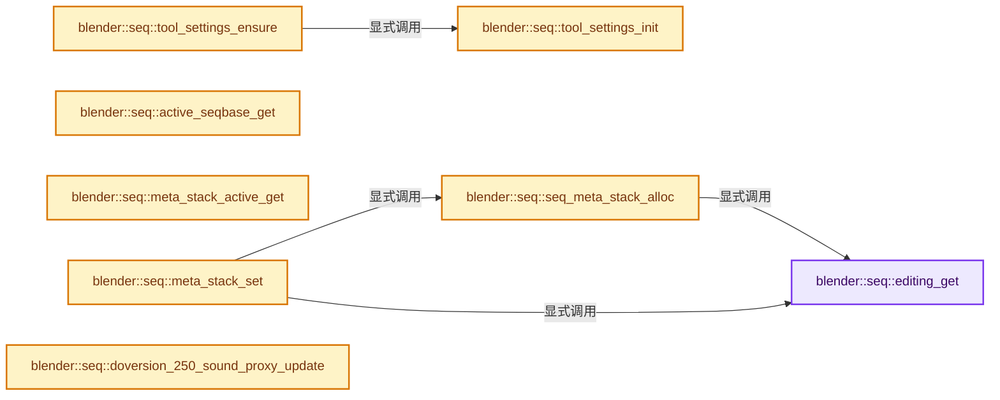
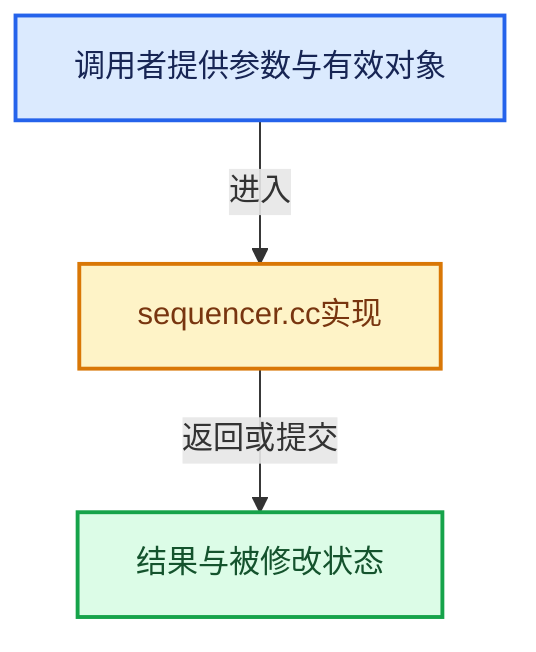

# 实现依赖专题：source/blender/sequencer/intern/sequencer.cc

[实现依赖导航](../../../README.md) · [符号索引](../../../../00-课程指南/02-源码与提交索引/符号依赖与实现索引.md)

本专题从正文实际调用进入，集中保存共享实现。函数有稳定锚点，可从调用处直接跳到对应完整函数；递归与互相调用通过回链组织。

## 本文件的实现关系






## 完整成员与函数实现

<a id="f-6332e57a33c5dd16"></a>

### `blender::seq::editing_get`

实现位置：[source/blender/sequencer/intern/sequencer.cc](../../../../../../../../source/blender/sequencer/intern/sequencer.cc) · L304—L307。

接口参数：

- `const Scene *scene`

**教学注释版**

<!-- annotated:85ff6287ae0be7 -->

```cpp
Editing *editing_get(const Scene *scene)
{
  return scene ? scene->ed : nullptr;
}
```

<details>
<summary>核对原始源码：source/blender/sequencer/intern/sequencer.cc · L304—L307</summary>

<!-- original:85ff6287ae0be7:source/blender/sequencer/intern/sequencer.cc:304:307 -->

```cpp
Editing *editing_get(const Scene *scene)
{
  return scene ? scene->ed : nullptr;
}
```

</details>

**结果出口**

- `return scene ? scene->ed : nullptr;`

**继续追踪实现**

本实现没有需要继续展开的显式调用；检查返回表达式、对象转换和调用者前置条件。

<a id="f-32968399f52f08bc"></a>

### `blender::seq::tool_settings_init`

实现位置：[source/blender/sequencer/intern/sequencer.cc](../../../../../../../../source/blender/sequencer/intern/sequencer.cc) · L375—L391。

**教学注释版**

<!-- annotated:ddb7c9e8c818f2 -->

```cpp
SequencerToolSettings *tool_settings_init()
{
  SequencerToolSettings *tool_settings = MEM_new<SequencerToolSettings>("Sequencer tool settings");
  tool_settings->fit_method = SEQ_SCALE_TO_FIT;
  tool_settings->snap_mode = SEQ_SNAP_TO_STRIPS | SEQ_SNAP_TO_CURRENT_FRAME |
                             SEQ_SNAP_TO_STRIP_HOLD | SEQ_SNAP_TO_MARKERS | SEQ_SNAP_TO_RETIMING |
                             SEQ_SNAP_TO_PREVIEW_BORDERS | SEQ_SNAP_TO_PREVIEW_CENTER |
                             SEQ_SNAP_TO_STRIPS_PREVIEW | SEQ_SNAP_TO_FRAME_RANGE;
  tool_settings->snap_flag = SEQ_SNAP_TO_ALL_CHANNEL_STRIPS;
  tool_settings->snap_distance = 15;
  tool_settings->overlap_mode = SEQ_OVERLAP_SHUFFLE;
  tool_settings->ripple_flag = SEQ_RIPPLE_ALL_CHANNELS | SEQ_RIPPLE_MARKERS |
                               SEQ_RIPPLE_CLEAR_RANGES;
  tool_settings->pivot_point = V3D_AROUND_CENTER_MEDIAN;

  return tool_settings;
}
```

<details>
<summary>核对原始源码：source/blender/sequencer/intern/sequencer.cc · L375—L391</summary>

<!-- original:ddb7c9e8c818f2:source/blender/sequencer/intern/sequencer.cc:375:391 -->

```cpp
SequencerToolSettings *tool_settings_init()
{
  SequencerToolSettings *tool_settings = MEM_new<SequencerToolSettings>("Sequencer tool settings");
  tool_settings->fit_method = SEQ_SCALE_TO_FIT;
  tool_settings->snap_mode = SEQ_SNAP_TO_STRIPS | SEQ_SNAP_TO_CURRENT_FRAME |
                             SEQ_SNAP_TO_STRIP_HOLD | SEQ_SNAP_TO_MARKERS | SEQ_SNAP_TO_RETIMING |
                             SEQ_SNAP_TO_PREVIEW_BORDERS | SEQ_SNAP_TO_PREVIEW_CENTER |
                             SEQ_SNAP_TO_STRIPS_PREVIEW | SEQ_SNAP_TO_FRAME_RANGE;
  tool_settings->snap_flag = SEQ_SNAP_TO_ALL_CHANNEL_STRIPS;
  tool_settings->snap_distance = 15;
  tool_settings->overlap_mode = SEQ_OVERLAP_SHUFFLE;
  tool_settings->ripple_flag = SEQ_RIPPLE_ALL_CHANNELS | SEQ_RIPPLE_MARKERS |
                               SEQ_RIPPLE_CLEAR_RANGES;
  tool_settings->pivot_point = V3D_AROUND_CENTER_MEDIAN;

  return tool_settings;
}
```

</details>

**沿实际写入检查状态**

- `tool_settings->fit_method = SEQ_SCALE_TO_FIT;`
- `tool_settings->snap_mode = SEQ_SNAP_TO_STRIPS | SEQ_SNAP_TO_CURRENT_FRAME |`
- `tool_settings->snap_flag = SEQ_SNAP_TO_ALL_CHANNEL_STRIPS;`
- `tool_settings->snap_distance = 15;`
- `tool_settings->overlap_mode = SEQ_OVERLAP_SHUFFLE;`
- `tool_settings->ripple_flag = SEQ_RIPPLE_ALL_CHANNELS | SEQ_RIPPLE_MARKERS |`
- `tool_settings->pivot_point = V3D_AROUND_CENTER_MEDIAN;`

**结果出口**

- `return tool_settings;`

**继续追踪实现**

- `MEM_new<SequencerToolSettings>` → [MEM_new · L351](../../../07-Intern运行时与平台/guardedalloc/MEM_guardedalloc.h.md#f-115f9b6784f89912)。

<a id="f-af1a4d92b8dd56b2"></a>

### `blender::seq::tool_settings_ensure`

实现位置：[source/blender/sequencer/intern/sequencer.cc](../../../../../../../../source/blender/sequencer/intern/sequencer.cc) · L393—L402。

接口参数：

- `Scene *scene`

**教学注释版**

<!-- annotated:9bf9f01a2643d3 -->

```cpp
SequencerToolSettings *tool_settings_ensure(Scene *scene)
{
  SequencerToolSettings *tool_settings = scene->toolsettings->sequencer_tool_settings;
  if (tool_settings == nullptr) {
    scene->toolsettings->sequencer_tool_settings = tool_settings_init();
    tool_settings = scene->toolsettings->sequencer_tool_settings;
  }

  return tool_settings;
}
```

<details>
<summary>核对原始源码：source/blender/sequencer/intern/sequencer.cc · L393—L402</summary>

<!-- original:9bf9f01a2643d3:source/blender/sequencer/intern/sequencer.cc:393:402 -->

```cpp
SequencerToolSettings *tool_settings_ensure(Scene *scene)
{
  SequencerToolSettings *tool_settings = scene->toolsettings->sequencer_tool_settings;
  if (tool_settings == nullptr) {
    scene->toolsettings->sequencer_tool_settings = tool_settings_init();
    tool_settings = scene->toolsettings->sequencer_tool_settings;
  }

  return tool_settings;
}
```

</details>

**沿实际写入检查状态**

- `scene->toolsettings->sequencer_tool_settings = tool_settings_init();`
- `tool_settings = scene->toolsettings->sequencer_tool_settings;`

**结果出口**

- `return tool_settings;`

**继续追踪实现**

- `tool_settings_init` → [blender::seq::tool_settings_init · L375](sequencer.cc.md#f-32968399f52f08bc)。

<a id="f-d423f2b50c326bea"></a>

### `blender::seq::active_seqbase_get`

实现位置：[source/blender/sequencer/intern/sequencer.cc](../../../../../../../../source/blender/sequencer/intern/sequencer.cc) · L463—L466。

接口参数：

- `const Editing *ed`

**教学注释版**

<!-- annotated:cf8b750376aada -->

```cpp
ListBaseT<Strip> *active_seqbase_get(const Editing *ed)
{
  return ed ? ed->current_strips() : nullptr;
}
```

<details>
<summary>核对原始源码：source/blender/sequencer/intern/sequencer.cc · L463—L466</summary>

<!-- original:cf8b750376aada:source/blender/sequencer/intern/sequencer.cc:463:466 -->

```cpp
ListBaseT<Strip> *active_seqbase_get(const Editing *ed)
{
  return ed ? ed->current_strips() : nullptr;
}
```

</details>

**结果出口**

- `return ed ? ed->current_strips() : nullptr;`

**继续追踪实现**

- `ed->current_strips` → [blender::Editing::current_strips · L1343](sequencer.cc.md#f-d22a33b0c208727d)；[blender::Editing::current_strips · L1351](sequencer.cc.md#f-50ac1d9f5024b8b8)。同名重载需按实参类型选择。

<a id="f-9ffef6e5f8b3419f"></a>

### `blender::seq::seq_meta_stack_alloc`

实现位置：[source/blender/sequencer/intern/sequencer.cc](../../../../../../../../source/blender/sequencer/intern/sequencer.cc) · L468—L482。

接口参数：

- `const Scene *scene`
- `Strip *strip_meta`

**教学注释版**

<!-- annotated:d9d218b06da57c -->

```cpp
static MetaStack *seq_meta_stack_alloc(const Scene *scene, Strip *strip_meta)
{
  Editing *ed = editing_get(scene);

  MetaStack *ms = MEM_new<MetaStack>("metastack");
  BLI_addhead(&ed->metastack, ms);
  ms->parent_strip = strip_meta;

  /* Reference to previously displayed timeline data. */
  ms->old_strip = lookup_meta_by_strip(ed, strip_meta);

  ms->disp_range[0] = ms->parent_strip->left_handle();
  ms->disp_range[1] = ms->parent_strip->right_handle(scene);
  return ms;
}
```

<details>
<summary>核对原始源码：source/blender/sequencer/intern/sequencer.cc · L468—L482</summary>

<!-- original:d9d218b06da57c:source/blender/sequencer/intern/sequencer.cc:468:482 -->

```cpp
static MetaStack *seq_meta_stack_alloc(const Scene *scene, Strip *strip_meta)
{
  Editing *ed = editing_get(scene);

  MetaStack *ms = MEM_new<MetaStack>("metastack");
  BLI_addhead(&ed->metastack, ms);
  ms->parent_strip = strip_meta;

  /* Reference to previously displayed timeline data. */
  ms->old_strip = lookup_meta_by_strip(ed, strip_meta);

  ms->disp_range[0] = ms->parent_strip->left_handle();
  ms->disp_range[1] = ms->parent_strip->right_handle(scene);
  return ms;
}
```

</details>

**沿实际写入检查状态**

- `ms->parent_strip = strip_meta;`
- `ms->old_strip = lookup_meta_by_strip(ed, strip_meta);`
- `ms->disp_range[0] = ms->parent_strip->left_handle();`
- `ms->disp_range[1] = ms->parent_strip->right_handle(scene);`

**结果出口**

- `return ms;`

**继续追踪实现**

- `editing_get` → [blender::seq::editing_get · L304](sequencer.cc.md#f-6332e57a33c5dd16)。
- `MEM_new<MetaStack>` → [MEM_new · L351](../../../07-Intern运行时与平台/guardedalloc/MEM_guardedalloc.h.md#f-115f9b6784f89912)。
- `BLI_addhead` → [blender::BLI_addhead · L98](../../../01-BLI基础库/intern/listbase.cc.md#f-fed3ad483fcdfeb9)。
- `lookup_meta_by_strip` → [blender::seq::lookup_meta_by_strip · L203](strip_lookup.cc.md#f-2c81ecce868f7f6f)。
- `ms->parent_strip->left_handle` → [调用协议](../../../../00-课程指南/01-路线与规范/模板宏与动态分派协议.md)：接收对象类型依赖auto、返回值或模板实例；不按同名猜测目标。调用位置L479。
- `ms->parent_strip->right_handle` → [调用协议](../../../../00-课程指南/01-路线与规范/模板宏与动态分派协议.md)：接收对象类型依赖auto、返回值或模板实例；不按同名猜测目标。调用位置L480。

<a id="f-38c94c63236ad8aa"></a>

### `blender::seq::meta_stack_active_get`

实现位置：[source/blender/sequencer/intern/sequencer.cc](../../../../../../../../source/blender/sequencer/intern/sequencer.cc) · L484—L491。

接口参数：

- `const Editing *ed`

**教学注释版**

<!-- annotated:bb559cff27c804 -->

```cpp
MetaStack *meta_stack_active_get(const Editing *ed)
{
  if (ed == nullptr) {
    return nullptr;
  }

  return ed->metastack.last();
}
```

<details>
<summary>核对原始源码：source/blender/sequencer/intern/sequencer.cc · L484—L491</summary>

<!-- original:bb559cff27c804:source/blender/sequencer/intern/sequencer.cc:484:491 -->

```cpp
MetaStack *meta_stack_active_get(const Editing *ed)
{
  if (ed == nullptr) {
    return nullptr;
  }

  return ed->metastack.last();
}
```

</details>

**结果出口**

- `return nullptr;`
- `return ed->metastack.last();`

**继续追踪实现**

- `ed->metastack.last` → [调用协议](../../../../00-课程指南/01-路线与规范/模板宏与动态分派协议.md)：接收对象类型依赖auto、返回值或模板实例；不按同名猜测目标。调用位置L490。

<a id="f-180230d10701f703"></a>

### `blender::seq::meta_stack_set`

实现位置：[source/blender/sequencer/intern/sequencer.cc](../../../../../../../../source/blender/sequencer/intern/sequencer.cc) · L493—L512。

接口参数：

- `const Scene *scene`
- `Strip *dst`

**教学注释版**

<!-- annotated:4dc0e7f3d6dc51 -->

```cpp
void meta_stack_set(const Scene *scene, Strip *dst)
{
  Editing *ed = editing_get(scene);
  /* Clear metastack */
  ed->metastack.free_no_destruct();

  if (dst != nullptr) {
    /* Allocate meta stack in a way, that represents meta hierarchy in timeline. */
    seq_meta_stack_alloc(scene, dst);
    Strip *meta_parent = dst;
    while ((meta_parent = lookup_meta_by_strip(ed, meta_parent))) {
      seq_meta_stack_alloc(scene, meta_parent);
    }

    ed->current_meta_strip = dst;
  }
  else {
    ed->current_meta_strip = nullptr;
  }
}
```

<details>
<summary>核对原始源码：source/blender/sequencer/intern/sequencer.cc · L493—L512</summary>

<!-- original:4dc0e7f3d6dc51:source/blender/sequencer/intern/sequencer.cc:493:512 -->

```cpp
void meta_stack_set(const Scene *scene, Strip *dst)
{
  Editing *ed = editing_get(scene);
  /* Clear metastack */
  ed->metastack.free_no_destruct();

  if (dst != nullptr) {
    /* Allocate meta stack in a way, that represents meta hierarchy in timeline. */
    seq_meta_stack_alloc(scene, dst);
    Strip *meta_parent = dst;
    while ((meta_parent = lookup_meta_by_strip(ed, meta_parent))) {
      seq_meta_stack_alloc(scene, meta_parent);
    }

    ed->current_meta_strip = dst;
  }
  else {
    ed->current_meta_strip = nullptr;
  }
}
```

</details>

**沿实际写入检查状态**

- `ed->current_meta_strip = dst;`
- `ed->current_meta_strip = nullptr;`

**继续追踪实现**

- `editing_get` → [blender::seq::editing_get · L304](sequencer.cc.md#f-6332e57a33c5dd16)。
- `ed->metastack.free_no_destruct` → [调用协议](../../../../00-课程指南/01-路线与规范/模板宏与动态分派协议.md)：接收对象类型依赖auto、返回值或模板实例；不按同名猜测目标。调用位置L497。
- `seq_meta_stack_alloc` → [blender::seq::seq_meta_stack_alloc · L468](sequencer.cc.md#f-9ffef6e5f8b3419f)。
- `lookup_meta_by_strip` → [blender::seq::lookup_meta_by_strip · L203](strip_lookup.cc.md#f-2c81ecce868f7f6f)。

<a id="f-8ba9a27d49d855ef"></a>

### `blender::seq::doversion_250_sound_proxy_update`

实现位置：[source/blender/sequencer/intern/sequencer.cc](../../../../../../../../source/blender/sequencer/intern/sequencer.cc) · L1141—L1144。

接口参数：

- `Main *bmain`
- `Editing *ed`

**教学注释版**

<!-- annotated:9340ec64eb4334 -->

```cpp
void doversion_250_sound_proxy_update(Main *bmain, Editing *ed)
{
  foreach_strip(&ed->seqbase, strip_doversion_250_sound_proxy_update_cb, bmain);
}
```

<details>
<summary>核对原始源码：source/blender/sequencer/intern/sequencer.cc · L1141—L1144</summary>

<!-- original:9340ec64eb4334:source/blender/sequencer/intern/sequencer.cc:1141:1144 -->

```cpp
void doversion_250_sound_proxy_update(Main *bmain, Editing *ed)
{
  foreach_strip(&ed->seqbase, strip_doversion_250_sound_proxy_update_cb, bmain);
}
```

</details>

**继续追踪实现**

- `foreach_strip` → [blender::seq::foreach_strip · L60](iterator.cc.md#f-86cee6cf86eb707c)；[blender::seq::foreach_strip · L65](iterator.cc.md#f-f628b6218602a592)。同名重载需按实参类型选择。

<a id="f-907f83bca8205a5c"></a>

### `blender::seq::eval_strips`

实现位置：[source/blender/sequencer/intern/sequencer.cc](../../../../../../../../source/blender/sequencer/intern/sequencer.cc) · L1300—L1313。

接口参数：

- `Depsgraph *depsgraph`
- `Scene *scene`
- `ListBaseT<Strip> *seqbase`

**教学注释版**

<!-- annotated:12fabcb205719b -->

```cpp
void eval_strips(Depsgraph *depsgraph, Scene *scene, ListBaseT<Strip> *seqbase)
{
  DEG_debug_print_eval(depsgraph, __func__, scene->id.name, scene);

  /* Note: sequencer caches are stored on the original scene, not the evaluated copy. */
  relations_invalidate_temporary_animation_frame(DEG_get_original(scene));

  BKE_sound_ensure_scene(scene);

  foreach_strip(seqbase, strip_sound_update_cb, scene);

  edit_update_muting(scene->ed);
  sound_update_bounds_all(scene);
}
```

<details>
<summary>核对原始源码：source/blender/sequencer/intern/sequencer.cc · L1300—L1313</summary>

<!-- original:12fabcb205719b:source/blender/sequencer/intern/sequencer.cc:1300:1313 -->

```cpp
void eval_strips(Depsgraph *depsgraph, Scene *scene, ListBaseT<Strip> *seqbase)
{
  DEG_debug_print_eval(depsgraph, __func__, scene->id.name, scene);

  /* Note: sequencer caches are stored on the original scene, not the evaluated copy. */
  relations_invalidate_temporary_animation_frame(DEG_get_original(scene));

  BKE_sound_ensure_scene(scene);

  foreach_strip(seqbase, strip_sound_update_cb, scene);

  edit_update_muting(scene->ed);
  sound_update_bounds_all(scene);
}
```

</details>

**继续追踪实现**

- `DEG_debug_print_eval` → [blender::DEG_debug_print_eval · L240](../../../06-Depsgraph依赖图/intern/depsgraph_debug.cc.md#f-f2c4ea506dd14a2f)。
- `relations_invalidate_temporary_animation_frame` → [blender::seq::relations_invalidate_temporary_animation_frame · L195](strip_relations.cc.md#f-59867b43110e719a)。
- `DEG_get_original` → [blender::DEG_get_original · L128](../../../06-Depsgraph依赖图/DEG_depsgraph_query.hh.md#f-79782eab82a92d86)；[blender::DEG_get_original · L134](../../../06-Depsgraph依赖图/DEG_depsgraph_query.hh.md#f-c032f06e9ef8f0cb)。同名重载需按实参类型选择。
- `BKE_sound_ensure_scene` → [blender::BKE_sound_ensure_scene · L2058](../../../02-BKE几何与数据/intern/sound.cc.md#f-d9bd478feb1afb9c)。
- `foreach_strip` → [blender::seq::foreach_strip · L60](iterator.cc.md#f-86cee6cf86eb707c)；[blender::seq::foreach_strip · L65](iterator.cc.md#f-f628b6218602a592)。同名重载需按实参类型选择。
- `edit_update_muting` → [blender::seq::edit_update_muting · L129](strip_edit.cc.md#f-b91b62421cda9c12)。
- `sound_update_bounds_all` → [blender::seq::sound_update_bounds_all · L104](sound.cc.md#f-66eaefe8f404ebfd)。

<a id="f-d22a33b0c208727d"></a>

### `blender::Editing::current_strips`

实现位置：[source/blender/sequencer/intern/sequencer.cc](../../../../../../../../source/blender/sequencer/intern/sequencer.cc) · L1343—L1349。

**教学注释版**

<!-- annotated:d5c609857bec3a -->

```cpp
ListBaseT<Strip> *Editing::current_strips()
{
  if (this->current_meta_strip) {
    return &this->current_meta_strip->seqbase;
  }
  return &this->seqbase;
}
```

<details>
<summary>核对原始源码：source/blender/sequencer/intern/sequencer.cc · L1343—L1349</summary>

<!-- original:d5c609857bec3a:source/blender/sequencer/intern/sequencer.cc:1343:1349 -->

```cpp
ListBaseT<Strip> *Editing::current_strips()
{
  if (this->current_meta_strip) {
    return &this->current_meta_strip->seqbase;
  }
  return &this->seqbase;
}
```

</details>

**结果出口**

- `return &this->current_meta_strip->seqbase;`
- `return &this->seqbase;`

**继续追踪实现**

本实现没有需要继续展开的显式调用；检查返回表达式、对象转换和调用者前置条件。

<a id="f-50ac1d9f5024b8b8"></a>

### `blender::Editing::current_strips`

实现位置：[source/blender/sequencer/intern/sequencer.cc](../../../../../../../../source/blender/sequencer/intern/sequencer.cc) · L1351—L1358。

**教学注释版**

<!-- annotated:4f509d444d3774 -->

```cpp
ListBaseT<Strip> *Editing::current_strips() const
{
  if (this->current_meta_strip) {
    return &this->current_meta_strip->seqbase;
  }
  /* NOTE: Const correctness is non-existent with ListBaseT anyway. */
  return &const_cast<ListBaseT<Strip> &>(this->seqbase);
}
```

<details>
<summary>核对原始源码：source/blender/sequencer/intern/sequencer.cc · L1351—L1358</summary>

<!-- original:4f509d444d3774:source/blender/sequencer/intern/sequencer.cc:1351:1358 -->

```cpp
ListBaseT<Strip> *Editing::current_strips() const
{
  if (this->current_meta_strip) {
    return &this->current_meta_strip->seqbase;
  }
  /* NOTE: Const correctness is non-existent with ListBaseT anyway. */
  return &const_cast<ListBaseT<Strip> &>(this->seqbase);
}
```

</details>

**结果出口**

- `return &this->current_meta_strip->seqbase;`
- `return &const_cast<ListBaseT<Strip> &>(this->seqbase);`

**继续追踪实现**

本实现没有需要继续展开的显式调用；检查返回表达式、对象转换和调用者前置条件。

<a id="f-26a10ad33ac0e4b2"></a>

### `blender::Strip::is_effect`

实现位置：[source/blender/sequencer/intern/sequencer.cc](../../../../../../../../source/blender/sequencer/intern/sequencer.cc) · L1391—L1394。

**教学注释版**

<!-- annotated:e6ae187a6d7fd6 -->

```cpp
bool Strip::is_effect() const
{
  return blender::seq::strip_type_is_effect(this->type);
}
```

<details>
<summary>核对原始源码：source/blender/sequencer/intern/sequencer.cc · L1391—L1394</summary>

<!-- original:e6ae187a6d7fd6:source/blender/sequencer/intern/sequencer.cc:1391:1394 -->

```cpp
bool Strip::is_effect() const
{
  return blender::seq::strip_type_is_effect(this->type);
}
```

</details>

**结果出口**

- `return blender::seq::strip_type_is_effect(this->type);`

**继续追踪实现**

- `blender::seq::strip_type_is_effect` → [blender::seq::strip_type_is_effect · L374](effects/effects.cc.md#f-7dc54a18828270eb)。
