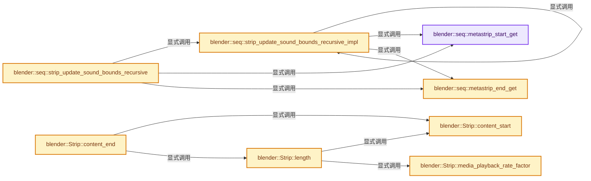
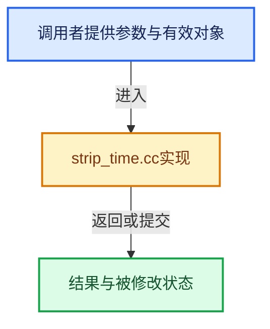

# 实现依赖专题：source/blender/sequencer/intern/strip_time.cc

[实现依赖导航](../../../README.md) · [符号索引](../../../../00-课程指南/02-源码与提交索引/符号依赖与实现索引.md)

本专题从正文实际调用进入，集中保存共享实现。函数有稳定锚点，可从调用处直接跳到对应完整函数；递归与互相调用通过回链组织。

## 本文件的实现关系






## 完整成员与函数实现

<a id="f-d9e8e854e263f070"></a>

### `blender::seq::metastrip_start_get`

实现位置：[source/blender/sequencer/intern/strip_time.cc](../../../../../../../../source/blender/sequencer/intern/strip_time.cc) · L86—L89。

接口参数：

- `Strip *strip_meta`

**教学注释版**

<!-- annotated:ae427e2ad2eaa1 -->

```cpp
static int metastrip_start_get(Strip *strip_meta)
{
  return strip_meta->start + strip_meta->startofs;
}
```

<details>
<summary>核对原始源码：source/blender/sequencer/intern/strip_time.cc · L86—L89</summary>

<!-- original:ae427e2ad2eaa1:source/blender/sequencer/intern/strip_time.cc:86:89 -->

```cpp
static int metastrip_start_get(Strip *strip_meta)
{
  return strip_meta->start + strip_meta->startofs;
}
```

</details>

**结果出口**

- `return strip_meta->start + strip_meta->startofs;`

**继续追踪实现**

本实现没有需要继续展开的显式调用；检查返回表达式、对象转换和调用者前置条件。

<a id="f-f292afadfcf94310"></a>

### `blender::seq::metastrip_end_get`

实现位置：[source/blender/sequencer/intern/strip_time.cc](../../../../../../../../source/blender/sequencer/intern/strip_time.cc) · L91—L94。

接口参数：

- `Strip *strip_meta`

**教学注释版**

<!-- annotated:c8fa15f00d94cf -->

```cpp
static int metastrip_end_get(Strip *strip_meta)
{
  return strip_meta->start + strip_meta->content_length() - strip_meta->end_offset();
}
```

<details>
<summary>核对原始源码：source/blender/sequencer/intern/strip_time.cc · L91—L94</summary>

<!-- original:c8fa15f00d94cf:source/blender/sequencer/intern/strip_time.cc:91:94 -->

```cpp
static int metastrip_end_get(Strip *strip_meta)
{
  return strip_meta->start + strip_meta->content_length() - strip_meta->end_offset();
}
```

</details>

**结果出口**

- `return strip_meta->start + strip_meta->content_length() - strip_meta->end_offset();`

**继续追踪实现**

- `strip_meta->content_length` → [blender::Strip::content_length · L640](strip_time.cc.md#f-3d8e2d72a26565de)。
- `strip_meta->end_offset` → [blender::Strip::end_offset · L650](strip_time.cc.md#f-fe64690d5e476274)。

<a id="f-2f69d830fa27a974"></a>

### `blender::seq::strip_update_sound_bounds_recursive_impl`

实现位置：[source/blender/sequencer/intern/strip_time.cc](../../../../../../../../source/blender/sequencer/intern/strip_time.cc) · L96—L136。

接口参数：

- `const Scene *scene`
- `Strip *strip_meta`
- `int start`
- `int end`

**教学注释版**

<!-- annotated:7b6454a3926d12 -->

```cpp
static void strip_update_sound_bounds_recursive_impl(const Scene *scene,
                                                     Strip *strip_meta,
                                                     int start,
                                                     int end)
{
  /* For sound we go over full meta tree to update bounds of the sound strips,
   * since sound is played outside of evaluating the image-buffers (#ImBuf). */
  for (Strip &strip : strip_meta->seqbase) {
    if (strip.type == STRIP_TYPE_META) {
      strip_update_sound_bounds_recursive_impl(scene,
                                               &strip,
                                               max_ii(start, metastrip_start_get(&strip)),
                                               min_ii(end, metastrip_end_get(&strip)));
    }
    else if (ELEM(strip.type, STRIP_TYPE_SOUND, STRIP_TYPE_SCENE)) {
      if (strip.runtime->scene_sound) {
        int startofs = strip.startofs;
        int endofs = strip.end_offset();
        if (strip.startofs + strip.start < start) {
          startofs = start - strip.start;
        }

        if (strip.start + strip.content_length() - strip.end_offset() > end) {
          endofs = strip.start + strip.content_length() - end;
        }

        double offset_time = 0.0f;
        if (strip.sound != nullptr) {
          offset_time = strip.sound->offset_time + strip.sound_offset;
        }

        BKE_sound_move_scene_sound(scene,
                                   strip.runtime->scene_sound,
                                   strip.start + startofs,
                                   strip.start + strip.content_length() - endofs,
                                   startofs + strip.anim_startofs,
                                   offset_time);
      }
    }
  }
}
```

<details>
<summary>核对原始源码：source/blender/sequencer/intern/strip_time.cc · L96—L136</summary>

<!-- original:7b6454a3926d12:source/blender/sequencer/intern/strip_time.cc:96:136 -->

```cpp
static void strip_update_sound_bounds_recursive_impl(const Scene *scene,
                                                     Strip *strip_meta,
                                                     int start,
                                                     int end)
{
  /* For sound we go over full meta tree to update bounds of the sound strips,
   * since sound is played outside of evaluating the image-buffers (#ImBuf). */
  for (Strip &strip : strip_meta->seqbase) {
    if (strip.type == STRIP_TYPE_META) {
      strip_update_sound_bounds_recursive_impl(scene,
                                               &strip,
                                               max_ii(start, metastrip_start_get(&strip)),
                                               min_ii(end, metastrip_end_get(&strip)));
    }
    else if (ELEM(strip.type, STRIP_TYPE_SOUND, STRIP_TYPE_SCENE)) {
      if (strip.runtime->scene_sound) {
        int startofs = strip.startofs;
        int endofs = strip.end_offset();
        if (strip.startofs + strip.start < start) {
          startofs = start - strip.start;
        }

        if (strip.start + strip.content_length() - strip.end_offset() > end) {
          endofs = strip.start + strip.content_length() - end;
        }

        double offset_time = 0.0f;
        if (strip.sound != nullptr) {
          offset_time = strip.sound->offset_time + strip.sound_offset;
        }

        BKE_sound_move_scene_sound(scene,
                                   strip.runtime->scene_sound,
                                   strip.start + startofs,
                                   strip.start + strip.content_length() - endofs,
                                   startofs + strip.anim_startofs,
                                   offset_time);
      }
    }
  }
}
```

</details>

**沿实际写入检查状态**

- `startofs = start - strip.start;`
- `endofs = strip.start + strip.content_length() - end;`
- `offset_time = strip.sound->offset_time + strip.sound_offset;`

**继续追踪实现**

- `strip_update_sound_bounds_recursive_impl` → [blender::seq::strip_update_sound_bounds_recursive_impl · L96](strip_time.cc.md#f-2f69d830fa27a974)。
- `max_ii` → [blender::max_ii · L368](../../../01-BLI基础库/intern/math_base_inline.cc.md#f-c45aa7b373adb94c)。
- `metastrip_start_get` → [blender::seq::metastrip_start_get · L86](strip_time.cc.md#f-d9e8e854e263f070)。
- `min_ii` → [blender::min_ii · L364](../../../01-BLI基础库/intern/math_base_inline.cc.md#f-30336db35b2810b8)。
- `metastrip_end_get` → [blender::seq::metastrip_end_get · L91](strip_time.cc.md#f-f292afadfcf94310)。
- `ELEM` → [ELEM · L88](../../../07-Intern运行时与平台/ghost/intern/GHOST_utildefines.hh.md#m-d28724a15928)；[ELEM · L135](../../../01-BLI基础库/BLI_utildefines.hh.md#m-d6572de7cae0)。宏定义由构建条件选择。
- `strip.end_offset` → [调用协议](../../../../00-课程指南/01-路线与规范/模板宏与动态分派协议.md)：接收对象类型依赖auto、返回值或模板实例；不按同名猜测目标。调用位置L113。
- `strip.content_length` → [调用协议](../../../../00-课程指南/01-路线与规范/模板宏与动态分派协议.md)：接收对象类型依赖auto、返回值或模板实例；不按同名猜测目标。调用位置L118。
- `BKE_sound_move_scene_sound` → [blender::BKE_sound_move_scene_sound · L981](../../../02-BKE几何与数据/intern/sound.cc.md#f-2c3da1b7f0e980ca)；[blender::BKE_sound_move_scene_sound · L1954](../../../02-BKE几何与数据/intern/sound.cc.md#f-1b8b0151e296e1b7)。同名重载需按实参类型选择。

<a id="f-b313b2cfaede559f"></a>

### `blender::seq::strip_update_sound_bounds_recursive`

实现位置：[source/blender/sequencer/intern/strip_time.cc](../../../../../../../../source/blender/sequencer/intern/strip_time.cc) · L138—L142。

接口参数：

- `const Scene *scene`
- `Strip *strip_meta`

**教学注释版**

<!-- annotated:f1f4c65d8dd350 -->

```cpp
void strip_update_sound_bounds_recursive(const Scene *scene, Strip *strip_meta)
{
  strip_update_sound_bounds_recursive_impl(
      scene, strip_meta, metastrip_start_get(strip_meta), metastrip_end_get(strip_meta));
}
```

<details>
<summary>核对原始源码：source/blender/sequencer/intern/strip_time.cc · L138—L142</summary>

<!-- original:f1f4c65d8dd350:source/blender/sequencer/intern/strip_time.cc:138:142 -->

```cpp
void strip_update_sound_bounds_recursive(const Scene *scene, Strip *strip_meta)
{
  strip_update_sound_bounds_recursive_impl(
      scene, strip_meta, metastrip_start_get(strip_meta), metastrip_end_get(strip_meta));
}
```

</details>

**继续追踪实现**

- `strip_update_sound_bounds_recursive_impl` → [blender::seq::strip_update_sound_bounds_recursive_impl · L96](strip_time.cc.md#f-2f69d830fa27a974)。
- `metastrip_start_get` → [blender::seq::metastrip_start_get · L86](strip_time.cc.md#f-d9e8e854e263f070)。
- `metastrip_end_get` → [blender::seq::metastrip_end_get · L91](strip_time.cc.md#f-f292afadfcf94310)。

<a id="f-729597a8ff964ddd"></a>

### `blender::Strip::media_playback_rate_factor`

实现位置：[source/blender/sequencer/intern/strip_time.cc](../../../../../../../../source/blender/sequencer/intern/strip_time.cc) · L477—L486。

接口参数：

- `float scene_fps`

**教学注释版**

<!-- annotated:5a978947a15082 -->

```cpp
float Strip::media_playback_rate_factor(float scene_fps) const
{
  if ((this->flag & SEQ_AUTO_PLAYBACK_RATE) == 0) {
    return 1.0f;
  }
  if (this->media_playback_rate == 0.0f) {
    return 1.0f;
  }
  return this->media_playback_rate / scene_fps;
}
```

<details>
<summary>核对原始源码：source/blender/sequencer/intern/strip_time.cc · L477—L486</summary>

<!-- original:5a978947a15082:source/blender/sequencer/intern/strip_time.cc:477:486 -->

```cpp
float Strip::media_playback_rate_factor(float scene_fps) const
{
  if ((this->flag & SEQ_AUTO_PLAYBACK_RATE) == 0) {
    return 1.0f;
  }
  if (this->media_playback_rate == 0.0f) {
    return 1.0f;
  }
  return this->media_playback_rate / scene_fps;
}
```

</details>

**结果出口**

- `return 1.0f;`
- `return this->media_playback_rate / scene_fps;`

**继续追踪实现**

本实现没有需要继续展开的显式调用；检查返回表达式、对象转换和调用者前置条件。

<a id="f-6fb9f553ebe290be"></a>

### `blender::Strip::content_start`

实现位置：[source/blender/sequencer/intern/strip_time.cc](../../../../../../../../source/blender/sequencer/intern/strip_time.cc) · L514—L517。

**教学注释版**

<!-- annotated:a8c8931c573a35 -->

```cpp
float Strip::content_start() const
{
  return this->start;
}
```

<details>
<summary>核对原始源码：source/blender/sequencer/intern/strip_time.cc · L514—L517</summary>

<!-- original:a8c8931c573a35:source/blender/sequencer/intern/strip_time.cc:514:517 -->

```cpp
float Strip::content_start() const
{
  return this->start;
}
```

</details>

**结果出口**

- `return this->start;`

**继续追踪实现**

本实现没有需要继续展开的显式调用；检查返回表达式、对象转换和调用者前置条件。

<a id="f-3e451fe0f4c53cad"></a>

### `blender::Strip::content_end`

实现位置：[source/blender/sequencer/intern/strip_time.cc](../../../../../../../../source/blender/sequencer/intern/strip_time.cc) · L527—L530。

接口参数：

- `const Scene *scene`

**教学注释版**

<!-- annotated:f8f5b154ca874b -->

```cpp
float Strip::content_end(const Scene *scene) const
{
  return this->content_start() + this->length(scene);
}
```

<details>
<summary>核对原始源码：source/blender/sequencer/intern/strip_time.cc · L527—L530</summary>

<!-- original:f8f5b154ca874b:source/blender/sequencer/intern/strip_time.cc:527:530 -->

```cpp
float Strip::content_end(const Scene *scene) const
{
  return this->content_start() + this->length(scene);
}
```

</details>

**结果出口**

- `return this->content_start() + this->length(scene);`

**继续追踪实现**

- `this->content_start` → [blender::Strip::content_start · L514](strip_time.cc.md#f-6fb9f553ebe290be)。
- `this->length` → [blender::Strip::length · L532](strip_time.cc.md#f-ae0ebd760efde98c)。

<a id="f-ae0ebd760efde98c"></a>

### `blender::Strip::length`

实现位置：[source/blender/sequencer/intern/strip_time.cc](../../../../../../../../source/blender/sequencer/intern/strip_time.cc) · L532—L544。

接口参数：

- `const Scene *scene`

**教学注释版**

<!-- annotated:73ff70e890f21e -->

```cpp
int Strip::length(const Scene *scene) const
{
  const float scene_fps = float(scene->r.frs_sec) / float(scene->r.frs_sec_base);
  if (seq::retiming_has_keys(this)) {
    const int last_key_frame = seq::retiming_key_frame_get(
        scene, this, seq::retiming_last_key_get(this));
    /* Last key is mapped to last frame index. Numbering starts from 0. */
    const int sound_offset = this->rounded_sound_offset(scene_fps);
    return last_key_frame - this->content_start() - sound_offset;
  }

  return this->content_length() / this->media_playback_rate_factor(scene_fps);
}
```

<details>
<summary>核对原始源码：source/blender/sequencer/intern/strip_time.cc · L532—L544</summary>

<!-- original:73ff70e890f21e:source/blender/sequencer/intern/strip_time.cc:532:544 -->

```cpp
int Strip::length(const Scene *scene) const
{
  const float scene_fps = float(scene->r.frs_sec) / float(scene->r.frs_sec_base);
  if (seq::retiming_has_keys(this)) {
    const int last_key_frame = seq::retiming_key_frame_get(
        scene, this, seq::retiming_last_key_get(this));
    /* Last key is mapped to last frame index. Numbering starts from 0. */
    const int sound_offset = this->rounded_sound_offset(scene_fps);
    return last_key_frame - this->content_start() - sound_offset;
  }

  return this->content_length() / this->media_playback_rate_factor(scene_fps);
}
```

</details>

**结果出口**

- `return last_key_frame - this->content_start() - sound_offset;`
- `return this->content_length() / this->media_playback_rate_factor(scene_fps);`

**继续追踪实现**

- `seq::retiming_has_keys` → [blender::seq::retiming_has_keys · L171](strip_retiming.cc.md#f-d0585b45f3931d2a)。
- `seq::retiming_key_frame_get` → [blender::seq::retiming_key_frame_get · L196](strip_retiming.cc.md#f-c64b88ee35d51f3e)。
- `seq::retiming_last_key_get` → [blender::seq::retiming_last_key_get · L56](strip_retiming.cc.md#f-d3a2a056fe6c7ca1)。
- `this->rounded_sound_offset` → [blender::Strip::rounded_sound_offset · L546](strip_time.cc.md#f-afdfa19d85f9c942)。
- `this->content_start` → [blender::Strip::content_start · L514](strip_time.cc.md#f-6fb9f553ebe290be)。
- `this->content_length` → [blender::Strip::content_length · L640](strip_time.cc.md#f-3d8e2d72a26565de)。
- `this->media_playback_rate_factor` → [blender::Strip::media_playback_rate_factor · L477](strip_time.cc.md#f-729597a8ff964ddd)。

<a id="f-afdfa19d85f9c942"></a>

### `blender::Strip::rounded_sound_offset`

实现位置：[source/blender/sequencer/intern/strip_time.cc](../../../../../../../../source/blender/sequencer/intern/strip_time.cc) · L546—L552。

接口参数：

- `float scene_fps`

**教学注释版**

<!-- annotated:1a83cb730ed260 -->

```cpp
int Strip::rounded_sound_offset(float scene_fps) const
{
  if (this->type == STRIP_TYPE_SOUND && this->sound != nullptr) {
    return round_fl_to_int((this->sound->offset_time + this->sound_offset) * scene_fps);
  }
  return 0;
}
```

<details>
<summary>核对原始源码：source/blender/sequencer/intern/strip_time.cc · L546—L552</summary>

<!-- original:1a83cb730ed260:source/blender/sequencer/intern/strip_time.cc:546:552 -->

```cpp
int Strip::rounded_sound_offset(float scene_fps) const
{
  if (this->type == STRIP_TYPE_SOUND && this->sound != nullptr) {
    return round_fl_to_int((this->sound->offset_time + this->sound_offset) * scene_fps);
  }
  return 0;
}
```

</details>

**结果出口**

- `return round_fl_to_int((this->sound->offset_time + this->sound_offset) * scene_fps);`
- `return 0;`

**继续追踪实现**

- `round_fl_to_int` → [blender::round_fl_to_int · L193](../../../01-BLI基础库/intern/math_base_inline.cc.md#f-ce88de51b67ea3e6)。

<a id="f-3da05f695eaa2192"></a>

### `blender::Strip::left_handle`

实现位置：[source/blender/sequencer/intern/strip_time.cc](../../../../../../../../source/blender/sequencer/intern/strip_time.cc) · L554—L561。

**教学注释版**

<!-- annotated:844f6a9894f622 -->

```cpp
int Strip::left_handle() const
{
  if (this->input1 || this->input2) {
    return this->startdisp;
  }

  return this->start + this->startofs;
}
```

<details>
<summary>核对原始源码：source/blender/sequencer/intern/strip_time.cc · L554—L561</summary>

<!-- original:844f6a9894f622:source/blender/sequencer/intern/strip_time.cc:554:561 -->

```cpp
int Strip::left_handle() const
{
  if (this->input1 || this->input2) {
    return this->startdisp;
  }

  return this->start + this->startofs;
}
```

</details>

**结果出口**

- `return this->startdisp;`
- `return this->start + this->startofs;`

**继续追踪实现**

本实现没有需要继续展开的显式调用；检查返回表达式、对象转换和调用者前置条件。

<a id="f-f083f08cb610fc60"></a>

### `blender::Strip::right_handle`

实现位置：[source/blender/sequencer/intern/strip_time.cc](../../../../../../../../source/blender/sequencer/intern/strip_time.cc) · L563—L570。

接口参数：

- `const Scene *scene`

**教学注释版**

<!-- annotated:e5c18c45d5d359 -->

```cpp
int Strip::right_handle(const Scene *scene) const
{
  if (this->input1 || this->input2) {
    return this->enddisp;
  }

  return this->content_end(scene) - this->end_offset();
}
```

<details>
<summary>核对原始源码：source/blender/sequencer/intern/strip_time.cc · L563—L570</summary>

<!-- original:e5c18c45d5d359:source/blender/sequencer/intern/strip_time.cc:563:570 -->

```cpp
int Strip::right_handle(const Scene *scene) const
{
  if (this->input1 || this->input2) {
    return this->enddisp;
  }

  return this->content_end(scene) - this->end_offset();
}
```

</details>

**结果出口**

- `return this->enddisp;`
- `return this->content_end(scene) - this->end_offset();`

**继续追踪实现**

- `this->content_end` → [blender::Strip::content_end · L527](strip_time.cc.md#f-3e451fe0f4c53cad)。
- `this->end_offset` → [blender::Strip::end_offset · L650](strip_time.cc.md#f-fe64690d5e476274)。

<a id="f-3d8e2d72a26565de"></a>

### `blender::Strip::content_length`

实现位置：[source/blender/sequencer/intern/strip_time.cc](../../../../../../../../source/blender/sequencer/intern/strip_time.cc) · L640—L648。

**教学注释版**

<!-- annotated:fec63abed51df3 -->

```cpp
int Strip::content_length() const
{
  if (this->scene && this->type == STRIP_TYPE_SCENE) {
    float new_length = this->scene->r.efra - this->scene->r.sfra + 1 - this->anim_startofs -
                       this->anim_endofs;
    return max_ff(new_length, 0);
  }
  return this->len;
}
```

<details>
<summary>核对原始源码：source/blender/sequencer/intern/strip_time.cc · L640—L648</summary>

<!-- original:fec63abed51df3:source/blender/sequencer/intern/strip_time.cc:640:648 -->

```cpp
int Strip::content_length() const
{
  if (this->scene && this->type == STRIP_TYPE_SCENE) {
    float new_length = this->scene->r.efra - this->scene->r.sfra + 1 - this->anim_startofs -
                       this->anim_endofs;
    return max_ff(new_length, 0);
  }
  return this->len;
}
```

</details>

**结果出口**

- `return max_ff(new_length, 0);`
- `return this->len;`

**继续追踪实现**

- `max_ff` → [blender::max_ff · L325](../../../01-BLI基础库/intern/math_base_inline.cc.md#f-05a351a3afd7dc2a)。

<a id="f-fe64690d5e476274"></a>

### `blender::Strip::end_offset`

实现位置：[source/blender/sequencer/intern/strip_time.cc](../../../../../../../../source/blender/sequencer/intern/strip_time.cc) · L650—L656。

**教学注释版**

<!-- annotated:ea55639ca3e11e -->

```cpp
float Strip::end_offset() const
{
  if (this->type == STRIP_TYPE_SCENE) {
    return this->content_length() - (this->len - this->endofs);
  }
  return this->endofs;
}
```

<details>
<summary>核对原始源码：source/blender/sequencer/intern/strip_time.cc · L650—L656</summary>

<!-- original:ea55639ca3e11e:source/blender/sequencer/intern/strip_time.cc:650:656 -->

```cpp
float Strip::end_offset() const
{
  if (this->type == STRIP_TYPE_SCENE) {
    return this->content_length() - (this->len - this->endofs);
  }
  return this->endofs;
}
```

</details>

**结果出口**

- `return this->content_length() - (this->len - this->endofs);`
- `return this->endofs;`

**继续追踪实现**

- `this->content_length` → [blender::Strip::content_length · L640](strip_time.cc.md#f-3d8e2d72a26565de)。
