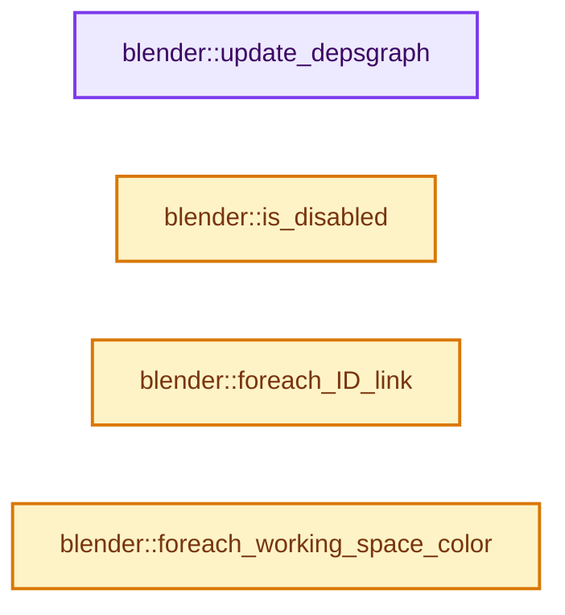
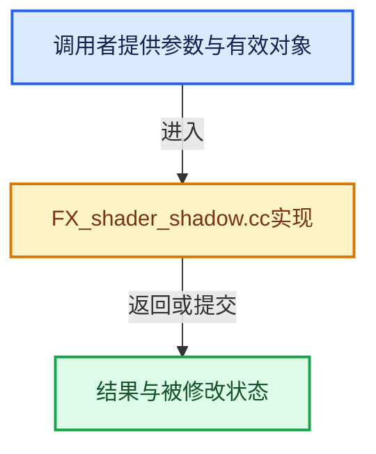

# 实现依赖专题：source/blender/shader_fx/intern/FX_shader_shadow.cc

[实现依赖导航](../../../README.md) · [符号索引](../../../../00-课程指南/02-源码与提交索引/符号依赖与实现索引.md)

本专题从正文实际调用进入，集中保存共享实现。函数有稳定锚点，可从调用处直接跳到对应完整函数；递归与互相调用通过回链组织。

## 本文件的实现关系






## 完整成员与函数实现

<a id="f-b34d41c747102ee1"></a>

### `blender::update_depsgraph`

实现位置：[source/blender/shader_fx/intern/FX_shader_shadow.cc](../../../../../../../../source/blender/shader_fx/intern/FX_shader_shadow.cc) · L58—L65。

接口参数：

- `ShaderFxData *fx`
- `const ModifierUpdateDepsgraphContext *ctx`

**教学注释版**

<!-- annotated:ba4412d66f0dcd -->

```cpp
static void update_depsgraph(ShaderFxData *fx, const ModifierUpdateDepsgraphContext *ctx)
{
  ShadowShaderFxData *fxd = reinterpret_cast<ShadowShaderFxData *>(fx);
  if (fxd->object != nullptr) {
    DEG_add_object_relation(ctx->node, fxd->object, DEG_OB_COMP_TRANSFORM, "Shadow ShaderFx");
  }
  DEG_add_object_relation(ctx->node, ctx->object, DEG_OB_COMP_TRANSFORM, "Shadow ShaderFx");
}
```

<details>
<summary>核对原始源码：source/blender/shader_fx/intern/FX_shader_shadow.cc · L58—L65</summary>

<!-- original:ba4412d66f0dcd:source/blender/shader_fx/intern/FX_shader_shadow.cc:58:65 -->

```cpp
static void update_depsgraph(ShaderFxData *fx, const ModifierUpdateDepsgraphContext *ctx)
{
  ShadowShaderFxData *fxd = reinterpret_cast<ShadowShaderFxData *>(fx);
  if (fxd->object != nullptr) {
    DEG_add_object_relation(ctx->node, fxd->object, DEG_OB_COMP_TRANSFORM, "Shadow ShaderFx");
  }
  DEG_add_object_relation(ctx->node, ctx->object, DEG_OB_COMP_TRANSFORM, "Shadow ShaderFx");
}
```

</details>

**继续追踪实现**

- `DEG_add_object_relation` → [blender::DEG_add_object_relation · L123](../../../06-Depsgraph依赖图/intern/depsgraph_build.cc.md#f-f570cffae97e273c)。

<a id="f-936f1bc8fa045f67"></a>

### `blender::is_disabled`

实现位置：[source/blender/shader_fx/intern/FX_shader_shadow.cc](../../../../../../../../source/blender/shader_fx/intern/FX_shader_shadow.cc) · L67—L72。

接口参数：

- `ShaderFxData *fx`
- `bool`

**教学注释版**

<!-- annotated:ccf233e495714a -->

```cpp
static bool is_disabled(ShaderFxData *fx, bool /*use_render_params*/)
{
  ShadowShaderFxData *fxd = reinterpret_cast<ShadowShaderFxData *>(fx);

  return (!fxd->object) && (fxd->flag & FX_SHADOW_USE_OBJECT);
}
```

<details>
<summary>核对原始源码：source/blender/shader_fx/intern/FX_shader_shadow.cc · L67—L72</summary>

<!-- original:ccf233e495714a:source/blender/shader_fx/intern/FX_shader_shadow.cc:67:72 -->

```cpp
static bool is_disabled(ShaderFxData *fx, bool /*use_render_params*/)
{
  ShadowShaderFxData *fxd = reinterpret_cast<ShadowShaderFxData *>(fx);

  return (!fxd->object) && (fxd->flag & FX_SHADOW_USE_OBJECT);
}
```

</details>

**结果出口**

- `return (!fxd->object) && (fxd->flag & FX_SHADOW_USE_OBJECT);`

**继续追踪实现**

本实现没有需要继续展开的显式调用；检查返回表达式、对象转换和调用者前置条件。

<a id="f-ba0bc12adf2b9e28"></a>

### `blender::foreach_ID_link`

实现位置：[source/blender/shader_fx/intern/FX_shader_shadow.cc](../../../../../../../../source/blender/shader_fx/intern/FX_shader_shadow.cc) · L74—L79。

接口参数：

- `ShaderFxData *fx`
- `Object *ob`
- `IDWalkFunc walk`
- `void *user_data`

**教学注释版**

<!-- annotated:c0a8c50eaa9846 -->

```cpp
static void foreach_ID_link(ShaderFxData *fx, Object *ob, IDWalkFunc walk, void *user_data)
{
  ShadowShaderFxData *fxd = reinterpret_cast<ShadowShaderFxData *>(fx);

  walk(user_data, ob, reinterpret_cast<ID **>(&fxd->object), IDWALK_CB_NOP);
}
```

<details>
<summary>核对原始源码：source/blender/shader_fx/intern/FX_shader_shadow.cc · L74—L79</summary>

<!-- original:c0a8c50eaa9846:source/blender/shader_fx/intern/FX_shader_shadow.cc:74:79 -->

```cpp
static void foreach_ID_link(ShaderFxData *fx, Object *ob, IDWalkFunc walk, void *user_data)
{
  ShadowShaderFxData *fxd = reinterpret_cast<ShadowShaderFxData *>(fx);

  walk(user_data, ob, reinterpret_cast<ID **>(&fxd->object), IDWALK_CB_NOP);
}
```

</details>

**继续追踪实现**

- `walk` → [调用协议](../../../../00-课程指南/01-路线与规范/模板宏与动态分派协议.md)：局部可调用对象，须结合其初始化与捕获环境。调用位置L78。

<a id="f-82c3e51fd945490e"></a>

### `blender::foreach_working_space_color`

实现位置：[source/blender/shader_fx/intern/FX_shader_shadow.cc](../../../../../../../../source/blender/shader_fx/intern/FX_shader_shadow.cc) · L146—L151。

接口参数：

- `ShaderFxData *fx`
- `const IDTypeForeachColorFunctionCallback &fn`

**教学注释版**

<!-- annotated:18711b2425ccad -->

```cpp
static void foreach_working_space_color(ShaderFxData *fx,
                                        const IDTypeForeachColorFunctionCallback &fn)
{
  ShadowShaderFxData *fxd = reinterpret_cast<ShadowShaderFxData *>(fx);
  fn.single(fxd->shadow_rgba);
}
```

<details>
<summary>核对原始源码：source/blender/shader_fx/intern/FX_shader_shadow.cc · L146—L151</summary>

<!-- original:18711b2425ccad:source/blender/shader_fx/intern/FX_shader_shadow.cc:146:151 -->

```cpp
static void foreach_working_space_color(ShaderFxData *fx,
                                        const IDTypeForeachColorFunctionCallback &fn)
{
  ShadowShaderFxData *fxd = reinterpret_cast<ShadowShaderFxData *>(fx);
  fn.single(fxd->shadow_rgba);
}
```

</details>

**继续追踪实现**

- `fn.single` → [blender::bits::BoolToBit::single · L68](../../../01-BLI基础库/intern/bit_bool_conversion.cc.md#f-08318f2d0747602b)。
