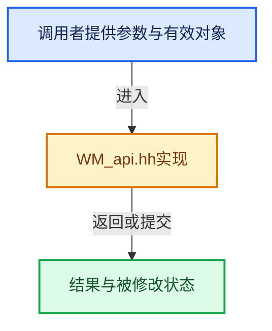

# 实现依赖专题：source/blender/windowmanager/WM_api.hh

[实现依赖导航](../../README.md) · [符号索引](../../../00-课程指南/02-源码与提交索引/符号依赖与实现索引.md)

本专题从正文实际调用进入，集中保存共享实现。函数有稳定锚点，可从调用处直接跳到对应完整函数；递归与互相调用通过回链组织。

## 本文件的实现关系





## 相关类型布局与成员入口

<a id="t-04c3bd0013b4"></a>

### `blender::ImageFormatData`

原始声明：[source/blender/windowmanager/WM_api.hh](../../../../../../../source/blender/windowmanager/WM_api.hh) · L45—L45。

以下保留类的数据声明与编译条件，成员函数实现通过后面的精确链接阅读。

<!-- annotated:9dc63048ad9945 -->

```cpp
struct ImageFormatData;
```

<details>
<summary>核对原始源码：source/blender/windowmanager/WM_api.hh · L45—L45</summary>

<!-- original:9dc63048ad9945:source/blender/windowmanager/WM_api.hh:45:45 -->

```cpp
struct ImageFormatData;
```

</details>


<a id="t-f893fce7bb11"></a>

### `blender::eWM_CapabilitiesFlag`

原始声明：[source/blender/windowmanager/WM_api.hh](../../../../../../../source/blender/windowmanager/WM_api.hh) · L195—L245。

以下保留类的数据声明与编译条件，成员函数实现通过后面的精确链接阅读。

<!-- annotated:00d2a234164c14 -->

```cpp
enum eWM_CapabilitiesFlag {
  /** Ability to warp the cursor (set its location). */
  WM_CAPABILITY_CURSOR_WARP = (1 << 0),
  /**
   * Window position access, support for the following.
   * - Getting window positions.
   * - Setting window positions.
   * - Setting positions for new windows.
   *
   * Currently there is no need to distinguish between these different cases
   * so a single flag is used.
   *
   * When omitted, it isn't possible to know where windows are located in relation to each other.
   * Operations such as applying events from one window to another or detecting the non-active
   * window under the cursor are not supported.
   */
  WM_CAPABILITY_WINDOW_POSITION = (1 << 1),
  /**
   * The windowing system supports a separate primary clipboard
   * (typically set when interactively selecting text).
   */
  WM_CAPABILITY_CLIPBOARD_PRIMARY = (1 << 2),
  /**
   * Reading from the back-buffer is supported.
   */
  WM_CAPABILITY_GPU_FRONT_BUFFER_READ = (1 << 3),
  /** Ability to copy/paste system clipboard images. */
  WM_CAPABILITY_CLIPBOARD_IMAGE = (1 << 4),
  /** Ability to sample a color outside of Blender windows. */
  WM_CAPABILITY_DESKTOP_SAMPLE = (1 << 5),
  /** Support for IME input methods. */
  WM_CAPABILITY_INPUT_IME = (1 << 6),
  /** Trackpad physical scroll detection. */
  WM_CAPABILITY_TRACKPAD_PHYSICAL_DIRECTION = (1 << 7),
  /** Support for window decoration styles. */
  WM_CAPABILITY_WINDOW_DECORATION_STYLES = (1 << 8),
  /** Support for the "Hyper" modifier key. */
  WM_CAPABILITY_KEYBOARD_HYPER_KEY = (1 << 9),
  /** Support for RGBA Cursors. */
  WM_CAPABILITY_CURSOR_RGBA = (1 << 10),
  /** Support on demand cursor generation. */
  WM_CAPABILITY_CURSOR_GENERATOR = (1 << 11),
  /** Ability to save/restore windows among multiple monitors. */
  WM_CAPABILITY_MULTIMONITOR_PLACEMENT = (1 << 12),
  /** Support for the window to show a file-path (otherwise include in the title text). */
  WM_CAPABILITY_WINDOW_PATH = (1 << 13),
  /** Support for window server side decorations (SSD). */
  WM_CAPABILITY_WINDOW_DECORATION_SERVER_SIDE = (1 << 14),
  /** The initial value, indicates the value needs to be set by inspecting GHOST. */
  WM_CAPABILITY_INITIALIZED = (1u << 31),
};
```

<details>
<summary>核对原始源码：source/blender/windowmanager/WM_api.hh · L195—L245</summary>

<!-- original:00d2a234164c14:source/blender/windowmanager/WM_api.hh:195:245 -->

```cpp
enum eWM_CapabilitiesFlag {
  /** Ability to warp the cursor (set its location). */
  WM_CAPABILITY_CURSOR_WARP = (1 << 0),
  /**
   * Window position access, support for the following.
   * - Getting window positions.
   * - Setting window positions.
   * - Setting positions for new windows.
   *
   * Currently there is no need to distinguish between these different cases
   * so a single flag is used.
   *
   * When omitted, it isn't possible to know where windows are located in relation to each other.
   * Operations such as applying events from one window to another or detecting the non-active
   * window under the cursor are not supported.
   */
  WM_CAPABILITY_WINDOW_POSITION = (1 << 1),
  /**
   * The windowing system supports a separate primary clipboard
   * (typically set when interactively selecting text).
   */
  WM_CAPABILITY_CLIPBOARD_PRIMARY = (1 << 2),
  /**
   * Reading from the back-buffer is supported.
   */
  WM_CAPABILITY_GPU_FRONT_BUFFER_READ = (1 << 3),
  /** Ability to copy/paste system clipboard images. */
  WM_CAPABILITY_CLIPBOARD_IMAGE = (1 << 4),
  /** Ability to sample a color outside of Blender windows. */
  WM_CAPABILITY_DESKTOP_SAMPLE = (1 << 5),
  /** Support for IME input methods. */
  WM_CAPABILITY_INPUT_IME = (1 << 6),
  /** Trackpad physical scroll detection. */
  WM_CAPABILITY_TRACKPAD_PHYSICAL_DIRECTION = (1 << 7),
  /** Support for window decoration styles. */
  WM_CAPABILITY_WINDOW_DECORATION_STYLES = (1 << 8),
  /** Support for the "Hyper" modifier key. */
  WM_CAPABILITY_KEYBOARD_HYPER_KEY = (1 << 9),
  /** Support for RGBA Cursors. */
  WM_CAPABILITY_CURSOR_RGBA = (1 << 10),
  /** Support on demand cursor generation. */
  WM_CAPABILITY_CURSOR_GENERATOR = (1 << 11),
  /** Ability to save/restore windows among multiple monitors. */
  WM_CAPABILITY_MULTIMONITOR_PLACEMENT = (1 << 12),
  /** Support for the window to show a file-path (otherwise include in the title text). */
  WM_CAPABILITY_WINDOW_PATH = (1 << 13),
  /** Support for window server side decorations (SSD). */
  WM_CAPABILITY_WINDOW_DECORATION_SERVER_SIDE = (1 << 14),
  /** The initial value, indicates the value needs to be set by inspecting GHOST. */
  WM_CAPABILITY_INITIALIZED = (1u << 31),
};
```

</details>


<a id="t-83237be90e40"></a>

### `blender::eWM_EventHandlerFlag`

原始声明：[source/blender/windowmanager/WM_api.hh](../../../../../../../source/blender/windowmanager/WM_api.hh) · L693—L702。

以下保留类的数据声明与编译条件，成员函数实现通过后面的精确链接阅读。

<!-- annotated:1a7d7b9fb54f61 -->

```cpp
enum eWM_EventHandlerFlag {
  /** After this handler all others are ignored. */
  WM_HANDLER_BLOCKING = (1 << 0),
  /** Handler accepts double key press events. */
  WM_HANDLER_ACCEPT_DBL_CLICK = (1 << 1),

  /* Internal. */
  /** Handler tagged to be freed in #wm_handlers_do(). */
  WM_HANDLER_DO_FREE = (1 << 7),
};
```

<details>
<summary>核对原始源码：source/blender/windowmanager/WM_api.hh · L693—L702</summary>

<!-- original:1a7d7b9fb54f61:source/blender/windowmanager/WM_api.hh:693:702 -->

```cpp
enum eWM_EventHandlerFlag {
  /** After this handler all others are ignored. */
  WM_HANDLER_BLOCKING = (1 << 0),
  /** Handler accepts double key press events. */
  WM_HANDLER_ACCEPT_DBL_CLICK = (1 << 1),

  /* Internal. */
  /** Handler tagged to be freed in #wm_handlers_do(). */
  WM_HANDLER_DO_FREE = (1 << 7),
};
```

</details>


<a id="t-a58f1911df5c"></a>

### `blender::ID_Type`

原始声明：[source/blender/windowmanager/WM_api.hh](../../../../../../../source/blender/windowmanager/WM_api.hh) · L1358—L1358。

以下保留类的数据声明与编译条件，成员函数实现通过后面的精确链接阅读。

<!-- annotated:8c3ae5bd67ecae -->

```cpp
                                                              enum ID_Type type);
```

<details>
<summary>核对原始源码：source/blender/windowmanager/WM_api.hh · L1358—L1358</summary>

<!-- original:8c3ae5bd67ecae:source/blender/windowmanager/WM_api.hh:1358:1358 -->

```cpp
                                                              enum ID_Type type);
```

</details>


<a id="t-f37c194e0a7d"></a>

### `blender::eWM_JobType`

原始声明：[source/blender/windowmanager/WM_api.hh](../../../../../../../source/blender/windowmanager/WM_api.hh) · L1992—L2042。

以下保留类的数据声明与编译条件，成员函数实现通过后面的精确链接阅读。

<!-- annotated:ab0bebeeb6dbd3 -->

```cpp
enum eWM_JobType {
  /** Not a real type, use for querying any type. */
  WM_JOB_TYPE_ANY = 0,

  WM_JOB_TYPE_COMPOSITE,
  WM_JOB_TYPE_RENDER,
  WM_JOB_TYPE_RENDER_PREVIEW, /* UI preview. */
  /** Job for the UI to load previews from the file system (uses OS thumbnail cache). */
  WM_JOB_TYPE_LOAD_PREVIEW, /* UI preview. */
  WM_JOB_TYPE_OBJECT_SIM_OCEAN,
  WM_JOB_TYPE_OBJECT_SIM_FLUID,
  WM_JOB_TYPE_OBJECT_BAKE_TEXTURE,
  WM_JOB_TYPE_OBJECT_BAKE,
  WM_JOB_TYPE_FILESEL_READDIR,
  WM_JOB_TYPE_ASSET_LIBRARY_LOAD,
  /**
   * For the global asset list storage (#ED_asset_list.hh). Use a different job type from
   * #WM_JOB_TYPE_ASSET_LIBRARY_LOAD (used by the asset browser) so the global storage loading can
   * happen independently of the asset browser loading. They would block each other if the type was
   * the same.
   */
  WM_JOB_TYPE_ASSET_LIBRARY_GLOBAL_LISTING_LOAD,
  WM_JOB_TYPE_CLIP_BUILD_PROXY,
  WM_JOB_TYPE_CLIP_TRACK_MARKERS,
  WM_JOB_TYPE_CLIP_SOLVE_CAMERA,
  WM_JOB_TYPE_CLIP_PREFETCH,
  WM_JOB_TYPE_SEQ_BUILD_PROXY,
  WM_JOB_TYPE_SEQ_BUILD_PREVIEW,
  WM_JOB_TYPE_POINTCACHE,
  WM_JOB_TYPE_DPAINT_BAKE,
  WM_JOB_TYPE_ALEMBIC_IMPORT,
  WM_JOB_TYPE_ALEMBIC_EXPORT,
  WM_JOB_TYPE_USD_IMPORT,
  WM_JOB_TYPE_USD_EXPORT,
  WM_JOB_TYPE_SHADER_COMPILATION,
  WM_JOB_TYPE_STUDIOLIGHT,
  WM_JOB_TYPE_LIGHT_BAKE,
  WM_JOB_TYPE_FSMENU_BOOKMARK_VALIDATE,
  WM_JOB_TYPE_QUADRIFLOW_REMESH,
  WM_JOB_TYPE_TRACE_IMAGE,
  WM_JOB_TYPE_LINEART,
  WM_JOB_TYPE_SEQ_DRAW_THUMBNAIL,
  WM_JOB_TYPE_SEQ_DRAG_DROP_PREVIEW,
  WM_JOB_TYPE_CALCULATE_SIMULATION_NODES,
  WM_JOB_TYPE_BAKE_GEOMETRY_NODES,
  WM_JOB_TYPE_UV_PACK,
  WM_JOB_TYPE_GENERATE_TEXTURE_CACHE,
  WM_JOB_TYPE_SOUND_MIXDOWN,
  /* Add as needed, bake, seq proxy build
   * if having hard coded values is a problem. */
};
```

<details>
<summary>核对原始源码：source/blender/windowmanager/WM_api.hh · L1992—L2042</summary>

<!-- original:ab0bebeeb6dbd3:source/blender/windowmanager/WM_api.hh:1992:2042 -->

```cpp
enum eWM_JobType {
  /** Not a real type, use for querying any type. */
  WM_JOB_TYPE_ANY = 0,

  WM_JOB_TYPE_COMPOSITE,
  WM_JOB_TYPE_RENDER,
  WM_JOB_TYPE_RENDER_PREVIEW, /* UI preview. */
  /** Job for the UI to load previews from the file system (uses OS thumbnail cache). */
  WM_JOB_TYPE_LOAD_PREVIEW, /* UI preview. */
  WM_JOB_TYPE_OBJECT_SIM_OCEAN,
  WM_JOB_TYPE_OBJECT_SIM_FLUID,
  WM_JOB_TYPE_OBJECT_BAKE_TEXTURE,
  WM_JOB_TYPE_OBJECT_BAKE,
  WM_JOB_TYPE_FILESEL_READDIR,
  WM_JOB_TYPE_ASSET_LIBRARY_LOAD,
  /**
   * For the global asset list storage (#ED_asset_list.hh). Use a different job type from
   * #WM_JOB_TYPE_ASSET_LIBRARY_LOAD (used by the asset browser) so the global storage loading can
   * happen independently of the asset browser loading. They would block each other if the type was
   * the same.
   */
  WM_JOB_TYPE_ASSET_LIBRARY_GLOBAL_LISTING_LOAD,
  WM_JOB_TYPE_CLIP_BUILD_PROXY,
  WM_JOB_TYPE_CLIP_TRACK_MARKERS,
  WM_JOB_TYPE_CLIP_SOLVE_CAMERA,
  WM_JOB_TYPE_CLIP_PREFETCH,
  WM_JOB_TYPE_SEQ_BUILD_PROXY,
  WM_JOB_TYPE_SEQ_BUILD_PREVIEW,
  WM_JOB_TYPE_POINTCACHE,
  WM_JOB_TYPE_DPAINT_BAKE,
  WM_JOB_TYPE_ALEMBIC_IMPORT,
  WM_JOB_TYPE_ALEMBIC_EXPORT,
  WM_JOB_TYPE_USD_IMPORT,
  WM_JOB_TYPE_USD_EXPORT,
  WM_JOB_TYPE_SHADER_COMPILATION,
  WM_JOB_TYPE_STUDIOLIGHT,
  WM_JOB_TYPE_LIGHT_BAKE,
  WM_JOB_TYPE_FSMENU_BOOKMARK_VALIDATE,
  WM_JOB_TYPE_QUADRIFLOW_REMESH,
  WM_JOB_TYPE_TRACE_IMAGE,
  WM_JOB_TYPE_LINEART,
  WM_JOB_TYPE_SEQ_DRAW_THUMBNAIL,
  WM_JOB_TYPE_SEQ_DRAG_DROP_PREVIEW,
  WM_JOB_TYPE_CALCULATE_SIMULATION_NODES,
  WM_JOB_TYPE_BAKE_GEOMETRY_NODES,
  WM_JOB_TYPE_UV_PACK,
  WM_JOB_TYPE_GENERATE_TEXTURE_CACHE,
  WM_JOB_TYPE_SOUND_MIXDOWN,
  /* Add as needed, bake, seq proxy build
   * if having hard coded values is a problem. */
};
```

</details>


<a id="m-19c9d065aee2"></a>

## 宏 `WM_operatortype_prop_tag`

<!-- annotated:09c12e99d840ac -->

```cpp
#define WM_operatortype_prop_tag(property, tags) \
  { \
    CHECK_TYPE(tags, eOperatorPropTags); \
    RNA_def_property_tags(prop, tags); \
  } \
  (void)0

```

<details>
<summary>核对原始源码：source/blender/windowmanager/WM_api.hh · L1580—L1586</summary>

<!-- original:09c12e99d840ac:source/blender/windowmanager/WM_api.hh:1580:1586 -->

```cpp
#define WM_operatortype_prop_tag(property, tags) \
  { \
    CHECK_TYPE(tags, eOperatorPropTags); \
    RNA_def_property_tags(prop, tags); \
  } \
  (void)0

```

</details>

宏在预处理阶段展开，参数替换、重复求值和条件编译应直接从该定义检查。与普通函数不同，宏不会自动提供参数类型检查；构建配置选择哪个定义需结合外围条件。

## 完整成员与函数实现
