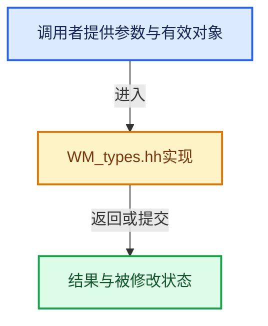

# 实现依赖专题：source/blender/windowmanager/WM_types.hh

[实现依赖导航](../../README.md) · [符号索引](../../../00-课程指南/02-源码与提交索引/符号依赖与实现索引.md)

本专题从正文实际调用进入，集中保存共享实现。函数有稳定锚点，可从调用处直接跳到对应完整函数；递归与互相调用通过回链组织。

## 本文件的实现关系





## 相关类型布局与成员入口

<a id="t-f5ff138e2144"></a>

### `blender::wm::OpCallContext`

原始声明：[source/blender/windowmanager/WM_types.hh](../../../../../../../source/blender/windowmanager/WM_types.hh) · L250—L265。

以下保留类的数据声明与编译条件，成员函数实现通过后面的精确链接阅读。

<!-- annotated:5612a533d0255e -->

```cpp
enum class OpCallContext : int8_t {
  /* If there's invoke, call it, otherwise exec. */
  InvokeDefault,
  InvokeRegionWin,
  InvokeRegionChannels,
  InvokeRegionPreview,
  InvokeArea,
  InvokeScreen,
  /* Only call exec. */
  ExecDefault,
  ExecRegionWin,
  ExecRegionChannels,
  ExecRegionPreview,
  ExecArea,
  ExecScreen,
};
```

<details>
<summary>核对原始源码：source/blender/windowmanager/WM_types.hh · L250—L265</summary>

<!-- original:5612a533d0255e:source/blender/windowmanager/WM_types.hh:250:265 -->

```cpp
enum class OpCallContext : int8_t {
  /* If there's invoke, call it, otherwise exec. */
  InvokeDefault,
  InvokeRegionWin,
  InvokeRegionChannels,
  InvokeRegionPreview,
  InvokeArea,
  InvokeScreen,
  /* Only call exec. */
  ExecDefault,
  ExecRegionWin,
  ExecRegionChannels,
  ExecRegionPreview,
  ExecArea,
  ExecScreen,
};
```

</details>


<a id="t-27b582991a64"></a>

### `blender::wmEventModifierFlag`

原始声明：[source/blender/windowmanager/WM_types.hh](../../../../../../../source/blender/windowmanager/WM_types.hh) · L290—L306。

以下保留类的数据声明与编译条件，成员函数实现通过后面的精确链接阅读。

<!-- annotated:e9263ef39591a8 -->

```cpp
enum wmEventModifierFlag : uint8_t {
  KM_SHIFT = (1 << 0),
  KM_CTRL = (1 << 1),
  KM_ALT = (1 << 2),
  /** Use for Windows-Key on MS-Windows, Command-key on macOS and Super on Linux. */
  KM_OSKEY = (1 << 3),
  /**
   * An additional modifier available on Unix systems (in addition to "Super").
   * Even though standard keyboards don't have a "Hyper" key it is a valid modifier
   * on Wayland and X11, where it is possible to map a key (typically CapsLock)
   * to be a Hyper modifier, see !136340.
   *
   * Note that this is currently only supported on Wayland & X11
   * but could be supported on other platforms if desired.
   */
  KM_HYPER = (1 << 4),
};
```

<details>
<summary>核对原始源码：source/blender/windowmanager/WM_types.hh · L290—L306</summary>

<!-- original:e9263ef39591a8:source/blender/windowmanager/WM_types.hh:290:306 -->

```cpp
enum wmEventModifierFlag : uint8_t {
  KM_SHIFT = (1 << 0),
  KM_CTRL = (1 << 1),
  KM_ALT = (1 << 2),
  /** Use for Windows-Key on MS-Windows, Command-key on macOS and Super on Linux. */
  KM_OSKEY = (1 << 3),
  /**
   * An additional modifier available on Unix systems (in addition to "Super").
   * Even though standard keyboards don't have a "Hyper" key it is a valid modifier
   * on Wayland and X11, where it is possible to map a key (typically CapsLock)
   * to be a Hyper modifier, see !136340.
   *
   * Note that this is currently only supported on Wayland & X11
   * but could be supported on other platforms if desired.
   */
  KM_HYPER = (1 << 4),
};
```

</details>


<a id="t-06b0d9e40d6b"></a>

### `blender::eWM_EventFlag`

原始声明：[source/blender/windowmanager/WM_types.hh](../../../../../../../source/blender/windowmanager/WM_types.hh) · L730—L757。

以下保留类的数据声明与编译条件，成员函数实现通过后面的精确链接阅读。

<!-- annotated:5dc5dba0890427 -->

```cpp
enum eWM_EventFlag {
  /**
   * True if the operating system inverted the delta x/y values and resulting
   * `prev_xy` values, for natural scroll direction.
   * For absolute scroll direction, the delta must be negated again.
   */
  WM_EVENT_SCROLL_INVERT = (1 << 0),
  /**
   * Generated by auto-repeat, note that this must only ever be set for keyboard events
   * where `ISKEYBOARD(event->type) == true`.
   *
   * See #KMI_REPEAT_IGNORE for details on how key-map handling uses this.
   */
  WM_EVENT_IS_REPEAT = (1 << 1),
  /**
   * Generated for consecutive trackpad or NDOF-motion events,
   * the repeat chain is broken by key/button events,
   * or cursor motion exceeding #WM_EVENT_CURSOR_MOTION_THRESHOLD.
   *
   * Changing the type of trackpad or gesture event also breaks the chain.
   */
  WM_EVENT_IS_CONSECUTIVE = (1 << 2),
  /**
   * Mouse-move events may have this flag set to force creating a click-drag event
   * even when the threshold has not been met.
   */
  WM_EVENT_FORCE_DRAG_THRESHOLD = (1 << 3),
};
```

<details>
<summary>核对原始源码：source/blender/windowmanager/WM_types.hh · L730—L757</summary>

<!-- original:5dc5dba0890427:source/blender/windowmanager/WM_types.hh:730:757 -->

```cpp
enum eWM_EventFlag {
  /**
   * True if the operating system inverted the delta x/y values and resulting
   * `prev_xy` values, for natural scroll direction.
   * For absolute scroll direction, the delta must be negated again.
   */
  WM_EVENT_SCROLL_INVERT = (1 << 0),
  /**
   * Generated by auto-repeat, note that this must only ever be set for keyboard events
   * where `ISKEYBOARD(event->type) == true`.
   *
   * See #KMI_REPEAT_IGNORE for details on how key-map handling uses this.
   */
  WM_EVENT_IS_REPEAT = (1 << 1),
  /**
   * Generated for consecutive trackpad or NDOF-motion events,
   * the repeat chain is broken by key/button events,
   * or cursor motion exceeding #WM_EVENT_CURSOR_MOTION_THRESHOLD.
   *
   * Changing the type of trackpad or gesture event also breaks the chain.
   */
  WM_EVENT_IS_CONSECUTIVE = (1 << 2),
  /**
   * Mouse-move events may have this flag set to force creating a click-drag event
   * even when the threshold has not been met.
   */
  WM_EVENT_FORCE_DRAG_THRESHOLD = (1 << 3),
};
```

</details>


<a id="m-3ffbbbe8504c"></a>

## 宏 `WM_OP_CONTEXT_HAS_AREA`

<!-- annotated:8122bff54d8241 -->

```cpp
#define WM_OP_CONTEXT_HAS_AREA(type) \
  (CHECK_TYPE_INLINE(type, wm::OpCallContext), \
   !ELEM(type, wm::OpCallContext::InvokeScreen, wm::OpCallContext::ExecScreen))
#define WM_OP_CONTEXT_HAS_REGION(type) \
```

<details>
<summary>核对原始源码：source/blender/windowmanager/WM_types.hh · L268—L271</summary>

<!-- original:8122bff54d8241:source/blender/windowmanager/WM_types.hh:268:271 -->

```cpp
#define WM_OP_CONTEXT_HAS_AREA(type) \
  (CHECK_TYPE_INLINE(type, wm::OpCallContext), \
   !ELEM(type, wm::OpCallContext::InvokeScreen, wm::OpCallContext::ExecScreen))
#define WM_OP_CONTEXT_HAS_REGION(type) \
```

</details>

宏在预处理阶段展开，参数替换、重复求值和条件编译应直接从该定义检查。与普通函数不同，宏不会自动提供参数类型检查；构建配置选择哪个定义需结合外围条件。

## 完整成员与函数实现
