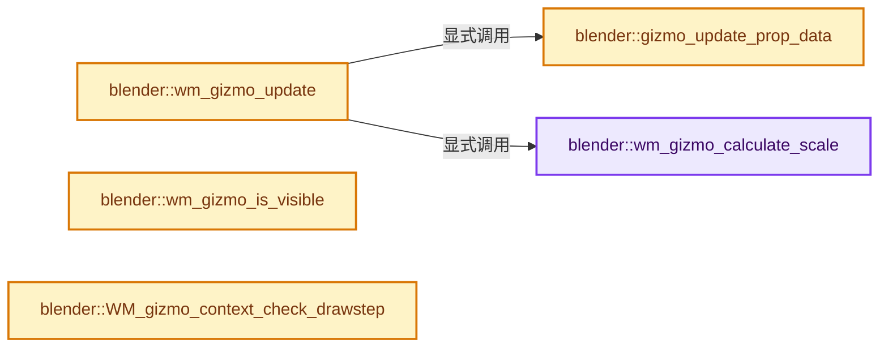
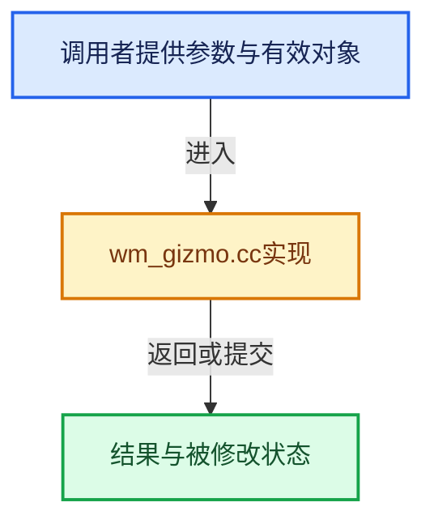

# 实现依赖专题：source/blender/windowmanager/gizmo/intern/wm_gizmo.cc

[实现依赖导航](../../../../README.md) · [符号索引](../../../../../00-课程指南/02-源码与提交索引/符号依赖与实现索引.md)

本专题从正文实际调用进入，集中保存共享实现。函数有稳定锚点，可从调用处直接跳到对应完整函数；递归与互相调用通过回链组织。

## 本文件的实现关系






## 完整成员与函数实现

<a id="f-21dce2fff7e59835"></a>

### `blender::wm_gizmo_calculate_scale`

实现位置：[source/blender/windowmanager/gizmo/intern/wm_gizmo.cc](../../../../../../../../../source/blender/windowmanager/gizmo/intern/wm_gizmo.cc) · L450—L475。

接口参数：

- `wmGizmo *gz`
- `const bContext *C`

**教学注释版**

<!-- annotated:ddca5bc8521bce -->

```cpp
void wm_gizmo_calculate_scale(wmGizmo *gz, const bContext *C)
{
  const RegionView3D *rv3d = CTX_wm_region_view3d(C);
  float scale = UI_SCALE_FAC;

  if ((gz->parent_gzgroup->type->flag & WM_GIZMOGROUPTYPE_SCALE) == 0) {
    scale *= U.gizmo_size;
    if (rv3d) {
      /* #ED_view3d_pixel_size includes #U.pixelsize, remove it. */
      float matrix_world[4][4];
      if (gz->type->matrix_basis_get) {
        float matrix_basis[4][4];
        gz->type->matrix_basis_get(gz, matrix_basis);
        mul_m4_m4m4(matrix_world, gz->matrix_space, matrix_basis);
      }
      else {
        mul_m4_m4m4(matrix_world, gz->matrix_space, gz->matrix_basis);
      }

      /* Exclude matrix_offset from scale. */
      scale *= ED_view3d_pixel_size_no_ui_scale(rv3d, matrix_world[3]);
    }
  }

  gz->scale_final = gz->scale_basis * scale;
}
```

<details>
<summary>核对原始源码：source/blender/windowmanager/gizmo/intern/wm_gizmo.cc · L450—L475</summary>

<!-- original:ddca5bc8521bce:source/blender/windowmanager/gizmo/intern/wm_gizmo.cc:450:475 -->

```cpp
void wm_gizmo_calculate_scale(wmGizmo *gz, const bContext *C)
{
  const RegionView3D *rv3d = CTX_wm_region_view3d(C);
  float scale = UI_SCALE_FAC;

  if ((gz->parent_gzgroup->type->flag & WM_GIZMOGROUPTYPE_SCALE) == 0) {
    scale *= U.gizmo_size;
    if (rv3d) {
      /* #ED_view3d_pixel_size includes #U.pixelsize, remove it. */
      float matrix_world[4][4];
      if (gz->type->matrix_basis_get) {
        float matrix_basis[4][4];
        gz->type->matrix_basis_get(gz, matrix_basis);
        mul_m4_m4m4(matrix_world, gz->matrix_space, matrix_basis);
      }
      else {
        mul_m4_m4m4(matrix_world, gz->matrix_space, gz->matrix_basis);
      }

      /* Exclude matrix_offset from scale. */
      scale *= ED_view3d_pixel_size_no_ui_scale(rv3d, matrix_world[3]);
    }
  }

  gz->scale_final = gz->scale_basis * scale;
}
```

</details>

**沿实际写入检查状态**

- `scale *= U.gizmo_size;`
- `scale *= ED_view3d_pixel_size_no_ui_scale(rv3d, matrix_world[3]);`
- `gz->scale_final = gz->scale_basis * scale;`

**继续追踪实现**

- `CTX_wm_region_view3d` → [blender::CTX_wm_region_view3d · L1009](../../../../02-BKE几何与数据/intern/context.cc.md#f-77c9aa04e585367e)。
- `gz->type->matrix_basis_get` → [调用协议](../../../../../00-课程指南/01-路线与规范/模板宏与动态分派协议.md)：接收对象类型依赖auto、返回值或模板实例；不按同名猜测目标。调用位置L462。
- `mul_m4_m4m4` → [blender::mul_m4_m4m4 · L217](../../../../01-BLI基础库/intern/math_matrix_c.cc.md#f-b5272136b543b73b)。
- `ED_view3d_pixel_size_no_ui_scale` → [blender::ED_view3d_pixel_size_no_ui_scale · L280](../../../editors/space_view3d/view3d_project.cc.md#f-08cbca8a966f8419)。

<a id="f-d62e8fbec94f45ef"></a>

### `blender::gizmo_update_prop_data`

实现位置：[source/blender/windowmanager/gizmo/intern/wm_gizmo.cc](../../../../../../../../../source/blender/windowmanager/gizmo/intern/wm_gizmo.cc) · L477—L487。

接口参数：

- `wmGizmo *gz`

**教学注释版**

<!-- annotated:fcb7d205dd0f3a -->

```cpp
static void gizmo_update_prop_data(wmGizmo *gz)
{
  /* Gizmo property might have been changed, so update gizmo. */
  if (gz->type->property_update) {
    for (wmGizmoProperty &gz_prop : gz->target_properties) {
      if (WM_gizmo_target_property_is_valid(&gz_prop)) {
        gz->type->property_update(gz, &gz_prop);
      }
    }
  }
}
```

<details>
<summary>核对原始源码：source/blender/windowmanager/gizmo/intern/wm_gizmo.cc · L477—L487</summary>

<!-- original:fcb7d205dd0f3a:source/blender/windowmanager/gizmo/intern/wm_gizmo.cc:477:487 -->

```cpp
static void gizmo_update_prop_data(wmGizmo *gz)
{
  /* Gizmo property might have been changed, so update gizmo. */
  if (gz->type->property_update) {
    for (wmGizmoProperty &gz_prop : gz->target_properties) {
      if (WM_gizmo_target_property_is_valid(&gz_prop)) {
        gz->type->property_update(gz, &gz_prop);
      }
    }
  }
}
```

</details>

**继续追踪实现**

- `WM_gizmo_target_property_is_valid` → [blender::WM_gizmo_target_property_is_valid · L150](wm_gizmo_target_props.cc.md#f-d31a463b664c4298)。
- `gz->type->property_update` → [调用协议](../../../../../00-课程指南/01-路线与规范/模板宏与动态分派协议.md)：接收对象类型依赖auto、返回值或模板实例；不按同名猜测目标。调用位置L483。

<a id="f-92db90866896bca0"></a>

### `blender::wm_gizmo_update`

实现位置：[source/blender/windowmanager/gizmo/intern/wm_gizmo.cc](../../../../../../../../../source/blender/windowmanager/gizmo/intern/wm_gizmo.cc) · L489—L495。

接口参数：

- `wmGizmo *gz`
- `const bContext *C`
- `const bool refresh_map`

**教学注释版**

<!-- annotated:9bf1a691b80f2c -->

```cpp
void wm_gizmo_update(wmGizmo *gz, const bContext *C, const bool refresh_map)
{
  if (refresh_map) {
    gizmo_update_prop_data(gz);
  }
  wm_gizmo_calculate_scale(gz, C);
}
```

<details>
<summary>核对原始源码：source/blender/windowmanager/gizmo/intern/wm_gizmo.cc · L489—L495</summary>

<!-- original:9bf1a691b80f2c:source/blender/windowmanager/gizmo/intern/wm_gizmo.cc:489:495 -->

```cpp
void wm_gizmo_update(wmGizmo *gz, const bContext *C, const bool refresh_map)
{
  if (refresh_map) {
    gizmo_update_prop_data(gz);
  }
  wm_gizmo_calculate_scale(gz, C);
}
```

</details>

**继续追踪实现**

- `gizmo_update_prop_data` → [blender::gizmo_update_prop_data · L477](wm_gizmo.cc.md#f-d62e8fbec94f45ef)。
- `wm_gizmo_calculate_scale` → [blender::wm_gizmo_calculate_scale · L450](wm_gizmo.cc.md#f-21dce2fff7e59835)。

<a id="f-bdaed1f2ac5e3d1d"></a>

### `blender::wm_gizmo_is_visible`

实现位置：[source/blender/windowmanager/gizmo/intern/wm_gizmo.cc](../../../../../../../../../source/blender/windowmanager/gizmo/intern/wm_gizmo.cc) · L497—L517。

接口参数：

- `wmGizmo *gz`

**教学注释版**

<!-- annotated:755c1ac75fcca7 -->

```cpp
int wm_gizmo_is_visible(wmGizmo *gz)
{
  if (gz->flag & WM_GIZMO_HIDDEN) {
    return 0;
  }
  if ((gz->state & WM_GIZMO_STATE_MODAL) &&
      !(gz->flag & (WM_GIZMO_DRAW_MODAL | WM_GIZMO_DRAW_VALUE)))
  {
    /* Don't draw while modal (dragging). */
    return 0;
  }
  if ((gz->flag & WM_GIZMO_DRAW_HOVER) && !(gz->state & WM_GIZMO_STATE_HIGHLIGHT) &&
      /* Still draw selected gizmos. */
      !(gz->state & WM_GIZMO_STATE_SELECT))
  {
    /* Update but don't draw. */
    return WM_GIZMO_IS_VISIBLE_UPDATE;
  }

  return WM_GIZMO_IS_VISIBLE_UPDATE | WM_GIZMO_IS_VISIBLE_DRAW;
}
```

<details>
<summary>核对原始源码：source/blender/windowmanager/gizmo/intern/wm_gizmo.cc · L497—L517</summary>

<!-- original:755c1ac75fcca7:source/blender/windowmanager/gizmo/intern/wm_gizmo.cc:497:517 -->

```cpp
int wm_gizmo_is_visible(wmGizmo *gz)
{
  if (gz->flag & WM_GIZMO_HIDDEN) {
    return 0;
  }
  if ((gz->state & WM_GIZMO_STATE_MODAL) &&
      !(gz->flag & (WM_GIZMO_DRAW_MODAL | WM_GIZMO_DRAW_VALUE)))
  {
    /* Don't draw while modal (dragging). */
    return 0;
  }
  if ((gz->flag & WM_GIZMO_DRAW_HOVER) && !(gz->state & WM_GIZMO_STATE_HIGHLIGHT) &&
      /* Still draw selected gizmos. */
      !(gz->state & WM_GIZMO_STATE_SELECT))
  {
    /* Update but don't draw. */
    return WM_GIZMO_IS_VISIBLE_UPDATE;
  }

  return WM_GIZMO_IS_VISIBLE_UPDATE | WM_GIZMO_IS_VISIBLE_DRAW;
}
```

</details>

**结果出口**

- `return 0;`
- `return WM_GIZMO_IS_VISIBLE_UPDATE;`
- `return WM_GIZMO_IS_VISIBLE_UPDATE | WM_GIZMO_IS_VISIBLE_DRAW;`

**继续追踪实现**

本实现没有需要继续展开的显式调用；检查返回表达式、对象转换和调用者前置条件。

<a id="f-de3060f53f851d2b"></a>

### `blender::WM_gizmo_context_check_drawstep`

实现位置：[source/blender/windowmanager/gizmo/intern/wm_gizmo.cc](../../../../../../../../../source/blender/windowmanager/gizmo/intern/wm_gizmo.cc) · L725—L740。

接口参数：

- `const bContext *C`
- `eWM_GizmoFlagMapDrawStep step`

**教学注释版**

<!-- annotated:d8d86906160f61 -->

```cpp
bool WM_gizmo_context_check_drawstep(const bContext *C, eWM_GizmoFlagMapDrawStep step)
{
  switch (step) {
    case WM_GIZMOMAP_DRAWSTEP_2D: {
      break;
    }
    case WM_GIZMOMAP_DRAWSTEP_3D: {
      wmWindowManager *wm = CTX_wm_manager(C);
      if (ED_screen_animation_playing(wm)) {
        return false;
      }
      break;
    }
  }
  return true;
}
```

<details>
<summary>核对原始源码：source/blender/windowmanager/gizmo/intern/wm_gizmo.cc · L725—L740</summary>

<!-- original:d8d86906160f61:source/blender/windowmanager/gizmo/intern/wm_gizmo.cc:725:740 -->

```cpp
bool WM_gizmo_context_check_drawstep(const bContext *C, eWM_GizmoFlagMapDrawStep step)
{
  switch (step) {
    case WM_GIZMOMAP_DRAWSTEP_2D: {
      break;
    }
    case WM_GIZMOMAP_DRAWSTEP_3D: {
      wmWindowManager *wm = CTX_wm_manager(C);
      if (ED_screen_animation_playing(wm)) {
        return false;
      }
      break;
    }
  }
  return true;
}
```

</details>

**结果出口**

- `return false;`
- `return true;`

**继续追踪实现**

- `CTX_wm_manager` → [blender::CTX_wm_manager · L928](../../../../02-BKE几何与数据/intern/context.cc.md#f-158f36db7379fbe8)。
- `ED_screen_animation_playing` → [blender::ED_screen_animation_playing · L6860](../../../editors/screen/screen_ops.cc.md#f-a214adf804d8afe6)。
