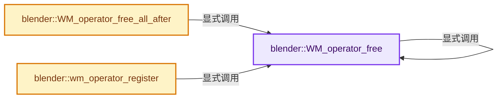
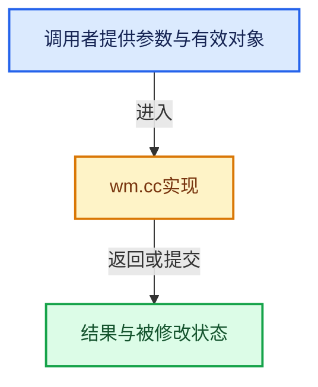

# 实现依赖专题：source/blender/windowmanager/intern/wm.cc

[实现依赖导航](../../../README.md) · [符号索引](../../../../00-课程指南/02-源码与提交索引/符号依赖与实现索引.md)

本专题从正文实际调用进入，集中保存共享实现。函数有稳定锚点，可从调用处直接跳到对应完整函数；递归与互相调用通过回链组织。

## 本文件的实现关系






## 完整成员与函数实现

<a id="f-58bc17403b28c17b"></a>

### `blender::WM_operator_free`

实现位置：[source/blender/windowmanager/intern/wm.cc](../../../../../../../../source/blender/windowmanager/intern/wm.cc) · L275—L308。

接口参数：

- `wmOperator *op`

**教学注释版**

<!-- annotated:9639c412eefe6c -->

```cpp
void WM_operator_free(wmOperator *op)
{

#ifdef WITH_PYTHON
  if (op->py_instance) {
    /* Do this first in case there are any __del__ functions or similar that use properties. */
    BPY_DECREF_RNA_INVALIDATE(op->py_instance);
  }
#endif

  if (op->ptr) {
    op->properties = static_cast<IDProperty *>(op->ptr->data);
    MEM_delete(op->ptr);
  }

  if (op->properties) {
    IDP_FreeProperty(op->properties);
  }

  if (op->reports && (op->reports->flag & RPT_FREE)) {
    BKE_reports_free(op->reports);
    MEM_delete(op->reports);
  }

  if (op->macro.first()) {
    wmOperator *opm, *opmnext;
    for (opm = op->macro.first(); opm; opm = opmnext) {
      opmnext = opm->next;
      WM_operator_free(opm);
    }
  }

  MEM_delete(op);
}
```

<details>
<summary>核对原始源码：source/blender/windowmanager/intern/wm.cc · L275—L308</summary>

<!-- original:9639c412eefe6c:source/blender/windowmanager/intern/wm.cc:275:308 -->

```cpp
void WM_operator_free(wmOperator *op)
{

#ifdef WITH_PYTHON
  if (op->py_instance) {
    /* Do this first in case there are any __del__ functions or similar that use properties. */
    BPY_DECREF_RNA_INVALIDATE(op->py_instance);
  }
#endif

  if (op->ptr) {
    op->properties = static_cast<IDProperty *>(op->ptr->data);
    MEM_delete(op->ptr);
  }

  if (op->properties) {
    IDP_FreeProperty(op->properties);
  }

  if (op->reports && (op->reports->flag & RPT_FREE)) {
    BKE_reports_free(op->reports);
    MEM_delete(op->reports);
  }

  if (op->macro.first()) {
    wmOperator *opm, *opmnext;
    for (opm = op->macro.first(); opm; opm = opmnext) {
      opmnext = opm->next;
      WM_operator_free(opm);
    }
  }

  MEM_delete(op);
}
```

</details>

**沿实际写入检查状态**

- `op->properties = static_cast<IDProperty *>(op->ptr->data);`
- `opmnext = opm->next;`

**继续追踪实现**

- `BPY_DECREF_RNA_INVALIDATE` → [blender::BPY_DECREF_RNA_INVALIDATE · L800](../../python/intern/bpy_interface.cc.md#f-91a708534db859b3)。
- `MEM_delete` → [MEM_delete · L400](../../../07-Intern运行时与平台/guardedalloc/MEM_guardedalloc.h.md#f-9049ffdd1682887c)。
- `IDP_FreeProperty` → [blender::IDP_FreeProperty · L1403](../../../02-BKE几何与数据/intern/idprop.cc.md#f-389134a630df1bed)。
- `BKE_reports_free` → [blender::BKE_reports_free · L106](../../../02-BKE几何与数据/intern/report.cc.md#f-14b48393664f8c21)。
- `op->macro.first` → [调用协议](../../../../00-课程指南/01-路线与规范/模板宏与动态分派协议.md)：接收对象类型依赖auto、返回值或模板实例；不按同名猜测目标。调用位置L299。
- `WM_operator_free` → [blender::WM_operator_free · L275](wm.cc.md#f-58bc17403b28c17b)。

<a id="f-7073e7762d0ea5c1"></a>

### `blender::WM_operator_free_all_after`

实现位置：[source/blender/windowmanager/intern/wm.cc](../../../../../../../../source/blender/windowmanager/intern/wm.cc) · L310—L319。

接口参数：

- `wmWindowManager *wm`
- `wmOperator *op`

**教学注释版**

<!-- annotated:246d4d057afbd3 -->

```cpp
void WM_operator_free_all_after(wmWindowManager *wm, wmOperator *op)
{
  op = op->next;
  while (op != nullptr) {
    wmOperator *op_next = op->next;
    BLI_remlink(&wm->runtime->operators, op);
    WM_operator_free(op);
    op = op_next;
  }
}
```

<details>
<summary>核对原始源码：source/blender/windowmanager/intern/wm.cc · L310—L319</summary>

<!-- original:246d4d057afbd3:source/blender/windowmanager/intern/wm.cc:310:319 -->

```cpp
void WM_operator_free_all_after(wmWindowManager *wm, wmOperator *op)
{
  op = op->next;
  while (op != nullptr) {
    wmOperator *op_next = op->next;
    BLI_remlink(&wm->runtime->operators, op);
    WM_operator_free(op);
    op = op_next;
  }
}
```

</details>

**沿实际写入检查状态**

- `op = op->next;`
- `op = op_next;`

**继续追踪实现**

- `BLI_remlink` → [blender::BLI_remlink · L138](../../../01-BLI基础库/intern/listbase.cc.md#f-120d80f281ca4cb7)。
- `WM_operator_free` → [blender::WM_operator_free · L275](wm.cc.md#f-58bc17403b28c17b)。

<a id="f-76e8a84c267fa6ae"></a>

### `blender::wm_operator_register`

实现位置：[source/blender/windowmanager/intern/wm.cc](../../../../../../../../source/blender/windowmanager/intern/wm.cc) · L348—L371。

接口参数：

- `bContext *C`
- `wmOperator *op`

**教学注释版**

<!-- annotated:74fa17986720e6 -->

```cpp
void wm_operator_register(bContext *C, wmOperator *op)
{
  wmWindowManager *wm = CTX_wm_manager(C);
  int tot = 0;

  BLI_addtail(&wm->runtime->operators, op);

  /* Only count registered operators. */
  while (op) {
    wmOperator *op_prev = op->prev;
    if (op->type->flag & OPTYPE_REGISTER) {
      tot += 1;
    }
    if (tot > MAX_OP_REGISTERED) {
      BLI_remlink(&wm->runtime->operators, op);
      WM_operator_free(op);
    }
    op = op_prev;
  }

  /* So the console is redrawn. */
  WM_event_add_notifier(C, NC_SPACE | ND_SPACE_INFO_REPORT, nullptr);
  WM_event_add_notifier(C, NC_WM | ND_HISTORY, nullptr);
}
```

<details>
<summary>核对原始源码：source/blender/windowmanager/intern/wm.cc · L348—L371</summary>

<!-- original:74fa17986720e6:source/blender/windowmanager/intern/wm.cc:348:371 -->

```cpp
void wm_operator_register(bContext *C, wmOperator *op)
{
  wmWindowManager *wm = CTX_wm_manager(C);
  int tot = 0;

  BLI_addtail(&wm->runtime->operators, op);

  /* Only count registered operators. */
  while (op) {
    wmOperator *op_prev = op->prev;
    if (op->type->flag & OPTYPE_REGISTER) {
      tot += 1;
    }
    if (tot > MAX_OP_REGISTERED) {
      BLI_remlink(&wm->runtime->operators, op);
      WM_operator_free(op);
    }
    op = op_prev;
  }

  /* So the console is redrawn. */
  WM_event_add_notifier(C, NC_SPACE | ND_SPACE_INFO_REPORT, nullptr);
  WM_event_add_notifier(C, NC_WM | ND_HISTORY, nullptr);
}
```

</details>

**沿实际写入检查状态**

- `tot += 1;`
- `op = op_prev;`

**继续追踪实现**

- `CTX_wm_manager` → [blender::CTX_wm_manager · L928](../../../02-BKE几何与数据/intern/context.cc.md#f-158f36db7379fbe8)。
- `BLI_addtail` → [blender::BLI_addtail · L118](../../../01-BLI基础库/intern/listbase.cc.md#f-4fb027713fa3115b)。
- `BLI_remlink` → [blender::BLI_remlink · L138](../../../01-BLI基础库/intern/listbase.cc.md#f-120d80f281ca4cb7)。
- `WM_operator_free` → [blender::WM_operator_free · L275](wm.cc.md#f-58bc17403b28c17b)。
- `WM_event_add_notifier` → [blender::WM_event_add_notifier · L396](wm_event_system.cc.md#f-a1b32e7f4a69b28f)。
