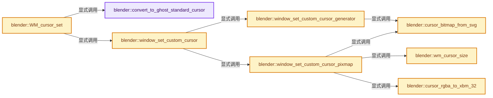
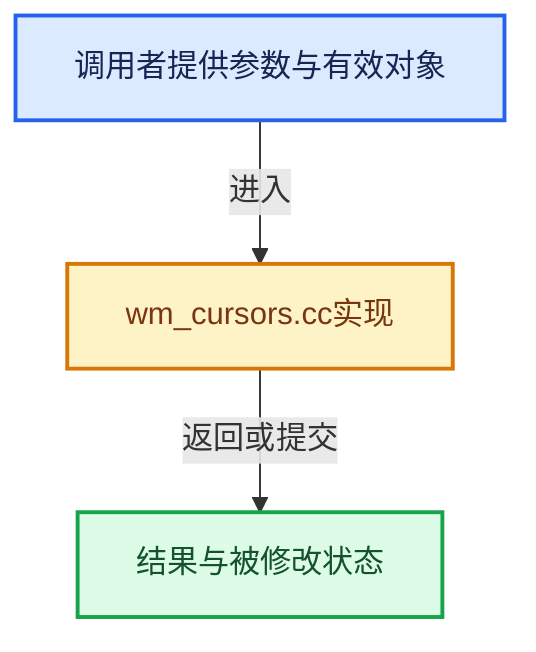

# 实现依赖专题：source/blender/windowmanager/intern/wm_cursors.cc

[实现依赖导航](../../../README.md) · [符号索引](../../../../00-课程指南/02-源码与提交索引/符号依赖与实现索引.md)

本专题从正文实际调用进入，集中保存共享实现。函数有稳定锚点，可从调用处直接跳到对应完整函数；递归与互相调用通过回链组织。

## 本文件的实现关系






## 完整成员与函数实现

<a id="f-03f6287dbacf949a"></a>

### `blender::convert_to_ghost_standard_cursor`

实现位置：[source/blender/windowmanager/intern/wm_cursors.cc](../../../../../../../../source/blender/windowmanager/intern/wm_cursors.cc) · L87—L164。

接口参数：

- `wmCursorType curs`

**教学注释版**

<!-- annotated:1c4da07ba7335b -->

```cpp
static GHOST_TStandardCursor convert_to_ghost_standard_cursor(wmCursorType curs)
{
  switch (curs) {
    case WM_CURSOR_DEFAULT:
      return GHOST_kStandardCursorDefault;
    case WM_CURSOR_WAIT:
      return GHOST_kStandardCursorWait;
    case WM_CURSOR_EDIT:
    case WM_CURSOR_CROSS:
      return GHOST_kStandardCursorCrosshair;
    case WM_CURSOR_MOVE:
      return GHOST_kStandardCursorMove;
    case WM_CURSOR_X_MOVE:
      return GHOST_kStandardCursorLeftRight;
    case WM_CURSOR_Y_MOVE:
      return GHOST_kStandardCursorUpDown;
    case WM_CURSOR_COPY:
      return GHOST_kStandardCursorCopy;
    case WM_CURSOR_HAND:
      return GHOST_kStandardCursorHandOpen;
    case WM_CURSOR_HAND_CLOSED:
      return GHOST_kStandardCursorHandClosed;
    case WM_CURSOR_HAND_POINT:
      return GHOST_kStandardCursorHandPoint;
    case WM_CURSOR_H_SPLIT:
      return GHOST_kStandardCursorHorizontalSplit;
    case WM_CURSOR_V_SPLIT:
      return GHOST_kStandardCursorVerticalSplit;
    case WM_CURSOR_STOP:
      return GHOST_kStandardCursorStop;
    case WM_CURSOR_KNIFE:
      return GHOST_kStandardCursorKnife;
    case WM_CURSOR_NSEW_SCROLL:
      return GHOST_kStandardCursorNSEWScroll;
    case WM_CURSOR_NS_SCROLL:
      return GHOST_kStandardCursorNSScroll;
    case WM_CURSOR_EW_SCROLL:
      return GHOST_kStandardCursorEWScroll;
    case WM_CURSOR_EYEDROPPER:
      return GHOST_kStandardCursorEyedropper;
    case WM_CURSOR_N_ARROW:
      return GHOST_kStandardCursorUpArrow;
    case WM_CURSOR_S_ARROW:
      return GHOST_kStandardCursorDownArrow;
    case WM_CURSOR_PAINT:
      return GHOST_kStandardCursorCrosshairA;
    case WM_CURSOR_DOT:
      return GHOST_kStandardCursorCrosshairB;
    case WM_CURSOR_CROSSC:
      return GHOST_kStandardCursorCrosshairC;
    case WM_CURSOR_ERASER:
      return GHOST_kStandardCursorEraser;
    case WM_CURSOR_ZOOM_IN:
      return GHOST_kStandardCursorZoomIn;
    case WM_CURSOR_ZOOM_OUT:
      return GHOST_kStandardCursorZoomOut;
    case WM_CURSOR_TEXT_EDIT:
      return GHOST_kStandardCursorText;
    case WM_CURSOR_PAINT_BRUSH:
      return GHOST_kStandardCursorPencil;
    case WM_CURSOR_E_ARROW:
      return GHOST_kStandardCursorRightArrow;
    case WM_CURSOR_W_ARROW:
      return GHOST_kStandardCursorLeftArrow;
    case WM_CURSOR_LEFT_HANDLE:
      return GHOST_kStandardCursorLeftHandle;
    case WM_CURSOR_RIGHT_HANDLE:
      return GHOST_kStandardCursorRightHandle;
    case WM_CURSOR_BOTH_HANDLES:
      return GHOST_kStandardCursorBothHandles;
    case WM_CURSOR_BLADE:
      return GHOST_kStandardCursorBlade;
    case WM_CURSOR_SLIP:
      return GHOST_kStandardCursorSlip;
    default:
      return GHOST_kStandardCursorCustom;
  }
}
```

<details>
<summary>核对原始源码：source/blender/windowmanager/intern/wm_cursors.cc · L87—L164</summary>

<!-- original:1c4da07ba7335b:source/blender/windowmanager/intern/wm_cursors.cc:87:164 -->

```cpp
static GHOST_TStandardCursor convert_to_ghost_standard_cursor(wmCursorType curs)
{
  switch (curs) {
    case WM_CURSOR_DEFAULT:
      return GHOST_kStandardCursorDefault;
    case WM_CURSOR_WAIT:
      return GHOST_kStandardCursorWait;
    case WM_CURSOR_EDIT:
    case WM_CURSOR_CROSS:
      return GHOST_kStandardCursorCrosshair;
    case WM_CURSOR_MOVE:
      return GHOST_kStandardCursorMove;
    case WM_CURSOR_X_MOVE:
      return GHOST_kStandardCursorLeftRight;
    case WM_CURSOR_Y_MOVE:
      return GHOST_kStandardCursorUpDown;
    case WM_CURSOR_COPY:
      return GHOST_kStandardCursorCopy;
    case WM_CURSOR_HAND:
      return GHOST_kStandardCursorHandOpen;
    case WM_CURSOR_HAND_CLOSED:
      return GHOST_kStandardCursorHandClosed;
    case WM_CURSOR_HAND_POINT:
      return GHOST_kStandardCursorHandPoint;
    case WM_CURSOR_H_SPLIT:
      return GHOST_kStandardCursorHorizontalSplit;
    case WM_CURSOR_V_SPLIT:
      return GHOST_kStandardCursorVerticalSplit;
    case WM_CURSOR_STOP:
      return GHOST_kStandardCursorStop;
    case WM_CURSOR_KNIFE:
      return GHOST_kStandardCursorKnife;
    case WM_CURSOR_NSEW_SCROLL:
      return GHOST_kStandardCursorNSEWScroll;
    case WM_CURSOR_NS_SCROLL:
      return GHOST_kStandardCursorNSScroll;
    case WM_CURSOR_EW_SCROLL:
      return GHOST_kStandardCursorEWScroll;
    case WM_CURSOR_EYEDROPPER:
      return GHOST_kStandardCursorEyedropper;
    case WM_CURSOR_N_ARROW:
      return GHOST_kStandardCursorUpArrow;
    case WM_CURSOR_S_ARROW:
      return GHOST_kStandardCursorDownArrow;
    case WM_CURSOR_PAINT:
      return GHOST_kStandardCursorCrosshairA;
    case WM_CURSOR_DOT:
      return GHOST_kStandardCursorCrosshairB;
    case WM_CURSOR_CROSSC:
      return GHOST_kStandardCursorCrosshairC;
    case WM_CURSOR_ERASER:
      return GHOST_kStandardCursorEraser;
    case WM_CURSOR_ZOOM_IN:
      return GHOST_kStandardCursorZoomIn;
    case WM_CURSOR_ZOOM_OUT:
      return GHOST_kStandardCursorZoomOut;
    case WM_CURSOR_TEXT_EDIT:
      return GHOST_kStandardCursorText;
    case WM_CURSOR_PAINT_BRUSH:
      return GHOST_kStandardCursorPencil;
    case WM_CURSOR_E_ARROW:
      return GHOST_kStandardCursorRightArrow;
    case WM_CURSOR_W_ARROW:
      return GHOST_kStandardCursorLeftArrow;
    case WM_CURSOR_LEFT_HANDLE:
      return GHOST_kStandardCursorLeftHandle;
    case WM_CURSOR_RIGHT_HANDLE:
      return GHOST_kStandardCursorRightHandle;
    case WM_CURSOR_BOTH_HANDLES:
      return GHOST_kStandardCursorBothHandles;
    case WM_CURSOR_BLADE:
      return GHOST_kStandardCursorBlade;
    case WM_CURSOR_SLIP:
      return GHOST_kStandardCursorSlip;
    default:
      return GHOST_kStandardCursorCustom;
  }
}
```

</details>

**结果出口**

- `return GHOST_kStandardCursorDefault;`
- `return GHOST_kStandardCursorWait;`
- `return GHOST_kStandardCursorCrosshair;`
- `return GHOST_kStandardCursorMove;`
- `return GHOST_kStandardCursorLeftRight;`
- `return GHOST_kStandardCursorUpDown;`
- `return GHOST_kStandardCursorCopy;`
- `return GHOST_kStandardCursorHandOpen;`
- `return GHOST_kStandardCursorHandClosed;`
- `return GHOST_kStandardCursorHandPoint;`
- `return GHOST_kStandardCursorHorizontalSplit;`
- `return GHOST_kStandardCursorVerticalSplit;`
- `return GHOST_kStandardCursorStop;`
- `return GHOST_kStandardCursorKnife;`
- `return GHOST_kStandardCursorNSEWScroll;`
- `return GHOST_kStandardCursorNSScroll;`
- `return GHOST_kStandardCursorEWScroll;`
- `return GHOST_kStandardCursorEyedropper;`
- `return GHOST_kStandardCursorUpArrow;`
- `return GHOST_kStandardCursorDownArrow;`
- `return GHOST_kStandardCursorCrosshairA;`
- `return GHOST_kStandardCursorCrosshairB;`
- `return GHOST_kStandardCursorCrosshairC;`
- `return GHOST_kStandardCursorEraser;`
- `return GHOST_kStandardCursorZoomIn;`
- `return GHOST_kStandardCursorZoomOut;`
- `return GHOST_kStandardCursorText;`
- `return GHOST_kStandardCursorPencil;`
- `return GHOST_kStandardCursorRightArrow;`
- `return GHOST_kStandardCursorLeftArrow;`
- `return GHOST_kStandardCursorLeftHandle;`
- `return GHOST_kStandardCursorRightHandle;`
- `return GHOST_kStandardCursorBothHandles;`
- `return GHOST_kStandardCursorBlade;`
- `return GHOST_kStandardCursorSlip;`
- `return GHOST_kStandardCursorCustom;`

**继续追踪实现**

本实现没有需要继续展开的显式调用；检查返回表达式、对象转换和调用者前置条件。

<a id="f-596c1ba926b18dff"></a>

### `blender::wm_cursor_size`

实现位置：[source/blender/windowmanager/intern/wm_cursors.cc](../../../../../../../../source/blender/windowmanager/intern/wm_cursors.cc) · L169—L181。

接口参数：

- `const wmWindow *win`

**教学注释版**

<!-- annotated:124f06b0430edb -->

```cpp
static int wm_cursor_size(const wmWindow *win)
{
  /* Keep for testing. */
  if (false) {
    /* Scaling with UI scale can be useful for magnified captures. */
    return std::lround(21.0f * UI_SCALE_FAC);
  }

  /* The DPI as a scale without the UI scale preference. */
  const float system_scale = WM_window_dpi_get_scale(win);

  return std::lround(WM_cursor_preferred_logical_size(true) * system_scale);
}
```

<details>
<summary>核对原始源码：source/blender/windowmanager/intern/wm_cursors.cc · L169—L181</summary>

<!-- original:124f06b0430edb:source/blender/windowmanager/intern/wm_cursors.cc:169:181 -->

```cpp
static int wm_cursor_size(const wmWindow *win)
{
  /* Keep for testing. */
  if (false) {
    /* Scaling with UI scale can be useful for magnified captures. */
    return std::lround(21.0f * UI_SCALE_FAC);
  }

  /* The DPI as a scale without the UI scale preference. */
  const float system_scale = WM_window_dpi_get_scale(win);

  return std::lround(WM_cursor_preferred_logical_size(true) * system_scale);
}
```

</details>

**结果出口**

- `return std::lround(21.0f * UI_SCALE_FAC);`
- `return std::lround(WM_cursor_preferred_logical_size(true) * system_scale);`

**继续追踪实现**

- `std::lround` → [外部契约](https://eel.is/c++draft/)：这个边界按实际表达式及所属类型核对参数、返回值、寿命与失败行为。这里提供接口入口，不声称已解释该第三方版本的内部实现。
- `WM_window_dpi_get_scale` → [blender::WM_window_dpi_get_scale · L773](wm_window.cc.md#f-8be3ca4f7dcd9349)。
- `WM_cursor_preferred_logical_size` → [blender::WM_cursor_preferred_logical_size · L3109](wm_window.cc.md#f-4586077f360949fd)。

<a id="f-f1a4471bb59cd4f6"></a>

### `blender::cursor_bitmap_from_svg`

实现位置：[source/blender/windowmanager/intern/wm_cursors.cc](../../../../../../../../source/blender/windowmanager/intern/wm_cursors.cc) · L217—L265。

接口参数：

- `const char *svg`
- `const int cursor_size`
- `uint8_t *(*alloc_fn)(size_t size)`
- `size_t size`
- `int r_bitmap_size[2]`

**教学注释版**

<!-- annotated:1ff401e4f960e6 -->

```cpp
static uint8_t *cursor_bitmap_from_svg(const char *svg,
                                       const int cursor_size,
                                       uint8_t *(*alloc_fn)(size_t size),
                                       int r_bitmap_size[2])
{
#ifdef WITH_HEADLESS
  UNUSED_VARS(svg, cursor_size, alloc_fn, r_bitmap_size);
  return nullptr;
#else
  /* #nsvgParse alters the source string. */
  std::string svg_source = svg;

  NSVGimage *image = nsvgParse(svg_source.data(), "px", 96.0f);
  if (image == nullptr) {
    return nullptr;
  }
  if (image->width == 0 || image->height == 0) {
    nsvgDelete(image);
    return nullptr;
  }
  NSVGrasterizer *rast = nsvgCreateRasterizer();
  if (rast == nullptr) {
    nsvgDelete(image);
    return nullptr;
  }

  const float scale = float(cursor_size) / 1600.0f;
  const size_t dest_size[2] = {
      // [讲解] std::min：按比较关系选取较小值；截断范围时还需先满足非负和可表示范围，min本身不会证明边界安全。
      std::min(size_t(ceil(image->width * scale)), size_t(cursor_size)),
      std::min(size_t(ceil(image->height * scale)), size_t(cursor_size)),
  };

  uint8_t *bitmap_rgba = alloc_fn(sizeof(uint8_t[4]) * dest_size[0] * dest_size[1]);
  if (bitmap_rgba == nullptr) {
    return nullptr;
  }

  nsvgRasterize(
      rast, image, 0.0f, 0.0f, scale, bitmap_rgba, dest_size[0], dest_size[1], dest_size[0] * 4);

  nsvgDeleteRasterizer(rast);
  nsvgDelete(image);

  r_bitmap_size[0] = dest_size[0];
  r_bitmap_size[1] = dest_size[1];

  return bitmap_rgba;
#endif /* !WITH_HEADLESS */
}
```

<details>
<summary>核对原始源码：source/blender/windowmanager/intern/wm_cursors.cc · L217—L265</summary>

<!-- original:1ff401e4f960e6:source/blender/windowmanager/intern/wm_cursors.cc:217:265 -->

```cpp
static uint8_t *cursor_bitmap_from_svg(const char *svg,
                                       const int cursor_size,
                                       uint8_t *(*alloc_fn)(size_t size),
                                       int r_bitmap_size[2])
{
#ifdef WITH_HEADLESS
  UNUSED_VARS(svg, cursor_size, alloc_fn, r_bitmap_size);
  return nullptr;
#else
  /* #nsvgParse alters the source string. */
  std::string svg_source = svg;

  NSVGimage *image = nsvgParse(svg_source.data(), "px", 96.0f);
  if (image == nullptr) {
    return nullptr;
  }
  if (image->width == 0 || image->height == 0) {
    nsvgDelete(image);
    return nullptr;
  }
  NSVGrasterizer *rast = nsvgCreateRasterizer();
  if (rast == nullptr) {
    nsvgDelete(image);
    return nullptr;
  }

  const float scale = float(cursor_size) / 1600.0f;
  const size_t dest_size[2] = {
      std::min(size_t(ceil(image->width * scale)), size_t(cursor_size)),
      std::min(size_t(ceil(image->height * scale)), size_t(cursor_size)),
  };

  uint8_t *bitmap_rgba = alloc_fn(sizeof(uint8_t[4]) * dest_size[0] * dest_size[1]);
  if (bitmap_rgba == nullptr) {
    return nullptr;
  }

  nsvgRasterize(
      rast, image, 0.0f, 0.0f, scale, bitmap_rgba, dest_size[0], dest_size[1], dest_size[0] * 4);

  nsvgDeleteRasterizer(rast);
  nsvgDelete(image);

  r_bitmap_size[0] = dest_size[0];
  r_bitmap_size[1] = dest_size[1];

  return bitmap_rgba;
#endif /* !WITH_HEADLESS */
}
```

</details>

**沿实际写入检查状态**

- `r_bitmap_size[0] = dest_size[0];`
- `r_bitmap_size[1] = dest_size[1];`

**结果出口**

- `return nullptr;`
- `return bitmap_rgba;`

**继续追踪实现**

- `UNUSED_VARS` → [UNUSED_VARS · L522](../../../01-BLI基础库/BLI_utildefines.hh.md#m-013582537634)；[UNUSED_VARS · L41](../../gpu/GPU_shader_shared_utils.hh.md#m-05d9d7a33da0)；[UNUSED_VARS · L62](../../gpu/GPU_shader_shared_utils.hh.md#m-e12c683a4aca)。宏定义由构建条件选择。
- `nsvgParse` → [调用协议](../../../../00-课程指南/01-路线与规范/模板宏与动态分派协议.md)：函数指针、局部可调用对象或未展开的宏；必须结合调用者环境。调用位置L229。
- `svg_source.data` → [外部契约](https://eel.is/c++draft/)：这个边界按实际表达式及所属类型核对参数、返回值、寿命与失败行为。这里提供接口入口，不声称已解释该第三方版本的内部实现。
- `nsvgDelete` → [调用协议](../../../../00-课程指南/01-路线与规范/模板宏与动态分派协议.md)：函数指针、局部可调用对象或未展开的宏；必须结合调用者环境。调用位置L234。
- `nsvgCreateRasterizer` → [调用协议](../../../../00-课程指南/01-路线与规范/模板宏与动态分派协议.md)：函数指针、局部可调用对象或未展开的宏；必须结合调用者环境。调用位置L237。
- `std::min` → [外部契约](https://eel.is/c++draft/alg.min.max)：按比较关系选取较小值；截断范围时还需先满足非负和可表示范围，min本身不会证明边界安全。
- `ceil` → [外部契约](https://eel.is/c++draft/)：这个边界按实际表达式及所属类型核对参数、返回值、寿命与失败行为。这里提供接口入口，不声称已解释该第三方版本的内部实现。
- `alloc_fn` → [调用协议](../../../../00-课程指南/01-路线与规范/模板宏与动态分派协议.md)：局部可调用对象，须结合其初始化与捕获环境。调用位置L249。
- `nsvgRasterize` → [调用协议](../../../../00-课程指南/01-路线与规范/模板宏与动态分派协议.md)：函数指针、局部可调用对象或未展开的宏；必须结合调用者环境。调用位置L254。
- `nsvgDeleteRasterizer` → [调用协议](../../../../00-课程指南/01-路线与规范/模板宏与动态分派协议.md)：函数指针、局部可调用对象或未展开的宏；必须结合调用者环境。调用位置L257。

<a id="f-203099ef1d3eee02"></a>

### `blender::cursor_rgba_to_xbm_32`

实现位置：[source/blender/windowmanager/intern/wm_cursors.cc](../../../../../../../../source/blender/windowmanager/intern/wm_cursors.cc) · L270—L288。

接口参数：

- `const uint8_t *rgba`
- `const int bitmap_size[2]`
- `uint8_t *bitmap`
- `uint8_t *mask`

**教学注释版**

<!-- annotated:077dfe4a68368c -->

```cpp
static void cursor_rgba_to_xbm_32(const uint8_t *rgba,
                                  const int bitmap_size[2],
                                  uint8_t *bitmap,
                                  uint8_t *mask)
{
  for (int y = 0; y < bitmap_size[1]; y++) {
    for (int x = 0; x < bitmap_size[0]; x++) {
      int i = (y * bitmap_size[0] * 4) + (x * 4);
      int j = (y * 4) + (x >> 3);
      int k = (x % 8);
      if (rgba[i + 3] > 128) {
        if (rgba[i] > 128) {
          bitmap[j] |= (1 << k);
        }
        mask[j] |= (1 << k);
      }
    }
  }
}
```

<details>
<summary>核对原始源码：source/blender/windowmanager/intern/wm_cursors.cc · L270—L288</summary>

<!-- original:077dfe4a68368c:source/blender/windowmanager/intern/wm_cursors.cc:270:288 -->

```cpp
static void cursor_rgba_to_xbm_32(const uint8_t *rgba,
                                  const int bitmap_size[2],
                                  uint8_t *bitmap,
                                  uint8_t *mask)
{
  for (int y = 0; y < bitmap_size[1]; y++) {
    for (int x = 0; x < bitmap_size[0]; x++) {
      int i = (y * bitmap_size[0] * 4) + (x * 4);
      int j = (y * 4) + (x >> 3);
      int k = (x % 8);
      if (rgba[i + 3] > 128) {
        if (rgba[i] > 128) {
          bitmap[j] |= (1 << k);
        }
        mask[j] |= (1 << k);
      }
    }
  }
}
```

</details>

**沿实际写入检查状态**

- `bitmap[j] |= (1 << k);`
- `mask[j] |= (1 << k);`

**继续追踪实现**

本实现没有需要继续展开的显式调用；检查返回表达式、对象转换和调用者前置条件。

<a id="f-c07a3c5bd947d455"></a>

### `blender::window_set_custom_cursor_generator`

实现位置：[source/blender/windowmanager/intern/wm_cursors.cc](../../../../../../../../source/blender/windowmanager/intern/wm_cursors.cc) · L290—L332。

接口参数：

- `wmWindow *win`
- `const BCursor &cursor`

**教学注释版**

<!-- annotated:b427349cf8e448 -->

```cpp
static bool window_set_custom_cursor_generator(wmWindow *win, const BCursor &cursor)
{
  GHOST_CursorGenerator *cursor_generator = MEM_new_zeroed<GHOST_CursorGenerator>(__func__);
  cursor_generator->generate_fn = [](const GHOST_CursorGenerator *cursor_generator,
                                     const int cursor_size,
                                     const int cursor_size_max,
                                     uint8_t *(*alloc_fn)(size_t size),
                                     int r_bitmap_size[2],
                                     int r_hot_spot[2],
                                     bool *r_can_invert_color) -> uint8_t * {
    const BCursor &cursor = *static_cast<const BCursor *>(cursor_generator->user_data);
    /* Currently SVG uses the `cursor_size` as the maximum. */
    UNUSED_VARS(cursor_size_max);

    int bitmap_size[2];
    uint8_t *bitmap_rgba = cursor_bitmap_from_svg(
        cursor.svg_source, cursor_size, alloc_fn, bitmap_size);

    if (bitmap_rgba == nullptr) [[unlikely]] {
      return nullptr;
    }

    r_bitmap_size[0] = bitmap_size[0];
    r_bitmap_size[1] = bitmap_size[1];

    r_hot_spot[0] = int(cursor.hotspot[0] * (bitmap_size[0] - 1));
    r_hot_spot[1] = int(cursor.hotspot[1] * (bitmap_size[1] - 1));

    *r_can_invert_color = cursor.can_invert;

    return bitmap_rgba;
  };

  cursor_generator->user_data = const_cast<void *>(static_cast<const void *>(&cursor));
  cursor_generator->free_fn = [](GHOST_CursorGenerator *cursor_generator) {
    MEM_delete(cursor_generator);
  };

  GHOST_IWindow *ghost_window = static_cast<GHOST_IWindow *>(win->runtime->ghostwin);
  GHOST_TSuccess success = ghost_window->setCustomCursorGenerator(cursor_generator);

  return (success == GHOST_kSuccess) ? true : false;
}
```

<details>
<summary>核对原始源码：source/blender/windowmanager/intern/wm_cursors.cc · L290—L332</summary>

<!-- original:b427349cf8e448:source/blender/windowmanager/intern/wm_cursors.cc:290:332 -->

```cpp
static bool window_set_custom_cursor_generator(wmWindow *win, const BCursor &cursor)
{
  GHOST_CursorGenerator *cursor_generator = MEM_new_zeroed<GHOST_CursorGenerator>(__func__);
  cursor_generator->generate_fn = [](const GHOST_CursorGenerator *cursor_generator,
                                     const int cursor_size,
                                     const int cursor_size_max,
                                     uint8_t *(*alloc_fn)(size_t size),
                                     int r_bitmap_size[2],
                                     int r_hot_spot[2],
                                     bool *r_can_invert_color) -> uint8_t * {
    const BCursor &cursor = *static_cast<const BCursor *>(cursor_generator->user_data);
    /* Currently SVG uses the `cursor_size` as the maximum. */
    UNUSED_VARS(cursor_size_max);

    int bitmap_size[2];
    uint8_t *bitmap_rgba = cursor_bitmap_from_svg(
        cursor.svg_source, cursor_size, alloc_fn, bitmap_size);

    if (bitmap_rgba == nullptr) [[unlikely]] {
      return nullptr;
    }

    r_bitmap_size[0] = bitmap_size[0];
    r_bitmap_size[1] = bitmap_size[1];

    r_hot_spot[0] = int(cursor.hotspot[0] * (bitmap_size[0] - 1));
    r_hot_spot[1] = int(cursor.hotspot[1] * (bitmap_size[1] - 1));

    *r_can_invert_color = cursor.can_invert;

    return bitmap_rgba;
  };

  cursor_generator->user_data = const_cast<void *>(static_cast<const void *>(&cursor));
  cursor_generator->free_fn = [](GHOST_CursorGenerator *cursor_generator) {
    MEM_delete(cursor_generator);
  };

  GHOST_IWindow *ghost_window = static_cast<GHOST_IWindow *>(win->runtime->ghostwin);
  GHOST_TSuccess success = ghost_window->setCustomCursorGenerator(cursor_generator);

  return (success == GHOST_kSuccess) ? true : false;
}
```

</details>

**沿实际写入检查状态**

- `cursor_generator->generate_fn = [](const GHOST_CursorGenerator *cursor_generator,`
- `r_bitmap_size[0] = bitmap_size[0];`
- `r_bitmap_size[1] = bitmap_size[1];`
- `r_hot_spot[0] = int(cursor.hotspot[0] * (bitmap_size[0] - 1));`
- `r_hot_spot[1] = int(cursor.hotspot[1] * (bitmap_size[1] - 1));`
- `cursor_generator->user_data = const_cast<void *>(static_cast<const void *>(&cursor));`
- `cursor_generator->free_fn = [](GHOST_CursorGenerator *cursor_generator) {`

**结果出口**

- `return nullptr;`
- `return bitmap_rgba;`
- `return (success == GHOST_kSuccess) ? true : false;`

**继续追踪实现**

- `MEM_new_zeroed<GHOST_CursorGenerator>` → [MEM_new_zeroed · L550](../../../07-Intern运行时与平台/guardedalloc/MEM_guardedalloc.h.md#f-eeb1e2a7f57dd231)；[MEM_new_zeroed · L114](../../../07-Intern运行时与平台/guardedalloc/intern/mallocn.cc.md#f-e04cf01c64c8b180)。同名重载需按实参类型选择。
- `UNUSED_VARS` → [UNUSED_VARS · L522](../../../01-BLI基础库/BLI_utildefines.hh.md#m-013582537634)；[UNUSED_VARS · L41](../../gpu/GPU_shader_shared_utils.hh.md#m-05d9d7a33da0)；[UNUSED_VARS · L62](../../gpu/GPU_shader_shared_utils.hh.md#m-e12c683a4aca)。宏定义由构建条件选择。
- `cursor_bitmap_from_svg` → [blender::cursor_bitmap_from_svg · L217](wm_cursors.cc.md#f-f1a4471bb59cd4f6)。
- `MEM_delete` → [MEM_delete · L400](../../../07-Intern运行时与平台/guardedalloc/MEM_guardedalloc.h.md#f-9049ffdd1682887c)。
- `ghost_window->setCustomCursorGenerator` → [GHOST_Window::setCustomCursorGenerator · L263](../../../07-Intern运行时与平台/ghost/intern/GHOST_Window.cc.md#f-7c5d59f6e41ab7d1)。

<a id="f-712d01af9daa1691"></a>

### `blender::window_set_custom_cursor_pixmap`

实现位置：[source/blender/windowmanager/intern/wm_cursors.cc](../../../../../../../../source/blender/windowmanager/intern/wm_cursors.cc) · L334—L381。

接口参数：

- `wmWindow *win`
- `const BCursor &cursor`

**教学注释版**

<!-- annotated:99f4841f1e4109 -->

```cpp
static bool window_set_custom_cursor_pixmap(wmWindow *win, const BCursor &cursor)
{
  /* Option to force use of 1bpp XBitMap cursors is needed for testing. */
  const bool use_only_1bpp_cursors = false;

  const bool use_rgba = !use_only_1bpp_cursors &&
                        (WM_capabilities_flag() & WM_CAPABILITY_CURSOR_RGBA);

  const int max_size = use_rgba ? CURSOR_HARDWARE_SIZE_MAX : 32;
  // [讲解] std::min：按比较关系选取较小值；截断范围时还需先满足非负和可表示范围，min本身不会证明边界安全。
  const int size = std::min(wm_cursor_size(win), max_size);

  int bitmap_size[2] = {0, 0};
  uint8_t *bitmap_rgba = cursor_bitmap_from_svg(
      cursor.svg_source,
      size,
      [](size_t size) -> uint8_t * {
        return MEM_new_array_uninitialized<uint8_t>(size, "wm.cursor");
      },
      bitmap_size);
  if (bitmap_rgba == nullptr) [[unlikely]] {
    return false;
  }

  const int hot_spot[2] = {
      int(cursor.hotspot[0] * (bitmap_size[0] - 1)),
      int(cursor.hotspot[1] * (bitmap_size[1] - 1)),
  };

  GHOST_TSuccess success;

  GHOST_IWindow *ghost_window = static_cast<GHOST_IWindow *>(win->runtime->ghostwin);
  if (use_rgba) {
    success = ghost_window->setCustomCursorShape(
        bitmap_rgba, nullptr, bitmap_size, hot_spot, cursor.can_invert);
  }
  else {
    int bitmap_size_fixed[2] = {32, 32};

    uint8_t bitmap[4 * 32] = {0};
    uint8_t mask[4 * 32] = {0};
    cursor_rgba_to_xbm_32(bitmap_rgba, bitmap_size, bitmap, mask);
    success = ghost_window->setCustomCursorShape(
        bitmap, mask, bitmap_size_fixed, hot_spot, cursor.can_invert);
  }

  MEM_delete(bitmap_rgba);
  return (success == GHOST_kSuccess) ? true : false;
}
```

<details>
<summary>核对原始源码：source/blender/windowmanager/intern/wm_cursors.cc · L334—L381</summary>

<!-- original:99f4841f1e4109:source/blender/windowmanager/intern/wm_cursors.cc:334:381 -->

```cpp
static bool window_set_custom_cursor_pixmap(wmWindow *win, const BCursor &cursor)
{
  /* Option to force use of 1bpp XBitMap cursors is needed for testing. */
  const bool use_only_1bpp_cursors = false;

  const bool use_rgba = !use_only_1bpp_cursors &&
                        (WM_capabilities_flag() & WM_CAPABILITY_CURSOR_RGBA);

  const int max_size = use_rgba ? CURSOR_HARDWARE_SIZE_MAX : 32;
  const int size = std::min(wm_cursor_size(win), max_size);

  int bitmap_size[2] = {0, 0};
  uint8_t *bitmap_rgba = cursor_bitmap_from_svg(
      cursor.svg_source,
      size,
      [](size_t size) -> uint8_t * {
        return MEM_new_array_uninitialized<uint8_t>(size, "wm.cursor");
      },
      bitmap_size);
  if (bitmap_rgba == nullptr) [[unlikely]] {
    return false;
  }

  const int hot_spot[2] = {
      int(cursor.hotspot[0] * (bitmap_size[0] - 1)),
      int(cursor.hotspot[1] * (bitmap_size[1] - 1)),
  };

  GHOST_TSuccess success;

  GHOST_IWindow *ghost_window = static_cast<GHOST_IWindow *>(win->runtime->ghostwin);
  if (use_rgba) {
    success = ghost_window->setCustomCursorShape(
        bitmap_rgba, nullptr, bitmap_size, hot_spot, cursor.can_invert);
  }
  else {
    int bitmap_size_fixed[2] = {32, 32};

    uint8_t bitmap[4 * 32] = {0};
    uint8_t mask[4 * 32] = {0};
    cursor_rgba_to_xbm_32(bitmap_rgba, bitmap_size, bitmap, mask);
    success = ghost_window->setCustomCursorShape(
        bitmap, mask, bitmap_size_fixed, hot_spot, cursor.can_invert);
  }

  MEM_delete(bitmap_rgba);
  return (success == GHOST_kSuccess) ? true : false;
}
```

</details>

**沿实际写入检查状态**

- `success = ghost_window->setCustomCursorShape(`

**结果出口**

- `return MEM_new_array_uninitialized<uint8_t>(size, "wm.cursor");`
- `return false;`
- `return (success == GHOST_kSuccess) ? true : false;`

**继续追踪实现**

- `WM_capabilities_flag` → [blender::WM_capabilities_flag · L2469](wm_window.cc.md#f-7cb69eddc2557327)。
- `std::min` → [外部契约](https://eel.is/c++draft/alg.min.max)：按比较关系选取较小值；截断范围时还需先满足非负和可表示范围，min本身不会证明边界安全。
- `wm_cursor_size` → [blender::wm_cursor_size · L169](wm_cursors.cc.md#f-596c1ba926b18dff)。
- `cursor_bitmap_from_svg` → [blender::cursor_bitmap_from_svg · L217](wm_cursors.cc.md#f-f1a4471bb59cd4f6)。
- `MEM_new_array_uninitialized<uint8_t>` → [MEM_new_array_uninitialized · L608](../../../07-Intern运行时与平台/guardedalloc/MEM_guardedalloc.h.md#f-b7103eae8eb57b05)；[MEM_new_array_uninitialized · L129](../../../07-Intern运行时与平台/guardedalloc/intern/mallocn.cc.md#f-bf6ef4ddcfb6e5df)。同名重载需按实参类型选择。
- `ghost_window->setCustomCursorShape` → [GHOST_Window::setCustomCursorShape · L250](../../../07-Intern运行时与平台/ghost/intern/GHOST_Window.cc.md#f-eac94e3d7dc35df0)。
- `cursor_rgba_to_xbm_32` → [blender::cursor_rgba_to_xbm_32 · L270](wm_cursors.cc.md#f-203099ef1d3eee02)。
- `MEM_delete` → [MEM_delete · L400](../../../07-Intern运行时与平台/guardedalloc/MEM_guardedalloc.h.md#f-9049ffdd1682887c)。

<a id="f-1f9c1ba9665cc3f5"></a>

### `blender::window_set_custom_cursor`

实现位置：[source/blender/windowmanager/intern/wm_cursors.cc](../../../../../../../../source/blender/windowmanager/intern/wm_cursors.cc) · L383—L389。

接口参数：

- `wmWindow *win`
- `const BCursor &cursor`

**教学注释版**

<!-- annotated:c294e848b2aa3a -->

```cpp
static bool window_set_custom_cursor(wmWindow *win, const BCursor &cursor)
{
  if (WM_capabilities_flag() & WM_CAPABILITY_CURSOR_GENERATOR) {
    return window_set_custom_cursor_generator(win, cursor);
  }
  return window_set_custom_cursor_pixmap(win, cursor);
}
```

<details>
<summary>核对原始源码：source/blender/windowmanager/intern/wm_cursors.cc · L383—L389</summary>

<!-- original:c294e848b2aa3a:source/blender/windowmanager/intern/wm_cursors.cc:383:389 -->

```cpp
static bool window_set_custom_cursor(wmWindow *win, const BCursor &cursor)
{
  if (WM_capabilities_flag() & WM_CAPABILITY_CURSOR_GENERATOR) {
    return window_set_custom_cursor_generator(win, cursor);
  }
  return window_set_custom_cursor_pixmap(win, cursor);
}
```

</details>

**结果出口**

- `return window_set_custom_cursor_generator(win, cursor);`
- `return window_set_custom_cursor_pixmap(win, cursor);`

**继续追踪实现**

- `WM_capabilities_flag` → [blender::WM_capabilities_flag · L2469](wm_window.cc.md#f-7cb69eddc2557327)。
- `window_set_custom_cursor_generator` → [blender::window_set_custom_cursor_generator · L290](wm_cursors.cc.md#f-c07a3c5bd947d455)。
- `window_set_custom_cursor_pixmap` → [blender::window_set_custom_cursor_pixmap · L334](wm_cursors.cc.md#f-712d01af9daa1691)。

<a id="f-0a91dda40c8ffe9e"></a>

### `blender::WM_cursor_set`

实现位置：[source/blender/windowmanager/intern/wm_cursors.cc](../../../../../../../../source/blender/windowmanager/intern/wm_cursors.cc) · L391—L450。

接口参数：

- `wmWindow *win`
- `int curs`

**教学注释版**

<!-- annotated:85d66d5a20434d -->

```cpp
void WM_cursor_set(wmWindow *win, int curs)
{
  /* Option to not use any OS-supplied cursors is needed for testing. */
  const bool use_only_custom_cursors = false;

  if (G.background) {
    return;
  }

  if (win == nullptr) {
    /* Can't set custom cursor before window initialization. */
    return;
  }

  if (curs == WM_CURSOR_DEFAULT && win->modalcursor) {
    /* If the cursor was set to default during the modal operation,
     * this usually indicates that win->lastcursor is not relevant anymore.
     * So update lastcursor to the default cursor as this is usually a safe
     * cursor shape to fall back to (see #144345).
     */
    win->lastcursor = curs;
    curs = win->modalcursor;
  }

  GHOST_IWindow *ghost_window = static_cast<GHOST_IWindow *>(win->runtime->ghostwin);

  if (curs == WM_CURSOR_NONE) {
    ghost_window->setCursorVisibility(false);
    return;
  }

  ghost_window->setCursorVisibility(true);

  if (win->cursor == curs) {
    return; /* Cursor is already set. */
  }

  win->cursor = curs;

  if (curs < 0 || curs >= WM_CURSOR_NUM) {
    BLI_assert_msg(0, "Invalid cursor number");
    return;
  }

  GHOST_TStandardCursor ghost_cursor = convert_to_ghost_standard_cursor(wmCursorType(curs));

  if (!use_only_custom_cursors && ghost_cursor != GHOST_kStandardCursorCustom &&
      ghost_window->hasCursorShape(ghost_cursor))
  {
    /* Use native GHOST cursor when available. */
    ghost_window->setCursorShape(ghost_cursor);
  }
  else {
    const BCursor &bcursor = g_cursors[curs];
    if (!bcursor.svg_source || !window_set_custom_cursor(win, bcursor)) {
      /* Fall back to default cursor if no bitmap found. */
      ghost_window->setCursorShape(GHOST_kStandardCursorDefault);
    }
  }
}
```

<details>
<summary>核对原始源码：source/blender/windowmanager/intern/wm_cursors.cc · L391—L450</summary>

<!-- original:85d66d5a20434d:source/blender/windowmanager/intern/wm_cursors.cc:391:450 -->

```cpp
void WM_cursor_set(wmWindow *win, int curs)
{
  /* Option to not use any OS-supplied cursors is needed for testing. */
  const bool use_only_custom_cursors = false;

  if (G.background) {
    return;
  }

  if (win == nullptr) {
    /* Can't set custom cursor before window initialization. */
    return;
  }

  if (curs == WM_CURSOR_DEFAULT && win->modalcursor) {
    /* If the cursor was set to default during the modal operation,
     * this usually indicates that win->lastcursor is not relevant anymore.
     * So update lastcursor to the default cursor as this is usually a safe
     * cursor shape to fall back to (see #144345).
     */
    win->lastcursor = curs;
    curs = win->modalcursor;
  }

  GHOST_IWindow *ghost_window = static_cast<GHOST_IWindow *>(win->runtime->ghostwin);

  if (curs == WM_CURSOR_NONE) {
    ghost_window->setCursorVisibility(false);
    return;
  }

  ghost_window->setCursorVisibility(true);

  if (win->cursor == curs) {
    return; /* Cursor is already set. */
  }

  win->cursor = curs;

  if (curs < 0 || curs >= WM_CURSOR_NUM) {
    BLI_assert_msg(0, "Invalid cursor number");
    return;
  }

  GHOST_TStandardCursor ghost_cursor = convert_to_ghost_standard_cursor(wmCursorType(curs));

  if (!use_only_custom_cursors && ghost_cursor != GHOST_kStandardCursorCustom &&
      ghost_window->hasCursorShape(ghost_cursor))
  {
    /* Use native GHOST cursor when available. */
    ghost_window->setCursorShape(ghost_cursor);
  }
  else {
    const BCursor &bcursor = g_cursors[curs];
    if (!bcursor.svg_source || !window_set_custom_cursor(win, bcursor)) {
      /* Fall back to default cursor if no bitmap found. */
      ghost_window->setCursorShape(GHOST_kStandardCursorDefault);
    }
  }
}
```

</details>

**沿实际写入检查状态**

- `win->lastcursor = curs;`
- `curs = win->modalcursor;`
- `win->cursor = curs;`

**继续追踪实现**

- `ghost_window->setCursorVisibility` → [GHOST_Window::setCursorVisibility · L163](../../../07-Intern运行时与平台/ghost/intern/GHOST_Window.cc.md#f-5017c7a3e787926a)。
- `BLI_assert_msg` → [BLI_assert_msg · L55](../../../01-BLI基础库/BLI_assert.hh.md#m-695eed20dceb)；[BLI_assert_msg · L64](../../../01-BLI基础库/BLI_assert.hh.md#m-7de5563de4db)。宏定义由构建条件选择。
- `convert_to_ghost_standard_cursor` → [blender::convert_to_ghost_standard_cursor · L87](wm_cursors.cc.md#f-03f6287dbacf949a)。
- `wmCursorType` → [blender::wmCursorType](../wm_cursors.hh.md#t-deb33f2585f5)。
- `ghost_window->hasCursorShape` → [调用协议](../../../../00-课程指南/01-路线与规范/模板宏与动态分派协议.md)：由接收对象具体类型或运行时策略提供实现。调用位置L438。
- `ghost_window->setCursorShape` → [GHOST_Window::setCursorShape · L241](../../../07-Intern运行时与平台/ghost/intern/GHOST_Window.cc.md#f-fe9b6ddc96b62c16)。
- `window_set_custom_cursor` → [blender::window_set_custom_cursor · L383](wm_cursors.cc.md#f-1f9c1ba9665cc3f5)。

<a id="f-f7971415a672ab47"></a>

### `blender::WM_cursor_modal_is_set_ok`

实现位置：[source/blender/windowmanager/intern/wm_cursors.cc](../../../../../../../../source/blender/windowmanager/intern/wm_cursors.cc) · L469—L472。

接口参数：

- `const wmWindow *win`

**教学注释版**

<!-- annotated:1434580524f1a1 -->

```cpp
bool WM_cursor_modal_is_set_ok(const wmWindow *win)
{
  return (win->grabcursor == 0 && win->modalcursor == 0);
}
```

<details>
<summary>核对原始源码：source/blender/windowmanager/intern/wm_cursors.cc · L469—L472</summary>

<!-- original:1434580524f1a1:source/blender/windowmanager/intern/wm_cursors.cc:469:472 -->

```cpp
bool WM_cursor_modal_is_set_ok(const wmWindow *win)
{
  return (win->grabcursor == 0 && win->modalcursor == 0);
}
```

</details>

**结果出口**

- `return (win->grabcursor == 0 && win->modalcursor == 0);`

**继续追踪实现**

本实现没有需要继续展开的显式调用；检查返回表达式、对象转换和调用者前置条件。

<a id="f-e25ae32808b6a3fe"></a>

### `blender::WM_cursor_modal_set`

实现位置：[source/blender/windowmanager/intern/wm_cursors.cc](../../../../../../../../source/blender/windowmanager/intern/wm_cursors.cc) · L474—L481。

接口参数：

- `wmWindow *win`
- `int val`

**教学注释版**

<!-- annotated:27e7bb7018cc48 -->

```cpp
void WM_cursor_modal_set(wmWindow *win, int val)
{
  if (win->lastcursor == 0) {
    win->lastcursor = win->cursor;
  }
  win->modalcursor = val;
  WM_cursor_set(win, val);
}
```

<details>
<summary>核对原始源码：source/blender/windowmanager/intern/wm_cursors.cc · L474—L481</summary>

<!-- original:27e7bb7018cc48:source/blender/windowmanager/intern/wm_cursors.cc:474:481 -->

```cpp
void WM_cursor_modal_set(wmWindow *win, int val)
{
  if (win->lastcursor == 0) {
    win->lastcursor = win->cursor;
  }
  win->modalcursor = val;
  WM_cursor_set(win, val);
}
```

</details>

**沿实际写入检查状态**

- `win->lastcursor = win->cursor;`
- `win->modalcursor = val;`

**继续追踪实现**

- `WM_cursor_set` → [blender::WM_cursor_set · L391](wm_cursors.cc.md#f-0a91dda40c8ffe9e)。

<a id="f-20c332ff739d555c"></a>

### `blender::WM_cursor_modal_restore`

实现位置：[source/blender/windowmanager/intern/wm_cursors.cc](../../../../../../../../source/blender/windowmanager/intern/wm_cursors.cc) · L483—L490。

接口参数：

- `wmWindow *win`

**教学注释版**

<!-- annotated:eddd4b09303f34 -->

```cpp
void WM_cursor_modal_restore(wmWindow *win)
{
  win->modalcursor = 0;
  if (win->lastcursor) {
    WM_cursor_set(win, win->lastcursor);
  }
  win->lastcursor = 0;
}
```

<details>
<summary>核对原始源码：source/blender/windowmanager/intern/wm_cursors.cc · L483—L490</summary>

<!-- original:eddd4b09303f34:source/blender/windowmanager/intern/wm_cursors.cc:483:490 -->

```cpp
void WM_cursor_modal_restore(wmWindow *win)
{
  win->modalcursor = 0;
  if (win->lastcursor) {
    WM_cursor_set(win, win->lastcursor);
  }
  win->lastcursor = 0;
}
```

</details>

**沿实际写入检查状态**

- `win->modalcursor = 0;`
- `win->lastcursor = 0;`

**继续追踪实现**

- `WM_cursor_set` → [blender::WM_cursor_set · L391](wm_cursors.cc.md#f-0a91dda40c8ffe9e)。

<a id="f-b909c6b6fbef0a8a"></a>

### `blender::WM_cursor_grab_enable`

实现位置：[source/blender/windowmanager/intern/wm_cursors.cc](../../../../../../../../source/blender/windowmanager/intern/wm_cursors.cc) · L509—L565。

接口参数：

- `wmWindow *win`
- `const eWM_CursorWrapAxis wrap`
- `const rcti *wrap_region`
- `const bool hide`

**教学注释版**

<!-- annotated:c47fae696996aa -->

```cpp
void WM_cursor_grab_enable(wmWindow *win,
                           const eWM_CursorWrapAxis wrap,
                           const rcti *wrap_region,
                           const bool hide)
{
  int _wrap_region_buf[4];
  int *wrap_region_screen = nullptr;

  /* Only grab cursor when not running debug.
   * It helps not to get a stuck WM when hitting a break-point. */
  GHOST_TGrabCursorMode mode = GHOST_kGrabNormal;
  GHOST_TAxisFlag mode_axis = GHOST_TAxisFlag(GHOST_kAxisX | GHOST_kAxisY);

  if (wrap_region) {
    wrap_region_screen = _wrap_region_buf;
    wrap_region_screen[0] = wrap_region->xmin;
    wrap_region_screen[1] = wrap_region->ymax;
    wrap_region_screen[2] = wrap_region->xmax;
    wrap_region_screen[3] = wrap_region->ymin;
    wm_cursor_position_to_ghost_screen_coords(win, &wrap_region_screen[0], &wrap_region_screen[1]);
    wm_cursor_position_to_ghost_screen_coords(win, &wrap_region_screen[2], &wrap_region_screen[3]);
  }

  if (hide) {
    mode = GHOST_kGrabHide;
  }
  else if (wrap != WM_CURSOR_WRAP_NONE) {
    mode = GHOST_kGrabWrap;

    if (wrap == WM_CURSOR_WRAP_X) {
      mode_axis = GHOST_kAxisX;
    }
    else if (wrap == WM_CURSOR_WRAP_Y) {
      mode_axis = GHOST_kAxisY;
    }
  }

  if ((G.debug & G_DEBUG) == 0) {
    if (win->runtime->ghostwin) {
      if (win->runtime->eventstate->tablet.is_motion_absolute == false) {
        GHOST_IWindow *ghost_window = static_cast<GHOST_IWindow *>(win->runtime->ghostwin);
        if (wrap_region_screen) {
          GHOST_Rect wrap_region_screen_rect(wrap_region_screen[0],
                                             wrap_region_screen[1],
                                             wrap_region_screen[2],
                                             wrap_region_screen[3]);
          ghost_window->setCursorGrab(mode, mode_axis, &wrap_region_screen_rect, nullptr);
        }
        else {
          ghost_window->setCursorGrab(mode, mode_axis, nullptr, nullptr);
        }
      }

      win->grabcursor = mode;
    }
  }
}
```

<details>
<summary>核对原始源码：source/blender/windowmanager/intern/wm_cursors.cc · L509—L565</summary>

<!-- original:c47fae696996aa:source/blender/windowmanager/intern/wm_cursors.cc:509:565 -->

```cpp
void WM_cursor_grab_enable(wmWindow *win,
                           const eWM_CursorWrapAxis wrap,
                           const rcti *wrap_region,
                           const bool hide)
{
  int _wrap_region_buf[4];
  int *wrap_region_screen = nullptr;

  /* Only grab cursor when not running debug.
   * It helps not to get a stuck WM when hitting a break-point. */
  GHOST_TGrabCursorMode mode = GHOST_kGrabNormal;
  GHOST_TAxisFlag mode_axis = GHOST_TAxisFlag(GHOST_kAxisX | GHOST_kAxisY);

  if (wrap_region) {
    wrap_region_screen = _wrap_region_buf;
    wrap_region_screen[0] = wrap_region->xmin;
    wrap_region_screen[1] = wrap_region->ymax;
    wrap_region_screen[2] = wrap_region->xmax;
    wrap_region_screen[3] = wrap_region->ymin;
    wm_cursor_position_to_ghost_screen_coords(win, &wrap_region_screen[0], &wrap_region_screen[1]);
    wm_cursor_position_to_ghost_screen_coords(win, &wrap_region_screen[2], &wrap_region_screen[3]);
  }

  if (hide) {
    mode = GHOST_kGrabHide;
  }
  else if (wrap != WM_CURSOR_WRAP_NONE) {
    mode = GHOST_kGrabWrap;

    if (wrap == WM_CURSOR_WRAP_X) {
      mode_axis = GHOST_kAxisX;
    }
    else if (wrap == WM_CURSOR_WRAP_Y) {
      mode_axis = GHOST_kAxisY;
    }
  }

  if ((G.debug & G_DEBUG) == 0) {
    if (win->runtime->ghostwin) {
      if (win->runtime->eventstate->tablet.is_motion_absolute == false) {
        GHOST_IWindow *ghost_window = static_cast<GHOST_IWindow *>(win->runtime->ghostwin);
        if (wrap_region_screen) {
          GHOST_Rect wrap_region_screen_rect(wrap_region_screen[0],
                                             wrap_region_screen[1],
                                             wrap_region_screen[2],
                                             wrap_region_screen[3]);
          ghost_window->setCursorGrab(mode, mode_axis, &wrap_region_screen_rect, nullptr);
        }
        else {
          ghost_window->setCursorGrab(mode, mode_axis, nullptr, nullptr);
        }
      }

      win->grabcursor = mode;
    }
  }
}
```

</details>

**沿实际写入检查状态**

- `wrap_region_screen = _wrap_region_buf;`
- `wrap_region_screen[0] = wrap_region->xmin;`
- `wrap_region_screen[1] = wrap_region->ymax;`
- `wrap_region_screen[2] = wrap_region->xmax;`
- `wrap_region_screen[3] = wrap_region->ymin;`
- `mode = GHOST_kGrabHide;`
- `mode = GHOST_kGrabWrap;`
- `mode_axis = GHOST_kAxisX;`
- `mode_axis = GHOST_kAxisY;`
- `win->grabcursor = mode;`

**继续追踪实现**

- `GHOST_TAxisFlag` → [GHOST_TAxisFlag](../../../07-Intern运行时与平台/ghost/GHOST_Types.hh.md#t-9a5082a4849d)。
- `wm_cursor_position_to_ghost_screen_coords` → [blender::wm_cursor_position_to_ghost_screen_coords · L1605](wm_window.cc.md#f-8a4cc88f2e5d2744)。
- `ghost_window->setCursorGrab` → [GHOST_IWindow::setCursorGrab · L340](../../../07-Intern运行时与平台/ghost/GHOST_IWindow.hh.md#f-d5c259ac89cf07fb)。

<a id="f-ad16a2e46b52b7f2"></a>

### `blender::WM_cursor_grab_disable`

实现位置：[source/blender/windowmanager/intern/wm_cursors.cc](../../../../../../../../source/blender/windowmanager/intern/wm_cursors.cc) · L567—L585。

接口参数：

- `wmWindow *win`
- `const int mouse_ungrab_xy[2]`

**教学注释版**

<!-- annotated:9469161e0014b4 -->

```cpp
void WM_cursor_grab_disable(wmWindow *win, const int mouse_ungrab_xy[2])
{
  if ((G.debug & G_DEBUG) == 0) {
    if (win && win->runtime->ghostwin) {
      GHOST_IWindow *ghost_window = static_cast<GHOST_IWindow *>(win->runtime->ghostwin);

      if (mouse_ungrab_xy) {
        int32_t mouse_xy[2] = {mouse_ungrab_xy[0], mouse_ungrab_xy[1]};
        wm_cursor_position_to_ghost_screen_coords(win, &mouse_xy[0], &mouse_xy[1]);
        ghost_window->setCursorGrab(GHOST_kGrabDisable, GHOST_kAxisNone, nullptr, mouse_xy);
      }
      else {
        ghost_window->setCursorGrab(GHOST_kGrabDisable, GHOST_kAxisNone, nullptr, nullptr);
      }

      win->grabcursor = GHOST_kGrabDisable;
    }
  }
}
```

<details>
<summary>核对原始源码：source/blender/windowmanager/intern/wm_cursors.cc · L567—L585</summary>

<!-- original:9469161e0014b4:source/blender/windowmanager/intern/wm_cursors.cc:567:585 -->

```cpp
void WM_cursor_grab_disable(wmWindow *win, const int mouse_ungrab_xy[2])
{
  if ((G.debug & G_DEBUG) == 0) {
    if (win && win->runtime->ghostwin) {
      GHOST_IWindow *ghost_window = static_cast<GHOST_IWindow *>(win->runtime->ghostwin);

      if (mouse_ungrab_xy) {
        int32_t mouse_xy[2] = {mouse_ungrab_xy[0], mouse_ungrab_xy[1]};
        wm_cursor_position_to_ghost_screen_coords(win, &mouse_xy[0], &mouse_xy[1]);
        ghost_window->setCursorGrab(GHOST_kGrabDisable, GHOST_kAxisNone, nullptr, mouse_xy);
      }
      else {
        ghost_window->setCursorGrab(GHOST_kGrabDisable, GHOST_kAxisNone, nullptr, nullptr);
      }

      win->grabcursor = GHOST_kGrabDisable;
    }
  }
}
```

</details>

**沿实际写入检查状态**

- `win->grabcursor = GHOST_kGrabDisable;`

**继续追踪实现**

- `wm_cursor_position_to_ghost_screen_coords` → [blender::wm_cursor_position_to_ghost_screen_coords · L1605](wm_window.cc.md#f-8a4cc88f2e5d2744)。
- `ghost_window->setCursorGrab` → [GHOST_IWindow::setCursorGrab · L340](../../../07-Intern运行时与平台/ghost/GHOST_IWindow.hh.md#f-d5c259ac89cf07fb)。
