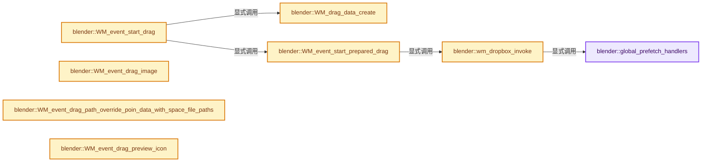
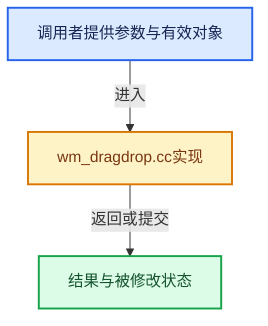

# 实现依赖专题：source/blender/windowmanager/intern/wm_dragdrop.cc

[实现依赖导航](../../../README.md) · [符号索引](../../../../00-课程指南/02-源码与提交索引/符号依赖与实现索引.md)

本专题从正文实际调用进入，集中保存共享实现。函数有稳定锚点，可从调用处直接跳到对应完整函数；递归与互相调用通过回链组织。

## 本文件的实现关系






## 完整成员与函数实现

<a id="f-d78523d8cb481e28"></a>

### `blender::global_prefetch_handlers`

实现位置：[source/blender/windowmanager/intern/wm_dragdrop.cc](../../../../../../../../source/blender/windowmanager/intern/wm_dragdrop.cc) · L106—L110。

**教学注释版**

<!-- annotated:e32f5c7c76031f -->

```cpp
static Vector<wmDragPrefetchHandler> &global_prefetch_handlers()
{
  static Vector<wmDragPrefetchHandler> storage;
  return storage;
}
```

<details>
<summary>核对原始源码：source/blender/windowmanager/intern/wm_dragdrop.cc · L106—L110</summary>

<!-- original:e32f5c7c76031f:source/blender/windowmanager/intern/wm_dragdrop.cc:106:110 -->

```cpp
static Vector<wmDragPrefetchHandler> &global_prefetch_handlers()
{
  static Vector<wmDragPrefetchHandler> storage;
  return storage;
}
```

</details>

**结果出口**

- `return storage;`

**继续追踪实现**

本实现没有需要继续展开的显式调用；检查返回表达式、对象转换和调用者前置条件。

<a id="f-a647e5c145068ef7"></a>

### `blender::wm_dropbox_invoke`

实现位置：[source/blender/windowmanager/intern/wm_dragdrop.cc](../../../../../../../../source/blender/windowmanager/intern/wm_dragdrop.cc) · L257—L299。

接口参数：

- `bContext *C`
- `wmDrag *drag`

**教学注释版**

<!-- annotated:798411ab37d425 -->

```cpp
static void wm_dropbox_invoke(bContext *C, wmDrag *drag)
{
  for (wmDragPrefetchHandler &handler : global_prefetch_handlers()) {
    if (handler.drag_type == drag->type) {
      handler.on_drag_start(*C, *drag);
    }
  }

  wmWindowManager *wm = CTX_wm_manager(C);

  /* Create a bitmap flag matrix of all currently visible region and area types.
   * Everything that isn't visible in the current window should not prefetch any data. */
  bool area_region_tag[SPACE_TYPE_NUM][RGN_TYPE_NUM] = {{false}};

  for (wmWindow &win : wm->windows) {
    bScreen *screen = WM_window_get_active_screen(&win);
    ED_screen_areas_iter (&win, screen, area) {
      for (ARegion &region : area->regionbase) {
        if (region.runtime->visible) {
          BLI_assert(area->spacetype < SPACE_TYPE_NUM);
          BLI_assert(region.regiontype < RGN_TYPE_NUM);
          area_region_tag[area->spacetype][region.regiontype] = true;
        }
      }
    }
  }

  for (wmDropBoxMap &dm : dropboxes) {
    if (!area_region_tag[dm.spaceid][dm.regionid]) {
      continue;
    }
    for (wmDropBox &drop : dm.dropboxes) {
      if (drag->drop_state.ui_context) {
        CTX_store_set(C, drag->drop_state.ui_context.get());
      }

      if (drop.on_drag_start) {
        drop.on_drag_start(C, drag);
      }
      CTX_store_set(C, nullptr);
    }
  }
}
```

<details>
<summary>核对原始源码：source/blender/windowmanager/intern/wm_dragdrop.cc · L257—L299</summary>

<!-- original:798411ab37d425:source/blender/windowmanager/intern/wm_dragdrop.cc:257:299 -->

```cpp
static void wm_dropbox_invoke(bContext *C, wmDrag *drag)
{
  for (wmDragPrefetchHandler &handler : global_prefetch_handlers()) {
    if (handler.drag_type == drag->type) {
      handler.on_drag_start(*C, *drag);
    }
  }

  wmWindowManager *wm = CTX_wm_manager(C);

  /* Create a bitmap flag matrix of all currently visible region and area types.
   * Everything that isn't visible in the current window should not prefetch any data. */
  bool area_region_tag[SPACE_TYPE_NUM][RGN_TYPE_NUM] = {{false}};

  for (wmWindow &win : wm->windows) {
    bScreen *screen = WM_window_get_active_screen(&win);
    ED_screen_areas_iter (&win, screen, area) {
      for (ARegion &region : area->regionbase) {
        if (region.runtime->visible) {
          BLI_assert(area->spacetype < SPACE_TYPE_NUM);
          BLI_assert(region.regiontype < RGN_TYPE_NUM);
          area_region_tag[area->spacetype][region.regiontype] = true;
        }
      }
    }
  }

  for (wmDropBoxMap &dm : dropboxes) {
    if (!area_region_tag[dm.spaceid][dm.regionid]) {
      continue;
    }
    for (wmDropBox &drop : dm.dropboxes) {
      if (drag->drop_state.ui_context) {
        CTX_store_set(C, drag->drop_state.ui_context.get());
      }

      if (drop.on_drag_start) {
        drop.on_drag_start(C, drag);
      }
      CTX_store_set(C, nullptr);
    }
  }
}
```

</details>

**沿实际写入检查状态**

- `area_region_tag[area->spacetype][region.regiontype] = true;`

**继续追踪实现**

- `global_prefetch_handlers` → [blender::global_prefetch_handlers · L106](wm_dragdrop.cc.md#f-d78523d8cb481e28)。
- `handler.on_drag_start` → [调用协议](../../../../00-课程指南/01-路线与规范/模板宏与动态分派协议.md)：接收对象类型依赖auto、返回值或模板实例；不按同名猜测目标。调用位置L261。
- `CTX_wm_manager` → [blender::CTX_wm_manager · L928](../../../02-BKE几何与数据/intern/context.cc.md#f-158f36db7379fbe8)。
- `WM_window_get_active_screen` → [blender::WM_window_get_active_screen · L3442](wm_window.cc.md#f-54952b6e38dc8344)。
- `ED_screen_areas_iter` → [ED_screen_areas_iter · L322](../../editors/include/ED_screen.hh.md#m-c19223ad8e6f)。宏定义由构建条件选择。
- `BLI_assert` → [BLI_assert · L48](../../../01-BLI基础库/BLI_assert.hh.md#m-57a88495704d)；[BLI_assert · L63](../../../01-BLI基础库/BLI_assert.hh.md#m-d07050020cb5)。宏定义由构建条件选择。
- `CTX_store_set` → [blender::CTX_store_set · L203](../../../02-BKE几何与数据/intern/context.cc.md#f-7afda6dfa8323e15)。
- `drag->drop_state.ui_context.get` → [调用协议](../../../../00-课程指南/01-路线与规范/模板宏与动态分派协议.md)：接收对象类型依赖auto、返回值或模板实例；不按同名猜测目标。调用位置L290。
- `drop.on_drag_start` → [调用协议](../../../../00-课程指南/01-路线与规范/模板宏与动态分派协议.md)：接收对象类型依赖auto、返回值或模板实例；不按同名猜测目标。调用位置L294。

<a id="f-e4534e8149709168"></a>

### `blender::WM_drag_data_create`

实现位置：[source/blender/windowmanager/intern/wm_dragdrop.cc](../../../../../../../../source/blender/windowmanager/intern/wm_dragdrop.cc) · L301—L345。

接口参数：

- `bContext *C`
- `int icon`
- `eWM_DragDataType type`
- `void *poin`
- `uint flags`

**教学注释版**

<!-- annotated:9fba934a2fc51f -->

```cpp
wmDrag *WM_drag_data_create(bContext *C, int icon, eWM_DragDataType type, void *poin, uint flags)
{
  wmDrag *drag = MEM_new<wmDrag>(__func__);

  /* Keep track of future multi-touch drag too, add a mouse-pointer id or so. */
  /* If multiple drags are added, they're drawn as list. */

  drag->flags = static_cast<eWM_DragFlags>(flags);
  drag->icon = icon;
  drag->type = type;
  switch (type) {
    case WM_DRAG_PATH:
      drag->poin = poin;
      drag->flags |= WM_DRAG_FREE_DATA;
      break;
    case WM_DRAG_ID:
      if (poin) {
        WM_drag_add_local_ID(drag, static_cast<ID *>(poin), nullptr);
      }
      break;
    case WM_DRAG_GREASE_PENCIL_LAYER:
    case WM_DRAG_ASSET:
    case WM_DRAG_ASSET_CATALOG:
      /* Move ownership of poin to wmDrag. */
      drag->poin = poin;
      drag->flags |= WM_DRAG_FREE_DATA;
      break;
      /* The asset-list case is special: We get multiple assets from context and attach them to the
       * drag item. */
    case WM_DRAG_ASSET_LIST: {
      Vector<PointerRNA> asset_links = CTX_data_collection_get(C, "selected_assets");
      for (const PointerRNA &ptr : asset_links) {
        const asset_system::AssetRepresentation *asset =
            static_cast<const asset_system::AssetRepresentation *>(ptr.data);
        WM_drag_add_asset_list_item(drag, asset);
      }
      break;
    }
    default:
      drag->poin = poin;
      break;
  }

  return drag;
}
```

<details>
<summary>核对原始源码：source/blender/windowmanager/intern/wm_dragdrop.cc · L301—L345</summary>

<!-- original:9fba934a2fc51f:source/blender/windowmanager/intern/wm_dragdrop.cc:301:345 -->

```cpp
wmDrag *WM_drag_data_create(bContext *C, int icon, eWM_DragDataType type, void *poin, uint flags)
{
  wmDrag *drag = MEM_new<wmDrag>(__func__);

  /* Keep track of future multi-touch drag too, add a mouse-pointer id or so. */
  /* If multiple drags are added, they're drawn as list. */

  drag->flags = static_cast<eWM_DragFlags>(flags);
  drag->icon = icon;
  drag->type = type;
  switch (type) {
    case WM_DRAG_PATH:
      drag->poin = poin;
      drag->flags |= WM_DRAG_FREE_DATA;
      break;
    case WM_DRAG_ID:
      if (poin) {
        WM_drag_add_local_ID(drag, static_cast<ID *>(poin), nullptr);
      }
      break;
    case WM_DRAG_GREASE_PENCIL_LAYER:
    case WM_DRAG_ASSET:
    case WM_DRAG_ASSET_CATALOG:
      /* Move ownership of poin to wmDrag. */
      drag->poin = poin;
      drag->flags |= WM_DRAG_FREE_DATA;
      break;
      /* The asset-list case is special: We get multiple assets from context and attach them to the
       * drag item. */
    case WM_DRAG_ASSET_LIST: {
      Vector<PointerRNA> asset_links = CTX_data_collection_get(C, "selected_assets");
      for (const PointerRNA &ptr : asset_links) {
        const asset_system::AssetRepresentation *asset =
            static_cast<const asset_system::AssetRepresentation *>(ptr.data);
        WM_drag_add_asset_list_item(drag, asset);
      }
      break;
    }
    default:
      drag->poin = poin;
      break;
  }

  return drag;
}
```

</details>

**沿实际写入检查状态**

- `drag->flags = static_cast<eWM_DragFlags>(flags);`
- `drag->icon = icon;`
- `drag->type = type;`
- `drag->poin = poin;`
- `drag->flags |= WM_DRAG_FREE_DATA;`

**结果出口**

- `return drag;`

**继续追踪实现**

- `MEM_new<wmDrag>` → [MEM_new · L351](../../../07-Intern运行时与平台/guardedalloc/MEM_guardedalloc.h.md#f-115f9b6784f89912)。
- `WM_drag_add_local_ID` → [blender::WM_drag_add_local_ID · L758](wm_dragdrop.cc.md#f-2583f67a4c480ddc)。
- `CTX_data_collection_get` → [blender::CTX_data_collection_get · L691](../../../02-BKE几何与数据/intern/context.cc.md#f-88506dcf87cb5a35)。
- `WM_drag_add_asset_list_item` → [blender::WM_drag_add_asset_list_item · L951](wm_dragdrop.cc.md#f-ff63a62356f0bcf3)。

<a id="f-dd3c7e1a1926d07b"></a>

### `blender::WM_event_start_prepared_drag`

实现位置：[source/blender/windowmanager/intern/wm_dragdrop.cc](../../../../../../../../source/blender/windowmanager/intern/wm_dragdrop.cc) · L347—L353。

接口参数：

- `bContext *C`
- `wmDrag *drag`

**教学注释版**

<!-- annotated:a646d5946cac97 -->

```cpp
void WM_event_start_prepared_drag(bContext *C, wmDrag *drag)
{
  wmWindowManager *wm = CTX_wm_manager(C);

  BLI_addtail(&wm->runtime->drags, drag);
  wm_dropbox_invoke(C, drag);
}
```

<details>
<summary>核对原始源码：source/blender/windowmanager/intern/wm_dragdrop.cc · L347—L353</summary>

<!-- original:a646d5946cac97:source/blender/windowmanager/intern/wm_dragdrop.cc:347:353 -->

```cpp
void WM_event_start_prepared_drag(bContext *C, wmDrag *drag)
{
  wmWindowManager *wm = CTX_wm_manager(C);

  BLI_addtail(&wm->runtime->drags, drag);
  wm_dropbox_invoke(C, drag);
}
```

</details>

**继续追踪实现**

- `CTX_wm_manager` → [blender::CTX_wm_manager · L928](../../../02-BKE几何与数据/intern/context.cc.md#f-158f36db7379fbe8)。
- `BLI_addtail` → [blender::BLI_addtail · L118](../../../01-BLI基础库/intern/listbase.cc.md#f-4fb027713fa3115b)。
- `wm_dropbox_invoke` → [blender::wm_dropbox_invoke · L257](wm_dragdrop.cc.md#f-a647e5c145068ef7)。

<a id="f-1cc22b3125da160c"></a>

### `blender::WM_event_start_drag`

实现位置：[source/blender/windowmanager/intern/wm_dragdrop.cc](../../../../../../../../source/blender/windowmanager/intern/wm_dragdrop.cc) · L355—L359。

接口参数：

- `bContext *C`
- `int icon`
- `eWM_DragDataType type`
- `void *poin`
- `uint flags`

**教学注释版**

<!-- annotated:7f21101e9344a5 -->

```cpp
void WM_event_start_drag(bContext *C, int icon, eWM_DragDataType type, void *poin, uint flags)
{
  wmDrag *drag = WM_drag_data_create(C, icon, type, poin, flags);
  WM_event_start_prepared_drag(C, drag);
}
```

<details>
<summary>核对原始源码：source/blender/windowmanager/intern/wm_dragdrop.cc · L355—L359</summary>

<!-- original:7f21101e9344a5:source/blender/windowmanager/intern/wm_dragdrop.cc:355:359 -->

```cpp
void WM_event_start_drag(bContext *C, int icon, eWM_DragDataType type, void *poin, uint flags)
{
  wmDrag *drag = WM_drag_data_create(C, icon, type, poin, flags);
  WM_event_start_prepared_drag(C, drag);
}
```

</details>

**继续追踪实现**

- `WM_drag_data_create` → [blender::WM_drag_data_create · L301](wm_dragdrop.cc.md#f-e4534e8149709168)。
- `WM_event_start_prepared_drag` → [blender::WM_event_start_prepared_drag · L347](wm_dragdrop.cc.md#f-dd3c7e1a1926d07b)。

<a id="f-955b4b1b7fd925ea"></a>

### `blender::WM_event_drag_image`

实现位置：[source/blender/windowmanager/intern/wm_dragdrop.cc](../../../../../../../../source/blender/windowmanager/intern/wm_dragdrop.cc) · L409—L413。

接口参数：

- `wmDrag *drag`
- `const ImBuf *imb`
- `float scale`

**教学注释版**

<!-- annotated:d6b8e99f3b6b42 -->

```cpp
void WM_event_drag_image(wmDrag *drag, const ImBuf *imb, float scale)
{
  drag->imb = imb;
  drag->imbuf_scale = scale;
}
```

<details>
<summary>核对原始源码：source/blender/windowmanager/intern/wm_dragdrop.cc · L409—L413</summary>

<!-- original:d6b8e99f3b6b42:source/blender/windowmanager/intern/wm_dragdrop.cc:409:413 -->

```cpp
void WM_event_drag_image(wmDrag *drag, const ImBuf *imb, float scale)
{
  drag->imb = imb;
  drag->imbuf_scale = scale;
}
```

</details>

**沿实际写入检查状态**

- `drag->imb = imb;`
- `drag->imbuf_scale = scale;`

**继续追踪实现**

本实现没有需要继续展开的显式调用；检查返回表达式、对象转换和调用者前置条件。

<a id="f-a3608fc03aa5038c"></a>

### `blender::WM_event_drag_path_override_poin_data_with_space_file_paths`

实现位置：[source/blender/windowmanager/intern/wm_dragdrop.cc](../../../../../../../../source/blender/windowmanager/intern/wm_dragdrop.cc) · L415—L432。

接口参数：

- `const bContext *C`
- `wmDrag *drag`

**教学注释版**

<!-- annotated:8b8fa4a926b2ab -->

```cpp
void WM_event_drag_path_override_poin_data_with_space_file_paths(const bContext *C, wmDrag *drag)
{
  BLI_assert(drag->type == WM_DRAG_PATH);
  const SpaceFile *sfile = CTX_wm_space_file(C);
  if (!sfile) {
    return;
  }
  const Vector<std::string> selected_paths = ED_fileselect_selected_files_full_paths(sfile);
  Vector<const char *> paths;
  for (const std::string &path : selected_paths) {
    // [讲解] paths.append：在尾部建立新元素，必要时先扩大存储。
    paths.append(path.c_str());
  }
  if (paths.is_empty()) {
    return;
  }
  WM_drag_data_free(drag->type, drag->poin);
  drag->poin = WM_drag_create_path_data(paths);
}
```

<details>
<summary>核对原始源码：source/blender/windowmanager/intern/wm_dragdrop.cc · L415—L432</summary>

<!-- original:8b8fa4a926b2ab:source/blender/windowmanager/intern/wm_dragdrop.cc:415:432 -->

```cpp
void WM_event_drag_path_override_poin_data_with_space_file_paths(const bContext *C, wmDrag *drag)
{
  BLI_assert(drag->type == WM_DRAG_PATH);
  const SpaceFile *sfile = CTX_wm_space_file(C);
  if (!sfile) {
    return;
  }
  const Vector<std::string> selected_paths = ED_fileselect_selected_files_full_paths(sfile);
  Vector<const char *> paths;
  for (const std::string &path : selected_paths) {
    paths.append(path.c_str());
  }
  if (paths.is_empty()) {
    return;
  }
  WM_drag_data_free(drag->type, drag->poin);
  drag->poin = WM_drag_create_path_data(paths);
}
```

</details>

**沿实际写入检查状态**

- `drag->poin = WM_drag_create_path_data(paths);`

**继续追踪实现**

- `BLI_assert` → [BLI_assert · L48](../../../01-BLI基础库/BLI_assert.hh.md#m-57a88495704d)；[BLI_assert · L63](../../../01-BLI基础库/BLI_assert.hh.md#m-d07050020cb5)。宏定义由构建条件选择。
- `CTX_wm_space_file` → [blender::CTX_wm_space_file · L1058](../../../02-BKE几何与数据/intern/context.cc.md#f-67f28671ebd856c1)。
- `ED_fileselect_selected_files_full_paths` → [blender::ED_fileselect_selected_files_full_paths · L1526](../../editors/space_file/filesel.cc.md#f-c61dc3125dacc7aa)。
- `paths.append` → [blender::Vector::append · L498](../../../../01-基础容器与现代CPP/11-Vector插入删除与重排.md#f-5bde268a69e443ec)；[blender::Vector::append · L502](../../../../01-基础容器与现代CPP/11-Vector插入删除与重排.md#f-591e0b15e6308532)。同名重载需按实参类型选择。
- `path.c_str` → [调用协议](../../../../00-课程指南/01-路线与规范/模板宏与动态分派协议.md)：接收对象类型依赖auto、返回值或模板实例；不按同名猜测目标。调用位置L425。
- `paths.is_empty` → [blender::Vector::is_empty · L792](../../../../01-基础容器与现代CPP/11-Vector插入删除与重排.md#f-937bbd9cb80bdcc8)。
- `WM_drag_data_free` → [blender::WM_drag_data_free · L440](wm_dragdrop.cc.md#f-bfd5410020d4ee83)。
- `WM_drag_create_path_data` → [blender::WM_drag_create_path_data · L1016](wm_dragdrop.cc.md#f-078f60646a0556fb)。

<a id="f-dcf5dae5f9d8bcd2"></a>

### `blender::WM_event_drag_preview_icon`

实现位置：[source/blender/windowmanager/intern/wm_dragdrop.cc](../../../../../../../../source/blender/windowmanager/intern/wm_dragdrop.cc) · L434—L438。

接口参数：

- `wmDrag *drag`
- `int icon_id`

**教学注释版**

<!-- annotated:03bf8c06130547 -->

```cpp
void WM_event_drag_preview_icon(wmDrag *drag, int icon_id)
{
  BLI_assert_msg(!drag->imb, "Drag image and preview are mutually exclusive");
  drag->preview_icon_id = icon_id;
}
```

<details>
<summary>核对原始源码：source/blender/windowmanager/intern/wm_dragdrop.cc · L434—L438</summary>

<!-- original:03bf8c06130547:source/blender/windowmanager/intern/wm_dragdrop.cc:434:438 -->

```cpp
void WM_event_drag_preview_icon(wmDrag *drag, int icon_id)
{
  BLI_assert_msg(!drag->imb, "Drag image and preview are mutually exclusive");
  drag->preview_icon_id = icon_id;
}
```

</details>

**沿实际写入检查状态**

- `drag->preview_icon_id = icon_id;`

**继续追踪实现**

- `BLI_assert_msg` → [BLI_assert_msg · L55](../../../01-BLI基础库/BLI_assert.hh.md#m-695eed20dceb)；[BLI_assert_msg · L64](../../../01-BLI基础库/BLI_assert.hh.md#m-7de5563de4db)。宏定义由构建条件选择。

<a id="f-bfd5410020d4ee83"></a>

### `blender::WM_drag_data_free`

实现位置：[source/blender/windowmanager/intern/wm_dragdrop.cc](../../../../../../../../source/blender/windowmanager/intern/wm_dragdrop.cc) · L440—L474。

接口参数：

- `eWM_DragDataType dragtype`
- `void *poin`

**教学注释版**

<!-- annotated:eb20b915972fb0 -->

```cpp
void WM_drag_data_free(eWM_DragDataType dragtype, void *poin)
{
  /* Don't require all the callers to have a nullptr-check, just allow passing nullptr. */
  if (!poin) {
    return;
  }

  /* Not too nice, could become a callback. */
  switch (dragtype) {
    case WM_DRAG_ASSET: {
      wmDragAsset *asset_data = static_cast<wmDragAsset *>(poin);
      wm_drag_free_asset_data(&asset_data);
      break;
    }
    case WM_DRAG_PATH: {
      wmDragPath *path_data = static_cast<wmDragPath *>(poin);
      wm_drag_free_path_data(&path_data);
      break;
    }
    case WM_DRAG_STRING: {
      std::string *str = static_cast<std::string *>(poin);
      MEM_delete(str);
      break;
    }
    case WM_DRAG_NODE_TREE_INTERFACE: {
      bke::node_interface::bNodeTreeInterfaceItemReference *item_reference =
          static_cast<bke::node_interface::bNodeTreeInterfaceItemReference *>(poin);
      bke::node_interface::item_reference_free(item_reference);
      break;
    }
    default:
      // [讲解] MEM_delete_void：以原始存储释放约定调用当前后端。
      MEM_delete_void(poin);
      break;
  }
}
```

<details>
<summary>核对原始源码：source/blender/windowmanager/intern/wm_dragdrop.cc · L440—L474</summary>

<!-- original:eb20b915972fb0:source/blender/windowmanager/intern/wm_dragdrop.cc:440:474 -->

```cpp
void WM_drag_data_free(eWM_DragDataType dragtype, void *poin)
{
  /* Don't require all the callers to have a nullptr-check, just allow passing nullptr. */
  if (!poin) {
    return;
  }

  /* Not too nice, could become a callback. */
  switch (dragtype) {
    case WM_DRAG_ASSET: {
      wmDragAsset *asset_data = static_cast<wmDragAsset *>(poin);
      wm_drag_free_asset_data(&asset_data);
      break;
    }
    case WM_DRAG_PATH: {
      wmDragPath *path_data = static_cast<wmDragPath *>(poin);
      wm_drag_free_path_data(&path_data);
      break;
    }
    case WM_DRAG_STRING: {
      std::string *str = static_cast<std::string *>(poin);
      MEM_delete(str);
      break;
    }
    case WM_DRAG_NODE_TREE_INTERFACE: {
      bke::node_interface::bNodeTreeInterfaceItemReference *item_reference =
          static_cast<bke::node_interface::bNodeTreeInterfaceItemReference *>(poin);
      bke::node_interface::item_reference_free(item_reference);
      break;
    }
    default:
      MEM_delete_void(poin);
      break;
  }
}
```

</details>

**继续追踪实现**

- `wm_drag_free_asset_data` → [blender::wm_drag_free_asset_data · L818](wm_dragdrop.cc.md#f-e5b33be2b5bd8974)。
- `wm_drag_free_path_data` → [blender::wm_drag_free_path_data · L1038](wm_dragdrop.cc.md#f-692c4a924fd53f9e)。
- `MEM_delete` → [MEM_delete · L400](../../../07-Intern运行时与平台/guardedalloc/MEM_guardedalloc.h.md#f-9049ffdd1682887c)。
- `bke::node_interface::item_reference_free` → [blender::bke::node_interface::item_reference_free · L1715](../../../02-BKE几何与数据/intern/node_tree_interface.cc.md#f-2c1ec6ee2ef6abe4)。
- `MEM_delete_void` → [MEM_delete_void · L647](../../../07-Intern运行时与平台/guardedalloc/MEM_guardedalloc.h.md#f-642896c7c62ff8b9)；[MEM_delete_void · L109](../../../07-Intern运行时与平台/guardedalloc/intern/mallocn.cc.md#f-9a07b26421f2bee6)。同名重载需按实参类型选择。

<a id="f-2583f67a4c480ddc"></a>

### `blender::WM_drag_add_local_ID`

实现位置：[source/blender/windowmanager/intern/wm_dragdrop.cc](../../../../../../../../source/blender/windowmanager/intern/wm_dragdrop.cc) · L758—L775。

接口参数：

- `wmDrag *drag`
- `ID *id`
- `ID *from_parent`

**教学注释版**

<!-- annotated:03118a6e24571f -->

```cpp
void WM_drag_add_local_ID(wmDrag *drag, ID *id, ID *from_parent)
{
  /* Don't drag the same ID twice. */
  for (wmDragID &drag_id : drag->ids) {
    if (drag_id.id == id) {
      if (drag_id.from_parent == nullptr) {
        drag_id.from_parent = from_parent;
      }
      return;
    }
  }

  /* Add to list. */
  wmDragID *drag_id = MEM_new_zeroed<wmDragID>(__func__);
  drag_id->id = id;
  drag_id->from_parent = from_parent;
  BLI_addtail(&drag->ids, drag_id);
}
```

<details>
<summary>核对原始源码：source/blender/windowmanager/intern/wm_dragdrop.cc · L758—L775</summary>

<!-- original:03118a6e24571f:source/blender/windowmanager/intern/wm_dragdrop.cc:758:775 -->

```cpp
void WM_drag_add_local_ID(wmDrag *drag, ID *id, ID *from_parent)
{
  /* Don't drag the same ID twice. */
  for (wmDragID &drag_id : drag->ids) {
    if (drag_id.id == id) {
      if (drag_id.from_parent == nullptr) {
        drag_id.from_parent = from_parent;
      }
      return;
    }
  }

  /* Add to list. */
  wmDragID *drag_id = MEM_new_zeroed<wmDragID>(__func__);
  drag_id->id = id;
  drag_id->from_parent = from_parent;
  BLI_addtail(&drag->ids, drag_id);
}
```

</details>

**沿实际写入检查状态**

- `drag_id.from_parent = from_parent;`
- `drag_id->id = id;`
- `drag_id->from_parent = from_parent;`

**继续追踪实现**

- `MEM_new_zeroed<wmDragID>` → [MEM_new_zeroed · L550](../../../07-Intern运行时与平台/guardedalloc/MEM_guardedalloc.h.md#f-eeb1e2a7f57dd231)；[MEM_new_zeroed · L114](../../../07-Intern运行时与平台/guardedalloc/intern/mallocn.cc.md#f-e04cf01c64c8b180)。同名重载需按实参类型选择。
- `BLI_addtail` → [blender::BLI_addtail · L118](../../../01-BLI基础库/intern/listbase.cc.md#f-4fb027713fa3115b)。

<a id="f-fb4f1da07517b56f"></a>

### `blender::WM_drag_create_asset_data`

实现位置：[source/blender/windowmanager/intern/wm_dragdrop.cc](../../../../../../../../source/blender/windowmanager/intern/wm_dragdrop.cc) · L807—L816。

接口参数：

- `const asset_system::AssetRepresentation *asset`
- `const AssetImportSettings &import_settings`

**教学注释版**

<!-- annotated:fcc1d08fd8f578 -->

```cpp
wmDragAsset *WM_drag_create_asset_data(const asset_system::AssetRepresentation *asset,
                                       const AssetImportSettings &import_settings)
{
  wmDragAsset *asset_drag = MEM_new<wmDragAsset>(__func__);

  asset_drag->asset = asset;
  asset_drag->import_settings = import_settings;

  return asset_drag;
}
```

<details>
<summary>核对原始源码：source/blender/windowmanager/intern/wm_dragdrop.cc · L807—L816</summary>

<!-- original:fcc1d08fd8f578:source/blender/windowmanager/intern/wm_dragdrop.cc:807:816 -->

```cpp
wmDragAsset *WM_drag_create_asset_data(const asset_system::AssetRepresentation *asset,
                                       const AssetImportSettings &import_settings)
{
  wmDragAsset *asset_drag = MEM_new<wmDragAsset>(__func__);

  asset_drag->asset = asset;
  asset_drag->import_settings = import_settings;

  return asset_drag;
}
```

</details>

**沿实际写入检查状态**

- `asset_drag->asset = asset;`
- `asset_drag->import_settings = import_settings;`

**结果出口**

- `return asset_drag;`

**继续追踪实现**

- `MEM_new<wmDragAsset>` → [MEM_new · L351](../../../07-Intern运行时与平台/guardedalloc/MEM_guardedalloc.h.md#f-115f9b6784f89912)。

<a id="f-e5b33be2b5bd8974"></a>

### `blender::wm_drag_free_asset_data`

实现位置：[source/blender/windowmanager/intern/wm_dragdrop.cc](../../../../../../../../source/blender/windowmanager/intern/wm_dragdrop.cc) · L818—L824。

接口参数：

- `wmDragAsset **asset_data`

**教学注释版**

<!-- annotated:5c65667abe647a -->

```cpp
static void wm_drag_free_asset_data(wmDragAsset **asset_data)
{
  if (*asset_data) {
    MEM_delete(*asset_data);
    *asset_data = nullptr;
  }
}
```

<details>
<summary>核对原始源码：source/blender/windowmanager/intern/wm_dragdrop.cc · L818—L824</summary>

<!-- original:5c65667abe647a:source/blender/windowmanager/intern/wm_dragdrop.cc:818:824 -->

```cpp
static void wm_drag_free_asset_data(wmDragAsset **asset_data)
{
  if (*asset_data) {
    MEM_delete(*asset_data);
    *asset_data = nullptr;
  }
}
```

</details>

**继续追踪实现**

- `MEM_delete` → [MEM_delete · L400](../../../07-Intern运行时与平台/guardedalloc/MEM_guardedalloc.h.md#f-9049ffdd1682887c)。

<a id="f-ff63a62356f0bcf3"></a>

### `blender::WM_drag_add_asset_list_item`

实现位置：[source/blender/windowmanager/intern/wm_dragdrop.cc](../../../../../../../../source/blender/windowmanager/intern/wm_dragdrop.cc) · L951—L974。

接口参数：

- `wmDrag *drag`
- `const asset_system::AssetRepresentation *asset`

**教学注释版**

<!-- annotated:3bfbac356ba112 -->

```cpp
void WM_drag_add_asset_list_item(wmDrag *drag, const asset_system::AssetRepresentation *asset)
{
  BLI_assert(drag->type == WM_DRAG_ASSET_LIST);

  /* No guarantee that the same asset isn't added twice. */

  /* Add to list. */
  wmDragAssetListItem *drag_asset = MEM_new_zeroed<wmDragAssetListItem>(__func__);
  ID *local_id = asset->local_id();
  if (local_id) {
    drag_asset->is_external = false;
    drag_asset->asset_data.local_id = local_id;
  }
  else {
    drag_asset->is_external = true;

    AssetImportSettings import_settings{};
    import_settings.method = ASSET_IMPORT_APPEND;
    import_settings.use_instance_collections = false;

    drag_asset->asset_data.external_info = WM_drag_create_asset_data(asset, import_settings);
  }
  BLI_addtail(&drag->asset_items, drag_asset);
}
```

<details>
<summary>核对原始源码：source/blender/windowmanager/intern/wm_dragdrop.cc · L951—L974</summary>

<!-- original:3bfbac356ba112:source/blender/windowmanager/intern/wm_dragdrop.cc:951:974 -->

```cpp
void WM_drag_add_asset_list_item(wmDrag *drag, const asset_system::AssetRepresentation *asset)
{
  BLI_assert(drag->type == WM_DRAG_ASSET_LIST);

  /* No guarantee that the same asset isn't added twice. */

  /* Add to list. */
  wmDragAssetListItem *drag_asset = MEM_new_zeroed<wmDragAssetListItem>(__func__);
  ID *local_id = asset->local_id();
  if (local_id) {
    drag_asset->is_external = false;
    drag_asset->asset_data.local_id = local_id;
  }
  else {
    drag_asset->is_external = true;

    AssetImportSettings import_settings{};
    import_settings.method = ASSET_IMPORT_APPEND;
    import_settings.use_instance_collections = false;

    drag_asset->asset_data.external_info = WM_drag_create_asset_data(asset, import_settings);
  }
  BLI_addtail(&drag->asset_items, drag_asset);
}
```

</details>

**沿实际写入检查状态**

- `drag_asset->is_external = false;`
- `drag_asset->asset_data.local_id = local_id;`
- `drag_asset->is_external = true;`
- `import_settings.method = ASSET_IMPORT_APPEND;`
- `import_settings.use_instance_collections = false;`
- `drag_asset->asset_data.external_info = WM_drag_create_asset_data(asset, import_settings);`

**继续追踪实现**

- `BLI_assert` → [BLI_assert · L48](../../../01-BLI基础库/BLI_assert.hh.md#m-57a88495704d)；[BLI_assert · L63](../../../01-BLI基础库/BLI_assert.hh.md#m-d07050020cb5)。宏定义由构建条件选择。
- `MEM_new_zeroed<wmDragAssetListItem>` → [MEM_new_zeroed · L550](../../../07-Intern运行时与平台/guardedalloc/MEM_guardedalloc.h.md#f-eeb1e2a7f57dd231)；[MEM_new_zeroed · L114](../../../07-Intern运行时与平台/guardedalloc/intern/mallocn.cc.md#f-e04cf01c64c8b180)。同名重载需按实参类型选择。
- `asset->local_id` → [blender::asset_system::AssetRepresentation::local_id · L275](../../asset_system/intern/asset_representation.cc.md#f-a057728b1eb05244)。
- `WM_drag_create_asset_data` → [blender::WM_drag_create_asset_data · L807](wm_dragdrop.cc.md#f-fb4f1da07517b56f)。
- `BLI_addtail` → [blender::BLI_addtail · L118](../../../01-BLI基础库/intern/listbase.cc.md#f-4fb027713fa3115b)。

<a id="f-078f60646a0556fb"></a>

### `blender::WM_drag_create_path_data`

实现位置：[source/blender/windowmanager/intern/wm_dragdrop.cc](../../../../../../../../source/blender/windowmanager/intern/wm_dragdrop.cc) · L1016—L1036。

接口参数：

- `Span<const char *> paths`

**教学注释版**

<!-- annotated:fecb95bc7fe911 -->

```cpp
wmDragPath *WM_drag_create_path_data(Span<const char *> paths)
{
  // [讲解] paths.is_empty：查询视图长度或生成对应有效索引区间。
  BLI_assert(!paths.is_empty());
  wmDragPath *path_data = MEM_new<wmDragPath>("wmDragPath");

  for (const char *path : paths) {
    path_data->paths.append(path);
    const int type_flag = ED_path_extension_type(path);
    path_data->file_types_bit_flag |= type_flag;
    path_data->file_types.append(type_flag);
  }

  path_data->tooltip = path_data->paths[0];

  if (path_data->paths.size() > 1) {
    std::string path_count = std::to_string(path_data->paths.size());
    path_data->tooltip = fmt::format(fmt::runtime(TIP_("Dragging {} files")), path_count);
  }

  return path_data;
}
```

<details>
<summary>核对原始源码：source/blender/windowmanager/intern/wm_dragdrop.cc · L1016—L1036</summary>

<!-- original:fecb95bc7fe911:source/blender/windowmanager/intern/wm_dragdrop.cc:1016:1036 -->

```cpp
wmDragPath *WM_drag_create_path_data(Span<const char *> paths)
{
  BLI_assert(!paths.is_empty());
  wmDragPath *path_data = MEM_new<wmDragPath>("wmDragPath");

  for (const char *path : paths) {
    path_data->paths.append(path);
    const int type_flag = ED_path_extension_type(path);
    path_data->file_types_bit_flag |= type_flag;
    path_data->file_types.append(type_flag);
  }

  path_data->tooltip = path_data->paths[0];

  if (path_data->paths.size() > 1) {
    std::string path_count = std::to_string(path_data->paths.size());
    path_data->tooltip = fmt::format(fmt::runtime(TIP_("Dragging {} files")), path_count);
  }

  return path_data;
}
```

</details>

**沿实际写入检查状态**

- `path_data->file_types_bit_flag |= type_flag;`
- `path_data->tooltip = path_data->paths[0];`
- `path_data->tooltip = fmt::format(fmt::runtime(TIP_("Dragging {} files")), path_count);`

**结果出口**

- `return path_data;`

**继续追踪实现**

- `BLI_assert` → [BLI_assert · L48](../../../01-BLI基础库/BLI_assert.hh.md#m-57a88495704d)；[BLI_assert · L63](../../../01-BLI基础库/BLI_assert.hh.md#m-d07050020cb5)。宏定义由构建条件选择。
- `paths.is_empty` → [blender::Span::is_empty · L264](../../../../01-基础容器与现代CPP/05-Span只读连续视图.md#f-8cc1d7ba8feb50e6)。
- `MEM_new<wmDragPath>` → [MEM_new · L351](../../../07-Intern运行时与平台/guardedalloc/MEM_guardedalloc.h.md#f-115f9b6784f89912)。
- `path_data->paths.append` → [调用协议](../../../../00-课程指南/01-路线与规范/模板宏与动态分派协议.md)：接收对象类型依赖auto、返回值或模板实例；不按同名猜测目标。调用位置L1022。
- `ED_path_extension_type` → [blender::ED_path_extension_type · L1852](../../editors/space_file/filelist/filelist.cc.md#f-532ed80303ec706b)。
- `path_data->file_types.append` → [调用协议](../../../../00-课程指南/01-路线与规范/模板宏与动态分派协议.md)：接收对象类型依赖auto、返回值或模板实例；不按同名猜测目标。调用位置L1025。
- `path_data->paths.size` → [调用协议](../../../../00-课程指南/01-路线与规范/模板宏与动态分派协议.md)：接收对象类型依赖auto、返回值或模板实例；不按同名猜测目标。调用位置L1030。
- `std::to_string` → [外部契约](https://eel.is/c++draft/)：这个边界按实际表达式及所属类型核对参数、返回值、寿命与失败行为。这里提供接口入口，不声称已解释该第三方版本的内部实现。
- `fmt::format` → [外部契约](https://fmt.dev/latest/api/)：按fmt接口的格式字符串与参数类型契约使用，格式化不改变被格式化对象的拥有关系。
- `fmt::runtime` → [外部契约](https://fmt.dev/latest/api/)：按fmt接口的格式字符串与参数类型契约使用，格式化不改变被格式化对象的拥有关系。
- `TIP_` → [TIP_ · L50](../../blentranslation/BLT_translation.hh.md#m-42b98cfb3af1)。宏定义由构建条件选择。

<a id="f-692c4a924fd53f9e"></a>

### `blender::wm_drag_free_path_data`

实现位置：[source/blender/windowmanager/intern/wm_dragdrop.cc](../../../../../../../../source/blender/windowmanager/intern/wm_dragdrop.cc) · L1038—L1042。

接口参数：

- `wmDragPath **path_data`

**教学注释版**

<!-- annotated:a8bf1b14e601d6 -->

```cpp
static void wm_drag_free_path_data(wmDragPath **path_data)
{
  MEM_delete(*path_data);
  *path_data = nullptr;
}
```

<details>
<summary>核对原始源码：source/blender/windowmanager/intern/wm_dragdrop.cc · L1038—L1042</summary>

<!-- original:a8bf1b14e601d6:source/blender/windowmanager/intern/wm_dragdrop.cc:1038:1042 -->

```cpp
static void wm_drag_free_path_data(wmDragPath **path_data)
{
  MEM_delete(*path_data);
  *path_data = nullptr;
}
```

</details>

**继续追踪实现**

- `MEM_delete` → [MEM_delete · L400](../../../07-Intern运行时与平台/guardedalloc/MEM_guardedalloc.h.md#f-9049ffdd1682887c)。
