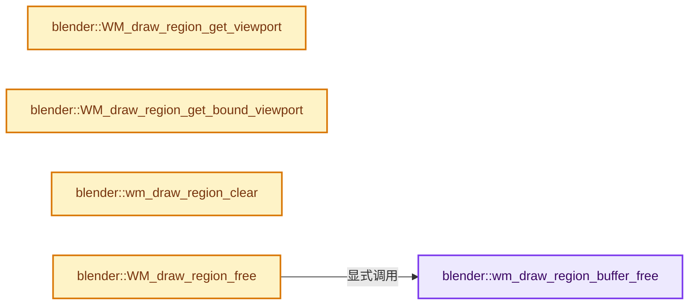
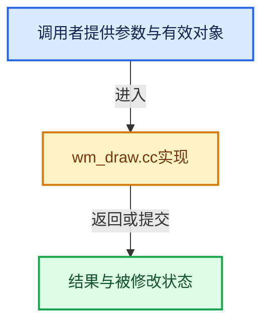

# 实现依赖专题：source/blender/windowmanager/intern/wm_draw.cc

[实现依赖导航](../../../README.md) · [符号索引](../../../../00-课程指南/02-源码与提交索引/符号依赖与实现索引.md)

本专题从正文实际调用进入，集中保存共享实现。函数有稳定锚点，可从调用处直接跳到对应完整函数；递归与互相调用通过回链组织。

## 本文件的实现关系






## 完整成员与函数实现

<a id="f-03c851b3b9752fb6"></a>

### `blender::wm_draw_region_buffer_free`

实现位置：[source/blender/windowmanager/intern/wm_draw.cc](../../../../../../../../source/blender/windowmanager/intern/wm_draw.cc) · L682—L695。

接口参数：

- `ARegion *region`

**教学注释版**

<!-- annotated:0d8c9acbfbc559 -->

```cpp
static void wm_draw_region_buffer_free(ARegion *region)
{
  if (region->runtime->draw_buffer) {
    if (region->runtime->draw_buffer->viewport) {
      GPU_viewport_free(region->runtime->draw_buffer->viewport);
    }
    if (region->runtime->draw_buffer->offscreen) {
      GPU_offscreen_free(region->runtime->draw_buffer->offscreen);
    }

    MEM_delete(region->runtime->draw_buffer);
    region->runtime->draw_buffer = nullptr;
  }
}
```

<details>
<summary>核对原始源码：source/blender/windowmanager/intern/wm_draw.cc · L682—L695</summary>

<!-- original:0d8c9acbfbc559:source/blender/windowmanager/intern/wm_draw.cc:682:695 -->

```cpp
static void wm_draw_region_buffer_free(ARegion *region)
{
  if (region->runtime->draw_buffer) {
    if (region->runtime->draw_buffer->viewport) {
      GPU_viewport_free(region->runtime->draw_buffer->viewport);
    }
    if (region->runtime->draw_buffer->offscreen) {
      GPU_offscreen_free(region->runtime->draw_buffer->offscreen);
    }

    MEM_delete(region->runtime->draw_buffer);
    region->runtime->draw_buffer = nullptr;
  }
}
```

</details>

**沿实际写入检查状态**

- `region->runtime->draw_buffer = nullptr;`

**继续追踪实现**

- `GPU_viewport_free` → [blender::GPU_viewport_free · L632](../../gpu/intern/gpu_viewport.cc.md#f-9ba1bcfa54b62923)。
- `GPU_offscreen_free` → [blender::GPU_offscreen_free · L795](../../gpu/intern/gpu_framebuffer.cc.md#f-bbe14db64a90c829)。
- `MEM_delete` → [MEM_delete · L400](../../../07-Intern运行时与平台/guardedalloc/MEM_guardedalloc.h.md#f-9049ffdd1682887c)。

<a id="f-fb0fe0d4aa2dff9f"></a>

### `blender::WM_draw_region_get_viewport`

实现位置：[source/blender/windowmanager/intern/wm_draw.cc](../../../../../../../../source/blender/windowmanager/intern/wm_draw.cc) · L954—L962。

接口参数：

- `ARegion *region`

**教学注释版**

<!-- annotated:35401936c09cee -->

```cpp
GPUViewport *WM_draw_region_get_viewport(ARegion *region)
{
  if (!region->runtime->draw_buffer) {
    return nullptr;
  }

  GPUViewport *viewport = region->runtime->draw_buffer->viewport;
  return viewport;
}
```

<details>
<summary>核对原始源码：source/blender/windowmanager/intern/wm_draw.cc · L954—L962</summary>

<!-- original:35401936c09cee:source/blender/windowmanager/intern/wm_draw.cc:954:962 -->

```cpp
GPUViewport *WM_draw_region_get_viewport(ARegion *region)
{
  if (!region->runtime->draw_buffer) {
    return nullptr;
  }

  GPUViewport *viewport = region->runtime->draw_buffer->viewport;
  return viewport;
}
```

</details>

**结果出口**

- `return nullptr;`
- `return viewport;`

**继续追踪实现**

本实现没有需要继续展开的显式调用；检查返回表达式、对象转换和调用者前置条件。

<a id="f-e2629c4ba858e4d1"></a>

### `blender::WM_draw_region_get_bound_viewport`

实现位置：[source/blender/windowmanager/intern/wm_draw.cc](../../../../../../../../source/blender/windowmanager/intern/wm_draw.cc) · L964—L972。

接口参数：

- `ARegion *region`

**教学注释版**

<!-- annotated:7a9087700d2a86 -->

```cpp
GPUViewport *WM_draw_region_get_bound_viewport(ARegion *region)
{
  if (!region->runtime->draw_buffer || region->runtime->draw_buffer->bound_view == -1) {
    return nullptr;
  }

  GPUViewport *viewport = region->runtime->draw_buffer->viewport;
  return viewport;
}
```

<details>
<summary>核对原始源码：source/blender/windowmanager/intern/wm_draw.cc · L964—L972</summary>

<!-- original:7a9087700d2a86:source/blender/windowmanager/intern/wm_draw.cc:964:972 -->

```cpp
GPUViewport *WM_draw_region_get_bound_viewport(ARegion *region)
{
  if (!region->runtime->draw_buffer || region->runtime->draw_buffer->bound_view == -1) {
    return nullptr;
  }

  GPUViewport *viewport = region->runtime->draw_buffer->viewport;
  return viewport;
}
```

</details>

**结果出口**

- `return nullptr;`
- `return viewport;`

**继续追踪实现**

本实现没有需要继续展开的显式调用；检查返回表达式、对象转换和调用者前置条件。

<a id="f-86736891865acab2"></a>

### `blender::wm_draw_region_clear`

实现位置：[source/blender/windowmanager/intern/wm_draw.cc](../../../../../../../../source/blender/windowmanager/intern/wm_draw.cc) · L1767—L1771。

接口参数：

- `wmWindow *win`
- `ARegion *`

**教学注释版**

<!-- annotated:01b545ce5eddb9 -->

```cpp
void wm_draw_region_clear(wmWindow *win, ARegion * /*region*/)
{
  bScreen *screen = WM_window_get_active_screen(win);
  screen->do_draw = true;
}
```

<details>
<summary>核对原始源码：source/blender/windowmanager/intern/wm_draw.cc · L1767—L1771</summary>

<!-- original:01b545ce5eddb9:source/blender/windowmanager/intern/wm_draw.cc:1767:1771 -->

```cpp
void wm_draw_region_clear(wmWindow *win, ARegion * /*region*/)
{
  bScreen *screen = WM_window_get_active_screen(win);
  screen->do_draw = true;
}
```

</details>

**沿实际写入检查状态**

- `screen->do_draw = true;`

**继续追踪实现**

- `WM_window_get_active_screen` → [blender::WM_window_get_active_screen · L3442](wm_window.cc.md#f-54952b6e38dc8344)。

<a id="f-c681b37646206f41"></a>

### `blender::WM_draw_region_free`

实现位置：[source/blender/windowmanager/intern/wm_draw.cc](../../../../../../../../source/blender/windowmanager/intern/wm_draw.cc) · L1773—L1776。

接口参数：

- `ARegion *region`

**教学注释版**

<!-- annotated:f69d1881f0e035 -->

```cpp
void WM_draw_region_free(ARegion *region)
{
  wm_draw_region_buffer_free(region);
}
```

<details>
<summary>核对原始源码：source/blender/windowmanager/intern/wm_draw.cc · L1773—L1776</summary>

<!-- original:f69d1881f0e035:source/blender/windowmanager/intern/wm_draw.cc:1773:1776 -->

```cpp
void WM_draw_region_free(ARegion *region)
{
  wm_draw_region_buffer_free(region);
}
```

</details>

**继续追踪实现**

- `wm_draw_region_buffer_free` → [blender::wm_draw_region_buffer_free · L682](wm_draw.cc.md#f-03c851b3b9752fb6)。
