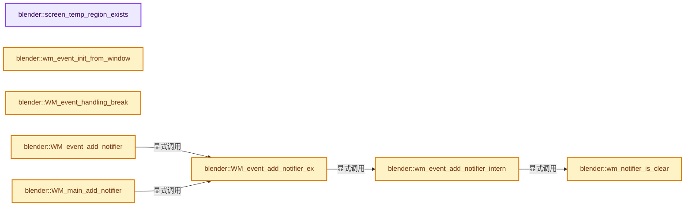
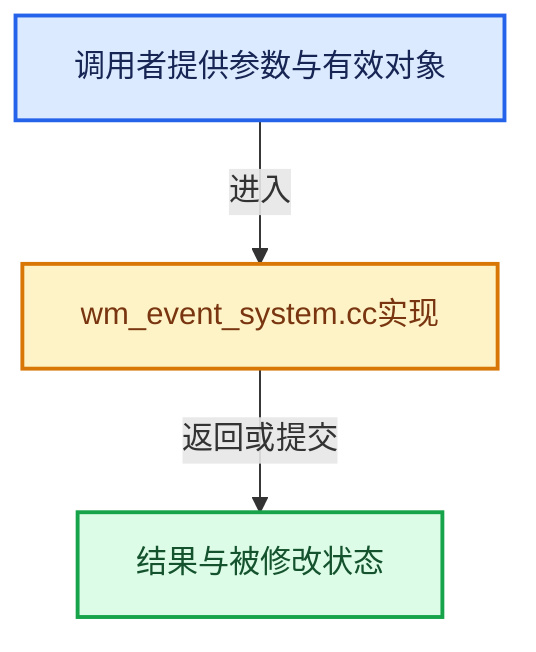

# 实现依赖专题：source/blender/windowmanager/intern/wm_event_system.cc

[实现依赖导航](../../../README.md) · [符号索引](../../../../00-课程指南/02-源码与提交索引/符号依赖与实现索引.md)

本专题从正文实际调用进入，集中保存共享实现。函数有稳定锚点，可从调用处直接跳到对应完整函数；递归与互相调用通过回链组织。

## 本文件的实现关系






## 完整成员与函数实现

<a id="f-cbbba8adebe99dc7"></a>

### `blender::screen_temp_region_exists`

实现位置：[source/blender/windowmanager/intern/wm_event_system.cc](../../../../../../../../source/blender/windowmanager/intern/wm_event_system.cc) · L160—L177。

接口参数：

- `const ARegion *region`

**教学注释版**

<!-- annotated:57478b1a0d8518 -->

```cpp
static bool screen_temp_region_exists(const ARegion *region)
{
  /* TODO(@ideasman42): this function would ideally not be needed.
   * It avoids problems restoring the #bContext::wm::region_popup
   * when it's not known if the popup was removed, however it would be better to
   * resolve this by ensuring the contexts previous state never references stale data.
   *
   * This could be done using a context "stack" allowing freeing windowing data to clear
   * references at all levels in the stack. */

  Main *bmain = G_MAIN;
  for (bScreen &screen : bmain->screens) {
    if (BLI_findindex(&screen.regionbase, region) != -1) {
      return true;
    }
  }
  return false;
}
```

<details>
<summary>核对原始源码：source/blender/windowmanager/intern/wm_event_system.cc · L160—L177</summary>

<!-- original:57478b1a0d8518:source/blender/windowmanager/intern/wm_event_system.cc:160:177 -->

```cpp
static bool screen_temp_region_exists(const ARegion *region)
{
  /* TODO(@ideasman42): this function would ideally not be needed.
   * It avoids problems restoring the #bContext::wm::region_popup
   * when it's not known if the popup was removed, however it would be better to
   * resolve this by ensuring the contexts previous state never references stale data.
   *
   * This could be done using a context "stack" allowing freeing windowing data to clear
   * references at all levels in the stack. */

  Main *bmain = G_MAIN;
  for (bScreen &screen : bmain->screens) {
    if (BLI_findindex(&screen.regionbase, region) != -1) {
      return true;
    }
  }
  return false;
}
```

</details>

**结果出口**

- `return true;`
- `return false;`

**继续追踪实现**

- `BLI_findindex` → [blender::BLI_findindex · L593](../../../01-BLI基础库/intern/listbase.cc.md#f-cb9036f12bd486b7)。

<a id="f-2d19d7d6070a5171"></a>

### `blender::wm_event_init_from_window`

实现位置：[source/blender/windowmanager/intern/wm_event_system.cc](../../../../../../../../source/blender/windowmanager/intern/wm_event_system.cc) · L317—L320。

接口参数：

- `wmWindow *win`
- `wmEvent *event`

**教学注释版**

<!-- annotated:88b1eb2a92eae3 -->

```cpp
void wm_event_init_from_window(wmWindow *win, wmEvent *event)
{
  *event = *(win->runtime->eventstate);
}
```

<details>
<summary>核对原始源码：source/blender/windowmanager/intern/wm_event_system.cc · L317—L320</summary>

<!-- original:88b1eb2a92eae3:source/blender/windowmanager/intern/wm_event_system.cc:317:320 -->

```cpp
void wm_event_init_from_window(wmWindow *win, wmEvent *event)
{
  *event = *(win->runtime->eventstate);
}
```

</details>

**继续追踪实现**

本实现没有需要继续展开的显式调用；检查返回表达式、对象转换和调用者前置条件。

<a id="f-4491082cb6f860b8"></a>

### `blender::WM_event_handling_break`

实现位置：[source/blender/windowmanager/intern/wm_event_system.cc](../../../../../../../../source/blender/windowmanager/intern/wm_event_system.cc) · L350—L353。

接口参数：

- `const bContext &C`

**教学注释版**

<!-- annotated:a08711d162fe69 -->

```cpp
void WM_event_handling_break(const bContext &C)
{
  CTX_wm_manager(&C)->runtime->break_events_handling = true;
}
```

<details>
<summary>核对原始源码：source/blender/windowmanager/intern/wm_event_system.cc · L350—L353</summary>

<!-- original:a08711d162fe69:source/blender/windowmanager/intern/wm_event_system.cc:350:353 -->

```cpp
void WM_event_handling_break(const bContext &C)
{
  CTX_wm_manager(&C)->runtime->break_events_handling = true;
}
```

</details>

**继续追踪实现**

- `CTX_wm_manager` → [blender::CTX_wm_manager · L928](../../../02-BKE几何与数据/intern/context.cc.md#f-158f36db7379fbe8)。

<a id="f-845120882e412257"></a>

### `blender::wm_event_add_notifier_intern`

实现位置：[source/blender/windowmanager/intern/wm_event_system.cc](../../../../../../../../source/blender/windowmanager/intern/wm_event_system.cc) · L355—L380。

接口参数：

- `wmWindowManager *wm`
- `const wmWindow *win`
- `uint type`
- `void *reference`

**教学注释版**

<!-- annotated:da3afea54a0509 -->

```cpp
static void wm_event_add_notifier_intern(wmWindowManager *wm,
                                         const wmWindow *win,
                                         uint type,
                                         void *reference)
{
  BLI_assert(wm != nullptr);

  wmNotifier note_test = {nullptr};

  note_test.window = win;

  note_test.category = type & NOTE_CATEGORY;
  note_test.data = type & NOTE_DATA;
  note_test.subtype = type & NOTE_SUBTYPE;
  note_test.action = type & NOTE_ACTION;
  note_test.reference = reference;

  BLI_assert(!wm_notifier_is_clear(&note_test));

  wm->runtime->notifier_queue_set.lookup_key_or_add_cb(&note_test, [&]() {
    wmNotifier *note = MEM_new<wmNotifier>("wm_event_add_notifier_intern");
    *note = note_test;
    BLI_addtail(&wm->runtime->notifier_queue, note);
    return note;
  });
}
```

<details>
<summary>核对原始源码：source/blender/windowmanager/intern/wm_event_system.cc · L355—L380</summary>

<!-- original:da3afea54a0509:source/blender/windowmanager/intern/wm_event_system.cc:355:380 -->

```cpp
static void wm_event_add_notifier_intern(wmWindowManager *wm,
                                         const wmWindow *win,
                                         uint type,
                                         void *reference)
{
  BLI_assert(wm != nullptr);

  wmNotifier note_test = {nullptr};

  note_test.window = win;

  note_test.category = type & NOTE_CATEGORY;
  note_test.data = type & NOTE_DATA;
  note_test.subtype = type & NOTE_SUBTYPE;
  note_test.action = type & NOTE_ACTION;
  note_test.reference = reference;

  BLI_assert(!wm_notifier_is_clear(&note_test));

  wm->runtime->notifier_queue_set.lookup_key_or_add_cb(&note_test, [&]() {
    wmNotifier *note = MEM_new<wmNotifier>("wm_event_add_notifier_intern");
    *note = note_test;
    BLI_addtail(&wm->runtime->notifier_queue, note);
    return note;
  });
}
```

</details>

**沿实际写入检查状态**

- `note_test.window = win;`
- `note_test.category = type & NOTE_CATEGORY;`
- `note_test.data = type & NOTE_DATA;`
- `note_test.subtype = type & NOTE_SUBTYPE;`
- `note_test.action = type & NOTE_ACTION;`
- `note_test.reference = reference;`

**结果出口**

- `return note;`

**继续追踪实现**

- `BLI_assert` → [BLI_assert · L48](../../../01-BLI基础库/BLI_assert.hh.md#m-57a88495704d)；[BLI_assert · L63](../../../01-BLI基础库/BLI_assert.hh.md#m-d07050020cb5)。宏定义由构建条件选择。
- `wm_notifier_is_clear` → [blender::wm_notifier_is_clear · L483](wm_event_system.cc.md#f-8aa4aff02f50c971)。
- `wm->runtime->notifier_queue_set.lookup_key_or_add_cb` → [调用协议](../../../../00-课程指南/01-路线与规范/模板宏与动态分派协议.md)：接收对象类型依赖auto、返回值或模板实例；不按同名猜测目标。调用位置L374。
- `MEM_new<wmNotifier>` → [MEM_new · L351](../../../07-Intern运行时与平台/guardedalloc/MEM_guardedalloc.h.md#f-115f9b6784f89912)。
- `BLI_addtail` → [blender::BLI_addtail · L118](../../../01-BLI基础库/intern/listbase.cc.md#f-4fb027713fa3115b)。

<a id="f-2d2e683dcd40dc25"></a>

### `blender::WM_event_add_notifier_ex`

实现位置：[source/blender/windowmanager/intern/wm_event_system.cc](../../../../../../../../source/blender/windowmanager/intern/wm_event_system.cc) · L382—L394。

接口参数：

- `wmWindowManager *wm`
- `const wmWindow *win`
- `uint type`
- `void *reference`

**教学注释版**

<!-- annotated:1362c9446981b7 -->

```cpp
void WM_event_add_notifier_ex(wmWindowManager *wm, const wmWindow *win, uint type, void *reference)
{
  if (wm == nullptr) {
    /* There may be some cases where e.g. `G_MAIN` is not actually the real current main, but some
     * other temporary one (e.g. during liboverride processing over linked data), leading to null
     * window manager.
     *
     * This is fairly bad and weak, but unfortunately RNA does not have any way to operate over
     * another main than G_MAIN currently. */
    return;
  }
  wm_event_add_notifier_intern(wm, win, type, reference);
}
```

<details>
<summary>核对原始源码：source/blender/windowmanager/intern/wm_event_system.cc · L382—L394</summary>

<!-- original:1362c9446981b7:source/blender/windowmanager/intern/wm_event_system.cc:382:394 -->

```cpp
void WM_event_add_notifier_ex(wmWindowManager *wm, const wmWindow *win, uint type, void *reference)
{
  if (wm == nullptr) {
    /* There may be some cases where e.g. `G_MAIN` is not actually the real current main, but some
     * other temporary one (e.g. during liboverride processing over linked data), leading to null
     * window manager.
     *
     * This is fairly bad and weak, but unfortunately RNA does not have any way to operate over
     * another main than G_MAIN currently. */
    return;
  }
  wm_event_add_notifier_intern(wm, win, type, reference);
}
```

</details>

**继续追踪实现**

- `wm_event_add_notifier_intern` → [blender::wm_event_add_notifier_intern · L355](wm_event_system.cc.md#f-845120882e412257)。

<a id="f-a1b32e7f4a69b28f"></a>

### `blender::WM_event_add_notifier`

实现位置：[source/blender/windowmanager/intern/wm_event_system.cc](../../../../../../../../source/blender/windowmanager/intern/wm_event_system.cc) · L396—L401。

接口参数：

- `const bContext *C`
- `uint type`
- `void *reference`

**教学注释版**

<!-- annotated:7fc02adc44be55 -->

```cpp
void WM_event_add_notifier(const bContext *C, uint type, void *reference)
{
  /* XXX: in future, which notifiers to send to other windows? */

  WM_event_add_notifier_ex(CTX_wm_manager(C), CTX_wm_window(C), type, reference);
}
```

<details>
<summary>核对原始源码：source/blender/windowmanager/intern/wm_event_system.cc · L396—L401</summary>

<!-- original:7fc02adc44be55:source/blender/windowmanager/intern/wm_event_system.cc:396:401 -->

```cpp
void WM_event_add_notifier(const bContext *C, uint type, void *reference)
{
  /* XXX: in future, which notifiers to send to other windows? */

  WM_event_add_notifier_ex(CTX_wm_manager(C), CTX_wm_window(C), type, reference);
}
```

</details>

**继续追踪实现**

- `WM_event_add_notifier_ex` → [blender::WM_event_add_notifier_ex · L382](wm_event_system.cc.md#f-2d2e683dcd40dc25)。
- `CTX_wm_manager` → [blender::CTX_wm_manager · L928](../../../02-BKE几何与数据/intern/context.cc.md#f-158f36db7379fbe8)。
- `CTX_wm_window` → [blender::CTX_wm_window · L938](../../../02-BKE几何与数据/intern/context.cc.md#f-a1996003b2409854)。

<a id="f-29a090eae8ebe51c"></a>

### `blender::WM_main_add_notifier`

实现位置：[source/blender/windowmanager/intern/wm_event_system.cc](../../../../../../../../source/blender/windowmanager/intern/wm_event_system.cc) · L403—L409。

接口参数：

- `uint type`
- `void *reference`

**教学注释版**

<!-- annotated:89777b95a05c4a -->

```cpp
void WM_main_add_notifier(uint type, void *reference)
{
  Main *bmain = G_MAIN;
  wmWindowManager *wm = bmain->wm.first();

  WM_event_add_notifier_ex(wm, nullptr, type, reference);
}
```

<details>
<summary>核对原始源码：source/blender/windowmanager/intern/wm_event_system.cc · L403—L409</summary>

<!-- original:89777b95a05c4a:source/blender/windowmanager/intern/wm_event_system.cc:403:409 -->

```cpp
void WM_main_add_notifier(uint type, void *reference)
{
  Main *bmain = G_MAIN;
  wmWindowManager *wm = bmain->wm.first();

  WM_event_add_notifier_ex(wm, nullptr, type, reference);
}
```

</details>

**继续追踪实现**

- `bmain->wm.first` → [调用协议](../../../../00-课程指南/01-路线与规范/模板宏与动态分派协议.md)：接收对象类型依赖auto、返回值或模板实例；不按同名猜测目标。调用位置L406。
- `WM_event_add_notifier_ex` → [blender::WM_event_add_notifier_ex · L382](wm_event_system.cc.md#f-2d2e683dcd40dc25)。

<a id="f-8aa4aff02f50c971"></a>

### `blender::wm_notifier_is_clear`

实现位置：[source/blender/windowmanager/intern/wm_event_system.cc](../../../../../../../../source/blender/windowmanager/intern/wm_event_system.cc) · L483—L486。

接口参数：

- `const wmNotifier *note`

**教学注释版**

<!-- annotated:5a8d1f3738953a -->

```cpp
static bool wm_notifier_is_clear(const wmNotifier *note)
{
  return note->category == NOTE_CATEGORY_TAG_CLEARED;
}
```

<details>
<summary>核对原始源码：source/blender/windowmanager/intern/wm_event_system.cc · L483—L486</summary>

<!-- original:5a8d1f3738953a:source/blender/windowmanager/intern/wm_event_system.cc:483:486 -->

```cpp
static bool wm_notifier_is_clear(const wmNotifier *note)
{
  return note->category == NOTE_CATEGORY_TAG_CLEARED;
}
```

</details>

**结果出口**

- `return note->category == NOTE_CATEGORY_TAG_CLEARED;`

**继续追踪实现**

本实现没有需要继续展开的显式调用；检查返回表达式、对象转换和调用者前置条件。

<a id="f-d241391488d01dcf"></a>

### `blender::wm_event_handler_ui_cancel_ex`

实现位置：[source/blender/windowmanager/intern/wm_event_system.cc](../../../../../../../../source/blender/windowmanager/intern/wm_event_system.cc) · L965—L986。

接口参数：

- `bContext *C`
- `wmWindow *win`
- `ARegion *region`
- `bool reactivate_button`

**教学注释版**

<!-- annotated:e5ad4cf5dc05d4 -->

```cpp
void wm_event_handler_ui_cancel_ex(bContext *C,
                                   wmWindow *win,
                                   ARegion *region,
                                   bool reactivate_button)
{
  if (!region) {
    return;
  }

  for (wmEventHandler &handler_base : region->runtime->handlers.items_mutable()) {
    if (handler_base.type == WM_HANDLER_TYPE_UI) {
      wmEventHandler_UI *handler = reinterpret_cast<wmEventHandler_UI *>(&handler_base);
      BLI_assert(handler->handle_fn != nullptr);
      wmEvent event;
      wm_event_init_from_window(win, &event);
      event.type = EVT_BUT_CANCEL;
      event.val = reactivate_button ? KM_NOTHING : KM_PRESS;
      event.flag = eWM_EventFlag(0);
      handler->handle_fn(C, &event, handler->user_data);
    }
  }
}
```

<details>
<summary>核对原始源码：source/blender/windowmanager/intern/wm_event_system.cc · L965—L986</summary>

<!-- original:e5ad4cf5dc05d4:source/blender/windowmanager/intern/wm_event_system.cc:965:986 -->

```cpp
void wm_event_handler_ui_cancel_ex(bContext *C,
                                   wmWindow *win,
                                   ARegion *region,
                                   bool reactivate_button)
{
  if (!region) {
    return;
  }

  for (wmEventHandler &handler_base : region->runtime->handlers.items_mutable()) {
    if (handler_base.type == WM_HANDLER_TYPE_UI) {
      wmEventHandler_UI *handler = reinterpret_cast<wmEventHandler_UI *>(&handler_base);
      BLI_assert(handler->handle_fn != nullptr);
      wmEvent event;
      wm_event_init_from_window(win, &event);
      event.type = EVT_BUT_CANCEL;
      event.val = reactivate_button ? KM_NOTHING : KM_PRESS;
      event.flag = eWM_EventFlag(0);
      handler->handle_fn(C, &event, handler->user_data);
    }
  }
}
```

</details>

**沿实际写入检查状态**

- `event.type = EVT_BUT_CANCEL;`
- `event.val = reactivate_button ? KM_NOTHING : KM_PRESS;`
- `event.flag = eWM_EventFlag(0);`

**继续追踪实现**

- `region->runtime->handlers.items_mutable` → [调用协议](../../../../00-课程指南/01-路线与规范/模板宏与动态分派协议.md)：接收对象类型依赖auto、返回值或模板实例；不按同名猜测目标。调用位置L974。
- `BLI_assert` → [BLI_assert · L48](../../../01-BLI基础库/BLI_assert.hh.md#m-57a88495704d)；[BLI_assert · L63](../../../01-BLI基础库/BLI_assert.hh.md#m-d07050020cb5)。宏定义由构建条件选择。
- `wm_event_init_from_window` → [blender::wm_event_init_from_window · L317](wm_event_system.cc.md#f-2d19d7d6070a5171)。
- `eWM_EventFlag` → [blender::eWM_EventFlag](../WM_types.hh.md#t-06b0d9e40d6b)。
- `handler->handle_fn` → [调用协议](../../../../00-课程指南/01-路线与规范/模板宏与动态分派协议.md)：由接收对象具体类型或运行时策略提供实现。调用位置L983。

<a id="f-7d9486ee39ba1b44"></a>

### `blender::wm_event_handler_ui_cancel`

实现位置：[source/blender/windowmanager/intern/wm_event_system.cc](../../../../../../../../source/blender/windowmanager/intern/wm_event_system.cc) · L988—L993。

接口参数：

- `bContext *C`

**教学注释版**

<!-- annotated:df33cf0b4589f7 -->

```cpp
static void wm_event_handler_ui_cancel(bContext *C)
{
  wmWindow *win = CTX_wm_window(C);
  ARegion *region = CTX_wm_region(C);
  wm_event_handler_ui_cancel_ex(C, win, region, true);
}
```

<details>
<summary>核对原始源码：source/blender/windowmanager/intern/wm_event_system.cc · L988—L993</summary>

<!-- original:df33cf0b4589f7:source/blender/windowmanager/intern/wm_event_system.cc:988:993 -->

```cpp
static void wm_event_handler_ui_cancel(bContext *C)
{
  wmWindow *win = CTX_wm_window(C);
  ARegion *region = CTX_wm_region(C);
  wm_event_handler_ui_cancel_ex(C, win, region, true);
}
```

</details>

**继续追踪实现**

- `CTX_wm_window` → [blender::CTX_wm_window · L938](../../../02-BKE几何与数据/intern/context.cc.md#f-a1996003b2409854)。
- `CTX_wm_region` → [blender::CTX_wm_region · L965](../../../02-BKE几何与数据/intern/context.cc.md#f-6cc0a26bc4539ae0)。
- `wm_event_handler_ui_cancel_ex` → [blender::wm_event_handler_ui_cancel_ex · L965](wm_event_system.cc.md#f-d241391488d01dcf)。

<a id="f-a9c784d86512c6e0"></a>

### `blender::WM_report_banner_show`

实现位置：[source/blender/windowmanager/intern/wm_event_system.cc](../../../../../../../../source/blender/windowmanager/intern/wm_event_system.cc) · L1003—L1022。

接口参数：

- `wmWindowManager *wm`
- `wmWindow *win`

**教学注释版**

<!-- annotated:381a0b2cda0d26 -->

```cpp
void WM_report_banner_show(wmWindowManager *wm, wmWindow *win)
{
  if (win == nullptr) {
    win = wm->runtime->winactive;
    if (win == nullptr) {
      win = wm->windows.first();
    }
  }

  ReportList *wm_reports = &wm->runtime->reports;

  /* After adding reports to the global list, reset the report timer. */
  WM_event_timer_remove(wm, nullptr, wm_reports->reporttimer);

  /* Records time since last report was added. */
  wm_reports->reporttimer = WM_event_timer_add(wm, win, TIMERREPORT, 0.05);

  ReportTimerInfo *rti = MEM_new<ReportTimerInfo>(__func__);
  wm_reports->reporttimer->customdata = rti;
}
```

<details>
<summary>核对原始源码：source/blender/windowmanager/intern/wm_event_system.cc · L1003—L1022</summary>

<!-- original:381a0b2cda0d26:source/blender/windowmanager/intern/wm_event_system.cc:1003:1022 -->

```cpp
void WM_report_banner_show(wmWindowManager *wm, wmWindow *win)
{
  if (win == nullptr) {
    win = wm->runtime->winactive;
    if (win == nullptr) {
      win = wm->windows.first();
    }
  }

  ReportList *wm_reports = &wm->runtime->reports;

  /* After adding reports to the global list, reset the report timer. */
  WM_event_timer_remove(wm, nullptr, wm_reports->reporttimer);

  /* Records time since last report was added. */
  wm_reports->reporttimer = WM_event_timer_add(wm, win, TIMERREPORT, 0.05);

  ReportTimerInfo *rti = MEM_new<ReportTimerInfo>(__func__);
  wm_reports->reporttimer->customdata = rti;
}
```

</details>

**沿实际写入检查状态**

- `win = wm->runtime->winactive;`
- `win = wm->windows.first();`
- `wm_reports->reporttimer = WM_event_timer_add(wm, win, TIMERREPORT, 0.05);`
- `wm_reports->reporttimer->customdata = rti;`

**继续追踪实现**

- `wm->windows.first` → [调用协议](../../../../00-课程指南/01-路线与规范/模板宏与动态分派协议.md)：接收对象类型依赖auto、返回值或模板实例；不按同名猜测目标。调用位置L1008。
- `WM_event_timer_remove` → [blender::WM_event_timer_remove · L2620](wm_window.cc.md#f-b9a941dd92720408)。
- `WM_event_timer_add` → [blender::WM_event_timer_add · L2555](wm_window.cc.md#f-b5fbc707cb32f70d)。
- `MEM_new<ReportTimerInfo>` → [MEM_new · L351](../../../07-Intern运行时与平台/guardedalloc/MEM_guardedalloc.h.md#f-115f9b6784f89912)。

<a id="f-da880e41265cdbff"></a>

### `blender::WM_reports_from_reports_move`

实现位置：[source/blender/windowmanager/intern/wm_event_system.cc](../../../../../../../../source/blender/windowmanager/intern/wm_event_system.cc) · L1039—L1054。

接口参数：

- `wmWindowManager *wm`
- `ReportList *reports`

**教学注释版**

<!-- annotated:729a99f843be4b -->

```cpp
void WM_reports_from_reports_move(wmWindowManager *wm, ReportList *reports)
{
  /* If the caller owns them, handle this. */
  if (!reports || reports->list.is_empty() || (reports->flag & RPT_OP_HOLD) != 0) {
    return;
  }

  if (!wm) {
    wm = G_MAIN->wm.first();
  }

  /* Add reports to the global list, otherwise they are not seen. */
  BKE_reports_move_to_reports(&wm->runtime->reports, reports);

  WM_report_banner_show(wm, nullptr);
}
```

<details>
<summary>核对原始源码：source/blender/windowmanager/intern/wm_event_system.cc · L1039—L1054</summary>

<!-- original:729a99f843be4b:source/blender/windowmanager/intern/wm_event_system.cc:1039:1054 -->

```cpp
void WM_reports_from_reports_move(wmWindowManager *wm, ReportList *reports)
{
  /* If the caller owns them, handle this. */
  if (!reports || reports->list.is_empty() || (reports->flag & RPT_OP_HOLD) != 0) {
    return;
  }

  if (!wm) {
    wm = G_MAIN->wm.first();
  }

  /* Add reports to the global list, otherwise they are not seen. */
  BKE_reports_move_to_reports(&wm->runtime->reports, reports);

  WM_report_banner_show(wm, nullptr);
}
```

</details>

**沿实际写入检查状态**

- `wm = G_MAIN->wm.first();`

**继续追踪实现**

- `reports->list.is_empty` → [调用协议](../../../../00-课程指南/01-路线与规范/模板宏与动态分派协议.md)：接收对象类型依赖auto、返回值或模板实例；不按同名猜测目标。调用位置L1042。
- `G_MAIN->wm.first` → [调用协议](../../../../00-课程指南/01-路线与规范/模板宏与动态分派协议.md)：接收对象类型依赖auto、返回值或模板实例；不按同名猜测目标。调用位置L1047。
- `BKE_reports_move_to_reports` → [blender::BKE_reports_move_to_reports · L150](../../../02-BKE几何与数据/intern/report.cc.md#f-b63ab0b56ee03476)。
- `WM_report_banner_show` → [blender::WM_report_banner_show · L1003](wm_event_system.cc.md#f-a9c784d86512c6e0)。

<a id="f-f195580dc7d88000"></a>

### `blender::WM_global_report`

实现位置：[source/blender/windowmanager/intern/wm_event_system.cc](../../../../../../../../source/blender/windowmanager/intern/wm_event_system.cc) · L1056—L1067。

接口参数：

- `eReportType type`
- `const char *message`

**教学注释版**

<!-- annotated:0caf6d84b0549b -->

```cpp
void WM_global_report(eReportType type, const char *message)
{
  /* WARNING: in most cases #BKE_report should be used instead, see docstring for details. */
  ReportList reports;
  BKE_reports_init(&reports, RPT_STORE | RPT_PRINT);
  BKE_report_print_level_set(&reports, RPT_WARNING);
  BKE_report(&reports, type, message);

  WM_reports_from_reports_move(nullptr, &reports);

  BKE_reports_free(&reports);
}
```

<details>
<summary>核对原始源码：source/blender/windowmanager/intern/wm_event_system.cc · L1056—L1067</summary>

<!-- original:0caf6d84b0549b:source/blender/windowmanager/intern/wm_event_system.cc:1056:1067 -->

```cpp
void WM_global_report(eReportType type, const char *message)
{
  /* WARNING: in most cases #BKE_report should be used instead, see docstring for details. */
  ReportList reports;
  BKE_reports_init(&reports, RPT_STORE | RPT_PRINT);
  BKE_report_print_level_set(&reports, RPT_WARNING);
  BKE_report(&reports, type, message);

  WM_reports_from_reports_move(nullptr, &reports);

  BKE_reports_free(&reports);
}
```

</details>

**继续追踪实现**

- `BKE_reports_init` → [blender::BKE_reports_init · L91](../../../02-BKE几何与数据/intern/report.cc.md#f-b8685fdb2b35bb7d)。
- `BKE_report_print_level_set` → [blender::BKE_report_print_level_set · L276](../../../02-BKE几何与数据/intern/report.cc.md#f-8b074095e449900c)。
- `BKE_report` → [blender::BKE_report · L162](../../../02-BKE几何与数据/intern/report.cc.md#f-56816f68adfe537b)。
- `WM_reports_from_reports_move` → [blender::WM_reports_from_reports_move · L1039](wm_event_system.cc.md#f-da880e41265cdbff)。
- `BKE_reports_free` → [blender::BKE_reports_free · L106](../../../02-BKE几何与数据/intern/report.cc.md#f-14b48393664f8c21)。

<a id="f-bebcdbebb52fae1d"></a>

### `blender::WM_global_reportf`

实现位置：[source/blender/windowmanager/intern/wm_event_system.cc](../../../../../../../../source/blender/windowmanager/intern/wm_event_system.cc) · L1069—L1083。

接口参数：

- `eReportType type`
- `const char *format`

**教学注释版**

<!-- annotated:85b0bb158b249c -->

```cpp
void WM_global_reportf(eReportType type, const char *format, ...)
{
  /* WARNING: in most cases #BKE_reportf should be used instead, see docstring for details. */

  va_list args;

  format = RPT_(format);

  va_start(args, format);
  char *str = BLI_vsprintfN(format, args);
  va_end(args);

  WM_global_report(type, str);
  MEM_delete(str);
}
```

<details>
<summary>核对原始源码：source/blender/windowmanager/intern/wm_event_system.cc · L1069—L1083</summary>

<!-- original:85b0bb158b249c:source/blender/windowmanager/intern/wm_event_system.cc:1069:1083 -->

```cpp
void WM_global_reportf(eReportType type, const char *format, ...)
{
  /* WARNING: in most cases #BKE_reportf should be used instead, see docstring for details. */

  va_list args;

  format = RPT_(format);

  va_start(args, format);
  char *str = BLI_vsprintfN(format, args);
  va_end(args);

  WM_global_report(type, str);
  MEM_delete(str);
}
```

</details>

**沿实际写入检查状态**

- `format = RPT_(format);`

**继续追踪实现**

- `RPT_` → [RPT_ · L51](../../blentranslation/BLT_translation.hh.md#m-c13f94a1a934)。宏定义由构建条件选择。
- `va_start` → [调用协议](../../../../00-课程指南/01-路线与规范/模板宏与动态分派协议.md)：函数指针、局部可调用对象或未展开的宏；必须结合调用者环境。调用位置L1077。
- `BLI_vsprintfN` → [blender::BLI_vsprintfN · L314](../../../01-BLI基础库/intern/string.cc.md#f-f9f2b319f94c0309)。
- `va_end` → [调用协议](../../../../00-课程指南/01-路线与规范/模板宏与动态分派协议.md)：函数指针、局部可调用对象或未展开的宏；必须结合调用者环境。调用位置L1079。
- `WM_global_report` → [blender::WM_global_report · L1056](wm_event_system.cc.md#f-f195580dc7d88000)。
- `MEM_delete` → [MEM_delete · L400](../../../07-Intern运行时与平台/guardedalloc/MEM_guardedalloc.h.md#f-9049ffdd1682887c)。

<a id="f-343f1f3169c0ce1a"></a>

### `blender::wm_operator_undo_active_id`

实现位置：[source/blender/windowmanager/intern/wm_event_system.cc](../../../../../../../../source/blender/windowmanager/intern/wm_event_system.cc) · L1094—L1100。

接口参数：

- `const wmWindowManager *wm`

**教学注释版**

<!-- annotated:81dafcf4df5c33 -->

```cpp
static intptr_t wm_operator_undo_active_id(const wmWindowManager *wm)
{
  if (wm->runtime->undo_stack) {
    return intptr_t(wm->runtime->undo_stack->step_active);
  }
  return -1;
}
```

<details>
<summary>核对原始源码：source/blender/windowmanager/intern/wm_event_system.cc · L1094—L1100</summary>

<!-- original:81dafcf4df5c33:source/blender/windowmanager/intern/wm_event_system.cc:1094:1100 -->

```cpp
static intptr_t wm_operator_undo_active_id(const wmWindowManager *wm)
{
  if (wm->runtime->undo_stack) {
    return intptr_t(wm->runtime->undo_stack->step_active);
  }
  return -1;
}
```

</details>

**结果出口**

- `return intptr_t(wm->runtime->undo_stack->step_active);`
- `return -1;`

**继续追踪实现**

本实现没有需要继续展开的显式调用；检查返回表达式、对象转换和调用者前置条件。

<a id="f-757b2f9f64092b8a"></a>

### `blender::wm_operator_register_active_id`

实现位置：[source/blender/windowmanager/intern/wm_event_system.cc](../../../../../../../../source/blender/windowmanager/intern/wm_event_system.cc) · L1102—L1108。

接口参数：

- `const wmWindowManager *wm`

**教学注释版**

<!-- annotated:2dae2fbb9473af -->

```cpp
static intptr_t wm_operator_register_active_id(const wmWindowManager *wm)
{
  if (wm->runtime->operators.last()) {
    return intptr_t(wm->runtime->operators.last());
  }
  return -1;
}
```

<details>
<summary>核对原始源码：source/blender/windowmanager/intern/wm_event_system.cc · L1102—L1108</summary>

<!-- original:2dae2fbb9473af:source/blender/windowmanager/intern/wm_event_system.cc:1102:1108 -->

```cpp
static intptr_t wm_operator_register_active_id(const wmWindowManager *wm)
{
  if (wm->runtime->operators.last()) {
    return intptr_t(wm->runtime->operators.last());
  }
  return -1;
}
```

</details>

**结果出口**

- `return intptr_t(wm->runtime->operators.last());`
- `return -1;`

**继续追踪实现**

- `wm->runtime->operators.last` → [调用协议](../../../../00-课程指南/01-路线与规范/模板宏与动态分派协议.md)：接收对象类型依赖auto、返回值或模板实例；不按同名猜测目标。调用位置L1104。

<a id="f-f468dca2684ae99e"></a>

### `blender::WM_operator_poll`

实现位置：[source/blender/windowmanager/intern/wm_event_system.cc](../../../../../../../../source/blender/windowmanager/intern/wm_event_system.cc) · L1110—L1132。

接口参数：

- `bContext *C`
- `wmOperatorType *ot`

**教学注释版**

<!-- annotated:1affc6badf284b -->

```cpp
bool WM_operator_poll(bContext *C, wmOperatorType *ot)
{
  PRF_scope_with_name("Operator Call (poll)", ProfileCategory::Default);
  PRF_scope_set_dynamic_name("Op: %s", ot->idname);

  for (wmOperatorTypeMacro &otmacro : ot->macro) {
    wmOperatorType *ot_macro = WM_operatortype_find(otmacro.idname, false);

    if (!WM_operator_poll(C, ot_macro)) {
      return false;
    }
  }

  /* Python needs operator type, so we added exception for it. */
  if (ot->pyop_poll) {
    return ot->pyop_poll(C, ot);
  }
  if (ot->poll) {
    return ot->poll(C);
  }

  return true;
}
```

<details>
<summary>核对原始源码：source/blender/windowmanager/intern/wm_event_system.cc · L1110—L1132</summary>

<!-- original:1affc6badf284b:source/blender/windowmanager/intern/wm_event_system.cc:1110:1132 -->

```cpp
bool WM_operator_poll(bContext *C, wmOperatorType *ot)
{
  PRF_scope_with_name("Operator Call (poll)", ProfileCategory::Default);
  PRF_scope_set_dynamic_name("Op: %s", ot->idname);

  for (wmOperatorTypeMacro &otmacro : ot->macro) {
    wmOperatorType *ot_macro = WM_operatortype_find(otmacro.idname, false);

    if (!WM_operator_poll(C, ot_macro)) {
      return false;
    }
  }

  /* Python needs operator type, so we added exception for it. */
  if (ot->pyop_poll) {
    return ot->pyop_poll(C, ot);
  }
  if (ot->poll) {
    return ot->poll(C);
  }

  return true;
}
```

</details>

**结果出口**

- `return false;`
- `return ot->pyop_poll(C, ot);`
- `return ot->poll(C);`
- `return true;`

**继续追踪实现**

- `PRF_scope_with_name` → [PRF_scope_with_name · L52](../../../07-Intern运行时与平台/profile/PRF_profile.hh.md#m-adc22c3a3f8c)；[PRF_scope_with_name · L91](../../../07-Intern运行时与平台/profile/PRF_profile.hh.md#m-3cbbaddb89c4)。宏定义由构建条件选择。
- `PRF_scope_set_dynamic_name` → [PRF_scope_set_dynamic_name · L55](../../../07-Intern运行时与平台/profile/PRF_profile.hh.md#m-27e2ed8a1ee1)；[PRF_scope_set_dynamic_name · L93](../../../07-Intern运行时与平台/profile/PRF_profile.hh.md#m-525677247e79)。宏定义由构建条件选择。
- `WM_operatortype_find` → [blender::WM_operatortype_find · L78](wm_operator_type.cc.md#f-9fc2574dfd3703ee)。
- `WM_operator_poll` → [blender::WM_operator_poll · L1110](wm_event_system.cc.md#f-f468dca2684ae99e)。
- `ot->pyop_poll` → [调用协议](../../../../00-课程指南/01-路线与规范/模板宏与动态分派协议.md)：由接收对象具体类型或运行时策略提供实现。调用位置L1125。
- `ot->poll` → [调用协议](../../../../00-课程指南/01-路线与规范/模板宏与动态分派协议.md)：由接收对象具体类型或运行时策略提供实现。调用位置L1128。

<a id="f-b6406edffb0baceb"></a>

### `blender::WM_operator_poll_context`

实现位置：[source/blender/windowmanager/intern/wm_event_system.cc](../../../../../../../../source/blender/windowmanager/intern/wm_event_system.cc) · L1154—L1158。

接口参数：

- `bContext *C`
- `wmOperatorType *ot`
- `wm::OpCallContext context`

**教学注释版**

<!-- annotated:5781efe844f6d5 -->

```cpp
bool WM_operator_poll_context(bContext *C, wmOperatorType *ot, wm::OpCallContext context)
{
  /* Sets up the new context and calls #wm_operator_invoke() with poll_only. */
  return wm_operator_call_internal(C, ot, nullptr, nullptr, context, true, nullptr);
}
```

<details>
<summary>核对原始源码：source/blender/windowmanager/intern/wm_event_system.cc · L1154—L1158</summary>

<!-- original:5781efe844f6d5:source/blender/windowmanager/intern/wm_event_system.cc:1154:1158 -->

```cpp
bool WM_operator_poll_context(bContext *C, wmOperatorType *ot, wm::OpCallContext context)
{
  /* Sets up the new context and calls #wm_operator_invoke() with poll_only. */
  return wm_operator_call_internal(C, ot, nullptr, nullptr, context, true, nullptr);
}
```

</details>

**结果出口**

- `return wm_operator_call_internal(C, ot, nullptr, nullptr, context, true, nullptr);`

**继续追踪实现**

- `wm_operator_call_internal` → [blender::wm_operator_call_internal · L1809](wm_event_system.cc.md#f-55519f3aefb70897)。

<a id="f-37bb770c622c4f5a"></a>

### `blender::WM_operator_ui_poll`

实现位置：[source/blender/windowmanager/intern/wm_event_system.cc](../../../../../../../../source/blender/windowmanager/intern/wm_event_system.cc) · L1160—L1191。

接口参数：

- `wmOperatorType *ot`
- `PointerRNA *ptr`

**教学注释版**

<!-- annotated:5c41f1c7bab7aa -->

```cpp
bool WM_operator_ui_poll(wmOperatorType *ot, PointerRNA *ptr)
{
  if (ot->macro.first() != nullptr) {
    /* For macros, check all have exec() we can call. */
    for (wmOperatorTypeMacro &otmacro : ot->macro) {
      wmOperatorType *otm = WM_operatortype_find(otmacro.idname, false);
      if (otm && WM_operator_ui_poll(otm, ptr)) {
        return true;
      }
    }
    return false;
  }

  if (ot->ui) {
    if (ot->ui_poll) {
      return ot->ui_poll(ot, ptr);
    }
    return true;
  }

  bool result = false;
  PointerRNA op_ptr = WM_operator_properties_create_ptr(ot);
  RNA_STRUCT_BEGIN (&op_ptr, prop) {
    int flag = RNA_property_flag(prop);
    if ((flag & PROP_HIDDEN) == 0) {
      result = true;
      break;
    }
  }
  RNA_STRUCT_END;
  return result;
}
```

<details>
<summary>核对原始源码：source/blender/windowmanager/intern/wm_event_system.cc · L1160—L1191</summary>

<!-- original:5c41f1c7bab7aa:source/blender/windowmanager/intern/wm_event_system.cc:1160:1191 -->

```cpp
bool WM_operator_ui_poll(wmOperatorType *ot, PointerRNA *ptr)
{
  if (ot->macro.first() != nullptr) {
    /* For macros, check all have exec() we can call. */
    for (wmOperatorTypeMacro &otmacro : ot->macro) {
      wmOperatorType *otm = WM_operatortype_find(otmacro.idname, false);
      if (otm && WM_operator_ui_poll(otm, ptr)) {
        return true;
      }
    }
    return false;
  }

  if (ot->ui) {
    if (ot->ui_poll) {
      return ot->ui_poll(ot, ptr);
    }
    return true;
  }

  bool result = false;
  PointerRNA op_ptr = WM_operator_properties_create_ptr(ot);
  RNA_STRUCT_BEGIN (&op_ptr, prop) {
    int flag = RNA_property_flag(prop);
    if ((flag & PROP_HIDDEN) == 0) {
      result = true;
      break;
    }
  }
  RNA_STRUCT_END;
  return result;
}
```

</details>

**沿实际写入检查状态**

- `result = true;`

**结果出口**

- `return true;`
- `return false;`
- `return ot->ui_poll(ot, ptr);`
- `return result;`

**继续追踪实现**

- `ot->macro.first` → [调用协议](../../../../00-课程指南/01-路线与规范/模板宏与动态分派协议.md)：接收对象类型依赖auto、返回值或模板实例；不按同名猜测目标。调用位置L1162。
- `WM_operatortype_find` → [blender::WM_operatortype_find · L78](wm_operator_type.cc.md#f-9fc2574dfd3703ee)。
- `WM_operator_ui_poll` → [blender::WM_operator_ui_poll · L1160](wm_event_system.cc.md#f-37bb770c622c4f5a)。
- `ot->ui_poll` → [调用协议](../../../../00-课程指南/01-路线与规范/模板宏与动态分派协议.md)：由接收对象具体类型或运行时策略提供实现。调用位置L1175。
- `WM_operator_properties_create_ptr` → [blender::WM_operator_properties_create_ptr · L748](wm_operators.cc.md#f-6314bcba0ea304a8)。
- `RNA_STRUCT_BEGIN` → [RNA_STRUCT_BEGIN · L836](../../makesrna/RNA_access.hh.md#m-e0d1e461ee20)。宏定义由构建条件选择。
- `RNA_property_flag` → [blender::RNA_property_flag · L1342](../../makesrna/intern/rna_access.cc.md#f-c36ad8058f3a533e)。

<a id="f-1c9905163b586391"></a>

### `blender::WM_operator_region_active_win_set`

实现位置：[source/blender/windowmanager/intern/wm_event_system.cc](../../../../../../../../source/blender/windowmanager/intern/wm_event_system.cc) · L1193—L1202。

接口参数：

- `bContext *C`

**教学注释版**

<!-- annotated:ad35229b590a9f -->

```cpp
void WM_operator_region_active_win_set(bContext *C)
{
  ScrArea *area = CTX_wm_area(C);
  if (area) {
    ARegion *region = CTX_wm_region(C);
    if (region && region->regiontype == RGN_TYPE_WINDOW) {
      area->region_active_win = BLI_findindex(&area->regionbase, region);
    }
  }
}
```

<details>
<summary>核对原始源码：source/blender/windowmanager/intern/wm_event_system.cc · L1193—L1202</summary>

<!-- original:ad35229b590a9f:source/blender/windowmanager/intern/wm_event_system.cc:1193:1202 -->

```cpp
void WM_operator_region_active_win_set(bContext *C)
{
  ScrArea *area = CTX_wm_area(C);
  if (area) {
    ARegion *region = CTX_wm_region(C);
    if (region && region->regiontype == RGN_TYPE_WINDOW) {
      area->region_active_win = BLI_findindex(&area->regionbase, region);
    }
  }
}
```

</details>

**沿实际写入检查状态**

- `area->region_active_win = BLI_findindex(&area->regionbase, region);`

**继续追踪实现**

- `CTX_wm_area` → [blender::CTX_wm_area · L954](../../../02-BKE几何与数据/intern/context.cc.md#f-f8ad7c2c364d711c)。
- `CTX_wm_region` → [blender::CTX_wm_region · L965](../../../02-BKE几何与数据/intern/context.cc.md#f-6cc0a26bc4539ae0)。
- `BLI_findindex` → [blender::BLI_findindex · L593](../../../01-BLI基础库/intern/listbase.cc.md#f-cb9036f12bd486b7)。

<a id="f-9705a1b9722f1b72"></a>

### `blender::wm_operator_reports`

实现位置：[source/blender/windowmanager/intern/wm_event_system.cc](../../../../../../../../source/blender/windowmanager/intern/wm_event_system.cc) · L1207—L1261。

接口参数：

- `bContext *C`
- `wmOperator *op`
- `const wmOperatorStatus retval`
- `const bool caller_owns_reports`

**教学注释版**

<!-- annotated:8f6e924608c06c -->

```cpp
static void wm_operator_reports(bContext *C,
                                wmOperator *op,
                                const wmOperatorStatus retval,
                                const bool caller_owns_reports)
{
  if (G.background == 0 && caller_owns_reports == false) { /* Popup. */
    if (op->reports->list.first()) {
      /* FIXME: temp setting window, see other call to #popup_menu_reports for why. */
      wmWindow *win_prev = CTX_wm_window(C);
      ScrArea *area_prev = CTX_wm_area(C);
      ARegion *region_prev = CTX_wm_region(C);

      if (win_prev == nullptr) {
        CTX_wm_window_set(C, CTX_wm_manager(C)->windows.first());
      }

      ui::popup_menu_reports(C, op->reports);

      CTX_wm_window_set(C, win_prev);
      CTX_wm_area_set(C, area_prev);
      CTX_wm_region_set(C, region_prev);
    }
  }

  std::string pystring = WM_operator_pystring(C, op, false, true);

  if (retval & OPERATOR_FINISHED) {
    if (caller_owns_reports == false) {
      /* Print out reports to console.
       * When quiet, only show warnings, suppressing info and other non-essential warnings. */
      const eReportType level = CLG_quiet_get() ? RPT_WARNING : RPT_DEBUG;
      BKE_reports_log(op->reports, level, WM_LOG_OPERATORS);
    }

    if (op->type->flag & OPTYPE_REGISTER) {
      if (G.background == 0) { /* Ends up printing these in the terminal, gets annoying. */
                               /* Report the python string representation of the operator. */
        BKE_report(CTX_wm_reports(C), RPT_OPERATOR, pystring.c_str());
      }
    }
  }

  CLOG_AT_LEVEL(WM_LOG_OPERATORS,
                /* Avoid logging very noisy hover/timer driven operators at info level. */
                ((op->type->flag & OPTYPE_REGISTER) ? CLG_LEVEL_INFO : CLG_LEVEL_DEBUG),
                (retval & OPERATOR_FINISHED) ? "Finished %s" : "Cancelled: %s",
                pystring.c_str());

  /* Refresh Info Editor with reports immediately, even if op returned #OPERATOR_CANCELLED. */
  if ((retval & (OPERATOR_FINISHED | OPERATOR_CANCELLED)) && !op->reports->list.is_empty()) {
    WM_event_add_notifier(C, NC_SPACE | ND_SPACE_INFO_REPORT, nullptr);
  }
  /* If the caller owns them, handle this. */
  WM_reports_from_reports_move(CTX_wm_manager(C), op->reports);
}
```

<details>
<summary>核对原始源码：source/blender/windowmanager/intern/wm_event_system.cc · L1207—L1261</summary>

<!-- original:8f6e924608c06c:source/blender/windowmanager/intern/wm_event_system.cc:1207:1261 -->

```cpp
static void wm_operator_reports(bContext *C,
                                wmOperator *op,
                                const wmOperatorStatus retval,
                                const bool caller_owns_reports)
{
  if (G.background == 0 && caller_owns_reports == false) { /* Popup. */
    if (op->reports->list.first()) {
      /* FIXME: temp setting window, see other call to #popup_menu_reports for why. */
      wmWindow *win_prev = CTX_wm_window(C);
      ScrArea *area_prev = CTX_wm_area(C);
      ARegion *region_prev = CTX_wm_region(C);

      if (win_prev == nullptr) {
        CTX_wm_window_set(C, CTX_wm_manager(C)->windows.first());
      }

      ui::popup_menu_reports(C, op->reports);

      CTX_wm_window_set(C, win_prev);
      CTX_wm_area_set(C, area_prev);
      CTX_wm_region_set(C, region_prev);
    }
  }

  std::string pystring = WM_operator_pystring(C, op, false, true);

  if (retval & OPERATOR_FINISHED) {
    if (caller_owns_reports == false) {
      /* Print out reports to console.
       * When quiet, only show warnings, suppressing info and other non-essential warnings. */
      const eReportType level = CLG_quiet_get() ? RPT_WARNING : RPT_DEBUG;
      BKE_reports_log(op->reports, level, WM_LOG_OPERATORS);
    }

    if (op->type->flag & OPTYPE_REGISTER) {
      if (G.background == 0) { /* Ends up printing these in the terminal, gets annoying. */
                               /* Report the python string representation of the operator. */
        BKE_report(CTX_wm_reports(C), RPT_OPERATOR, pystring.c_str());
      }
    }
  }

  CLOG_AT_LEVEL(WM_LOG_OPERATORS,
                /* Avoid logging very noisy hover/timer driven operators at info level. */
                ((op->type->flag & OPTYPE_REGISTER) ? CLG_LEVEL_INFO : CLG_LEVEL_DEBUG),
                (retval & OPERATOR_FINISHED) ? "Finished %s" : "Cancelled: %s",
                pystring.c_str());

  /* Refresh Info Editor with reports immediately, even if op returned #OPERATOR_CANCELLED. */
  if ((retval & (OPERATOR_FINISHED | OPERATOR_CANCELLED)) && !op->reports->list.is_empty()) {
    WM_event_add_notifier(C, NC_SPACE | ND_SPACE_INFO_REPORT, nullptr);
  }
  /* If the caller owns them, handle this. */
  WM_reports_from_reports_move(CTX_wm_manager(C), op->reports);
}
```

</details>

**继续追踪实现**

- `op->reports->list.first` → [调用协议](../../../../00-课程指南/01-路线与规范/模板宏与动态分派协议.md)：接收对象类型依赖auto、返回值或模板实例；不按同名猜测目标。调用位置L1213。
- `CTX_wm_window` → [blender::CTX_wm_window · L938](../../../02-BKE几何与数据/intern/context.cc.md#f-a1996003b2409854)。
- `CTX_wm_area` → [blender::CTX_wm_area · L954](../../../02-BKE几何与数据/intern/context.cc.md#f-f8ad7c2c364d711c)。
- `CTX_wm_region` → [blender::CTX_wm_region · L965](../../../02-BKE几何与数据/intern/context.cc.md#f-6cc0a26bc4539ae0)。
- `CTX_wm_window_set` → [blender::CTX_wm_window_set · L1191](../../../02-BKE几何与数据/intern/context.cc.md#f-9ecc830b11e46300)。
- `CTX_wm_manager(C)->windows.first` → [调用协议](../../../../00-课程指南/01-路线与规范/模板宏与动态分派协议.md)：接收对象类型依赖auto、返回值或模板实例；不按同名猜测目标。调用位置L1220。
- `CTX_wm_manager` → [blender::CTX_wm_manager · L928](../../../02-BKE几何与数据/intern/context.cc.md#f-158f36db7379fbe8)。
- `ui::popup_menu_reports` → [blender::ui::popup_menu_reports · L554](../../editors/interface/regions/interface_region_menu_popup.cc.md#f-6828389bb7206898)。
- `CTX_wm_area_set` → [blender::CTX_wm_area_set · L1226](../../../02-BKE几何与数据/intern/context.cc.md#f-d1a016e39c2c0baa)。
- `CTX_wm_region_set` → [blender::CTX_wm_region_set · L1240](../../../02-BKE几何与数据/intern/context.cc.md#f-7c17937537b1c2fc)。
- `WM_operator_pystring` → [blender::WM_operator_pystring · L336](wm_operators.cc.md#f-ee0c249543a22bfb)。
- `CLG_quiet_get` → [CLG_quiet_get · L942](../../../07-Intern运行时与平台/clog/clog.cc.md#f-451ecbba942b2a2a)。
- `BKE_reports_log` → [blender::BKE_reports_log · L354](../../../02-BKE几何与数据/intern/report.cc.md#f-4b04faadc2a2df46)。
- `BKE_report` → [blender::BKE_report · L162](../../../02-BKE几何与数据/intern/report.cc.md#f-56816f68adfe537b)。
- `CTX_wm_reports` → [blender::CTX_wm_reports · L991](../../../02-BKE几何与数据/intern/context.cc.md#f-ada8e83c6b09fb3a)。
- `pystring.c_str` → [外部契约](https://eel.is/c++draft/)：这个边界按实际表达式及所属类型核对参数、返回值、寿命与失败行为。这里提供接口入口，不声称已解释该第三方版本的内部实现。
- `CLOG_AT_LEVEL` → [CLOG_AT_LEVEL · L150](../../../07-Intern运行时与平台/clog/CLG_log.h.md#m-27d8408e382a)。宏定义由构建条件选择。
- `op->reports->list.is_empty` → [调用协议](../../../../00-课程指南/01-路线与规范/模板宏与动态分派协议.md)：接收对象类型依赖auto、返回值或模板实例；不按同名猜测目标。调用位置L1256。
- `WM_event_add_notifier` → [blender::WM_event_add_notifier · L396](wm_event_system.cc.md#f-a1b32e7f4a69b28f)。
- `WM_reports_from_reports_move` → [blender::WM_reports_from_reports_move · L1039](wm_event_system.cc.md#f-da880e41265cdbff)。

<a id="f-f43c26fe3d152788"></a>

### `blender::wm_operator_register_check`

实现位置：[source/blender/windowmanager/intern/wm_event_system.cc](../../../../../../../../source/blender/windowmanager/intern/wm_event_system.cc) · L1267—L1272。

接口参数：

- `wmWindowManager *wm`
- `wmOperatorType *ot`

**教学注释版**

<!-- annotated:cc87cbbf4080a2 -->

```cpp
static bool wm_operator_register_check(wmWindowManager *wm, wmOperatorType *ot)
{
  /* Check undo flag here since undo operators are also added to the list,
   * to support checking if the same operator is run twice. */
  return wm && (wm->op_undo_depth == 0) && (ot->flag & (OPTYPE_REGISTER | OPTYPE_UNDO));
}
```

<details>
<summary>核对原始源码：source/blender/windowmanager/intern/wm_event_system.cc · L1267—L1272</summary>

<!-- original:cc87cbbf4080a2:source/blender/windowmanager/intern/wm_event_system.cc:1267:1272 -->

```cpp
static bool wm_operator_register_check(wmWindowManager *wm, wmOperatorType *ot)
{
  /* Check undo flag here since undo operators are also added to the list,
   * to support checking if the same operator is run twice. */
  return wm && (wm->op_undo_depth == 0) && (ot->flag & (OPTYPE_REGISTER | OPTYPE_UNDO));
}
```

</details>

**结果出口**

- `return wm && (wm->op_undo_depth == 0) && (ot->flag & (OPTYPE_REGISTER | OPTYPE_UNDO));`

**继续追踪实现**

本实现没有需要继续展开的显式调用；检查返回表达式、对象转换和调用者前置条件。

<a id="f-acf0d7396682d8b7"></a>

### `blender::wm_operator_finished`

实现位置：[source/blender/windowmanager/intern/wm_event_system.cc](../../../../../../../../source/blender/windowmanager/intern/wm_event_system.cc) · L1279—L1366。

接口参数：

- `bContext *C`
- `wmOperator *op`
- `const bool repeat`
- `const bool store`
- `const bool has_undo_step`
- `const bool has_register`

**教学注释版**

<!-- annotated:9cae06db1a78d5 -->

```cpp
static void wm_operator_finished(bContext *C,
                                 wmOperator *op,
                                 const bool repeat,
                                 const bool store,
                                 const bool has_undo_step,
                                 const bool has_register)
{
  wmWindowManager *wm = CTX_wm_manager(C);
  enum {
    NOP,
    SET,
    CLEAR,
  } hud_status = NOP;
  const bool do_register = (repeat == false) && wm_operator_register_check(wm, op->type);

  op->customdata = nullptr;

  if (store) {
    WM_operator_last_properties_store(op);
  }

  /* We don't want to do undo pushes for operators that are being
   * called from operators that already do an undo push. Usually
   * this will happen for python operators that call C operators. */
  if (wm->op_undo_depth == 0) {
    if (op->type->flag & OPTYPE_UNDO) {
      ED_undo_push_op(C, op);
      if (repeat == 0) {
        hud_status = CLEAR;
      }
    }
    else if (op->type->flag & OPTYPE_UNDO_GROUPED) {
      ED_undo_grouped_push_op(C, op);
      if (repeat == 0) {
        hud_status = CLEAR;
      }
    }
    else if (has_undo_step) {
      /* An undo step was added but the operator wasn't registered (and won't register itself),
       * therefore a redo panel wouldn't redo this action but the previous registered action,
       * causing the "redo" to remove/loose this operator. See: #101743.
       * Register check is needed so nested operator calls don't clear the HUD. See: #103587. */
      if (!(has_register || do_register)) {
        if (repeat == 0) {
          hud_status = CLEAR;
        }
      }
    }
  }

  if (repeat == 0) {
    if (G.debug & G_DEBUG_WM) {
      std::string pystring = WM_operator_pystring(C, op, false, true);
      BKE_report(CTX_wm_reports(C), RPT_OPERATOR, pystring.c_str());
    }

    if (do_register) {
      /* Take ownership of reports (in case python provided its own). */
      op->reports->flag |= RPT_FREE;

      wm_operator_register(C, op);
      WM_operator_region_active_win_set(C);

      if (WM_operator_last_redo(C) == op) {
        /* Show the redo panel. */
        hud_status = SET;
      }
    }
    else {
      WM_operator_free(op);
    }
  }

  if (hud_status != NOP) {
    if (hud_status == SET) {
      ScrArea *area = CTX_wm_area(C);
      if (area && ((area->flag & AREA_FLAG_OFFSCREEN) == 0)) {
        ui::ED_area_type_hud_ensure(C, area);
      }
    }
    else if (hud_status == CLEAR) {
      ui::ED_area_type_hud_clear(wm, nullptr);
    }
    else {
      BLI_assert_unreachable();
    }
  }
}
```

<details>
<summary>核对原始源码：source/blender/windowmanager/intern/wm_event_system.cc · L1279—L1366</summary>

<!-- original:9cae06db1a78d5:source/blender/windowmanager/intern/wm_event_system.cc:1279:1366 -->

```cpp
static void wm_operator_finished(bContext *C,
                                 wmOperator *op,
                                 const bool repeat,
                                 const bool store,
                                 const bool has_undo_step,
                                 const bool has_register)
{
  wmWindowManager *wm = CTX_wm_manager(C);
  enum {
    NOP,
    SET,
    CLEAR,
  } hud_status = NOP;
  const bool do_register = (repeat == false) && wm_operator_register_check(wm, op->type);

  op->customdata = nullptr;

  if (store) {
    WM_operator_last_properties_store(op);
  }

  /* We don't want to do undo pushes for operators that are being
   * called from operators that already do an undo push. Usually
   * this will happen for python operators that call C operators. */
  if (wm->op_undo_depth == 0) {
    if (op->type->flag & OPTYPE_UNDO) {
      ED_undo_push_op(C, op);
      if (repeat == 0) {
        hud_status = CLEAR;
      }
    }
    else if (op->type->flag & OPTYPE_UNDO_GROUPED) {
      ED_undo_grouped_push_op(C, op);
      if (repeat == 0) {
        hud_status = CLEAR;
      }
    }
    else if (has_undo_step) {
      /* An undo step was added but the operator wasn't registered (and won't register itself),
       * therefore a redo panel wouldn't redo this action but the previous registered action,
       * causing the "redo" to remove/loose this operator. See: #101743.
       * Register check is needed so nested operator calls don't clear the HUD. See: #103587. */
      if (!(has_register || do_register)) {
        if (repeat == 0) {
          hud_status = CLEAR;
        }
      }
    }
  }

  if (repeat == 0) {
    if (G.debug & G_DEBUG_WM) {
      std::string pystring = WM_operator_pystring(C, op, false, true);
      BKE_report(CTX_wm_reports(C), RPT_OPERATOR, pystring.c_str());
    }

    if (do_register) {
      /* Take ownership of reports (in case python provided its own). */
      op->reports->flag |= RPT_FREE;

      wm_operator_register(C, op);
      WM_operator_region_active_win_set(C);

      if (WM_operator_last_redo(C) == op) {
        /* Show the redo panel. */
        hud_status = SET;
      }
    }
    else {
      WM_operator_free(op);
    }
  }

  if (hud_status != NOP) {
    if (hud_status == SET) {
      ScrArea *area = CTX_wm_area(C);
      if (area && ((area->flag & AREA_FLAG_OFFSCREEN) == 0)) {
        ui::ED_area_type_hud_ensure(C, area);
      }
    }
    else if (hud_status == CLEAR) {
      ui::ED_area_type_hud_clear(wm, nullptr);
    }
    else {
      BLI_assert_unreachable();
    }
  }
}
```

</details>

**沿实际写入检查状态**

- `op->customdata = nullptr;`
- `hud_status = CLEAR;`
- `op->reports->flag |= RPT_FREE;`
- `hud_status = SET;`

**继续追踪实现**

- `CTX_wm_manager` → [blender::CTX_wm_manager · L928](../../../02-BKE几何与数据/intern/context.cc.md#f-158f36db7379fbe8)。
- `wm_operator_register_check` → [blender::wm_operator_register_check · L1267](wm_event_system.cc.md#f-f43c26fe3d152788)。
- `WM_operator_last_properties_store` → [blender::WM_operator_last_properties_store · L939](wm_operators.cc.md#f-87303b6c4102202a)；[blender::WM_operator_last_properties_store · L976](wm_operators.cc.md#f-d32aecf62289c4c4)。同名重载需按实参类型选择。
- `ED_undo_push_op` → [blender::ED_undo_push_op · L553](../../editors/undo/ed_undo.cc.md#f-1eb420d4ce7cd126)。
- `ED_undo_grouped_push_op` → [blender::ED_undo_grouped_push_op · L561](../../editors/undo/ed_undo.cc.md#f-0baa1d6cdd86f9e5)。
- `WM_operator_pystring` → [blender::WM_operator_pystring · L336](wm_operators.cc.md#f-ee0c249543a22bfb)。
- `BKE_report` → [blender::BKE_report · L162](../../../02-BKE几何与数据/intern/report.cc.md#f-56816f68adfe537b)。
- `CTX_wm_reports` → [blender::CTX_wm_reports · L991](../../../02-BKE几何与数据/intern/context.cc.md#f-ada8e83c6b09fb3a)。
- `pystring.c_str` → [外部契约](https://eel.is/c++draft/)：这个边界按实际表达式及所属类型核对参数、返回值、寿命与失败行为。这里提供接口入口，不声称已解释该第三方版本的内部实现。
- `wm_operator_register` → [blender::wm_operator_register · L348](wm.cc.md#f-76e8a84c267fa6ae)。
- `WM_operator_region_active_win_set` → [blender::WM_operator_region_active_win_set · L1193](wm_event_system.cc.md#f-1c9905163b586391)。
- `WM_operator_last_redo` → [blender::WM_operator_last_redo · L1296](wm_operators.cc.md#f-2f8e679023662c57)。
- `WM_operator_free` → [blender::WM_operator_free · L275](wm.cc.md#f-58bc17403b28c17b)。
- `CTX_wm_area` → [blender::CTX_wm_area · L954](../../../02-BKE几何与数据/intern/context.cc.md#f-f8ad7c2c364d711c)。
- `ui::ED_area_type_hud_ensure` → [blender::ui::ED_area_type_hud_ensure · L362](../../editors/interface/regions/interface_region_hud.cc.md#f-a0afd86d31b95c6e)。
- `ui::ED_area_type_hud_clear` → [blender::ui::ED_area_type_hud_clear · L342](../../editors/interface/regions/interface_region_hud.cc.md#f-f5827ccd898217da)。
- `BLI_assert_unreachable` → [BLI_assert_unreachable · L77](../../../01-BLI基础库/BLI_assert.hh.md#m-7a2d91a67d8e)。宏定义由构建条件选择。

<a id="f-b8fe41bd0b7a1750"></a>

### `blender::wm_operator_exec`

实现位置：[source/blender/windowmanager/intern/wm_event_system.cc](../../../../../../../../source/blender/windowmanager/intern/wm_event_system.cc) · L1371—L1427。

接口参数：

- `bContext *C`
- `wmOperator *op`
- `const bool repeat`
- `const bool store`

**教学注释版**

<!-- annotated:0e0ee934e8988c -->

```cpp
static wmOperatorStatus wm_operator_exec(bContext *C,
                                         wmOperator *op,
                                         const bool repeat,
                                         const bool store)
{
  wmWindowManager *wm = CTX_wm_manager(C);
  wmOperatorStatus retval = OPERATOR_CANCELLED;

  CTX_wm_operator_poll_msg_clear(C);

  if (op == nullptr || op->type == nullptr) {
    return retval;
  }

  if (0 == WM_operator_poll(C, op->type)) {
    return retval;
  }

  const intptr_t undo_id_prev = wm_operator_undo_active_id(wm);
  const intptr_t register_id_prev = wm_operator_register_active_id(wm);

  if (op->type->exec) {
    if (op->type->flag & OPTYPE_UNDO) {
      wm->op_undo_depth++;
    }

    retval = op->type->exec(C, op);
    OPERATOR_RETVAL_CHECK(retval);

    if (op->type->flag & OPTYPE_UNDO && CTX_wm_manager(C) == wm) {
      wm->op_undo_depth--;
    }
  }

  /* XXX(@mont29): Disabled the repeat check to address part 2 of #31840.
   * Carefully checked all calls to wm_operator_exec and WM_operator_repeat, don't see any reason
   * why this was needed, but worth to note it in case something turns bad. */
  if (retval & (OPERATOR_FINISHED | OPERATOR_CANCELLED) /* && repeat == 0 */) {
    wm_operator_reports(C, op, retval, false);
  }

  if (retval & OPERATOR_FINISHED) {
    const bool has_undo_step = (undo_id_prev != wm_operator_undo_active_id(wm));
    const bool has_register = (register_id_prev != wm_operator_register_active_id(wm));

    wm_operator_finished(
        C, op, repeat, store && wm->op_undo_depth == 0, has_undo_step, has_register);
  }
  else if (repeat == 0) {
    /* WARNING: modal from exec is bad practice, but avoid crashing. */
    if (retval & (OPERATOR_FINISHED | OPERATOR_CANCELLED)) {
      WM_operator_free(op);
    }
  }

  return retval | OPERATOR_HANDLED;
}
```

<details>
<summary>核对原始源码：source/blender/windowmanager/intern/wm_event_system.cc · L1371—L1427</summary>

<!-- original:0e0ee934e8988c:source/blender/windowmanager/intern/wm_event_system.cc:1371:1427 -->

```cpp
static wmOperatorStatus wm_operator_exec(bContext *C,
                                         wmOperator *op,
                                         const bool repeat,
                                         const bool store)
{
  wmWindowManager *wm = CTX_wm_manager(C);
  wmOperatorStatus retval = OPERATOR_CANCELLED;

  CTX_wm_operator_poll_msg_clear(C);

  if (op == nullptr || op->type == nullptr) {
    return retval;
  }

  if (0 == WM_operator_poll(C, op->type)) {
    return retval;
  }

  const intptr_t undo_id_prev = wm_operator_undo_active_id(wm);
  const intptr_t register_id_prev = wm_operator_register_active_id(wm);

  if (op->type->exec) {
    if (op->type->flag & OPTYPE_UNDO) {
      wm->op_undo_depth++;
    }

    retval = op->type->exec(C, op);
    OPERATOR_RETVAL_CHECK(retval);

    if (op->type->flag & OPTYPE_UNDO && CTX_wm_manager(C) == wm) {
      wm->op_undo_depth--;
    }
  }

  /* XXX(@mont29): Disabled the repeat check to address part 2 of #31840.
   * Carefully checked all calls to wm_operator_exec and WM_operator_repeat, don't see any reason
   * why this was needed, but worth to note it in case something turns bad. */
  if (retval & (OPERATOR_FINISHED | OPERATOR_CANCELLED) /* && repeat == 0 */) {
    wm_operator_reports(C, op, retval, false);
  }

  if (retval & OPERATOR_FINISHED) {
    const bool has_undo_step = (undo_id_prev != wm_operator_undo_active_id(wm));
    const bool has_register = (register_id_prev != wm_operator_register_active_id(wm));

    wm_operator_finished(
        C, op, repeat, store && wm->op_undo_depth == 0, has_undo_step, has_register);
  }
  else if (repeat == 0) {
    /* WARNING: modal from exec is bad practice, but avoid crashing. */
    if (retval & (OPERATOR_FINISHED | OPERATOR_CANCELLED)) {
      WM_operator_free(op);
    }
  }

  return retval | OPERATOR_HANDLED;
}
```

</details>

**沿实际写入检查状态**

- `retval = op->type->exec(C, op);`

**结果出口**

- `return retval;`
- `return retval | OPERATOR_HANDLED;`

**继续追踪实现**

- `CTX_wm_manager` → [blender::CTX_wm_manager · L928](../../../02-BKE几何与数据/intern/context.cc.md#f-158f36db7379fbe8)。
- `CTX_wm_operator_poll_msg_clear` → [blender::CTX_wm_operator_poll_msg_clear · L1264](../../../02-BKE几何与数据/intern/context.cc.md#f-e7eb8cf3726fd357)。
- `WM_operator_poll` → [blender::WM_operator_poll · L1110](wm_event_system.cc.md#f-f468dca2684ae99e)。
- `wm_operator_undo_active_id` → [blender::wm_operator_undo_active_id · L1094](wm_event_system.cc.md#f-343f1f3169c0ce1a)。
- `wm_operator_register_active_id` → [blender::wm_operator_register_active_id · L1102](wm_event_system.cc.md#f-757b2f9f64092b8a)。
- `op->type->exec` → [调用协议](../../../../00-课程指南/01-路线与规范/模板宏与动态分派协议.md)：接收对象类型依赖auto、返回值或模板实例；不按同名猜测目标。调用位置L1397。
- `OPERATOR_RETVAL_CHECK` → [OPERATOR_RETVAL_CHECK · L39](../../makesdna/DNA_windowmanager_enums.h.md#m-4eebac16ab0d)。宏定义由构建条件选择。
- `wm_operator_reports` → [blender::wm_operator_reports · L1207](wm_event_system.cc.md#f-9705a1b9722f1b72)。
- `wm_operator_finished` → [blender::wm_operator_finished · L1279](wm_event_system.cc.md#f-acf0d7396682d8b7)。
- `WM_operator_free` → [blender::WM_operator_free · L275](wm.cc.md#f-58bc17403b28c17b)。

<a id="f-bc917a724f7377ce"></a>

### `blender::WM_operator_repeat`

实现位置：[source/blender/windowmanager/intern/wm_event_system.cc](../../../../../../../../source/blender/windowmanager/intern/wm_event_system.cc) · L1461—L1468。

接口参数：

- `bContext *C`
- `wmOperator *op`

**教学注释版**

<!-- annotated:36ea2cf8f5316e -->

```cpp
wmOperatorStatus WM_operator_repeat(bContext *C, wmOperator *op)
{
  const eOperator_Flag op_flag = OP_IS_REPEAT;
  op->flag |= op_flag;
  const wmOperatorStatus ret = wm_operator_exec(C, op, true, true);
  op->flag &= ~op_flag;
  return ret;
}
```

<details>
<summary>核对原始源码：source/blender/windowmanager/intern/wm_event_system.cc · L1461—L1468</summary>

<!-- original:36ea2cf8f5316e:source/blender/windowmanager/intern/wm_event_system.cc:1461:1468 -->

```cpp
wmOperatorStatus WM_operator_repeat(bContext *C, wmOperator *op)
{
  const eOperator_Flag op_flag = OP_IS_REPEAT;
  op->flag |= op_flag;
  const wmOperatorStatus ret = wm_operator_exec(C, op, true, true);
  op->flag &= ~op_flag;
  return ret;
}
```

</details>

**沿实际写入检查状态**

- `op->flag |= op_flag;`
- `op->flag &= ~op_flag;`

**结果出口**

- `return ret;`

**继续追踪实现**

- `wm_operator_exec` → [blender::wm_operator_exec · L1371](wm_event_system.cc.md#f-b8fe41bd0b7a1750)。

<a id="f-1c0fbf1f114ca1e3"></a>

### `blender::WM_operator_repeat_check`

实现位置：[source/blender/windowmanager/intern/wm_event_system.cc](../../../../../../../../source/blender/windowmanager/intern/wm_event_system.cc) · L1477—L1494。

接口参数：

- `const bContext *`
- `wmOperator *op`

**教学注释版**

<!-- annotated:fa1abe979097ed -->

```cpp
bool WM_operator_repeat_check(const bContext * /*C*/, wmOperator *op)
{
  if (op->type->exec != nullptr) {
    return true;
  }
  if (op->opm) {
    /* For macros, check all have exec() we can call. */
    for (wmOperatorTypeMacro &otmacro : op->opm->type->macro) {
      wmOperatorType *otm = WM_operatortype_find(otmacro.idname, false);
      if (otm && otm->exec == nullptr) {
        return false;
      }
    }
    return true;
  }

  return false;
}
```

<details>
<summary>核对原始源码：source/blender/windowmanager/intern/wm_event_system.cc · L1477—L1494</summary>

<!-- original:fa1abe979097ed:source/blender/windowmanager/intern/wm_event_system.cc:1477:1494 -->

```cpp
bool WM_operator_repeat_check(const bContext * /*C*/, wmOperator *op)
{
  if (op->type->exec != nullptr) {
    return true;
  }
  if (op->opm) {
    /* For macros, check all have exec() we can call. */
    for (wmOperatorTypeMacro &otmacro : op->opm->type->macro) {
      wmOperatorType *otm = WM_operatortype_find(otmacro.idname, false);
      if (otm && otm->exec == nullptr) {
        return false;
      }
    }
    return true;
  }

  return false;
}
```

</details>

**结果出口**

- `return true;`
- `return false;`

**继续追踪实现**

- `WM_operatortype_find` → [blender::WM_operatortype_find · L78](wm_operator_type.cc.md#f-9fc2574dfd3703ee)。

<a id="f-26b0b56e92965836"></a>

### `blender::wm_operator_create`

实现位置：[source/blender/windowmanager/intern/wm_event_system.cc](../../../../../../../../source/blender/windowmanager/intern/wm_event_system.cc) · L1510—L1597。

接口参数：

- `wmWindowManager *wm`
- `wmOperatorType *ot`
- `PointerRNA *properties`
- `ReportList *reports`

**教学注释版**

<!-- annotated:34ae85a2ad8222 -->

```cpp
static wmOperator *wm_operator_create(wmWindowManager *wm,
                                      wmOperatorType *ot,
                                      PointerRNA *properties,
                                      ReportList *reports)
{
  /* Operator-type names are static still (for C++ defined operators).
   * Pass to allocation name for debugging. */
  wmOperator *op = MEM_new<wmOperator>(ot->rna_ext.srna ? __func__ : ot->idname);

  /* Adding new operator could be function, only happens here now. */
  op->type = ot;
  STRNCPY_UTF8(op->idname, ot->idname);

  /* Initialize properties, either copy or create. */
  op->ptr = MEM_new<PointerRNA>("wmOperatorPtrRNA");
  if (properties && properties->data) {
    op->properties = IDP_CopyProperty(static_cast<const IDProperty *>(properties->data));
  }
  else {
    op->properties = bke::idprop::create_group("wmOperatorProperties").release();
  }
  *op->ptr = RNA_pointer_create_discrete(&wm->id, ot->srna, op->properties);

  /* Initialize error reports. */
  if (reports) {
    op->reports = reports; /* Must be initialized already. */
  }
  else {
    op->reports = MEM_new<ReportList>("wmOperatorReportList");
    BKE_reports_init(op->reports, RPT_STORE | RPT_FREE);
  }

  /* Recursive filling of operator macro list. */
  if (ot->macro.first()) {
    static wmOperator *motherop = nullptr;
    int root = 0;

    /* Ensure all ops are in execution order in 1 list. */
    if (motherop == nullptr) {
      motherop = op;
      root = 1;
    }

    /* If properties exist, it will contain everything needed. */
    if (properties) {
      wmOperatorTypeMacro *otmacro = ot->macro.first();

      RNA_STRUCT_BEGIN (properties, prop) {

        if (otmacro == nullptr) {
          break;
        }

        /* Skip invalid properties. */
        if (STREQ(RNA_property_identifier(prop), otmacro->idname)) {
          wmOperatorType *otm = WM_operatortype_find(otmacro->idname, false);
          PointerRNA someptr = RNA_property_pointer_get(properties, prop);
          wmOperator *opm = wm_operator_create(wm, otm, &someptr, nullptr);

          IDP_ReplaceGroupInGroup(opm->properties, otmacro->properties);

          BLI_addtail(&motherop->macro, opm);
          opm->opm = motherop; /* Pointer to mom, for modal(). */

          otmacro = otmacro->next;
        }
      }
      RNA_STRUCT_END;
    }
    else {
      for (wmOperatorTypeMacro &otmacro : ot->macro) {
        wmOperatorType *otm = WM_operatortype_find(otmacro.idname, false);
        wmOperator *opm = wm_operator_create(wm, otm, otmacro.ptr, nullptr);

        BLI_addtail(&motherop->macro, opm);
        opm->opm = motherop; /* Pointer to mom, for modal(). */
      }
    }

    if (root) {
      motherop = nullptr;
    }
  }

  WM_operator_properties_sanitize(op->ptr, false);

  return op;
}
```

<details>
<summary>核对原始源码：source/blender/windowmanager/intern/wm_event_system.cc · L1510—L1597</summary>

<!-- original:34ae85a2ad8222:source/blender/windowmanager/intern/wm_event_system.cc:1510:1597 -->

```cpp
static wmOperator *wm_operator_create(wmWindowManager *wm,
                                      wmOperatorType *ot,
                                      PointerRNA *properties,
                                      ReportList *reports)
{
  /* Operator-type names are static still (for C++ defined operators).
   * Pass to allocation name for debugging. */
  wmOperator *op = MEM_new<wmOperator>(ot->rna_ext.srna ? __func__ : ot->idname);

  /* Adding new operator could be function, only happens here now. */
  op->type = ot;
  STRNCPY_UTF8(op->idname, ot->idname);

  /* Initialize properties, either copy or create. */
  op->ptr = MEM_new<PointerRNA>("wmOperatorPtrRNA");
  if (properties && properties->data) {
    op->properties = IDP_CopyProperty(static_cast<const IDProperty *>(properties->data));
  }
  else {
    op->properties = bke::idprop::create_group("wmOperatorProperties").release();
  }
  *op->ptr = RNA_pointer_create_discrete(&wm->id, ot->srna, op->properties);

  /* Initialize error reports. */
  if (reports) {
    op->reports = reports; /* Must be initialized already. */
  }
  else {
    op->reports = MEM_new<ReportList>("wmOperatorReportList");
    BKE_reports_init(op->reports, RPT_STORE | RPT_FREE);
  }

  /* Recursive filling of operator macro list. */
  if (ot->macro.first()) {
    static wmOperator *motherop = nullptr;
    int root = 0;

    /* Ensure all ops are in execution order in 1 list. */
    if (motherop == nullptr) {
      motherop = op;
      root = 1;
    }

    /* If properties exist, it will contain everything needed. */
    if (properties) {
      wmOperatorTypeMacro *otmacro = ot->macro.first();

      RNA_STRUCT_BEGIN (properties, prop) {

        if (otmacro == nullptr) {
          break;
        }

        /* Skip invalid properties. */
        if (STREQ(RNA_property_identifier(prop), otmacro->idname)) {
          wmOperatorType *otm = WM_operatortype_find(otmacro->idname, false);
          PointerRNA someptr = RNA_property_pointer_get(properties, prop);
          wmOperator *opm = wm_operator_create(wm, otm, &someptr, nullptr);

          IDP_ReplaceGroupInGroup(opm->properties, otmacro->properties);

          BLI_addtail(&motherop->macro, opm);
          opm->opm = motherop; /* Pointer to mom, for modal(). */

          otmacro = otmacro->next;
        }
      }
      RNA_STRUCT_END;
    }
    else {
      for (wmOperatorTypeMacro &otmacro : ot->macro) {
        wmOperatorType *otm = WM_operatortype_find(otmacro.idname, false);
        wmOperator *opm = wm_operator_create(wm, otm, otmacro.ptr, nullptr);

        BLI_addtail(&motherop->macro, opm);
        opm->opm = motherop; /* Pointer to mom, for modal(). */
      }
    }

    if (root) {
      motherop = nullptr;
    }
  }

  WM_operator_properties_sanitize(op->ptr, false);

  return op;
}
```

</details>

**沿实际写入检查状态**

- `op->type = ot;`
- `op->ptr = MEM_new<PointerRNA>("wmOperatorPtrRNA");`
- `op->properties = IDP_CopyProperty(static_cast<const IDProperty *>(properties->data));`
- `op->properties = bke::idprop::create_group("wmOperatorProperties").release();`
- `op->reports = reports; /* Must be initialized already. */`
- `op->reports = MEM_new<ReportList>("wmOperatorReportList");`
- `motherop = op;`
- `root = 1;`
- `opm->opm = motherop; /* Pointer to mom, for modal(). */`
- `otmacro = otmacro->next;`
- `motherop = nullptr;`

**结果出口**

- `return op;`

**继续追踪实现**

- `MEM_new<wmOperator>` → [MEM_new · L351](../../../07-Intern运行时与平台/guardedalloc/MEM_guardedalloc.h.md#f-115f9b6784f89912)。
- `STRNCPY_UTF8` → [STRNCPY_UTF8 · L335](../../../01-BLI基础库/BLI_string_utf8.hh.md#m-222967f0ab6a)。宏定义由构建条件选择。
- `MEM_new<PointerRNA>` → [MEM_new · L351](../../../07-Intern运行时与平台/guardedalloc/MEM_guardedalloc.h.md#f-115f9b6784f89912)。
- `IDP_CopyProperty` → [blender::IDP_CopyProperty · L986](../../../02-BKE几何与数据/intern/idprop.cc.md#f-e78bbf56cd2a07bd)。
- `bke::idprop::create_group("wmOperatorProperties").release` → [调用协议](../../../../00-课程指南/01-路线与规范/模板宏与动态分派协议.md)：接收对象类型依赖auto、返回值或模板实例；不按同名猜测目标。调用位置L1529。
- `bke::idprop::create_group` → [blender::bke::idprop::create_group · L155](../../../02-BKE几何与数据/intern/idprop_create.cc.md#f-b1e2d8bfd5654bc2)。
- `RNA_pointer_create_discrete` → [blender::RNA_pointer_create_discrete · L181](../../makesrna/intern/rna_access.cc.md#f-592a276e869c6d94)。
- `MEM_new<ReportList>` → [MEM_new · L351](../../../07-Intern运行时与平台/guardedalloc/MEM_guardedalloc.h.md#f-115f9b6784f89912)。
- `BKE_reports_init` → [blender::BKE_reports_init · L91](../../../02-BKE几何与数据/intern/report.cc.md#f-b8685fdb2b35bb7d)。
- `ot->macro.first` → [调用协议](../../../../00-课程指南/01-路线与规范/模板宏与动态分派协议.md)：接收对象类型依赖auto、返回值或模板实例；不按同名猜测目标。调用位置L1543。
- `STREQ` → [STREQ · L112](../../../07-Intern运行时与平台/ghost/intern/GHOST_utildefines.hh.md#m-9549fb6aafd2)；[STREQ · L451](../../../01-BLI基础库/BLI_utildefines.hh.md#m-c7b745bcfad2)；[STREQ · L55](../../../07-Intern运行时与平台/clog/clog.cc.md#m-96e78f386894)。宏定义由构建条件选择。
- `RNA_property_identifier` → [blender::RNA_property_identifier · L1275](../../makesrna/intern/rna_access.cc.md#f-67de6dc6c76092df)。
- `WM_operatortype_find` → [blender::WM_operatortype_find · L78](wm_operator_type.cc.md#f-9fc2574dfd3703ee)。
- `RNA_property_pointer_get` → [blender::RNA_property_pointer_get · L4660](../../makesrna/intern/rna_access.cc.md#f-bca774eb7a868daa)。
- `wm_operator_create` → [blender::wm_operator_create · L1510](wm_event_system.cc.md#f-26b0b56e92965836)。
- `IDP_ReplaceGroupInGroup` → [blender::IDP_ReplaceGroupInGroup · L705](../../../02-BKE几何与数据/intern/idprop.cc.md#f-f93723faae77bcd5)。
- `BLI_addtail` → [blender::BLI_addtail · L118](../../../01-BLI基础库/intern/listbase.cc.md#f-4fb027713fa3115b)。
- `WM_operator_properties_sanitize` → [blender::WM_operator_properties_sanitize · L786](wm_operators.cc.md#f-089e465a535d934f)。

<a id="f-db6c825ab528f5ce"></a>

### `blender::wm_region_mouse_co`

实现位置：[source/blender/windowmanager/intern/wm_event_system.cc](../../../../../../../../source/blender/windowmanager/intern/wm_event_system.cc) · L1622—L1635。

接口参数：

- `bContext *C`
- `wmEvent *event`

**教学注释版**

<!-- annotated:e911480ea4a35a -->

```cpp
static void wm_region_mouse_co(bContext *C, wmEvent *event)
{
  ARegion *region = CTX_wm_region(C);
  if (region) {
    /* Compatibility convention. */
    event->mval[0] = event->xy[0] - region->winrct.xmin;
    event->mval[1] = event->xy[1] - region->winrct.ymin;
  }
  else {
    /* These values are invalid (avoid odd behavior by relying on old #wmEvent.mval values). */
    event->mval[0] = -1;
    event->mval[1] = -1;
  }
}
```

<details>
<summary>核对原始源码：source/blender/windowmanager/intern/wm_event_system.cc · L1622—L1635</summary>

<!-- original:e911480ea4a35a:source/blender/windowmanager/intern/wm_event_system.cc:1622:1635 -->

```cpp
static void wm_region_mouse_co(bContext *C, wmEvent *event)
{
  ARegion *region = CTX_wm_region(C);
  if (region) {
    /* Compatibility convention. */
    event->mval[0] = event->xy[0] - region->winrct.xmin;
    event->mval[1] = event->xy[1] - region->winrct.ymin;
  }
  else {
    /* These values are invalid (avoid odd behavior by relying on old #wmEvent.mval values). */
    event->mval[0] = -1;
    event->mval[1] = -1;
  }
}
```

</details>

**沿实际写入检查状态**

- `event->mval[0] = event->xy[0] - region->winrct.xmin;`
- `event->mval[1] = event->xy[1] - region->winrct.ymin;`
- `event->mval[0] = -1;`
- `event->mval[1] = -1;`

**继续追踪实现**

- `CTX_wm_region` → [blender::CTX_wm_region · L965](../../../02-BKE几何与数据/intern/context.cc.md#f-6cc0a26bc4539ae0)。

<a id="f-00ccaf88a3bcbdf1"></a>

### `blender::wm_operator_invoke`

实现位置：[source/blender/windowmanager/intern/wm_event_system.cc](../../../../../../../../source/blender/windowmanager/intern/wm_event_system.cc) · L1640—L1802。

接口参数：

- `bContext *C`
- `wmOperatorType *ot`
- `const wmEvent *event`
- `PointerRNA *properties`
- `ReportList *reports`
- `const bool poll_only`
- `bool use_last_properties`

**教学注释版**

<!-- annotated:13118d7759ae9a -->

```cpp
static wmOperatorStatus wm_operator_invoke(bContext *C,
                                           wmOperatorType *ot,
                                           const wmEvent *event,
                                           PointerRNA *properties,
                                           ReportList *reports,
                                           const bool poll_only,
                                           bool use_last_properties)
{
  wmOperatorStatus retval = OPERATOR_PASS_THROUGH;

  /* This is done because complicated setup is done to call this function
   * that is better not duplicated. */
  if (poll_only) {
    return wmOperatorStatus(WM_operator_poll(C, ot));
  }

  if (WM_operator_poll(C, ot)) {
    PRF_scope_with_name("Operator Call (exec/invoke)", ProfileCategory::Default);
    PRF_scope_set_dynamic_name("Op: %s", ot->idname);
    wmWindowManager *wm = CTX_wm_manager(C);
    const intptr_t undo_id_prev = wm_operator_undo_active_id(wm);
    const intptr_t register_id_prev = wm_operator_register_active_id(wm);

    /* If `reports == nullptr`, they'll be initialized. */
    wmOperator *op = wm_operator_create(wm, ot, properties, reports);

    CLOG_AT_LEVEL(WM_LOG_OPERATORS,
                  /* Avoid logging very noisy hover/timer driven operators at info level. */
                  ((op->type->flag & OPTYPE_REGISTER) ? CLG_LEVEL_INFO : CLG_LEVEL_DEBUG),
                  "Started %s",
                  WM_operator_pystring(C, op, false, true).c_str());

    const bool is_nested_call = (wm->op_undo_depth != 0);

    if (event != nullptr) {
      op->flag |= OP_IS_INVOKE;
    }

    /* Initialize setting from previous run. */
    if (!is_nested_call && use_last_properties) { /* Not called by a Python script. */
      WM_operator_last_properties_init(op);
    }

    if ((event == nullptr) || (event->type != MOUSEMOVE)) {
      CLOG_DEBUG(WM_LOG_EVENTS,
                 "Handle event %d win %p op %s",
                 event ? event->type : 0,
                 CTX_wm_screen(C)->active_region,
                 ot->idname);
    }

    if (op->type->invoke && event) {
      /* Make a copy of the event as it's `const` and the #wmEvent.mval to be written into. */
      wmEvent event_temp = *event;
      wm_region_mouse_co(C, &event_temp);

      if (op->type->flag & OPTYPE_UNDO) {
        wm->op_undo_depth++;
      }

      retval = op->type->invoke(C, op, &event_temp);
      OPERATOR_RETVAL_CHECK(retval);

      if (op->type->flag & OPTYPE_UNDO && CTX_wm_manager(C) == wm) {
        wm->op_undo_depth--;
      }
    }
    else if (op->type->exec) {
      if (op->type->flag & OPTYPE_UNDO) {
        wm->op_undo_depth++;
      }

      retval = op->type->exec(C, op);
      OPERATOR_RETVAL_CHECK(retval);

      if (op->type->flag & OPTYPE_UNDO && CTX_wm_manager(C) == wm) {
        wm->op_undo_depth--;
      }
    }
    else {
      /* Debug, important to leave a while, should never happen. */
      CLOG_ERROR(WM_LOG_OPERATORS, "Invalid operator call '%s'", op->idname);
    }

    /* NOTE: if the report is given as an argument then assume the caller will deal with displaying
     * them currently Python only uses this. */
    if (!(retval & OPERATOR_HANDLED) && (retval & (OPERATOR_FINISHED | OPERATOR_CANCELLED))) {
      /* Only show the report if the report list was not given in the function. */
      wm_operator_reports(C, op, retval, (reports != nullptr));
    }

    if (retval & OPERATOR_HANDLED) {
      /* Do nothing, #wm_operator_exec() has been called somewhere. */
    }
    else if (retval & OPERATOR_FINISHED) {
      const bool has_undo_step = (undo_id_prev != wm_operator_undo_active_id(wm));
      const bool has_register = (register_id_prev != wm_operator_register_active_id(wm));
      const bool store = !is_nested_call && use_last_properties;
      wm_operator_finished(C, op, false, store, has_undo_step, has_register);
    }
    else if (retval & OPERATOR_RUNNING_MODAL) {
      /* Take ownership of reports (in case python provided its own). */
      op->reports->flag |= RPT_FREE;

      /* Grab cursor during blocking modal operators (X11)
       * Also check for macro. */
      if (ot->flag & OPTYPE_BLOCKING || (op->opm && op->opm->type->flag & OPTYPE_BLOCKING)) {
        eWM_CursorWrapAxis wrap = WM_CURSOR_WRAP_NONE;
        const rcti *wrap_region = nullptr;

        if (event && (U.uiflag & USER_CONTINUOUS_MOUSE)) {
          const wmOperator *op_test = op->opm ? op->opm : op;
          const wmOperatorType *ot_test = op_test->type;
          if ((ot_test->flag & OPTYPE_GRAB_CURSOR_XY) || (op_test->flag & OP_IS_MODAL_GRAB_CURSOR))
          {
            wrap = WM_CURSOR_WRAP_XY;
          }
          else if (ot_test->flag & OPTYPE_GRAB_CURSOR_X) {
            wrap = WM_CURSOR_WRAP_X;
          }
          else if (ot_test->flag & OPTYPE_GRAB_CURSOR_Y) {
            wrap = WM_CURSOR_WRAP_Y;
          }
        }

        if (wrap) {
          ARegion *region = CTX_wm_region(C);
          ScrArea *area = CTX_wm_area(C);

          /* Wrap only in X for header. */
          if (region && RGN_TYPE_IS_HEADER_ANY(region->regiontype)) {
            /* Disable cursor wrapping/continuous grab when scrubbing playhead in scrubbing region.
             */
            wrap = (region->regiontype != RGN_TYPE_SCRUBBING) ? WM_CURSOR_WRAP_X :
                                                                WM_CURSOR_WRAP_NONE;
          }

          if (region && region->regiontype == RGN_TYPE_WINDOW &&
              BLI_rcti_isect_pt_v(&region->winrct, event->xy))
          {
            wrap_region = &region->winrct;
          }
          else if (area && BLI_rcti_isect_pt_v(&area->totrct, event->xy)) {
            wrap_region = &area->totrct;
          }
        }

        WM_cursor_grab_enable(CTX_wm_window(C), wrap, wrap_region, false);
      }

      /* Cancel UI handlers, typically tool-tips that can hang around
       * while dragging the view or worse, that stay there permanently
       * after the modal operator has swallowed all events and passed
       * none to the UI handler. */
      wm_event_handler_ui_cancel(C);
    }
    else {
      WM_operator_free(op);
    }
  }

  return retval;
}
```

<details>
<summary>核对原始源码：source/blender/windowmanager/intern/wm_event_system.cc · L1640—L1802</summary>

<!-- original:13118d7759ae9a:source/blender/windowmanager/intern/wm_event_system.cc:1640:1802 -->

```cpp
static wmOperatorStatus wm_operator_invoke(bContext *C,
                                           wmOperatorType *ot,
                                           const wmEvent *event,
                                           PointerRNA *properties,
                                           ReportList *reports,
                                           const bool poll_only,
                                           bool use_last_properties)
{
  wmOperatorStatus retval = OPERATOR_PASS_THROUGH;

  /* This is done because complicated setup is done to call this function
   * that is better not duplicated. */
  if (poll_only) {
    return wmOperatorStatus(WM_operator_poll(C, ot));
  }

  if (WM_operator_poll(C, ot)) {
    PRF_scope_with_name("Operator Call (exec/invoke)", ProfileCategory::Default);
    PRF_scope_set_dynamic_name("Op: %s", ot->idname);
    wmWindowManager *wm = CTX_wm_manager(C);
    const intptr_t undo_id_prev = wm_operator_undo_active_id(wm);
    const intptr_t register_id_prev = wm_operator_register_active_id(wm);

    /* If `reports == nullptr`, they'll be initialized. */
    wmOperator *op = wm_operator_create(wm, ot, properties, reports);

    CLOG_AT_LEVEL(WM_LOG_OPERATORS,
                  /* Avoid logging very noisy hover/timer driven operators at info level. */
                  ((op->type->flag & OPTYPE_REGISTER) ? CLG_LEVEL_INFO : CLG_LEVEL_DEBUG),
                  "Started %s",
                  WM_operator_pystring(C, op, false, true).c_str());

    const bool is_nested_call = (wm->op_undo_depth != 0);

    if (event != nullptr) {
      op->flag |= OP_IS_INVOKE;
    }

    /* Initialize setting from previous run. */
    if (!is_nested_call && use_last_properties) { /* Not called by a Python script. */
      WM_operator_last_properties_init(op);
    }

    if ((event == nullptr) || (event->type != MOUSEMOVE)) {
      CLOG_DEBUG(WM_LOG_EVENTS,
                 "Handle event %d win %p op %s",
                 event ? event->type : 0,
                 CTX_wm_screen(C)->active_region,
                 ot->idname);
    }

    if (op->type->invoke && event) {
      /* Make a copy of the event as it's `const` and the #wmEvent.mval to be written into. */
      wmEvent event_temp = *event;
      wm_region_mouse_co(C, &event_temp);

      if (op->type->flag & OPTYPE_UNDO) {
        wm->op_undo_depth++;
      }

      retval = op->type->invoke(C, op, &event_temp);
      OPERATOR_RETVAL_CHECK(retval);

      if (op->type->flag & OPTYPE_UNDO && CTX_wm_manager(C) == wm) {
        wm->op_undo_depth--;
      }
    }
    else if (op->type->exec) {
      if (op->type->flag & OPTYPE_UNDO) {
        wm->op_undo_depth++;
      }

      retval = op->type->exec(C, op);
      OPERATOR_RETVAL_CHECK(retval);

      if (op->type->flag & OPTYPE_UNDO && CTX_wm_manager(C) == wm) {
        wm->op_undo_depth--;
      }
    }
    else {
      /* Debug, important to leave a while, should never happen. */
      CLOG_ERROR(WM_LOG_OPERATORS, "Invalid operator call '%s'", op->idname);
    }

    /* NOTE: if the report is given as an argument then assume the caller will deal with displaying
     * them currently Python only uses this. */
    if (!(retval & OPERATOR_HANDLED) && (retval & (OPERATOR_FINISHED | OPERATOR_CANCELLED))) {
      /* Only show the report if the report list was not given in the function. */
      wm_operator_reports(C, op, retval, (reports != nullptr));
    }

    if (retval & OPERATOR_HANDLED) {
      /* Do nothing, #wm_operator_exec() has been called somewhere. */
    }
    else if (retval & OPERATOR_FINISHED) {
      const bool has_undo_step = (undo_id_prev != wm_operator_undo_active_id(wm));
      const bool has_register = (register_id_prev != wm_operator_register_active_id(wm));
      const bool store = !is_nested_call && use_last_properties;
      wm_operator_finished(C, op, false, store, has_undo_step, has_register);
    }
    else if (retval & OPERATOR_RUNNING_MODAL) {
      /* Take ownership of reports (in case python provided its own). */
      op->reports->flag |= RPT_FREE;

      /* Grab cursor during blocking modal operators (X11)
       * Also check for macro. */
      if (ot->flag & OPTYPE_BLOCKING || (op->opm && op->opm->type->flag & OPTYPE_BLOCKING)) {
        eWM_CursorWrapAxis wrap = WM_CURSOR_WRAP_NONE;
        const rcti *wrap_region = nullptr;

        if (event && (U.uiflag & USER_CONTINUOUS_MOUSE)) {
          const wmOperator *op_test = op->opm ? op->opm : op;
          const wmOperatorType *ot_test = op_test->type;
          if ((ot_test->flag & OPTYPE_GRAB_CURSOR_XY) || (op_test->flag & OP_IS_MODAL_GRAB_CURSOR))
          {
            wrap = WM_CURSOR_WRAP_XY;
          }
          else if (ot_test->flag & OPTYPE_GRAB_CURSOR_X) {
            wrap = WM_CURSOR_WRAP_X;
          }
          else if (ot_test->flag & OPTYPE_GRAB_CURSOR_Y) {
            wrap = WM_CURSOR_WRAP_Y;
          }
        }

        if (wrap) {
          ARegion *region = CTX_wm_region(C);
          ScrArea *area = CTX_wm_area(C);

          /* Wrap only in X for header. */
          if (region && RGN_TYPE_IS_HEADER_ANY(region->regiontype)) {
            /* Disable cursor wrapping/continuous grab when scrubbing playhead in scrubbing region.
             */
            wrap = (region->regiontype != RGN_TYPE_SCRUBBING) ? WM_CURSOR_WRAP_X :
                                                                WM_CURSOR_WRAP_NONE;
          }

          if (region && region->regiontype == RGN_TYPE_WINDOW &&
              BLI_rcti_isect_pt_v(&region->winrct, event->xy))
          {
            wrap_region = &region->winrct;
          }
          else if (area && BLI_rcti_isect_pt_v(&area->totrct, event->xy)) {
            wrap_region = &area->totrct;
          }
        }

        WM_cursor_grab_enable(CTX_wm_window(C), wrap, wrap_region, false);
      }

      /* Cancel UI handlers, typically tool-tips that can hang around
       * while dragging the view or worse, that stay there permanently
       * after the modal operator has swallowed all events and passed
       * none to the UI handler. */
      wm_event_handler_ui_cancel(C);
    }
    else {
      WM_operator_free(op);
    }
  }

  return retval;
}
```

</details>

**沿实际写入检查状态**

- `op->flag |= OP_IS_INVOKE;`
- `retval = op->type->invoke(C, op, &event_temp);`
- `retval = op->type->exec(C, op);`
- `op->reports->flag |= RPT_FREE;`
- `wrap = WM_CURSOR_WRAP_XY;`
- `wrap = WM_CURSOR_WRAP_X;`
- `wrap = WM_CURSOR_WRAP_Y;`
- `wrap = (region->regiontype != RGN_TYPE_SCRUBBING) ? WM_CURSOR_WRAP_X :`
- `wrap_region = &region->winrct;`
- `wrap_region = &area->totrct;`

**结果出口**

- `return wmOperatorStatus(WM_operator_poll(C, ot));`
- `return retval;`

**继续追踪实现**

- `wmOperatorStatus` → [blender::wmOperatorStatus](../../makesdna/DNA_windowmanager_enums.h.md#t-40661a2e0e7b)。
- `WM_operator_poll` → [blender::WM_operator_poll · L1110](wm_event_system.cc.md#f-f468dca2684ae99e)。
- `PRF_scope_with_name` → [PRF_scope_with_name · L52](../../../07-Intern运行时与平台/profile/PRF_profile.hh.md#m-adc22c3a3f8c)；[PRF_scope_with_name · L91](../../../07-Intern运行时与平台/profile/PRF_profile.hh.md#m-3cbbaddb89c4)。宏定义由构建条件选择。
- `PRF_scope_set_dynamic_name` → [PRF_scope_set_dynamic_name · L55](../../../07-Intern运行时与平台/profile/PRF_profile.hh.md#m-27e2ed8a1ee1)；[PRF_scope_set_dynamic_name · L93](../../../07-Intern运行时与平台/profile/PRF_profile.hh.md#m-525677247e79)。宏定义由构建条件选择。
- `CTX_wm_manager` → [blender::CTX_wm_manager · L928](../../../02-BKE几何与数据/intern/context.cc.md#f-158f36db7379fbe8)。
- `wm_operator_undo_active_id` → [blender::wm_operator_undo_active_id · L1094](wm_event_system.cc.md#f-343f1f3169c0ce1a)。
- `wm_operator_register_active_id` → [blender::wm_operator_register_active_id · L1102](wm_event_system.cc.md#f-757b2f9f64092b8a)。
- `wm_operator_create` → [blender::wm_operator_create · L1510](wm_event_system.cc.md#f-26b0b56e92965836)。
- `CLOG_AT_LEVEL` → [CLOG_AT_LEVEL · L150](../../../07-Intern运行时与平台/clog/CLG_log.h.md#m-27d8408e382a)。宏定义由构建条件选择。
- `WM_operator_pystring(C, op, false, true).c_str` → [调用协议](../../../../00-课程指南/01-路线与规范/模板宏与动态分派协议.md)：接收对象类型依赖auto、返回值或模板实例；不按同名猜测目标。调用位置L1670。
- `WM_operator_pystring` → [blender::WM_operator_pystring · L336](wm_operators.cc.md#f-ee0c249543a22bfb)。
- `WM_operator_last_properties_init` → [blender::WM_operator_last_properties_init · L924](wm_operators.cc.md#f-12a201c4b86671ca)；[blender::WM_operator_last_properties_init · L971](wm_operators.cc.md#f-8e79283fe4e02d28)。同名重载需按实参类型选择。
- `CLOG_DEBUG` → [CLOG_DEBUG · L191](../../../07-Intern运行时与平台/clog/CLG_log.h.md#m-e062f5f17675)。宏定义由构建条件选择。
- `CTX_wm_screen` → [blender::CTX_wm_screen · L949](../../../02-BKE几何与数据/intern/context.cc.md#f-78039a0c1148839b)。
- `wm_region_mouse_co` → [blender::wm_region_mouse_co · L1622](wm_event_system.cc.md#f-db6c825ab528f5ce)。
- `op->type->invoke` → [调用协议](../../../../00-课程指南/01-路线与规范/模板宏与动态分派协议.md)：接收对象类型依赖auto、返回值或模板实例；不按同名猜测目标。调用位置L1700。
- `OPERATOR_RETVAL_CHECK` → [OPERATOR_RETVAL_CHECK · L39](../../makesdna/DNA_windowmanager_enums.h.md#m-4eebac16ab0d)。宏定义由构建条件选择。
- `op->type->exec` → [调用协议](../../../../00-课程指南/01-路线与规范/模板宏与动态分派协议.md)：接收对象类型依赖auto、返回值或模板实例；不按同名猜测目标。调用位置L1712。
- `CLOG_ERROR` → [CLOG_ERROR · L188](../../../07-Intern运行时与平台/clog/CLG_log.h.md#m-081575cdc8d0)。宏定义由构建条件选择。
- `wm_operator_reports` → [blender::wm_operator_reports · L1207](wm_event_system.cc.md#f-9705a1b9722f1b72)。
- `wm_operator_finished` → [blender::wm_operator_finished · L1279](wm_event_system.cc.md#f-acf0d7396682d8b7)。
- `CTX_wm_region` → [blender::CTX_wm_region · L965](../../../02-BKE几何与数据/intern/context.cc.md#f-6cc0a26bc4539ae0)。
- `CTX_wm_area` → [blender::CTX_wm_area · L954](../../../02-BKE几何与数据/intern/context.cc.md#f-f8ad7c2c364d711c)。
- `RGN_TYPE_IS_HEADER_ANY` → [RGN_TYPE_IS_HEADER_ANY · L710](../../makesdna/DNA_screen_types.h.md#m-8998f932a229)。宏定义由构建条件选择。
- `BLI_rcti_isect_pt_v` → [blender::BLI_rcti_isect_pt_v · L78](../../../01-BLI基础库/intern/rct.cc.md#f-fbeeea057dda9fad)。
- `WM_cursor_grab_enable` → [blender::WM_cursor_grab_enable · L509](wm_cursors.cc.md#f-b909c6b6fbef0a8a)。
- `CTX_wm_window` → [blender::CTX_wm_window · L938](../../../02-BKE几何与数据/intern/context.cc.md#f-a1996003b2409854)。
- `wm_event_handler_ui_cancel` → [blender::wm_event_handler_ui_cancel · L988](wm_event_system.cc.md#f-7d9486ee39ba1b44)。
- `WM_operator_free` → [blender::WM_operator_free · L275](wm.cc.md#f-58bc17403b28c17b)。

<a id="f-55519f3aefb70897"></a>

### `blender::wm_operator_call_internal`

实现位置：[source/blender/windowmanager/intern/wm_event_system.cc](../../../../../../../../source/blender/windowmanager/intern/wm_event_system.cc) · L1809—L1943。

接口参数：

- `bContext *C`
- `wmOperatorType *ot`
- `PointerRNA *properties`
- `ReportList *reports`
- `const wm::OpCallContext context`
- `const bool poll_only`
- `const wmEvent *event`

**教学注释版**

<!-- annotated:bf146c237732f3 -->

```cpp
static wmOperatorStatus wm_operator_call_internal(bContext *C,
                                                  wmOperatorType *ot,
                                                  PointerRNA *properties,
                                                  ReportList *reports,
                                                  const wm::OpCallContext context,
                                                  const bool poll_only,
                                                  const wmEvent *event)
{
  wmOperatorStatus retval;

  CTX_wm_operator_poll_msg_clear(C);

  /* Dummy test. */
  if (ot) {
    wmWindow *window = CTX_wm_window(C);

    if (event == nullptr) {
      switch (context) {
        case wm::OpCallContext::InvokeDefault:
        case wm::OpCallContext::InvokeRegionWin:
        case wm::OpCallContext::InvokeRegionPreview:
        case wm::OpCallContext::InvokeRegionChannels:
        case wm::OpCallContext::InvokeArea:
        case wm::OpCallContext::InvokeScreen:
          /* Window is needed for invoke and cancel operators. */
          if (window == nullptr) {
            if (poll_only) {
              CTX_wm_operator_poll_msg_set(C, "Missing 'window' in context");
            }
            return wmOperatorStatus(0);
          }
          else {
            event = window->runtime->eventstate;
          }
          break;
        default:
          event = nullptr;
          break;
      }
    }
    else {
      switch (context) {
        case wm::OpCallContext::ExecDefault:
        case wm::OpCallContext::ExecRegionWin:
        case wm::OpCallContext::ExecRegionPreview:
        case wm::OpCallContext::ExecRegionChannels:
        case wm::OpCallContext::ExecArea:
        case wm::OpCallContext::ExecScreen:
          event = nullptr;
          break;
        default:
          break;
      }
    }

    switch (context) {
      case wm::OpCallContext::ExecRegionWin:
      case wm::OpCallContext::InvokeRegionWin:
      case wm::OpCallContext::ExecRegionChannels:
      case wm::OpCallContext::InvokeRegionChannels:
      case wm::OpCallContext::ExecRegionPreview:
      case wm::OpCallContext::InvokeRegionPreview: {
        /* Forces operator to go to the region window/channels/preview, for header menus,
         * but we stay in the same region if we are already in one. */
        ARegion *region = CTX_wm_region(C);
        ScrArea *area = CTX_wm_area(C);
        int type = RGN_TYPE_WINDOW;

        switch (context) {
          case wm::OpCallContext::ExecRegionChannels:
          case wm::OpCallContext::InvokeRegionChannels:
            type = RGN_TYPE_CHANNELS;
            break;

          case wm::OpCallContext::ExecRegionPreview:
          case wm::OpCallContext::InvokeRegionPreview:
            type = RGN_TYPE_PREVIEW;
            break;

          case wm::OpCallContext::ExecRegionWin:
          case wm::OpCallContext::InvokeRegionWin:
          default:
            type = RGN_TYPE_WINDOW;
            break;
        }

        if (!(region && region->regiontype == type) && area) {
          ARegion *region_other = (type == RGN_TYPE_WINDOW) ?
                                      BKE_area_find_region_active_win(area) :
                                      BKE_area_find_region_type(area, type);
          if (region_other) {
            CTX_wm_region_set(C, region_other);
          }
        }

        retval = wm_operator_invoke(C, ot, event, properties, reports, poll_only, true);

        /* Set region back. */
        CTX_wm_region_set(C, region);

        return retval;
      }
      case wm::OpCallContext::ExecArea:
      case wm::OpCallContext::InvokeArea: {
        /* Remove region from context. */
        ARegion *region = CTX_wm_region(C);

        CTX_wm_region_set(C, nullptr);
        retval = wm_operator_invoke(C, ot, event, properties, reports, poll_only, true);
        CTX_wm_region_set(C, region);

        return retval;
      }
      case wm::OpCallContext::ExecScreen:
      case wm::OpCallContext::InvokeScreen: {
        /* Remove region + area from context. */
        ARegion *region = CTX_wm_region(C);
        ScrArea *area = CTX_wm_area(C);

        CTX_wm_region_set(C, nullptr);
        CTX_wm_area_set(C, nullptr);
        retval = wm_operator_invoke(C, ot, event, properties, reports, poll_only, true);
        CTX_wm_area_set(C, area);
        CTX_wm_region_set(C, region);

        return retval;
      }
      case wm::OpCallContext::ExecDefault:
      case wm::OpCallContext::InvokeDefault:
        return wm_operator_invoke(C, ot, event, properties, reports, poll_only, true);
    }
  }

  return wmOperatorStatus(0);
}
```

<details>
<summary>核对原始源码：source/blender/windowmanager/intern/wm_event_system.cc · L1809—L1943</summary>

<!-- original:bf146c237732f3:source/blender/windowmanager/intern/wm_event_system.cc:1809:1943 -->

```cpp
static wmOperatorStatus wm_operator_call_internal(bContext *C,
                                                  wmOperatorType *ot,
                                                  PointerRNA *properties,
                                                  ReportList *reports,
                                                  const wm::OpCallContext context,
                                                  const bool poll_only,
                                                  const wmEvent *event)
{
  wmOperatorStatus retval;

  CTX_wm_operator_poll_msg_clear(C);

  /* Dummy test. */
  if (ot) {
    wmWindow *window = CTX_wm_window(C);

    if (event == nullptr) {
      switch (context) {
        case wm::OpCallContext::InvokeDefault:
        case wm::OpCallContext::InvokeRegionWin:
        case wm::OpCallContext::InvokeRegionPreview:
        case wm::OpCallContext::InvokeRegionChannels:
        case wm::OpCallContext::InvokeArea:
        case wm::OpCallContext::InvokeScreen:
          /* Window is needed for invoke and cancel operators. */
          if (window == nullptr) {
            if (poll_only) {
              CTX_wm_operator_poll_msg_set(C, "Missing 'window' in context");
            }
            return wmOperatorStatus(0);
          }
          else {
            event = window->runtime->eventstate;
          }
          break;
        default:
          event = nullptr;
          break;
      }
    }
    else {
      switch (context) {
        case wm::OpCallContext::ExecDefault:
        case wm::OpCallContext::ExecRegionWin:
        case wm::OpCallContext::ExecRegionPreview:
        case wm::OpCallContext::ExecRegionChannels:
        case wm::OpCallContext::ExecArea:
        case wm::OpCallContext::ExecScreen:
          event = nullptr;
          break;
        default:
          break;
      }
    }

    switch (context) {
      case wm::OpCallContext::ExecRegionWin:
      case wm::OpCallContext::InvokeRegionWin:
      case wm::OpCallContext::ExecRegionChannels:
      case wm::OpCallContext::InvokeRegionChannels:
      case wm::OpCallContext::ExecRegionPreview:
      case wm::OpCallContext::InvokeRegionPreview: {
        /* Forces operator to go to the region window/channels/preview, for header menus,
         * but we stay in the same region if we are already in one. */
        ARegion *region = CTX_wm_region(C);
        ScrArea *area = CTX_wm_area(C);
        int type = RGN_TYPE_WINDOW;

        switch (context) {
          case wm::OpCallContext::ExecRegionChannels:
          case wm::OpCallContext::InvokeRegionChannels:
            type = RGN_TYPE_CHANNELS;
            break;

          case wm::OpCallContext::ExecRegionPreview:
          case wm::OpCallContext::InvokeRegionPreview:
            type = RGN_TYPE_PREVIEW;
            break;

          case wm::OpCallContext::ExecRegionWin:
          case wm::OpCallContext::InvokeRegionWin:
          default:
            type = RGN_TYPE_WINDOW;
            break;
        }

        if (!(region && region->regiontype == type) && area) {
          ARegion *region_other = (type == RGN_TYPE_WINDOW) ?
                                      BKE_area_find_region_active_win(area) :
                                      BKE_area_find_region_type(area, type);
          if (region_other) {
            CTX_wm_region_set(C, region_other);
          }
        }

        retval = wm_operator_invoke(C, ot, event, properties, reports, poll_only, true);

        /* Set region back. */
        CTX_wm_region_set(C, region);

        return retval;
      }
      case wm::OpCallContext::ExecArea:
      case wm::OpCallContext::InvokeArea: {
        /* Remove region from context. */
        ARegion *region = CTX_wm_region(C);

        CTX_wm_region_set(C, nullptr);
        retval = wm_operator_invoke(C, ot, event, properties, reports, poll_only, true);
        CTX_wm_region_set(C, region);

        return retval;
      }
      case wm::OpCallContext::ExecScreen:
      case wm::OpCallContext::InvokeScreen: {
        /* Remove region + area from context. */
        ARegion *region = CTX_wm_region(C);
        ScrArea *area = CTX_wm_area(C);

        CTX_wm_region_set(C, nullptr);
        CTX_wm_area_set(C, nullptr);
        retval = wm_operator_invoke(C, ot, event, properties, reports, poll_only, true);
        CTX_wm_area_set(C, area);
        CTX_wm_region_set(C, region);

        return retval;
      }
      case wm::OpCallContext::ExecDefault:
      case wm::OpCallContext::InvokeDefault:
        return wm_operator_invoke(C, ot, event, properties, reports, poll_only, true);
    }
  }

  return wmOperatorStatus(0);
}
```

</details>

**沿实际写入检查状态**

- `event = window->runtime->eventstate;`
- `event = nullptr;`
- `type = RGN_TYPE_CHANNELS;`
- `type = RGN_TYPE_PREVIEW;`
- `type = RGN_TYPE_WINDOW;`
- `retval = wm_operator_invoke(C, ot, event, properties, reports, poll_only, true);`

**结果出口**

- `return wmOperatorStatus(0);`
- `return retval;`
- `return wm_operator_invoke(C, ot, event, properties, reports, poll_only, true);`

**继续追踪实现**

- `CTX_wm_operator_poll_msg_clear` → [blender::CTX_wm_operator_poll_msg_clear · L1264](../../../02-BKE几何与数据/intern/context.cc.md#f-e7eb8cf3726fd357)。
- `CTX_wm_window` → [blender::CTX_wm_window · L938](../../../02-BKE几何与数据/intern/context.cc.md#f-a1996003b2409854)。
- `CTX_wm_operator_poll_msg_set` → [blender::CTX_wm_operator_poll_msg_set · L1276](../../../02-BKE几何与数据/intern/context.cc.md#f-92542f9f2e36d340)；[blender::CTX_wm_operator_poll_msg_set · L1282](../../../02-BKE几何与数据/intern/context.cc.md#f-c010407ebab8dbc2)。同名重载需按实参类型选择。
- `wmOperatorStatus` → [blender::wmOperatorStatus](../../makesdna/DNA_windowmanager_enums.h.md#t-40661a2e0e7b)。
- `CTX_wm_region` → [blender::CTX_wm_region · L965](../../../02-BKE几何与数据/intern/context.cc.md#f-6cc0a26bc4539ae0)。
- `CTX_wm_area` → [blender::CTX_wm_area · L954](../../../02-BKE几何与数据/intern/context.cc.md#f-f8ad7c2c364d711c)。
- `BKE_area_find_region_active_win` → [blender::BKE_area_find_region_active_win · L1035](../../../02-BKE几何与数据/intern/screen.cc.md#f-07a1d68833cd1a0a)。
- `BKE_area_find_region_type` → [blender::BKE_area_find_region_type · L1022](../../../02-BKE几何与数据/intern/screen.cc.md#f-0196b501297e2f5c)。
- `CTX_wm_region_set` → [blender::CTX_wm_region_set · L1240](../../../02-BKE几何与数据/intern/context.cc.md#f-7c17937537b1c2fc)。
- `wm_operator_invoke` → [blender::wm_operator_invoke · L1640](wm_event_system.cc.md#f-00ccaf88a3bcbdf1)。
- `CTX_wm_area_set` → [blender::CTX_wm_area_set · L1226](../../../02-BKE几何与数据/intern/context.cc.md#f-d1a016e39c2c0baa)。

<a id="f-eda827eeea5fb23c"></a>

### `blender::WM_operator_type_call_ptr_with_reports`

实现位置：[source/blender/windowmanager/intern/wm_event_system.cc](../../../../../../../../source/blender/windowmanager/intern/wm_event_system.cc) · L1945—L1954。

接口参数：

- `bContext *C`
- `wmOperatorType *ot`
- `wm::OpCallContext context`
- `PointerRNA *properties`
- `ReportList *reports`
- `const wmEvent *event`

**教学注释版**

<!-- annotated:30c3dc9fa9d5bf -->

```cpp
wmOperatorStatus WM_operator_type_call_ptr_with_reports(bContext *C,
                                                        wmOperatorType *ot,
                                                        wm::OpCallContext context,
                                                        PointerRNA *properties,
                                                        ReportList *reports,
                                                        const wmEvent *event)
{
  BLI_assert(ot == WM_operatortype_find(ot->idname, true));
  return wm_operator_call_internal(C, ot, properties, reports, context, false, event);
}
```

<details>
<summary>核对原始源码：source/blender/windowmanager/intern/wm_event_system.cc · L1945—L1954</summary>

<!-- original:30c3dc9fa9d5bf:source/blender/windowmanager/intern/wm_event_system.cc:1945:1954 -->

```cpp
wmOperatorStatus WM_operator_type_call_ptr_with_reports(bContext *C,
                                                        wmOperatorType *ot,
                                                        wm::OpCallContext context,
                                                        PointerRNA *properties,
                                                        ReportList *reports,
                                                        const wmEvent *event)
{
  BLI_assert(ot == WM_operatortype_find(ot->idname, true));
  return wm_operator_call_internal(C, ot, properties, reports, context, false, event);
}
```

</details>

**结果出口**

- `return wm_operator_call_internal(C, ot, properties, reports, context, false, event);`

**继续追踪实现**

- `BLI_assert` → [BLI_assert · L48](../../../01-BLI基础库/BLI_assert.hh.md#m-57a88495704d)；[BLI_assert · L63](../../../01-BLI基础库/BLI_assert.hh.md#m-d07050020cb5)。宏定义由构建条件选择。
- `WM_operatortype_find` → [blender::WM_operatortype_find · L78](wm_operator_type.cc.md#f-9fc2574dfd3703ee)。
- `wm_operator_call_internal` → [blender::wm_operator_call_internal · L1809](wm_event_system.cc.md#f-55519f3aefb70897)。

<a id="f-41c9a9d0217a7d8c"></a>

### `blender::WM_operator_name_call_ptr`

实现位置：[source/blender/windowmanager/intern/wm_event_system.cc](../../../../../../../../source/blender/windowmanager/intern/wm_event_system.cc) · L1956—L1963。

接口参数：

- `bContext *C`
- `wmOperatorType *ot`
- `wm::OpCallContext context`
- `PointerRNA *properties`
- `const wmEvent *event`

**教学注释版**

<!-- annotated:09beb9d0e9dd43 -->

```cpp
wmOperatorStatus WM_operator_name_call_ptr(bContext *C,
                                           wmOperatorType *ot,
                                           wm::OpCallContext context,
                                           PointerRNA *properties,
                                           const wmEvent *event)
{
  return WM_operator_type_call_ptr_with_reports(C, ot, context, properties, nullptr, event);
}
```

<details>
<summary>核对原始源码：source/blender/windowmanager/intern/wm_event_system.cc · L1956—L1963</summary>

<!-- original:09beb9d0e9dd43:source/blender/windowmanager/intern/wm_event_system.cc:1956:1963 -->

```cpp
wmOperatorStatus WM_operator_name_call_ptr(bContext *C,
                                           wmOperatorType *ot,
                                           wm::OpCallContext context,
                                           PointerRNA *properties,
                                           const wmEvent *event)
{
  return WM_operator_type_call_ptr_with_reports(C, ot, context, properties, nullptr, event);
}
```

</details>

**结果出口**

- `return WM_operator_type_call_ptr_with_reports(C, ot, context, properties, nullptr, event);`

**继续追踪实现**

- `WM_operator_type_call_ptr_with_reports` → [blender::WM_operator_type_call_ptr_with_reports · L1945](wm_event_system.cc.md#f-eda827eeea5fb23c)。

<a id="f-533d3b2dec29273a"></a>

### `blender::WM_operator_name_call_ptr_with_depends_on_cursor`

实现位置：[source/blender/windowmanager/intern/wm_event_system.cc](../../../../../../../../source/blender/windowmanager/intern/wm_event_system.cc) · L2137—L2205。

接口参数：

- `bContext *C`
- `wmOperatorType *ot`
- `wm::OpCallContext opcontext`
- `PointerRNA *properties`
- `const wmEvent *event`
- `const StringRef drawstr`

**教学注释版**

<!-- annotated:b1515f2a9f062f -->

```cpp
void WM_operator_name_call_ptr_with_depends_on_cursor(bContext *C,
                                                      wmOperatorType *ot,
                                                      wm::OpCallContext opcontext,
                                                      PointerRNA *properties,
                                                      const wmEvent *event,
                                                      const StringRef drawstr)
{
  bool depends_on_cursor = WM_operator_depends_on_cursor(*C, *ot, properties);

  for (wmOperatorTypeMacro &otmacro : ot->macro) {
    if (wmOperatorType *otm = WM_operatortype_find(otmacro.idname, false)) {
      if (WM_operator_depends_on_cursor(*C, *otm, properties)) {
        depends_on_cursor = true;
      }
    }
  }

  if (!depends_on_cursor) {
    WM_operator_name_call_ptr(C, ot, opcontext, properties, event);
    return;
  }

  wmWindow *win = CTX_wm_window(C);
  /* The operator context is applied when the operator is called,
   * the check for the area needs to be explicitly limited here.
   * Useful so it's possible to screen-shot an area without drawing into it's header. */
  ScrArea *area = WM_OP_CONTEXT_HAS_AREA(opcontext) ? CTX_wm_area(C) : nullptr;

  {
    std::string header_text = fmt::format(
        fmt::runtime(IFACE_("Input pending {}")),
        drawstr.is_empty() ? CTX_IFACE_(ot->translation_context, ot->name) : drawstr);
    if (area != nullptr) {
      ED_area_status_text(area, header_text.c_str());
    }
    else {
      ED_workspace_status_text(C, header_text.c_str());
    }
  }

  WM_cursor_modal_set(win, ot->cursor_pending);

  OperatorWaitForInput *opwait = MEM_new<OperatorWaitForInput>(__func__);
  opwait->optype_params.optype = ot;
  opwait->optype_params.opcontext = opcontext;
  opwait->optype_params.opptr = properties;

  opwait->area = area;

  if (properties) {
    opwait->optype_params.opptr = MEM_new<PointerRNA>(__func__);
    *opwait->optype_params.opptr = *properties;
    if (properties->data != nullptr) {
      opwait->optype_params.opptr->data = IDP_CopyProperty(
          static_cast<IDProperty *>(properties->data));
    }
  }

  if (const bContextStore *store = CTX_store_get(C)) {
    opwait->context = *store;
  }

  WM_event_add_ui_handler(C,
                          &win->runtime->modalhandlers,
                          ui_handler_wait_for_input,
                          ui_handler_wait_for_input_remove,
                          opwait,
                          WM_HANDLER_BLOCKING);
}
```

<details>
<summary>核对原始源码：source/blender/windowmanager/intern/wm_event_system.cc · L2137—L2205</summary>

<!-- original:b1515f2a9f062f:source/blender/windowmanager/intern/wm_event_system.cc:2137:2205 -->

```cpp
void WM_operator_name_call_ptr_with_depends_on_cursor(bContext *C,
                                                      wmOperatorType *ot,
                                                      wm::OpCallContext opcontext,
                                                      PointerRNA *properties,
                                                      const wmEvent *event,
                                                      const StringRef drawstr)
{
  bool depends_on_cursor = WM_operator_depends_on_cursor(*C, *ot, properties);

  for (wmOperatorTypeMacro &otmacro : ot->macro) {
    if (wmOperatorType *otm = WM_operatortype_find(otmacro.idname, false)) {
      if (WM_operator_depends_on_cursor(*C, *otm, properties)) {
        depends_on_cursor = true;
      }
    }
  }

  if (!depends_on_cursor) {
    WM_operator_name_call_ptr(C, ot, opcontext, properties, event);
    return;
  }

  wmWindow *win = CTX_wm_window(C);
  /* The operator context is applied when the operator is called,
   * the check for the area needs to be explicitly limited here.
   * Useful so it's possible to screen-shot an area without drawing into it's header. */
  ScrArea *area = WM_OP_CONTEXT_HAS_AREA(opcontext) ? CTX_wm_area(C) : nullptr;

  {
    std::string header_text = fmt::format(
        fmt::runtime(IFACE_("Input pending {}")),
        drawstr.is_empty() ? CTX_IFACE_(ot->translation_context, ot->name) : drawstr);
    if (area != nullptr) {
      ED_area_status_text(area, header_text.c_str());
    }
    else {
      ED_workspace_status_text(C, header_text.c_str());
    }
  }

  WM_cursor_modal_set(win, ot->cursor_pending);

  OperatorWaitForInput *opwait = MEM_new<OperatorWaitForInput>(__func__);
  opwait->optype_params.optype = ot;
  opwait->optype_params.opcontext = opcontext;
  opwait->optype_params.opptr = properties;

  opwait->area = area;

  if (properties) {
    opwait->optype_params.opptr = MEM_new<PointerRNA>(__func__);
    *opwait->optype_params.opptr = *properties;
    if (properties->data != nullptr) {
      opwait->optype_params.opptr->data = IDP_CopyProperty(
          static_cast<IDProperty *>(properties->data));
    }
  }

  if (const bContextStore *store = CTX_store_get(C)) {
    opwait->context = *store;
  }

  WM_event_add_ui_handler(C,
                          &win->runtime->modalhandlers,
                          ui_handler_wait_for_input,
                          ui_handler_wait_for_input_remove,
                          opwait,
                          WM_HANDLER_BLOCKING);
}
```

</details>

**沿实际写入检查状态**

- `depends_on_cursor = true;`
- `opwait->optype_params.optype = ot;`
- `opwait->optype_params.opcontext = opcontext;`
- `opwait->optype_params.opptr = properties;`
- `opwait->area = area;`
- `opwait->optype_params.opptr = MEM_new<PointerRNA>(__func__);`
- `opwait->optype_params.opptr->data = IDP_CopyProperty(`
- `opwait->context = *store;`

**继续追踪实现**

- `WM_operator_depends_on_cursor` → [blender::WM_operator_depends_on_cursor · L638](wm_operator_type.cc.md#f-9e3a6fed5b56d472)。
- `WM_operatortype_find` → [blender::WM_operatortype_find · L78](wm_operator_type.cc.md#f-9fc2574dfd3703ee)。
- `WM_operator_name_call_ptr` → [blender::WM_operator_name_call_ptr · L1956](wm_event_system.cc.md#f-41c9a9d0217a7d8c)。
- `CTX_wm_window` → [blender::CTX_wm_window · L938](../../../02-BKE几何与数据/intern/context.cc.md#f-a1996003b2409854)。
- `WM_OP_CONTEXT_HAS_AREA` → [WM_OP_CONTEXT_HAS_AREA · L268](../WM_types.hh.md#m-3ffbbbe8504c)。宏定义由构建条件选择。
- `CTX_wm_area` → [blender::CTX_wm_area · L954](../../../02-BKE几何与数据/intern/context.cc.md#f-f8ad7c2c364d711c)。
- `fmt::format` → [外部契约](https://fmt.dev/latest/api/)：按fmt接口的格式字符串与参数类型契约使用，格式化不改变被格式化对象的拥有关系。
- `fmt::runtime` → [外部契约](https://fmt.dev/latest/api/)：按fmt接口的格式字符串与参数类型契约使用，格式化不改变被格式化对象的拥有关系。
- `IFACE_` → [IFACE_ · L49](../../blentranslation/BLT_translation.hh.md#m-378ed115fdc8)。宏定义由构建条件选择。
- `drawstr.is_empty` → [blender::Bounds<T>::is_empty · L533](../../../../12-空间数据结构与几何算法/07-Bounds与BVH对比.md#f-55ac376b3d0a0944)；[blender::GVArrayCommon::is_empty · L767](../../../../04-虚拟数组与索引选择/05-GVArray运行时类型.md#f-c1da602ffc5555f9)；[blender::StringRefBase::is_empty · L201](../../../../01-基础容器与现代CPP/15-StringRef字符串视图.md#f-9f6c3d2da1cb1796)；[blender::KDTreeNew<T>::is_empty · L498](../../../../12-空间数据结构与几何算法/05-K近邻与范围查询.md#f-67f0ff91cf00b00b)。同名重载需按实参类型选择。
- `CTX_IFACE_` → [CTX_IFACE_ · L53](../../blentranslation/BLT_translation.hh.md#m-8d5c11953dfa)。宏定义由构建条件选择。
- `ED_area_status_text` → [blender::ED_area_status_text · L975](../../editors/screen/area.cc.md#f-70bb6863a3207339)。
- `header_text.c_str` → [外部契约](https://eel.is/c++draft/)：这个边界按实际表达式及所属类型核对参数、返回值、寿命与失败行为。这里提供接口入口，不声称已解释该第三方版本的内部实现。
- `ED_workspace_status_text` → [blender::ED_workspace_status_text · L1153](../../editors/screen/area.cc.md#f-3c6c6d4c4cd867ef)。
- `WM_cursor_modal_set` → [blender::WM_cursor_modal_set · L474](wm_cursors.cc.md#f-e25ae32808b6a3fe)。
- `MEM_new<OperatorWaitForInput>` → [MEM_new · L351](../../../07-Intern运行时与平台/guardedalloc/MEM_guardedalloc.h.md#f-115f9b6784f89912)。
- `MEM_new<PointerRNA>` → [MEM_new · L351](../../../07-Intern运行时与平台/guardedalloc/MEM_guardedalloc.h.md#f-115f9b6784f89912)。
- `IDP_CopyProperty` → [blender::IDP_CopyProperty · L986](../../../02-BKE几何与数据/intern/idprop.cc.md#f-e78bbf56cd2a07bd)。
- `CTX_store_get` → [blender::CTX_store_get · L198](../../../02-BKE几何与数据/intern/context.cc.md#f-72120481647ce215)。
- `WM_event_add_ui_handler` → [blender::WM_event_add_ui_handler · L5215](wm_event_system.cc.md#f-e5ee26cda5f50d50)。

<a id="f-14424daf70240a48"></a>

### `blender::wm_event_free_handler`

实现位置：[source/blender/windowmanager/intern/wm_event_system.cc](../../../../../../../../source/blender/windowmanager/intern/wm_event_system.cc) · L2215—L2219。

接口参数：

- `wmEventHandler *handler`

**教学注释版**

<!-- annotated:57556d97601ddd -->

```cpp
void wm_event_free_handler(wmEventHandler *handler)
{
  /* Future extra custom-data free? */
  MEM_delete(handler);
}
```

<details>
<summary>核对原始源码：source/blender/windowmanager/intern/wm_event_system.cc · L2215—L2219</summary>

<!-- original:57556d97601ddd:source/blender/windowmanager/intern/wm_event_system.cc:2215:2219 -->

```cpp
void wm_event_free_handler(wmEventHandler *handler)
{
  /* Future extra custom-data free? */
  MEM_delete(handler);
}
```

</details>

**继续追踪实现**

- `MEM_delete` → [MEM_delete · L400](../../../07-Intern运行时与平台/guardedalloc/MEM_guardedalloc.h.md#f-9049ffdd1682887c)。

<a id="f-456179f2f35a789e"></a>

### `blender::wm_handler_op_context_get_if_valid`

实现位置：[source/blender/windowmanager/intern/wm_event_system.cc](../../../../../../../../source/blender/windowmanager/intern/wm_event_system.cc) · L2225—L2304。

接口参数：

- `bContext *C`
- `wmEventHandler_Op *handler`
- `const wmEvent *event`
- `ScrArea **r_area`
- `ARegion **r_region`

**教学注释版**

<!-- annotated:91991963792246 -->

```cpp
static void wm_handler_op_context_get_if_valid(bContext *C,
                                               wmEventHandler_Op *handler,
                                               const wmEvent *event,
                                               ScrArea **r_area,
                                               ARegion **r_region)
{
  wmWindow *win = handler->context.win ? handler->context.win : CTX_wm_window(C);
  /* It's probably fine to always use #WM_window_get_active_screen() to get the screen. But this
   * code has been getting it through context since forever, so play safe and stick to that when
   * possible. */
  bScreen *screen = handler->context.win ? WM_window_get_active_screen(win) : CTX_wm_screen(C);

  *r_area = nullptr;
  *r_region = nullptr;

  if (screen == nullptr || handler->op == nullptr) {
    return;
  }

  if (handler->context.area == nullptr) {
    /* Pass. */
  }
  else {
    ScrArea *area = nullptr;

    ED_screen_areas_iter (win, screen, area_iter) {
      if (area_iter == handler->context.area) {
        area = area_iter;
        break;
      }
    }

#ifdef WITH_XR_OPENXR
    /* Special case for XR operators, which are executed in an XR-specific offscreen area. */
    bContext *xr_context = WM_xr_session_context_get(&CTX_wm_manager(C)->xr);
    if (xr_context != nullptr) {
      ScrArea *xr_offscreen_area = CTX_wm_area(xr_context);
      if (handler->context.area == xr_offscreen_area) {
        area = xr_offscreen_area;
      }
    }
#endif

    if (area == nullptr) {
      /* When changing screen layouts with running modal handlers (like render display), this
       * is not an error to print. */
      if (handler->op == nullptr) {
        CLOG_ERROR(WM_LOG_EVENTS,
                   "internal error: handler (%s) has invalid area",
                   handler->op->type->idname);
      }
    }
    else {
      ARegion *region;
      wmOperator *op = handler->op ? (handler->op->opm ? handler->op->opm : handler->op) : nullptr;
      *r_area = area;

      if (op && (op->flag & OP_IS_MODAL_CURSOR_REGION)) {
        region = BKE_area_find_region_xy(area, handler->context.region_type, event->xy);
        if (region) {
          handler->context.region = region;
        }
      }
      else {
        region = nullptr;
      }

      if ((region == nullptr) && handler->context.region) {
        if (BLI_findindex(&area->regionbase, handler->context.region) != -1) {
          region = handler->context.region;
        }
      }

      /* No warning print here, after full-area and back regions are remade. */
      if (region) {
        *r_region = region;
      }
    }
  }
}
```

<details>
<summary>核对原始源码：source/blender/windowmanager/intern/wm_event_system.cc · L2225—L2304</summary>

<!-- original:91991963792246:source/blender/windowmanager/intern/wm_event_system.cc:2225:2304 -->

```cpp
static void wm_handler_op_context_get_if_valid(bContext *C,
                                               wmEventHandler_Op *handler,
                                               const wmEvent *event,
                                               ScrArea **r_area,
                                               ARegion **r_region)
{
  wmWindow *win = handler->context.win ? handler->context.win : CTX_wm_window(C);
  /* It's probably fine to always use #WM_window_get_active_screen() to get the screen. But this
   * code has been getting it through context since forever, so play safe and stick to that when
   * possible. */
  bScreen *screen = handler->context.win ? WM_window_get_active_screen(win) : CTX_wm_screen(C);

  *r_area = nullptr;
  *r_region = nullptr;

  if (screen == nullptr || handler->op == nullptr) {
    return;
  }

  if (handler->context.area == nullptr) {
    /* Pass. */
  }
  else {
    ScrArea *area = nullptr;

    ED_screen_areas_iter (win, screen, area_iter) {
      if (area_iter == handler->context.area) {
        area = area_iter;
        break;
      }
    }

#ifdef WITH_XR_OPENXR
    /* Special case for XR operators, which are executed in an XR-specific offscreen area. */
    bContext *xr_context = WM_xr_session_context_get(&CTX_wm_manager(C)->xr);
    if (xr_context != nullptr) {
      ScrArea *xr_offscreen_area = CTX_wm_area(xr_context);
      if (handler->context.area == xr_offscreen_area) {
        area = xr_offscreen_area;
      }
    }
#endif

    if (area == nullptr) {
      /* When changing screen layouts with running modal handlers (like render display), this
       * is not an error to print. */
      if (handler->op == nullptr) {
        CLOG_ERROR(WM_LOG_EVENTS,
                   "internal error: handler (%s) has invalid area",
                   handler->op->type->idname);
      }
    }
    else {
      ARegion *region;
      wmOperator *op = handler->op ? (handler->op->opm ? handler->op->opm : handler->op) : nullptr;
      *r_area = area;

      if (op && (op->flag & OP_IS_MODAL_CURSOR_REGION)) {
        region = BKE_area_find_region_xy(area, handler->context.region_type, event->xy);
        if (region) {
          handler->context.region = region;
        }
      }
      else {
        region = nullptr;
      }

      if ((region == nullptr) && handler->context.region) {
        if (BLI_findindex(&area->regionbase, handler->context.region) != -1) {
          region = handler->context.region;
        }
      }

      /* No warning print here, after full-area and back regions are remade. */
      if (region) {
        *r_region = region;
      }
    }
  }
}
```

</details>

**沿实际写入检查状态**

- `area = area_iter;`
- `area = xr_offscreen_area;`
- `region = BKE_area_find_region_xy(area, handler->context.region_type, event->xy);`
- `handler->context.region = region;`
- `region = nullptr;`
- `region = handler->context.region;`

**继续追踪实现**

- `CTX_wm_window` → [blender::CTX_wm_window · L938](../../../02-BKE几何与数据/intern/context.cc.md#f-a1996003b2409854)。
- `WM_window_get_active_screen` → [blender::WM_window_get_active_screen · L3442](wm_window.cc.md#f-54952b6e38dc8344)。
- `CTX_wm_screen` → [blender::CTX_wm_screen · L949](../../../02-BKE几何与数据/intern/context.cc.md#f-78039a0c1148839b)。
- `WM_xr_session_context_get` → [blender::WM_xr_session_context_get · L492](../xr/intern/wm_xr_session.cc.md#f-0c8b0894fe990f19)。
- `CTX_wm_manager` → [blender::CTX_wm_manager · L928](../../../02-BKE几何与数据/intern/context.cc.md#f-158f36db7379fbe8)。
- `CTX_wm_area` → [blender::CTX_wm_area · L954](../../../02-BKE几何与数据/intern/context.cc.md#f-f8ad7c2c364d711c)。
- `CLOG_ERROR` → [CLOG_ERROR · L188](../../../07-Intern运行时与平台/clog/CLG_log.h.md#m-081575cdc8d0)。宏定义由构建条件选择。
- `BKE_area_find_region_xy` → [blender::BKE_area_find_region_xy · L1051](../../../02-BKE几何与数据/intern/screen.cc.md#f-7ce222b680710509)。
- `BLI_findindex` → [blender::BLI_findindex · L593](../../../01-BLI基础库/intern/listbase.cc.md#f-cb9036f12bd486b7)。

<a id="f-c815c9d8cd69fc67"></a>

### `blender::wm_handler_op_context`

实现位置：[source/blender/windowmanager/intern/wm_event_system.cc](../../../../../../../../source/blender/windowmanager/intern/wm_event_system.cc) · L2306—L2313。

接口参数：

- `bContext *C`
- `wmEventHandler_Op *handler`
- `const wmEvent *event`

**教学注释版**

<!-- annotated:309dd839cb1eae -->

```cpp
static void wm_handler_op_context(bContext *C, wmEventHandler_Op *handler, const wmEvent *event)
{
  ScrArea *area = nullptr;
  ARegion *region = nullptr;
  wm_handler_op_context_get_if_valid(C, handler, event, &area, &region);
  CTX_wm_area_set(C, area);
  CTX_wm_region_set(C, region);
}
```

<details>
<summary>核对原始源码：source/blender/windowmanager/intern/wm_event_system.cc · L2306—L2313</summary>

<!-- original:309dd839cb1eae:source/blender/windowmanager/intern/wm_event_system.cc:2306:2313 -->

```cpp
static void wm_handler_op_context(bContext *C, wmEventHandler_Op *handler, const wmEvent *event)
{
  ScrArea *area = nullptr;
  ARegion *region = nullptr;
  wm_handler_op_context_get_if_valid(C, handler, event, &area, &region);
  CTX_wm_area_set(C, area);
  CTX_wm_region_set(C, region);
}
```

</details>

**继续追踪实现**

- `wm_handler_op_context_get_if_valid` → [blender::wm_handler_op_context_get_if_valid · L2225](wm_event_system.cc.md#f-456179f2f35a789e)。
- `CTX_wm_area_set` → [blender::CTX_wm_area_set · L1226](../../../02-BKE几何与数据/intern/context.cc.md#f-d1a016e39c2c0baa)。
- `CTX_wm_region_set` → [blender::CTX_wm_region_set · L1240](../../../02-BKE几何与数据/intern/context.cc.md#f-7c17937537b1c2fc)。

<a id="f-e79652491b717af4"></a>

### `blender::WM_event_remove_handlers`

实现位置：[source/blender/windowmanager/intern/wm_event_system.cc](../../../../../../../../source/blender/windowmanager/intern/wm_event_system.cc) · L2315—L2404。

接口参数：

- `bContext *C`
- `ListBaseT<wmEventHandler> *handlers`

**教学注释版**

<!-- annotated:7767ae8b1b9069 -->

```cpp
void WM_event_remove_handlers(bContext *C, ListBaseT<wmEventHandler> *handlers)
{
  wmWindowManager *wm = CTX_wm_manager(C);

  /* C is zero on freeing database, modal handlers then already were freed. */
  while (wmEventHandler *handler_base = static_cast<wmEventHandler *>(BLI_pophead(handlers))) {
    BLI_assert(handler_base->type != 0);
    if (handler_base->type == WM_HANDLER_TYPE_OP) {
      wmEventHandler_Op *handler = reinterpret_cast<wmEventHandler_Op *>(handler_base);

      if (handler->op) {
        wmWindow *win = CTX_wm_window(C);

        if (handler->is_fileselect) {
          /* Exit File Browsers referring to this handler/operator. */
          for (wmWindow &temp_win : wm->windows) {
            ScrArea *file_area = ED_fileselect_handler_area_find(&temp_win, handler->op);
            if (!file_area) {
              continue;
            }
            ED_area_exit(C, file_area);
          }
        }

        if (handler->op->type->cancel) {
          ScrArea *area = CTX_wm_area(C);
          ARegion *region = CTX_wm_region(C);

          wm_handler_op_context(C, handler, win->runtime->eventstate);

          if (handler->op->type->flag & OPTYPE_UNDO) {
            wm->op_undo_depth++;
          }

          handler->op->type->cancel(C, handler->op);

          if (handler->op->type->flag & OPTYPE_UNDO) {
            wm->op_undo_depth--;
          }

          CTX_wm_area_set(C, area);
          CTX_wm_region_set(C, region);
        }

        WM_cursor_grab_disable(win, nullptr);

        if (handler->is_fileselect) {
          wm_operator_free_for_fileselect(handler->op);
        }
        else {
          WM_operator_free(handler->op);
        }
      }
    }
    else if (handler_base->type == WM_HANDLER_TYPE_UI) {
      wmEventHandler_UI *handler = reinterpret_cast<wmEventHandler_UI *>(handler_base);

      if (handler->remove_fn) {
        ScrArea *area_prev = CTX_wm_area(C);
        ARegion *region_prev = CTX_wm_region(C);
        ARegion *region_popup_prev = CTX_wm_region_popup(C);

        if (handler->context.area) {
          CTX_wm_area_set(C, handler->context.area);
        }
        if (handler->context.region) {
          CTX_wm_region_set(C, handler->context.region);
        }
        if (handler->context.region_popup) {
          BLI_assert(screen_temp_region_exists(handler->context.region_popup));
          CTX_wm_region_popup_set(C, handler->context.region_popup);
        }

        handler->remove_fn(C, handler->user_data);

        /* Currently we don't have a practical way to check if this region
         * was a temporary region created by `handler`, so do a full lookup. */
        if (region_popup_prev && !screen_temp_region_exists(region_popup_prev)) {
          region_popup_prev = nullptr;
        }

        CTX_wm_area_set(C, area_prev);
        CTX_wm_region_set(C, region_prev);
        CTX_wm_region_popup_set(C, region_popup_prev);
      }
    }

    wm_event_free_handler(handler_base);
  }
}
```

<details>
<summary>核对原始源码：source/blender/windowmanager/intern/wm_event_system.cc · L2315—L2404</summary>

<!-- original:7767ae8b1b9069:source/blender/windowmanager/intern/wm_event_system.cc:2315:2404 -->

```cpp
void WM_event_remove_handlers(bContext *C, ListBaseT<wmEventHandler> *handlers)
{
  wmWindowManager *wm = CTX_wm_manager(C);

  /* C is zero on freeing database, modal handlers then already were freed. */
  while (wmEventHandler *handler_base = static_cast<wmEventHandler *>(BLI_pophead(handlers))) {
    BLI_assert(handler_base->type != 0);
    if (handler_base->type == WM_HANDLER_TYPE_OP) {
      wmEventHandler_Op *handler = reinterpret_cast<wmEventHandler_Op *>(handler_base);

      if (handler->op) {
        wmWindow *win = CTX_wm_window(C);

        if (handler->is_fileselect) {
          /* Exit File Browsers referring to this handler/operator. */
          for (wmWindow &temp_win : wm->windows) {
            ScrArea *file_area = ED_fileselect_handler_area_find(&temp_win, handler->op);
            if (!file_area) {
              continue;
            }
            ED_area_exit(C, file_area);
          }
        }

        if (handler->op->type->cancel) {
          ScrArea *area = CTX_wm_area(C);
          ARegion *region = CTX_wm_region(C);

          wm_handler_op_context(C, handler, win->runtime->eventstate);

          if (handler->op->type->flag & OPTYPE_UNDO) {
            wm->op_undo_depth++;
          }

          handler->op->type->cancel(C, handler->op);

          if (handler->op->type->flag & OPTYPE_UNDO) {
            wm->op_undo_depth--;
          }

          CTX_wm_area_set(C, area);
          CTX_wm_region_set(C, region);
        }

        WM_cursor_grab_disable(win, nullptr);

        if (handler->is_fileselect) {
          wm_operator_free_for_fileselect(handler->op);
        }
        else {
          WM_operator_free(handler->op);
        }
      }
    }
    else if (handler_base->type == WM_HANDLER_TYPE_UI) {
      wmEventHandler_UI *handler = reinterpret_cast<wmEventHandler_UI *>(handler_base);

      if (handler->remove_fn) {
        ScrArea *area_prev = CTX_wm_area(C);
        ARegion *region_prev = CTX_wm_region(C);
        ARegion *region_popup_prev = CTX_wm_region_popup(C);

        if (handler->context.area) {
          CTX_wm_area_set(C, handler->context.area);
        }
        if (handler->context.region) {
          CTX_wm_region_set(C, handler->context.region);
        }
        if (handler->context.region_popup) {
          BLI_assert(screen_temp_region_exists(handler->context.region_popup));
          CTX_wm_region_popup_set(C, handler->context.region_popup);
        }

        handler->remove_fn(C, handler->user_data);

        /* Currently we don't have a practical way to check if this region
         * was a temporary region created by `handler`, so do a full lookup. */
        if (region_popup_prev && !screen_temp_region_exists(region_popup_prev)) {
          region_popup_prev = nullptr;
        }

        CTX_wm_area_set(C, area_prev);
        CTX_wm_region_set(C, region_prev);
        CTX_wm_region_popup_set(C, region_popup_prev);
      }
    }

    wm_event_free_handler(handler_base);
  }
}
```

</details>

**沿实际写入检查状态**

- `region_popup_prev = nullptr;`

**继续追踪实现**

- `CTX_wm_manager` → [blender::CTX_wm_manager · L928](../../../02-BKE几何与数据/intern/context.cc.md#f-158f36db7379fbe8)。
- `BLI_pophead` → [blender::BLI_pophead · L259](../../../01-BLI基础库/intern/listbase.cc.md#f-c1491382e532f81c)。
- `BLI_assert` → [BLI_assert · L48](../../../01-BLI基础库/BLI_assert.hh.md#m-57a88495704d)；[BLI_assert · L63](../../../01-BLI基础库/BLI_assert.hh.md#m-d07050020cb5)。宏定义由构建条件选择。
- `CTX_wm_window` → [blender::CTX_wm_window · L938](../../../02-BKE几何与数据/intern/context.cc.md#f-a1996003b2409854)。
- `ED_fileselect_handler_area_find` → [blender::ED_fileselect_handler_area_find · L1472](../../editors/space_file/filesel.cc.md#f-918bfd797ef25cd9)。
- `ED_area_exit` → [blender::ED_area_exit · L925](../../editors/screen/screen_edit.cc.md#f-f0e14f1392d19269)。
- `CTX_wm_area` → [blender::CTX_wm_area · L954](../../../02-BKE几何与数据/intern/context.cc.md#f-f8ad7c2c364d711c)。
- `CTX_wm_region` → [blender::CTX_wm_region · L965](../../../02-BKE几何与数据/intern/context.cc.md#f-6cc0a26bc4539ae0)。
- `wm_handler_op_context` → [blender::wm_handler_op_context · L2306](wm_event_system.cc.md#f-c815c9d8cd69fc67)。
- `handler->op->type->cancel` → [调用协议](../../../../00-课程指南/01-路线与规范/模板宏与动态分派协议.md)：接收对象类型依赖auto、返回值或模板实例；不按同名猜测目标。调用位置L2349。
- `CTX_wm_area_set` → [blender::CTX_wm_area_set · L1226](../../../02-BKE几何与数据/intern/context.cc.md#f-d1a016e39c2c0baa)。
- `CTX_wm_region_set` → [blender::CTX_wm_region_set · L1240](../../../02-BKE几何与数据/intern/context.cc.md#f-7c17937537b1c2fc)。
- `WM_cursor_grab_disable` → [blender::WM_cursor_grab_disable · L567](wm_cursors.cc.md#f-ad16a2e46b52b7f2)。
- `wm_operator_free_for_fileselect` → [blender::wm_operator_free_for_fileselect · L2866](wm_event_system.cc.md#f-a7b3c67391eaf5f6)。
- `WM_operator_free` → [blender::WM_operator_free · L275](wm.cc.md#f-58bc17403b28c17b)。
- `CTX_wm_region_popup` → [blender::CTX_wm_region_popup · L976](../../../02-BKE几何与数据/intern/context.cc.md#f-0300c76092cd3bbc)。
- `screen_temp_region_exists` → [blender::screen_temp_region_exists · L160](wm_event_system.cc.md#f-cbbba8adebe99dc7)。
- `CTX_wm_region_popup_set` → [blender::CTX_wm_region_popup_set · L1253](../../../02-BKE几何与数据/intern/context.cc.md#f-362f845d998ad9ae)。
- `handler->remove_fn` → [调用协议](../../../../00-课程指南/01-路线与规范/模板宏与动态分派协议.md)：由接收对象具体类型或运行时策略提供实现。调用位置L2388。
- `wm_event_free_handler` → [blender::wm_event_free_handler · L2215](wm_event_system.cc.md#f-14424daf70240a48)。

<a id="f-a7b3c67391eaf5f6"></a>

### `blender::wm_operator_free_for_fileselect`

实现位置：[source/blender/windowmanager/intern/wm_event_system.cc](../../../../../../../../source/blender/windowmanager/intern/wm_event_system.cc) · L2866—L2880。

接口参数：

- `wmOperator *file_operator`

**教学注释版**

<!-- annotated:df878137c35928 -->

```cpp
static void wm_operator_free_for_fileselect(wmOperator *file_operator)
{
  for (bScreen &screen : G_MAIN->screens) {
    for (ScrArea &area : screen.areabase) {
      if (area.spacetype == SPACE_FILE) {
        SpaceFile *sfile = area.spacedata.first_as<SpaceFile>();
        if (sfile->op == file_operator) {
          sfile->op = nullptr;
        }
      }
    }
  }

  WM_operator_free(file_operator);
}
```

<details>
<summary>核对原始源码：source/blender/windowmanager/intern/wm_event_system.cc · L2866—L2880</summary>

<!-- original:df878137c35928:source/blender/windowmanager/intern/wm_event_system.cc:2866:2880 -->

```cpp
static void wm_operator_free_for_fileselect(wmOperator *file_operator)
{
  for (bScreen &screen : G_MAIN->screens) {
    for (ScrArea &area : screen.areabase) {
      if (area.spacetype == SPACE_FILE) {
        SpaceFile *sfile = area.spacedata.first_as<SpaceFile>();
        if (sfile->op == file_operator) {
          sfile->op = nullptr;
        }
      }
    }
  }

  WM_operator_free(file_operator);
}
```

</details>

**沿实际写入检查状态**

- `sfile->op = nullptr;`

**继续追踪实现**

- `area.spacedata.first_as<SpaceFile>` → [调用协议](../../../../00-课程指南/01-路线与规范/模板宏与动态分派协议.md)：接收对象类型依赖auto、返回值或模板实例；不按同名猜测目标。调用位置L2871。
- `WM_operator_free` → [blender::WM_operator_free · L275](wm.cc.md#f-58bc17403b28c17b)。

<a id="f-962e6bbf7640c456"></a>

### `blender::WM_event_modal_handler_area_replace`

实现位置：[source/blender/windowmanager/intern/wm_event_system.cc](../../../../../../../../source/blender/windowmanager/intern/wm_event_system.cc) · L4857—L4869。

接口参数：

- `wmWindow *win`
- `const ScrArea *old_area`
- `ScrArea *new_area`

**教学注释版**

<!-- annotated:452d0320863b5a -->

```cpp
void WM_event_modal_handler_area_replace(wmWindow *win, const ScrArea *old_area, ScrArea *new_area)
{
  for (wmEventHandler &handler_base : win->runtime->modalhandlers) {
    if (handler_base.type == WM_HANDLER_TYPE_OP) {
      wmEventHandler_Op *handler = reinterpret_cast<wmEventHandler_Op *>(&handler_base);
      /* File-select handler is quite special.
       * it needs to keep old area stored in handler, so don't change it. */
      if ((handler->context.area == old_area) && (handler->is_fileselect == false)) {
        handler->context.area = new_area;
      }
    }
  }
}
```

<details>
<summary>核对原始源码：source/blender/windowmanager/intern/wm_event_system.cc · L4857—L4869</summary>

<!-- original:452d0320863b5a:source/blender/windowmanager/intern/wm_event_system.cc:4857:4869 -->

```cpp
void WM_event_modal_handler_area_replace(wmWindow *win, const ScrArea *old_area, ScrArea *new_area)
{
  for (wmEventHandler &handler_base : win->runtime->modalhandlers) {
    if (handler_base.type == WM_HANDLER_TYPE_OP) {
      wmEventHandler_Op *handler = reinterpret_cast<wmEventHandler_Op *>(&handler_base);
      /* File-select handler is quite special.
       * it needs to keep old area stored in handler, so don't change it. */
      if ((handler->context.area == old_area) && (handler->is_fileselect == false)) {
        handler->context.area = new_area;
      }
    }
  }
}
```

</details>

**沿实际写入检查状态**

- `handler->context.area = new_area;`

**继续追踪实现**

本实现没有需要继续展开的显式调用；检查返回表达式、对象转换和调用者前置条件。

<a id="f-4c5e7ee76ba9d2bd"></a>

### `blender::WM_event_modal_handler_region_replace`

实现位置：[source/blender/windowmanager/intern/wm_event_system.cc](../../../../../../../../source/blender/windowmanager/intern/wm_event_system.cc) · L4871—L4886。

接口参数：

- `wmWindow *win`
- `const ARegion *old_region`
- `ARegion *new_region`

**教学注释版**

<!-- annotated:1d902d55be2e9d -->

```cpp
void WM_event_modal_handler_region_replace(wmWindow *win,
                                           const ARegion *old_region,
                                           ARegion *new_region)
{
  for (wmEventHandler &handler_base : win->runtime->modalhandlers) {
    if (handler_base.type == WM_HANDLER_TYPE_OP) {
      wmEventHandler_Op *handler = reinterpret_cast<wmEventHandler_Op *>(&handler_base);
      /* File-select handler is quite special.
       * it needs to keep old region stored in handler, so don't change it. */
      if ((handler->context.region == old_region) && (handler->is_fileselect == false)) {
        handler->context.region = new_region;
        handler->context.region_type = new_region ? new_region->regiontype : int(RGN_TYPE_WINDOW);
      }
    }
  }
}
```

<details>
<summary>核对原始源码：source/blender/windowmanager/intern/wm_event_system.cc · L4871—L4886</summary>

<!-- original:1d902d55be2e9d:source/blender/windowmanager/intern/wm_event_system.cc:4871:4886 -->

```cpp
void WM_event_modal_handler_region_replace(wmWindow *win,
                                           const ARegion *old_region,
                                           ARegion *new_region)
{
  for (wmEventHandler &handler_base : win->runtime->modalhandlers) {
    if (handler_base.type == WM_HANDLER_TYPE_OP) {
      wmEventHandler_Op *handler = reinterpret_cast<wmEventHandler_Op *>(&handler_base);
      /* File-select handler is quite special.
       * it needs to keep old region stored in handler, so don't change it. */
      if ((handler->context.region == old_region) && (handler->is_fileselect == false)) {
        handler->context.region = new_region;
        handler->context.region_type = new_region ? new_region->regiontype : int(RGN_TYPE_WINDOW);
      }
    }
  }
}
```

</details>

**沿实际写入检查状态**

- `handler->context.region = new_region;`
- `handler->context.region_type = new_region ? new_region->regiontype : int(RGN_TYPE_WINDOW);`

**继续追踪实现**

本实现没有需要继续展开的显式调用；检查返回表达式、对象转换和调用者前置条件。

<a id="f-907d6ccb488614e9"></a>

### `blender::WM_event_ui_handler_region_popup_replace`

实现位置：[source/blender/windowmanager/intern/wm_event_system.cc](../../../../../../../../source/blender/windowmanager/intern/wm_event_system.cc) · L4888—L4900。

接口参数：

- `wmWindow *win`
- `const ARegion *old_region`
- `ARegion *new_region`

**教学注释版**

<!-- annotated:dad0fd998bcbfd -->

```cpp
void WM_event_ui_handler_region_popup_replace(wmWindow *win,
                                              const ARegion *old_region,
                                              ARegion *new_region)
{
  for (wmEventHandler &handler_base : win->runtime->modalhandlers) {
    if (handler_base.type == WM_HANDLER_TYPE_UI) {
      wmEventHandler_UI *handler = reinterpret_cast<wmEventHandler_UI *>(&handler_base);
      if (handler->context.region_popup == old_region) {
        handler->context.region_popup = new_region;
      }
    }
  }
}
```

<details>
<summary>核对原始源码：source/blender/windowmanager/intern/wm_event_system.cc · L4888—L4900</summary>

<!-- original:dad0fd998bcbfd:source/blender/windowmanager/intern/wm_event_system.cc:4888:4900 -->

```cpp
void WM_event_ui_handler_region_popup_replace(wmWindow *win,
                                              const ARegion *old_region,
                                              ARegion *new_region)
{
  for (wmEventHandler &handler_base : win->runtime->modalhandlers) {
    if (handler_base.type == WM_HANDLER_TYPE_UI) {
      wmEventHandler_UI *handler = reinterpret_cast<wmEventHandler_UI *>(&handler_base);
      if (handler->context.region_popup == old_region) {
        handler->context.region_popup = new_region;
      }
    }
  }
}
```

</details>

**沿实际写入检查状态**

- `handler->context.region_popup = new_region;`

**继续追踪实现**

本实现没有需要继续展开的显式调用；检查返回表达式、对象转换和调用者前置条件。

<a id="f-e5ee26cda5f50d50"></a>

### `blender::WM_event_add_ui_handler`

实现位置：[source/blender/windowmanager/intern/wm_event_system.cc](../../../../../../../../source/blender/windowmanager/intern/wm_event_system.cc) · L5215—L5244。

接口参数：

- `const bContext *C`
- `ListBaseT<wmEventHandler> *handlers`
- `wmUIHandlerFunc handle_fn`
- `wmUIHandlerRemoveFunc remove_fn`
- `void *user_data`
- `const eWM_EventHandlerFlag flag`

**教学注释版**

<!-- annotated:7d448190c45b75 -->

```cpp
wmEventHandler_UI *WM_event_add_ui_handler(const bContext *C,
                                           ListBaseT<wmEventHandler> *handlers,
                                           wmUIHandlerFunc handle_fn,
                                           wmUIHandlerRemoveFunc remove_fn,
                                           void *user_data,
                                           const eWM_EventHandlerFlag flag)
{
  wmEventHandler_UI *handler = MEM_new_zeroed<wmEventHandler_UI>(__func__);
  handler->head.type = WM_HANDLER_TYPE_UI;
  handler->handle_fn = handle_fn;
  handler->remove_fn = remove_fn;
  handler->user_data = user_data;
  if (C) {
    handler->context.area = CTX_wm_area(C);
    handler->context.region = CTX_wm_region(C);
    handler->context.region_popup = CTX_wm_region_popup(C);
  }
  else {
    handler->context.area = nullptr;
    handler->context.region = nullptr;
    handler->context.region_popup = nullptr;
  }

  BLI_assert((flag & WM_HANDLER_DO_FREE) == 0);
  handler->head.flag = flag;

  BLI_addhead(handlers, handler);

  return handler;
}
```

<details>
<summary>核对原始源码：source/blender/windowmanager/intern/wm_event_system.cc · L5215—L5244</summary>

<!-- original:7d448190c45b75:source/blender/windowmanager/intern/wm_event_system.cc:5215:5244 -->

```cpp
wmEventHandler_UI *WM_event_add_ui_handler(const bContext *C,
                                           ListBaseT<wmEventHandler> *handlers,
                                           wmUIHandlerFunc handle_fn,
                                           wmUIHandlerRemoveFunc remove_fn,
                                           void *user_data,
                                           const eWM_EventHandlerFlag flag)
{
  wmEventHandler_UI *handler = MEM_new_zeroed<wmEventHandler_UI>(__func__);
  handler->head.type = WM_HANDLER_TYPE_UI;
  handler->handle_fn = handle_fn;
  handler->remove_fn = remove_fn;
  handler->user_data = user_data;
  if (C) {
    handler->context.area = CTX_wm_area(C);
    handler->context.region = CTX_wm_region(C);
    handler->context.region_popup = CTX_wm_region_popup(C);
  }
  else {
    handler->context.area = nullptr;
    handler->context.region = nullptr;
    handler->context.region_popup = nullptr;
  }

  BLI_assert((flag & WM_HANDLER_DO_FREE) == 0);
  handler->head.flag = flag;

  BLI_addhead(handlers, handler);

  return handler;
}
```

</details>

**沿实际写入检查状态**

- `handler->head.type = WM_HANDLER_TYPE_UI;`
- `handler->handle_fn = handle_fn;`
- `handler->remove_fn = remove_fn;`
- `handler->user_data = user_data;`
- `handler->context.area = CTX_wm_area(C);`
- `handler->context.region = CTX_wm_region(C);`
- `handler->context.region_popup = CTX_wm_region_popup(C);`
- `handler->context.area = nullptr;`
- `handler->context.region = nullptr;`
- `handler->context.region_popup = nullptr;`
- `handler->head.flag = flag;`

**结果出口**

- `return handler;`

**继续追踪实现**

- `MEM_new_zeroed<wmEventHandler_UI>` → [MEM_new_zeroed · L550](../../../07-Intern运行时与平台/guardedalloc/MEM_guardedalloc.h.md#f-eeb1e2a7f57dd231)；[MEM_new_zeroed · L114](../../../07-Intern运行时与平台/guardedalloc/intern/mallocn.cc.md#f-e04cf01c64c8b180)。同名重载需按实参类型选择。
- `CTX_wm_area` → [blender::CTX_wm_area · L954](../../../02-BKE几何与数据/intern/context.cc.md#f-f8ad7c2c364d711c)。
- `CTX_wm_region` → [blender::CTX_wm_region · L965](../../../02-BKE几何与数据/intern/context.cc.md#f-6cc0a26bc4539ae0)。
- `CTX_wm_region_popup` → [blender::CTX_wm_region_popup · L976](../../../02-BKE几何与数据/intern/context.cc.md#f-0300c76092cd3bbc)。
- `BLI_assert` → [BLI_assert · L48](../../../01-BLI基础库/BLI_assert.hh.md#m-57a88495704d)；[BLI_assert · L63](../../../01-BLI基础库/BLI_assert.hh.md#m-d07050020cb5)。宏定义由构建条件选择。
- `BLI_addhead` → [blender::BLI_addhead · L98](../../../01-BLI基础库/intern/listbase.cc.md#f-fed3ad483fcdfeb9)。

<a id="f-a160a7e94886c82d"></a>

### `blender::WM_event_remove_ui_handler`

实现位置：[source/blender/windowmanager/intern/wm_event_system.cc](../../../../../../../../source/blender/windowmanager/intern/wm_event_system.cc) · L5246—L5270。

接口参数：

- `ListBaseT<wmEventHandler> *handlers`
- `wmUIHandlerFunc handle_fn`
- `wmUIHandlerRemoveFunc remove_fn`
- `void *user_data`
- `const bool postpone`

**教学注释版**

<!-- annotated:688f35d9b5e919 -->

```cpp
void WM_event_remove_ui_handler(ListBaseT<wmEventHandler> *handlers,
                                wmUIHandlerFunc handle_fn,
                                wmUIHandlerRemoveFunc remove_fn,
                                void *user_data,
                                const bool postpone)
{
  for (wmEventHandler &handler_base : *handlers) {
    if (handler_base.type == WM_HANDLER_TYPE_UI) {
      wmEventHandler_UI *handler = reinterpret_cast<wmEventHandler_UI *>(&handler_base);
      if ((handler->handle_fn == handle_fn) && (handler->remove_fn == remove_fn) &&
          (handler->user_data == user_data))
      {
        /* Handlers will be freed in #wm_handlers_do(). */
        if (postpone) {
          handler->head.flag |= WM_HANDLER_DO_FREE;
        }
        else {
          BLI_remlink(handlers, handler);
          wm_event_free_handler(&handler->head);
        }
        break;
      }
    }
  }
}
```

<details>
<summary>核对原始源码：source/blender/windowmanager/intern/wm_event_system.cc · L5246—L5270</summary>

<!-- original:688f35d9b5e919:source/blender/windowmanager/intern/wm_event_system.cc:5246:5270 -->

```cpp
void WM_event_remove_ui_handler(ListBaseT<wmEventHandler> *handlers,
                                wmUIHandlerFunc handle_fn,
                                wmUIHandlerRemoveFunc remove_fn,
                                void *user_data,
                                const bool postpone)
{
  for (wmEventHandler &handler_base : *handlers) {
    if (handler_base.type == WM_HANDLER_TYPE_UI) {
      wmEventHandler_UI *handler = reinterpret_cast<wmEventHandler_UI *>(&handler_base);
      if ((handler->handle_fn == handle_fn) && (handler->remove_fn == remove_fn) &&
          (handler->user_data == user_data))
      {
        /* Handlers will be freed in #wm_handlers_do(). */
        if (postpone) {
          handler->head.flag |= WM_HANDLER_DO_FREE;
        }
        else {
          BLI_remlink(handlers, handler);
          wm_event_free_handler(&handler->head);
        }
        break;
      }
    }
  }
}
```

</details>

**沿实际写入检查状态**

- `handler->head.flag |= WM_HANDLER_DO_FREE;`

**继续追踪实现**

- `BLI_remlink` → [blender::BLI_remlink · L138](../../../01-BLI基础库/intern/listbase.cc.md#f-120d80f281ca4cb7)。
- `wm_event_free_handler` → [blender::wm_event_free_handler · L2215](wm_event_system.cc.md#f-14424daf70240a48)。

<a id="f-43a2db8eab31c4e2"></a>

### `blender::WM_event_add_mousemove`

实现位置：[source/blender/windowmanager/intern/wm_event_system.cc](../../../../../../../../source/blender/windowmanager/intern/wm_event_system.cc) · L5349—L5352。

接口参数：

- `wmWindow *win`

**教学注释版**

<!-- annotated:09a049fc4e666e -->

```cpp
void WM_event_add_mousemove(wmWindow *win)
{
  win->addmousemove = 1;
}
```

<details>
<summary>核对原始源码：source/blender/windowmanager/intern/wm_event_system.cc · L5349—L5352</summary>

<!-- original:09a049fc4e666e:source/blender/windowmanager/intern/wm_event_system.cc:5349:5352 -->

```cpp
void WM_event_add_mousemove(wmWindow *win)
{
  win->addmousemove = 1;
}
```

</details>

**沿实际写入检查状态**

- `win->addmousemove = 1;`

**继续追踪实现**

本实现没有需要继续展开的显式调用；检查返回表达式、对象转换和调用者前置条件。

<a id="f-e5fc7e21dbc1f36e"></a>

### `blender::WM_event_get_keymaps_from_handler`

实现位置：[source/blender/windowmanager/intern/wm_event_system.cc](../../../../../../../../source/blender/windowmanager/intern/wm_event_system.cc) · L6660—L6677。

接口参数：

- `wmWindowManager *wm`
- `wmWindow *win`
- `wmEventHandler_Keymap *handler`
- `wmEventHandler_KeymapResult *km_result`

**教学注释版**

<!-- annotated:f3f40fd5398f71 -->

```cpp
void WM_event_get_keymaps_from_handler(wmWindowManager *wm,
                                       wmWindow *win,
                                       wmEventHandler_Keymap *handler,
                                       wmEventHandler_KeymapResult *km_result)
{
  if (handler->dynamic.keymap_fn != nullptr) {
    handler->dynamic.keymap_fn(wm, win, handler, km_result);
    BLI_assert(handler->keymap == nullptr);
  }
  else {
    // [讲解] memset：填充字节，不调用T构造函数，也不保证任意类型的全零表示是合法或期望值。
    memset(km_result, 0x0, sizeof(*km_result));
    wmKeyMap *keymap = WM_keymap_active(wm, handler->keymap);
    BLI_assert(keymap != nullptr);
    if (keymap != nullptr) {
      km_result->keymaps[km_result->keymaps_len++] = keymap;
    }
  }
}
```

<details>
<summary>核对原始源码：source/blender/windowmanager/intern/wm_event_system.cc · L6660—L6677</summary>

<!-- original:f3f40fd5398f71:source/blender/windowmanager/intern/wm_event_system.cc:6660:6677 -->

```cpp
void WM_event_get_keymaps_from_handler(wmWindowManager *wm,
                                       wmWindow *win,
                                       wmEventHandler_Keymap *handler,
                                       wmEventHandler_KeymapResult *km_result)
{
  if (handler->dynamic.keymap_fn != nullptr) {
    handler->dynamic.keymap_fn(wm, win, handler, km_result);
    BLI_assert(handler->keymap == nullptr);
  }
  else {
    memset(km_result, 0x0, sizeof(*km_result));
    wmKeyMap *keymap = WM_keymap_active(wm, handler->keymap);
    BLI_assert(keymap != nullptr);
    if (keymap != nullptr) {
      km_result->keymaps[km_result->keymaps_len++] = keymap;
    }
  }
}
```

</details>

**继续追踪实现**

- `handler->dynamic.keymap_fn` → [调用协议](../../../../00-课程指南/01-路线与规范/模板宏与动态分派协议.md)：接收对象类型依赖auto、返回值或模板实例；不按同名猜测目标。调用位置L6666。
- `BLI_assert` → [BLI_assert · L48](../../../01-BLI基础库/BLI_assert.hh.md#m-57a88495704d)；[BLI_assert · L63](../../../01-BLI基础库/BLI_assert.hh.md#m-d07050020cb5)。宏定义由构建条件选择。
- `memset` → [外部契约](https://eel.is/c++draft/cstring.syn)：填充字节，不调用T构造函数，也不保证任意类型的全零表示是合法或期望值。
- `WM_keymap_active` → [blender::WM_keymap_active · L2075](wm_keymap.cc.md#f-6f7f5d6473d3918f)。
