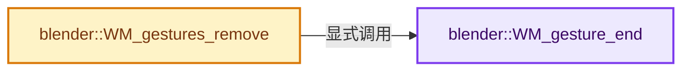
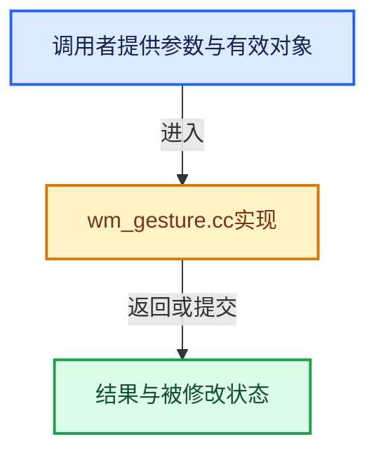

# 实现依赖专题：source/blender/windowmanager/intern/wm_gesture.cc

[实现依赖导航](../../../README.md) · [符号索引](../../../../00-课程指南/02-源码与提交索引/符号依赖与实现索引.md)

本专题从正文实际调用进入，集中保存共享实现。函数有稳定锚点，可从调用处直接跳到对应完整函数；递归与互相调用通过回链组织。

## 本文件的实现关系






## 完整成员与函数实现

<a id="f-f855c36ac68e4a44"></a>

### `blender::WM_gesture_end`

实现位置：[source/blender/windowmanager/intern/wm_gesture.cc](../../../../../../../../source/blender/windowmanager/intern/wm_gesture.cc) · L101—L108。

接口参数：

- `wmWindow *win`
- `wmGesture *gesture`

**教学注释版**

<!-- annotated:a7281971d63643 -->

```cpp
void WM_gesture_end(wmWindow *win, wmGesture *gesture)
{
  BLI_remlink(&win->runtime->gesture, gesture);
  // [讲解] MEM_delete_void：以原始存储释放约定调用当前后端。
  MEM_delete_void(gesture->customdata);
  WM_generic_user_data_free(&gesture->user_data);
  MEM_delete(gesture->edge_pan_data);
  MEM_delete(gesture);
}
```

<details>
<summary>核对原始源码：source/blender/windowmanager/intern/wm_gesture.cc · L101—L108</summary>

<!-- original:a7281971d63643:source/blender/windowmanager/intern/wm_gesture.cc:101:108 -->

```cpp
void WM_gesture_end(wmWindow *win, wmGesture *gesture)
{
  BLI_remlink(&win->runtime->gesture, gesture);
  MEM_delete_void(gesture->customdata);
  WM_generic_user_data_free(&gesture->user_data);
  MEM_delete(gesture->edge_pan_data);
  MEM_delete(gesture);
}
```

</details>

**继续追踪实现**

- `BLI_remlink` → [blender::BLI_remlink · L138](../../../01-BLI基础库/intern/listbase.cc.md#f-120d80f281ca4cb7)。
- `MEM_delete_void` → [MEM_delete_void · L647](../../../07-Intern运行时与平台/guardedalloc/MEM_guardedalloc.h.md#f-642896c7c62ff8b9)；[MEM_delete_void · L109](../../../07-Intern运行时与平台/guardedalloc/intern/mallocn.cc.md#f-9a07b26421f2bee6)。同名重载需按实参类型选择。
- `WM_generic_user_data_free` → [blender::WM_generic_user_data_free · L47](wm_utils.cc.md#f-3eb55123c40b8f45)。
- `MEM_delete` → [MEM_delete · L400](../../../07-Intern运行时与平台/guardedalloc/MEM_guardedalloc.h.md#f-9049ffdd1682887c)。

<a id="f-5030de55e4326345"></a>

### `blender::WM_gestures_remove`

实现位置：[source/blender/windowmanager/intern/wm_gesture.cc](../../../../../../../../source/blender/windowmanager/intern/wm_gesture.cc) · L117—L122。

接口参数：

- `wmWindow *win`

**教学注释版**

<!-- annotated:0d6e0e3198a8fc -->

```cpp
void WM_gestures_remove(wmWindow *win)
{
  while (win->runtime->gesture.first()) {
    WM_gesture_end(win, win->runtime->gesture.first());
  }
}
```

<details>
<summary>核对原始源码：source/blender/windowmanager/intern/wm_gesture.cc · L117—L122</summary>

<!-- original:0d6e0e3198a8fc:source/blender/windowmanager/intern/wm_gesture.cc:117:122 -->

```cpp
void WM_gestures_remove(wmWindow *win)
{
  while (win->runtime->gesture.first()) {
    WM_gesture_end(win, win->runtime->gesture.first());
  }
}
```

</details>

**继续追踪实现**

- `win->runtime->gesture.first` → [调用协议](../../../../00-课程指南/01-路线与规范/模板宏与动态分派协议.md)：接收对象类型依赖auto、返回值或模板实例；不按同名猜测目标。调用位置L119。
- `WM_gesture_end` → [blender::WM_gesture_end · L101](wm_gesture.cc.md#f-f855c36ac68e4a44)。
