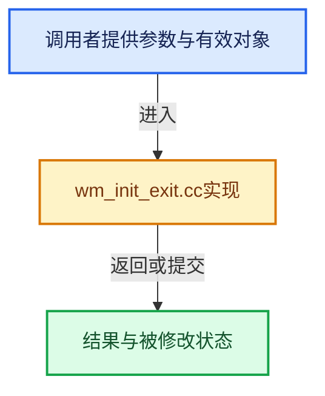

# 实现依赖专题：source/blender/windowmanager/intern/wm_init_exit.cc

[实现依赖导航](../../../README.md) · [符号索引](../../../../00-课程指南/02-源码与提交索引/符号依赖与实现索引.md)

本专题从正文实际调用进入，集中保存共享实现。函数有稳定锚点，可从调用处直接跳到对应完整函数；递归与互相调用通过回链组织。

## 本文件的实现关系





## 完整成员与函数实现

<a id="f-dda93bdd3cffe503"></a>

### `blender::WM_init_gpu_backend`

实现位置：[source/blender/windowmanager/intern/wm_init_exit.cc](../../../../../../../../source/blender/windowmanager/intern/wm_init_exit.cc) · L150—L153。

**教学注释版**

<!-- annotated:a33646346769f0 -->

```cpp
void WM_init_gpu_backend()
{
  GPU_backend_type_selection_detect();
}
```

<details>
<summary>核对原始源码：source/blender/windowmanager/intern/wm_init_exit.cc · L150—L153</summary>

<!-- original:a33646346769f0:source/blender/windowmanager/intern/wm_init_exit.cc:150:153 -->

```cpp
void WM_init_gpu_backend()
{
  GPU_backend_type_selection_detect();
}
```

</details>

**继续追踪实现**

- `GPU_backend_type_selection_detect` → [blender::GPU_backend_type_selection_detect · L479](../../gpu/intern/gpu_context.cc.md#f-c10e962c8300e624)。

<a id="f-06324089ff98ece2"></a>

### `blender::WM_init_gpu_offscreen`

实现位置：[source/blender/windowmanager/intern/wm_init_exit.cc](../../../../../../../../source/blender/windowmanager/intern/wm_init_exit.cc) · L155—L185。

**教学注释版**

<!-- annotated:75fb2f67b33bdb -->

```cpp
void WM_init_gpu_offscreen()
{
  /* Must be called only once. */
  BLI_assert(gpu_is_init == false);

  if (G.background) {
    /* Init on demand for background mode, already done for foreground mode. */
    WM_init_gpu_backend();

    /* Ghost is still not initialized elsewhere in background mode. */
    wm_ghost_init_background();
  }

  if (!GPU_backend_supported()) {
    return;
  }

  /* Needs to be first to have an OpenGL context bound. */
  DRW_gpu_context_create();

  GPU_init();

  if (G.debug & G_DEBUG_GPU_COMPILE_SHADERS) {
    GPU_shader_compile_static();
  }

  /* Some part of the code assumes no context is left bound. */
  DRW_gpu_context_disable_ex(true);

  gpu_is_init = true;
}
```

<details>
<summary>核对原始源码：source/blender/windowmanager/intern/wm_init_exit.cc · L155—L185</summary>

<!-- original:75fb2f67b33bdb:source/blender/windowmanager/intern/wm_init_exit.cc:155:185 -->

```cpp
void WM_init_gpu_offscreen()
{
  /* Must be called only once. */
  BLI_assert(gpu_is_init == false);

  if (G.background) {
    /* Init on demand for background mode, already done for foreground mode. */
    WM_init_gpu_backend();

    /* Ghost is still not initialized elsewhere in background mode. */
    wm_ghost_init_background();
  }

  if (!GPU_backend_supported()) {
    return;
  }

  /* Needs to be first to have an OpenGL context bound. */
  DRW_gpu_context_create();

  GPU_init();

  if (G.debug & G_DEBUG_GPU_COMPILE_SHADERS) {
    GPU_shader_compile_static();
  }

  /* Some part of the code assumes no context is left bound. */
  DRW_gpu_context_disable_ex(true);

  gpu_is_init = true;
}
```

</details>

**沿实际写入检查状态**

- `gpu_is_init = true;`

**继续追踪实现**

- `BLI_assert` → [BLI_assert · L48](../../../01-BLI基础库/BLI_assert.hh.md#m-57a88495704d)；[BLI_assert · L63](../../../01-BLI基础库/BLI_assert.hh.md#m-d07050020cb5)。宏定义由构建条件选择。
- `WM_init_gpu_backend` → [blender::WM_init_gpu_backend · L150](wm_init_exit.cc.md#f-dda93bdd3cffe503)。
- `wm_ghost_init_background` → [blender::wm_ghost_init_background · L2360](wm_window.cc.md#f-864081e28ff10c39)。
- `GPU_backend_supported` → [blender::GPU_backend_supported · L556](../../gpu/intern/gpu_context.cc.md#f-4a415245c3bf7368)。
- `DRW_gpu_context_create` → [blender::DRW_gpu_context_create · L168](../../draw/intern/draw_gpu_context.cc.md#f-691f1687a17e9c60)。
- `GPU_init` → [blender::GPU_init · L27](../../gpu/intern/gpu_init_exit.cc.md#f-b606151a4976aec8)。
- `GPU_shader_compile_static` → [blender::GPU_shader_compile_static · L370](../../gpu/intern/gpu_shader.cc.md#f-2357045ae209ac45)。
- `DRW_gpu_context_disable_ex` → [blender::DRW_gpu_context_disable_ex · L206](../../draw/intern/draw_gpu_context.cc.md#f-f696f3fc7280fe49)。
