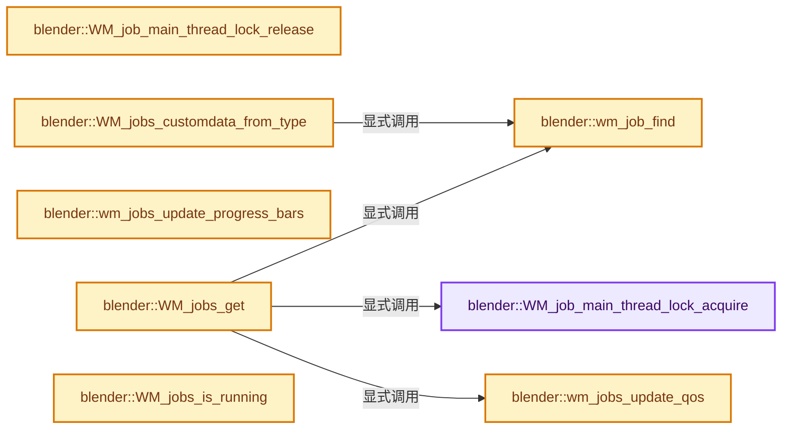
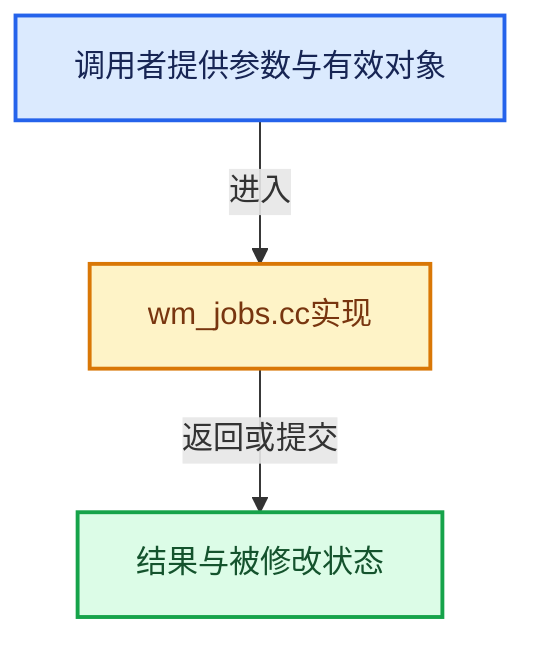

# 实现依赖专题：source/blender/windowmanager/intern/wm_jobs.cc

[实现依赖导航](../../../README.md) · [符号索引](../../../../00-课程指南/02-源码与提交索引/符号依赖与实现索引.md)

本专题从正文实际调用进入，集中保存共享实现。函数有稳定锚点，可从调用处直接跳到对应完整函数；递归与互相调用通过回链组织。

## 本文件的实现关系






## 完整成员与函数实现

<a id="f-8b4106d318b6f054"></a>

### `blender::WM_job_main_thread_lock_acquire`

实现位置：[source/blender/windowmanager/intern/wm_jobs.cc](../../../../../../../../source/blender/windowmanager/intern/wm_jobs.cc) · L162—L165。

接口参数：

- `wmJob *wm_job`

**教学注释版**

<!-- annotated:520b7d7e60516c -->

```cpp
void WM_job_main_thread_lock_acquire(wmJob *wm_job)
{
  BLI_ticket_mutex_lock(wm_job->main_thread_mutex);
}
```

<details>
<summary>核对原始源码：source/blender/windowmanager/intern/wm_jobs.cc · L162—L165</summary>

<!-- original:520b7d7e60516c:source/blender/windowmanager/intern/wm_jobs.cc:162:165 -->

```cpp
void WM_job_main_thread_lock_acquire(wmJob *wm_job)
{
  BLI_ticket_mutex_lock(wm_job->main_thread_mutex);
}
```

</details>

**继续追踪实现**

- `BLI_ticket_mutex_lock` → [BLI_ticket_mutex_lock · L555](../../../01-BLI基础库/intern/threads.cc.md#f-0636d5a04033b13b)。

<a id="f-898b929be6a50e1c"></a>

### `blender::WM_job_main_thread_lock_release`

实现位置：[source/blender/windowmanager/intern/wm_jobs.cc](../../../../../../../../source/blender/windowmanager/intern/wm_jobs.cc) · L167—L170。

接口参数：

- `wmJob *wm_job`

**教学注释版**

<!-- annotated:ce46ce9fe3ade0 -->

```cpp
void WM_job_main_thread_lock_release(wmJob *wm_job)
{
  BLI_ticket_mutex_unlock(wm_job->main_thread_mutex);
}
```

<details>
<summary>核对原始源码：source/blender/windowmanager/intern/wm_jobs.cc · L167—L170</summary>

<!-- original:ce46ce9fe3ade0:source/blender/windowmanager/intern/wm_jobs.cc:167:170 -->

```cpp
void WM_job_main_thread_lock_release(wmJob *wm_job)
{
  BLI_ticket_mutex_unlock(wm_job->main_thread_mutex);
}
```

</details>

**继续追踪实现**

- `BLI_ticket_mutex_unlock` → [BLI_ticket_mutex_unlock · L565](../../../01-BLI基础库/intern/threads.cc.md#f-75799cbeb37c97e5)。

<a id="f-7dc3b49b6d4a4ce5"></a>

### `blender::wm_jobs_update_qos`

实现位置：[source/blender/windowmanager/intern/wm_jobs.cc](../../../../../../../../source/blender/windowmanager/intern/wm_jobs.cc) · L180—L195。

接口参数：

- `const wmWindowManager *wm`

**教学注释版**

<!-- annotated:3f3435d8968b5e -->

```cpp
static void wm_jobs_update_qos(const wmWindowManager *wm)
{
  /* A QoS API is currently only available for Windows. */
#if OS_WINDOWS
  for (wmJob &wm_job : wm->runtime->jobs) {
    if (wm_job.flag & WM_JOB_PRIORITY) {
      BLI_windows_process_set_qos(QoSMode::HIGH, QoSPrecedence::JOB);
      return;
    }
  }

  BLI_windows_process_set_qos(QoSMode::DEFAULT, QoSPrecedence::JOB);
#else
  UNUSED_VARS(wm);
#endif
}
```

<details>
<summary>核对原始源码：source/blender/windowmanager/intern/wm_jobs.cc · L180—L195</summary>

<!-- original:3f3435d8968b5e:source/blender/windowmanager/intern/wm_jobs.cc:180:195 -->

```cpp
static void wm_jobs_update_qos(const wmWindowManager *wm)
{
  /* A QoS API is currently only available for Windows. */
#if OS_WINDOWS
  for (wmJob &wm_job : wm->runtime->jobs) {
    if (wm_job.flag & WM_JOB_PRIORITY) {
      BLI_windows_process_set_qos(QoSMode::HIGH, QoSPrecedence::JOB);
      return;
    }
  }

  BLI_windows_process_set_qos(QoSMode::DEFAULT, QoSPrecedence::JOB);
#else
  UNUSED_VARS(wm);
#endif
}
```

</details>

**继续追踪实现**

- `BLI_windows_process_set_qos` → [blender::BLI_windows_process_set_qos · L589](../../../01-BLI基础库/intern/winstuff.cc.md#f-b763684d36142e21)。
- `UNUSED_VARS` → [UNUSED_VARS · L522](../../../01-BLI基础库/BLI_utildefines.hh.md#m-013582537634)；[UNUSED_VARS · L41](../../gpu/GPU_shader_shared_utils.hh.md#m-05d9d7a33da0)；[UNUSED_VARS · L62](../../gpu/GPU_shader_shared_utils.hh.md#m-e12c683a4aca)。宏定义由构建条件选择。

<a id="f-ea754b6ce013a3d5"></a>

### `blender::wm_job_find`

实现位置：[source/blender/windowmanager/intern/wm_jobs.cc](../../../../../../../../source/blender/windowmanager/intern/wm_jobs.cc) · L199—L224。

接口参数：

- `const wmWindowManager *wm`
- `const void *owner`
- `const eWM_JobType job_type`

**教学注释版**

<!-- annotated:c3167fb2a29184 -->

```cpp
static wmJob *wm_job_find(const wmWindowManager *wm, const void *owner, const eWM_JobType job_type)
{
  if (owner && (job_type != WM_JOB_TYPE_ANY)) {
    for (wmJob &wm_job : wm->runtime->jobs) {
      if (wm_job.owner == owner && wm_job.job_type == job_type) {
        return &wm_job;
      }
    }
  }
  else if (owner) {
    for (wmJob &wm_job : wm->runtime->jobs) {
      if (wm_job.owner == owner) {
        return &wm_job;
      }
    }
  }
  else if (job_type != WM_JOB_TYPE_ANY) {
    for (wmJob &wm_job : wm->runtime->jobs) {
      if (wm_job.job_type == job_type) {
        return &wm_job;
      }
    }
  }

  return nullptr;
}
```

<details>
<summary>核对原始源码：source/blender/windowmanager/intern/wm_jobs.cc · L199—L224</summary>

<!-- original:c3167fb2a29184:source/blender/windowmanager/intern/wm_jobs.cc:199:224 -->

```cpp
static wmJob *wm_job_find(const wmWindowManager *wm, const void *owner, const eWM_JobType job_type)
{
  if (owner && (job_type != WM_JOB_TYPE_ANY)) {
    for (wmJob &wm_job : wm->runtime->jobs) {
      if (wm_job.owner == owner && wm_job.job_type == job_type) {
        return &wm_job;
      }
    }
  }
  else if (owner) {
    for (wmJob &wm_job : wm->runtime->jobs) {
      if (wm_job.owner == owner) {
        return &wm_job;
      }
    }
  }
  else if (job_type != WM_JOB_TYPE_ANY) {
    for (wmJob &wm_job : wm->runtime->jobs) {
      if (wm_job.job_type == job_type) {
        return &wm_job;
      }
    }
  }

  return nullptr;
}
```

</details>

**结果出口**

- `return &wm_job;`
- `return nullptr;`

**继续追踪实现**

本实现没有需要继续展开的显式调用；检查返回表达式、对象转换和调用者前置条件。

<a id="f-c8729db4ef26b0e7"></a>

### `blender::WM_jobs_get`

实现位置：[source/blender/windowmanager/intern/wm_jobs.cc](../../../../../../../../source/blender/windowmanager/intern/wm_jobs.cc) · L228—L262。

接口参数：

- `wmWindowManager *wm`
- `wmWindow *win`
- `const void *owner`
- `const char *name`
- `const eWM_JobFlag flag`
- `const eWM_JobType job_type`

**教学注释版**

<!-- annotated:d11e1435ecbe35 -->

```cpp
wmJob *WM_jobs_get(wmWindowManager *wm,
                   wmWindow *win,
                   const void *owner,
                   const char *name,
                   const eWM_JobFlag flag,
                   const eWM_JobType job_type)
{
  wmJob *wm_job = wm_job_find(wm, owner, job_type);

  if (wm_job == nullptr) {
    wm_job = MEM_new_zeroed<wmJob>("new job");

    BLI_addtail(&wm->runtime->jobs, wm_job);
    wm_job->win = win;
    wm_job->owner = owner;
    wm_job->flag = flag;
    wm_job->job_type = job_type;
    STRNCPY(wm_job->name, name);

    wm_job->main_thread_mutex = BLI_ticket_mutex_alloc();
    WM_job_main_thread_lock_acquire(wm_job);

    wm_job->worker_status.reports = MEM_new<ReportList>(__func__);
    BKE_reports_init(wm_job->worker_status.reports, RPT_STORE | RPT_PRINT);
    BKE_report_print_level_set(wm_job->worker_status.reports, RPT_WARNING);

    wm_jobs_update_qos(wm);
  }
  /* Else: a running job, be careful. */

  /* Prevent creating a job with an invalid type. */
  BLI_assert(wm_job->job_type != WM_JOB_TYPE_ANY);

  return wm_job;
}
```

<details>
<summary>核对原始源码：source/blender/windowmanager/intern/wm_jobs.cc · L228—L262</summary>

<!-- original:d11e1435ecbe35:source/blender/windowmanager/intern/wm_jobs.cc:228:262 -->

```cpp
wmJob *WM_jobs_get(wmWindowManager *wm,
                   wmWindow *win,
                   const void *owner,
                   const char *name,
                   const eWM_JobFlag flag,
                   const eWM_JobType job_type)
{
  wmJob *wm_job = wm_job_find(wm, owner, job_type);

  if (wm_job == nullptr) {
    wm_job = MEM_new_zeroed<wmJob>("new job");

    BLI_addtail(&wm->runtime->jobs, wm_job);
    wm_job->win = win;
    wm_job->owner = owner;
    wm_job->flag = flag;
    wm_job->job_type = job_type;
    STRNCPY(wm_job->name, name);

    wm_job->main_thread_mutex = BLI_ticket_mutex_alloc();
    WM_job_main_thread_lock_acquire(wm_job);

    wm_job->worker_status.reports = MEM_new<ReportList>(__func__);
    BKE_reports_init(wm_job->worker_status.reports, RPT_STORE | RPT_PRINT);
    BKE_report_print_level_set(wm_job->worker_status.reports, RPT_WARNING);

    wm_jobs_update_qos(wm);
  }
  /* Else: a running job, be careful. */

  /* Prevent creating a job with an invalid type. */
  BLI_assert(wm_job->job_type != WM_JOB_TYPE_ANY);

  return wm_job;
}
```

</details>

**沿实际写入检查状态**

- `wm_job = MEM_new_zeroed<wmJob>("new job");`
- `wm_job->win = win;`
- `wm_job->owner = owner;`
- `wm_job->flag = flag;`
- `wm_job->job_type = job_type;`
- `wm_job->main_thread_mutex = BLI_ticket_mutex_alloc();`
- `wm_job->worker_status.reports = MEM_new<ReportList>(__func__);`

**结果出口**

- `return wm_job;`

**继续追踪实现**

- `wm_job_find` → [blender::wm_job_find · L199](wm_jobs.cc.md#f-ea754b6ce013a3d5)。
- `MEM_new_zeroed<wmJob>` → [MEM_new_zeroed · L550](../../../07-Intern运行时与平台/guardedalloc/MEM_guardedalloc.h.md#f-eeb1e2a7f57dd231)；[MEM_new_zeroed · L114](../../../07-Intern运行时与平台/guardedalloc/intern/mallocn.cc.md#f-e04cf01c64c8b180)。同名重载需按实参类型选择。
- `BLI_addtail` → [blender::BLI_addtail · L118](../../../01-BLI基础库/intern/listbase.cc.md#f-4fb027713fa3115b)。
- `STRNCPY` → [blender::STRNCPY · L690](../../../01-BLI基础库/BLI_string.hh.md#f-6b2d861724026be6)。
- `BLI_ticket_mutex_alloc` → [BLI_ticket_mutex_alloc · L513](../../../01-BLI基础库/intern/threads.cc.md#f-a19b42cf96696ce4)。
- `WM_job_main_thread_lock_acquire` → [blender::WM_job_main_thread_lock_acquire · L162](wm_jobs.cc.md#f-8b4106d318b6f054)。
- `MEM_new<ReportList>` → [MEM_new · L351](../../../07-Intern运行时与平台/guardedalloc/MEM_guardedalloc.h.md#f-115f9b6784f89912)。
- `BKE_reports_init` → [blender::BKE_reports_init · L91](../../../02-BKE几何与数据/intern/report.cc.md#f-b8685fdb2b35bb7d)。
- `BKE_report_print_level_set` → [blender::BKE_report_print_level_set · L276](../../../02-BKE几何与数据/intern/report.cc.md#f-8b074095e449900c)。
- `wm_jobs_update_qos` → [blender::wm_jobs_update_qos · L180](wm_jobs.cc.md#f-7dc3b49b6d4a4ce5)。
- `BLI_assert` → [BLI_assert · L48](../../../01-BLI基础库/BLI_assert.hh.md#m-57a88495704d)；[BLI_assert · L63](../../../01-BLI基础库/BLI_assert.hh.md#m-d07050020cb5)。宏定义由构建条件选择。

<a id="f-8adc603f7fe031d1"></a>

### `blender::wm_jobs_update_progress_bars`

实现位置：[source/blender/windowmanager/intern/wm_jobs.cc](../../../../../../../../source/blender/windowmanager/intern/wm_jobs.cc) · L295—L323。

接口参数：

- `wmWindowManager *wm`

**教学注释版**

<!-- annotated:54ae4a8b680066 -->

```cpp
static void wm_jobs_update_progress_bars(wmWindowManager *wm)
{
  float total_progress = 0.0f;
  float jobs_progress = 0;

  for (wmJob &wm_job : wm->runtime->jobs) {
    if (wm_job.threads.first() && !wm_job.ready) {
      if (wm_job.flag & WM_JOB_PROGRESS) {
        /* Accumulate global progress for running jobs. */
        jobs_progress++;
        total_progress += wm_job.worker_status.progress;
      }
    }
  }

  /* If there are running jobs, set the global progress indicator. */
  if (jobs_progress > 0) {
    float progress = total_progress / jobs_progress;

    for (wmWindow &win : wm->windows) {
      WM_progress_set(&win, progress);
    }
  }
  else {
    for (wmWindow &win : wm->windows) {
      WM_progress_clear(&win);
    }
  }
}
```

<details>
<summary>核对原始源码：source/blender/windowmanager/intern/wm_jobs.cc · L295—L323</summary>

<!-- original:54ae4a8b680066:source/blender/windowmanager/intern/wm_jobs.cc:295:323 -->

```cpp
static void wm_jobs_update_progress_bars(wmWindowManager *wm)
{
  float total_progress = 0.0f;
  float jobs_progress = 0;

  for (wmJob &wm_job : wm->runtime->jobs) {
    if (wm_job.threads.first() && !wm_job.ready) {
      if (wm_job.flag & WM_JOB_PROGRESS) {
        /* Accumulate global progress for running jobs. */
        jobs_progress++;
        total_progress += wm_job.worker_status.progress;
      }
    }
  }

  /* If there are running jobs, set the global progress indicator. */
  if (jobs_progress > 0) {
    float progress = total_progress / jobs_progress;

    for (wmWindow &win : wm->windows) {
      WM_progress_set(&win, progress);
    }
  }
  else {
    for (wmWindow &win : wm->windows) {
      WM_progress_clear(&win);
    }
  }
}
```

</details>

**沿实际写入检查状态**

- `total_progress += wm_job.worker_status.progress;`

**继续追踪实现**

- `wm_job.threads.first` → [调用协议](../../../../00-课程指南/01-路线与规范/模板宏与动态分派协议.md)：接收对象类型依赖auto、返回值或模板实例；不按同名猜测目标。调用位置L301。
- `WM_progress_set` → [blender::WM_progress_set · L2879](wm_window.cc.md#f-3cf00e8fb010123f)。
- `WM_progress_clear` → [blender::WM_progress_clear · L2888](wm_window.cc.md#f-2f18b872894f6ccc)。

<a id="f-e017aeba181baaac"></a>

### `blender::WM_jobs_customdata_from_type`

实现位置：[source/blender/windowmanager/intern/wm_jobs.cc](../../../../../../../../source/blender/windowmanager/intern/wm_jobs.cc) · L347—L356。

接口参数：

- `wmWindowManager *wm`
- `const void *owner`
- `int job_type`

**教学注释版**

<!-- annotated:7530be55f599df -->

```cpp
void *WM_jobs_customdata_from_type(wmWindowManager *wm, const void *owner, int job_type)
{
  wmJob *wm_job = wm_job_find(wm, owner, eWM_JobType(job_type));

  if (wm_job) {
    return WM_jobs_customdata_get(wm_job);
  }

  return nullptr;
}
```

<details>
<summary>核对原始源码：source/blender/windowmanager/intern/wm_jobs.cc · L347—L356</summary>

<!-- original:7530be55f599df:source/blender/windowmanager/intern/wm_jobs.cc:347:356 -->

```cpp
void *WM_jobs_customdata_from_type(wmWindowManager *wm, const void *owner, int job_type)
{
  wmJob *wm_job = wm_job_find(wm, owner, eWM_JobType(job_type));

  if (wm_job) {
    return WM_jobs_customdata_get(wm_job);
  }

  return nullptr;
}
```

</details>

**结果出口**

- `return WM_jobs_customdata_get(wm_job);`
- `return nullptr;`

**继续追踪实现**

- `wm_job_find` → [blender::wm_job_find · L199](wm_jobs.cc.md#f-ea754b6ce013a3d5)。
- `eWM_JobType` → [blender::eWM_JobType](../WM_api.hh.md#t-f37c194e0a7d)。
- `WM_jobs_customdata_get` → [blender::WM_jobs_customdata_get · L369](wm_jobs.cc.md#f-6f6d609ff16d5b9b)。

<a id="f-430b2c708925708a"></a>

### `blender::WM_jobs_is_running`

实现位置：[source/blender/windowmanager/intern/wm_jobs.cc](../../../../../../../../source/blender/windowmanager/intern/wm_jobs.cc) · L358—L361。

接口参数：

- `const wmJob *wm_job`

**教学注释版**

<!-- annotated:fca0815750b762 -->

```cpp
bool WM_jobs_is_running(const wmJob *wm_job)
{
  return wm_job->running;
}
```

<details>
<summary>核对原始源码：source/blender/windowmanager/intern/wm_jobs.cc · L358—L361</summary>

<!-- original:fca0815750b762:source/blender/windowmanager/intern/wm_jobs.cc:358:361 -->

```cpp
bool WM_jobs_is_running(const wmJob *wm_job)
{
  return wm_job->running;
}
```

</details>

**结果出口**

- `return wm_job->running;`

**继续追踪实现**

本实现没有需要继续展开的显式调用；检查返回表达式、对象转换和调用者前置条件。

<a id="f-6f6d609ff16d5b9b"></a>

### `blender::WM_jobs_customdata_get`

实现位置：[source/blender/windowmanager/intern/wm_jobs.cc](../../../../../../../../source/blender/windowmanager/intern/wm_jobs.cc) · L369—L375。

接口参数：

- `wmJob *wm_job`

**教学注释版**

<!-- annotated:79e71493ebb18c -->

```cpp
void *WM_jobs_customdata_get(wmJob *wm_job)
{
  if (!wm_job->customdata) {
    return wm_job->run_customdata;
  }
  return wm_job->customdata;
}
```

<details>
<summary>核对原始源码：source/blender/windowmanager/intern/wm_jobs.cc · L369—L375</summary>

<!-- original:79e71493ebb18c:source/blender/windowmanager/intern/wm_jobs.cc:369:375 -->

```cpp
void *WM_jobs_customdata_get(wmJob *wm_job)
{
  if (!wm_job->customdata) {
    return wm_job->run_customdata;
  }
  return wm_job->customdata;
}
```

</details>

**结果出口**

- `return wm_job->run_customdata;`
- `return wm_job->customdata;`

**继续追踪实现**

本实现没有需要继续展开的显式调用；检查返回表达式、对象转换和调用者前置条件。

<a id="f-129383343a19f471"></a>

### `blender::WM_jobs_customdata_set`

实现位置：[source/blender/windowmanager/intern/wm_jobs.cc](../../../../../../../../source/blender/windowmanager/intern/wm_jobs.cc) · L377—L391。

接口参数：

- `wmJob *wm_job`
- `void *customdata`
- `void (*free)(void *customdata)`
- `void *customdata`

**教学注释版**

<!-- annotated:ec9bfa26d0b691 -->

```cpp
void WM_jobs_customdata_set(wmJob *wm_job, void *customdata, void (*free)(void *customdata))
{
  /* Pending job? just free. */
  if (wm_job->customdata) {
    // [讲解] wm_job->free：这个边界按实际表达式及所属类型核对参数、返回值、寿命与失败行为。这里提供接口入口，不声称已解释该第三方版本的内部实现。
    wm_job->free(wm_job->customdata);
  }

  wm_job->customdata = customdata;
  wm_job->free = free;

  if (wm_job->running) {
    /* Signal job to end. */
    wm_job->worker_status.stop = true;
  }
}
```

<details>
<summary>核对原始源码：source/blender/windowmanager/intern/wm_jobs.cc · L377—L391</summary>

<!-- original:ec9bfa26d0b691:source/blender/windowmanager/intern/wm_jobs.cc:377:391 -->

```cpp
void WM_jobs_customdata_set(wmJob *wm_job, void *customdata, void (*free)(void *customdata))
{
  /* Pending job? just free. */
  if (wm_job->customdata) {
    wm_job->free(wm_job->customdata);
  }

  wm_job->customdata = customdata;
  wm_job->free = free;

  if (wm_job->running) {
    /* Signal job to end. */
    wm_job->worker_status.stop = true;
  }
}
```

</details>

**沿实际写入检查状态**

- `wm_job->customdata = customdata;`
- `wm_job->free = free;`
- `wm_job->worker_status.stop = true;`

**继续追踪实现**

- `wm_job->free` → [外部契约](https://eel.is/c++draft/)：这个边界按实际表达式及所属类型核对参数、返回值、寿命与失败行为。这里提供接口入口，不声称已解释该第三方版本的内部实现。

<a id="f-98d85930af2bed33"></a>

### `blender::WM_jobs_timer`

实现位置：[source/blender/windowmanager/intern/wm_jobs.cc](../../../../../../../../source/blender/windowmanager/intern/wm_jobs.cc) · L393—L400。

接口参数：

- `wmJob *wm_job`
- `double time_step`
- `uint note`
- `uint endnote`
- `void (*timer_step)(void *)`
- `void *`

**教学注释版**

<!-- annotated:9aac27a14ff8ad -->

```cpp
void WM_jobs_timer(
    wmJob *wm_job, double time_step, uint note, uint endnote, void (*timer_step)(void *))
{
  wm_job->time_step = time_step;
  wm_job->note = note;
  wm_job->endnote = endnote;
  wm_job->timer_step = timer_step;
}
```

<details>
<summary>核对原始源码：source/blender/windowmanager/intern/wm_jobs.cc · L393—L400</summary>

<!-- original:9aac27a14ff8ad:source/blender/windowmanager/intern/wm_jobs.cc:393:400 -->

```cpp
void WM_jobs_timer(
    wmJob *wm_job, double time_step, uint note, uint endnote, void (*timer_step)(void *))
{
  wm_job->time_step = time_step;
  wm_job->note = note;
  wm_job->endnote = endnote;
  wm_job->timer_step = timer_step;
}
```

</details>

**沿实际写入检查状态**

- `wm_job->time_step = time_step;`
- `wm_job->note = note;`
- `wm_job->endnote = endnote;`
- `wm_job->timer_step = timer_step;`

**继续追踪实现**

本实现没有需要继续展开的显式调用；检查返回表达式、对象转换和调用者前置条件。

<a id="f-34999dbc42367b69"></a>

### `blender::WM_jobs_delay_start`

实现位置：[source/blender/windowmanager/intern/wm_jobs.cc](../../../../../../../../source/blender/windowmanager/intern/wm_jobs.cc) · L402—L405。

接口参数：

- `wmJob *wm_job`
- `double delay_time`

**教学注释版**

<!-- annotated:50ece1a46bc45a -->

```cpp
void WM_jobs_delay_start(wmJob *wm_job, double delay_time)
{
  wm_job->start_delay_time = delay_time;
}
```

<details>
<summary>核对原始源码：source/blender/windowmanager/intern/wm_jobs.cc · L402—L405</summary>

<!-- original:50ece1a46bc45a:source/blender/windowmanager/intern/wm_jobs.cc:402:405 -->

```cpp
void WM_jobs_delay_start(wmJob *wm_job, double delay_time)
{
  wm_job->start_delay_time = delay_time;
}
```

</details>

**沿实际写入检查状态**

- `wm_job->start_delay_time = delay_time;`

**继续追踪实现**

本实现没有需要继续展开的显式调用；检查返回表达式、对象转换和调用者前置条件。

<a id="f-f8d54fc5ad0ce02c"></a>

### `blender::WM_jobs_callbacks`

实现位置：[source/blender/windowmanager/intern/wm_jobs.cc](../../../../../../../../source/blender/windowmanager/intern/wm_jobs.cc) · L407—L414。

接口参数：

- `wmJob *wm_job`
- `wm_jobs_start_callback startjob`
- `void (*initjob)(void *)`
- `void *`
- `void (*update)(void *)`
- `void *`
- `void (*endjob)(void *)`
- `void *`

**教学注释版**

<!-- annotated:dcbbcb4a040bca -->

```cpp
void WM_jobs_callbacks(wmJob *wm_job,
                       wm_jobs_start_callback startjob,
                       void (*initjob)(void *),
                       void (*update)(void *),
                       void (*endjob)(void *))
{
  WM_jobs_callbacks_ex(wm_job, startjob, initjob, update, endjob, nullptr, nullptr);
}
```

<details>
<summary>核对原始源码：source/blender/windowmanager/intern/wm_jobs.cc · L407—L414</summary>

<!-- original:dcbbcb4a040bca:source/blender/windowmanager/intern/wm_jobs.cc:407:414 -->

```cpp
void WM_jobs_callbacks(wmJob *wm_job,
                       wm_jobs_start_callback startjob,
                       void (*initjob)(void *),
                       void (*update)(void *),
                       void (*endjob)(void *))
{
  WM_jobs_callbacks_ex(wm_job, startjob, initjob, update, endjob, nullptr, nullptr);
}
```

</details>

**继续追踪实现**

- `WM_jobs_callbacks_ex` → [blender::WM_jobs_callbacks_ex · L416](wm_jobs.cc.md#f-07a8f146b38816e9)。

<a id="f-07a8f146b38816e9"></a>

### `blender::WM_jobs_callbacks_ex`

实现位置：[source/blender/windowmanager/intern/wm_jobs.cc](../../../../../../../../source/blender/windowmanager/intern/wm_jobs.cc) · L416—L430。

接口参数：

- `wmJob *wm_job`
- `wm_jobs_start_callback startjob`
- `void (*initjob)(void *)`
- `void *`
- `void (*update)(void *)`
- `void *`
- `void (*endjob)(void *)`
- `void *`
- `void (*completed)(void *)`
- `void *`
- `void (*canceled)(void *)`
- `void *`

**教学注释版**

<!-- annotated:2af63bc9b23336 -->

```cpp
void WM_jobs_callbacks_ex(wmJob *wm_job,
                          wm_jobs_start_callback startjob,
                          void (*initjob)(void *),
                          void (*update)(void *),
                          void (*endjob)(void *),
                          void (*completed)(void *),
                          void (*canceled)(void *))
{
  wm_job->startjob = startjob;
  wm_job->initjob = initjob;
  wm_job->update = update;
  wm_job->endjob = endjob;
  wm_job->completed = completed;
  wm_job->canceled = canceled;
}
```

<details>
<summary>核对原始源码：source/blender/windowmanager/intern/wm_jobs.cc · L416—L430</summary>

<!-- original:2af63bc9b23336:source/blender/windowmanager/intern/wm_jobs.cc:416:430 -->

```cpp
void WM_jobs_callbacks_ex(wmJob *wm_job,
                          wm_jobs_start_callback startjob,
                          void (*initjob)(void *),
                          void (*update)(void *),
                          void (*endjob)(void *),
                          void (*completed)(void *),
                          void (*canceled)(void *))
{
  wm_job->startjob = startjob;
  wm_job->initjob = initjob;
  wm_job->update = update;
  wm_job->endjob = endjob;
  wm_job->completed = completed;
  wm_job->canceled = canceled;
}
```

</details>

**沿实际写入检查状态**

- `wm_job->startjob = startjob;`
- `wm_job->initjob = initjob;`
- `wm_job->update = update;`
- `wm_job->endjob = endjob;`
- `wm_job->completed = completed;`
- `wm_job->canceled = canceled;`

**继续追踪实现**

本实现没有需要继续展开的显式调用；检查返回表达式、对象转换和调用者前置条件。

<a id="f-b86a541f41961f56"></a>

### `blender::wm_jobs_reports_update`

实现位置：[source/blender/windowmanager/intern/wm_jobs.cc](../../../../../../../../source/blender/windowmanager/intern/wm_jobs.cc) · L432—L435。

接口参数：

- `wmWindowManager *wm`
- `wmJob *wm_job`

**教学注释版**

<!-- annotated:c9765166d3198d -->

```cpp
static void wm_jobs_reports_update(wmWindowManager *wm, wmJob *wm_job)
{
  WM_reports_from_reports_move(wm, wm_job->worker_status.reports);
}
```

<details>
<summary>核对原始源码：source/blender/windowmanager/intern/wm_jobs.cc · L432—L435</summary>

<!-- original:c9765166d3198d:source/blender/windowmanager/intern/wm_jobs.cc:432:435 -->

```cpp
static void wm_jobs_reports_update(wmWindowManager *wm, wmJob *wm_job)
{
  WM_reports_from_reports_move(wm, wm_job->worker_status.reports);
}
```

</details>

**继续追踪实现**

- `WM_reports_from_reports_move` → [blender::WM_reports_from_reports_move · L1039](wm_event_system.cc.md#f-da880e41265cdbff)。

<a id="f-541c72c3934c4347"></a>

### `blender::wm_jobs_test_suspend_stop`

实现位置：[source/blender/windowmanager/intern/wm_jobs.cc](../../../../../../../../source/blender/windowmanager/intern/wm_jobs.cc) · L448—L496。

接口参数：

- `wmWindowManager *wm`
- `wmJob *test`

**教学注释版**

<!-- annotated:2bdd9301dc7436 -->

```cpp
static void wm_jobs_test_suspend_stop(wmWindowManager *wm, wmJob *test)
{
  bool suspend = false;

  /* Job added with suspend flag, we wait 1 timer step before activating it. */
  if (test->start_delay_time > 0.0) {
    suspend = true;
    test->start_delay_time = 0.0;
  }
  else {
    /* Check other jobs. */
    for (wmJob &wm_job : wm->runtime->jobs) {
      /* Obvious case, no test needed. */
      if (&wm_job == test || !wm_job.running) {
        continue;
      }

      /* If new job is not render, then check for same job type. */
      if (0 == (test->flag & WM_JOB_EXCL_RENDER)) {
        if (wm_job.job_type != test->job_type) {
          continue;
        }
      }

      /* If new job is render, any render job should be stopped. */
      if (test->flag & WM_JOB_EXCL_RENDER) {
        if (0 == (wm_job.flag & WM_JOB_EXCL_RENDER)) {
          continue;
        }
      }

      suspend = true;

      /* If this job has higher priority, stop others. */
      if (test->flag & WM_JOB_PRIORITY) {
        wm_job.worker_status.stop = true;
        // printf("job stopped: %s\n", wm_job->name);
      }
    }
  }

  /* Possible suspend ourselves, waiting for other jobs, or de-suspend. */
  test->suspended = suspend;
#if 0
  if (suspend) {
    printf("job suspended: %s\n", test->name);
  }
#endif
}
```

<details>
<summary>核对原始源码：source/blender/windowmanager/intern/wm_jobs.cc · L448—L496</summary>

<!-- original:2bdd9301dc7436:source/blender/windowmanager/intern/wm_jobs.cc:448:496 -->

```cpp
static void wm_jobs_test_suspend_stop(wmWindowManager *wm, wmJob *test)
{
  bool suspend = false;

  /* Job added with suspend flag, we wait 1 timer step before activating it. */
  if (test->start_delay_time > 0.0) {
    suspend = true;
    test->start_delay_time = 0.0;
  }
  else {
    /* Check other jobs. */
    for (wmJob &wm_job : wm->runtime->jobs) {
      /* Obvious case, no test needed. */
      if (&wm_job == test || !wm_job.running) {
        continue;
      }

      /* If new job is not render, then check for same job type. */
      if (0 == (test->flag & WM_JOB_EXCL_RENDER)) {
        if (wm_job.job_type != test->job_type) {
          continue;
        }
      }

      /* If new job is render, any render job should be stopped. */
      if (test->flag & WM_JOB_EXCL_RENDER) {
        if (0 == (wm_job.flag & WM_JOB_EXCL_RENDER)) {
          continue;
        }
      }

      suspend = true;

      /* If this job has higher priority, stop others. */
      if (test->flag & WM_JOB_PRIORITY) {
        wm_job.worker_status.stop = true;
        // printf("job stopped: %s\n", wm_job->name);
      }
    }
  }

  /* Possible suspend ourselves, waiting for other jobs, or de-suspend. */
  test->suspended = suspend;
#if 0
  if (suspend) {
    printf("job suspended: %s\n", test->name);
  }
#endif
}
```

</details>

**沿实际写入检查状态**

- `suspend = true;`
- `test->start_delay_time = 0.0;`
- `wm_job.worker_status.stop = true;`
- `test->suspended = suspend;`

**继续追踪实现**

- `printf` → [外部契约](https://eel.is/c++draft/)：这个边界按实际表达式及所属类型核对参数、返回值、寿命与失败行为。这里提供接口入口，不声称已解释该第三方版本的内部实现。

<a id="f-718e40aed5c7c087"></a>

### `blender::WM_jobs_start`

实现位置：[source/blender/windowmanager/intern/wm_jobs.cc](../../../../../../../../source/blender/windowmanager/intern/wm_jobs.cc) · L498—L550。

接口参数：

- `wmWindowManager *wm`
- `wmJob *wm_job`

**教学注释版**

<!-- annotated:70f25abb4a9b72 -->

```cpp
void WM_jobs_start(wmWindowManager *wm, wmJob *wm_job)
{
  if (wm_job->running) {
    /* Signal job to end and restart. */
    wm_job->worker_status.stop = true;
    // printf("job started a running job, ending... %s\n", wm_job->name);
  }
  else {

    if (wm_job->customdata && wm_job->startjob) {
      const double time_step = (wm_job->start_delay_time > 0.0) ? wm_job->start_delay_time :
                                                                  wm_job->time_step;

      wm_jobs_test_suspend_stop(wm, wm_job);

      if (wm_job->suspended == false) {
        /* Copy to ensure proper free in end. */
        wm_job->run_customdata = wm_job->customdata;
        wm_job->run_free = wm_job->free;
        wm_job->free = nullptr;
        wm_job->customdata = nullptr;
        wm_job->running = true;

        if (wm_job->initjob) {
          wm_job->initjob(wm_job->run_customdata);
        }

        wm_job->worker_status.stop = false;
        wm_job->ready = false;
        wm_job->worker_status.progress = 0.0;

        // printf("job started: %s\n", wm_job->name);

        BLI_threadpool_init(&wm_job->threads, do_job_thread, 1);
        BLI_threadpool_insert(&wm_job->threads, wm_job);
      }

      /* Restarted job has timer already. */
      if (wm_job->wt && (wm_job->wt->time_step > time_step)) {
        WM_event_timer_remove(wm, wm_job->win, wm_job->wt);
        wm_job->wt = WM_event_timer_add(wm, wm_job->win, TIMERJOBS, time_step);
      }
      if (wm_job->wt == nullptr) {
        wm_job->wt = WM_event_timer_add(wm, wm_job->win, TIMERJOBS, time_step);
      }

      wm_job->start_time = BLI_time_now_seconds();
    }
    else {
      printf("job fails, not initialized\n");
    }
  }
}
```

<details>
<summary>核对原始源码：source/blender/windowmanager/intern/wm_jobs.cc · L498—L550</summary>

<!-- original:70f25abb4a9b72:source/blender/windowmanager/intern/wm_jobs.cc:498:550 -->

```cpp
void WM_jobs_start(wmWindowManager *wm, wmJob *wm_job)
{
  if (wm_job->running) {
    /* Signal job to end and restart. */
    wm_job->worker_status.stop = true;
    // printf("job started a running job, ending... %s\n", wm_job->name);
  }
  else {

    if (wm_job->customdata && wm_job->startjob) {
      const double time_step = (wm_job->start_delay_time > 0.0) ? wm_job->start_delay_time :
                                                                  wm_job->time_step;

      wm_jobs_test_suspend_stop(wm, wm_job);

      if (wm_job->suspended == false) {
        /* Copy to ensure proper free in end. */
        wm_job->run_customdata = wm_job->customdata;
        wm_job->run_free = wm_job->free;
        wm_job->free = nullptr;
        wm_job->customdata = nullptr;
        wm_job->running = true;

        if (wm_job->initjob) {
          wm_job->initjob(wm_job->run_customdata);
        }

        wm_job->worker_status.stop = false;
        wm_job->ready = false;
        wm_job->worker_status.progress = 0.0;

        // printf("job started: %s\n", wm_job->name);

        BLI_threadpool_init(&wm_job->threads, do_job_thread, 1);
        BLI_threadpool_insert(&wm_job->threads, wm_job);
      }

      /* Restarted job has timer already. */
      if (wm_job->wt && (wm_job->wt->time_step > time_step)) {
        WM_event_timer_remove(wm, wm_job->win, wm_job->wt);
        wm_job->wt = WM_event_timer_add(wm, wm_job->win, TIMERJOBS, time_step);
      }
      if (wm_job->wt == nullptr) {
        wm_job->wt = WM_event_timer_add(wm, wm_job->win, TIMERJOBS, time_step);
      }

      wm_job->start_time = BLI_time_now_seconds();
    }
    else {
      printf("job fails, not initialized\n");
    }
  }
}
```

</details>

**沿实际写入检查状态**

- `wm_job->worker_status.stop = true;`
- `wm_job->run_customdata = wm_job->customdata;`
- `wm_job->run_free = wm_job->free;`
- `wm_job->free = nullptr;`
- `wm_job->customdata = nullptr;`
- `wm_job->running = true;`
- `wm_job->worker_status.stop = false;`
- `wm_job->ready = false;`
- `wm_job->worker_status.progress = 0.0;`
- `wm_job->wt = WM_event_timer_add(wm, wm_job->win, TIMERJOBS, time_step);`
- `wm_job->start_time = BLI_time_now_seconds();`

**继续追踪实现**

- `wm_jobs_test_suspend_stop` → [blender::wm_jobs_test_suspend_stop · L448](wm_jobs.cc.md#f-541c72c3934c4347)。
- `wm_job->initjob` → [调用协议](../../../../00-课程指南/01-路线与规范/模板宏与动态分派协议.md)：由接收对象具体类型或运行时策略提供实现。调用位置L522。
- `BLI_threadpool_init` → [BLI_threadpool_init · L123](../../../01-BLI基础库/intern/threads.cc.md#f-8cd7d1cb805be904)。
- `BLI_threadpool_insert` → [BLI_threadpool_insert · L189](../../../01-BLI基础库/intern/threads.cc.md#f-e28be3630192cc51)。
- `WM_event_timer_remove` → [blender::WM_event_timer_remove · L2620](wm_window.cc.md#f-b9a941dd92720408)。
- `WM_event_timer_add` → [blender::WM_event_timer_add · L2555](wm_window.cc.md#f-b5fbc707cb32f70d)。
- `BLI_time_now_seconds` → [blender::BLI_time_now_seconds · L30](../../../01-BLI基础库/intern/time.cc.md#f-78479f031bcc3c53)。
- `printf` → [外部契约](https://eel.is/c++draft/)：这个边界按实际表达式及所属类型核对参数、返回值、寿命与失败行为。这里提供接口入口，不声称已解释该第三方版本的内部实现。

<a id="f-cdb538ee8cc6a523"></a>

### `blender::wm_job_end`

实现位置：[source/blender/windowmanager/intern/wm_jobs.cc](../../../../../../../../source/blender/windowmanager/intern/wm_jobs.cc) · L552—L571。

接口参数：

- `wmWindowManager *wm`
- `wmJob *wm_job`

**教学注释版**

<!-- annotated:02da96331c16e4 -->

```cpp
static void wm_job_end(wmWindowManager *wm, wmJob *wm_job)
{
  BLI_assert_msg(BLI_thread_is_main(), "wm_job_end should only be called from the main thread");
  if (wm_job->endjob) {
    wm_job->endjob(wm_job->run_customdata);
  }

  /* Do the final callback based on whether the job was run to completion or not.
   * Not all jobs have the same way of signaling cancellation (i.e. rendering stops when
   * `G.is_break == true`, but doesn't set any wm_job properties to cancel the WM job). */
  const bool was_canceled = wm_job->worker_status.stop || G.is_break;
  void (*final_callback)(void *) = (wm_job->ready && !was_canceled) ? wm_job->completed :
                                                                      wm_job->canceled;
  if (final_callback) {
    final_callback(wm_job->run_customdata);
  }

  /* Ensure all reports have been moved to WM. */
  wm_jobs_reports_update(wm, wm_job);
}
```

<details>
<summary>核对原始源码：source/blender/windowmanager/intern/wm_jobs.cc · L552—L571</summary>

<!-- original:02da96331c16e4:source/blender/windowmanager/intern/wm_jobs.cc:552:571 -->

```cpp
static void wm_job_end(wmWindowManager *wm, wmJob *wm_job)
{
  BLI_assert_msg(BLI_thread_is_main(), "wm_job_end should only be called from the main thread");
  if (wm_job->endjob) {
    wm_job->endjob(wm_job->run_customdata);
  }

  /* Do the final callback based on whether the job was run to completion or not.
   * Not all jobs have the same way of signaling cancellation (i.e. rendering stops when
   * `G.is_break == true`, but doesn't set any wm_job properties to cancel the WM job). */
  const bool was_canceled = wm_job->worker_status.stop || G.is_break;
  void (*final_callback)(void *) = (wm_job->ready && !was_canceled) ? wm_job->completed :
                                                                      wm_job->canceled;
  if (final_callback) {
    final_callback(wm_job->run_customdata);
  }

  /* Ensure all reports have been moved to WM. */
  wm_jobs_reports_update(wm, wm_job);
}
```

</details>

**继续追踪实现**

- `BLI_assert_msg` → [BLI_assert_msg · L55](../../../01-BLI基础库/BLI_assert.hh.md#m-695eed20dceb)；[BLI_assert_msg · L64](../../../01-BLI基础库/BLI_assert.hh.md#m-7de5563de4db)。宏定义由构建条件选择。
- `BLI_thread_is_main` → [BLI_thread_is_main · L184](../../../01-BLI基础库/intern/threads.cc.md#f-da304af4327defdc)。
- `wm_job->endjob` → [调用协议](../../../../00-课程指南/01-路线与规范/模板宏与动态分派协议.md)：由接收对象具体类型或运行时策略提供实现。调用位置L556。
- `final_callback` → [调用协议](../../../../00-课程指南/01-路线与规范/模板宏与动态分派协议.md)：局部可调用对象，须结合其初始化与捕获环境。调用位置L566。
- `wm_jobs_reports_update` → [blender::wm_jobs_reports_update · L432](wm_jobs.cc.md#f-b86a541f41961f56)。

<a id="f-7cd7469d98ec7ba1"></a>

### `blender::wm_job_free`

实现位置：[source/blender/windowmanager/intern/wm_jobs.cc](../../../../../../../../source/blender/windowmanager/intern/wm_jobs.cc) · L573—L585。

接口参数：

- `wmWindowManager *wm`
- `wmJob *wm_job`

**教学注释版**

<!-- annotated:c90031f819ced4 -->

```cpp
static void wm_job_free(wmWindowManager *wm, wmJob *wm_job)
{
  BLI_remlink(&wm->runtime->jobs, wm_job);
  WM_job_main_thread_lock_release(wm_job);
  BLI_ticket_mutex_free(wm_job->main_thread_mutex);

  BLI_assert(wm_job->worker_status.reports->list.is_empty());
  BKE_reports_free(wm_job->worker_status.reports);
  MEM_delete(wm_job->worker_status.reports);
  MEM_delete(wm_job);

  wm_jobs_update_qos(wm);
}
```

<details>
<summary>核对原始源码：source/blender/windowmanager/intern/wm_jobs.cc · L573—L585</summary>

<!-- original:c90031f819ced4:source/blender/windowmanager/intern/wm_jobs.cc:573:585 -->

```cpp
static void wm_job_free(wmWindowManager *wm, wmJob *wm_job)
{
  BLI_remlink(&wm->runtime->jobs, wm_job);
  WM_job_main_thread_lock_release(wm_job);
  BLI_ticket_mutex_free(wm_job->main_thread_mutex);

  BLI_assert(wm_job->worker_status.reports->list.is_empty());
  BKE_reports_free(wm_job->worker_status.reports);
  MEM_delete(wm_job->worker_status.reports);
  MEM_delete(wm_job);

  wm_jobs_update_qos(wm);
}
```

</details>

**继续追踪实现**

- `BLI_remlink` → [blender::BLI_remlink · L138](../../../01-BLI基础库/intern/listbase.cc.md#f-120d80f281ca4cb7)。
- `WM_job_main_thread_lock_release` → [blender::WM_job_main_thread_lock_release · L167](wm_jobs.cc.md#f-898b929be6a50e1c)。
- `BLI_ticket_mutex_free` → [BLI_ticket_mutex_free · L523](../../../01-BLI基础库/intern/threads.cc.md#f-a4994dce7ba3c984)。
- `BLI_assert` → [BLI_assert · L48](../../../01-BLI基础库/BLI_assert.hh.md#m-57a88495704d)；[BLI_assert · L63](../../../01-BLI基础库/BLI_assert.hh.md#m-d07050020cb5)。宏定义由构建条件选择。
- `wm_job->worker_status.reports->list.is_empty` → [调用协议](../../../../00-课程指南/01-路线与规范/模板宏与动态分派协议.md)：接收对象类型依赖auto、返回值或模板实例；不按同名猜测目标。调用位置L579。
- `BKE_reports_free` → [blender::BKE_reports_free · L106](../../../02-BKE几何与数据/intern/report.cc.md#f-14b48393664f8c21)。
- `MEM_delete` → [MEM_delete · L400](../../../07-Intern运行时与平台/guardedalloc/MEM_guardedalloc.h.md#f-9049ffdd1682887c)。
- `wm_jobs_update_qos` → [blender::wm_jobs_update_qos · L180](wm_jobs.cc.md#f-7dc3b49b6d4a4ce5)。

<a id="f-b4cc97187ae58771"></a>

### `blender::wm_jobs_kill_job`

实现位置：[source/blender/windowmanager/intern/wm_jobs.cc](../../../../../../../../source/blender/windowmanager/intern/wm_jobs.cc) · L588—L619。

接口参数：

- `wmWindowManager *wm`
- `wmJob *wm_job`

**教学注释版**

<!-- annotated:9cff8b21b5d5dc -->

```cpp
static void wm_jobs_kill_job(wmWindowManager *wm, wmJob *wm_job)
{
  bool update_progress = (wm_job->flag & WM_JOB_PROGRESS) != 0;

  if (wm_job->running) {
    /* Signal job to end. */
    wm_job->worker_status.stop = true;

    WM_job_main_thread_lock_release(wm_job);
    BLI_threadpool_end(&wm_job->threads);
    WM_job_main_thread_lock_acquire(wm_job);
    wm_job_end(wm, wm_job);
  }

  if (wm_job->wt) {
    WM_event_timer_remove(wm, wm_job->win, wm_job->wt);
  }
  if (wm_job->customdata) {
    // [讲解] wm_job->free：这个边界按实际表达式及所属类型核对参数、返回值、寿命与失败行为。这里提供接口入口，不声称已解释该第三方版本的内部实现。
    wm_job->free(wm_job->customdata);
  }
  if (wm_job->run_customdata) {
    wm_job->run_free(wm_job->run_customdata);
  }

  /* Remove wm_job. */
  wm_job_free(wm, wm_job);

  /* Update progress bars in windows. */
  if (update_progress) {
    wm_jobs_update_progress_bars(wm);
  }
}
```

<details>
<summary>核对原始源码：source/blender/windowmanager/intern/wm_jobs.cc · L588—L619</summary>

<!-- original:9cff8b21b5d5dc:source/blender/windowmanager/intern/wm_jobs.cc:588:619 -->

```cpp
static void wm_jobs_kill_job(wmWindowManager *wm, wmJob *wm_job)
{
  bool update_progress = (wm_job->flag & WM_JOB_PROGRESS) != 0;

  if (wm_job->running) {
    /* Signal job to end. */
    wm_job->worker_status.stop = true;

    WM_job_main_thread_lock_release(wm_job);
    BLI_threadpool_end(&wm_job->threads);
    WM_job_main_thread_lock_acquire(wm_job);
    wm_job_end(wm, wm_job);
  }

  if (wm_job->wt) {
    WM_event_timer_remove(wm, wm_job->win, wm_job->wt);
  }
  if (wm_job->customdata) {
    wm_job->free(wm_job->customdata);
  }
  if (wm_job->run_customdata) {
    wm_job->run_free(wm_job->run_customdata);
  }

  /* Remove wm_job. */
  wm_job_free(wm, wm_job);

  /* Update progress bars in windows. */
  if (update_progress) {
    wm_jobs_update_progress_bars(wm);
  }
}
```

</details>

**沿实际写入检查状态**

- `wm_job->worker_status.stop = true;`

**继续追踪实现**

- `WM_job_main_thread_lock_release` → [blender::WM_job_main_thread_lock_release · L167](wm_jobs.cc.md#f-898b929be6a50e1c)。
- `BLI_threadpool_end` → [BLI_threadpool_end · L239](../../../01-BLI基础库/intern/threads.cc.md#f-e4be8f92ee41d794)。
- `WM_job_main_thread_lock_acquire` → [blender::WM_job_main_thread_lock_acquire · L162](wm_jobs.cc.md#f-8b4106d318b6f054)。
- `wm_job_end` → [blender::wm_job_end · L552](wm_jobs.cc.md#f-cdb538ee8cc6a523)。
- `WM_event_timer_remove` → [blender::WM_event_timer_remove · L2620](wm_window.cc.md#f-b9a941dd92720408)。
- `wm_job->free` → [外部契约](https://eel.is/c++draft/)：这个边界按实际表达式及所属类型核对参数、返回值、寿命与失败行为。这里提供接口入口，不声称已解释该第三方版本的内部实现。
- `wm_job->run_free` → [调用协议](../../../../00-课程指南/01-路线与规范/模板宏与动态分派协议.md)：由接收对象具体类型或运行时策略提供实现。调用位置L609。
- `wm_job_free` → [blender::wm_job_free · L573](wm_jobs.cc.md#f-7cd7469d98ec7ba1)。
- `wm_jobs_update_progress_bars` → [blender::wm_jobs_update_progress_bars · L295](wm_jobs.cc.md#f-8adc603f7fe031d1)。

<a id="f-2dd48fd36587d27f"></a>

### `blender::WM_jobs_kill_all`

实现位置：[source/blender/windowmanager/intern/wm_jobs.cc](../../../../../../../../source/blender/windowmanager/intern/wm_jobs.cc) · L621—L631。

接口参数：

- `wmWindowManager *wm`

**教学注释版**

<!-- annotated:0dc286f9fd5be1 -->

```cpp
void WM_jobs_kill_all(wmWindowManager *wm)
{
  wmJob *wm_job;

  while ((wm_job = wm->runtime->jobs.first())) {
    wm_jobs_kill_job(wm, wm_job);
  }

  /* This job will be automatically restarted. */
  seq::prefetch_stop_all();
}
```

<details>
<summary>核对原始源码：source/blender/windowmanager/intern/wm_jobs.cc · L621—L631</summary>

<!-- original:0dc286f9fd5be1:source/blender/windowmanager/intern/wm_jobs.cc:621:631 -->

```cpp
void WM_jobs_kill_all(wmWindowManager *wm)
{
  wmJob *wm_job;

  while ((wm_job = wm->runtime->jobs.first())) {
    wm_jobs_kill_job(wm, wm_job);
  }

  /* This job will be automatically restarted. */
  seq::prefetch_stop_all();
}
```

</details>

**继续追踪实现**

- `wm->runtime->jobs.first` → [调用协议](../../../../00-课程指南/01-路线与规范/模板宏与动态分派协议.md)：接收对象类型依赖auto、返回值或模板实例；不按同名猜测目标。调用位置L625。
- `wm_jobs_kill_job` → [blender::wm_jobs_kill_job · L588](wm_jobs.cc.md#f-b4cc97187ae58771)。
- `seq::prefetch_stop_all` → [blender::seq::prefetch_stop_all · L327](../../sequencer/intern/prefetch.cc.md#f-c132adb52d81dd07)。

<a id="f-6c8270668d007352"></a>

### `blender::WM_jobs_kill_type`

实现位置：[source/blender/windowmanager/intern/wm_jobs.cc](../../../../../../../../source/blender/windowmanager/intern/wm_jobs.cc) · L642—L655。

接口参数：

- `wmWindowManager *wm`
- `const void *owner`
- `int job_type`

**教学注释版**

<!-- annotated:18f8dbf371fef8 -->

```cpp
void WM_jobs_kill_type(wmWindowManager *wm, const void *owner, int job_type)
{
  BLI_assert(job_type != WM_JOB_TYPE_ANY);

  for (wmJob &wm_job : wm->runtime->jobs.items_mutable()) {
    if (owner && wm_job.owner != owner) {
      continue;
    }

    if (wm_job.job_type == job_type) {
      wm_jobs_kill_job(wm, &wm_job);
    }
  }
}
```

<details>
<summary>核对原始源码：source/blender/windowmanager/intern/wm_jobs.cc · L642—L655</summary>

<!-- original:18f8dbf371fef8:source/blender/windowmanager/intern/wm_jobs.cc:642:655 -->

```cpp
void WM_jobs_kill_type(wmWindowManager *wm, const void *owner, int job_type)
{
  BLI_assert(job_type != WM_JOB_TYPE_ANY);

  for (wmJob &wm_job : wm->runtime->jobs.items_mutable()) {
    if (owner && wm_job.owner != owner) {
      continue;
    }

    if (wm_job.job_type == job_type) {
      wm_jobs_kill_job(wm, &wm_job);
    }
  }
}
```

</details>

**继续追踪实现**

- `BLI_assert` → [BLI_assert · L48](../../../01-BLI基础库/BLI_assert.hh.md#m-57a88495704d)；[BLI_assert · L63](../../../01-BLI基础库/BLI_assert.hh.md#m-d07050020cb5)。宏定义由构建条件选择。
- `wm->runtime->jobs.items_mutable` → [调用协议](../../../../00-课程指南/01-路线与规范/模板宏与动态分派协议.md)：接收对象类型依赖auto、返回值或模板实例；不按同名猜测目标。调用位置L646。
- `wm_jobs_kill_job` → [blender::wm_jobs_kill_job · L588](wm_jobs.cc.md#f-b4cc97187ae58771)。

<a id="f-ec91415d4f7d247f"></a>

### `blender::WM_jobs_has_running`

实现位置：[source/blender/windowmanager/intern/wm_jobs.cc](../../../../../../../../source/blender/windowmanager/intern/wm_jobs.cc) · L809—L833。

接口参数：

- `const wmWindowManager *window_manager`
- `const void *owner`
- `const eWM_JobType type`
- `const eWM_JobFlag exclude_flags`

**教学注释版**

<!-- annotated:5fdbd40ea6a759 -->

```cpp
bool WM_jobs_has_running(const wmWindowManager *window_manager,
                         const void *owner,
                         const eWM_JobType type,
                         const eWM_JobFlag exclude_flags)
{
  for (const wmJob &job : window_manager->runtime->jobs) {
    if (owner && job.owner != owner) {
      continue;
    }

    if (!ELEM(type, WM_JOB_TYPE_ANY, job.job_type)) {
      continue;
    }

    if (job.flag & exclude_flags) {
      continue;
    }

    if (job.running || job.suspended) {
      return true;
    }
  }

  return false;
}
```

<details>
<summary>核对原始源码：source/blender/windowmanager/intern/wm_jobs.cc · L809—L833</summary>

<!-- original:5fdbd40ea6a759:source/blender/windowmanager/intern/wm_jobs.cc:809:833 -->

```cpp
bool WM_jobs_has_running(const wmWindowManager *window_manager,
                         const void *owner,
                         const eWM_JobType type,
                         const eWM_JobFlag exclude_flags)
{
  for (const wmJob &job : window_manager->runtime->jobs) {
    if (owner && job.owner != owner) {
      continue;
    }

    if (!ELEM(type, WM_JOB_TYPE_ANY, job.job_type)) {
      continue;
    }

    if (job.flag & exclude_flags) {
      continue;
    }

    if (job.running || job.suspended) {
      return true;
    }
  }

  return false;
}
```

</details>

**结果出口**

- `return true;`
- `return false;`

**继续追踪实现**

- `ELEM` → [ELEM · L88](../../../07-Intern运行时与平台/ghost/intern/GHOST_utildefines.hh.md#m-d28724a15928)；[ELEM · L135](../../../01-BLI基础库/BLI_utildefines.hh.md#m-d6572de7cae0)。宏定义由构建条件选择。
