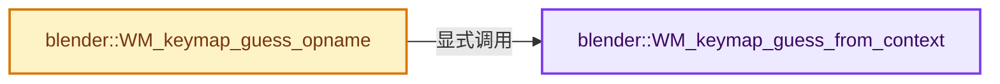

# 实现依赖专题：source/blender/windowmanager/intern/wm_keymap_utils.cc

[实现依赖导航](../../../README.md) · [符号索引](../../../../00-课程指南/02-源码与提交索引/符号依赖与实现索引.md)

本专题从正文实际调用进入，集中保存共享实现。函数有稳定锚点，可从调用处直接跳到对应完整函数；递归与互相调用通过回链组织。

## 本文件的实现关系




## 完整成员与函数实现

<a id="f-b24fe5a2a8449d58"></a>

### `blender::WM_keymap_guess_from_context`

实现位置：[source/blender/windowmanager/intern/wm_keymap_utils.cc](../../../../../../../../source/blender/windowmanager/intern/wm_keymap_utils.cc) · L79—L223。

接口参数：

- `const bContext *C`

**教学注释版**

<!-- annotated:7e9cab10759292 -->

```cpp
wmKeyMap *WM_keymap_guess_from_context(const bContext *C)
{
  eSpace_Type space_type = SPACE_EMPTY;
  eRegion_Type region_type = RGN_TYPE_WINDOW;
  SpaceLink *sl = CTX_wm_space_data(C);

  /* Tool property tab is a special case where 3d tool properties are shown in the properties
   * editor. This would allow assigning tool shortcut keys from properties editor. */
  bool allow_properties_keymap = false;
  if (sl->spacetype == SPACE_PROPERTIES) {
    SpaceProperties *sp = reinterpret_cast<SpaceProperties *>(sl);
    if (sp->mainb == BCONTEXT_TOOL) {
      allow_properties_keymap = true;
    }
  }

  const char *km_id = nullptr;
  if (sl->spacetype == SPACE_VIEW3D || allow_properties_keymap) {
    const enum eContextObjectMode mode = CTX_data_mode_enum(C);
    switch (mode) {
      case CTX_MODE_EDIT_MESH:
        km_id = "Mesh";
        break;
      case CTX_MODE_EDIT_CURVE:
        km_id = "Curve";
        break;
      case CTX_MODE_EDIT_CURVES:
        km_id = "Curves";
        break;
      case CTX_MODE_EDIT_SURFACE:
        km_id = "Curve";
        break;
      case CTX_MODE_EDIT_TEXT:
        km_id = "Font";
        break;
      case CTX_MODE_EDIT_ARMATURE:
        km_id = "Armature";
        break;
      case CTX_MODE_EDIT_METABALL:
        km_id = "Metaball";
        break;
      case CTX_MODE_EDIT_LATTICE:
        km_id = "Lattice";
        break;
      case CTX_MODE_EDIT_GREASE_PENCIL:
        km_id = "Grease Pencil Edit Mode";
        break;
      case CTX_MODE_EDIT_POINTCLOUD:
        km_id = "Point Cloud";
        break;
      case CTX_MODE_POSE:
        km_id = "Pose";
        break;
      case CTX_MODE_SCULPT:
        km_id = "Sculpt";
        break;
      case CTX_MODE_PAINT_WEIGHT:
        km_id = "Weight Paint";
        break;
      case CTX_MODE_PAINT_VERTEX:
        km_id = "Vertex Paint";
        break;
      case CTX_MODE_PAINT_TEXTURE:
        km_id = "Image Paint";
        break;
      case CTX_MODE_PARTICLE:
        km_id = "Particle";
        break;
      case CTX_MODE_OBJECT:
        km_id = "Object Mode";
        break;
      case CTX_MODE_PAINT_GPENCIL_LEGACY:
        km_id = "Grease Pencil Stroke Paint Mode";
        break;
      case CTX_MODE_EDIT_GPENCIL_LEGACY:
        km_id = "Grease Pencil Stroke Edit Mode";
        break;
      case CTX_MODE_SCULPT_GPENCIL_LEGACY:
        km_id = "Grease Pencil Stroke Sculpt Mode";
        break;
      case CTX_MODE_WEIGHT_GPENCIL_LEGACY:
        km_id = "Grease Pencil Stroke Weight Mode";
        break;
      case CTX_MODE_VERTEX_GPENCIL_LEGACY:
        km_id = "Grease Pencil Stroke Vertex Mode";
        break;
      case CTX_MODE_SCULPT_CURVES:
        km_id = "Sculpt Curves";
        break;
      case CTX_MODE_PAINT_GREASE_PENCIL:
        km_id = "Grease Pencil Draw Mode";
        break;
      case CTX_MODE_SCULPT_GREASE_PENCIL:
        km_id = "Grease Pencil Sculpt Mode";
        break;
      case CTX_MODE_WEIGHT_GREASE_PENCIL:
        km_id = "Grease Pencil Weight Mode";
        break;
      case CTX_MODE_VERTEX_GREASE_PENCIL:
        km_id = "Grease Pencil Vertex Mode";
        break;
    }
  }
  else if (sl->spacetype == SPACE_IMAGE) {
    const SpaceImage *sima = reinterpret_cast<SpaceImage *>(sl);
    const eSpaceImage_Mode mode = eSpaceImage_Mode(sima->mode);
    switch (mode) {
      case SI_MODE_VIEW:
        km_id = "Image";
        break;
      case SI_MODE_PAINT:
        km_id = "Image Paint";
        break;
      case SI_MODE_MASK:
        km_id = "Mask Editing";
        break;
      case SI_MODE_UV:
        km_id = "UV Editor";
        break;
    }
  }
  else if (sl->spacetype == SPACE_SEQ) {
    const SpaceSeq *sseq = reinterpret_cast<SpaceSeq *>(sl);
    const enum eSpaceSeq_Displays view = eSpaceSeq_Displays(sseq->view);
    space_type = SPACE_SEQ;
    switch (view) {
      case SEQ_VIEW_SEQUENCE:
        km_id = "Sequencer";
        break;
      case SEQ_VIEW_PREVIEW:
        km_id = "Preview";
        break;
      case SEQ_VIEW_SEQUENCE_PREVIEW:
        km_id = "Video Sequence Editor";
        break;
    }
  }
  else {
    return nullptr;
  }

  wmKeyMap *km = WM_keymap_find_all(CTX_wm_manager(C), km_id, space_type, region_type);
  BLI_assert(km);
  return km;
}
```

<details>
<summary>核对原始源码：source/blender/windowmanager/intern/wm_keymap_utils.cc · L79—L223</summary>

<!-- original:7e9cab10759292:source/blender/windowmanager/intern/wm_keymap_utils.cc:79:223 -->

```cpp
wmKeyMap *WM_keymap_guess_from_context(const bContext *C)
{
  eSpace_Type space_type = SPACE_EMPTY;
  eRegion_Type region_type = RGN_TYPE_WINDOW;
  SpaceLink *sl = CTX_wm_space_data(C);

  /* Tool property tab is a special case where 3d tool properties are shown in the properties
   * editor. This would allow assigning tool shortcut keys from properties editor. */
  bool allow_properties_keymap = false;
  if (sl->spacetype == SPACE_PROPERTIES) {
    SpaceProperties *sp = reinterpret_cast<SpaceProperties *>(sl);
    if (sp->mainb == BCONTEXT_TOOL) {
      allow_properties_keymap = true;
    }
  }

  const char *km_id = nullptr;
  if (sl->spacetype == SPACE_VIEW3D || allow_properties_keymap) {
    const enum eContextObjectMode mode = CTX_data_mode_enum(C);
    switch (mode) {
      case CTX_MODE_EDIT_MESH:
        km_id = "Mesh";
        break;
      case CTX_MODE_EDIT_CURVE:
        km_id = "Curve";
        break;
      case CTX_MODE_EDIT_CURVES:
        km_id = "Curves";
        break;
      case CTX_MODE_EDIT_SURFACE:
        km_id = "Curve";
        break;
      case CTX_MODE_EDIT_TEXT:
        km_id = "Font";
        break;
      case CTX_MODE_EDIT_ARMATURE:
        km_id = "Armature";
        break;
      case CTX_MODE_EDIT_METABALL:
        km_id = "Metaball";
        break;
      case CTX_MODE_EDIT_LATTICE:
        km_id = "Lattice";
        break;
      case CTX_MODE_EDIT_GREASE_PENCIL:
        km_id = "Grease Pencil Edit Mode";
        break;
      case CTX_MODE_EDIT_POINTCLOUD:
        km_id = "Point Cloud";
        break;
      case CTX_MODE_POSE:
        km_id = "Pose";
        break;
      case CTX_MODE_SCULPT:
        km_id = "Sculpt";
        break;
      case CTX_MODE_PAINT_WEIGHT:
        km_id = "Weight Paint";
        break;
      case CTX_MODE_PAINT_VERTEX:
        km_id = "Vertex Paint";
        break;
      case CTX_MODE_PAINT_TEXTURE:
        km_id = "Image Paint";
        break;
      case CTX_MODE_PARTICLE:
        km_id = "Particle";
        break;
      case CTX_MODE_OBJECT:
        km_id = "Object Mode";
        break;
      case CTX_MODE_PAINT_GPENCIL_LEGACY:
        km_id = "Grease Pencil Stroke Paint Mode";
        break;
      case CTX_MODE_EDIT_GPENCIL_LEGACY:
        km_id = "Grease Pencil Stroke Edit Mode";
        break;
      case CTX_MODE_SCULPT_GPENCIL_LEGACY:
        km_id = "Grease Pencil Stroke Sculpt Mode";
        break;
      case CTX_MODE_WEIGHT_GPENCIL_LEGACY:
        km_id = "Grease Pencil Stroke Weight Mode";
        break;
      case CTX_MODE_VERTEX_GPENCIL_LEGACY:
        km_id = "Grease Pencil Stroke Vertex Mode";
        break;
      case CTX_MODE_SCULPT_CURVES:
        km_id = "Sculpt Curves";
        break;
      case CTX_MODE_PAINT_GREASE_PENCIL:
        km_id = "Grease Pencil Draw Mode";
        break;
      case CTX_MODE_SCULPT_GREASE_PENCIL:
        km_id = "Grease Pencil Sculpt Mode";
        break;
      case CTX_MODE_WEIGHT_GREASE_PENCIL:
        km_id = "Grease Pencil Weight Mode";
        break;
      case CTX_MODE_VERTEX_GREASE_PENCIL:
        km_id = "Grease Pencil Vertex Mode";
        break;
    }
  }
  else if (sl->spacetype == SPACE_IMAGE) {
    const SpaceImage *sima = reinterpret_cast<SpaceImage *>(sl);
    const eSpaceImage_Mode mode = eSpaceImage_Mode(sima->mode);
    switch (mode) {
      case SI_MODE_VIEW:
        km_id = "Image";
        break;
      case SI_MODE_PAINT:
        km_id = "Image Paint";
        break;
      case SI_MODE_MASK:
        km_id = "Mask Editing";
        break;
      case SI_MODE_UV:
        km_id = "UV Editor";
        break;
    }
  }
  else if (sl->spacetype == SPACE_SEQ) {
    const SpaceSeq *sseq = reinterpret_cast<SpaceSeq *>(sl);
    const enum eSpaceSeq_Displays view = eSpaceSeq_Displays(sseq->view);
    space_type = SPACE_SEQ;
    switch (view) {
      case SEQ_VIEW_SEQUENCE:
        km_id = "Sequencer";
        break;
      case SEQ_VIEW_PREVIEW:
        km_id = "Preview";
        break;
      case SEQ_VIEW_SEQUENCE_PREVIEW:
        km_id = "Video Sequence Editor";
        break;
    }
  }
  else {
    return nullptr;
  }

  wmKeyMap *km = WM_keymap_find_all(CTX_wm_manager(C), km_id, space_type, region_type);
  BLI_assert(km);
  return km;
}
```

</details>

**沿实际写入检查状态**

- `allow_properties_keymap = true;`
- `km_id = "Mesh";`
- `km_id = "Curve";`
- `km_id = "Curves";`
- `km_id = "Font";`
- `km_id = "Armature";`
- `km_id = "Metaball";`
- `km_id = "Lattice";`
- `km_id = "Grease Pencil Edit Mode";`
- `km_id = "Point Cloud";`
- `km_id = "Pose";`
- `km_id = "Sculpt";`
- `km_id = "Weight Paint";`
- `km_id = "Vertex Paint";`
- `km_id = "Image Paint";`
- `km_id = "Particle";`
- `km_id = "Object Mode";`
- `km_id = "Grease Pencil Stroke Paint Mode";`
- `km_id = "Grease Pencil Stroke Edit Mode";`
- `km_id = "Grease Pencil Stroke Sculpt Mode";`
- `km_id = "Grease Pencil Stroke Weight Mode";`
- `km_id = "Grease Pencil Stroke Vertex Mode";`
- `km_id = "Sculpt Curves";`
- `km_id = "Grease Pencil Draw Mode";`
- `km_id = "Grease Pencil Sculpt Mode";`
- `km_id = "Grease Pencil Weight Mode";`
- `km_id = "Grease Pencil Vertex Mode";`
- `km_id = "Image";`
- `km_id = "Mask Editing";`
- `km_id = "UV Editor";`
- `space_type = SPACE_SEQ;`
- `km_id = "Sequencer";`
- `km_id = "Preview";`
- `km_id = "Video Sequence Editor";`

**结果出口**

- `return nullptr;`
- `return km;`

**继续追踪实现**

- `CTX_wm_space_data` → [blender::CTX_wm_space_data · L959](../../../02-BKE几何与数据/intern/context.cc.md#f-ddd6af522f1f553c)。
- `CTX_data_mode_enum` → [blender::CTX_data_mode_enum · L1495](../../../02-BKE几何与数据/intern/context.cc.md#f-b33bca83bf05ef47)。
- `eSpaceImage_Mode` → [blender::eSpaceImage_Mode](../../makesdna/DNA_space_enums.h.md#t-85e86963ce65)。
- `eSpaceSeq_Displays` → [blender::eSpaceSeq_Displays](../../makesdna/DNA_space_enums.h.md#t-140c06c16c9b)。
- `WM_keymap_find_all` → [blender::WM_keymap_find_all · L949](wm_keymap.cc.md#f-69501e2a189e4d06)。
- `CTX_wm_manager` → [blender::CTX_wm_manager · L928](../../../02-BKE几何与数据/intern/context.cc.md#f-158f36db7379fbe8)。
- `BLI_assert` → [BLI_assert · L48](../../../01-BLI基础库/BLI_assert.hh.md#m-57a88495704d)；[BLI_assert · L63](../../../01-BLI基础库/BLI_assert.hh.md#m-d07050020cb5)。宏定义由构建条件选择。

<a id="f-34c7248dec09cc3a"></a>

### `blender::WM_keymap_guess_opname`

实现位置：[source/blender/windowmanager/intern/wm_keymap_utils.cc](../../../../../../../../source/blender/windowmanager/intern/wm_keymap_utils.cc) · L225—L545。

接口参数：

- `const bContext *C`
- `const char *opname`

**教学注释版**

<!-- annotated:12ab1af461658b -->

```cpp
wmKeyMap *WM_keymap_guess_opname(const bContext *C, const char *opname)
{
  /* Op types purposely skipped for now:
   *     BOID_OT
   *     BUTTONS_OT
   *     CONSTRAINT_OT
   *     ED_OT
   *     FLUID_OT
   *     TEXTURE_OT
   *     WORLD_OT
   */

  wmKeyMap *km = nullptr;
  wmWindowManager *wm = CTX_wm_manager(C);
  SpaceLink *sl = CTX_wm_space_data(C);

  /* Window. */
  if (STRPREFIX(opname, "WM_OT") || STRPREFIX(opname, "ED_OT_undo")) {
    if (STREQ(opname, "WM_OT_tool_set_by_id") || STREQ(opname, "WM_OT_call_asset_shelf_popover")) {
      km = WM_keymap_guess_from_context(C);
    }

    if (km == nullptr) {
      km = WM_keymap_find_all(wm, "Window", SPACE_EMPTY, RGN_TYPE_WINDOW);
    }
  }
  /* Screen & Render. */
  else if (STRPREFIX(opname, "SCREEN_OT") || STRPREFIX(opname, "RENDER_OT") ||
           STRPREFIX(opname, "SOUND_OT") || STRPREFIX(opname, "SCENE_OT"))
  {
    km = WM_keymap_find_all(wm, "Screen", SPACE_EMPTY, RGN_TYPE_WINDOW);
  }
  /* Grease Pencil. */
  else if (STRPREFIX(opname, "GPENCIL_OT")) {
    km = WM_keymap_find_all(wm, "Grease Pencil", SPACE_EMPTY, RGN_TYPE_WINDOW);
  }
  else if (STRPREFIX(opname, "GREASE_PENCIL_OT")) {
    km = WM_keymap_find_all(wm, "Grease Pencil", SPACE_EMPTY, RGN_TYPE_WINDOW);
  }
  /* Markers. */
  else if (STRPREFIX(opname, "MARKER_OT")) {
    km = WM_keymap_find_all(wm, "Markers", SPACE_EMPTY, RGN_TYPE_WINDOW);
  }
  /* Import/Export. */
  else if (STRPREFIX(opname, "IMPORT_") || STRPREFIX(opname, "EXPORT_")) {
    km = WM_keymap_find_all(wm, "Window", SPACE_EMPTY, RGN_TYPE_WINDOW);
  }

  /* 3D View. */
  else if (STRPREFIX(opname, "VIEW3D_OT")) {
    km = WM_keymap_find_all(wm, "3D View", sl->spacetype, RGN_TYPE_WINDOW);
  }
  else if (STRPREFIX(opname, "OBJECT_OT")) {
    /* Exception, this needs to work outside object mode too. */
    if (STRPREFIX(opname, "OBJECT_OT_mode_set") || STRPREFIX(opname, "OBJECT_OT_transfer_mode")) {
      km = WM_keymap_find_all(wm, "Object Non-modal", SPACE_EMPTY, RGN_TYPE_WINDOW);
    }
    else {
      km = WM_keymap_guess_from_context(C);
    }

    if (km == nullptr) {
      km = WM_keymap_find_all(wm, "Object Mode", SPACE_EMPTY, RGN_TYPE_WINDOW);
    }
  }
  /* Object mode related. */
  else if (STRPREFIX(opname, "GROUP_OT") || STRPREFIX(opname, "MATERIAL_OT") ||
           STRPREFIX(opname, "PTCACHE_OT") || STRPREFIX(opname, "RIGIDBODY_OT"))
  {
    km = WM_keymap_find_all(wm, "Object Mode", SPACE_EMPTY, RGN_TYPE_WINDOW);
  }

  /* Editing Modes. */
  else if (STRPREFIX(opname, "MESH_OT")) {
    km = WM_keymap_find_all(wm, "Mesh", SPACE_EMPTY, RGN_TYPE_WINDOW);

    /* Some mesh operators are active in object mode too, like add-prim. */
    if (km && !WM_keymap_poll(const_cast<bContext *>(C), km)) {
      km = WM_keymap_find_all(wm, "Object Mode", SPACE_EMPTY, RGN_TYPE_WINDOW);
    }
  }
  else if (STRPREFIX(opname, "CURVE_OT") || STRPREFIX(opname, "SURFACE_OT")) {
    km = WM_keymap_find_all(wm, "Curve", SPACE_EMPTY, RGN_TYPE_WINDOW);

    /* Some curve operators are active in object mode too, like add-prim. */
    if (km && !WM_keymap_poll(const_cast<bContext *>(C), km)) {
      km = WM_keymap_find_all(wm, "Object Mode", SPACE_EMPTY, RGN_TYPE_WINDOW);
    }
  }
  else if (STRPREFIX(opname, "ARMATURE_OT") || STRPREFIX(opname, "SKETCH_OT")) {
    km = WM_keymap_find_all(wm, "Armature", SPACE_EMPTY, RGN_TYPE_WINDOW);
  }
  else if (STRPREFIX(opname, "POSE_OT") || STRPREFIX(opname, "POSELIB_OT")) {
    switch (CTX_data_mode_enum(C)) {
      case CTX_MODE_OBJECT:
        /* Some POSE operators are now working in object mode. See #159734. */
        km = WM_keymap_find_all(wm, "Object Mode", SPACE_EMPTY, RGN_TYPE_WINDOW);
        break;
      default:
        km = WM_keymap_find_all(wm, "Pose", SPACE_EMPTY, RGN_TYPE_WINDOW);
        break;
    }
  }
  else if (STRPREFIX(opname, "SCULPT_OT")) {
    switch (CTX_data_mode_enum(C)) {
      case CTX_MODE_SCULPT:
        km = WM_keymap_find_all(wm, "Sculpt", SPACE_EMPTY, RGN_TYPE_WINDOW);
        break;
      default:
        break;
    }
  }
  else if (STRPREFIX(opname, "CURVES_OT")) {
    km = WM_keymap_find_all(wm, "Curves", SPACE_EMPTY, RGN_TYPE_WINDOW);
  }
  else if (STRPREFIX(opname, "SCULPT_CURVES_OT")) {
    km = WM_keymap_find_all(wm, "Sculpt Curves", SPACE_EMPTY, RGN_TYPE_WINDOW);
  }
  else if (STRPREFIX(opname, "MBALL_OT")) {
    km = WM_keymap_find_all(wm, "Metaball", SPACE_EMPTY, RGN_TYPE_WINDOW);

    /* Some meta-ball operators are active in object mode too, like add-primitive. */
    if (km && !WM_keymap_poll(const_cast<bContext *>(C), km)) {
      km = WM_keymap_find_all(wm, "Object Mode", SPACE_EMPTY, RGN_TYPE_WINDOW);
    }
  }
  else if (STRPREFIX(opname, "LATTICE_OT")) {
    km = WM_keymap_find_all(wm, "Lattice", SPACE_EMPTY, RGN_TYPE_WINDOW);
  }
  else if (STRPREFIX(opname, "PARTICLE_OT")) {
    km = WM_keymap_find_all(wm, "Particle", SPACE_EMPTY, RGN_TYPE_WINDOW);
  }
  else if (STRPREFIX(opname, "POINTCLOUD_OT")) {
    km = WM_keymap_find_all(wm, "Point Cloud", SPACE_EMPTY, RGN_TYPE_WINDOW);
  }
  else if (STRPREFIX(opname, "FONT_OT")) {
    km = WM_keymap_find_all(wm, "Font", SPACE_EMPTY, RGN_TYPE_WINDOW);
  }
  /* Paint Face Mask. */
  else if (STRPREFIX(opname, "PAINT_OT_face_select")) {
    km = WM_keymap_find_all(
        wm, "Paint Face Mask (Weight, Vertex, Texture)", SPACE_EMPTY, RGN_TYPE_WINDOW);
  }
  else if (STRPREFIX(opname, "PAINT_OT") || STRPREFIX(opname, "BRUSH_OT")) {
    /* Check for relevant mode. */
    km = WM_keymap_guess_from_context(C);
  }
  /* General 2D View, not bound to a specific spacetype. */
  else if (STRPREFIX(opname, "VIEW2D_OT")) {
    km = WM_keymap_find_all(wm, "View2D", SPACE_EMPTY, RGN_TYPE_WINDOW);
  }
  /* Image Editor. */
  else if (STRPREFIX(opname, "IMAGE_OT")) {
    km = WM_keymap_find_all(wm, "Image", sl->spacetype, RGN_TYPE_WINDOW);
  }
  /* Clip Editor. */
  else if (STRPREFIX(opname, "CLIP_OT")) {
    km = WM_keymap_find_all(wm, "Clip", sl->spacetype, RGN_TYPE_WINDOW);
  }
  else if (STRPREFIX(opname, "MASK_OT")) {
    km = WM_keymap_find_all(wm, "Mask Editing", SPACE_EMPTY, RGN_TYPE_WINDOW);
  }
  /* UV Editor. */
  else if (STRPREFIX(opname, "UV_OT")) {
    /* Hack to allow using UV unwrapping ops from 3DView/editmode.
     * Mesh keymap is probably not ideal, but best place I could find to put those. */
    if (sl->spacetype == SPACE_VIEW3D) {
      km = WM_keymap_find_all(wm, "Mesh", SPACE_EMPTY, RGN_TYPE_WINDOW);
      if (km && !WM_keymap_poll(const_cast<bContext *>(C), km)) {
        km = nullptr;
      }
    }
    if (!km) {
      km = WM_keymap_find_all(wm, "UV Editor", SPACE_EMPTY, RGN_TYPE_WINDOW);
    }
  }
  /* Node Editor. */
  else if (STRPREFIX(opname, "NODE_OT")) {
    km = WM_keymap_find_all(wm, "Node Editor", sl->spacetype, RGN_TYPE_WINDOW);
  }
  /* Animation Editor Channels. */
  else if (STRPREFIX(opname, "ANIM_OT_channels")) {
    km = WM_keymap_find_all(wm, "Animation Channels", SPACE_EMPTY, RGN_TYPE_WINDOW);
  }
  /* Animation Generic - after channels. */
  else if (STRPREFIX(opname, "ANIM_OT")) {
    if (sl->spacetype == SPACE_VIEW3D) {
      switch (CTX_data_mode_enum(C)) {
        case CTX_MODE_OBJECT:
          km = WM_keymap_find_all(wm, "Object Mode", SPACE_EMPTY, RGN_TYPE_WINDOW);
          break;
        case CTX_MODE_POSE:
          km = WM_keymap_find_all(wm, "Pose", SPACE_EMPTY, RGN_TYPE_WINDOW);
          break;
        default:
          break;
      }

      if (ARegion *region = CTX_wm_region(C)) {
        /* When property is in side panel, add shortcut key to User interface Keymap, see: #136998.
         */
        if (region->regiontype == RGN_TYPE_UI) {
          km = WM_keymap_find_all(wm, "User Interface", SPACE_EMPTY, RGN_TYPE_WINDOW);
        }
      }
      if (km && !WM_keymap_poll(const_cast<bContext *>(C), km)) {
        km = nullptr;
      }
    }
    else if (sl->spacetype == SPACE_PROPERTIES) {
      km = WM_keymap_find_all(wm, "User Interface", SPACE_EMPTY, RGN_TYPE_WINDOW);
    }

    if (!km) {
      km = WM_keymap_find_all(wm, "Animation", SPACE_EMPTY, RGN_TYPE_WINDOW);
    }
  }
  /* Graph Editor. */
  else if (STRPREFIX(opname, "GRAPH_OT")) {
    km = WM_keymap_find_all(wm, "Graph Editor", sl->spacetype, RGN_TYPE_WINDOW);
  }
  /* Dopesheet Editor. */
  else if (STRPREFIX(opname, "ACTION_OT")) {
    km = WM_keymap_find_all(wm, "Dopesheet", sl->spacetype, RGN_TYPE_WINDOW);
  }
  /* NLA Editor. */
  else if (STRPREFIX(opname, "NLA_OT")) {
    km = WM_keymap_find_all(wm, "NLA Editor", sl->spacetype, RGN_TYPE_WINDOW);
  }
  /* Script. */
  else if (STRPREFIX(opname, "SCRIPT_OT")) {
    km = WM_keymap_find_all(wm, "Script", sl->spacetype, RGN_TYPE_WINDOW);
  }
  /* Text. */
  else if (STRPREFIX(opname, "TEXT_OT")) {
    km = WM_keymap_find_all(wm, "Text", sl->spacetype, RGN_TYPE_WINDOW);
  }
  /* Sequencer. */
  else if (STRPREFIX(opname, "SEQUENCER_OT")) {
    km = WM_keymap_find_all(wm, "Sequencer", sl->spacetype, RGN_TYPE_WINDOW);
  }
  /* Console. */
  else if (STRPREFIX(opname, "CONSOLE_OT")) {
    km = WM_keymap_find_all(wm, "Console", sl->spacetype, RGN_TYPE_WINDOW);
  }
  /* Console. */
  else if (STRPREFIX(opname, "INFO_OT")) {
    km = WM_keymap_find_all(wm, "Info", sl->spacetype, RGN_TYPE_WINDOW);
  }
  /* File browser. */
  else if (STRPREFIX(opname, "FILE_OT")) {
    km = WM_keymap_find_all(wm, "File Browser", sl->spacetype, RGN_TYPE_WINDOW);
  }
  /* Logic Editor. */
  else if (STRPREFIX(opname, "LOGIC_OT")) {
    km = WM_keymap_find_all(wm, "Logic Editor", sl->spacetype, RGN_TYPE_WINDOW);
  }
  /* Outliner. */
  else if (STRPREFIX(opname, "OUTLINER_OT")) {
    km = WM_keymap_find_all(wm, "Outliner", sl->spacetype, RGN_TYPE_WINDOW);
  }
  /* Transform. */
  else if (STRPREFIX(opname, "TRANSFORM_OT")) {
    /* Check for relevant editor. */
    switch (sl->spacetype) {
      case SPACE_VIEW3D:
        km = WM_keymap_find_all(wm, "3D View", sl->spacetype, RGN_TYPE_WINDOW);
        break;
      case SPACE_GRAPH:
        km = WM_keymap_find_all(wm, "Graph Editor", sl->spacetype, RGN_TYPE_WINDOW);
        break;
      case SPACE_ACTION:
        km = WM_keymap_find_all(wm, "Dopesheet", sl->spacetype, RGN_TYPE_WINDOW);
        break;
      case SPACE_NLA:
        km = WM_keymap_find_all(wm, "NLA Editor", sl->spacetype, RGN_TYPE_WINDOW);
        break;
      case SPACE_IMAGE:
        km = WM_keymap_find_all(wm, "UV Editor", SPACE_EMPTY, RGN_TYPE_WINDOW);
        break;
      case SPACE_NODE:
        km = WM_keymap_find_all(wm, "Node Editor", sl->spacetype, RGN_TYPE_WINDOW);
        break;
      case SPACE_SEQ:
        km = WM_keymap_find_all(wm, "Sequencer", sl->spacetype, RGN_TYPE_WINDOW);
        break;
    }
  }
  /* User Interface. */
  else if (STRPREFIX(opname, "UI_OT")) {
    km = WM_keymap_find_all(wm, "User Interface", SPACE_EMPTY, RGN_TYPE_WINDOW);
  }
  /* Geometry. */
  else if (STRPREFIX(opname, "GEOMETRY_OT")) {
    switch (sl->spacetype) {
      case SPACE_VIEW3D:
        switch (CTX_data_mode_enum(C)) {
          case CTX_MODE_EDIT_MESH:
            km = WM_keymap_find_all(wm, "Mesh", SPACE_EMPTY, RGN_TYPE_WINDOW);
            break;
          case CTX_MODE_EDIT_CURVES:
            km = WM_keymap_find_all(wm, "Curves", SPACE_EMPTY, RGN_TYPE_WINDOW);
            break;
          case CTX_MODE_EDIT_POINTCLOUD:
            km = WM_keymap_find_all(wm, "Point Cloud", SPACE_EMPTY, RGN_TYPE_WINDOW);
            break;
          case CTX_MODE_SCULPT:
            km = WM_keymap_find_all(wm, "Sculpt", SPACE_EMPTY, RGN_TYPE_WINDOW);
            break;
          case CTX_MODE_SCULPT_CURVES:
            km = WM_keymap_find_all(wm, "Sculpt Curves", SPACE_EMPTY, RGN_TYPE_WINDOW);
            break;
          default:
            break;
        }
        break;
    }
  }

  return km;
}
```

<details>
<summary>核对原始源码：source/blender/windowmanager/intern/wm_keymap_utils.cc · L225—L545</summary>

<!-- original:12ab1af461658b:source/blender/windowmanager/intern/wm_keymap_utils.cc:225:545 -->

```cpp
wmKeyMap *WM_keymap_guess_opname(const bContext *C, const char *opname)
{
  /* Op types purposely skipped for now:
   *     BOID_OT
   *     BUTTONS_OT
   *     CONSTRAINT_OT
   *     ED_OT
   *     FLUID_OT
   *     TEXTURE_OT
   *     WORLD_OT
   */

  wmKeyMap *km = nullptr;
  wmWindowManager *wm = CTX_wm_manager(C);
  SpaceLink *sl = CTX_wm_space_data(C);

  /* Window. */
  if (STRPREFIX(opname, "WM_OT") || STRPREFIX(opname, "ED_OT_undo")) {
    if (STREQ(opname, "WM_OT_tool_set_by_id") || STREQ(opname, "WM_OT_call_asset_shelf_popover")) {
      km = WM_keymap_guess_from_context(C);
    }

    if (km == nullptr) {
      km = WM_keymap_find_all(wm, "Window", SPACE_EMPTY, RGN_TYPE_WINDOW);
    }
  }
  /* Screen & Render. */
  else if (STRPREFIX(opname, "SCREEN_OT") || STRPREFIX(opname, "RENDER_OT") ||
           STRPREFIX(opname, "SOUND_OT") || STRPREFIX(opname, "SCENE_OT"))
  {
    km = WM_keymap_find_all(wm, "Screen", SPACE_EMPTY, RGN_TYPE_WINDOW);
  }
  /* Grease Pencil. */
  else if (STRPREFIX(opname, "GPENCIL_OT")) {
    km = WM_keymap_find_all(wm, "Grease Pencil", SPACE_EMPTY, RGN_TYPE_WINDOW);
  }
  else if (STRPREFIX(opname, "GREASE_PENCIL_OT")) {
    km = WM_keymap_find_all(wm, "Grease Pencil", SPACE_EMPTY, RGN_TYPE_WINDOW);
  }
  /* Markers. */
  else if (STRPREFIX(opname, "MARKER_OT")) {
    km = WM_keymap_find_all(wm, "Markers", SPACE_EMPTY, RGN_TYPE_WINDOW);
  }
  /* Import/Export. */
  else if (STRPREFIX(opname, "IMPORT_") || STRPREFIX(opname, "EXPORT_")) {
    km = WM_keymap_find_all(wm, "Window", SPACE_EMPTY, RGN_TYPE_WINDOW);
  }

  /* 3D View. */
  else if (STRPREFIX(opname, "VIEW3D_OT")) {
    km = WM_keymap_find_all(wm, "3D View", sl->spacetype, RGN_TYPE_WINDOW);
  }
  else if (STRPREFIX(opname, "OBJECT_OT")) {
    /* Exception, this needs to work outside object mode too. */
    if (STRPREFIX(opname, "OBJECT_OT_mode_set") || STRPREFIX(opname, "OBJECT_OT_transfer_mode")) {
      km = WM_keymap_find_all(wm, "Object Non-modal", SPACE_EMPTY, RGN_TYPE_WINDOW);
    }
    else {
      km = WM_keymap_guess_from_context(C);
    }

    if (km == nullptr) {
      km = WM_keymap_find_all(wm, "Object Mode", SPACE_EMPTY, RGN_TYPE_WINDOW);
    }
  }
  /* Object mode related. */
  else if (STRPREFIX(opname, "GROUP_OT") || STRPREFIX(opname, "MATERIAL_OT") ||
           STRPREFIX(opname, "PTCACHE_OT") || STRPREFIX(opname, "RIGIDBODY_OT"))
  {
    km = WM_keymap_find_all(wm, "Object Mode", SPACE_EMPTY, RGN_TYPE_WINDOW);
  }

  /* Editing Modes. */
  else if (STRPREFIX(opname, "MESH_OT")) {
    km = WM_keymap_find_all(wm, "Mesh", SPACE_EMPTY, RGN_TYPE_WINDOW);

    /* Some mesh operators are active in object mode too, like add-prim. */
    if (km && !WM_keymap_poll(const_cast<bContext *>(C), km)) {
      km = WM_keymap_find_all(wm, "Object Mode", SPACE_EMPTY, RGN_TYPE_WINDOW);
    }
  }
  else if (STRPREFIX(opname, "CURVE_OT") || STRPREFIX(opname, "SURFACE_OT")) {
    km = WM_keymap_find_all(wm, "Curve", SPACE_EMPTY, RGN_TYPE_WINDOW);

    /* Some curve operators are active in object mode too, like add-prim. */
    if (km && !WM_keymap_poll(const_cast<bContext *>(C), km)) {
      km = WM_keymap_find_all(wm, "Object Mode", SPACE_EMPTY, RGN_TYPE_WINDOW);
    }
  }
  else if (STRPREFIX(opname, "ARMATURE_OT") || STRPREFIX(opname, "SKETCH_OT")) {
    km = WM_keymap_find_all(wm, "Armature", SPACE_EMPTY, RGN_TYPE_WINDOW);
  }
  else if (STRPREFIX(opname, "POSE_OT") || STRPREFIX(opname, "POSELIB_OT")) {
    switch (CTX_data_mode_enum(C)) {
      case CTX_MODE_OBJECT:
        /* Some POSE operators are now working in object mode. See #159734. */
        km = WM_keymap_find_all(wm, "Object Mode", SPACE_EMPTY, RGN_TYPE_WINDOW);
        break;
      default:
        km = WM_keymap_find_all(wm, "Pose", SPACE_EMPTY, RGN_TYPE_WINDOW);
        break;
    }
  }
  else if (STRPREFIX(opname, "SCULPT_OT")) {
    switch (CTX_data_mode_enum(C)) {
      case CTX_MODE_SCULPT:
        km = WM_keymap_find_all(wm, "Sculpt", SPACE_EMPTY, RGN_TYPE_WINDOW);
        break;
      default:
        break;
    }
  }
  else if (STRPREFIX(opname, "CURVES_OT")) {
    km = WM_keymap_find_all(wm, "Curves", SPACE_EMPTY, RGN_TYPE_WINDOW);
  }
  else if (STRPREFIX(opname, "SCULPT_CURVES_OT")) {
    km = WM_keymap_find_all(wm, "Sculpt Curves", SPACE_EMPTY, RGN_TYPE_WINDOW);
  }
  else if (STRPREFIX(opname, "MBALL_OT")) {
    km = WM_keymap_find_all(wm, "Metaball", SPACE_EMPTY, RGN_TYPE_WINDOW);

    /* Some meta-ball operators are active in object mode too, like add-primitive. */
    if (km && !WM_keymap_poll(const_cast<bContext *>(C), km)) {
      km = WM_keymap_find_all(wm, "Object Mode", SPACE_EMPTY, RGN_TYPE_WINDOW);
    }
  }
  else if (STRPREFIX(opname, "LATTICE_OT")) {
    km = WM_keymap_find_all(wm, "Lattice", SPACE_EMPTY, RGN_TYPE_WINDOW);
  }
  else if (STRPREFIX(opname, "PARTICLE_OT")) {
    km = WM_keymap_find_all(wm, "Particle", SPACE_EMPTY, RGN_TYPE_WINDOW);
  }
  else if (STRPREFIX(opname, "POINTCLOUD_OT")) {
    km = WM_keymap_find_all(wm, "Point Cloud", SPACE_EMPTY, RGN_TYPE_WINDOW);
  }
  else if (STRPREFIX(opname, "FONT_OT")) {
    km = WM_keymap_find_all(wm, "Font", SPACE_EMPTY, RGN_TYPE_WINDOW);
  }
  /* Paint Face Mask. */
  else if (STRPREFIX(opname, "PAINT_OT_face_select")) {
    km = WM_keymap_find_all(
        wm, "Paint Face Mask (Weight, Vertex, Texture)", SPACE_EMPTY, RGN_TYPE_WINDOW);
  }
  else if (STRPREFIX(opname, "PAINT_OT") || STRPREFIX(opname, "BRUSH_OT")) {
    /* Check for relevant mode. */
    km = WM_keymap_guess_from_context(C);
  }
  /* General 2D View, not bound to a specific spacetype. */
  else if (STRPREFIX(opname, "VIEW2D_OT")) {
    km = WM_keymap_find_all(wm, "View2D", SPACE_EMPTY, RGN_TYPE_WINDOW);
  }
  /* Image Editor. */
  else if (STRPREFIX(opname, "IMAGE_OT")) {
    km = WM_keymap_find_all(wm, "Image", sl->spacetype, RGN_TYPE_WINDOW);
  }
  /* Clip Editor. */
  else if (STRPREFIX(opname, "CLIP_OT")) {
    km = WM_keymap_find_all(wm, "Clip", sl->spacetype, RGN_TYPE_WINDOW);
  }
  else if (STRPREFIX(opname, "MASK_OT")) {
    km = WM_keymap_find_all(wm, "Mask Editing", SPACE_EMPTY, RGN_TYPE_WINDOW);
  }
  /* UV Editor. */
  else if (STRPREFIX(opname, "UV_OT")) {
    /* Hack to allow using UV unwrapping ops from 3DView/editmode.
     * Mesh keymap is probably not ideal, but best place I could find to put those. */
    if (sl->spacetype == SPACE_VIEW3D) {
      km = WM_keymap_find_all(wm, "Mesh", SPACE_EMPTY, RGN_TYPE_WINDOW);
      if (km && !WM_keymap_poll(const_cast<bContext *>(C), km)) {
        km = nullptr;
      }
    }
    if (!km) {
      km = WM_keymap_find_all(wm, "UV Editor", SPACE_EMPTY, RGN_TYPE_WINDOW);
    }
  }
  /* Node Editor. */
  else if (STRPREFIX(opname, "NODE_OT")) {
    km = WM_keymap_find_all(wm, "Node Editor", sl->spacetype, RGN_TYPE_WINDOW);
  }
  /* Animation Editor Channels. */
  else if (STRPREFIX(opname, "ANIM_OT_channels")) {
    km = WM_keymap_find_all(wm, "Animation Channels", SPACE_EMPTY, RGN_TYPE_WINDOW);
  }
  /* Animation Generic - after channels. */
  else if (STRPREFIX(opname, "ANIM_OT")) {
    if (sl->spacetype == SPACE_VIEW3D) {
      switch (CTX_data_mode_enum(C)) {
        case CTX_MODE_OBJECT:
          km = WM_keymap_find_all(wm, "Object Mode", SPACE_EMPTY, RGN_TYPE_WINDOW);
          break;
        case CTX_MODE_POSE:
          km = WM_keymap_find_all(wm, "Pose", SPACE_EMPTY, RGN_TYPE_WINDOW);
          break;
        default:
          break;
      }

      if (ARegion *region = CTX_wm_region(C)) {
        /* When property is in side panel, add shortcut key to User interface Keymap, see: #136998.
         */
        if (region->regiontype == RGN_TYPE_UI) {
          km = WM_keymap_find_all(wm, "User Interface", SPACE_EMPTY, RGN_TYPE_WINDOW);
        }
      }
      if (km && !WM_keymap_poll(const_cast<bContext *>(C), km)) {
        km = nullptr;
      }
    }
    else if (sl->spacetype == SPACE_PROPERTIES) {
      km = WM_keymap_find_all(wm, "User Interface", SPACE_EMPTY, RGN_TYPE_WINDOW);
    }

    if (!km) {
      km = WM_keymap_find_all(wm, "Animation", SPACE_EMPTY, RGN_TYPE_WINDOW);
    }
  }
  /* Graph Editor. */
  else if (STRPREFIX(opname, "GRAPH_OT")) {
    km = WM_keymap_find_all(wm, "Graph Editor", sl->spacetype, RGN_TYPE_WINDOW);
  }
  /* Dopesheet Editor. */
  else if (STRPREFIX(opname, "ACTION_OT")) {
    km = WM_keymap_find_all(wm, "Dopesheet", sl->spacetype, RGN_TYPE_WINDOW);
  }
  /* NLA Editor. */
  else if (STRPREFIX(opname, "NLA_OT")) {
    km = WM_keymap_find_all(wm, "NLA Editor", sl->spacetype, RGN_TYPE_WINDOW);
  }
  /* Script. */
  else if (STRPREFIX(opname, "SCRIPT_OT")) {
    km = WM_keymap_find_all(wm, "Script", sl->spacetype, RGN_TYPE_WINDOW);
  }
  /* Text. */
  else if (STRPREFIX(opname, "TEXT_OT")) {
    km = WM_keymap_find_all(wm, "Text", sl->spacetype, RGN_TYPE_WINDOW);
  }
  /* Sequencer. */
  else if (STRPREFIX(opname, "SEQUENCER_OT")) {
    km = WM_keymap_find_all(wm, "Sequencer", sl->spacetype, RGN_TYPE_WINDOW);
  }
  /* Console. */
  else if (STRPREFIX(opname, "CONSOLE_OT")) {
    km = WM_keymap_find_all(wm, "Console", sl->spacetype, RGN_TYPE_WINDOW);
  }
  /* Console. */
  else if (STRPREFIX(opname, "INFO_OT")) {
    km = WM_keymap_find_all(wm, "Info", sl->spacetype, RGN_TYPE_WINDOW);
  }
  /* File browser. */
  else if (STRPREFIX(opname, "FILE_OT")) {
    km = WM_keymap_find_all(wm, "File Browser", sl->spacetype, RGN_TYPE_WINDOW);
  }
  /* Logic Editor. */
  else if (STRPREFIX(opname, "LOGIC_OT")) {
    km = WM_keymap_find_all(wm, "Logic Editor", sl->spacetype, RGN_TYPE_WINDOW);
  }
  /* Outliner. */
  else if (STRPREFIX(opname, "OUTLINER_OT")) {
    km = WM_keymap_find_all(wm, "Outliner", sl->spacetype, RGN_TYPE_WINDOW);
  }
  /* Transform. */
  else if (STRPREFIX(opname, "TRANSFORM_OT")) {
    /* Check for relevant editor. */
    switch (sl->spacetype) {
      case SPACE_VIEW3D:
        km = WM_keymap_find_all(wm, "3D View", sl->spacetype, RGN_TYPE_WINDOW);
        break;
      case SPACE_GRAPH:
        km = WM_keymap_find_all(wm, "Graph Editor", sl->spacetype, RGN_TYPE_WINDOW);
        break;
      case SPACE_ACTION:
        km = WM_keymap_find_all(wm, "Dopesheet", sl->spacetype, RGN_TYPE_WINDOW);
        break;
      case SPACE_NLA:
        km = WM_keymap_find_all(wm, "NLA Editor", sl->spacetype, RGN_TYPE_WINDOW);
        break;
      case SPACE_IMAGE:
        km = WM_keymap_find_all(wm, "UV Editor", SPACE_EMPTY, RGN_TYPE_WINDOW);
        break;
      case SPACE_NODE:
        km = WM_keymap_find_all(wm, "Node Editor", sl->spacetype, RGN_TYPE_WINDOW);
        break;
      case SPACE_SEQ:
        km = WM_keymap_find_all(wm, "Sequencer", sl->spacetype, RGN_TYPE_WINDOW);
        break;
    }
  }
  /* User Interface. */
  else if (STRPREFIX(opname, "UI_OT")) {
    km = WM_keymap_find_all(wm, "User Interface", SPACE_EMPTY, RGN_TYPE_WINDOW);
  }
  /* Geometry. */
  else if (STRPREFIX(opname, "GEOMETRY_OT")) {
    switch (sl->spacetype) {
      case SPACE_VIEW3D:
        switch (CTX_data_mode_enum(C)) {
          case CTX_MODE_EDIT_MESH:
            km = WM_keymap_find_all(wm, "Mesh", SPACE_EMPTY, RGN_TYPE_WINDOW);
            break;
          case CTX_MODE_EDIT_CURVES:
            km = WM_keymap_find_all(wm, "Curves", SPACE_EMPTY, RGN_TYPE_WINDOW);
            break;
          case CTX_MODE_EDIT_POINTCLOUD:
            km = WM_keymap_find_all(wm, "Point Cloud", SPACE_EMPTY, RGN_TYPE_WINDOW);
            break;
          case CTX_MODE_SCULPT:
            km = WM_keymap_find_all(wm, "Sculpt", SPACE_EMPTY, RGN_TYPE_WINDOW);
            break;
          case CTX_MODE_SCULPT_CURVES:
            km = WM_keymap_find_all(wm, "Sculpt Curves", SPACE_EMPTY, RGN_TYPE_WINDOW);
            break;
          default:
            break;
        }
        break;
    }
  }

  return km;
}
```

</details>

**沿实际写入检查状态**

- `km = WM_keymap_guess_from_context(C);`
- `km = WM_keymap_find_all(wm, "Window", SPACE_EMPTY, RGN_TYPE_WINDOW);`
- `km = WM_keymap_find_all(wm, "Screen", SPACE_EMPTY, RGN_TYPE_WINDOW);`
- `km = WM_keymap_find_all(wm, "Grease Pencil", SPACE_EMPTY, RGN_TYPE_WINDOW);`
- `km = WM_keymap_find_all(wm, "Markers", SPACE_EMPTY, RGN_TYPE_WINDOW);`
- `km = WM_keymap_find_all(wm, "3D View", sl->spacetype, RGN_TYPE_WINDOW);`
- `km = WM_keymap_find_all(wm, "Object Non-modal", SPACE_EMPTY, RGN_TYPE_WINDOW);`
- `km = WM_keymap_find_all(wm, "Object Mode", SPACE_EMPTY, RGN_TYPE_WINDOW);`
- `km = WM_keymap_find_all(wm, "Mesh", SPACE_EMPTY, RGN_TYPE_WINDOW);`
- `km = WM_keymap_find_all(wm, "Curve", SPACE_EMPTY, RGN_TYPE_WINDOW);`
- `km = WM_keymap_find_all(wm, "Armature", SPACE_EMPTY, RGN_TYPE_WINDOW);`
- `km = WM_keymap_find_all(wm, "Pose", SPACE_EMPTY, RGN_TYPE_WINDOW);`
- `km = WM_keymap_find_all(wm, "Sculpt", SPACE_EMPTY, RGN_TYPE_WINDOW);`
- `km = WM_keymap_find_all(wm, "Curves", SPACE_EMPTY, RGN_TYPE_WINDOW);`
- `km = WM_keymap_find_all(wm, "Sculpt Curves", SPACE_EMPTY, RGN_TYPE_WINDOW);`
- `km = WM_keymap_find_all(wm, "Metaball", SPACE_EMPTY, RGN_TYPE_WINDOW);`
- `km = WM_keymap_find_all(wm, "Lattice", SPACE_EMPTY, RGN_TYPE_WINDOW);`
- `km = WM_keymap_find_all(wm, "Particle", SPACE_EMPTY, RGN_TYPE_WINDOW);`
- `km = WM_keymap_find_all(wm, "Point Cloud", SPACE_EMPTY, RGN_TYPE_WINDOW);`
- `km = WM_keymap_find_all(wm, "Font", SPACE_EMPTY, RGN_TYPE_WINDOW);`
- `km = WM_keymap_find_all(`
- `km = WM_keymap_find_all(wm, "View2D", SPACE_EMPTY, RGN_TYPE_WINDOW);`
- `km = WM_keymap_find_all(wm, "Image", sl->spacetype, RGN_TYPE_WINDOW);`
- `km = WM_keymap_find_all(wm, "Clip", sl->spacetype, RGN_TYPE_WINDOW);`
- `km = WM_keymap_find_all(wm, "Mask Editing", SPACE_EMPTY, RGN_TYPE_WINDOW);`
- `km = nullptr;`
- `km = WM_keymap_find_all(wm, "UV Editor", SPACE_EMPTY, RGN_TYPE_WINDOW);`
- `km = WM_keymap_find_all(wm, "Node Editor", sl->spacetype, RGN_TYPE_WINDOW);`
- `km = WM_keymap_find_all(wm, "Animation Channels", SPACE_EMPTY, RGN_TYPE_WINDOW);`
- `km = WM_keymap_find_all(wm, "User Interface", SPACE_EMPTY, RGN_TYPE_WINDOW);`
- `km = WM_keymap_find_all(wm, "Animation", SPACE_EMPTY, RGN_TYPE_WINDOW);`
- `km = WM_keymap_find_all(wm, "Graph Editor", sl->spacetype, RGN_TYPE_WINDOW);`
- `km = WM_keymap_find_all(wm, "Dopesheet", sl->spacetype, RGN_TYPE_WINDOW);`
- `km = WM_keymap_find_all(wm, "NLA Editor", sl->spacetype, RGN_TYPE_WINDOW);`
- `km = WM_keymap_find_all(wm, "Script", sl->spacetype, RGN_TYPE_WINDOW);`
- `km = WM_keymap_find_all(wm, "Text", sl->spacetype, RGN_TYPE_WINDOW);`
- `km = WM_keymap_find_all(wm, "Sequencer", sl->spacetype, RGN_TYPE_WINDOW);`
- `km = WM_keymap_find_all(wm, "Console", sl->spacetype, RGN_TYPE_WINDOW);`
- `km = WM_keymap_find_all(wm, "Info", sl->spacetype, RGN_TYPE_WINDOW);`
- `km = WM_keymap_find_all(wm, "File Browser", sl->spacetype, RGN_TYPE_WINDOW);`
- `km = WM_keymap_find_all(wm, "Logic Editor", sl->spacetype, RGN_TYPE_WINDOW);`
- `km = WM_keymap_find_all(wm, "Outliner", sl->spacetype, RGN_TYPE_WINDOW);`

**结果出口**

- `return km;`

**继续追踪实现**

- `CTX_wm_manager` → [blender::CTX_wm_manager · L928](../../../02-BKE几何与数据/intern/context.cc.md#f-158f36db7379fbe8)。
- `CTX_wm_space_data` → [blender::CTX_wm_space_data · L959](../../../02-BKE几何与数据/intern/context.cc.md#f-ddd6af522f1f553c)。
- `STRPREFIX` → [STRPREFIX · L117](../../../07-Intern运行时与平台/ghost/intern/GHOST_utildefines.hh.md#m-f15302dd736a)；[STRPREFIX · L456](../../../01-BLI基础库/BLI_utildefines.hh.md#m-afbbeb066fe7)；[STRPREFIX · L18](../../datatoc/datatoc.cc.md#m-cc9a805e5520)。宏定义由构建条件选择。
- `STREQ` → [STREQ · L112](../../../07-Intern运行时与平台/ghost/intern/GHOST_utildefines.hh.md#m-9549fb6aafd2)；[STREQ · L451](../../../01-BLI基础库/BLI_utildefines.hh.md#m-c7b745bcfad2)；[STREQ · L55](../../../07-Intern运行时与平台/clog/clog.cc.md#m-96e78f386894)。宏定义由构建条件选择。
- `WM_keymap_guess_from_context` → [blender::WM_keymap_guess_from_context · L79](wm_keymap_utils.cc.md#f-b24fe5a2a8449d58)。
- `WM_keymap_find_all` → [blender::WM_keymap_find_all · L949](wm_keymap.cc.md#f-69501e2a189e4d06)。
- `WM_keymap_poll` → [blender::WM_keymap_poll · L485](wm_keymap.cc.md#f-95b1e6239af89fd0)。
- `CTX_data_mode_enum` → [blender::CTX_data_mode_enum · L1495](../../../02-BKE几何与数据/intern/context.cc.md#f-b33bca83bf05ef47)。
- `CTX_wm_region` → [blender::CTX_wm_region · L965](../../../02-BKE几何与数据/intern/context.cc.md#f-6cc0a26bc4539ae0)。
