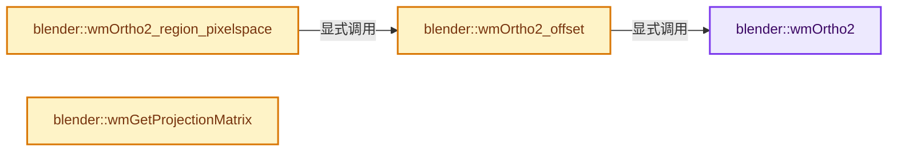

# 实现依赖专题：source/blender/windowmanager/intern/wm_subwindow.cc

[实现依赖导航](../../../README.md) · [符号索引](../../../../00-课程指南/02-源码与提交索引/符号依赖与实现索引.md)

本专题从正文实际调用进入，集中保存共享实现。函数有稳定锚点，可从调用处直接跳到对应完整函数；递归与互相调用通过回链组织。

## 本文件的实现关系




## 完整成员与函数实现

<a id="f-5dd5c1d1033d899e"></a>

### `blender::wmOrtho2`

实现位置：[source/blender/windowmanager/intern/wm_subwindow.cc](../../../../../../../../source/blender/windowmanager/intern/wm_subwindow.cc) · L108—L120。

接口参数：

- `float x1`
- `float x2`
- `float y1`
- `float y2`

**教学注释版**

<!-- annotated:ad647bd3b9232e -->

```cpp
void wmOrtho2(float x1, float x2, float y1, float y2)
{
  /* Prevent opengl from generating errors. */
  if (x2 == x1) {
    x2 += 1.0f;
  }
  if (y2 == y1) {
    y2 += 1.0f;
  }

  GPU_matrix_ortho_set(
      x1, x2, y1, y2, GPU_MATRIX_ORTHO_CLIP_NEAR_DEFAULT, GPU_MATRIX_ORTHO_CLIP_FAR_DEFAULT);
}
```

<details>
<summary>核对原始源码：source/blender/windowmanager/intern/wm_subwindow.cc · L108—L120</summary>

<!-- original:ad647bd3b9232e:source/blender/windowmanager/intern/wm_subwindow.cc:108:120 -->

```cpp
void wmOrtho2(float x1, float x2, float y1, float y2)
{
  /* Prevent opengl from generating errors. */
  if (x2 == x1) {
    x2 += 1.0f;
  }
  if (y2 == y1) {
    y2 += 1.0f;
  }

  GPU_matrix_ortho_set(
      x1, x2, y1, y2, GPU_MATRIX_ORTHO_CLIP_NEAR_DEFAULT, GPU_MATRIX_ORTHO_CLIP_FAR_DEFAULT);
}
```

</details>

**沿实际写入检查状态**

- `x2 += 1.0f;`
- `y2 += 1.0f;`

**继续追踪实现**

- `GPU_matrix_ortho_set` → [blender::GPU_matrix_ortho_set · L400](../../gpu/intern/gpu_matrix.cc.md#f-0bb5e2d8c02c2c99)。

<a id="f-68ef06d4bfc44951"></a>

### `blender::wmOrtho2_offset`

实现位置：[source/blender/windowmanager/intern/wm_subwindow.cc](../../../../../../../../source/blender/windowmanager/intern/wm_subwindow.cc) · L122—L125。

接口参数：

- `const float x`
- `const float y`
- `const float ofs`

**教学注释版**

<!-- annotated:7ce600dd14c769 -->

```cpp
static void wmOrtho2_offset(const float x, const float y, const float ofs)
{
  wmOrtho2(ofs, x + ofs, ofs, y + ofs);
}
```

<details>
<summary>核对原始源码：source/blender/windowmanager/intern/wm_subwindow.cc · L122—L125</summary>

<!-- original:7ce600dd14c769:source/blender/windowmanager/intern/wm_subwindow.cc:122:125 -->

```cpp
static void wmOrtho2_offset(const float x, const float y, const float ofs)
{
  wmOrtho2(ofs, x + ofs, ofs, y + ofs);
}
```

</details>

**继续追踪实现**

- `wmOrtho2` → [blender::wmOrtho2 · L108](wm_subwindow.cc.md#f-5dd5c1d1033d899e)。

<a id="f-81f42b31d31e8f75"></a>

### `blender::wmOrtho2_region_pixelspace`

实现位置：[source/blender/windowmanager/intern/wm_subwindow.cc](../../../../../../../../source/blender/windowmanager/intern/wm_subwindow.cc) · L127—L130。

接口参数：

- `const ARegion *region`

**教学注释版**

<!-- annotated:2ce2d50d058924 -->

```cpp
void wmOrtho2_region_pixelspace(const ARegion *region)
{
  wmOrtho2_offset(region->winx, region->winy, -0.01f);
}
```

<details>
<summary>核对原始源码：source/blender/windowmanager/intern/wm_subwindow.cc · L127—L130</summary>

<!-- original:2ce2d50d058924:source/blender/windowmanager/intern/wm_subwindow.cc:127:130 -->

```cpp
void wmOrtho2_region_pixelspace(const ARegion *region)
{
  wmOrtho2_offset(region->winx, region->winy, -0.01f);
}
```

</details>

**继续追踪实现**

- `wmOrtho2_offset` → [blender::wmOrtho2_offset · L122](wm_subwindow.cc.md#f-68ef06d4bfc44951)。

<a id="f-f789df2154feaf25"></a>

### `blender::wmGetProjectionMatrix`

实现位置：[source/blender/windowmanager/intern/wm_subwindow.cc](../../../../../../../../source/blender/windowmanager/intern/wm_subwindow.cc) · L137—L148。

接口参数：

- `float mat[4][4]`
- `const rcti *winrct`

**教学注释版**

<!-- annotated:7da2b5f17603a2 -->

```cpp
void wmGetProjectionMatrix(float mat[4][4], const rcti *winrct)
{
  int width = BLI_rcti_size_x(winrct) + 1;
  int height = BLI_rcti_size_y(winrct) + 1;
  orthographic_m4(mat,
                  -GLA_PIXEL_OFS,
                  float(width) - GLA_PIXEL_OFS,
                  -GLA_PIXEL_OFS,
                  float(height) - GLA_PIXEL_OFS,
                  GPU_MATRIX_ORTHO_CLIP_NEAR_DEFAULT,
                  GPU_MATRIX_ORTHO_CLIP_FAR_DEFAULT);
}
```

<details>
<summary>核对原始源码：source/blender/windowmanager/intern/wm_subwindow.cc · L137—L148</summary>

<!-- original:7da2b5f17603a2:source/blender/windowmanager/intern/wm_subwindow.cc:137:148 -->

```cpp
void wmGetProjectionMatrix(float mat[4][4], const rcti *winrct)
{
  int width = BLI_rcti_size_x(winrct) + 1;
  int height = BLI_rcti_size_y(winrct) + 1;
  orthographic_m4(mat,
                  -GLA_PIXEL_OFS,
                  float(width) - GLA_PIXEL_OFS,
                  -GLA_PIXEL_OFS,
                  float(height) - GLA_PIXEL_OFS,
                  GPU_MATRIX_ORTHO_CLIP_NEAR_DEFAULT,
                  GPU_MATRIX_ORTHO_CLIP_FAR_DEFAULT);
}
```

</details>

**继续追踪实现**

- `BLI_rcti_size_x` → [blender::BLI_rcti_size_x · L203](../../../01-BLI基础库/BLI_rect.hh.md#f-7a8fb2c54a829be6)。
- `BLI_rcti_size_y` → [blender::BLI_rcti_size_y · L207](../../../01-BLI基础库/BLI_rect.hh.md#f-ac87d6c708d502ad)。
- `orthographic_m4` → [blender::orthographic_m4 · L4712](../../../01-BLI基础库/intern/math_geom.cc.md#f-d52906a632ea05bc)。
