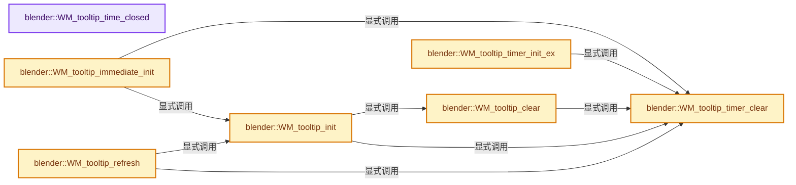
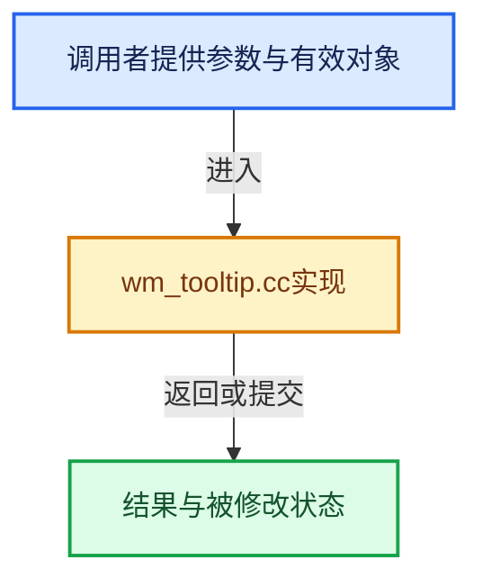

# 实现依赖专题：source/blender/windowmanager/intern/wm_tooltip.cc

[实现依赖导航](../../../README.md) · [符号索引](../../../../00-课程指南/02-源码与提交索引/符号依赖与实现索引.md)

本专题从正文实际调用进入，集中保存共享实现。函数有稳定锚点，可从调用处直接跳到对应完整函数；递归与互相调用通过回链组织。

## 本文件的实现关系






## 完整成员与函数实现

<a id="f-a7d14d4f57ac9898"></a>

### `blender::WM_tooltip_time_closed`

实现位置：[source/blender/windowmanager/intern/wm_tooltip.cc](../../../../../../../../source/blender/windowmanager/intern/wm_tooltip.cc) · L26—L29。

**教学注释版**

<!-- annotated:46cd3909896eae -->

```cpp
double WM_tooltip_time_closed()
{
  return g_tooltip_time_closed;
}
```

<details>
<summary>核对原始源码：source/blender/windowmanager/intern/wm_tooltip.cc · L26—L29</summary>

<!-- original:46cd3909896eae:source/blender/windowmanager/intern/wm_tooltip.cc:26:29 -->

```cpp
double WM_tooltip_time_closed()
{
  return g_tooltip_time_closed;
}
```

</details>

**结果出口**

- `return g_tooltip_time_closed;`

**继续追踪实现**

本实现没有需要继续展开的显式调用；检查返回表达式、对象转换和调用者前置条件。

<a id="f-44806b85fd89b692"></a>

### `blender::WM_tooltip_immediate_init`

实现位置：[source/blender/windowmanager/intern/wm_tooltip.cc](../../../../../../../../source/blender/windowmanager/intern/wm_tooltip.cc) · L31—L44。

接口参数：

- `bContext *C`
- `wmWindow *win`
- `ScrArea *area`
- `ARegion *region`
- `wmTooltipInitFn init`

**教学注释版**

<!-- annotated:8e75fc4207ee27 -->

```cpp
void WM_tooltip_immediate_init(
    bContext *C, wmWindow *win, ScrArea *area, ARegion *region, wmTooltipInitFn init)
{
  WM_tooltip_timer_clear(C, win);

  bScreen *screen = WM_window_get_active_screen(win);
  if (screen->tool_tip == nullptr) {
    screen->tool_tip = MEM_new_zeroed<wmTooltipState>(__func__);
  }
  screen->tool_tip->area_from = area;
  screen->tool_tip->region_from = region;
  screen->tool_tip->init = init;
  WM_tooltip_init(C, win);
}
```

<details>
<summary>核对原始源码：source/blender/windowmanager/intern/wm_tooltip.cc · L31—L44</summary>

<!-- original:8e75fc4207ee27:source/blender/windowmanager/intern/wm_tooltip.cc:31:44 -->

```cpp
void WM_tooltip_immediate_init(
    bContext *C, wmWindow *win, ScrArea *area, ARegion *region, wmTooltipInitFn init)
{
  WM_tooltip_timer_clear(C, win);

  bScreen *screen = WM_window_get_active_screen(win);
  if (screen->tool_tip == nullptr) {
    screen->tool_tip = MEM_new_zeroed<wmTooltipState>(__func__);
  }
  screen->tool_tip->area_from = area;
  screen->tool_tip->region_from = region;
  screen->tool_tip->init = init;
  WM_tooltip_init(C, win);
}
```

</details>

**沿实际写入检查状态**

- `screen->tool_tip = MEM_new_zeroed<wmTooltipState>(__func__);`
- `screen->tool_tip->area_from = area;`
- `screen->tool_tip->region_from = region;`
- `screen->tool_tip->init = init;`

**继续追踪实现**

- `WM_tooltip_timer_clear` → [blender::WM_tooltip_timer_clear · L72](wm_tooltip.cc.md#f-8a76091367efa4c0)。
- `WM_window_get_active_screen` → [blender::WM_window_get_active_screen · L3442](wm_window.cc.md#f-54952b6e38dc8344)。
- `MEM_new_zeroed<wmTooltipState>` → [MEM_new_zeroed · L550](../../../07-Intern运行时与平台/guardedalloc/MEM_guardedalloc.h.md#f-eeb1e2a7f57dd231)；[MEM_new_zeroed · L114](../../../07-Intern运行时与平台/guardedalloc/intern/mallocn.cc.md#f-e04cf01c64c8b180)。同名重载需按实参类型选择。
- `WM_tooltip_init` → [blender::WM_tooltip_init · L99](wm_tooltip.cc.md#f-f9a8d58c10035869)。

<a id="f-0bd58260433cdd40"></a>

### `blender::WM_tooltip_timer_init_ex`

实现位置：[source/blender/windowmanager/intern/wm_tooltip.cc](../../../../../../../../source/blender/windowmanager/intern/wm_tooltip.cc) · L46—L64。

接口参数：

- `bContext *C`
- `wmWindow *win`
- `ScrArea *area`
- `ARegion *region`
- `wmTooltipInitFn init`
- `double delay`

**教学注释版**

<!-- annotated:cfd453df9a836f -->

```cpp
void WM_tooltip_timer_init_ex(
    bContext *C, wmWindow *win, ScrArea *area, ARegion *region, wmTooltipInitFn init, double delay)
{
  WM_tooltip_timer_clear(C, win);

  bScreen *screen = WM_window_get_active_screen(win);
  wmWindowManager *wm = CTX_wm_manager(C);
  if (screen->tool_tip == nullptr) {
    screen->tool_tip = MEM_new_zeroed<wmTooltipState>(__func__);
  }
  screen->tool_tip->area_from = area;
  screen->tool_tip->region_from = region;
  screen->tool_tip->timer = WM_event_timer_add(wm, win, TIMER, delay);
  screen->tool_tip->init = init;

  /* Mouse position will be updated when the tooltip is shown, but save now
   * because we cancel the showing if there is movement before timer expiry. */
  copy_v2_v2_int(screen->tool_tip->event_xy, win->runtime->eventstate->xy);
}
```

<details>
<summary>核对原始源码：source/blender/windowmanager/intern/wm_tooltip.cc · L46—L64</summary>

<!-- original:cfd453df9a836f:source/blender/windowmanager/intern/wm_tooltip.cc:46:64 -->

```cpp
void WM_tooltip_timer_init_ex(
    bContext *C, wmWindow *win, ScrArea *area, ARegion *region, wmTooltipInitFn init, double delay)
{
  WM_tooltip_timer_clear(C, win);

  bScreen *screen = WM_window_get_active_screen(win);
  wmWindowManager *wm = CTX_wm_manager(C);
  if (screen->tool_tip == nullptr) {
    screen->tool_tip = MEM_new_zeroed<wmTooltipState>(__func__);
  }
  screen->tool_tip->area_from = area;
  screen->tool_tip->region_from = region;
  screen->tool_tip->timer = WM_event_timer_add(wm, win, TIMER, delay);
  screen->tool_tip->init = init;

  /* Mouse position will be updated when the tooltip is shown, but save now
   * because we cancel the showing if there is movement before timer expiry. */
  copy_v2_v2_int(screen->tool_tip->event_xy, win->runtime->eventstate->xy);
}
```

</details>

**沿实际写入检查状态**

- `screen->tool_tip = MEM_new_zeroed<wmTooltipState>(__func__);`
- `screen->tool_tip->area_from = area;`
- `screen->tool_tip->region_from = region;`
- `screen->tool_tip->timer = WM_event_timer_add(wm, win, TIMER, delay);`
- `screen->tool_tip->init = init;`

**继续追踪实现**

- `WM_tooltip_timer_clear` → [blender::WM_tooltip_timer_clear · L72](wm_tooltip.cc.md#f-8a76091367efa4c0)。
- `WM_window_get_active_screen` → [blender::WM_window_get_active_screen · L3442](wm_window.cc.md#f-54952b6e38dc8344)。
- `CTX_wm_manager` → [blender::CTX_wm_manager · L928](../../../02-BKE几何与数据/intern/context.cc.md#f-158f36db7379fbe8)。
- `MEM_new_zeroed<wmTooltipState>` → [MEM_new_zeroed · L550](../../../07-Intern运行时与平台/guardedalloc/MEM_guardedalloc.h.md#f-eeb1e2a7f57dd231)；[MEM_new_zeroed · L114](../../../07-Intern运行时与平台/guardedalloc/intern/mallocn.cc.md#f-e04cf01c64c8b180)。同名重载需按实参类型选择。
- `WM_event_timer_add` → [blender::WM_event_timer_add · L2555](wm_window.cc.md#f-b5fbc707cb32f70d)。
- `copy_v2_v2_int` → [blender::copy_v2_v2_int · L129](../../../01-BLI基础库/intern/math_vector_inline.cc.md#f-80f68f9495f4b7b8)。

<a id="f-8a76091367efa4c0"></a>

### `blender::WM_tooltip_timer_clear`

实现位置：[source/blender/windowmanager/intern/wm_tooltip.cc](../../../../../../../../source/blender/windowmanager/intern/wm_tooltip.cc) · L72—L82。

接口参数：

- `bContext *C`
- `wmWindow *win`

**教学注释版**

<!-- annotated:b4c3e235b3a9bb -->

```cpp
void WM_tooltip_timer_clear(bContext *C, wmWindow *win)
{
  wmWindowManager *wm = CTX_wm_manager(C);
  bScreen *screen = WM_window_get_active_screen(win);
  if (screen->tool_tip != nullptr) {
    if (screen->tool_tip->timer != nullptr) {
      WM_event_timer_remove(wm, win, screen->tool_tip->timer);
      screen->tool_tip->timer = nullptr;
    }
  }
}
```

<details>
<summary>核对原始源码：source/blender/windowmanager/intern/wm_tooltip.cc · L72—L82</summary>

<!-- original:b4c3e235b3a9bb:source/blender/windowmanager/intern/wm_tooltip.cc:72:82 -->

```cpp
void WM_tooltip_timer_clear(bContext *C, wmWindow *win)
{
  wmWindowManager *wm = CTX_wm_manager(C);
  bScreen *screen = WM_window_get_active_screen(win);
  if (screen->tool_tip != nullptr) {
    if (screen->tool_tip->timer != nullptr) {
      WM_event_timer_remove(wm, win, screen->tool_tip->timer);
      screen->tool_tip->timer = nullptr;
    }
  }
}
```

</details>

**沿实际写入检查状态**

- `screen->tool_tip->timer = nullptr;`

**继续追踪实现**

- `CTX_wm_manager` → [blender::CTX_wm_manager · L928](../../../02-BKE几何与数据/intern/context.cc.md#f-158f36db7379fbe8)。
- `WM_window_get_active_screen` → [blender::WM_window_get_active_screen · L3442](wm_window.cc.md#f-54952b6e38dc8344)。
- `WM_event_timer_remove` → [blender::WM_event_timer_remove · L2620](wm_window.cc.md#f-b9a941dd92720408)。

<a id="f-82cdc19e47b38291"></a>

### `blender::WM_tooltip_clear`

实现位置：[source/blender/windowmanager/intern/wm_tooltip.cc](../../../../../../../../source/blender/windowmanager/intern/wm_tooltip.cc) · L84—L97。

接口参数：

- `bContext *C`
- `wmWindow *win`

**教学注释版**

<!-- annotated:8379b49fa7e25f -->

```cpp
void WM_tooltip_clear(bContext *C, wmWindow *win)
{
  WM_tooltip_timer_clear(C, win);
  bScreen *screen = WM_window_get_active_screen(win);
  if (screen->tool_tip != nullptr) {
    if (screen->tool_tip->region) {
      ui::tooltip_free(C, screen, screen->tool_tip->region);
      screen->tool_tip->region = nullptr;
      g_tooltip_time_closed = BLI_time_now_seconds();
    }
    MEM_delete(screen->tool_tip);
    screen->tool_tip = nullptr;
  }
}
```

<details>
<summary>核对原始源码：source/blender/windowmanager/intern/wm_tooltip.cc · L84—L97</summary>

<!-- original:8379b49fa7e25f:source/blender/windowmanager/intern/wm_tooltip.cc:84:97 -->

```cpp
void WM_tooltip_clear(bContext *C, wmWindow *win)
{
  WM_tooltip_timer_clear(C, win);
  bScreen *screen = WM_window_get_active_screen(win);
  if (screen->tool_tip != nullptr) {
    if (screen->tool_tip->region) {
      ui::tooltip_free(C, screen, screen->tool_tip->region);
      screen->tool_tip->region = nullptr;
      g_tooltip_time_closed = BLI_time_now_seconds();
    }
    MEM_delete(screen->tool_tip);
    screen->tool_tip = nullptr;
  }
}
```

</details>

**沿实际写入检查状态**

- `screen->tool_tip->region = nullptr;`
- `g_tooltip_time_closed = BLI_time_now_seconds();`
- `screen->tool_tip = nullptr;`

**继续追踪实现**

- `WM_tooltip_timer_clear` → [blender::WM_tooltip_timer_clear · L72](wm_tooltip.cc.md#f-8a76091367efa4c0)。
- `WM_window_get_active_screen` → [blender::WM_window_get_active_screen · L3442](wm_window.cc.md#f-54952b6e38dc8344)。
- `ui::tooltip_free` → [blender::ui::tooltip_free · L2068](../../editors/interface/regions/interface_region_tooltip.cc.md#f-c6f2cbec6ef04825)。
- `BLI_time_now_seconds` → [blender::BLI_time_now_seconds · L30](../../../01-BLI基础库/intern/time.cc.md#f-78479f031bcc3c53)。
- `MEM_delete` → [MEM_delete · L400](../../../07-Intern运行时与平台/guardedalloc/MEM_guardedalloc.h.md#f-9049ffdd1682887c)。

<a id="f-f9a8d58c10035869"></a>

### `blender::WM_tooltip_init`

实现位置：[source/blender/windowmanager/intern/wm_tooltip.cc](../../../../../../../../source/blender/windowmanager/intern/wm_tooltip.cc) · L99—L133。

接口参数：

- `bContext *C`
- `wmWindow *win`

**教学注释版**

<!-- annotated:2b6f68ebf3eca4 -->

```cpp
void WM_tooltip_init(bContext *C, wmWindow *win)
{
  WM_tooltip_timer_clear(C, win);
  bScreen *screen = WM_window_get_active_screen(win);
  if (screen->tool_tip->region) {
    ui::tooltip_free(C, screen, screen->tool_tip->region);
    screen->tool_tip->region = nullptr;
  }
  const int pass_prev = screen->tool_tip->pass;
  double pass_delay = 0.0;

  {
    ScrArea *area_prev = CTX_wm_area(C);
    ARegion *region_prev = CTX_wm_region(C);
    CTX_wm_area_set(C, screen->tool_tip->area_from);
    CTX_wm_region_set(C, screen->tool_tip->region_from);
    screen->tool_tip->region = screen->tool_tip->init(C,
                                                      screen->tool_tip->region_from,
                                                      &screen->tool_tip->pass,
                                                      &pass_delay,
                                                      &screen->tool_tip->exit_on_event);
    CTX_wm_area_set(C, area_prev);
    CTX_wm_region_set(C, region_prev);
  }

  copy_v2_v2_int(screen->tool_tip->event_xy, win->runtime->eventstate->xy);
  if (pass_prev != screen->tool_tip->pass) {
    /* The pass changed, add timer for next pass. */
    wmWindowManager *wm = CTX_wm_manager(C);
    screen->tool_tip->timer = WM_event_timer_add(wm, win, TIMER, pass_delay);
  }
  if (screen->tool_tip->region == nullptr) {
    WM_tooltip_clear(C, win);
  }
}
```

<details>
<summary>核对原始源码：source/blender/windowmanager/intern/wm_tooltip.cc · L99—L133</summary>

<!-- original:2b6f68ebf3eca4:source/blender/windowmanager/intern/wm_tooltip.cc:99:133 -->

```cpp
void WM_tooltip_init(bContext *C, wmWindow *win)
{
  WM_tooltip_timer_clear(C, win);
  bScreen *screen = WM_window_get_active_screen(win);
  if (screen->tool_tip->region) {
    ui::tooltip_free(C, screen, screen->tool_tip->region);
    screen->tool_tip->region = nullptr;
  }
  const int pass_prev = screen->tool_tip->pass;
  double pass_delay = 0.0;

  {
    ScrArea *area_prev = CTX_wm_area(C);
    ARegion *region_prev = CTX_wm_region(C);
    CTX_wm_area_set(C, screen->tool_tip->area_from);
    CTX_wm_region_set(C, screen->tool_tip->region_from);
    screen->tool_tip->region = screen->tool_tip->init(C,
                                                      screen->tool_tip->region_from,
                                                      &screen->tool_tip->pass,
                                                      &pass_delay,
                                                      &screen->tool_tip->exit_on_event);
    CTX_wm_area_set(C, area_prev);
    CTX_wm_region_set(C, region_prev);
  }

  copy_v2_v2_int(screen->tool_tip->event_xy, win->runtime->eventstate->xy);
  if (pass_prev != screen->tool_tip->pass) {
    /* The pass changed, add timer for next pass. */
    wmWindowManager *wm = CTX_wm_manager(C);
    screen->tool_tip->timer = WM_event_timer_add(wm, win, TIMER, pass_delay);
  }
  if (screen->tool_tip->region == nullptr) {
    WM_tooltip_clear(C, win);
  }
}
```

</details>

**沿实际写入检查状态**

- `screen->tool_tip->region = nullptr;`
- `screen->tool_tip->region = screen->tool_tip->init(C,`
- `screen->tool_tip->timer = WM_event_timer_add(wm, win, TIMER, pass_delay);`

**继续追踪实现**

- `WM_tooltip_timer_clear` → [blender::WM_tooltip_timer_clear · L72](wm_tooltip.cc.md#f-8a76091367efa4c0)。
- `WM_window_get_active_screen` → [blender::WM_window_get_active_screen · L3442](wm_window.cc.md#f-54952b6e38dc8344)。
- `ui::tooltip_free` → [blender::ui::tooltip_free · L2068](../../editors/interface/regions/interface_region_tooltip.cc.md#f-c6f2cbec6ef04825)。
- `CTX_wm_area` → [blender::CTX_wm_area · L954](../../../02-BKE几何与数据/intern/context.cc.md#f-f8ad7c2c364d711c)。
- `CTX_wm_region` → [blender::CTX_wm_region · L965](../../../02-BKE几何与数据/intern/context.cc.md#f-6cc0a26bc4539ae0)。
- `CTX_wm_area_set` → [blender::CTX_wm_area_set · L1226](../../../02-BKE几何与数据/intern/context.cc.md#f-d1a016e39c2c0baa)。
- `CTX_wm_region_set` → [blender::CTX_wm_region_set · L1240](../../../02-BKE几何与数据/intern/context.cc.md#f-7c17937537b1c2fc)。
- `screen->tool_tip->init` → [调用协议](../../../../00-课程指南/01-路线与规范/模板宏与动态分派协议.md)：接收对象类型依赖auto、返回值或模板实例；不按同名猜测目标。调用位置L115。
- `copy_v2_v2_int` → [blender::copy_v2_v2_int · L129](../../../01-BLI基础库/intern/math_vector_inline.cc.md#f-80f68f9495f4b7b8)。
- `CTX_wm_manager` → [blender::CTX_wm_manager · L928](../../../02-BKE几何与数据/intern/context.cc.md#f-158f36db7379fbe8)。
- `WM_event_timer_add` → [blender::WM_event_timer_add · L2555](wm_window.cc.md#f-b5fbc707cb32f70d)。
- `WM_tooltip_clear` → [blender::WM_tooltip_clear · L84](wm_tooltip.cc.md#f-82cdc19e47b38291)。

<a id="f-ccfa9478c16ffc42"></a>

### `blender::WM_tooltip_refresh`

实现位置：[source/blender/windowmanager/intern/wm_tooltip.cc](../../../../../../../../source/blender/windowmanager/intern/wm_tooltip.cc) · L135—L146。

接口参数：

- `bContext *C`
- `wmWindow *win`

**教学注释版**

<!-- annotated:3503e01b92f184 -->

```cpp
void WM_tooltip_refresh(bContext *C, wmWindow *win)
{
  WM_tooltip_timer_clear(C, win);
  bScreen *screen = WM_window_get_active_screen(win);
  if (screen->tool_tip != nullptr) {
    if (screen->tool_tip->region) {
      ui::tooltip_free(C, screen, screen->tool_tip->region);
      screen->tool_tip->region = nullptr;
    }
    WM_tooltip_init(C, win);
  }
}
```

<details>
<summary>核对原始源码：source/blender/windowmanager/intern/wm_tooltip.cc · L135—L146</summary>

<!-- original:3503e01b92f184:source/blender/windowmanager/intern/wm_tooltip.cc:135:146 -->

```cpp
void WM_tooltip_refresh(bContext *C, wmWindow *win)
{
  WM_tooltip_timer_clear(C, win);
  bScreen *screen = WM_window_get_active_screen(win);
  if (screen->tool_tip != nullptr) {
    if (screen->tool_tip->region) {
      ui::tooltip_free(C, screen, screen->tool_tip->region);
      screen->tool_tip->region = nullptr;
    }
    WM_tooltip_init(C, win);
  }
}
```

</details>

**沿实际写入检查状态**

- `screen->tool_tip->region = nullptr;`

**继续追踪实现**

- `WM_tooltip_timer_clear` → [blender::WM_tooltip_timer_clear · L72](wm_tooltip.cc.md#f-8a76091367efa4c0)。
- `WM_window_get_active_screen` → [blender::WM_window_get_active_screen · L3442](wm_window.cc.md#f-54952b6e38dc8344)。
- `ui::tooltip_free` → [blender::ui::tooltip_free · L2068](../../editors/interface/regions/interface_region_tooltip.cc.md#f-c6f2cbec6ef04825)。
- `WM_tooltip_init` → [blender::WM_tooltip_init · L99](wm_tooltip.cc.md#f-f9a8d58c10035869)。
