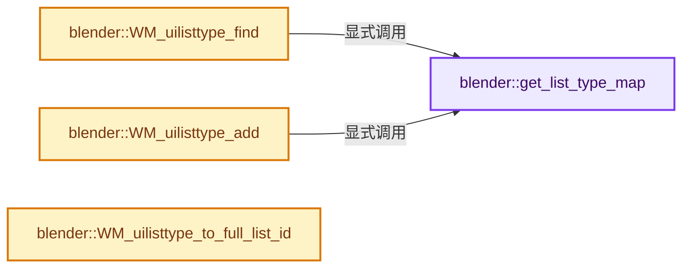

# 实现依赖专题：source/blender/windowmanager/intern/wm_uilist_type.cc

[实现依赖导航](../../../README.md) · [符号索引](../../../../00-课程指南/02-源码与提交索引/符号依赖与实现索引.md)

本专题从正文实际调用进入，集中保存共享实现。函数有稳定锚点，可从调用处直接跳到对应完整函数；递归与互相调用通过回链组织。

## 本文件的实现关系




## 完整成员与函数实现

<a id="f-c69d9ab6683df638"></a>

### `blender::get_list_type_map`

实现位置：[source/blender/windowmanager/intern/wm_uilist_type.cc](../../../../../../../../source/blender/windowmanager/intern/wm_uilist_type.cc) · L35—L45。

**教学注释版**

<!-- annotated:2192ff3d9971a8 -->

```cpp
static auto &get_list_type_map()
{
  struct IDNameGetter {
    StringRef operator()(const uiListType *value) const
    {
      return StringRef(value->idname);
    }
  };
  static CustomIDVectorSet<uiListType *, IDNameGetter> map;
  return map;
}
```

<details>
<summary>核对原始源码：source/blender/windowmanager/intern/wm_uilist_type.cc · L35—L45</summary>

<!-- original:2192ff3d9971a8:source/blender/windowmanager/intern/wm_uilist_type.cc:35:45 -->

```cpp
static auto &get_list_type_map()
{
  struct IDNameGetter {
    StringRef operator()(const uiListType *value) const
    {
      return StringRef(value->idname);
    }
  };
  static CustomIDVectorSet<uiListType *, IDNameGetter> map;
  return map;
}
```

</details>

**结果出口**

- `return StringRef(value->idname);`
- `return map;`

**继续追踪实现**

- `StringRef` → [blender::StringRef::StringRef · L555](../../../../01-基础容器与现代CPP/15-StringRef字符串视图.md#f-f6aca324a36faa7e)；[blender::StringRef::StringRef · L560](../../../../01-基础容器与现代CPP/15-StringRef字符串视图.md#f-ab9714781ca51bac)；[blender::StringRef::StringRef · L565](../../../../01-基础容器与现代CPP/15-StringRef字符串视图.md#f-95f0b483bbdd7739)；[blender::StringRef::StringRef · L570](../../../../01-基础容器与现代CPP/15-StringRef字符串视图.md#f-808d05699cb33334)；[blender::StringRef::StringRef · L631](../../../../01-基础容器与现代CPP/15-StringRef字符串视图.md#f-37788e5f3fa3b736)；[blender::StringRef::StringRef · L641](../../../../01-基础容器与现代CPP/15-StringRef字符串视图.md#f-11abd0510fb6b926)；[blender::StringRef::StringRef · L646](../../../../01-基础容器与现代CPP/15-StringRef字符串视图.md#f-8437dbd8a582eefd)；[blender::StringRef::StringRef · L651](../../../../01-基础容器与现代CPP/15-StringRef字符串视图.md#f-70bcb338de0db978)。同名重载需按实参类型选择。

<a id="f-c4c6b0f9856de7fa"></a>

### `blender::WM_uilisttype_find`

实现位置：[source/blender/windowmanager/intern/wm_uilist_type.cc](../../../../../../../../source/blender/windowmanager/intern/wm_uilist_type.cc) · L47—L60。

接口参数：

- `const StringRef idname`
- `bool quiet`

**教学注释版**

<!-- annotated:d26f56f0a38c63 -->

```cpp
uiListType *WM_uilisttype_find(const StringRef idname, bool quiet)
{
  if (!idname.is_empty()) {
    if (uiListType *const *ult = get_list_type_map().lookup_key_ptr_as(idname)) {
      return *ult;
    }
  }

  if (!quiet) {
    printf("search for unknown uilisttype %s\n", std::string(idname).c_str());
  }

  return nullptr;
}
```

<details>
<summary>核对原始源码：source/blender/windowmanager/intern/wm_uilist_type.cc · L47—L60</summary>

<!-- original:d26f56f0a38c63:source/blender/windowmanager/intern/wm_uilist_type.cc:47:60 -->

```cpp
uiListType *WM_uilisttype_find(const StringRef idname, bool quiet)
{
  if (!idname.is_empty()) {
    if (uiListType *const *ult = get_list_type_map().lookup_key_ptr_as(idname)) {
      return *ult;
    }
  }

  if (!quiet) {
    printf("search for unknown uilisttype %s\n", std::string(idname).c_str());
  }

  return nullptr;
}
```

</details>

**结果出口**

- `return *ult;`
- `return nullptr;`

**继续追踪实现**

- `idname.is_empty` → [blender::Bounds<T>::is_empty · L533](../../../../12-空间数据结构与几何算法/07-Bounds与BVH对比.md#f-55ac376b3d0a0944)；[blender::GVArrayCommon::is_empty · L767](../../../../04-虚拟数组与索引选择/05-GVArray运行时类型.md#f-c1da602ffc5555f9)；[blender::StringRefBase::is_empty · L201](../../../../01-基础容器与现代CPP/15-StringRef字符串视图.md#f-9f6c3d2da1cb1796)；[blender::KDTreeNew<T>::is_empty · L498](../../../../12-空间数据结构与几何算法/05-K近邻与范围查询.md#f-67f0ff91cf00b00b)。同名重载需按实参类型选择。
- `get_list_type_map().lookup_key_ptr_as` → [调用协议](../../../../00-课程指南/01-路线与规范/模板宏与动态分派协议.md)：接收对象类型依赖auto、返回值或模板实例；不按同名猜测目标。调用位置L50。
- `get_list_type_map` → [blender::get_list_type_map · L35](wm_uilist_type.cc.md#f-c69d9ab6683df638)。
- `printf` → [外部契约](https://eel.is/c++draft/)：这个边界按实际表达式及所属类型核对参数、返回值、寿命与失败行为。这里提供接口入口，不声称已解释该第三方版本的内部实现。
- `std::string(idname).c_str` → [外部契约](https://eel.is/c++draft/)：这个边界按实际表达式及所属类型核对参数、返回值、寿命与失败行为。这里提供接口入口，不声称已解释该第三方版本的内部实现。
- `std::string` → [外部契约](https://eel.is/c++draft/)：这个边界按实际表达式及所属类型核对参数、返回值、寿命与失败行为。这里提供接口入口，不声称已解释该第三方版本的内部实现。

<a id="f-5b2d99da0b0a736e"></a>

### `blender::WM_uilisttype_add`

实现位置：[source/blender/windowmanager/intern/wm_uilist_type.cc](../../../../../../../../source/blender/windowmanager/intern/wm_uilist_type.cc) · L62—L66。

接口参数：

- `uiListType *ult`

**教学注释版**

<!-- annotated:8375cc2a1588ee -->

```cpp
bool WM_uilisttype_add(uiListType *ult)
{
  get_list_type_map().add(ult);
  return true;
}
```

<details>
<summary>核对原始源码：source/blender/windowmanager/intern/wm_uilist_type.cc · L62—L66</summary>

<!-- original:8375cc2a1588ee:source/blender/windowmanager/intern/wm_uilist_type.cc:62:66 -->

```cpp
bool WM_uilisttype_add(uiListType *ult)
{
  get_list_type_map().add(ult);
  return true;
}
```

</details>

**结果出口**

- `return true;`

**继续追踪实现**

- `get_list_type_map().add` → [调用协议](../../../../00-课程指南/01-路线与规范/模板宏与动态分派协议.md)：接收对象类型依赖auto、返回值或模板实例；不按同名猜测目标。调用位置L64。
- `get_list_type_map` → [blender::get_list_type_map · L35](wm_uilist_type.cc.md#f-c69d9ab6683df638)。

<a id="f-35e2f754b856ce4f"></a>

### `blender::WM_uilisttype_to_full_list_id`

实现位置：[source/blender/windowmanager/intern/wm_uilist_type.cc](../../../../../../../../source/blender/windowmanager/intern/wm_uilist_type.cc) · L154—L160。

接口参数：

- `const uiListType *ult`
- `const char *list_id`
- `char r_full_list_id[/*UI_MAX_NAME_STR*/]`

**教学注释版**

<!-- annotated:75d464bd02ea78 -->

```cpp
void WM_uilisttype_to_full_list_id(const uiListType *ult,
                                   const char *list_id,
                                   char r_full_list_id[/*UI_MAX_NAME_STR*/])
{
  /* We tag the list id with the list type... */
  BLI_snprintf_utf8(r_full_list_id, UI_MAX_NAME_STR, "%s_%s", ult->idname, list_id ? list_id : "");
}
```

<details>
<summary>核对原始源码：source/blender/windowmanager/intern/wm_uilist_type.cc · L154—L160</summary>

<!-- original:75d464bd02ea78:source/blender/windowmanager/intern/wm_uilist_type.cc:154:160 -->

```cpp
void WM_uilisttype_to_full_list_id(const uiListType *ult,
                                   const char *list_id,
                                   char r_full_list_id[/*UI_MAX_NAME_STR*/])
{
  /* We tag the list id with the list type... */
  BLI_snprintf_utf8(r_full_list_id, UI_MAX_NAME_STR, "%s_%s", ult->idname, list_id ? list_id : "");
}
```

</details>

**继续追踪实现**

- `BLI_snprintf_utf8` → [blender::BLI_snprintf_utf8 · L597](../../../01-BLI基础库/intern/string_utf8.cc.md#f-47c5b052ec665ff6)。
