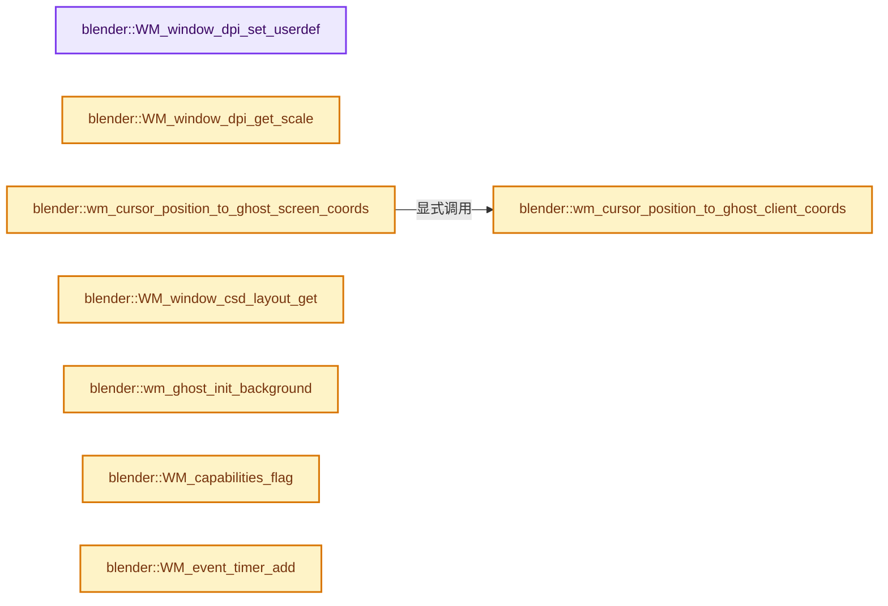
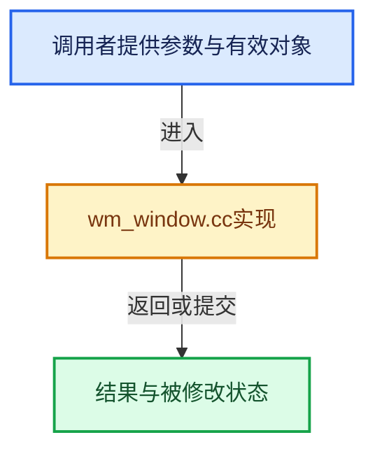

# 实现依赖专题：source/blender/windowmanager/intern/wm_window.cc

[实现依赖导航](../../../README.md) · [符号索引](../../../../00-课程指南/02-源码与提交索引/符号依赖与实现索引.md)

本专题从正文实际调用进入，集中保存共享实现。函数有稳定锚点，可从调用处直接跳到对应完整函数；递归与互相调用通过回链组织。

## 本文件的实现关系






## 完整成员与函数实现

<a id="f-84926cd7f2ece3e1"></a>

### `blender::WM_window_dpi_set_userdef`

实现位置：[source/blender/windowmanager/intern/wm_window.cc](../../../../../../../../source/blender/windowmanager/intern/wm_window.cc) · L726—L771。

接口参数：

- `const wmWindow *win`

**教学注释版**

<!-- annotated:d5b1ce94a6bd4f -->

```cpp
void WM_window_dpi_set_userdef(const wmWindow *win)
{
  GHOST_IWindow *ghost_window = static_cast<GHOST_IWindow *>(win->runtime->ghostwin);
  float auto_dpi = ghost_window->getDPIHint();

  /* Clamp auto DPI to 96, since our font/interface drawing does not work well
   * with lower sizes. The main case we are interested in supporting is higher
   * DPI. If a smaller UI is desired it is still possible to adjust UI scale. */
  auto_dpi = max_ff(auto_dpi, 96.0f);

  /* Lazily init UI scale size, preserving backwards compatibility by
   * computing UI scale from ratio of previous DPI and auto DPI. */
  if (U.ui_scale == 0) {
    int virtual_pixel = (U.virtual_pixel == VIRTUAL_PIXEL_NATIVE) ? 1 : 2;

    if (U.dpi == 0) {
      U.ui_scale = virtual_pixel;
    }
    else {
      U.ui_scale = (virtual_pixel * U.dpi * 96.0f) / (auto_dpi * 72.0f);
    }

    CLAMP(U.ui_scale, 0.25f, 4.0f);
  }

  /* Blender's UI drawing assumes DPI 72 as a good default following macOS
   * while Windows and Linux use DPI 96. GHOST assumes a default 96 so we
   * remap the DPI to Blender's convention. */
  auto_dpi *= ghost_window->getNativePixelSize();
  U.dpi = auto_dpi * U.ui_scale * (72.0 / 96.0f);

  /* Automatically set larger pixel size for high DPI. */
  int pixelsize = max_ii(1, (U.dpi / 64));
  /* User adjustment for pixel size. */
  pixelsize = max_ii(1, pixelsize + U.ui_line_width);

  /* Set user preferences globals for drawing, and for forward compatibility. */
  U.pixelsize = pixelsize;
  U.virtual_pixel = (pixelsize == 1) ? VIRTUAL_PIXEL_NATIVE : VIRTUAL_PIXEL_DOUBLE;
  U.scale_factor = U.dpi / 72.0f;
  U.inv_scale_factor = 1.0f / U.scale_factor;

  /* Widget unit is 20 pixels at 1X scale. This consists of 18 user-scaled units plus
   * left and right borders of line-width (pixel-size). */
  U.widget_unit = int(roundf(18.0f * U.scale_factor)) + (2 * pixelsize);
}
```

<details>
<summary>核对原始源码：source/blender/windowmanager/intern/wm_window.cc · L726—L771</summary>

<!-- original:d5b1ce94a6bd4f:source/blender/windowmanager/intern/wm_window.cc:726:771 -->

```cpp
void WM_window_dpi_set_userdef(const wmWindow *win)
{
  GHOST_IWindow *ghost_window = static_cast<GHOST_IWindow *>(win->runtime->ghostwin);
  float auto_dpi = ghost_window->getDPIHint();

  /* Clamp auto DPI to 96, since our font/interface drawing does not work well
   * with lower sizes. The main case we are interested in supporting is higher
   * DPI. If a smaller UI is desired it is still possible to adjust UI scale. */
  auto_dpi = max_ff(auto_dpi, 96.0f);

  /* Lazily init UI scale size, preserving backwards compatibility by
   * computing UI scale from ratio of previous DPI and auto DPI. */
  if (U.ui_scale == 0) {
    int virtual_pixel = (U.virtual_pixel == VIRTUAL_PIXEL_NATIVE) ? 1 : 2;

    if (U.dpi == 0) {
      U.ui_scale = virtual_pixel;
    }
    else {
      U.ui_scale = (virtual_pixel * U.dpi * 96.0f) / (auto_dpi * 72.0f);
    }

    CLAMP(U.ui_scale, 0.25f, 4.0f);
  }

  /* Blender's UI drawing assumes DPI 72 as a good default following macOS
   * while Windows and Linux use DPI 96. GHOST assumes a default 96 so we
   * remap the DPI to Blender's convention. */
  auto_dpi *= ghost_window->getNativePixelSize();
  U.dpi = auto_dpi * U.ui_scale * (72.0 / 96.0f);

  /* Automatically set larger pixel size for high DPI. */
  int pixelsize = max_ii(1, (U.dpi / 64));
  /* User adjustment for pixel size. */
  pixelsize = max_ii(1, pixelsize + U.ui_line_width);

  /* Set user preferences globals for drawing, and for forward compatibility. */
  U.pixelsize = pixelsize;
  U.virtual_pixel = (pixelsize == 1) ? VIRTUAL_PIXEL_NATIVE : VIRTUAL_PIXEL_DOUBLE;
  U.scale_factor = U.dpi / 72.0f;
  U.inv_scale_factor = 1.0f / U.scale_factor;

  /* Widget unit is 20 pixels at 1X scale. This consists of 18 user-scaled units plus
   * left and right borders of line-width (pixel-size). */
  U.widget_unit = int(roundf(18.0f * U.scale_factor)) + (2 * pixelsize);
}
```

</details>

**沿实际写入检查状态**

- `auto_dpi = max_ff(auto_dpi, 96.0f);`
- `U.ui_scale = virtual_pixel;`
- `U.ui_scale = (virtual_pixel * U.dpi * 96.0f) / (auto_dpi * 72.0f);`
- `auto_dpi *= ghost_window->getNativePixelSize();`
- `U.dpi = auto_dpi * U.ui_scale * (72.0 / 96.0f);`
- `pixelsize = max_ii(1, pixelsize + U.ui_line_width);`
- `U.pixelsize = pixelsize;`
- `U.virtual_pixel = (pixelsize == 1) ? VIRTUAL_PIXEL_NATIVE : VIRTUAL_PIXEL_DOUBLE;`
- `U.scale_factor = U.dpi / 72.0f;`
- `U.inv_scale_factor = 1.0f / U.scale_factor;`
- `U.widget_unit = int(roundf(18.0f * U.scale_factor)) + (2 * pixelsize);`

**继续追踪实现**

- `ghost_window->getDPIHint` → [调用协议](../../../../00-课程指南/01-路线与规范/模板宏与动态分派协议.md)：由接收对象具体类型或运行时策略提供实现。调用位置L729。
- `max_ff` → [blender::max_ff · L325](../../../01-BLI基础库/intern/math_base_inline.cc.md#f-05a351a3afd7dc2a)。
- `CLAMP` → [CLAMP · L200](../../../01-BLI基础库/BLI_utildefines.hh.md#m-69703e497120)。宏定义由构建条件选择。
- `ghost_window->getNativePixelSize` → [GHOST_Window::getNativePixelSize · L230](../../../07-Intern运行时与平台/ghost/intern/GHOST_Window.hh.md#f-2e3e47958eb26427)。
- `max_ii` → [blender::max_ii · L368](../../../01-BLI基础库/intern/math_base_inline.cc.md#f-c45aa7b373adb94c)。
- `roundf` → [roundf · L174](../../../07-Intern运行时与平台/cycles/kernel/device/oneapi/compat.h.md#m-bdf6eb01f4f1)；[roundf · L272](../../../07-Intern运行时与平台/cycles/kernel/device/metal/compat.h.md#m-97b17e1586c9)。宏定义由构建条件选择。

<a id="f-8be3ca4f7dcd9349"></a>

### `blender::WM_window_dpi_get_scale`

实现位置：[source/blender/windowmanager/intern/wm_window.cc](../../../../../../../../source/blender/windowmanager/intern/wm_window.cc) · L773—L786。

接口参数：

- `const wmWindow *win`

**教学注释版**

<!-- annotated:066f58fbef5a81 -->

```cpp
float WM_window_dpi_get_scale(const wmWindow *win)
{
  GHOST_IWindow *ghost_window = static_cast<GHOST_IWindow *>(win->runtime->ghostwin);

  const uint16_t dpi_base = 96;
  // [讲解] std::max<uint16_t>：按比较关系选取较大值。本讲解中的增长公式同时满足最低请求和几何增长；若保存返回引用，还需注意实参寿命。
  const uint16_t dpi_fixed = std::max<uint16_t>(dpi_base, ghost_window->getDPIHint());

  float dpi = float(dpi_fixed);
  if (OS_MAC) {
    dpi *= ghost_window->getNativePixelSize();
  }

  return dpi / float(dpi_base);
}
```

<details>
<summary>核对原始源码：source/blender/windowmanager/intern/wm_window.cc · L773—L786</summary>

<!-- original:066f58fbef5a81:source/blender/windowmanager/intern/wm_window.cc:773:786 -->

```cpp
float WM_window_dpi_get_scale(const wmWindow *win)
{
  GHOST_IWindow *ghost_window = static_cast<GHOST_IWindow *>(win->runtime->ghostwin);

  const uint16_t dpi_base = 96;
  const uint16_t dpi_fixed = std::max<uint16_t>(dpi_base, ghost_window->getDPIHint());

  float dpi = float(dpi_fixed);
  if (OS_MAC) {
    dpi *= ghost_window->getNativePixelSize();
  }

  return dpi / float(dpi_base);
}
```

</details>

**沿实际写入检查状态**

- `dpi *= ghost_window->getNativePixelSize();`

**结果出口**

- `return dpi / float(dpi_base);`

**继续追踪实现**

- `std::max<uint16_t>` → [外部契约](https://eel.is/c++draft/alg.min.max)：按比较关系选取较大值。本讲解中的增长公式同时满足最低请求和几何增长；若保存返回引用，还需注意实参寿命。
- `ghost_window->getDPIHint` → [调用协议](../../../../00-课程指南/01-路线与规范/模板宏与动态分派协议.md)：由接收对象具体类型或运行时策略提供实现。调用位置L778。
- `ghost_window->getNativePixelSize` → [GHOST_Window::getNativePixelSize · L230](../../../07-Intern运行时与平台/ghost/intern/GHOST_Window.hh.md#f-2e3e47958eb26427)。

<a id="f-d5ac056c21cf4e97"></a>

### `blender::wm_cursor_position_to_ghost_client_coords`

实现位置：[source/blender/windowmanager/intern/wm_window.cc](../../../../../../../../source/blender/windowmanager/intern/wm_window.cc) · L1587—L1595。

接口参数：

- `wmWindow *win`
- `int *x`
- `int *y`

**教学注释版**

<!-- annotated:8fc03c14192337 -->

```cpp
void wm_cursor_position_to_ghost_client_coords(wmWindow *win, int *x, int *y)
{
  GHOST_IWindow *ghost_window = static_cast<GHOST_IWindow *>(win->runtime->ghostwin);
  const float fac = ghost_window->getNativePixelSize();

  *x /= fac;
  *y /= fac;
  *y = win->sizey - *y - 1;
}
```

<details>
<summary>核对原始源码：source/blender/windowmanager/intern/wm_window.cc · L1587—L1595</summary>

<!-- original:8fc03c14192337:source/blender/windowmanager/intern/wm_window.cc:1587:1595 -->

```cpp
void wm_cursor_position_to_ghost_client_coords(wmWindow *win, int *x, int *y)
{
  GHOST_IWindow *ghost_window = static_cast<GHOST_IWindow *>(win->runtime->ghostwin);
  const float fac = ghost_window->getNativePixelSize();

  *x /= fac;
  *y /= fac;
  *y = win->sizey - *y - 1;
}
```

</details>

**继续追踪实现**

- `ghost_window->getNativePixelSize` → [GHOST_Window::getNativePixelSize · L230](../../../07-Intern运行时与平台/ghost/intern/GHOST_Window.hh.md#f-2e3e47958eb26427)。

<a id="f-8a4cc88f2e5d2744"></a>

### `blender::wm_cursor_position_to_ghost_screen_coords`

实现位置：[source/blender/windowmanager/intern/wm_window.cc](../../../../../../../../source/blender/windowmanager/intern/wm_window.cc) · L1605—L1611。

接口参数：

- `wmWindow *win`
- `int *x`
- `int *y`

**教学注释版**

<!-- annotated:13a37f6be05d2f -->

```cpp
void wm_cursor_position_to_ghost_screen_coords(wmWindow *win, int *x, int *y)
{
  wm_cursor_position_to_ghost_client_coords(win, x, y);

  const GHOST_IWindow *ghost_window = static_cast<GHOST_IWindow *>(win->runtime->ghostwin);
  ghost_window->clientToScreen(*x, *y, *x, *y);
}
```

<details>
<summary>核对原始源码：source/blender/windowmanager/intern/wm_window.cc · L1605—L1611</summary>

<!-- original:13a37f6be05d2f:source/blender/windowmanager/intern/wm_window.cc:1605:1611 -->

```cpp
void wm_cursor_position_to_ghost_screen_coords(wmWindow *win, int *x, int *y)
{
  wm_cursor_position_to_ghost_client_coords(win, x, y);

  const GHOST_IWindow *ghost_window = static_cast<GHOST_IWindow *>(win->runtime->ghostwin);
  ghost_window->clientToScreen(*x, *y, *x, *y);
}
```

</details>

**继续追踪实现**

- `wm_cursor_position_to_ghost_client_coords` → [blender::wm_cursor_position_to_ghost_client_coords · L1587](wm_window.cc.md#f-d5ac056c21cf4e97)。
- `ghost_window->clientToScreen` → [调用协议](../../../../00-课程指南/01-路线与规范/模板宏与动态分派协议.md)：由接收对象具体类型或运行时策略提供实现。调用位置L1610。

<a id="f-52a2b0a3eaf5f9c8"></a>

### `blender::WM_window_csd_layout_get`

实现位置：[source/blender/windowmanager/intern/wm_window.cc](../../../../../../../../source/blender/windowmanager/intern/wm_window.cc) · L2294—L2297。

**教学注释版**

<!-- annotated:5b7cfce72d661d -->

```cpp
const GHOST_CSD_Layout *WM_window_csd_layout_get()
{
  return &g_system->getWindowCSD_Layout();
}
```

<details>
<summary>核对原始源码：source/blender/windowmanager/intern/wm_window.cc · L2294—L2297</summary>

<!-- original:5b7cfce72d661d:source/blender/windowmanager/intern/wm_window.cc:2294:2297 -->

```cpp
const GHOST_CSD_Layout *WM_window_csd_layout_get()
{
  return &g_system->getWindowCSD_Layout();
}
```

</details>

**结果出口**

- `return &g_system->getWindowCSD_Layout();`

**继续追踪实现**

- `g_system->getWindowCSD_Layout` → [调用协议](../../../../00-课程指南/01-路线与规范/模板宏与动态分派协议.md)：接收对象类型依赖auto、返回值或模板实例；不按同名猜测目标。调用位置L2296。

<a id="f-864081e28ff10c39"></a>

### `blender::wm_ghost_init_background`

实现位置：[source/blender/windowmanager/intern/wm_window.cc](../../../../../../../../source/blender/windowmanager/intern/wm_window.cc) · L2360—L2379。

**教学注释版**

<!-- annotated:c7ebc460ebe5d2 -->

```cpp
void wm_ghost_init_background()
{
  /* TODO: move this to `wm_init_exit.cc`. */

  if (g_system) {
    return;
  }

  GHOST_ISystem::setBacktraceFn(BLI_system_backtrace);

  GHOST_ISystem::createSystemBackground();
  g_system = GHOST_ISystem::getSystem();
  GPU_backend_ghost_system_set(g_system);

  GHOST_Debug debug = {0};
  if (G.debug & G_DEBUG_GHOST) {
    debug.flags |= GHOST_kDebugDefault;
  }
  g_system->initDebug(debug);
}
```

<details>
<summary>核对原始源码：source/blender/windowmanager/intern/wm_window.cc · L2360—L2379</summary>

<!-- original:c7ebc460ebe5d2:source/blender/windowmanager/intern/wm_window.cc:2360:2379 -->

```cpp
void wm_ghost_init_background()
{
  /* TODO: move this to `wm_init_exit.cc`. */

  if (g_system) {
    return;
  }

  GHOST_ISystem::setBacktraceFn(BLI_system_backtrace);

  GHOST_ISystem::createSystemBackground();
  g_system = GHOST_ISystem::getSystem();
  GPU_backend_ghost_system_set(g_system);

  GHOST_Debug debug = {0};
  if (G.debug & G_DEBUG_GHOST) {
    debug.flags |= GHOST_kDebugDefault;
  }
  g_system->initDebug(debug);
}
```

</details>

**沿实际写入检查状态**

- `g_system = GHOST_ISystem::getSystem();`
- `debug.flags |= GHOST_kDebugDefault;`

**继续追踪实现**

- `GHOST_ISystem::setBacktraceFn` → [GHOST_ISystem::setBacktraceFn · L282](../../../07-Intern运行时与平台/ghost/intern/GHOST_ISystem.cc.md#f-4d400ba31716faa7)。
- `GHOST_ISystem::createSystemBackground` → [GHOST_ISystem::createSystemBackground · L227](../../../07-Intern运行时与平台/ghost/intern/GHOST_ISystem.cc.md#f-3ec26e4a2541066d)。
- `GHOST_ISystem::getSystem` → [GHOST_ISystem::getSystem · L267](../../../07-Intern运行时与平台/ghost/intern/GHOST_ISystem.cc.md#f-0483b05f8dc0805c)。
- `GPU_backend_ghost_system_set` → [blender::GPU_backend_ghost_system_set · L370](../../gpu/intern/gpu_context.cc.md#f-169ef7bceec1a7bf)。
- `g_system->initDebug` → [调用协议](../../../../00-课程指南/01-路线与规范/模板宏与动态分派协议.md)：接收对象类型依赖auto、返回值或模板实例；不按同名猜测目标。调用位置L2378。

<a id="f-7cb69eddc2557327"></a>

### `blender::WM_capabilities_flag`

实现位置：[source/blender/windowmanager/intern/wm_window.cc](../../../../../../../../source/blender/windowmanager/intern/wm_window.cc) · L2469—L2533。

**教学注释版**

<!-- annotated:9624ea928088a6 -->

```cpp
eWM_CapabilitiesFlag WM_capabilities_flag()
{
  static eWM_CapabilitiesFlag flag = eWM_CapabilitiesFlag(0);
  if (flag != 0) {
    return flag;
  }
  flag |= WM_CAPABILITY_INITIALIZED;

  /* NOTE(@ideasman42): Regarding tests.
   * Some callers of this function may run from tests where GHOST's hasn't been initialized.
   * In such cases it may be necessary to check `!G.background` which is acceptable in most cases.
   * At time of writing this is the case for `bl_animation_keyframing`.
   *
   * While this function *could* early-exit when in background mode, don't do this as GHOST
   * may be initialized in background mode for GPU rendering and in this case we may want to
   * query GHOST/GPU related capabilities. */

  const GHOST_TCapabilityFlag ghost_flag = g_system->getCapabilities();
  if (ghost_flag & GHOST_kCapabilityCursorWarp) {
    flag |= WM_CAPABILITY_CURSOR_WARP;
  }
  if (ghost_flag & GHOST_kCapabilityWindowPosition) {
    flag |= WM_CAPABILITY_WINDOW_POSITION;
  }
  if (ghost_flag & GHOST_kCapabilityClipboardPrimary) {
    flag |= WM_CAPABILITY_CLIPBOARD_PRIMARY;
  }
  if (ghost_flag & GHOST_kCapabilityGPUReadFrontBuffer) {
    flag |= WM_CAPABILITY_GPU_FRONT_BUFFER_READ;
  }
  if (ghost_flag & GHOST_kCapabilityClipboardImage) {
    flag |= WM_CAPABILITY_CLIPBOARD_IMAGE;
  }
  if (ghost_flag & GHOST_kCapabilityDesktopSample) {
    flag |= WM_CAPABILITY_DESKTOP_SAMPLE;
  }
  if (ghost_flag & GHOST_kCapabilityInputIME) {
    flag |= WM_CAPABILITY_INPUT_IME;
  }
  if (ghost_flag & GHOST_kCapabilityTrackpadPhysicalDirection) {
    flag |= WM_CAPABILITY_TRACKPAD_PHYSICAL_DIRECTION;
  }
  if (ghost_flag & GHOST_kCapabilityWindowDecorationStyles) {
    flag |= WM_CAPABILITY_WINDOW_DECORATION_STYLES;
  }
  if (ghost_flag & GHOST_kCapabilityKeyboardHyperKey) {
    flag |= WM_CAPABILITY_KEYBOARD_HYPER_KEY;
  }
  if (ghost_flag & GHOST_kCapabilityCursorRGBA) {
    flag |= WM_CAPABILITY_CURSOR_RGBA;
  }
  if (ghost_flag & GHOST_kCapabilityCursorGenerator) {
    flag |= WM_CAPABILITY_CURSOR_GENERATOR;
  }
  if (ghost_flag & GHOST_kCapabilityMultiMonitorPlacement) {
    flag |= WM_CAPABILITY_MULTIMONITOR_PLACEMENT;
  }
  if (ghost_flag & GHOST_kCapabilityWindowPath) {
    flag |= WM_CAPABILITY_WINDOW_PATH;
  }
  if (ghost_flag & GHOST_kCapabilityWindowDecorationServerSide) {
    flag |= WM_CAPABILITY_WINDOW_DECORATION_SERVER_SIDE;
  }
  return flag;
}
```

<details>
<summary>核对原始源码：source/blender/windowmanager/intern/wm_window.cc · L2469—L2533</summary>

<!-- original:9624ea928088a6:source/blender/windowmanager/intern/wm_window.cc:2469:2533 -->

```cpp
eWM_CapabilitiesFlag WM_capabilities_flag()
{
  static eWM_CapabilitiesFlag flag = eWM_CapabilitiesFlag(0);
  if (flag != 0) {
    return flag;
  }
  flag |= WM_CAPABILITY_INITIALIZED;

  /* NOTE(@ideasman42): Regarding tests.
   * Some callers of this function may run from tests where GHOST's hasn't been initialized.
   * In such cases it may be necessary to check `!G.background` which is acceptable in most cases.
   * At time of writing this is the case for `bl_animation_keyframing`.
   *
   * While this function *could* early-exit when in background mode, don't do this as GHOST
   * may be initialized in background mode for GPU rendering and in this case we may want to
   * query GHOST/GPU related capabilities. */

  const GHOST_TCapabilityFlag ghost_flag = g_system->getCapabilities();
  if (ghost_flag & GHOST_kCapabilityCursorWarp) {
    flag |= WM_CAPABILITY_CURSOR_WARP;
  }
  if (ghost_flag & GHOST_kCapabilityWindowPosition) {
    flag |= WM_CAPABILITY_WINDOW_POSITION;
  }
  if (ghost_flag & GHOST_kCapabilityClipboardPrimary) {
    flag |= WM_CAPABILITY_CLIPBOARD_PRIMARY;
  }
  if (ghost_flag & GHOST_kCapabilityGPUReadFrontBuffer) {
    flag |= WM_CAPABILITY_GPU_FRONT_BUFFER_READ;
  }
  if (ghost_flag & GHOST_kCapabilityClipboardImage) {
    flag |= WM_CAPABILITY_CLIPBOARD_IMAGE;
  }
  if (ghost_flag & GHOST_kCapabilityDesktopSample) {
    flag |= WM_CAPABILITY_DESKTOP_SAMPLE;
  }
  if (ghost_flag & GHOST_kCapabilityInputIME) {
    flag |= WM_CAPABILITY_INPUT_IME;
  }
  if (ghost_flag & GHOST_kCapabilityTrackpadPhysicalDirection) {
    flag |= WM_CAPABILITY_TRACKPAD_PHYSICAL_DIRECTION;
  }
  if (ghost_flag & GHOST_kCapabilityWindowDecorationStyles) {
    flag |= WM_CAPABILITY_WINDOW_DECORATION_STYLES;
  }
  if (ghost_flag & GHOST_kCapabilityKeyboardHyperKey) {
    flag |= WM_CAPABILITY_KEYBOARD_HYPER_KEY;
  }
  if (ghost_flag & GHOST_kCapabilityCursorRGBA) {
    flag |= WM_CAPABILITY_CURSOR_RGBA;
  }
  if (ghost_flag & GHOST_kCapabilityCursorGenerator) {
    flag |= WM_CAPABILITY_CURSOR_GENERATOR;
  }
  if (ghost_flag & GHOST_kCapabilityMultiMonitorPlacement) {
    flag |= WM_CAPABILITY_MULTIMONITOR_PLACEMENT;
  }
  if (ghost_flag & GHOST_kCapabilityWindowPath) {
    flag |= WM_CAPABILITY_WINDOW_PATH;
  }
  if (ghost_flag & GHOST_kCapabilityWindowDecorationServerSide) {
    flag |= WM_CAPABILITY_WINDOW_DECORATION_SERVER_SIDE;
  }
  return flag;
}
```

</details>

**沿实际写入检查状态**

- `flag |= WM_CAPABILITY_INITIALIZED;`
- `flag |= WM_CAPABILITY_CURSOR_WARP;`
- `flag |= WM_CAPABILITY_WINDOW_POSITION;`
- `flag |= WM_CAPABILITY_CLIPBOARD_PRIMARY;`
- `flag |= WM_CAPABILITY_GPU_FRONT_BUFFER_READ;`
- `flag |= WM_CAPABILITY_CLIPBOARD_IMAGE;`
- `flag |= WM_CAPABILITY_DESKTOP_SAMPLE;`
- `flag |= WM_CAPABILITY_INPUT_IME;`
- `flag |= WM_CAPABILITY_TRACKPAD_PHYSICAL_DIRECTION;`
- `flag |= WM_CAPABILITY_WINDOW_DECORATION_STYLES;`
- `flag |= WM_CAPABILITY_KEYBOARD_HYPER_KEY;`
- `flag |= WM_CAPABILITY_CURSOR_RGBA;`
- `flag |= WM_CAPABILITY_CURSOR_GENERATOR;`
- `flag |= WM_CAPABILITY_MULTIMONITOR_PLACEMENT;`
- `flag |= WM_CAPABILITY_WINDOW_PATH;`
- `flag |= WM_CAPABILITY_WINDOW_DECORATION_SERVER_SIDE;`

**结果出口**

- `return flag;`

**继续追踪实现**

- `eWM_CapabilitiesFlag` → [blender::eWM_CapabilitiesFlag](../WM_api.hh.md#t-f893fce7bb11)。
- `g_system->getCapabilities` → [调用协议](../../../../00-课程指南/01-路线与规范/模板宏与动态分派协议.md)：接收对象类型依赖auto、返回值或模板实例；不按同名猜测目标。调用位置L2486。

<a id="f-b5fbc707cb32f70d"></a>

### `blender::WM_event_timer_add`

实现位置：[source/blender/windowmanager/intern/wm_window.cc](../../../../../../../../source/blender/windowmanager/intern/wm_window.cc) · L2555—L2575。

接口参数：

- `wmWindowManager *wm`
- `wmWindow *win`
- `const wmEventType event_type`
- `const double time_step`

**教学注释版**

<!-- annotated:ca6075e303d091 -->

```cpp
wmTimer *WM_event_timer_add(wmWindowManager *wm,
                            wmWindow *win,
                            const wmEventType event_type,
                            const double time_step)
{
  BLI_assert(ISTIMER(event_type));

  wmTimer *wt = MEM_new_zeroed<wmTimer>("window timer");
  BLI_assert(time_step >= 0.0f);

  wt->event_type = event_type;
  wt->time_last = BLI_time_now_seconds();
  wt->time_next = wt->time_last + time_step;
  wt->time_start = wt->time_last;
  wt->time_step = time_step;
  wt->win = win;

  BLI_addtail(&wm->runtime->timers, wt);

  return wt;
}
```

<details>
<summary>核对原始源码：source/blender/windowmanager/intern/wm_window.cc · L2555—L2575</summary>

<!-- original:ca6075e303d091:source/blender/windowmanager/intern/wm_window.cc:2555:2575 -->

```cpp
wmTimer *WM_event_timer_add(wmWindowManager *wm,
                            wmWindow *win,
                            const wmEventType event_type,
                            const double time_step)
{
  BLI_assert(ISTIMER(event_type));

  wmTimer *wt = MEM_new_zeroed<wmTimer>("window timer");
  BLI_assert(time_step >= 0.0f);

  wt->event_type = event_type;
  wt->time_last = BLI_time_now_seconds();
  wt->time_next = wt->time_last + time_step;
  wt->time_start = wt->time_last;
  wt->time_step = time_step;
  wt->win = win;

  BLI_addtail(&wm->runtime->timers, wt);

  return wt;
}
```

</details>

**沿实际写入检查状态**

- `wt->event_type = event_type;`
- `wt->time_last = BLI_time_now_seconds();`
- `wt->time_next = wt->time_last + time_step;`
- `wt->time_start = wt->time_last;`
- `wt->time_step = time_step;`
- `wt->win = win;`

**结果出口**

- `return wt;`

**继续追踪实现**

- `BLI_assert` → [BLI_assert · L48](../../../01-BLI基础库/BLI_assert.hh.md#m-57a88495704d)；[BLI_assert · L63](../../../01-BLI基础库/BLI_assert.hh.md#m-d07050020cb5)。宏定义由构建条件选择。
- `ISTIMER` → [ISTIMER · L390](../wm_event_types.hh.md#m-c49069802f97)。宏定义由构建条件选择。
- `MEM_new_zeroed<wmTimer>` → [MEM_new_zeroed · L550](../../../07-Intern运行时与平台/guardedalloc/MEM_guardedalloc.h.md#f-eeb1e2a7f57dd231)；[MEM_new_zeroed · L114](../../../07-Intern运行时与平台/guardedalloc/intern/mallocn.cc.md#f-e04cf01c64c8b180)。同名重载需按实参类型选择。
- `BLI_time_now_seconds` → [blender::BLI_time_now_seconds · L30](../../../01-BLI基础库/intern/time.cc.md#f-78479f031bcc3c53)。
- `BLI_addtail` → [blender::BLI_addtail · L118](../../../01-BLI基础库/intern/listbase.cc.md#f-4fb027713fa3115b)。

<a id="f-07ae325c2076ec4f"></a>

### `blender::WM_event_timer_free_data`

实现位置：[source/blender/windowmanager/intern/wm_window.cc](../../../../../../../../source/blender/windowmanager/intern/wm_window.cc) · L2612—L2618。

接口参数：

- `wmTimer *timer`

**教学注释版**

<!-- annotated:f7e1c0b63fe16c -->

```cpp
void WM_event_timer_free_data(wmTimer *timer)
{
  if (timer->customdata != nullptr && (timer->flags & WM_TIMER_NO_FREE_CUSTOM_DATA) == 0) {
    // [讲解] MEM_delete_void：以原始存储释放约定调用当前后端。
    MEM_delete_void(timer->customdata);
    timer->customdata = nullptr;
  }
}
```

<details>
<summary>核对原始源码：source/blender/windowmanager/intern/wm_window.cc · L2612—L2618</summary>

<!-- original:f7e1c0b63fe16c:source/blender/windowmanager/intern/wm_window.cc:2612:2618 -->

```cpp
void WM_event_timer_free_data(wmTimer *timer)
{
  if (timer->customdata != nullptr && (timer->flags & WM_TIMER_NO_FREE_CUSTOM_DATA) == 0) {
    MEM_delete_void(timer->customdata);
    timer->customdata = nullptr;
  }
}
```

</details>

**沿实际写入检查状态**

- `timer->customdata = nullptr;`

**继续追踪实现**

- `MEM_delete_void` → [MEM_delete_void · L647](../../../07-Intern运行时与平台/guardedalloc/MEM_guardedalloc.h.md#f-642896c7c62ff8b9)；[MEM_delete_void · L109](../../../07-Intern运行时与平台/guardedalloc/intern/mallocn.cc.md#f-9a07b26421f2bee6)。同名重载需按实参类型选择。

<a id="f-b9a941dd92720408"></a>

### `blender::WM_event_timer_remove`

实现位置：[source/blender/windowmanager/intern/wm_window.cc](../../../../../../../../source/blender/windowmanager/intern/wm_window.cc) · L2620—L2646。

接口参数：

- `wmWindowManager *wm`
- `wmWindow *`
- `wmTimer *timer`

**教学注释版**

<!-- annotated:d749bca5735a36 -->

```cpp
void WM_event_timer_remove(wmWindowManager *wm, wmWindow * /*win*/, wmTimer *timer)
{
  /* Extra security check. */
  if (BLI_findindex(&wm->runtime->timers, timer) == -1) {
    return;
  }

  timer->flags |= WM_TIMER_TAGGED_FOR_REMOVAL;

  /* Clear existing references to the timer. */
  if (wm->runtime->reports.reporttimer == timer) {
    wm->runtime->reports.reporttimer = nullptr;
  }
  /* There might be events in queue with this timer as customdata. */
  for (wmWindow &win : wm->windows) {
    for (wmEvent &event : win.runtime->event_queue) {
      if (event.customdata == timer) {
        event.customdata = nullptr;
        event.type = EVENT_NONE; /* Timer users customdata, don't want `nullptr == nullptr`. */
      }
    }
  }

  /* Immediately free `customdata` if requested, so that invalid usages of that data after
   * calling `WM_event_timer_remove` can be easily spotted (through ASAN errors e.g.). */
  WM_event_timer_free_data(timer);
}
```

<details>
<summary>核对原始源码：source/blender/windowmanager/intern/wm_window.cc · L2620—L2646</summary>

<!-- original:d749bca5735a36:source/blender/windowmanager/intern/wm_window.cc:2620:2646 -->

```cpp
void WM_event_timer_remove(wmWindowManager *wm, wmWindow * /*win*/, wmTimer *timer)
{
  /* Extra security check. */
  if (BLI_findindex(&wm->runtime->timers, timer) == -1) {
    return;
  }

  timer->flags |= WM_TIMER_TAGGED_FOR_REMOVAL;

  /* Clear existing references to the timer. */
  if (wm->runtime->reports.reporttimer == timer) {
    wm->runtime->reports.reporttimer = nullptr;
  }
  /* There might be events in queue with this timer as customdata. */
  for (wmWindow &win : wm->windows) {
    for (wmEvent &event : win.runtime->event_queue) {
      if (event.customdata == timer) {
        event.customdata = nullptr;
        event.type = EVENT_NONE; /* Timer users customdata, don't want `nullptr == nullptr`. */
      }
    }
  }

  /* Immediately free `customdata` if requested, so that invalid usages of that data after
   * calling `WM_event_timer_remove` can be easily spotted (through ASAN errors e.g.). */
  WM_event_timer_free_data(timer);
}
```

</details>

**沿实际写入检查状态**

- `timer->flags |= WM_TIMER_TAGGED_FOR_REMOVAL;`
- `wm->runtime->reports.reporttimer = nullptr;`
- `event.customdata = nullptr;`
- `event.type = EVENT_NONE; /* Timer users customdata, don't want ˋnullptr == nullptrˋ. */`

**继续追踪实现**

- `BLI_findindex` → [blender::BLI_findindex · L593](../../../01-BLI基础库/intern/listbase.cc.md#f-cb9036f12bd486b7)。
- `WM_event_timer_free_data` → [blender::WM_event_timer_free_data · L2612](wm_window.cc.md#f-07ae325c2076ec4f)。

<a id="f-623247e67a8b8245"></a>

### `blender::wm_clipboard_text_get_impl`

实现位置：[source/blender/windowmanager/intern/wm_window.cc](../../../../../../../../source/blender/windowmanager/intern/wm_window.cc) · L2683—L2700。

接口参数：

- `bool selection`

**教学注释版**

<!-- annotated:98dd89b0b8d83e -->

```cpp
static char *wm_clipboard_text_get_impl(bool selection)
{
  if (G.f & G_FLAG_EVENT_SIMULATE) [[unlikely]] {
    if (g_wm_clipboard_text_simulate == nullptr) {
      return nullptr;
    }
    const char *buf_src = g_wm_clipboard_text_simulate->buffers[int(selection)];
    if (buf_src == nullptr) {
      return nullptr;
    }
    size_t size = strlen(buf_src) + 1;
    // [讲解] malloc：取得原始存储，失败可返回空指针；不构造C++对象。必须与匹配释放接口及对象寿命管理结合。
    char *buf = static_cast<char *>(malloc(size));
    // [讲解] memcpy：复制字节，源与目标不应重叠。类型生命周期、对齐和可复制表示须由调用者证明，不是任意对象的复制构造。
    memcpy(buf, buf_src, size);
    return buf;
  }

  return g_system->getClipboard(selection);
}
```

<details>
<summary>核对原始源码：source/blender/windowmanager/intern/wm_window.cc · L2683—L2700</summary>

<!-- original:98dd89b0b8d83e:source/blender/windowmanager/intern/wm_window.cc:2683:2700 -->

```cpp
static char *wm_clipboard_text_get_impl(bool selection)
{
  if (G.f & G_FLAG_EVENT_SIMULATE) [[unlikely]] {
    if (g_wm_clipboard_text_simulate == nullptr) {
      return nullptr;
    }
    const char *buf_src = g_wm_clipboard_text_simulate->buffers[int(selection)];
    if (buf_src == nullptr) {
      return nullptr;
    }
    size_t size = strlen(buf_src) + 1;
    char *buf = static_cast<char *>(malloc(size));
    memcpy(buf, buf_src, size);
    return buf;
  }

  return g_system->getClipboard(selection);
}
```

</details>

**结果出口**

- `return nullptr;`
- `return buf;`
- `return g_system->getClipboard(selection);`

**继续追踪实现**

- `strlen` → [外部契约](https://eel.is/c++draft/)：这个边界按实际表达式及所属类型核对参数、返回值、寿命与失败行为。这里提供接口入口，不声称已解释该第三方版本的内部实现。
- `malloc` → [外部契约](https://eel.is/c++draft/c.malloc)：取得原始存储，失败可返回空指针；不构造C++对象。必须与匹配释放接口及对象寿命管理结合。
- `memcpy` → [外部契约](https://eel.is/c++draft/cstring.syn)：复制字节，源与目标不应重叠。类型生命周期、对齐和可复制表示须由调用者证明，不是任意对象的复制构造。
- `g_system->getClipboard` → [调用协议](../../../../00-课程指南/01-路线与规范/模板宏与动态分派协议.md)：接收对象类型依赖auto、返回值或模板实例；不按同名猜测目标。调用位置L2699。

<a id="f-516cd2c8c8306b11"></a>

### `blender::wm_clipboard_text_set_impl`

实现位置：[source/blender/windowmanager/intern/wm_window.cc](../../../../../../../../source/blender/windowmanager/intern/wm_window.cc) · L2702—L2716。

接口参数：

- `const char *buf`
- `bool selection`

**教学注释版**

<!-- annotated:41c0e342aa3602 -->

```cpp
static void wm_clipboard_text_set_impl(const char *buf, bool selection)
{
  if (G.f & G_FLAG_EVENT_SIMULATE) [[unlikely]] {
    if (g_wm_clipboard_text_simulate == nullptr) {
      g_wm_clipboard_text_simulate =
          MEM_new_zeroed<std::remove_pointer_t<decltype(g_wm_clipboard_text_simulate)>>(__func__);
    }
    char **buf_src_p = &(g_wm_clipboard_text_simulate->buffers[int(selection)]);
    MEM_SAFE_DELETE(*buf_src_p);
    *buf_src_p = BLI_strdup(buf);
    return;
  }

  g_system->putClipboard(buf, selection);
}
```

<details>
<summary>核对原始源码：source/blender/windowmanager/intern/wm_window.cc · L2702—L2716</summary>

<!-- original:41c0e342aa3602:source/blender/windowmanager/intern/wm_window.cc:2702:2716 -->

```cpp
static void wm_clipboard_text_set_impl(const char *buf, bool selection)
{
  if (G.f & G_FLAG_EVENT_SIMULATE) [[unlikely]] {
    if (g_wm_clipboard_text_simulate == nullptr) {
      g_wm_clipboard_text_simulate =
          MEM_new_zeroed<std::remove_pointer_t<decltype(g_wm_clipboard_text_simulate)>>(__func__);
    }
    char **buf_src_p = &(g_wm_clipboard_text_simulate->buffers[int(selection)]);
    MEM_SAFE_DELETE(*buf_src_p);
    *buf_src_p = BLI_strdup(buf);
    return;
  }

  g_system->putClipboard(buf, selection);
}
```

</details>

**沿实际写入检查状态**

- `g_wm_clipboard_text_simulate =`

**继续追踪实现**

- `MEM_new_zeroed<std::remove_pointer_t<decltype(g_wm_clipboard_text_simulate)>>` → [MEM_new_zeroed · L550](../../../07-Intern运行时与平台/guardedalloc/MEM_guardedalloc.h.md#f-eeb1e2a7f57dd231)；[MEM_new_zeroed · L114](../../../07-Intern运行时与平台/guardedalloc/intern/mallocn.cc.md#f-e04cf01c64c8b180)。同名重载需按实参类型选择。
- `MEM_SAFE_DELETE` → [MEM_SAFE_DELETE · L436](../../../07-Intern运行时与平台/guardedalloc/MEM_guardedalloc.h.md#m-eadb3bc5b902)。宏定义由构建条件选择。
- `BLI_strdup` → [blender::BLI_strdup · L43](../../../01-BLI基础库/intern/string.cc.md#f-7e6d5c696c20c0e1)。
- `g_system->putClipboard` → [调用协议](../../../../00-课程指南/01-路线与规范/模板宏与动态分派协议.md)：接收对象类型依赖auto、返回值或模板实例；不按同名猜测目标。调用位置L2715。

<a id="f-faa7399ca9d295ec"></a>

### `blender::wm_clipboard_text_get_ex`

实现位置：[source/blender/windowmanager/intern/wm_window.cc](../../../../../../../../source/blender/windowmanager/intern/wm_window.cc) · L2724—L2780。

接口参数：

- `bool selection`
- `int *r_len`
- `const bool ensure_utf8`
- `const bool firstline`

**教学注释版**

<!-- annotated:9deb89e1270c8d -->

```cpp
static char *wm_clipboard_text_get_ex(bool selection,
                                      int *r_len,
                                      const bool ensure_utf8,
                                      const bool firstline)
{
  if (G.background) {
    *r_len = 0;
    return nullptr;
  }

  char *buf = wm_clipboard_text_get_impl(selection);
  if (!buf) {
    *r_len = 0;
    return nullptr;
  }

  int buf_len = strlen(buf);

  if (ensure_utf8) {
    /* TODO(@ideasman42): It would be good if unexpected byte sequences could be interpreted
     * instead of stripped - so mixed in characters (typically Latin1) aren't ignored.
     * Check on how Python bytes this, see: #PyC_UnicodeFromBytesAndSize,
     * there are clever ways to handle this although they increase the size of the buffer. */
    buf_len -= BLI_str_utf8_invalid_strip(buf, buf_len);
  }

  /* Always convert from `\r\n` to `\n`. */
  char *newbuf = MEM_new_array_uninitialized<char>(size_t(buf_len) + 1, __func__);
  char *p2 = newbuf;

  if (firstline) {
    /* Will return an over-allocated value in the case there are newlines. */
    for (char *p = buf; *p; p++) {
      if (!ELEM(*p, '\n', '\r')) {
        *(p2++) = *p;
      }
      else {
        break;
      }
    }
  }
  else {
    for (char *p = buf; *p; p++) {
      if (*p != '\r') {
        *(p2++) = *p;
      }
    }
  }

  *p2 = '\0';

  // [讲解] free：归还相匹配的C分配存储，不自动执行C++析构；不可用于Windows的_aligned_malloc结果。
  free(buf); /* GHOST uses regular malloc. */

  *r_len = (p2 - newbuf);

  return newbuf;
}
```

<details>
<summary>核对原始源码：source/blender/windowmanager/intern/wm_window.cc · L2724—L2780</summary>

<!-- original:9deb89e1270c8d:source/blender/windowmanager/intern/wm_window.cc:2724:2780 -->

```cpp
static char *wm_clipboard_text_get_ex(bool selection,
                                      int *r_len,
                                      const bool ensure_utf8,
                                      const bool firstline)
{
  if (G.background) {
    *r_len = 0;
    return nullptr;
  }

  char *buf = wm_clipboard_text_get_impl(selection);
  if (!buf) {
    *r_len = 0;
    return nullptr;
  }

  int buf_len = strlen(buf);

  if (ensure_utf8) {
    /* TODO(@ideasman42): It would be good if unexpected byte sequences could be interpreted
     * instead of stripped - so mixed in characters (typically Latin1) aren't ignored.
     * Check on how Python bytes this, see: #PyC_UnicodeFromBytesAndSize,
     * there are clever ways to handle this although they increase the size of the buffer. */
    buf_len -= BLI_str_utf8_invalid_strip(buf, buf_len);
  }

  /* Always convert from `\r\n` to `\n`. */
  char *newbuf = MEM_new_array_uninitialized<char>(size_t(buf_len) + 1, __func__);
  char *p2 = newbuf;

  if (firstline) {
    /* Will return an over-allocated value in the case there are newlines. */
    for (char *p = buf; *p; p++) {
      if (!ELEM(*p, '\n', '\r')) {
        *(p2++) = *p;
      }
      else {
        break;
      }
    }
  }
  else {
    for (char *p = buf; *p; p++) {
      if (*p != '\r') {
        *(p2++) = *p;
      }
    }
  }

  *p2 = '\0';

  free(buf); /* GHOST uses regular malloc. */

  *r_len = (p2 - newbuf);

  return newbuf;
}
```

</details>

**沿实际写入检查状态**

- `buf_len -= BLI_str_utf8_invalid_strip(buf, buf_len);`

**结果出口**

- `return nullptr;`
- `return newbuf;`

**继续追踪实现**

- `wm_clipboard_text_get_impl` → [blender::wm_clipboard_text_get_impl · L2683](wm_window.cc.md#f-623247e67a8b8245)。
- `strlen` → [外部契约](https://eel.is/c++draft/)：这个边界按实际表达式及所属类型核对参数、返回值、寿命与失败行为。这里提供接口入口，不声称已解释该第三方版本的内部实现。
- `BLI_str_utf8_invalid_strip` → [blender::BLI_str_utf8_invalid_strip · L289](../../../01-BLI基础库/intern/string_utf8.cc.md#f-1870ea2045c820fa)。
- `MEM_new_array_uninitialized<char>` → [MEM_new_array_uninitialized · L608](../../../07-Intern运行时与平台/guardedalloc/MEM_guardedalloc.h.md#f-b7103eae8eb57b05)；[MEM_new_array_uninitialized · L129](../../../07-Intern运行时与平台/guardedalloc/intern/mallocn.cc.md#f-bf6ef4ddcfb6e5df)。同名重载需按实参类型选择。
- `ELEM` → [ELEM · L88](../../../07-Intern运行时与平台/ghost/intern/GHOST_utildefines.hh.md#m-d28724a15928)；[ELEM · L135](../../../01-BLI基础库/BLI_utildefines.hh.md#m-d6572de7cae0)。宏定义由构建条件选择。
- `free` → [外部契约](https://eel.is/c++draft/c.malloc)：归还相匹配的C分配存储，不自动执行C++析构；不可用于Windows的_aligned_malloc结果。

<a id="f-b2227b3e755fc22e"></a>

### `blender::WM_clipboard_text_get`

实现位置：[source/blender/windowmanager/intern/wm_window.cc](../../../../../../../../source/blender/windowmanager/intern/wm_window.cc) · L2782—L2785。

接口参数：

- `bool selection`
- `bool ensure_utf8`
- `int *r_len`

**教学注释版**

<!-- annotated:08180eed5b42cc -->

```cpp
char *WM_clipboard_text_get(bool selection, bool ensure_utf8, int *r_len)
{
  return wm_clipboard_text_get_ex(selection, r_len, ensure_utf8, false);
}
```

<details>
<summary>核对原始源码：source/blender/windowmanager/intern/wm_window.cc · L2782—L2785</summary>

<!-- original:08180eed5b42cc:source/blender/windowmanager/intern/wm_window.cc:2782:2785 -->

```cpp
char *WM_clipboard_text_get(bool selection, bool ensure_utf8, int *r_len)
{
  return wm_clipboard_text_get_ex(selection, r_len, ensure_utf8, false);
}
```

</details>

**结果出口**

- `return wm_clipboard_text_get_ex(selection, r_len, ensure_utf8, false);`

**继续追踪实现**

- `wm_clipboard_text_get_ex` → [blender::wm_clipboard_text_get_ex · L2724](wm_window.cc.md#f-faa7399ca9d295ec)。

<a id="f-f5a3cc502e9cc872"></a>

### `blender::WM_clipboard_text_get_firstline`

实现位置：[source/blender/windowmanager/intern/wm_window.cc](../../../../../../../../source/blender/windowmanager/intern/wm_window.cc) · L2787—L2790。

接口参数：

- `bool selection`
- `bool ensure_utf8`
- `int *r_len`

**教学注释版**

<!-- annotated:c1ab908907107b -->

```cpp
char *WM_clipboard_text_get_firstline(bool selection, bool ensure_utf8, int *r_len)
{
  return wm_clipboard_text_get_ex(selection, r_len, ensure_utf8, true);
}
```

<details>
<summary>核对原始源码：source/blender/windowmanager/intern/wm_window.cc · L2787—L2790</summary>

<!-- original:c1ab908907107b:source/blender/windowmanager/intern/wm_window.cc:2787:2790 -->

```cpp
char *WM_clipboard_text_get_firstline(bool selection, bool ensure_utf8, int *r_len)
{
  return wm_clipboard_text_get_ex(selection, r_len, ensure_utf8, true);
}
```

</details>

**结果出口**

- `return wm_clipboard_text_get_ex(selection, r_len, ensure_utf8, true);`

**继续追踪实现**

- `wm_clipboard_text_get_ex` → [blender::wm_clipboard_text_get_ex · L2724](wm_window.cc.md#f-faa7399ca9d295ec)。

<a id="f-32d06caacea3ed09"></a>

### `blender::WM_clipboard_text_set`

实现位置：[source/blender/windowmanager/intern/wm_window.cc](../../../../../../../../source/blender/windowmanager/intern/wm_window.cc) · L2792—L2829。

接口参数：

- `const char *buf`
- `bool selection`

**教学注释版**

<!-- annotated:4d1460e78d162d -->

```cpp
void WM_clipboard_text_set(const char *buf, bool selection)
{
  if (!G.background) {
#ifdef _WIN32
    /* Do conversion from `\n` to `\r\n` on Windows. */
    const char *p;
    char *p2, *newbuf;
    int newlen = 0;

    for (p = buf; *p; p++) {
      if (*p == '\n') {
        newlen += 2;
      }
      else {
        newlen++;
      }
    }

    newbuf = MEM_new_array_zeroed<char>(newlen + 1, "WM_clipboard_text_set");

    for (p = buf, p2 = newbuf; *p; p++, p2++) {
      if (*p == '\n') {
        *(p2++) = '\r';
        *p2 = '\n';
      }
      else {
        *p2 = *p;
      }
    }
    *p2 = '\0';

    wm_clipboard_text_set_impl(newbuf, selection);
    MEM_delete(newbuf);
#else
    wm_clipboard_text_set_impl(buf, selection);
#endif
  }
}
```

<details>
<summary>核对原始源码：source/blender/windowmanager/intern/wm_window.cc · L2792—L2829</summary>

<!-- original:4d1460e78d162d:source/blender/windowmanager/intern/wm_window.cc:2792:2829 -->

```cpp
void WM_clipboard_text_set(const char *buf, bool selection)
{
  if (!G.background) {
#ifdef _WIN32
    /* Do conversion from `\n` to `\r\n` on Windows. */
    const char *p;
    char *p2, *newbuf;
    int newlen = 0;

    for (p = buf; *p; p++) {
      if (*p == '\n') {
        newlen += 2;
      }
      else {
        newlen++;
      }
    }

    newbuf = MEM_new_array_zeroed<char>(newlen + 1, "WM_clipboard_text_set");

    for (p = buf, p2 = newbuf; *p; p++, p2++) {
      if (*p == '\n') {
        *(p2++) = '\r';
        *p2 = '\n';
      }
      else {
        *p2 = *p;
      }
    }
    *p2 = '\0';

    wm_clipboard_text_set_impl(newbuf, selection);
    MEM_delete(newbuf);
#else
    wm_clipboard_text_set_impl(buf, selection);
#endif
  }
}
```

</details>

**沿实际写入检查状态**

- `newlen += 2;`
- `newbuf = MEM_new_array_zeroed<char>(newlen + 1, "WM_clipboard_text_set");`

**继续追踪实现**

- `MEM_new_array_zeroed<char>` → [MEM_new_array_zeroed · L566](../../../07-Intern运行时与平台/guardedalloc/MEM_guardedalloc.h.md#f-3a0cf63fb5216500)；[MEM_new_array_zeroed · L119](../../../07-Intern运行时与平台/guardedalloc/intern/mallocn.cc.md#f-6825557da566fdbe)。同名重载需按实参类型选择。
- `wm_clipboard_text_set_impl` → [blender::wm_clipboard_text_set_impl · L2702](wm_window.cc.md#f-516cd2c8c8306b11)。
- `MEM_delete` → [MEM_delete · L400](../../../07-Intern运行时与平台/guardedalloc/MEM_guardedalloc.h.md#f-9049ffdd1682887c)。

<a id="f-3cf00e8fb010123f"></a>

### `blender::WM_progress_set`

实现位置：[source/blender/windowmanager/intern/wm_window.cc](../../../../../../../../source/blender/windowmanager/intern/wm_window.cc) · L2879—L2886。

接口参数：

- `wmWindow *win`
- `float progress`

**教学注释版**

<!-- annotated:ffe9f727bc553e -->

```cpp
void WM_progress_set(wmWindow *win, float progress)
{
  /* In background mode we may have windows, but not actual GHOST windows. */
  if (win->runtime->ghostwin) {
    GHOST_IWindow *ghost_window = static_cast<GHOST_IWindow *>(win->runtime->ghostwin);
    ghost_window->setProgressBar(progress);
  }
}
```

<details>
<summary>核对原始源码：source/blender/windowmanager/intern/wm_window.cc · L2879—L2886</summary>

<!-- original:ffe9f727bc553e:source/blender/windowmanager/intern/wm_window.cc:2879:2886 -->

```cpp
void WM_progress_set(wmWindow *win, float progress)
{
  /* In background mode we may have windows, but not actual GHOST windows. */
  if (win->runtime->ghostwin) {
    GHOST_IWindow *ghost_window = static_cast<GHOST_IWindow *>(win->runtime->ghostwin);
    ghost_window->setProgressBar(progress);
  }
}
```

</details>

**继续追踪实现**

- `ghost_window->setProgressBar` → [调用协议](../../../../00-课程指南/01-路线与规范/模板宏与动态分派协议.md)：由接收对象具体类型或运行时策略提供实现。调用位置L2884。

<a id="f-2f18b872894f6ccc"></a>

### `blender::WM_progress_clear`

实现位置：[source/blender/windowmanager/intern/wm_window.cc](../../../../../../../../source/blender/windowmanager/intern/wm_window.cc) · L2888—L2894。

接口参数：

- `wmWindow *win`

**教学注释版**

<!-- annotated:6479c30bd0f948 -->

```cpp
void WM_progress_clear(wmWindow *win)
{
  if (win->runtime->ghostwin) {
    GHOST_IWindow *ghost_window = static_cast<GHOST_IWindow *>(win->runtime->ghostwin);
    ghost_window->endProgressBar();
  }
}
```

<details>
<summary>核对原始源码：source/blender/windowmanager/intern/wm_window.cc · L2888—L2894</summary>

<!-- original:6479c30bd0f948:source/blender/windowmanager/intern/wm_window.cc:2888:2894 -->

```cpp
void WM_progress_clear(wmWindow *win)
{
  if (win->runtime->ghostwin) {
    GHOST_IWindow *ghost_window = static_cast<GHOST_IWindow *>(win->runtime->ghostwin);
    ghost_window->endProgressBar();
  }
}
```

</details>

**继续追踪实现**

- `ghost_window->endProgressBar` → [调用协议](../../../../00-课程指南/01-路线与规范/模板宏与动态分派协议.md)：由接收对象具体类型或运行时策略提供实现。调用位置L2892。

<a id="f-4586077f360949fd"></a>

### `blender::WM_cursor_preferred_logical_size`

实现位置：[source/blender/windowmanager/intern/wm_window.cc](../../../../../../../../source/blender/windowmanager/intern/wm_window.cc) · L3109—L3122。

接口参数：

- `const bool hardware_cursor`

**教学注释版**

<!-- annotated:e614f3e80e1d00 -->

```cpp
uint WM_cursor_preferred_logical_size(const bool hardware_cursor)
{
  if (OS_MAC) {
    if (hardware_cursor) {
      /* On macOS 21 logical pixels is the expected "default", so follow this here.
       *
       * NOTE(@ideasman42): visually Blender's cursors do look bigger then the systems
       * when set to #WM_CURSOR_DEFAULT_LOGICAL_SIZE, so use macOS's default size. */
      return 21;
    }
  }

  return g_system->getCursorPreferredLogicalSize();
}
```

<details>
<summary>核对原始源码：source/blender/windowmanager/intern/wm_window.cc · L3109—L3122</summary>

<!-- original:e614f3e80e1d00:source/blender/windowmanager/intern/wm_window.cc:3109:3122 -->

```cpp
uint WM_cursor_preferred_logical_size(const bool hardware_cursor)
{
  if (OS_MAC) {
    if (hardware_cursor) {
      /* On macOS 21 logical pixels is the expected "default", so follow this here.
       *
       * NOTE(@ideasman42): visually Blender's cursors do look bigger then the systems
       * when set to #WM_CURSOR_DEFAULT_LOGICAL_SIZE, so use macOS's default size. */
      return 21;
    }
  }

  return g_system->getCursorPreferredLogicalSize();
}
```

</details>

**结果出口**

- `return 21;`
- `return g_system->getCursorPreferredLogicalSize();`

**继续追踪实现**

- `g_system->getCursorPreferredLogicalSize` → [调用协议](../../../../00-课程指南/01-路线与规范/模板宏与动态分派协议.md)：接收对象类型依赖auto、返回值或模板实例；不按同名猜测目标。调用位置L3121。

<a id="f-2869fcdd44a332c1"></a>

### `blender::WM_window_native_pixel_x`

实现位置：[source/blender/windowmanager/intern/wm_window.cc](../../../../../../../../source/blender/windowmanager/intern/wm_window.cc) · L3130—L3136。

接口参数：

- `const wmWindow *win`

**教学注释版**

<!-- annotated:38d4de9945569b -->

```cpp
int WM_window_native_pixel_x(const wmWindow *win)
{
  GHOST_IWindow *ghost_window = static_cast<GHOST_IWindow *>(win->runtime->ghostwin);
  const float fac = ghost_window ? ghost_window->getNativePixelSize() : 1.0f;

  return int(fac * float(win->sizex));
}
```

<details>
<summary>核对原始源码：source/blender/windowmanager/intern/wm_window.cc · L3130—L3136</summary>

<!-- original:38d4de9945569b:source/blender/windowmanager/intern/wm_window.cc:3130:3136 -->

```cpp
int WM_window_native_pixel_x(const wmWindow *win)
{
  GHOST_IWindow *ghost_window = static_cast<GHOST_IWindow *>(win->runtime->ghostwin);
  const float fac = ghost_window ? ghost_window->getNativePixelSize() : 1.0f;

  return int(fac * float(win->sizex));
}
```

</details>

**结果出口**

- `return int(fac * float(win->sizex));`

**继续追踪实现**

- `ghost_window->getNativePixelSize` → [GHOST_Window::getNativePixelSize · L230](../../../07-Intern运行时与平台/ghost/intern/GHOST_Window.hh.md#f-2e3e47958eb26427)。

<a id="f-e23de39fb8f8173b"></a>

### `blender::WM_window_native_pixel_size`

实现位置：[source/blender/windowmanager/intern/wm_window.cc](../../../../../../../../source/blender/windowmanager/intern/wm_window.cc) · L3145—L3151。

接口参数：

- `const wmWindow *win`

**教学注释版**

<!-- annotated:0b73364bc05506 -->

```cpp
int2 WM_window_native_pixel_size(const wmWindow *win)
{
  GHOST_IWindow *ghost_window = static_cast<GHOST_IWindow *>(win->runtime->ghostwin);
  const float fac = ghost_window ? ghost_window->getNativePixelSize() : 1.0f;

  return int2(int(fac * float(win->sizex)), int(fac * float(win->sizey)));
}
```

<details>
<summary>核对原始源码：source/blender/windowmanager/intern/wm_window.cc · L3145—L3151</summary>

<!-- original:0b73364bc05506:source/blender/windowmanager/intern/wm_window.cc:3145:3151 -->

```cpp
int2 WM_window_native_pixel_size(const wmWindow *win)
{
  GHOST_IWindow *ghost_window = static_cast<GHOST_IWindow *>(win->runtime->ghostwin);
  const float fac = ghost_window ? ghost_window->getNativePixelSize() : 1.0f;

  return int2(int(fac * float(win->sizex)), int(fac * float(win->sizey)));
}
```

</details>

**结果出口**

- `return int2(int(fac * float(win->sizex)), int(fac * float(win->sizey)));`

**继续追踪实现**

- `ghost_window->getNativePixelSize` → [GHOST_Window::getNativePixelSize · L230](../../../07-Intern运行时与平台/ghost/intern/GHOST_Window.hh.md#f-2e3e47958eb26427)。
- `int2` → [int2 · L643](../../compositor/algorithms/intern/smaa.cc.md#m-8960c8e6139d)。宏定义由构建条件选择。

<a id="f-02b1fbf88b76283d"></a>

### `blender::WM_window_is_csd`

实现位置：[source/blender/windowmanager/intern/wm_window.cc](../../../../../../../../source/blender/windowmanager/intern/wm_window.cc) · L3183—L3193。

接口参数：

- `const wmWindow *win`

**教学注释版**

<!-- annotated:a25bcd33eaf4ec -->

```cpp
bool WM_window_is_csd(const wmWindow *win)
{
#ifdef WITH_GHOST_CSD
  if (g_system_use_csd && !WM_window_is_fullscreen(win)) {
    return true;
  }
#else
  UNUSED_VARS(win);
#endif
  return false;
}
```

<details>
<summary>核对原始源码：source/blender/windowmanager/intern/wm_window.cc · L3183—L3193</summary>

<!-- original:a25bcd33eaf4ec:source/blender/windowmanager/intern/wm_window.cc:3183:3193 -->

```cpp
bool WM_window_is_csd(const wmWindow *win)
{
#ifdef WITH_GHOST_CSD
  if (g_system_use_csd && !WM_window_is_fullscreen(win)) {
    return true;
  }
#else
  UNUSED_VARS(win);
#endif
  return false;
}
```

</details>

**结果出口**

- `return true;`
- `return false;`

**继续追踪实现**

- `WM_window_is_fullscreen` → [blender::WM_window_is_fullscreen · L3244](wm_window.cc.md#f-48e1576a1ed4e24f)。
- `UNUSED_VARS` → [UNUSED_VARS · L522](../../../01-BLI基础库/BLI_utildefines.hh.md#m-013582537634)；[UNUSED_VARS · L41](../../gpu/GPU_shader_shared_utils.hh.md#m-05d9d7a33da0)；[UNUSED_VARS · L62](../../gpu/GPU_shader_shared_utils.hh.md#m-e12c683a4aca)。宏定义由构建条件选择。

<a id="f-2df910c9dd5ddbe5"></a>

### `blender::WM_window_rect_calc`

实现位置：[source/blender/windowmanager/intern/wm_window.cc](../../../../../../../../source/blender/windowmanager/intern/wm_window.cc) · L3195—L3210。

接口参数：

- `const wmWindow *win`
- `rcti *r_rect`

**教学注释版**

<!-- annotated:3bfed2b9ea6283 -->

```cpp
void WM_window_rect_calc(const wmWindow *win, rcti *r_rect)
{
#ifdef WITH_GHOST_CSD
  if (WM_window_is_csd(win) &&
      /* This will be null when creating the window.
       * So we can't calculate CSD here. */
      (win->runtime->ghostwin != nullptr))
  {
    WM_window_csd_rect_calc(win, r_rect);
    return;
  }
#endif /* WITH_GHOST_CSD */

  const int2 win_size = WM_window_native_pixel_size(win);
  BLI_rcti_init(r_rect, 0, win_size[0], 0, win_size[1]);
}
```

<details>
<summary>核对原始源码：source/blender/windowmanager/intern/wm_window.cc · L3195—L3210</summary>

<!-- original:3bfed2b9ea6283:source/blender/windowmanager/intern/wm_window.cc:3195:3210 -->

```cpp
void WM_window_rect_calc(const wmWindow *win, rcti *r_rect)
{
#ifdef WITH_GHOST_CSD
  if (WM_window_is_csd(win) &&
      /* This will be null when creating the window.
       * So we can't calculate CSD here. */
      (win->runtime->ghostwin != nullptr))
  {
    WM_window_csd_rect_calc(win, r_rect);
    return;
  }
#endif /* WITH_GHOST_CSD */

  const int2 win_size = WM_window_native_pixel_size(win);
  BLI_rcti_init(r_rect, 0, win_size[0], 0, win_size[1]);
}
```

</details>

**继续追踪实现**

- `WM_window_is_csd` → [blender::WM_window_is_csd · L3183](wm_window.cc.md#f-02b1fbf88b76283d)。
- `WM_window_csd_rect_calc` → [blender::WM_window_csd_rect_calc · L114](wm_window_csd_layout.cc.md#f-cfa82ac118d7f987)。
- `WM_window_native_pixel_size` → [blender::WM_window_native_pixel_size · L3145](wm_window.cc.md#f-e23de39fb8f8173b)。
- `BLI_rcti_init` → [blender::BLI_rcti_init · L428](../../../01-BLI基础库/intern/rct.cc.md#f-c75659264970b4d1)。

<a id="f-21cb7ecd1acfa4a2"></a>

### `blender::WM_window_screen_rect_calc`

实现位置：[source/blender/windowmanager/intern/wm_window.cc](../../../../../../../../source/blender/windowmanager/intern/wm_window.cc) · L3211—L3242。

接口参数：

- `const wmWindow *win`
- `rcti *r_rect`

**教学注释版**

<!-- annotated:bad96bbf67cb3a -->

```cpp
void WM_window_screen_rect_calc(const wmWindow *win, rcti *r_rect)
{
  rcti window_rect, screen_rect;

  WM_window_rect_calc(win, &window_rect);
  screen_rect = window_rect;

  /* Subtract global areas from screen rectangle. */
  for (ScrArea &global_area : win->global_areas.areabase) {
    int height = ED_area_global_size_y(&global_area) - 1;

    if (global_area.global->flag & GLOBAL_AREA_IS_HIDDEN) {
      continue;
    }

    switch (global_area.global->align) {
      case GLOBAL_AREA_ALIGN_TOP:
        screen_rect.ymax -= height;
        break;
      case GLOBAL_AREA_ALIGN_BOTTOM:
        screen_rect.ymin += height;
        break;
      default:
        BLI_assert_unreachable();
        break;
    }
  }

  BLI_assert(BLI_rcti_is_valid(&screen_rect));

  *r_rect = screen_rect;
}
```

<details>
<summary>核对原始源码：source/blender/windowmanager/intern/wm_window.cc · L3211—L3242</summary>

<!-- original:bad96bbf67cb3a:source/blender/windowmanager/intern/wm_window.cc:3211:3242 -->

```cpp
void WM_window_screen_rect_calc(const wmWindow *win, rcti *r_rect)
{
  rcti window_rect, screen_rect;

  WM_window_rect_calc(win, &window_rect);
  screen_rect = window_rect;

  /* Subtract global areas from screen rectangle. */
  for (ScrArea &global_area : win->global_areas.areabase) {
    int height = ED_area_global_size_y(&global_area) - 1;

    if (global_area.global->flag & GLOBAL_AREA_IS_HIDDEN) {
      continue;
    }

    switch (global_area.global->align) {
      case GLOBAL_AREA_ALIGN_TOP:
        screen_rect.ymax -= height;
        break;
      case GLOBAL_AREA_ALIGN_BOTTOM:
        screen_rect.ymin += height;
        break;
      default:
        BLI_assert_unreachable();
        break;
    }
  }

  BLI_assert(BLI_rcti_is_valid(&screen_rect));

  *r_rect = screen_rect;
}
```

</details>

**沿实际写入检查状态**

- `screen_rect = window_rect;`
- `screen_rect.ymax -= height;`
- `screen_rect.ymin += height;`

**继续追踪实现**

- `WM_window_rect_calc` → [blender::WM_window_rect_calc · L3195](wm_window.cc.md#f-2df910c9dd5ddbe5)。
- `ED_area_global_size_y` → [blender::ED_area_global_size_y · L4429](../../editors/screen/area.cc.md#f-6c72f36b9836ff02)。
- `BLI_assert_unreachable` → [BLI_assert_unreachable · L77](../../../01-BLI基础库/BLI_assert.hh.md#m-7a2d91a67d8e)。宏定义由构建条件选择。
- `BLI_assert` → [BLI_assert · L48](../../../01-BLI基础库/BLI_assert.hh.md#m-57a88495704d)；[BLI_assert · L63](../../../01-BLI基础库/BLI_assert.hh.md#m-d07050020cb5)。宏定义由构建条件选择。
- `BLI_rcti_is_valid` → [blender::BLI_rcti_is_valid · L443](../../../01-BLI基础库/intern/rct.cc.md#f-81856f2f7ec4fd9d)。

<a id="f-48e1576a1ed4e24f"></a>

### `blender::WM_window_is_fullscreen`

实现位置：[source/blender/windowmanager/intern/wm_window.cc](../../../../../../../../source/blender/windowmanager/intern/wm_window.cc) · L3244—L3247。

接口参数：

- `const wmWindow *win`

**教学注释版**

<!-- annotated:5b572683e2f548 -->

```cpp
bool WM_window_is_fullscreen(const wmWindow *win)
{
  return win->windowstate == GHOST_kWindowStateFullScreen;
}
```

<details>
<summary>核对原始源码：source/blender/windowmanager/intern/wm_window.cc · L3244—L3247</summary>

<!-- original:5b572683e2f548:source/blender/windowmanager/intern/wm_window.cc:3244:3247 -->

```cpp
bool WM_window_is_fullscreen(const wmWindow *win)
{
  return win->windowstate == GHOST_kWindowStateFullScreen;
}
```

</details>

**结果出口**

- `return win->windowstate == GHOST_kWindowStateFullScreen;`

**继续追踪实现**

本实现没有需要继续展开的显式调用；检查返回表达式、对象转换和调用者前置条件。

<a id="f-b60c8943a5c782b7"></a>

### `blender::WM_window_get_active_scene`

实现位置：[source/blender/windowmanager/intern/wm_window.cc](../../../../../../../../source/blender/windowmanager/intern/wm_window.cc) · L3324—L3327。

接口参数：

- `const wmWindow *win`

**教学注释版**

<!-- annotated:a5759daf68500e -->

```cpp
Scene *WM_window_get_active_scene(const wmWindow *win)
{
  return win->scene;
}
```

<details>
<summary>核对原始源码：source/blender/windowmanager/intern/wm_window.cc · L3324—L3327</summary>

<!-- original:a5759daf68500e:source/blender/windowmanager/intern/wm_window.cc:3324:3327 -->

```cpp
Scene *WM_window_get_active_scene(const wmWindow *win)
{
  return win->scene;
}
```

</details>

**结果出口**

- `return win->scene;`

**继续追踪实现**

本实现没有需要继续展开的显式调用；检查返回表达式、对象转换和调用者前置条件。

<a id="f-4508ed61dd74e6a2"></a>

### `blender::WM_window_get_active_view_layer`

实现位置：[source/blender/windowmanager/intern/wm_window.cc](../../../../../../../../source/blender/windowmanager/intern/wm_window.cc) · L3358—L3376。

接口参数：

- `const wmWindow *win`

**教学注释版**

<!-- annotated:0c4514b7dfbdb8 -->

```cpp
ViewLayer *WM_window_get_active_view_layer(const wmWindow *win)
{
  Scene *scene = WM_window_get_active_scene(win);
  if (scene == nullptr) {
    return nullptr;
  }

  ViewLayer *view_layer = BKE_view_layer_find(scene, win->view_layer_name);
  if (view_layer) {
    return view_layer;
  }

  view_layer = BKE_view_layer_default_view(scene);
  if (view_layer) {
    WM_window_set_active_view_layer(const_cast<wmWindow *>(win), view_layer);
  }

  return view_layer;
}
```

<details>
<summary>核对原始源码：source/blender/windowmanager/intern/wm_window.cc · L3358—L3376</summary>

<!-- original:0c4514b7dfbdb8:source/blender/windowmanager/intern/wm_window.cc:3358:3376 -->

```cpp
ViewLayer *WM_window_get_active_view_layer(const wmWindow *win)
{
  Scene *scene = WM_window_get_active_scene(win);
  if (scene == nullptr) {
    return nullptr;
  }

  ViewLayer *view_layer = BKE_view_layer_find(scene, win->view_layer_name);
  if (view_layer) {
    return view_layer;
  }

  view_layer = BKE_view_layer_default_view(scene);
  if (view_layer) {
    WM_window_set_active_view_layer(const_cast<wmWindow *>(win), view_layer);
  }

  return view_layer;
}
```

</details>

**沿实际写入检查状态**

- `view_layer = BKE_view_layer_default_view(scene);`

**结果出口**

- `return nullptr;`
- `return view_layer;`

**继续追踪实现**

- `WM_window_get_active_scene` → [blender::WM_window_get_active_scene · L3324](wm_window.cc.md#f-b60c8943a5c782b7)。
- `BKE_view_layer_find` → [blender::BKE_view_layer_find · L150](../../../02-BKE几何与数据/intern/layer.cc.md#f-886c6c7025b5b68b)。
- `BKE_view_layer_default_view` → [blender::BKE_view_layer_default_view · L126](../../../02-BKE几何与数据/intern/layer.cc.md#f-43eb64033ee54636)。
- `WM_window_set_active_view_layer` → [blender::WM_window_set_active_view_layer · L3378](wm_window.cc.md#f-79098bfdbfb8d7a6)。

<a id="f-79098bfdbfb8d7a6"></a>

### `blender::WM_window_set_active_view_layer`

实现位置：[source/blender/windowmanager/intern/wm_window.cc](../../../../../../../../source/blender/windowmanager/intern/wm_window.cc) · L3378—L3394。

接口参数：

- `wmWindow *win`
- `ViewLayer *view_layer`

**教学注释版**

<!-- annotated:92890e7b417516 -->

```cpp
void WM_window_set_active_view_layer(wmWindow *win, ViewLayer *view_layer)
{
  BLI_assert(BKE_view_layer_find(WM_window_get_active_scene(win), view_layer->name) != nullptr);
  Main *bmain = G_MAIN;

  wmWindowManager *wm = bmain->wm.first();
  wmWindow *win_parent = (win->parent) ? win->parent : win;

  /* Set view layer in parent and child windows. */
  for (wmWindow &win_iter : wm->windows) {
    if ((&win_iter == win_parent) || (win_iter.parent == win_parent)) {
      STRNCPY_UTF8(win_iter.view_layer_name, view_layer->name);
      bScreen *screen = BKE_workspace_active_screen_get(win_iter.workspace_hook);
      ED_render_view_layer_changed(bmain, screen);
    }
  }
}
```

<details>
<summary>核对原始源码：source/blender/windowmanager/intern/wm_window.cc · L3378—L3394</summary>

<!-- original:92890e7b417516:source/blender/windowmanager/intern/wm_window.cc:3378:3394 -->

```cpp
void WM_window_set_active_view_layer(wmWindow *win, ViewLayer *view_layer)
{
  BLI_assert(BKE_view_layer_find(WM_window_get_active_scene(win), view_layer->name) != nullptr);
  Main *bmain = G_MAIN;

  wmWindowManager *wm = bmain->wm.first();
  wmWindow *win_parent = (win->parent) ? win->parent : win;

  /* Set view layer in parent and child windows. */
  for (wmWindow &win_iter : wm->windows) {
    if ((&win_iter == win_parent) || (win_iter.parent == win_parent)) {
      STRNCPY_UTF8(win_iter.view_layer_name, view_layer->name);
      bScreen *screen = BKE_workspace_active_screen_get(win_iter.workspace_hook);
      ED_render_view_layer_changed(bmain, screen);
    }
  }
}
```

</details>

**继续追踪实现**

- `BLI_assert` → [BLI_assert · L48](../../../01-BLI基础库/BLI_assert.hh.md#m-57a88495704d)；[BLI_assert · L63](../../../01-BLI基础库/BLI_assert.hh.md#m-d07050020cb5)。宏定义由构建条件选择。
- `BKE_view_layer_find` → [blender::BKE_view_layer_find · L150](../../../02-BKE几何与数据/intern/layer.cc.md#f-886c6c7025b5b68b)。
- `WM_window_get_active_scene` → [blender::WM_window_get_active_scene · L3324](wm_window.cc.md#f-b60c8943a5c782b7)。
- `bmain->wm.first` → [调用协议](../../../../00-课程指南/01-路线与规范/模板宏与动态分派协议.md)：接收对象类型依赖auto、返回值或模板实例；不按同名猜测目标。调用位置L3383。
- `STRNCPY_UTF8` → [STRNCPY_UTF8 · L335](../../../01-BLI基础库/BLI_string_utf8.hh.md#m-222967f0ab6a)。宏定义由构建条件选择。
- `BKE_workspace_active_screen_get` → [blender::BKE_workspace_active_screen_get · L684](../../../02-BKE几何与数据/intern/workspace.cc.md#f-514f5bcbd6245e5d)。
- `ED_render_view_layer_changed` → [blender::ED_render_view_layer_changed · L276](../../editors/render/render_update.cc.md#f-7242000afbf16624)。

<a id="f-31f068348776fc20"></a>

### `blender::WM_window_get_active_workspace`

实现位置：[source/blender/windowmanager/intern/wm_window.cc](../../../../../../../../source/blender/windowmanager/intern/wm_window.cc) · L3407—L3410。

接口参数：

- `const wmWindow *win`

**教学注释版**

<!-- annotated:c99a43a80c52f3 -->

```cpp
WorkSpace *WM_window_get_active_workspace(const wmWindow *win)
{
  return BKE_workspace_active_get(win->workspace_hook);
}
```

<details>
<summary>核对原始源码：source/blender/windowmanager/intern/wm_window.cc · L3407—L3410</summary>

<!-- original:c99a43a80c52f3:source/blender/windowmanager/intern/wm_window.cc:3407:3410 -->

```cpp
WorkSpace *WM_window_get_active_workspace(const wmWindow *win)
{
  return BKE_workspace_active_get(win->workspace_hook);
}
```

</details>

**结果出口**

- `return BKE_workspace_active_get(win->workspace_hook);`

**继续追踪实现**

- `BKE_workspace_active_get` → [blender::BKE_workspace_active_get · L633](../../../02-BKE几何与数据/intern/workspace.cc.md#f-ce6f20307c1fc1a9)。

<a id="f-54952b6e38dc8344"></a>

### `blender::WM_window_get_active_screen`

实现位置：[source/blender/windowmanager/intern/wm_window.cc](../../../../../../../../source/blender/windowmanager/intern/wm_window.cc) · L3442—L3448。

接口参数：

- `const wmWindow *win`

**教学注释版**

<!-- annotated:fbdedc4229912e -->

```cpp
bScreen *WM_window_get_active_screen(const wmWindow *win)
{
  const WorkSpace *workspace = WM_window_get_active_workspace(win);
  /* May be null in rare cases like closing Blender. */
  return (LIKELY(workspace != nullptr) ? BKE_workspace_active_screen_get(win->workspace_hook) :
                                         nullptr);
}
```

<details>
<summary>核对原始源码：source/blender/windowmanager/intern/wm_window.cc · L3442—L3448</summary>

<!-- original:fbdedc4229912e:source/blender/windowmanager/intern/wm_window.cc:3442:3448 -->

```cpp
bScreen *WM_window_get_active_screen(const wmWindow *win)
{
  const WorkSpace *workspace = WM_window_get_active_workspace(win);
  /* May be null in rare cases like closing Blender. */
  return (LIKELY(workspace != nullptr) ? BKE_workspace_active_screen_get(win->workspace_hook) :
                                         nullptr);
}
```

</details>

**结果出口**

- `return (LIKELY(workspace != nullptr) ? BKE_workspace_active_screen_get(win->workspace_hook) :`

**继续追踪实现**

- `WM_window_get_active_workspace` → [blender::WM_window_get_active_workspace · L3407](wm_window.cc.md#f-31f068348776fc20)。
- `LIKELY` → [LIKELY · L51](../../../07-Intern运行时与平台/guardedalloc/intern/mallocn_intern.hh.md#m-53ea5e2ff73b)；[LIKELY · L54](../../../07-Intern运行时与平台/guardedalloc/intern/mallocn_intern.hh.md#m-bb82bdeee493)；[LIKELY · L107](../../../07-Intern运行时与平台/cycles/util/defines.h.md#m-bd6166173f61)；[LIKELY · L110](../../../07-Intern运行时与平台/cycles/util/defines.h.md#m-2c2ad9a348a5)；[LIKELY · L543](../../../01-BLI基础库/BLI_utildefines.hh.md#m-eeacc3e1dee8)；[LIKELY · L546](../../../01-BLI基础库/BLI_utildefines.hh.md#m-26b4114d7b77)。宏定义由构建条件选择。
- `BKE_workspace_active_screen_get` → [blender::BKE_workspace_active_screen_get · L684](../../../02-BKE几何与数据/intern/workspace.cc.md#f-514f5bcbd6245e5d)。

<a id="f-053578e4b6de0aa1"></a>

### `blender::wm_window_ime_position_set`

实现位置：[source/blender/windowmanager/intern/wm_window.cc](../../../../../../../../source/blender/windowmanager/intern/wm_window.cc) · L3468—L3481。

接口参数：

- `wmWindow *win`
- `int x`
- `int y`
- `int w`
- `int h`
- `const bool complete`

**教学注释版**

<!-- annotated:6d29d52008b4a7 -->

```cpp
static void wm_window_ime_position_set(
    wmWindow *win, int x, int y, int w, int h, const bool complete)
{
  BLI_assert(win);

  /* Convert to native OS window coordinates. */
  GHOST_IWindow *ghost_window = static_cast<GHOST_IWindow *>(win->runtime->ghostwin);
  const float fac = ghost_window->getNativePixelSize();
  x /= fac;
  y /= fac;
  w /= fac;
  h /= fac;
  ghost_window->beginIME(x, win->sizey - y, w, h, complete);
}
```

<details>
<summary>核对原始源码：source/blender/windowmanager/intern/wm_window.cc · L3468—L3481</summary>

<!-- original:6d29d52008b4a7:source/blender/windowmanager/intern/wm_window.cc:3468:3481 -->

```cpp
static void wm_window_ime_position_set(
    wmWindow *win, int x, int y, int w, int h, const bool complete)
{
  BLI_assert(win);

  /* Convert to native OS window coordinates. */
  GHOST_IWindow *ghost_window = static_cast<GHOST_IWindow *>(win->runtime->ghostwin);
  const float fac = ghost_window->getNativePixelSize();
  x /= fac;
  y /= fac;
  w /= fac;
  h /= fac;
  ghost_window->beginIME(x, win->sizey - y, w, h, complete);
}
```

</details>

**继续追踪实现**

- `BLI_assert` → [BLI_assert · L48](../../../01-BLI基础库/BLI_assert.hh.md#m-57a88495704d)；[BLI_assert · L63](../../../01-BLI基础库/BLI_assert.hh.md#m-d07050020cb5)。宏定义由构建条件选择。
- `ghost_window->getNativePixelSize` → [GHOST_Window::getNativePixelSize · L230](../../../07-Intern运行时与平台/ghost/intern/GHOST_Window.hh.md#f-2e3e47958eb26427)。
- `ghost_window->beginIME` → [调用协议](../../../../00-课程指南/01-路线与规范/模板宏与动态分派协议.md)：由接收对象具体类型或运行时策略提供实现。调用位置L3480。

<a id="f-c0668f3cfd9f9c9c"></a>

### `blender::WM_window_IME_begin`

实现位置：[source/blender/windowmanager/intern/wm_window.cc](../../../../../../../../source/blender/windowmanager/intern/wm_window.cc) · L3483—L3491。

接口参数：

- `wmWindow *win`
- `int x`
- `int y`
- `int w`
- `int h`
- `const bke::wmIMEOwnerType owner`

**教学注释版**

<!-- annotated:7fb7a42e9879ee -->

```cpp
void WM_window_IME_begin(
    wmWindow *win, int x, int y, int w, int h, const bke::wmIMEOwnerType owner)
{
  if ((WM_capabilities_flag() & WM_CAPABILITY_INPUT_IME) == 0) {
    return;
  }
  win->runtime->ime_owner = owner;
  wm_window_ime_position_set(win, x, y, w, h, true);
}
```

<details>
<summary>核对原始源码：source/blender/windowmanager/intern/wm_window.cc · L3483—L3491</summary>

<!-- original:7fb7a42e9879ee:source/blender/windowmanager/intern/wm_window.cc:3483:3491 -->

```cpp
void WM_window_IME_begin(
    wmWindow *win, int x, int y, int w, int h, const bke::wmIMEOwnerType owner)
{
  if ((WM_capabilities_flag() & WM_CAPABILITY_INPUT_IME) == 0) {
    return;
  }
  win->runtime->ime_owner = owner;
  wm_window_ime_position_set(win, x, y, w, h, true);
}
```

</details>

**沿实际写入检查状态**

- `win->runtime->ime_owner = owner;`

**继续追踪实现**

- `WM_capabilities_flag` → [blender::WM_capabilities_flag · L2469](wm_window.cc.md#f-7cb69eddc2557327)。
- `wm_window_ime_position_set` → [blender::wm_window_ime_position_set · L3468](wm_window.cc.md#f-053578e4b6de0aa1)。

<a id="f-2b072379d9868bfc"></a>

### `blender::WM_window_IME_reposition`

实现位置：[source/blender/windowmanager/intern/wm_window.cc](../../../../../../../../source/blender/windowmanager/intern/wm_window.cc) · L3493—L3502。

接口参数：

- `wmWindow *win`
- `int x`
- `int y`
- `int w`
- `int h`

**教学注释版**

<!-- annotated:fe49d2622902b0 -->

```cpp
void WM_window_IME_reposition(wmWindow *win, int x, int y, int w, int h)
{
  if ((WM_capabilities_flag() & WM_CAPABILITY_INPUT_IME) == 0) {
    return;
  }
  /* Callers only reposition a session they know exists. */
  BLI_assert(win->runtime->ime_owner.has_value());
  /* `complete = false` moves the IME window without completing the composition. */
  wm_window_ime_position_set(win, x, y, w, h, false);
}
```

<details>
<summary>核对原始源码：source/blender/windowmanager/intern/wm_window.cc · L3493—L3502</summary>

<!-- original:fe49d2622902b0:source/blender/windowmanager/intern/wm_window.cc:3493:3502 -->

```cpp
void WM_window_IME_reposition(wmWindow *win, int x, int y, int w, int h)
{
  if ((WM_capabilities_flag() & WM_CAPABILITY_INPUT_IME) == 0) {
    return;
  }
  /* Callers only reposition a session they know exists. */
  BLI_assert(win->runtime->ime_owner.has_value());
  /* `complete = false` moves the IME window without completing the composition. */
  wm_window_ime_position_set(win, x, y, w, h, false);
}
```

</details>

**继续追踪实现**

- `WM_capabilities_flag` → [blender::WM_capabilities_flag · L2469](wm_window.cc.md#f-7cb69eddc2557327)。
- `BLI_assert` → [BLI_assert · L48](../../../01-BLI基础库/BLI_assert.hh.md#m-57a88495704d)；[BLI_assert · L63](../../../01-BLI基础库/BLI_assert.hh.md#m-d07050020cb5)。宏定义由构建条件选择。
- `win->runtime->ime_owner.has_value` → [调用协议](../../../../00-课程指南/01-路线与规范/模板宏与动态分派协议.md)：接收对象类型依赖auto、返回值或模板实例；不按同名猜测目标。调用位置L3499。
- `wm_window_ime_position_set` → [blender::wm_window_ime_position_set · L3468](wm_window.cc.md#f-053578e4b6de0aa1)。

<a id="f-62c1be58f1f156dc"></a>

### `blender::WM_window_IME_end`

实现位置：[source/blender/windowmanager/intern/wm_window.cc](../../../../../../../../source/blender/windowmanager/intern/wm_window.cc) · L3504—L3539。

接口参数：

- `wmWindow *win`

**教学注释版**

<!-- annotated:302f1ae558c177 -->

```cpp
void WM_window_IME_end(wmWindow *win)
{
  if ((WM_capabilities_flag() & WM_CAPABILITY_INPUT_IME) == 0) {
    return;
  }

  BLI_assert(win);

  if (win->runtime->ime_data_is_composing) {
    /* NOTE: ending cancels the composition, however editors have no reliable signal to erase
     * their preview. The GHOST "composite end" event is dispatched at the mouse, which may be
     * over another region by now. #ED_region_tag_redraw would seem the obvious alternative,
     * although it can't be used as this may run from #ED_region_do_draw.
     * Cancels are rare, so a coarse redraw is acceptable. */
    WM_main_add_notifier(NC_WINDOW, nullptr);
  }
  win->runtime->ime_owner = std::nullopt;
  /* NOTE(@ideasman42): on WAYLAND and Windows a call to "begin" must be closed by an "end" call.
   * Even if no IME events were generated (which assigned `ime_data`).
   * TODO: check if #GHOST_EndIME can run on APPLE without causing problems. */
#  ifdef __APPLE__
  /* Null when no IME events occurred since the last "end",
   * common as callers end without checking an IME editor exists,
   * see #WM_window_IME_region_refresh. */
  if (win->runtime->ime_data == nullptr) {
    return;
  }
#  endif

  GHOST_IWindow *ghost_window = static_cast<GHOST_IWindow *>(win->runtime->ghostwin);
  ghost_window->endIME();

  MEM_delete(win->runtime->ime_data);
  win->runtime->ime_data = nullptr;
  win->runtime->ime_data_is_composing = false;
}
```

<details>
<summary>核对原始源码：source/blender/windowmanager/intern/wm_window.cc · L3504—L3539</summary>

<!-- original:302f1ae558c177:source/blender/windowmanager/intern/wm_window.cc:3504:3539 -->

```cpp
void WM_window_IME_end(wmWindow *win)
{
  if ((WM_capabilities_flag() & WM_CAPABILITY_INPUT_IME) == 0) {
    return;
  }

  BLI_assert(win);

  if (win->runtime->ime_data_is_composing) {
    /* NOTE: ending cancels the composition, however editors have no reliable signal to erase
     * their preview. The GHOST "composite end" event is dispatched at the mouse, which may be
     * over another region by now. #ED_region_tag_redraw would seem the obvious alternative,
     * although it can't be used as this may run from #ED_region_do_draw.
     * Cancels are rare, so a coarse redraw is acceptable. */
    WM_main_add_notifier(NC_WINDOW, nullptr);
  }
  win->runtime->ime_owner = std::nullopt;
  /* NOTE(@ideasman42): on WAYLAND and Windows a call to "begin" must be closed by an "end" call.
   * Even if no IME events were generated (which assigned `ime_data`).
   * TODO: check if #GHOST_EndIME can run on APPLE without causing problems. */
#  ifdef __APPLE__
  /* Null when no IME events occurred since the last "end",
   * common as callers end without checking an IME editor exists,
   * see #WM_window_IME_region_refresh. */
  if (win->runtime->ime_data == nullptr) {
    return;
  }
#  endif

  GHOST_IWindow *ghost_window = static_cast<GHOST_IWindow *>(win->runtime->ghostwin);
  ghost_window->endIME();

  MEM_delete(win->runtime->ime_data);
  win->runtime->ime_data = nullptr;
  win->runtime->ime_data_is_composing = false;
}
```

</details>

**沿实际写入检查状态**

- `win->runtime->ime_owner = std::nullopt;`
- `win->runtime->ime_data = nullptr;`
- `win->runtime->ime_data_is_composing = false;`

**继续追踪实现**

- `WM_capabilities_flag` → [blender::WM_capabilities_flag · L2469](wm_window.cc.md#f-7cb69eddc2557327)。
- `BLI_assert` → [BLI_assert · L48](../../../01-BLI基础库/BLI_assert.hh.md#m-57a88495704d)；[BLI_assert · L63](../../../01-BLI基础库/BLI_assert.hh.md#m-d07050020cb5)。宏定义由构建条件选择。
- `WM_main_add_notifier` → [blender::WM_main_add_notifier · L403](wm_event_system.cc.md#f-29a090eae8ebe51c)。
- `ghost_window->endIME` → [调用协议](../../../../00-课程指南/01-路线与规范/模板宏与动态分派协议.md)：由接收对象具体类型或运行时策略提供实现。调用位置L3534。
- `MEM_delete` → [MEM_delete · L400](../../../07-Intern运行时与平台/guardedalloc/MEM_guardedalloc.h.md#f-9049ffdd1682887c)。

<a id="f-2555a5bdd1c72873"></a>

### `blender::WM_window_IME_region_refresh`

实现位置：[source/blender/windowmanager/intern/wm_window.cc](../../../../../../../../source/blender/windowmanager/intern/wm_window.cc) · L3541—L3620。

接口参数：

- `wmWindow *win`
- `const ScrArea *area`
- `const ARegion *region`
- `const bool keep_composing`
- `ARegionIMECursor *r_cursor`

**教学注释版**

<!-- annotated:d42da079481728 -->

```cpp
bool WM_window_IME_region_refresh(wmWindow *win,
                                  const ScrArea *area,
                                  const ARegion *region,
                                  const bool keep_composing,
                                  ARegionIMECursor *r_cursor)
{
  if (win->runtime->ime_owner == bke::wmIMEOwnerType::Button) {
    /* A text button owns the session, possibly in a popup over this region,
     * see #textedit_ime_begin. */
    return false;
  }

  /* A temporary popup is modal, it takes precedence over the region below it,
   * otherwise any redraw while the popup is open re-enables the IME, see #ED_region_do_draw.
   * Tool-tips match too, harmless as an existing session isn't ended. */
  const bScreen *screen = WM_window_get_active_screen(win);
  if (!screen->regionbase.is_empty() &&
      (BKE_screen_find_region_type(screen, RGN_TYPE_TEMPORARY) != nullptr))
  {
    return false;
  }

  /* NOTE: ending mid-composition cancels it, so the draw-time refresh opts out via
   * `keep_composing`. Other callers keep end + begin so that the composition doesn't follow
   * the mouse into another editor.
   *
   * Composing while the session has no `Region` owner is unlikely. Treat it as not composing
   * so the end + begin below still runs, otherwise the candidate window is never positioned. */
  const bool composing = keep_composing && win->runtime->ime_data_is_composing &&
                         (win->runtime->ime_owner == bke::wmIMEOwnerType::Region) && region &&
                         region->runtime->type->cursor_ime;

  if (!composing) {
    WM_window_IME_end(win);

    if (!region || !region->runtime->type->cursor_ime) {
      return false;
    }
  }

  ARegionIMECursor cursor;
  const std::optional<ARegionIMECursorState> cursor_state = region->runtime->type->cursor_ime(
      win, area, region, &cursor);
  if (!cursor_state) {
    /* The region stopped accepting IME (e.g. exited edit mode), end the session when composing.
     * Leaving it open would keep the OS IME enabled with input silently dropped. */
    if (composing) {
      WM_window_IME_end(win);
    }
    return false;
  }
  if (*cursor_state != ARegionIMECursorState::PositionSet) {
    /* Pending because of a transient lack of position, so keep the session where it is. */
    return false;
  }
  if (r_cursor) {
    *r_cursor = cursor;
  }

  /* Convert to window coordinates, clamped to the region so a cursor scrolled out of view
   * keeps the IME window at the region edge. */
  const int x = region->winrct.xmin +
                std::clamp(cursor.rect.xmin, 0, BLI_rcti_size_x(&region->winrct));
  const int y = region->winrct.ymin +
                std::clamp(cursor.rect.ymin, 0, BLI_rcti_size_y(&region->winrct));
  /* A caret has no width, its height is the preview's, see #ARegionType::cursor_ime. */
  BLI_assert(BLI_rcti_size_x(&cursor.rect) == 0);
  BLI_assert(BLI_rcti_size_y(&cursor.rect) != 0);
  const int w = 0;
  const int h = BLI_rcti_size_y(&cursor.rect);

  if (composing) {
    WM_window_IME_reposition(win, x, y, w, h);
  }
  else {
    /* #WM_window_IME_end above ended any session, so this is always a fresh begin. */
    WM_window_IME_begin(win, x, y, w, h, bke::wmIMEOwnerType::Region);
  }
  return true;
}
```

<details>
<summary>核对原始源码：source/blender/windowmanager/intern/wm_window.cc · L3541—L3620</summary>

<!-- original:d42da079481728:source/blender/windowmanager/intern/wm_window.cc:3541:3620 -->

```cpp
bool WM_window_IME_region_refresh(wmWindow *win,
                                  const ScrArea *area,
                                  const ARegion *region,
                                  const bool keep_composing,
                                  ARegionIMECursor *r_cursor)
{
  if (win->runtime->ime_owner == bke::wmIMEOwnerType::Button) {
    /* A text button owns the session, possibly in a popup over this region,
     * see #textedit_ime_begin. */
    return false;
  }

  /* A temporary popup is modal, it takes precedence over the region below it,
   * otherwise any redraw while the popup is open re-enables the IME, see #ED_region_do_draw.
   * Tool-tips match too, harmless as an existing session isn't ended. */
  const bScreen *screen = WM_window_get_active_screen(win);
  if (!screen->regionbase.is_empty() &&
      (BKE_screen_find_region_type(screen, RGN_TYPE_TEMPORARY) != nullptr))
  {
    return false;
  }

  /* NOTE: ending mid-composition cancels it, so the draw-time refresh opts out via
   * `keep_composing`. Other callers keep end + begin so that the composition doesn't follow
   * the mouse into another editor.
   *
   * Composing while the session has no `Region` owner is unlikely. Treat it as not composing
   * so the end + begin below still runs, otherwise the candidate window is never positioned. */
  const bool composing = keep_composing && win->runtime->ime_data_is_composing &&
                         (win->runtime->ime_owner == bke::wmIMEOwnerType::Region) && region &&
                         region->runtime->type->cursor_ime;

  if (!composing) {
    WM_window_IME_end(win);

    if (!region || !region->runtime->type->cursor_ime) {
      return false;
    }
  }

  ARegionIMECursor cursor;
  const std::optional<ARegionIMECursorState> cursor_state = region->runtime->type->cursor_ime(
      win, area, region, &cursor);
  if (!cursor_state) {
    /* The region stopped accepting IME (e.g. exited edit mode), end the session when composing.
     * Leaving it open would keep the OS IME enabled with input silently dropped. */
    if (composing) {
      WM_window_IME_end(win);
    }
    return false;
  }
  if (*cursor_state != ARegionIMECursorState::PositionSet) {
    /* Pending because of a transient lack of position, so keep the session where it is. */
    return false;
  }
  if (r_cursor) {
    *r_cursor = cursor;
  }

  /* Convert to window coordinates, clamped to the region so a cursor scrolled out of view
   * keeps the IME window at the region edge. */
  const int x = region->winrct.xmin +
                std::clamp(cursor.rect.xmin, 0, BLI_rcti_size_x(&region->winrct));
  const int y = region->winrct.ymin +
                std::clamp(cursor.rect.ymin, 0, BLI_rcti_size_y(&region->winrct));
  /* A caret has no width, its height is the preview's, see #ARegionType::cursor_ime. */
  BLI_assert(BLI_rcti_size_x(&cursor.rect) == 0);
  BLI_assert(BLI_rcti_size_y(&cursor.rect) != 0);
  const int w = 0;
  const int h = BLI_rcti_size_y(&cursor.rect);

  if (composing) {
    WM_window_IME_reposition(win, x, y, w, h);
  }
  else {
    /* #WM_window_IME_end above ended any session, so this is always a fresh begin. */
    WM_window_IME_begin(win, x, y, w, h, bke::wmIMEOwnerType::Region);
  }
  return true;
}
```

</details>

**结果出口**

- `return false;`
- `return true;`

**继续追踪实现**

- `WM_window_get_active_screen` → [blender::WM_window_get_active_screen · L3442](wm_window.cc.md#f-54952b6e38dc8344)。
- `screen->regionbase.is_empty` → [调用协议](../../../../00-课程指南/01-路线与规范/模板宏与动态分派协议.md)：接收对象类型依赖auto、返回值或模板实例；不按同名猜测目标。调用位置L3557。
- `BKE_screen_find_region_type` → [blender::BKE_screen_find_region_type · L1067](../../../02-BKE几何与数据/intern/screen.cc.md#f-26eba3a13bad2fe7)。
- `WM_window_IME_end` → [blender::WM_window_IME_end · L3504](wm_window.cc.md#f-62c1be58f1f156dc)。
- `region->runtime->type->cursor_ime` → [调用协议](../../../../00-课程指南/01-路线与规范/模板宏与动态分派协议.md)：接收对象类型依赖auto、返回值或模板实例；不按同名猜测目标。调用位置L3582。
- `std::clamp` → [外部契约](https://eel.is/c++draft/)：这个边界按实际表达式及所属类型核对参数、返回值、寿命与失败行为。这里提供接口入口，不声称已解释该第三方版本的内部实现。
- `BLI_rcti_size_x` → [blender::BLI_rcti_size_x · L203](../../../01-BLI基础库/BLI_rect.hh.md#f-7a8fb2c54a829be6)。
- `BLI_rcti_size_y` → [blender::BLI_rcti_size_y · L207](../../../01-BLI基础库/BLI_rect.hh.md#f-ac87d6c708d502ad)。
- `BLI_assert` → [BLI_assert · L48](../../../01-BLI基础库/BLI_assert.hh.md#m-57a88495704d)；[BLI_assert · L63](../../../01-BLI基础库/BLI_assert.hh.md#m-d07050020cb5)。宏定义由构建条件选择。
- `WM_window_IME_reposition` → [blender::WM_window_IME_reposition · L3493](wm_window.cc.md#f-2b072379d9868bfc)。
- `WM_window_IME_begin` → [blender::WM_window_IME_begin · L3483](wm_window.cc.md#f-c0668f3cfd9f9c9c)。

<a id="f-3e7141099e9a313f"></a>

### `blender::WM_system_gpu_context_activate`

实现位置：[source/blender/windowmanager/intern/wm_window.cc](../../../../../../../../source/blender/windowmanager/intern/wm_window.cc) · L3702—L3706。

接口参数：

- `GHOST_IContext *context`

**教学注释版**

<!-- annotated:d70debdef8ca90 -->

```cpp
void WM_system_gpu_context_activate(GHOST_IContext *context)
{
  BLI_assert(GPU_framebuffer_active_get() == GPU_framebuffer_back_get());
  context->activateDrawingContext();
}
```

<details>
<summary>核对原始源码：source/blender/windowmanager/intern/wm_window.cc · L3702—L3706</summary>

<!-- original:d70debdef8ca90:source/blender/windowmanager/intern/wm_window.cc:3702:3706 -->

```cpp
void WM_system_gpu_context_activate(GHOST_IContext *context)
{
  BLI_assert(GPU_framebuffer_active_get() == GPU_framebuffer_back_get());
  context->activateDrawingContext();
}
```

</details>

**继续追踪实现**

- `BLI_assert` → [BLI_assert · L48](../../../01-BLI基础库/BLI_assert.hh.md#m-57a88495704d)；[BLI_assert · L63](../../../01-BLI基础库/BLI_assert.hh.md#m-d07050020cb5)。宏定义由构建条件选择。
- `GPU_framebuffer_active_get` → [blender::GPU_framebuffer_active_get · L297](../../gpu/intern/gpu_framebuffer.cc.md#f-ebdb4dc041100a0d)。
- `GPU_framebuffer_back_get` → [blender::GPU_framebuffer_back_get · L303](../../gpu/intern/gpu_framebuffer.cc.md#f-d092ae819762f1bd)。
- `context->activateDrawingContext` → [调用协议](../../../../00-课程指南/01-路线与规范/模板宏与动态分派协议.md)：由接收对象具体类型或运行时策略提供实现。调用位置L3705。

<a id="f-7db896ac7a0d2dbf"></a>

### `blender::WM_system_gpu_context_release`

实现位置：[source/blender/windowmanager/intern/wm_window.cc](../../../../../../../../source/blender/windowmanager/intern/wm_window.cc) · L3708—L3712。

接口参数：

- `GHOST_IContext *context`

**教学注释版**

<!-- annotated:1a712c04b540db -->

```cpp
void WM_system_gpu_context_release(GHOST_IContext *context)
{
  BLI_assert(GPU_framebuffer_active_get() == GPU_framebuffer_back_get());
  context->releaseDrawingContext();
}
```

<details>
<summary>核对原始源码：source/blender/windowmanager/intern/wm_window.cc · L3708—L3712</summary>

<!-- original:1a712c04b540db:source/blender/windowmanager/intern/wm_window.cc:3708:3712 -->

```cpp
void WM_system_gpu_context_release(GHOST_IContext *context)
{
  BLI_assert(GPU_framebuffer_active_get() == GPU_framebuffer_back_get());
  context->releaseDrawingContext();
}
```

</details>

**继续追踪实现**

- `BLI_assert` → [BLI_assert · L48](../../../01-BLI基础库/BLI_assert.hh.md#m-57a88495704d)；[BLI_assert · L63](../../../01-BLI基础库/BLI_assert.hh.md#m-d07050020cb5)。宏定义由构建条件选择。
- `GPU_framebuffer_active_get` → [blender::GPU_framebuffer_active_get · L297](../../gpu/intern/gpu_framebuffer.cc.md#f-ebdb4dc041100a0d)。
- `GPU_framebuffer_back_get` → [blender::GPU_framebuffer_back_get · L303](../../gpu/intern/gpu_framebuffer.cc.md#f-d092ae819762f1bd)。
- `context->releaseDrawingContext` → [调用协议](../../../../00-课程指南/01-路线与规范/模板宏与动态分派协议.md)：由接收对象具体类型或运行时策略提供实现。调用位置L3711。
