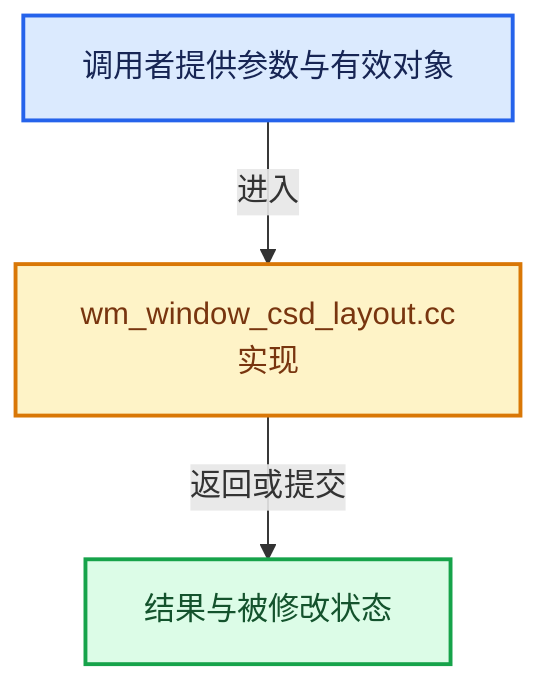

# 实现依赖专题：source/blender/windowmanager/intern/wm_window_csd_layout.cc

[实现依赖导航](../../../README.md) · [符号索引](../../../../00-课程指南/02-源码与提交索引/符号依赖与实现索引.md)

本专题从正文实际调用进入，集中保存共享实现。函数有稳定锚点，可从调用处直接跳到对应完整函数；递归与互相调用通过回链组织。

## 本文件的实现关系





## 完整成员与函数实现

<a id="f-98270cf5c29f40a6"></a>

### `blender::WM_window_csd_fractional_scale_apply`

实现位置：[source/blender/windowmanager/intern/wm_window_csd_layout.cc](../../../../../../../../source/blender/windowmanager/intern/wm_window_csd_layout.cc) · L27—L30。

接口参数：

- `int value`
- `const int fractional_scale[2]`

**教学注释版**

<!-- annotated:7bb60c9e6d447c -->

```cpp
int WM_window_csd_fractional_scale_apply(int value, const int fractional_scale[2])
{
  return (value * fractional_scale[1]) / fractional_scale[0];
}
```

<details>
<summary>核对原始源码：source/blender/windowmanager/intern/wm_window_csd_layout.cc · L27—L30</summary>

<!-- original:7bb60c9e6d447c:source/blender/windowmanager/intern/wm_window_csd_layout.cc:27:30 -->

```cpp
int WM_window_csd_fractional_scale_apply(int value, const int fractional_scale[2])
{
  return (value * fractional_scale[1]) / fractional_scale[0];
}
```

</details>

**结果出口**

- `return (value * fractional_scale[1]) / fractional_scale[0];`

**继续追踪实现**

本实现没有需要继续展开的显式调用；检查返回表达式、对象转换和调用者前置条件。

<a id="f-9e612e76078a8c29"></a>

### `blender::WM_window_csd_layout_callback`

实现位置：[source/blender/windowmanager/intern/wm_window_csd_layout.cc](../../../../../../../../source/blender/windowmanager/intern/wm_window_csd_layout.cc) · L32—L112。

接口参数：

- `const int window_size[2]`
- `const int fractional_scale[2]`
- `const char window_state`
- `const GHOST_CSD_Layout *csd_layout`
- `GHOST_CSD_Elem *csd_elems`

**教学注释版**

<!-- annotated:c6d63d7c2b9f97 -->

```cpp
int WM_window_csd_layout_callback(const int window_size[2],
                                  const int fractional_scale[2],
                                  const char window_state,
                                  const GHOST_CSD_Layout *csd_layout,
                                  GHOST_CSD_Elem *csd_elems)
{
  constexpr int csd_title_height = 25;

  const int title = WM_window_csd_fractional_scale_apply(csd_title_height, fractional_scale);

  /* The caller is expected not to run the callback for full screen windows. */
  BLI_assert(window_state != GHOST_kWindowStateFullScreen);
  UNUSED_VARS_NDEBUG(window_state);
  int decor_num = 0;

  GHOST_CSD_Elem *elem;

  /* Window contents. */
  elem = &csd_elems[decor_num++];
  elem->type = GHOST_kCSDTypeBody;
  elem->bounds[0][0] = 0;
  elem->bounds[0][1] = window_size[0];
  elem->bounds[1][0] = title;
  elem->bounds[1][1] = window_size[1];

  /* Allow this to be null for callers that only need to know about
   * the "title" & "body" regions. */
  if (csd_layout != nullptr) {
    int button_layout_title_index = 0;

    /* Buttons on the left. */
    {
      int button_index = 0;
      for (int i = 0; i < csd_layout->buttons_num; i++) {
        if (csd_layout->buttons[i] == GHOST_kCSDTypeTitlebar) {
          button_layout_title_index = i;
          break;
        }

        GHOST_TCSD_Type type = GHOST_TCSD_Type(csd_layout->buttons[i]);
        elem = &csd_elems[decor_num++];
        elem->type = type;
        elem->bounds[0][0] = title * button_index;
        elem->bounds[0][1] = title + (title * button_index);
        elem->bounds[1][0] = 0;
        elem->bounds[1][1] = title;

        button_index++;
      }
    }

    /* Buttons on the right. */
    {
      int button_index = 0;
      for (int i = csd_layout->buttons_num - 1; i > button_layout_title_index; i--) {
        GHOST_TCSD_Type type = csd_layout->buttons[i];
        elem = &csd_elems[decor_num++];
        elem->type = type;
        elem->bounds[0][0] = (window_size[0] - title) - (title * button_index);
        elem->bounds[0][1] = window_size[0] - (title * button_index);
        elem->bounds[1][0] = 0;
        elem->bounds[1][1] = title;
        button_index++;
      }
    }
  }

  /* Title bar. */
  elem = &csd_elems[decor_num++];
  elem->type = GHOST_kCSDTypeTitlebar;
  elem->bounds[0][0] = 0;
  elem->bounds[0][1] = window_size[0];
  elem->bounds[1][0] = 0;
  elem->bounds[1][1] = title;

  /* Border elements are intentionally not included, resizing runs via the invisible
   * margin outside the window which resolves borders from its own geometry,
   * see #GHOST_CSD_Params::resize_margin_size. */

  return decor_num;
}
```

<details>
<summary>核对原始源码：source/blender/windowmanager/intern/wm_window_csd_layout.cc · L32—L112</summary>

<!-- original:c6d63d7c2b9f97:source/blender/windowmanager/intern/wm_window_csd_layout.cc:32:112 -->

```cpp
int WM_window_csd_layout_callback(const int window_size[2],
                                  const int fractional_scale[2],
                                  const char window_state,
                                  const GHOST_CSD_Layout *csd_layout,
                                  GHOST_CSD_Elem *csd_elems)
{
  constexpr int csd_title_height = 25;

  const int title = WM_window_csd_fractional_scale_apply(csd_title_height, fractional_scale);

  /* The caller is expected not to run the callback for full screen windows. */
  BLI_assert(window_state != GHOST_kWindowStateFullScreen);
  UNUSED_VARS_NDEBUG(window_state);
  int decor_num = 0;

  GHOST_CSD_Elem *elem;

  /* Window contents. */
  elem = &csd_elems[decor_num++];
  elem->type = GHOST_kCSDTypeBody;
  elem->bounds[0][0] = 0;
  elem->bounds[0][1] = window_size[0];
  elem->bounds[1][0] = title;
  elem->bounds[1][1] = window_size[1];

  /* Allow this to be null for callers that only need to know about
   * the "title" & "body" regions. */
  if (csd_layout != nullptr) {
    int button_layout_title_index = 0;

    /* Buttons on the left. */
    {
      int button_index = 0;
      for (int i = 0; i < csd_layout->buttons_num; i++) {
        if (csd_layout->buttons[i] == GHOST_kCSDTypeTitlebar) {
          button_layout_title_index = i;
          break;
        }

        GHOST_TCSD_Type type = GHOST_TCSD_Type(csd_layout->buttons[i]);
        elem = &csd_elems[decor_num++];
        elem->type = type;
        elem->bounds[0][0] = title * button_index;
        elem->bounds[0][1] = title + (title * button_index);
        elem->bounds[1][0] = 0;
        elem->bounds[1][1] = title;

        button_index++;
      }
    }

    /* Buttons on the right. */
    {
      int button_index = 0;
      for (int i = csd_layout->buttons_num - 1; i > button_layout_title_index; i--) {
        GHOST_TCSD_Type type = csd_layout->buttons[i];
        elem = &csd_elems[decor_num++];
        elem->type = type;
        elem->bounds[0][0] = (window_size[0] - title) - (title * button_index);
        elem->bounds[0][1] = window_size[0] - (title * button_index);
        elem->bounds[1][0] = 0;
        elem->bounds[1][1] = title;
        button_index++;
      }
    }
  }

  /* Title bar. */
  elem = &csd_elems[decor_num++];
  elem->type = GHOST_kCSDTypeTitlebar;
  elem->bounds[0][0] = 0;
  elem->bounds[0][1] = window_size[0];
  elem->bounds[1][0] = 0;
  elem->bounds[1][1] = title;

  /* Border elements are intentionally not included, resizing runs via the invisible
   * margin outside the window which resolves borders from its own geometry,
   * see #GHOST_CSD_Params::resize_margin_size. */

  return decor_num;
}
```

</details>

**沿实际写入检查状态**

- `elem = &csd_elems[decor_num++];`
- `elem->type = GHOST_kCSDTypeBody;`
- `elem->bounds[0][0] = 0;`
- `elem->bounds[0][1] = window_size[0];`
- `elem->bounds[1][0] = title;`
- `elem->bounds[1][1] = window_size[1];`
- `button_layout_title_index = i;`
- `elem->type = type;`
- `elem->bounds[0][0] = title * button_index;`
- `elem->bounds[0][1] = title + (title * button_index);`
- `elem->bounds[1][0] = 0;`
- `elem->bounds[1][1] = title;`
- `elem->bounds[0][0] = (window_size[0] - title) - (title * button_index);`
- `elem->bounds[0][1] = window_size[0] - (title * button_index);`
- `elem->type = GHOST_kCSDTypeTitlebar;`

**结果出口**

- `return decor_num;`

**继续追踪实现**

- `WM_window_csd_fractional_scale_apply` → [blender::WM_window_csd_fractional_scale_apply · L27](wm_window_csd_layout.cc.md#f-98270cf5c29f40a6)。
- `BLI_assert` → [BLI_assert · L48](../../../01-BLI基础库/BLI_assert.hh.md#m-57a88495704d)；[BLI_assert · L63](../../../01-BLI基础库/BLI_assert.hh.md#m-d07050020cb5)。宏定义由构建条件选择。
- `UNUSED_VARS_NDEBUG` → [UNUSED_VARS_NDEBUG · L526](../../../01-BLI基础库/BLI_utildefines.hh.md#m-fea439f7d366)；[UNUSED_VARS_NDEBUG · L528](../../../01-BLI基础库/BLI_utildefines.hh.md#m-a8f8cfac06c0)。宏定义由构建条件选择。
- `GHOST_TCSD_Type` → [GHOST_TCSD_Type](../../../07-Intern运行时与平台/ghost/GHOST_Types.hh.md#t-9f42b5e5b249)。

<a id="f-cfa82ac118d7f987"></a>

### `blender::WM_window_csd_rect_calc`

实现位置：[source/blender/windowmanager/intern/wm_window_csd_layout.cc](../../../../../../../../source/blender/windowmanager/intern/wm_window_csd_layout.cc) · L114—L144。

接口参数：

- `const wmWindow *win`
- `rcti *r_rect`

**教学注释版**

<!-- annotated:3a04622ec9088d -->

```cpp
void WM_window_csd_rect_calc(const wmWindow *win, rcti *r_rect)
{
  const GHOST_CSD_Layout *csd_layout = WM_window_csd_layout_get();
  GHOST_IWindow *ghost_window = static_cast<GHOST_IWindow *>(win->runtime->ghostwin);
  const int fractional_scale[2] = {GHOST_CSD_DPI_FRACTIONAL_BASE, ghost_window->getDPIHint()};

  GHOST_CSD_Elem csd_elems[GHOST_kCSDType_NUM];

  const int2 win_size = WM_window_native_pixel_size(win);
  const int decor_num = WM_window_csd_layout_callback(
      win_size, fractional_scale, GHOST_TWindowState(win->windowstate), csd_layout, csd_elems);

  const GHOST_CSD_Elem *elem = nullptr;
  for (int i = 0; i < decor_num; i++) {
    /* Typically the first. */
    if (csd_elems[i].type == GHOST_kCSDTypeBody) {
      elem = &csd_elems[i];
      break;
    }
  }
  if (elem == nullptr) {
    BLI_assert_msg(0, "unexpected, no window contents");
    BLI_rcti_init(r_rect, 0, win_size[0], 0, win_size[1]);
  }

  /* Flip the Y. */
  r_rect->xmin = elem->bounds[0][0];
  r_rect->xmax = elem->bounds[0][1];
  r_rect->ymin = win_size.y - elem->bounds[1][1];
  r_rect->ymax = win_size.y - elem->bounds[1][0];
}
```

<details>
<summary>核对原始源码：source/blender/windowmanager/intern/wm_window_csd_layout.cc · L114—L144</summary>

<!-- original:3a04622ec9088d:source/blender/windowmanager/intern/wm_window_csd_layout.cc:114:144 -->

```cpp
void WM_window_csd_rect_calc(const wmWindow *win, rcti *r_rect)
{
  const GHOST_CSD_Layout *csd_layout = WM_window_csd_layout_get();
  GHOST_IWindow *ghost_window = static_cast<GHOST_IWindow *>(win->runtime->ghostwin);
  const int fractional_scale[2] = {GHOST_CSD_DPI_FRACTIONAL_BASE, ghost_window->getDPIHint()};

  GHOST_CSD_Elem csd_elems[GHOST_kCSDType_NUM];

  const int2 win_size = WM_window_native_pixel_size(win);
  const int decor_num = WM_window_csd_layout_callback(
      win_size, fractional_scale, GHOST_TWindowState(win->windowstate), csd_layout, csd_elems);

  const GHOST_CSD_Elem *elem = nullptr;
  for (int i = 0; i < decor_num; i++) {
    /* Typically the first. */
    if (csd_elems[i].type == GHOST_kCSDTypeBody) {
      elem = &csd_elems[i];
      break;
    }
  }
  if (elem == nullptr) {
    BLI_assert_msg(0, "unexpected, no window contents");
    BLI_rcti_init(r_rect, 0, win_size[0], 0, win_size[1]);
  }

  /* Flip the Y. */
  r_rect->xmin = elem->bounds[0][0];
  r_rect->xmax = elem->bounds[0][1];
  r_rect->ymin = win_size.y - elem->bounds[1][1];
  r_rect->ymax = win_size.y - elem->bounds[1][0];
}
```

</details>

**沿实际写入检查状态**

- `elem = &csd_elems[i];`
- `r_rect->xmin = elem->bounds[0][0];`
- `r_rect->xmax = elem->bounds[0][1];`
- `r_rect->ymin = win_size.y - elem->bounds[1][1];`
- `r_rect->ymax = win_size.y - elem->bounds[1][0];`

**继续追踪实现**

- `WM_window_csd_layout_get` → [blender::WM_window_csd_layout_get · L2294](wm_window.cc.md#f-52a2b0a3eaf5f9c8)。
- `ghost_window->getDPIHint` → [调用协议](../../../../00-课程指南/01-路线与规范/模板宏与动态分派协议.md)：由接收对象具体类型或运行时策略提供实现。调用位置L118。
- `WM_window_native_pixel_size` → [blender::WM_window_native_pixel_size · L3145](wm_window.cc.md#f-e23de39fb8f8173b)。
- `WM_window_csd_layout_callback` → [blender::WM_window_csd_layout_callback · L32](wm_window_csd_layout.cc.md#f-9e612e76078a8c29)。
- `GHOST_TWindowState` → [GHOST_TWindowState](../../../07-Intern运行时与平台/ghost/GHOST_Types.hh.md#t-bd6e3ea2e6e1)。
- `BLI_assert_msg` → [BLI_assert_msg · L55](../../../01-BLI基础库/BLI_assert.hh.md#m-695eed20dceb)；[BLI_assert_msg · L64](../../../01-BLI基础库/BLI_assert.hh.md#m-7de5563de4db)。宏定义由构建条件选择。
- `BLI_rcti_init` → [blender::BLI_rcti_init · L428](../../../01-BLI基础库/intern/rct.cc.md#f-c75659264970b4d1)。
