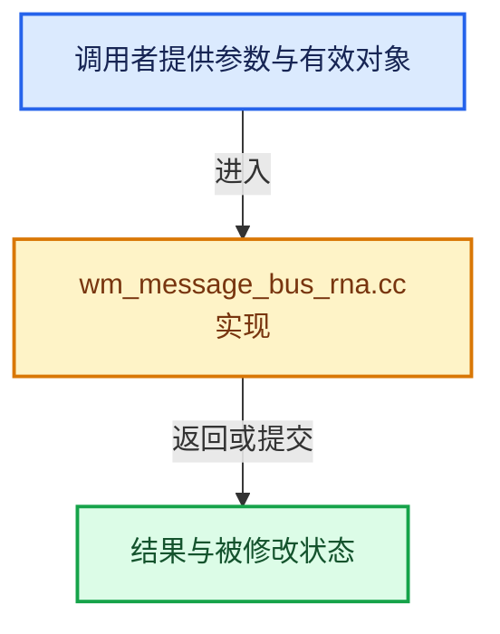

# 实现依赖专题：source/blender/windowmanager/message_bus/intern/wm_message_bus_rna.cc

[实现依赖导航](../../../../README.md) · [符号索引](../../../../../00-课程指南/02-源码与提交索引/符号依赖与实现索引.md)

本专题从正文实际调用进入，集中保存共享实现。函数有稳定锚点，可从调用处直接跳到对应完整函数；递归与互相调用通过回链组织。

## 本文件的实现关系





## 完整成员与函数实现

<a id="f-7fff502de8a213ea"></a>

### `blender::WM_msg_lookup_rna`

实现位置：[source/blender/windowmanager/message_bus/intern/wm_message_bus_rna.cc](../../../../../../../../../source/blender/windowmanager/message_bus/intern/wm_message_bus_rna.cc) · L226—L232。

接口参数：

- `wmMsgBus *mbus`
- `const wmMsgParams_RNA *msg_key_params`

**教学注释版**

<!-- annotated:6ab5ea55cf5f8d -->

```cpp
wmMsgSubscribeKey_RNA *WM_msg_lookup_rna(wmMsgBus *mbus, const wmMsgParams_RNA *msg_key_params)
{
  wmMsgSubscribeKey_RNA key_test;
  key_test.msg.params = *msg_key_params;
  return static_cast<wmMsgSubscribeKey_RNA *>(
      BLI_gset_lookup(mbus->messages_gset[WM_MSG_TYPE_RNA], &key_test));
}
```

<details>
<summary>核对原始源码：source/blender/windowmanager/message_bus/intern/wm_message_bus_rna.cc · L226—L232</summary>

<!-- original:6ab5ea55cf5f8d:source/blender/windowmanager/message_bus/intern/wm_message_bus_rna.cc:226:232 -->

```cpp
wmMsgSubscribeKey_RNA *WM_msg_lookup_rna(wmMsgBus *mbus, const wmMsgParams_RNA *msg_key_params)
{
  wmMsgSubscribeKey_RNA key_test;
  key_test.msg.params = *msg_key_params;
  return static_cast<wmMsgSubscribeKey_RNA *>(
      BLI_gset_lookup(mbus->messages_gset[WM_MSG_TYPE_RNA], &key_test));
}
```

</details>

**沿实际写入检查状态**

- `key_test.msg.params = *msg_key_params;`

**结果出口**

- `return static_cast<wmMsgSubscribeKey_RNA *>(`

**继续追踪实现**

- `BLI_gset_lookup` → [blender::BLI_gset_lookup · L1071](../../../../01-BLI基础库/intern/BLI_ghash.cc.md#f-11d88e4b4daea6dd)。

<a id="f-364fae14e3241cab"></a>

### `blender::WM_msg_publish_rna_params`

实现位置：[source/blender/windowmanager/message_bus/intern/wm_message_bus_rna.cc](../../../../../../../../../source/blender/windowmanager/message_bus/intern/wm_message_bus_rna.cc) · L234—L279。

接口参数：

- `wmMsgBus *mbus`
- `const wmMsgParams_RNA *msg_key_params`

**教学注释版**

<!-- annotated:6bd9624c13725b -->

```cpp
void WM_msg_publish_rna_params(wmMsgBus *mbus, const wmMsgParams_RNA *msg_key_params)
{
  wmMsgSubscribeKey_RNA *key;

  const char *none = "<none>";
  CLOG_DEBUG(
      WM_LOG_MSGBUS_PUB,
      "rna(id='%s', %s.%s)",
      msg_key_params->ptr.has_owner_id() ? ((ID *)msg_key_params->ptr.owner_id)->name : none,
      msg_key_params->ptr.has_type() ? RNA_struct_identifier(msg_key_params->ptr.type) : none,
      msg_key_params->prop ? RNA_property_identifier((PropertyRNA *)msg_key_params->prop) : none);

  if ((key = WM_msg_lookup_rna(mbus, msg_key_params))) {
    WM_msg_publish_with_key(mbus, &key->head);
  }

  /* Support anonymous subscribers, this may be some extra overhead
   * but we want to be able to be more ambiguous. */
  if (msg_key_params->ptr.has_owner_id() || msg_key_params->ptr.has_data()) {
    wmMsgParams_RNA msg_key_params_anon = *msg_key_params;

    /* We might want to enable this later? */
    if (msg_key_params_anon.prop != nullptr) {
      /* All properties for this type. */
      msg_key_params_anon.prop = nullptr;
      if ((key = WM_msg_lookup_rna(mbus, &msg_key_params_anon))) {
        WM_msg_publish_with_key(mbus, &key->head);
      }
      msg_key_params_anon.prop = msg_key_params->prop;
    }

    msg_key_params_anon.ptr.owner_id = nullptr;
    msg_key_params_anon.ptr.data = nullptr;
    if ((key = WM_msg_lookup_rna(mbus, &msg_key_params_anon))) {
      WM_msg_publish_with_key(mbus, &key->head);
    }

    /* Support subscribers to a type. */
    if (msg_key_params->prop) {
      msg_key_params_anon.prop = nullptr;
      if ((key = WM_msg_lookup_rna(mbus, &msg_key_params_anon))) {
        WM_msg_publish_with_key(mbus, &key->head);
      }
    }
  }
}
```

<details>
<summary>核对原始源码：source/blender/windowmanager/message_bus/intern/wm_message_bus_rna.cc · L234—L279</summary>

<!-- original:6bd9624c13725b:source/blender/windowmanager/message_bus/intern/wm_message_bus_rna.cc:234:279 -->

```cpp
void WM_msg_publish_rna_params(wmMsgBus *mbus, const wmMsgParams_RNA *msg_key_params)
{
  wmMsgSubscribeKey_RNA *key;

  const char *none = "<none>";
  CLOG_DEBUG(
      WM_LOG_MSGBUS_PUB,
      "rna(id='%s', %s.%s)",
      msg_key_params->ptr.has_owner_id() ? ((ID *)msg_key_params->ptr.owner_id)->name : none,
      msg_key_params->ptr.has_type() ? RNA_struct_identifier(msg_key_params->ptr.type) : none,
      msg_key_params->prop ? RNA_property_identifier((PropertyRNA *)msg_key_params->prop) : none);

  if ((key = WM_msg_lookup_rna(mbus, msg_key_params))) {
    WM_msg_publish_with_key(mbus, &key->head);
  }

  /* Support anonymous subscribers, this may be some extra overhead
   * but we want to be able to be more ambiguous. */
  if (msg_key_params->ptr.has_owner_id() || msg_key_params->ptr.has_data()) {
    wmMsgParams_RNA msg_key_params_anon = *msg_key_params;

    /* We might want to enable this later? */
    if (msg_key_params_anon.prop != nullptr) {
      /* All properties for this type. */
      msg_key_params_anon.prop = nullptr;
      if ((key = WM_msg_lookup_rna(mbus, &msg_key_params_anon))) {
        WM_msg_publish_with_key(mbus, &key->head);
      }
      msg_key_params_anon.prop = msg_key_params->prop;
    }

    msg_key_params_anon.ptr.owner_id = nullptr;
    msg_key_params_anon.ptr.data = nullptr;
    if ((key = WM_msg_lookup_rna(mbus, &msg_key_params_anon))) {
      WM_msg_publish_with_key(mbus, &key->head);
    }

    /* Support subscribers to a type. */
    if (msg_key_params->prop) {
      msg_key_params_anon.prop = nullptr;
      if ((key = WM_msg_lookup_rna(mbus, &msg_key_params_anon))) {
        WM_msg_publish_with_key(mbus, &key->head);
      }
    }
  }
}
```

</details>

**沿实际写入检查状态**

- `msg_key_params_anon.prop = nullptr;`
- `msg_key_params_anon.prop = msg_key_params->prop;`
- `msg_key_params_anon.ptr.owner_id = nullptr;`
- `msg_key_params_anon.ptr.data = nullptr;`

**继续追踪实现**

- `CLOG_DEBUG` → [CLOG_DEBUG · L191](../../../../07-Intern运行时与平台/clog/CLG_log.h.md#m-e062f5f17675)。宏定义由构建条件选择。
- `msg_key_params->ptr.has_owner_id` → [调用协议](../../../../../00-课程指南/01-路线与规范/模板宏与动态分派协议.md)：接收对象类型依赖auto、返回值或模板实例；不按同名猜测目标。调用位置L242。
- `msg_key_params->ptr.has_type` → [调用协议](../../../../../00-课程指南/01-路线与规范/模板宏与动态分派协议.md)：接收对象类型依赖auto、返回值或模板实例；不按同名猜测目标。调用位置L243。
- `RNA_struct_identifier` → [blender::RNA_struct_identifier · L711](../../../makesrna/intern/rna_access.cc.md#f-754de32877e73311)。
- `RNA_property_identifier` → [blender::RNA_property_identifier · L1275](../../../makesrna/intern/rna_access.cc.md#f-67de6dc6c76092df)。
- `WM_msg_lookup_rna` → [blender::WM_msg_lookup_rna · L226](wm_message_bus_rna.cc.md#f-7fff502de8a213ea)。
- `WM_msg_publish_with_key` → [blender::WM_msg_publish_with_key · L176](wm_message_bus.cc.md#f-773dd6753f9d0d59)。
- `msg_key_params->ptr.has_data` → [调用协议](../../../../../00-课程指南/01-路线与规范/模板宏与动态分派协议.md)：接收对象类型依赖auto、返回值或模板实例；不按同名猜测目标。调用位置L252。

<a id="f-77a65d7779f9f89a"></a>

### `blender::WM_msg_publish_rna`

实现位置：[source/blender/windowmanager/message_bus/intern/wm_message_bus_rna.cc](../../../../../../../../../source/blender/windowmanager/message_bus/intern/wm_message_bus_rna.cc) · L281—L287。

接口参数：

- `wmMsgBus *mbus`
- `PointerRNA *ptr`
- `PropertyRNA *prop`

**教学注释版**

<!-- annotated:36576712e9c6ab -->

```cpp
void WM_msg_publish_rna(wmMsgBus *mbus, PointerRNA *ptr, PropertyRNA *prop)
{
  wmMsgParams_RNA params{};
  params.ptr = *ptr;
  params.prop = prop;
  WM_msg_publish_rna_params(mbus, &params);
}
```

<details>
<summary>核对原始源码：source/blender/windowmanager/message_bus/intern/wm_message_bus_rna.cc · L281—L287</summary>

<!-- original:36576712e9c6ab:source/blender/windowmanager/message_bus/intern/wm_message_bus_rna.cc:281:287 -->

```cpp
void WM_msg_publish_rna(wmMsgBus *mbus, PointerRNA *ptr, PropertyRNA *prop)
{
  wmMsgParams_RNA params{};
  params.ptr = *ptr;
  params.prop = prop;
  WM_msg_publish_rna_params(mbus, &params);
}
```

</details>

**沿实际写入检查状态**

- `params.ptr = *ptr;`
- `params.prop = prop;`

**继续追踪实现**

- `WM_msg_publish_rna_params` → [blender::WM_msg_publish_rna_params · L234](wm_message_bus_rna.cc.md#f-364fae14e3241cab)。
